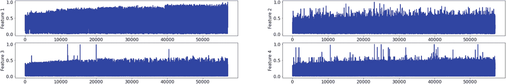
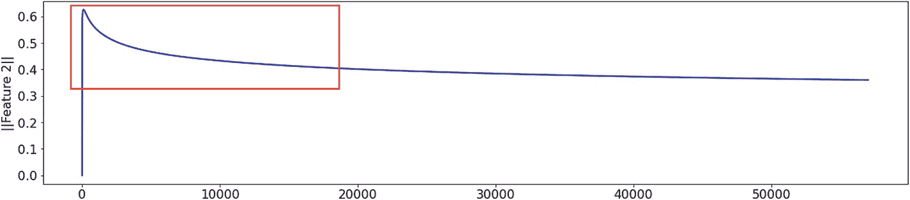
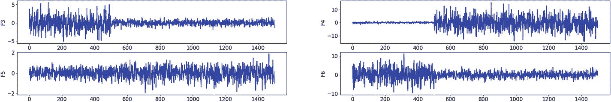
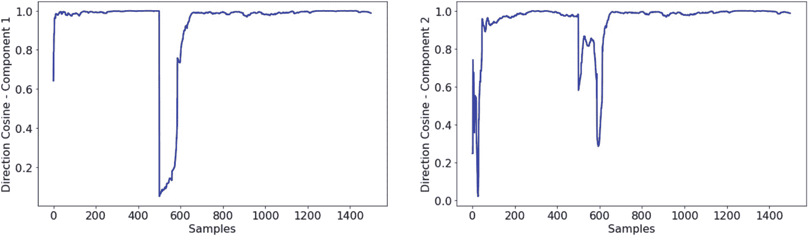

# 前言

本书介绍了在机器学习、数据可视化和数据分析中具有重要价值的几类流数据问题。书中提供了多种自适应算法，用于解决流数据向量或矩阵上的这些问题。基于复杂神经网络的应用已十分普遍，计算能力也在呈指数级增长，那么为什么我们还需要自适应计算呢？

在数据量大、数据维度高、数据随时间变化且底层统计特性不断改变，并且我们没有足够的存储、计算能力和带宽来低延迟处理数据的环境中，自适应算法至关重要。边缘设备上的计算就是这样一个环境。

由于蜂窝边缘数十亿设备的快速普及，以及这些设备上机器学习和数据分析应用的指数级增长，我们迫切需要在这些设备上管理以下方面：
*   大规模计算时的功耗
*   输入的非平稳性和传入数据的漂移
*   设备上的计算延迟
*   设备的内存和带宽

`[2021 年 Gartner 关于边缘计算的报告](https://www.itweb.co.za/content/lwrKx73KXLL7mg1o)` [Stratus Technologies, 2021] 指出，由云和 5G 的采用所推动的基于设备的计算增长，将要求我们优先考虑并构建边缘计算框架。

在这些环境中存在以下约束：
*   数据无法立即批量处理，需要即时使用。我们有一个向量或矩阵的流序列作为算法的输入。
*   数据随时间变化。换句话说，数据是非平稳的，会导致输入特征的显著漂移，从而使机器学习模型随着时间的推移不再有效。
*   数据量和维度很大，我们没有设备内存、带宽或功率来存储或将数据上传到云端。

在这些应用中，我们使用自适应算法来管理设备的功耗、内存和带宽，以便我们能够维持预训练模型的准确性。一些用例包括：
1.  计算传入数据的特征漂移，并提前检测训练-服务偏差 [Kaz 等人，2021]。
2.  适应传入数据的漂移，并计算最适合数据的特征。
3.  计算传入数据中的异常，以便模型使用良好、干净的数据。
4.  将传入数据压缩为特征，用于创建新模型。

在第 8 章中，我结合真实世界的数据，通过自适应算法讨论了这些问题的解决方案。

## 检测特征漂移

请看一个例子，其中实时数据 [Vinicius Souza 等人，2020] 存在特征的渐进漂移。在实时环境中，观测数据的底层分布会发生变化。这些数据统计特性的变化称为*漂移*。当统计特性的变化是平滑的时，称为*渐进漂移*。图 1 显示了多元数据各分量幅度随时间缓慢变化，呈现出渐进漂移。

尽早检测到这些漂移分量非常重要，这样我们就可以更新机器学习模型以保持性能。请注意，数据的基线统计信息是事先未知的。



我使用了一种自适应算法（见第 5 章）来计算数据的[主成分](https://en.wikipedia.org/wiki/Principal_component_analysis) [主成分分析，维基百科]，并从中推导出一个度量指标。图 2 显示该度量指标并未收敛到其统计值（理想值为 1），而是向 0 发散。这可以快速检测到特征漂移，从而使边缘设备能够更新机器学习模型。



图中检测度量指标的下行斜率表明了特征的渐进漂移。

## 适应漂移

在另一种类型的漂移中，数据的统计特性会发生突变。图 3 显示了模拟的多维数据，在 500 个样本后，其底层统计特性发生了突变。



自适应算法帮助我们适应这种突变，并重新计算底层统计特性，在本例中，即数据的前两个主特征向量（见第 6 章）。图 4 中的理想值为 1。当数据在 500 个样本后发生突变时，该值下降并迅速恢复至 1。



## 我的方法

### 自适应算法与最佳实践

在本书中，我提供了超过 50 个自适应算法的示例来解决实际问题。我还提供了为不同用例选择合适算法的最佳实践。我将这些问题表述为矩阵计算，其中底层矩阵是未知的。我假设整个数据并非一次性可用。相反，我有一系列随机矩阵或向量，我从中计算矩阵函数，而无需知道这些矩阵。当每个样本被呈现给算法时，矩阵函数被自适应地计算出来。

1.  我的算法处理每个传入样本 `x[k]`，使得在任何时刻 `k`，所有当前可用的数据都被考虑在内。
2.  对于每个样本，算法估计所需的矩阵函数，并且其估计具有已知的统计特性。
3.  这些算法能够适应底层系统的变化，因此对于每个样本 `x[k]`，我获得的是过程的当前状态，而不是所有样本的平均值（即，我可以处理平稳和非平稳数据）。

### 传统非自适应方法存在的问题

评估矩阵函数的传统方法需要先收集所有样本，然后计算矩阵，最后应用数值程序。这种方法存在两个问题。
1.  样本的维度可能很大，因此即使所有样本都已获取，执行矩阵运算也可能很困难，或者需要消耗极其庞大的计算资源和内存。
2.  通过传统方案评估的矩阵函数无法适应数据的微小变化（例如，少量新样本的加入）。如果使用传统方法从 `K` 个（有限）样本中估计出矩阵函数，那么每增加一个样本，所有计算都必须重复进行。

这些缺陷使得传统方案在实时应用中效率低下。

### 计算简单性

我的方法是使用计算简单的自适应算法。例如，给定一个随机向量序列 `{x[k]}`，一个用于主特征向量评估的著名算法使用更新规则：
```
w[k+1] = w[k] + η (x[k]x[k]^(T) – w[k]w[k]^(T)x[k]x[k]^(T)w[k])
```
其中 `η` 是一个小的正常数。在该算法中，对于每个样本 `x[k]`，更新过程只需要简单的矩阵-向量乘法，然而向量 `w[k]` 会快速收敛到数据相关矩阵的主特征向量。显然，这可以在低内存和低功耗设备上的 CPU 中轻松实现。

本书的目标是介绍一系列用于矩阵代数问题的[神经形态](https://en.wikipedia.org/wiki/Neuromorphic_engineering)自适应算法。神经形态算法通过使用网络模拟人类神经系统的物理机制来工作，其中神经元的激活会以级联链的方式传播到其他神经元。

### 我解决的矩阵函数

我自适应计算的矩阵代数函数包括：
*   归一化均值、中位数
*   LU 分解（平方根）、逆平方根
*   特征向量/特征值分解 (EVD)
*   广义 EVD
*   奇异值分解 (SVD)
*   广义 SVD

对于每个矩阵函数，我将讨论其在机器学习和数据分析中的实际用例，并用实验结果加以支持。

### 推导自适应算法的通用方法论

本书的另一个贡献是提出了一种推导每种自适应算法的**通用方法论**。对于每个矩阵函数和每种自适应算法，我提出了一个标量无约束目标函数 `J(W;A)`，其最小化器 `W^(*)` 是 `A` 的期望矩阵函数。从这个目标函数 `J(W;A)` 出发，我使用标准的优化技术（例如，梯度下降）推导出自适应算法，例如 `W[k + 1] = W[k] − η∇[W]J(W[k]; A)`。然后，我通过使用统计方法来加速这些自适应算法。请注意，这有助于实践者为其用例创建新的自适应算法。

总之，本书从一个推导自适应算法的通用框架开始，然后将该框架应用于每一类流数据问题，从自适应中位数到复杂主成分分析和判别分析。我在每个类别中提出实际问题，并推导出解决这些问题的算法。最后一章解决了针对时变、非平稳数据的关键边缘计算问题，同时最大限度地减少了计算量、内存、延迟和带宽。我还提供了本书讨论的所有算法的代码 [Chatterjee GitHub]。

## GitHub

所有章节的仿真和实现代码都已发布在公共 GitHub 上：
[`https://github.com/cchatterj0/AdaptiveMLAlgorithms`](https://github.com/cchatterj0/AdaptiveMLAlgorithms)

该 GitHub 页面包含以下内容：
*   从第 2 章开始的所有章节的 Python 代码
*   一个独立目录中的 MATLAB 仿真代码
*   所有实现代码所需的数据
*   部分算法的收敛性证明

## 致谢

我要感谢我的教授兼导师 Vwani Roychowdhury 指导我完成博士论文，本书中展示的大部分研究最初都是在博士论文中创建的。Vwani 教会了我如何在我们共同撰写的许多论文中研究、撰写和呈现这些材料。他还激励我继续这项研究，并最终写成这本书。没有他的启发、帮助和指导，我不可能完成这项工作。我衷心感谢 Vwani 作为我的老师和导师。

## 关于作者
## 关于技术审校者