# 1. 引言

在本章中，我将介绍用于数据表示和分类的重要特征的自适应计算方法。我将论证这些特征在机器学习、数据可视化和数据分析中的重要性。同时，我也会展示这些算法在多个学科中的重要性，并介绍它们在这些学科中的推导方式。最后，我将提出一种通用的方法来推导这些算法。该方法具有很高的实用价值，因为实践者可以利用它为自己的应用场景推导出专属的特征和算法。

对于这些数据特征，我假设数据以序列形式到达，必须即时使用，且无法将整批数据存储在内存中。

在回归、分类、增强或可视化等机器学习和数据分析问题中，数据的有效表示是关键。当数据是多维且随时间变化时，计算挑战更为严峻。此时，我们不仅需要及时计算出表示后的数据，还要以快速、高效且稳健的方式适应不断变化的输入。

一种著名的数据压缩/表示方法是卡胡南-洛厄夫定理 [Karhunen–Loève theorem, Wikipedia] 或特征向量正交展开 [Fukunaga 90]。该方法也被称为主成分分析（PCA）[principal component analysis, Wikipedia]。由于每个特征向量可根据其对应的特征值进行排序，因此可以选择一组“最佳”特征向量作为最相关的特征。

图 1-1 展示了一个包含两个类别的二维数据，其中用于数据表示的最佳特征是将数据投影到向量 **e**[1] 上，该向量捕捉了来自两个类别的数据的最显著属性。

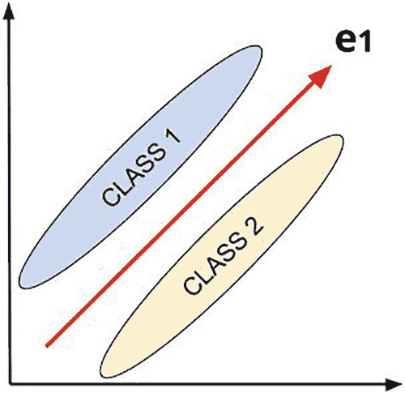

图 1-1

最能表示来自两个类别的数据的数据表示特征 **e**[1] [来源：Chatterjee 等人，IEEE Transactions on Neural Networks, Vol. 8, No. 3, pp. 663-678, May 1997]

然而，在分类中，通常希望提取能有效保持*类别可分性*的特征。简单来说，分类特征提取的目标是找到一个变换，将原始测量值映射到一个更小的特征集，该特征集包含解决整个模式识别问题所需的所有判别信息。

图 1-2 展示了相同的包含两个类别的二维数据，其中用于分类的最佳特征是向量 **e**[2]，将数据投影到 **e**[2] 上能带来最佳的类别可分性。

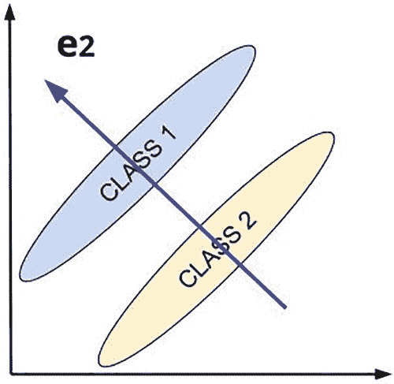

图 1-2

能带来最佳类别可分性的数据分类特征 **e**[2] [来源：Chatterjee 等人，IEEE Transactions on Neural Networks, Vol. 8, No. 3, pp. 663-678, May 1997]

在接下来的章节中介绍用于流数据的自适应算法之前，我需要讨论以下几点：

1.  通过对数据进行线性变换获得的常用特征，以及它们如何用于边缘应用的流数据
2.  这些特征的历史渊源，以及我们如何从不同学科中推导出它们
3.  为什么我们要使用自适应算法来计算这些特征
4.  如何创建一个通用的数学框架来推导这些特征以及更多其他特征的自适应算法

## 1.1 通过线性变换获得的常用特征

在本节中，我将讨论四种用于数据分析和机器学习的常用特征。这些特征在数据分类和表示中非常有效，并且可以通过对数据进行简单的线性变换轻松获得。这些特征的简洁性和有效性使其非常适用于流数据和边缘应用。

用数学术语来说，设 {**x**[*k*]} 是一个表示数据的 *n* 维（零均值）序列。我们寻求一个矩阵序列 {*W*[*k*]} 和一个变换：

，     (1.1)

使得线性变换 **y**[*k*] 具有数据表示的特性，并且是我们所需的特征。我将在后面讨论其中一些特征。

**定义：** 将 {**x**[*k*]} 的数据相关矩阵 *A* 定义为

![$$ A=\underset{k\to \infty }{\lim }E\left[{\mathbf{x}}_k{\mathbf{x}}_k^T\right] $$](images/522202_1_En_1_Chapter/522202_1_En_1_Chapter_TeX_IEq2.png)。     (1.2)

### 数据白化

数据白化是一个对数据进行去相关处理的过程，使得所有分量都具有单位方差。这是机器学习和数据分析中用于“归一化”数据的预处理步骤，以便更容易建模。这里数据的线性变换 **y**[*k*] 具有性质 ![$$ E\left[{\mathbf{y}}_k{\mathbf{y}}_k^T\right] $$](images/522202_1_En_1_Chapter/522202_1_En_1_Chapter_TeX_IEq3.png)=*I*[*n*]（单位矩阵）。我将在第 3 章中讨论 *W*[*k*]=*A*^(–½) 是最优值。

图 1-3 展示了原始数据和白化数据的相关矩阵。原始随机正态数据高度相关，如所有轴上的颜色所示。白化数据完全去相关，分量之间没有相关性，因为只存在对角线上的值。

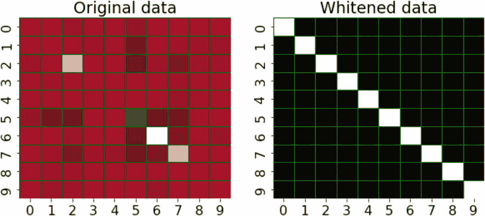

图 1-3

原始相关数据通过数据白化算法变为不相关

从原始数据集 `X[nDim, nSamples]` 生成白化数据的 Python 代码如下：

```
from scipy.linalg import eigh
# 计算原始数据的相关矩阵和特征向量
corX = (X @ X.T) / nSamples
# 生成白化数据
eigvals, eigvecs = eigh(corX)
V = np.fliplr(eigvecs)
D  = np.diag(np.sqrt(1/eigvals[::-1]))
Y = V @ D @ V.T @ X
corY = (Y @ Y.T)/nSamples
# 绘制原始数据和白化数据的相关矩阵
import seaborn as sns
plt.figure(figsize=(10, 4))
plt.rcParams.update({'font.size': 16})
plt.subplot(1, 2, 1)
sns.heatmap(corX, linewidth=0.5, linecolor="green", cmap='RdBu', cbar=False)
plt.title("原始数据")
plt.subplot(1, 2, 2)
sns.heatmap(corY, linewidth=0.5, linecolor="green", cmap='hot', cbar=False)
plt.title("白化数据")
plt.show()
```


### 主成分

[主成分分析](https://en.wikipedia.org/wiki/Principal_component_analysis)（PCA）是数据表示模型中一个经过充分研究的例子。从*经典统计学*的角度来看，PCA 是对多变量数据 {**x**[*k*]} 协方差结构的分析。令 **y**[*k*]=[*y*[*k*1],…,*y*[*kp*]]^(*T*) 为 PCA 变换后数据的成分。在这种表示中，第一主成分 *y*[*k1*] 是一个一维线性子空间，投影数据的方差在该子空间上最大。第二主成分 *y*[*k*2] 是在与 *y*[*k*1] 正交的空间中方差最大的方向，依此类推。

已有研究表明，最优权重矩阵 *W*[*k*] 是零均值输入过程 {**x**[*k*]} 相关矩阵的特征向量矩阵。令 *A*Φ=ΦΛ 为 *A* 的*特征分解（EVD）*，其中 Φ 和 Λ 分别是特征向量和特征值矩阵。这里 Λ=*diag*(*λ*[1],…,*λ*[*n*]) 是对角特征值矩阵，满足 *λ*[1]≥…≥*λ*[*n*]>0，且 Φ 是标准正交的。我们将 Φ[*p*]∈ℜ^(*n*X*p*) 记为其列是前 *p* 个主特征向量的矩阵。那么最优的 *W*[*k*]=Φ[*p*]。

PCA 有三种在应用中很有用的变体。

1.  当 *p*=*n* 时，**y**[*k*] 的 *n* 个成分按方差从最大到最小排序。这是用于*数据分析*的成分分析器。

2.  当 *p*<*n* 时，**y**[*k*] 的 *p* 个成分包含用于*数据压缩*的最大信息量。

3.  对于 *p*<*n*，**y**[*k*] 中方差最小的 *n*–*p* 个成分可被视为异常信号，并通过重构为 (*I*[*n*]–Φ[*p*]Φ[*p*]^(*T*))**x**[*k*] 来获得一个*新颖性滤波器*。

图 1-4 显示了原始数据和 PCA 变换后的随机正态数据的相关矩阵。原始数据高度相关，如所有轴上的颜色所示。PCA 变换后的数据不相关，仅具有对角块，且成分 1（左上角块）的表示值最高，之后递减。

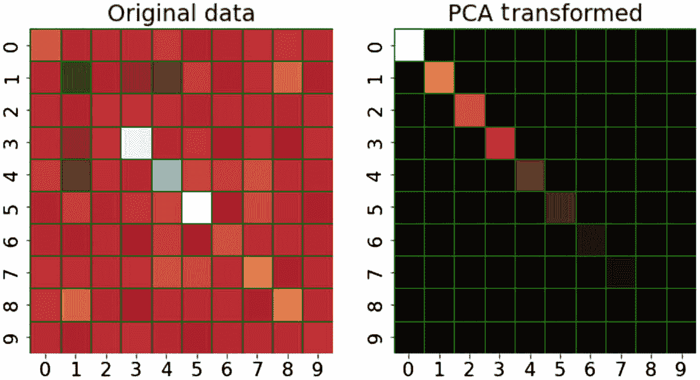

图 1-4

原始相关数据通过 PCA 投影变得不相关

从原始数据集 `X[nDim, nSamples]` 生成 PCA 投影数据的 Python 代码如下：

```
from scipy.linalg import eigh
# 计算数据相关矩阵
corX = (X @ X.T) / nSamples
# 生成 PCA 变换后的数据
eigvals, eigvecs = eigh(corX)
EstV = np.fliplr(eigvecs)
Y = EstV.T @ X
corY = (Y @ Y.T)/nSamples
# 绘制 PCA 变换后的数据
import seaborn as sns
plt.figure(figsize=(10, 5))
plt.rcParams.update({'font.size': 16})
plt.subplot(1, 2, 1)
sns.heatmap(corX, linewidth=0.5, linecolor="green", cmap='RdBu', cbar=False)
plt.title("原始数据")
plt.subplot(1, 2, 2)
sns.heatmap(corY, linewidth=0.5, linecolor="green", cmap='hot', cbar=False)
plt.title("PCA 变换后")
plt.show()
```

### 线性判别特征

线性判别分析（LDA）[线性判别分析，维基百科] 从多个类别的数据中创建特征，使得变换后的表示 **y**[*k*] 具有最大的类别可分性。给定数据 **x**[*k*] 和相应的类别 **c**[*k*]，我们可以计算以下矩阵：

*   数据相关矩阵 *B*=*E*(**x**[*k*]**x**[*k*]^(*T*))，

*   互相关矩阵 *M*=*E*(**x**[*k*]**c**[*k*]^(*T*))，

*   以及 *A*=*MM*^(*T*)。

众所周知，线性变换 *W*[*k*]（公式 1.1）是 *A* 相对于 *B* 的*广义特征分解*（GEVD）[广义特征向量，维基百科]。这里 *A*Ψ=*B*ΨΔ，其中 Ψ 和 Δ 分别是广义特征向量和特征值矩阵。此外，Ψ[*p*]∈ℜ^(*n*X*p*) 是其列为前 *p≤n* 个主广义特征向量的矩阵。

图 1-5 展示了一个二分类问题，其中左侧的真实世界数据相关矩阵在所有轴上都有值，很难区分这两个类别。右侧是 LDA 变换后的数据，清晰地显示了两个类别，易于分类。

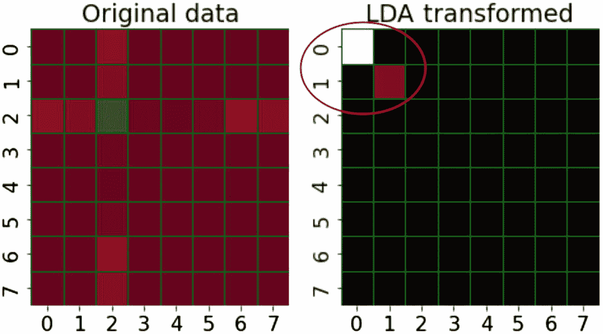

图 1-5

原始相关数据通过线性判别分析变得不相关

从二分类、多维数据集 `[nDim, nSamples]` 自适应生成 LDA 变换后相关矩阵的 Python 代码如下：

```
# 自适应计算矩阵 A 和 B
from numpy import linalg as la
dataset2 = dataset.drop(['Class'],1)
nSamples = dataset2.shape[0]
nDim = dataset2.shape[1]
classes = np.array(dataset['Class']-1)
classes_categorical = tf.keras.utils.to_categorical(classes, num_classes=2)
M = np.zeros(shape=(nDim,2)) # 存储自适应相关矩阵
B = np.zeros(shape=(nDim,nDim)) # 存储自适应相关矩阵
for iter in range(nSamples):
cnt = iter + 1
# 从当前样本 x 生成矩阵 A 和 B
x = np.array(dataset2.iloc[iter])
x = x.reshape(nDim,1)
B = B + (1.0/cnt)*((np.dot(x, x.T)) - B)
y = classes_categorical[iter].reshape(2,1)
M = M + (1.0/cnt)*((np.dot(x, y.T)) - M)
A = M @ M.T
# 生成 LDA 变换后的数据
from scipy.linalg import eigh
from sklearn.preprocessing import normalize
eigvals, eigvecs = eigh(A, B)
V = np.fliplr(eigvecs)
VTAV = np.around(V.T @ A @ V, 2)
VTBV = np.around(V.T @ B @ V, 2)
# 绘制 LDA 变换后的数据
import seaborn as sns
plt.figure(figsize=(8, 8))
plt.rcParams.update({'font.size': 16})
plt.subplot(2, 2, 1)
sns.heatmap(A, linewidth=0.5, linecolor="green", cmap='RdBu', cbar=False)
plt.title("原始数据")
plt.subplot(2, 2, 2)
sns.heatmap(VTBV, linewidth=0.5, linecolor="green", cmap='hot', cbar=False)
plt.title("LDA 变换后")
plt.subplot(2, 2, 3)
sns.heatmap(A, linewidth=0.5, linecolor="green", cmap='RdBu', cbar=False)
plt.subplot(2, 2, 4)
sns.heatmap(VTAV, linewidth=0.5, linecolor="green", cmap='hot', cbar=False)
plt.show()
```

### 奇异值特征

奇异值分解（SVD）[奇异值分解，维基百科] 是 EVD 问题的一个特例，如下所述。给定互相关（n×m 实）矩阵 *M*=*E*(**x**[*k*]**c**[*k*]^(*T*)) ∈ℜ^(*nXm*)，SVD 计算两个矩阵 *U*[*k*]∈ℜ^(*nXn*) 和 *V*[*k*]∈ℜ^(*mXm*)，使得 *U*[*k*]^(*T*)*MV*[*k*]=*S*[*nxm*]，其中 *U*[*k*] 和 *V*[*k*] 是标准正交的，且 *S*=diag(*s*[1],...*s*[*r*])，*r*=min(*m*, *n*)，满足 *s*[1]>=...>=*s*[*r*]>=0。通过重新排列向量 **x**[*k*] 和 **c**[*k*]，我们可以将一个 *n*x*m* 维的 SVD 问题转化为一个 (*n*+*m*)x(*n*+*m*) 维的 EVD 问题。


### 摘要

表 1-1 总结了本节讨论的内容。请注意，给定一个向量序列 {**x**[*k*]}，我们正在寻找一个矩阵序列 {*W*[*k*]} 和一个线性变换 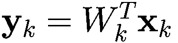。

表 1-1.

***y***[***k***] 的统计特性与 ***W***[***k***] 的矩阵特性

| 计算 | y[*k*] 的统计特性 | *W*[*k*] 的矩阵特性 |
| --- | --- | --- |
| 白化 | ![$$ E\left[{\mathbf{y}}_k{\mathbf{y}}_k^T\right]={I}_n $$](images/522202_1_En_1_Chapter/522202_1_En_1_Chapter_TeX_IEq5.png) | *W*[*k*] = *A*^(–½) = ΦΛ^(–½Φ*T*) |
| PCA/EVD | 在满足 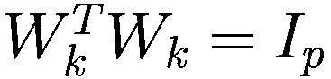 的条件下，最大化 ![$$ E\left[{\mathbf{y}}_k^T{\mathbf{y}}_k\right] $$](images/522202_1_En_1_Chapter/522202_1_En_1_Chapter_TeX_IEq6.png) | *W*[*k*] = Φ[*p*] 且 ![$$ E\left[{\mathbf{y}}_k{\mathbf{y}}_k^T\right]={I}_p $$](images/522202_1_En_1_Chapter/522202_1_En_1_Chapter_TeX_IEq8.png) |
| LDA/GEVD | 在满足 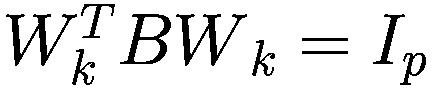 的条件下，最大化 ![$$ E\left[{\mathbf{y}}_k^T{\mathbf{y}}_k\right] $$](images/522202_1_En_1_Chapter/522202_1_En_1_Chapter_TeX_IEq9.png) | *W*[*k*] = Ψ[*p*] 且 ![$$ E\left[{\mathbf{y}}_k{\mathbf{y}}_k^T\right]={I}_p $$](images/522202_1_En_1_Chapter/522202_1_En_1_Chapter_TeX_IEq11.png) |

## 1.2 线性特征的跨学科起源

在本节中，我将通过展示多个学科如何推导这些特征并针对流式数据进行自适应计算，进一步探讨数据表示和分类特征的重要性。针对每个学科，我将演示这些特征在真实数据上的应用。

### 赫布学习或神经生物学

赫布学习假说是所有学习规则中最古老、最著名的一个。赫布提出，当细胞 *A* 的轴突激发细胞 *B* 时，突触权重 *W* 会根据 *f*(**x**,**y**) 进行调整，其中 *f*(⋅) 是突触前活动 **x** 和突触后活动 **y** 的函数。作为一种特殊情况，我们可以将权重调整量写为 Δ*W*=η**xy**^(*T*)，其中 η>0 是一个小常数。

给定一个输入序列 {**x**[*k*]}，我们可以构造其线性变换 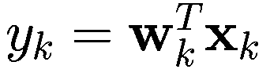，其中 **w**[*k*∈]ℜ^(*n*) 是权重向量。我们可以将用于调整 **w**[*k*] 的赫布规则 [Haykin 94] 描述为 **w**[*k*+1]=**w**[*k*]+η***x***[*k*]*y*[*k*]。由于该规则会导致指数增长，Oja [Oja 89] 引入了一种规则，通过对 **w**[*k*] 进行归一化来限制其增长，如下所示：

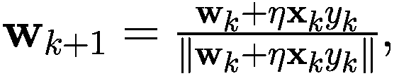     (1.3)

假设 η 很小且 ‖**w**[*k*]‖=1，可以将 (1.3) 展开为 η 的幂级数，从而得到

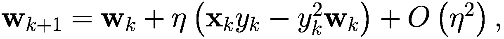     (1.4)

忽略 *O*(η²) 项，我们得到了*约束赫布算法* (*CHA*) 或 *Oja 单单元规则*（第 4 章，第 4.​3 节）。实际上，该算法收敛于 *A* 的第一个主特征向量。

请注意，自适应 PCA 算法通常用于流式数据，并且存在一些相关的 GitHub 仓库。我在本书及关联的 GitHub 中创建了一个包含这些算法的综合资源库，并提出了新的算法。

例如，算法 (1.4) 已被广泛用于流式数据，以从数据中提取最强的表示特征，用于分析和机器学习。图 1-6 展示了具有季节性的多元非平稳数据。使用自适应更新规则 (1.4)，我们仅用流式数据的 0.2% 就有效地推导出了第一主成分。图 1-6 左侧显示了季节性时变流式数据，右侧显示了算法快速收敛（理想值为 1）到第一主特征向量，从而得到最强的数据表示特征。

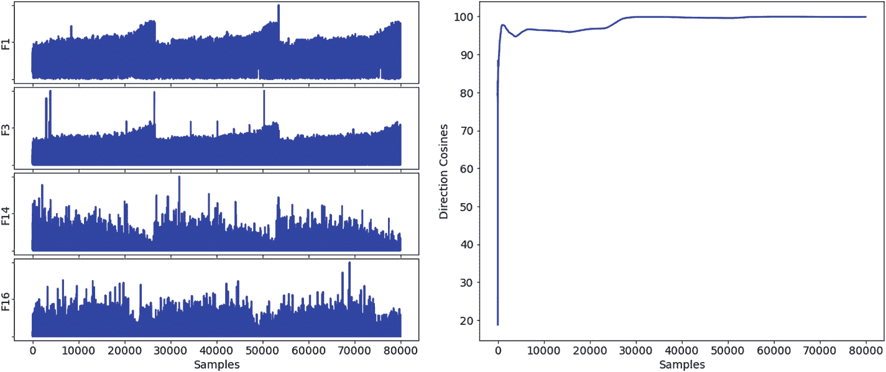

图 1-6

用于季节性流式数据的自适应 PCA 算法

在真实的 33 维数据集 `[nDim][nSamples]` 上实现赫布自适应算法的 Python 代码如下：

```
# Adaptive Hebbian/OJA algorithms
from numpy import linalg as la
A = np.zeros(shape=(nDim,nDim)) # stores adaptive correlation matrix
w = 0.1 * np.ones(shape=(nDim)) # weight vectors of all algorithms
for iter in range(nSamples):
# update the data correlation matrix with latest data vector x
x = np.array(dataset1.iloc[iter]).reshape(nDim,1)
A = A + (1.0/(1 + iter))*((np.dot(x, x.T)) - A)
# Hebbian/OJA Algorithm
v = w[:].reshape(nDim, 1)
v = v + (1/(100+iter))*(A @ v - v @ (v.T @ A @ v))
w[:] = v.reshape(nDim)
```


### 自联想网络

自联想是一种神经网络结构，其期望输出与网络输入 **x**[*k*] 相同。这也被称为线性自编码器 [autoencoder, Wikipedia]。考虑一个两层线性网络，其输入层和输出层的权重矩阵分别为 *W*[1] 和 *W*[2]，隐藏层有 *p* (≤*n*) 个节点。网络输出的均方误差 (MSE) 由下式给出：

![$$ e=E\left[{\left\Vert {\mathbf{x}}_k-{W}_2^T{W}_1^T{\mathbf{x}}_k\right\Vert}²\right] $$](images/522202_1_En_1_Chapter/522202_1_En_1_Chapter_TeX_IEq15.png)。     (1.5)

由于隐藏层有 *p* 个节点，最小化 MSE 产生的输出代表了 **x**[*k*∈]ℜ^(*n*) 在 ℜ[*p*] 子空间中的最佳估计。由于投影到 Φ[*p*] 上能最小化 ℜ[*p*] 子空间中的误差，我们期望第一层权重矩阵 *W*[1] 是 Φ[*p*] 的旋转。第二层权重矩阵 *W*[2] 是 *W*[1] 的逆矩阵，以最终表示“最佳”恒等变换。这一直观论证已被证明 [Baldi and Hornik 89,95, Bourland and Kamp 88]，其中最优权重矩阵为：

*W*[1] = Φ[*p*]*R* 且 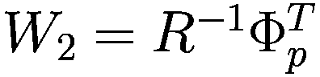，     (1.6)

其中 *R* 是一个非奇异的 *n*X*n* 矩阵。注意，如果我们进一步施加约束 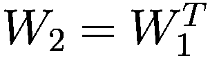，那么 *R* 是一个酉矩阵，并且输入层权重矩阵 *W*[1] 是标准正交的，张成了由 Φ[*p*] 定义的空间，Φ[*p*] 是输入相关矩阵 *A* 的 *p* 个主特征向量。见图 1-7。

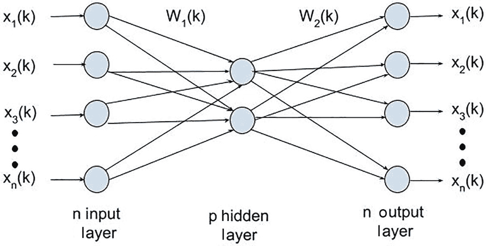

图 1-7

自联想神经网络

注意，如果我们在隐藏层只有一个节点（即 *p*=1），那么对于输入层权重向量为 **w**、输出层权重向量为 **w**^(*T*) 的两层线性自联想网络，我们得到 *e* 作为输出平方和误差。**w** 的最优值是输入相关矩阵 *A*[*k*] 的第一个主特征向量。

(1.6) 中的结果表明，可以通过仅对输入层权重进行梯度修正来实现 PCA 算法，同时以对称方式修改输出层权重，从而避免其中一层的误差反向传播。该思想的一个可能版本是：

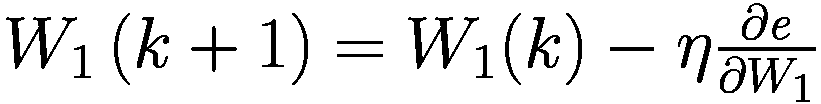 且 *W*2 = *W*1^(*T*)。     (1.7)

将 *W*1 记为 *W*[*k*]，我们得到一个与 Oja 的*子空间学习算法* (SLA) 相同的算法。

算法 (1.7) 已被广泛用于多变量流数据，以提取显著的主成分，从而能够即时找到重要的数据表示特征。图 1-8 左侧显示了多维流数据，右侧显示了通过自适应算法 (1.7) 快速收敛的前两个主特征向量，该算法将在第 5 章中进一步描述。

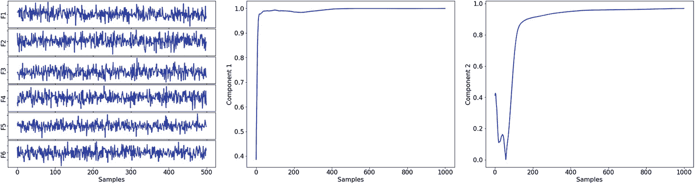

图 1-8

从多维流数据计算出的前两个主特征向量的收敛情况。左侧为数据，右侧为特征收敛（理想值 = 1）

从 10 维合成数据集中生成前 4 个主特征向量的 Python 代码如下：

```
from numpy import linalg as la
A = np.zeros(shape=(nDim,nDim)) # 存储自适应相关矩阵
W2 = 0.1 * np.ones(shape=(nDim,nEA)) # 所有算法的权重向量
W3 = W2
c = [2-0.3*k for k in range(nEA)]
C = np.diag(c)
for epoch in range(nEpochs):
for iter in range(nSamples):
cnt = nSamples*epoch + iter
# 使用当前数据样本 x 更新数据相关矩阵 A
x = X[:,iter]
x = x.reshape(nDim,1)
A = A + (1.0/(1 + cnt))*((np.dot(x, x.T)) - A)
# 缩减梯度下降
W2 = W2 + (1/(100 + cnt))*(A @ W2 - W2 @ np.triu(W2.T @ A @ W2))
# 加权梯度下降
W3 = W3 + (1/(220 + cnt))*(A @ W3 @ C - W3 @ C @ (W3.T @ A @ W3))
```


### 异联想网络

我们考虑一个异联想网络，它与自联想网络的区别在于输出层，输出是 **d** 而非 **x**。这里 **d** 表示数据所属的类别。**d** 的一个例子是 **d**=**e**[*i*]，其中 **e**[*i*] 是第 *i* 个标准基向量 [标准基，维基百科]，对应类别 *i*。在一个二分类问题中，类别 1 的 **d**=[1 0]^(*T*)，类别 2 的 **d**=[0 1]^(*T*)。我们定义 *B*=*E*(**xx**^(*T*))，*M*=*E*(**xd**^(*T*))，以及 *A*=*MM*^(*T*)。参见图 1-9。

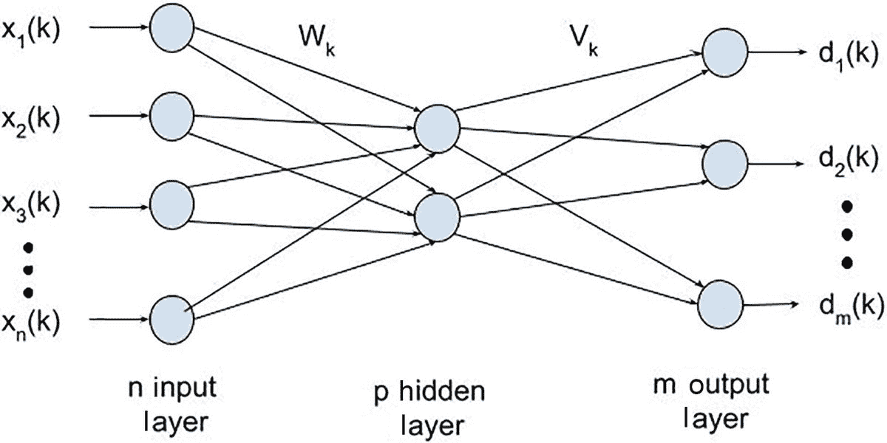

图 1-9

异联想神经网络

我们考虑一个两层线性异联想神经网络，其隐藏层只有一个神经元，输出层有 *m≤n* 个单元。设 **w∈**ℜ^(*n*) 为输入层的权重向量，**v∈**ℜ^(*m*) 为输出层的权重向量。网络输出端的均方误差为

*e* = *E*{‖**d** − **vw**^(*T*)**x**‖²}。 (1.8)

我们进一步假设网络功率有限，因此 **w**^(*T*)*B***w**=1。因此，我们将此约束施加到 (1.8) 中的均方误差准则上，得到

*J*(**w**, **v**) = *E*{‖**d** − **vw**^(*T*)**x**‖²} + *μ*(**w**^(*T*)*B***w** − 1)， (1.9)

其中 μ 是拉格朗日乘子。该方程存在唯一的全局最小值，此时 **w** 是矩阵束 (*A*,*B*) 的第一主特征向量，且 **v**=*M*^(*T*)**w**。此外，根据 (1.9) 对 **w** 的梯度，我们得到 **w** 的更新方程如下

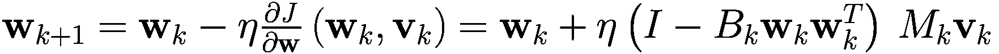。 (1.10)

我们可以代入 **v** 的收敛值 (1.10)，并避免第二层的误差反向传播，从而得到

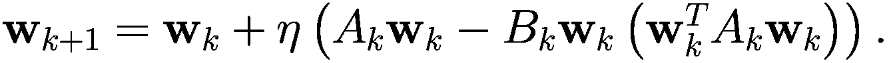 (1.11)

该算法可有效用于从流数据中自适应地计算分类特征。

图 1-10 展示了属于两个类别的多元电子购物点击流数据集 [Apczynski M., et al*.*]，用于确定买家的价格情绪。我们使用自适应算法 (1.11) 来计算类别可分性特征 **w**。图 1-10 展示了以下内容：

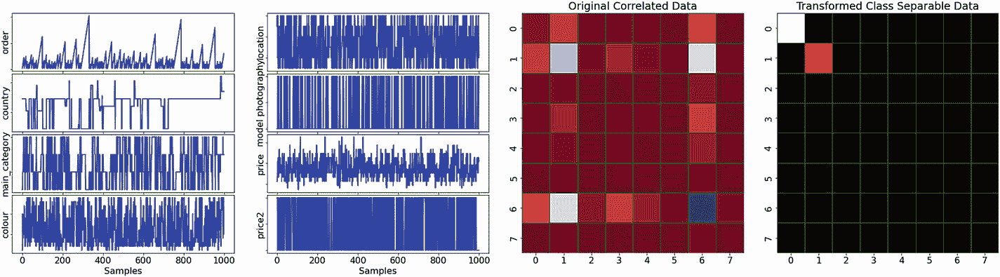

图 1-10

左侧为电子购物点击流数据，右侧为去相关的类别可分数据

*   左侧两幅图为原始多维电子购物数据。
*   右侧（第三幅图）为原始数据相关性。原始数据相关矩阵显示，在原始数据中类别无法区分。
*   最右侧为经算法 (1.11) 变换后的数据相关矩阵。最右侧矩阵中的白色和红色块表明，经算法 (1.11) 变换后，两个类别在数据中清晰分离。

从二分类多维数据集 [nDim, nSamples] 生成类别可分离的变换后相关矩阵的 Python 代码如下：

```
# Adaptively compute matrices A and B
from numpy import linalg as la
nSamples = dataset1.shape[0]
nDim = dataset1.shape[1]
classes = np.array(dataset['price2']-1)
classes_categorical = tf.keras.utils.to_categorical(classes, num_classes=2)
M = np.zeros(shape=(nDim,2)) # stores adaptive correlation matrix
B = np.zeros(shape=(nDim,nDim)) # stores adaptive correlation matrix
for iter in range(nSamples):
cnt = iter + 1
x = np.array(dataset1.iloc[iter])
x = x.reshape(nDim,1)
B = B + (1.0/cnt)*((np.dot(x, x.T)) - B)
y = classes_categorical[iter].reshape(2,1)
M = M + (1.0/cnt)*((np.dot(x, y.T)) - M)
A = M @ M.T
# generate the transformed data
from scipy.linalg import eigh
eigvals, eigvecs = eigh(A, B)
V = np.fliplr(eigvecs)
VTAV = np.around(V.T @ A @ V, 2)
VTBV = np.around(V.T @ B @ V, 2)
# plot the LDA transformed data
import seaborn as sns
plt.figure(figsize=(12, 12))
plt.rcParams.update({'font.size': 16})
plt.subplot(2, 2, 1)
sns.heatmap(A, linewidth=0.5, linecolor="green", cmap='RdBu', cbar=False)
plt.title("Original Correlated Data")
plt.subplot(2, 2, 2)
sns.heatmap(VTBV, linewidth=0.5, linecolor="green", cmap='hot', cbar=False)
plt.title("Transformed Class Separable Data")
plt.subplot(2, 2, 3)
sns.heatmap(A, linewidth=0.5, linecolor="green", cmap='RdBu', cbar=False)
plt.title("Original Correlated Data")
plt.subplot(2, 2, 4)
sns.heatmap(VTAV, linewidth=0.5, linecolor="green", cmap='hot', cbar=False)
plt.title("Transformed Class Separable Data")
plt.show()
```

### 统计模式识别

线性异联想的一个特例是执行 *m* 选 1 分类的网络，其中网络的输入 **x** 被分类为 *m* 个类别 ω[1],...,ω[*m*] 中的一个。如果 **x∈**ω[*i*]，则 **d**=**e**[*i*]，其中 **e**[*i*] 是第 *i* 个标准基向量。与无监督的自联想学习不同，该网络是有监督的。在这种情况下，*A* 和 *B* 是散布矩阵。这里 *A* 是*类间散布矩阵 S*[*b*]*，即类均值围绕混合均值的散布，而 *B* 是*混合散布矩阵 S*[*m*]*，即所有样本（不考虑类别归属）的协方差。(*A*,*B*) 的广义特征向量分解被称为*线性判别分析* (LDA)，这在第 1.1 节中已讨论过。

### 信息论

数据模型 (1.1) 的另一个观点源于 Linsker [1988] 和 Plumbley [1993]。根据 Linsker 的 *Infomax* 原理，权重矩阵 *W* 的最优值出现在其输出 **y** 关于其输入 **x** 所传递的信息 *I*(**x**,**y**) 被*最大化*时。这等价于输入 **x** 中关于输出 **y** 的信息，因为 *I*(**x**,**y**)=*I*(**y**,**x**)。然而，像 (1.1) 这样的无噪声过程，其 **y** 中包含关于输入 **x** 的无限信息，反之亦然，因为 **y** 完美地表示了 **x**。为了继续分析，我们假设输入 **x** 包含一些噪声 **n**，这阻止了 **y** 精确测量 **x**。该模型有两种变体，均受 Plumbley [1993] 启发。

在第一个模型中，我们假设输出 **y** 因变换 *W* 而受到噪声污染。我们进一步假设可用于传输的平均功率是有限的，输入 **x** 是均值为零、协方差为 *A* 的高斯分布，噪声 **n** 是均值为零、协方差为 *N* 的不相关高斯分布，并且变换噪声 **n** 与 **x** 独立。含噪声的数据模型为

**y** = *W*^(*T*)**x** + **n**。 (1.12)

互信息 *I*(**y**,**x**)（在高斯假设下）为

*I*(**y**, **x**) = 0.5 log det(*W*^(*T*)*AW* + *N*) − 0.5 log det(*N*)。 (1.13)

我们定义一个带有功率约束的目标函数为

*J*(*W*) = *I*(**y**, **x**) − 0.5*tr*(Λ(*W*^(*T*)*AW* + *N*))， (1.14)

其中 Λ 是一个由拉格朗日乘子组成的对角矩阵。当 *W*=Φ*R* 时，该函数被最大化，其中 Φ 是 *A* 的主特征向量矩阵，*R* 是一个非奇异旋转矩阵。


### 优化理论

在优化理论中，通过评估目标函数的最大值和最小值来计算各种矩阵函数。给定一个对称正定矩阵束 (*A*,*B*)，第一主广义特征向量通过最大化著名的瑞利商得到：

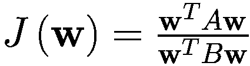。     (1.15)

基于优化方法 [Luenberger]，该目标函数有三种常见的修正形式。它们是：

*   拉格朗日乘子法：

*J*(**w**) =  − **w**^(*T*)*A***w** + *α*(**w**^(*T*)*B***w** − 1),     (1.16)

其中 *α* 是拉格朗日乘子。

*   罚函数法：

*J*(**w**) =  − **w**^(*T*)*A***w** + *μ*(**w**^(*T*)*B***w** − 1)²,     (1.17)

其中 *μ* 是一个非负标量常数。

*   增广拉格朗日法：

*J*(**w**) =  − **w**^(*T*)*A***w** + *α*(**w**^(*T*)*B***w** − 1) + *μ*(**w**^(*T*)*B***w** − 1)²,     (1.18)

其中 *α* 是拉格朗日乘子，*μ* > 0 是罚函数常数。基于此目标函数的几种算法将在第 4 章至第 7 章中给出。

通过使用梯度的瞬时值和梯度上升技术，我们可以从这些目标函数中获得自适应算法，这将在后续章节中讨论。这些目标函数的一个优点是我们可以使用加速收敛方法，例如最速下降法、共轭方向法和牛顿-拉夫逊法。第 6 章讨论了其中的几种方法。递归最小二乘法也已通过采用目标函数逆黑塞矩阵的各种近似，被应用于自适应矩阵计算。

## 1.3 为什么需要自适应算法？

我们观察到，数据表示和分类问题会引出矩阵代数问题，根据输入的性质，这些问题有两种解决方案。

1.  第一类解决方案要求预先知道相关的矩阵。

2.  第二类解决方案需要一系列样本，从中可以计算出矩阵。

在本节中，我将解释批处理和自适应处理之间的区别、自适应处理对流式数据的优势，以及自适应算法的要求。

### 静态数据的迭代或批处理

当数据预先可用且底层矩阵已知时，我们可以使用批处理方法。这些算法已被用于解决各种矩阵代数问题，例如矩阵求逆、特征值分解、奇异值分解和主成分分析 [Cichocki et al*.* 92, 93]。这些算法分两步求解：(1) 使用汇集数据估计所需的矩阵，(2) 使用数值矩阵代数过程求解必要的矩阵函数。

例如，考虑数据序列 {**x**[*k*]} 的相关矩阵 *A* 的简单矩阵求逆问题。我们可以在收集完所有数据并计算出 *A* 之后，计算矩阵逆 *A*^(-1)。这种方法以批处理方式工作。当添加一个新样本 **x** 时，计算新矩阵 *A*[*new*]=(*nA*+**xx**^(*T*))/(*n*+1) 的逆并不困难，其中 *n* 是用于计算 *A* 的样本总数。尽管 *A* 的计算很简单，但求解 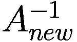 的所有计算都需要重复进行。

这种批处理方法存在两个问题。

1.  首先，样本的维度可能很大，因此即使所有样本都可用，执行矩阵代数运算也可能很困难，或者需要耗费大量计算时间，这在实际中是不可行的。例如，特征向量评估需要 *O*(*n*³) 的计算量，这对于图像处理和自动控制应用中常见的大维度样本（例如 1,000）是不可行的。

2.  其次，通过传统方案评估的矩阵函数无法适应数据的微小变化（例如，少数几个新传入的样本）。如果通过传统方法从 *K* 个样本估计出矩阵函数，那么对于每一个额外的样本，所有的计算都必须重复进行。

这些缺陷使得批处理方案对于数据增量到达或*在线*方式的实时应用效率低下。


### 我的方法：流式数据的自适应处理

当我们面对连续的数据样本序列时，批处理算法便不再适用。此时，需要采用自适应算法来解决矩阵代数问题。这类算法的一个直接优势是，它们可以应用于实时问题，例如边缘计算、自适应数据压缩 [Le Gall 91]、用于噪声分析和源定位的天线阵列处理 [Owsley 78]，以及用于频率估计的自适应谱分析 [Pisarenko 73]。

我的方法是提供计算简单的自适应算法，用于处理来自流式数据的矩阵计算。请注意，在以下环境中，自适应算法至关重要：数据量大、数据维度高、数据随时间变化且其底层统计特性也在变化，并且我们没有足够的存储、计算和带宽来以低延迟处理数据。边缘设备和边缘计算就是这样的环境之一。

例如，给定客户电子购物数据的流式样本 {**x**[*k*]}，我们需要从数据流中计算出一个关键的客户情感指标 **w**[*k*]。为此，我们需要设计一个**简单的更新规则**，以便在新数据 **x** 可用时更新客户情感指标 **w**。这个简单的更新规则会在新数据 **x**[*k*] 可用时，将情感指标 **w**[*k*] 更新为其最新值 **w**[*k*+1]。其格式为 **w**[*k*+1]= **w**[*k*] + *f*(**w**[*k*],**x**[*k*])，其中：

*   **w**[*k*] 是情感指标的上一个值，
*   **w**[*k*+1] 是情感指标的最新更新值，
*   **x**[*k*] 是用于计算 **w**[*k*+1] 的最新数据，以及
*   *f*(.) 是关于 **w**[*k*] 和 **x**[*k*] 的一个简单函数。

这个更新规则的一个例子是著名的 [Oja 82] 算法，用于计算流式序列 {**x**[*k*]} 的第一个主特征向量：

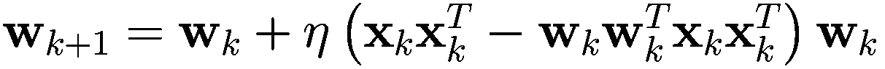，     (1.19)

其中 η>0 是一个小的增益常数。在该算法中，对于每个样本 **x**[*k*]，更新过程只需要简单的矩阵-向量乘法，并且向量 **w**[*k*] 会收敛到数据相关矩阵 *A* 的主特征向量。显然，这可以很容易地在小型 CPU 上实现。

图 1-11 展示了一个多变量电子购物点击流数据集 [Apczynski M. et al*.*]。自适应更新规则 (1.19) 被用于计算买家定价情感指标。左侧显示了数据，右侧显示了自适应计算出的情感指标（理想值为 1）。随着新数据的到来，情感指标被自适应地更新，并且情感值迅速收敛到其理想值 1。

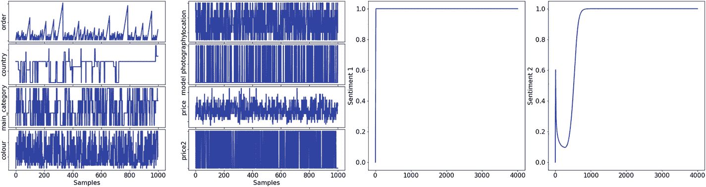

图 1-11

左侧为电子购物点击流数据，右侧为通过更新规则 (1.19) 计算出的买家情感指标（理想值 = 1）

与传统的迭代批处理解决方案相比，自适应算法有几个优点和缺点。

优点包括：

*   传统解决方案会找出所有特征向量和特征值，而自适应解决方案仅计算所需的特征向量。在许多应用中，我们并不需要特征值。因此，自适应算法应该更高效。
*   此外，自适应算法的计算复杂度取决于矩阵-向量乘积 *A***x** 的效率。当矩阵 *A* 具有某种结构（例如稀疏、汉克尔或托普利兹矩阵）时，这些方法可以更加高效，因为可以使用 FFT 来加速计算。
*   自适应算法很容易适应时变多维过程的框架，例如自适应信号处理，其中输入过程是持续更新的。

缺点包括：

*   自适应算法为当前数据集生成特征值的近似值，而批处理算法则提供精确值。
*   自适应方法需要一段“启动”时间才能达到高精度，如图 1-10 中的曲线所示。

### 自适应算法的要求

从前面的讨论可以清楚地看出，用于矩阵计算的自适应算法需要计算成本低廉，以便计算过程能够跟上输入数据流的速度。我们还要求估计值能够强收敛到其真实值。因此，我们期望我们的自适应算法满足以下约束条件：

*   算法应能适应数据的微小变化，这对于实时应用非常有用。
*   从算法获得的估计值应具有已知的统计特性。
*   与自适应算法相关的网络架构由单层或双层网络中的线性单元组成，这样网络可以很容易地用简单的 CPU 实现，无需特殊硬件。
*   算法涉及的计算成本低廉，以便统计过程能够在每个数据样本到达时对其进行处理。
*   从算法获得的估计值应强收敛到其真实值。

基于这些要求，我们着手设计能够解决本书中考虑的矩阵代数问题的自适应算法。本书的目标是开发多种神经形态自适应算法来解决矩阵代数问题。

尽管我将讨论许多用于求解矩阵函数的自适应算法，但大多数算法都遵循以下通用形式：

*W*[*k* + 1] = *W*[*k*] + *ηH*(**x**[*k*], *W*[*k*])，     (1.20)

其中 *H*(**x**[*k*],*W*[*k*]) 满足某些连续性和正则性属性 [Ljung 77,78,84,92]，并且 η > 0 是一个小的增益常数。这些算法满足前面概述的要求。

### 自适应矩阵计算算法的实际应用与 GitHub

在第 8 章中，我将讨论这些自适应矩阵计算算法的几个实际应用。我还将这些应用的代码发布在公共 GitHub 仓库 [Chanchal Chatterjee GitHub] 中。


## 1.4 算法推导的通用方法论

我在本书中的贡献有两方面：

1.  我提出了一种推导和分析每种自适应算法的通用方法论。

2.  我针对多个矩阵代数问题提出了自适应算法。

关于矩阵计算的自适应算法文献提供了多种技术（包括特设方法）和各种类型的收敛过程。在本书中，我提出了一种*通用方法论*来推导并证明自适应算法的收敛性（所有证明均在 GitHub 上）。

**采用此方法论的优点在于，它能让读者遵循该方法论，为其应用场景推导出新的自适应算法。**

在接下来的章节中，我将遵循以下步骤来推导每种算法：

1.  **目标函数**

我首先提出一个*目标函数* *J*(*W*;*A*[*k*])，使得该函数的最小化器 *W*^(***) 是数据矩阵 *A* 的期望矩阵函数。

2.  **推导自适应算法**

我通过对目标函数 *J*(*W*;*A*[*k*]) 应用梯度下降技术，推导出矩阵 *W* 的*自适应更新规则*。自适应梯度下降更新规则为：

*W*[*k* + 1] = *W*[*k*] − *η*[*k*]∇[*W*]*J*(*W*[*k*], *A*[*k*]) = *W*[*k*] + *η*[*k*]*h*(*W*[*k*], *A*[*k*]),     (1.21)

其中函数 *h*(*W*[*k*],*A*[*k*]) 遵循特定的连续性和正则性属性，而 *η*[*k*] 是一个递减的增益序列。

3.  **加速自适应算法**

目标函数 *J*(*W*;*A*) 的可用性使我们能够通过应用优化理论中的加速技术（如最速下降法、共轭方向法、牛顿-拉夫逊法和递归最小二乘法）来加速自适应算法。这些方法在主成分分析中的详细内容见第 6 章。

4.  **证明算法收敛于矩阵函数**

在本书中，我提供了数值实验来证明这些算法的收敛性。数学证明在 GitHub [Chatterjee Github] 的单独文档中提供。

遵循此方法论的一个重要好处是，它允许实践者为其自身的应用场景推导新的算法。

### 此处解决的矩阵代数问题

在应用中，我假设数据按时间顺序到达，例如向量序列 {**x**[*k*]} 或 {**y**[*k*]}，或矩阵序列 {*A*[*k*]} 或 {*B*[*k*]}。请注意，此处给出的算法可用于非平稳输入流。

在接下来的章节中，我将提出新颖的自适应算法来估计以下矩阵函数：

*   均值、相关性和归一化均值（针对 {**x**[*k*]}）
*   从 {**x**[*k*]} 或 {*A*[*k*]} 中计算 *A* 的平方根 (*A*^½) 和平方根的逆 (*A*^(–½))
*   从 {**x**[*k*]} 或 {*A*[*k*]} 中计算 *A* 的主特征向量
*   从 {**x**[*k*]} 或 {*A*[*k*]} 中计算 *A* 的主特征向量和次特征向量
*   从 {**x**[*k*]} 和 {**z**[*k*]} 或 {*A*[*k*]} 和 {*B*[*k*]} 中计算 *A* 相对于 *B* 的广义特征向量
*   从 {**x**[*k*]} 和 {**z**[*k*]} 或 {*C*[*k*]} 中计算 *C* 的奇异值分解 (SVD)

除了这些算法，我还讨论了：

*   均值、协方差和矩阵求逆的自适应计算
*   通过非线性优化技术加速自适应算法的方法

## 1.5 本书大纲

在接下来的章节中，我将详细讨论针对各种矩阵代数问题的多种自适应算法的公式化、推导、收敛性以及实验结果。

在第 2 章中，我讨论了后续章节中使用的基本术语和方法。本章还讨论了针对平稳和非平稳数据的均值、中位数、相关性、协方差以及逆相关/协方差计算的自适应算法。我进一步讨论了用于归一化均值计算的新颖自适应算法。

在第 3 章中，我讨论了三种用于计算矩阵序列平方根的自适应算法。接着，我讨论了三种用于计算其平方根逆的算法。我为这些算法提供了目标函数和收敛性证明。

在第 4 章中，我讨论了 11 种算法（其中一些是新算法），用于自适应计算矩阵序列的第一主特征向量或向量序列的在线相关矩阵。我提供了针对特定应用选择算法的最佳实践。我遵循通用的方法论来推导和分析每种算法的收敛性，并辅以实验结果。

在第 5 章中，我提出了 21 种自适应算法，用于计算矩阵序列的主特征向量和次特征向量，或向量序列的在线相关矩阵。这些算法源自 7 种不同类型的目标函数，每种函数在 3 种不同条件下推导。每种算法都经过推导、讨论，并在分析和实验上证明其收敛性。我提供了针对特定应用选择算法的最佳实践。

由于我为所有自适应算法都提供了目标函数，因此在第 6 章中，我偏离了传统的梯度下降法来推导算法。这里，我通过对目标函数应用最速下降法、共轭方向法、牛顿-拉夫逊法和递归最小二乘法，推导出新的计算速度更快的算法。实验结果以及与最先进算法的比较显示了这些自适应算法更快的收敛速度。

在第 7 章中，我讨论了 21 种用于从两个矩阵或向量序列进行广义特征分解的自适应算法。我再次遵循通用的方法论，从目标函数推导所有算法，并附上实验结果。

在第 8 章中，我通过示例和代码展示了这些算法在现实世界中的应用。

参考文献在第 [9](https://doi.org/10.1007/978-1-4842-8017-1_9) 章。

