# 2. 通用理论与符号

## 2.1 引言

在本章中，我提出了从矩阵序列中自适应求解矩阵代数问题的算法。这些流或序列可以是随机矩阵 {*A*[*k*]} 或 {*B*[*k*]}，也可以是随机向量序列 {**x**[*k*]} 或 {**y**[*k*]} 的相关矩阵。矩阵代数的例子包括矩阵求逆、平方根、平方根逆、特征向量、广义特征向量、奇异向量和广义奇异向量。

本章还涵盖了后续章节中使用的基本术语和方法。我还介绍了众所周知的从随机矩阵或向量序列计算均值、中位数、协方差、逆协方差和相关矩阵的自适应算法。此外，我提出了一种计算随机向量序列归一化均值的新算法。

为简单起见，我们假设多维数据 {**x**[*k*]∈ℜ^(*n*)} 以序列形式到达。从这个数据序列中，我们可以推导出一个矩阵序列 {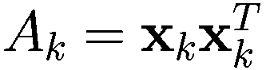}。我们将数据相关矩阵 *A* 定义如下：

![$$ A=\underset{k\to \infty }{\lim }E\left[{\mathbf{x}}_k{\mathbf{x}}_k^T\right] $$](images/522202_1_En_2_Chapter/522202_1_En_2_Chapter_TeX_IEq2.png)。     (2.1)


## 2.2 平稳序列与非平稳序列

在实际应用中，我们面临两种类型的序列：平稳序列和非平稳序列。如果 ![$$ {\lim}_{k\to \infty }E\left[{\mathbf{x}}_k{\mathbf{x}}_k^T\right] $$](images/522202_1_En_2_Chapter/522202_1_En_2_Chapter_TeX_IEq3.png) 是一个常数，则序列 {**x**[*k*]} 被认为是*渐近*（*弱*）*平稳*的。对于一个*非平稳*序列 {**x**[*k*]}，![$$ E\left[{\mathbf{x}}_k{\mathbf{x}}_{k+m}^T\right] $$](images/522202_1_En_2_Chapter/522202_1_En_2_Chapter_TeX_IEq4.png) 仍然是 *k* 和 *m* 的函数，并且 ![$$ E\left[{\mathbf{x}}_k{\mathbf{x}}_k^T\right] $$](images/522202_1_En_2_Chapter/522202_1_En_2_Chapter_TeX_IEq5.png) 是 *k* 的函数。非平稳数据的示例见 *Publicly Real-World Datasets to Evaluate Stream Learning Algorithms* [Vinicius Souza 等人，20]。图 2-1 展示了平稳数据和非平稳数据的示例。

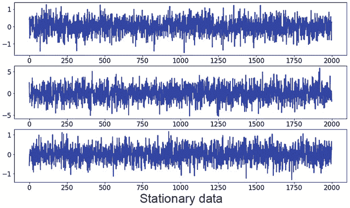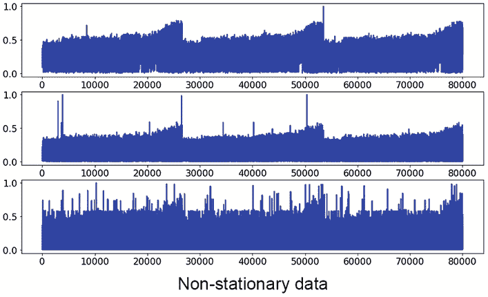

图 2-1

平稳数据和非平稳数据的示例

数据中的非平稳性可以通过本参考文献 [Shay Palachy 19] 中描述的著名技术来检测。

## 2.3 自适应均值、中位数和协方差的应用场景

尽管自适应均值计算是最简单的算法之一，但它在实际应用中非常重要。

### 手写字符识别

考虑检测手写数字 8 的问题。图 2-2 展示了来自 Keras 数据集 MNIST 图像 [Keras, MNIST] 的六个数字 8 的实例。

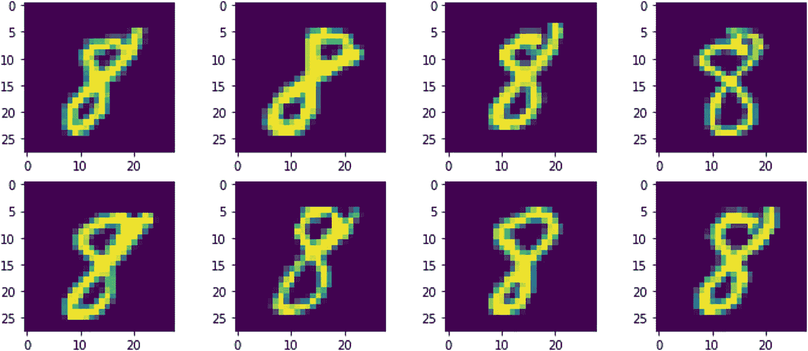

图 2-2

手写数字 8 的变体示例

一种识别所有变体数字 8 的算法是找到代表它的平均像素集。由于手写的随机变化，很难提前编译每个字符的所有变体。设计一种自适应学习方案非常重要，使得这些字符的即时变化能够立即在机器学习算法中得到体现。

自适应均值检测算法有助于找到代表数字 8 的常见模式。图 2-3 展示了通过公式 (2.2) 中给出的自适应均值算法获得的数字 8 的模板。

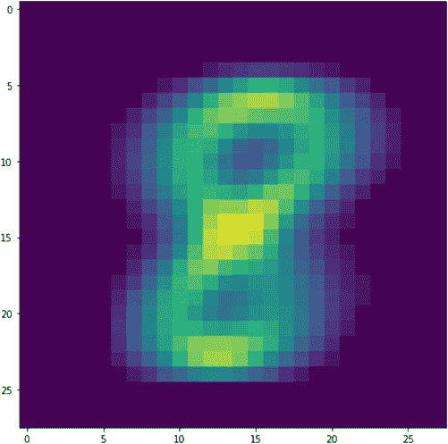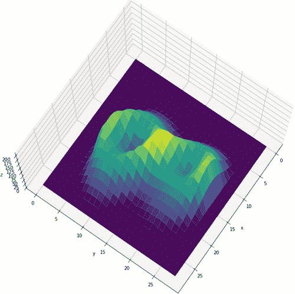

图 2-3

数字 8 的模板。左侧为二维表示，右侧为三维表示

### 流式数据的异常检测

一种简单但强大的数据异常检测算法是计算中位数，并将当前值与数据的中位数进行比较。图 2-4 展示了包含偶尔异常值的流式数据 [Yahoo Research Webscope S5 Data]。我们使用算法 (2.20) 自适应地计算了中位数，并将其与数据进行比较以检测异常。此处，数据样本为蓝色，自适应中位数为绿色，异常值为红色。

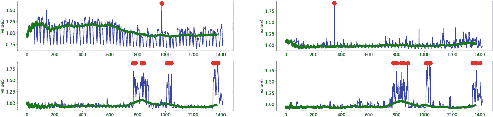

图 2-4

使用自适应中位数算法在时间序列数据上检测到的异常

关于此主题的更多内容将在第 8 章中讨论。

## 2.4 非平稳序列的自适应均值和协方差

在平稳情况下，给定一个序列 {**x**[*k*]∈ℜ^(*n*)}，我们可以按如下方式计算自适应均值 **m**[*k*]：

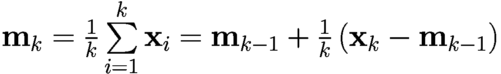。     (2.2)

类似地，自适应相关 *A*[*k*] 为

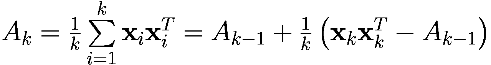。     (2.3)

这里我们使用了直到时刻 *k* 的所有样本。

然而，如果数据是非平稳的，我们使用一个*遗忘因子* 0<*β*≤1 来实现一个大小为 1/(1–*β*) 的有效窗口，如下所示：

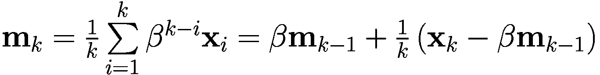     (2.4)

和

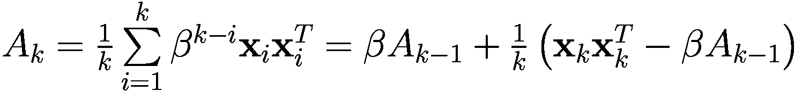。     (2.5)

这个有效窗口确保过去的数据样本与最近的样本相比，通过指数衰减窗口被赋予较低的权重，以便为自适应算法提供跟踪能力。*β* 的具体值取决于特定应用。一般来说，对于慢时变 {**x**[*k*]}，*β* 选择接近 1 以实现较大的有效窗口；而对于快时变 {**x**[*k*]}，*β* 选择接近 0 以实现较小的有效窗口 [Benveniste 等人，90]。

以下是使用数据 `X[nDim,nSamples]` 自适应计算均值向量和相关矩阵的 Python 代码：

```
for epoch in range(nEpochs):
for iter in range(nSamples):
cnt = nSamples*epoch + iter
x = X[:,iter]
x = x.reshape(nDim,1)
# 公式 2.4
m = beta * m  + (1.0/(1 + cnt)) * (x - beta * m)
# 公式 2.5
A = beta * A + (1.0/(1 + cnt))*((np.dot(x, x.T)) - beta * A)
```

## 2.5 自适应协方差及其逆矩阵

给定前面讨论的均值和相关，自适应协方差矩阵 *B*[*k*] 也可以按如下方式计算：

     (2.6)

根据 (2.5) 中的自适应相关矩阵 *A*[*k*]，逆相关矩阵 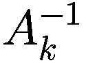 可以通过 Sherman-Morrison 公式 [Sherman–Morrison, Wikipedia] 自适应地获得，如下所示：

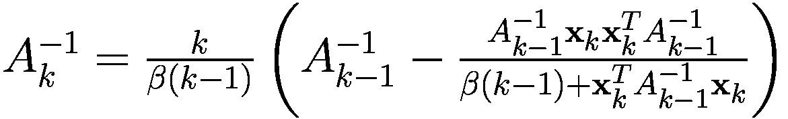。     (2.7)

类似地，逆协方差矩阵 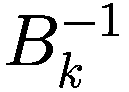 可以自适应地获得，如下所示：

。     (2.8)

以下是使用数据 `X[nDim,nSamples]` 自适应计算逆相关矩阵和逆协方差矩阵的 Python 代码：

```
for epoch in range(nEpochs):
for iter in range(nSamples):
cnt = nSamples*epoch + iter
x = X[:,iter]
x = x.reshape(nDim,1)
y = Y[:,iter]
y = x.reshape(nDim,1)
# 公式 2.7
k = cnt+2
AW = (k/(beta*(k-1))) * (AW - (AW * (x @ x.T) * AW) \
/ (beta*(k-1) + x.T @ AW @ x))
# 公式 2.8
BW = (k/(beta*(k-1))) * (BW - (BW * (y @ y.T) * BW) \
/ (beta*(k-1) + y.T @ BW @ y))
```


## 2.6 自适应归一化均值算法

自适应归一化均值算法最直接的选择是使用公式(2.2)并对每个**m**[*k*]进行归一化。然而，通过以下代价函数可以获得更高效的算法，其最小化器**w**^*是渐近归一化均值**m**/‖**m**‖，其中**m** = lim[*k* → ∞]*E*[**x**[*k*]]：

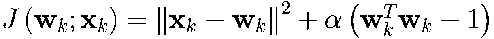，     (2.9)

其中α是拉格朗日乘子，用于强制执行均值归一化的约束。*J*(**w**[*k*];**x**[*k*])关于**w**[*k*]的梯度为

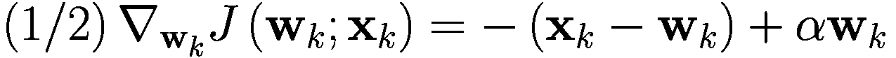。     (2.10)

将公式(2.10)乘以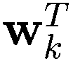并应用约束条件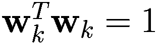，我们得到

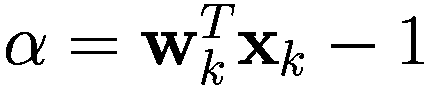。     (2.11)

在公式(2.11)中使用此*α*，我们得到用于归一化均值的自适应梯度下降算法：

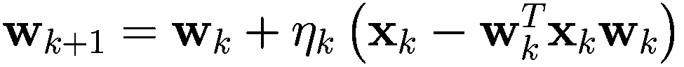，     (2.12)

其中*η*[*k*]是一个小的递减常数，满足 GitHub [Chatterjee GitHub] 上收敛性证明中的假设 A1.2。

### 自适应归一化均值算法的变体

目标函数(2.9)有几种变体，它们衍生出许多其他用于归一化均值计算的自适应算法。(2.9)的一种变体是将公式(2.11)中*α*的值代入目标函数(2.9)，得到以下目标函数：

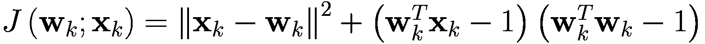。     (2.13)

与(2.9)不同，该目标函数是无约束的，并且内置了约束条件。它导出了以下自适应算法：

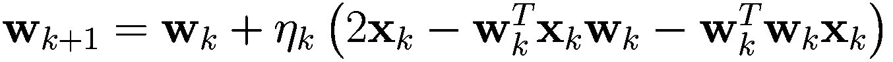。     (2.14)

另一种变体是使用非线性优化的罚函数法来强制执行约束条件。该目标函数为

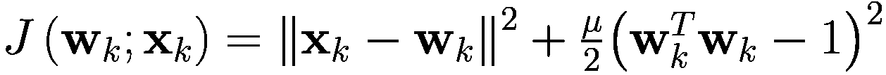，     (2.15)

其中*μ*是一个正的惩罚常数。该目标函数也是无约束的，并导出了以下自适应算法：

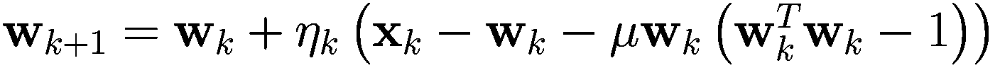。     (2.16)

以下是使用算法(2.12)、(2.14)和(2.16)，利用数据`X[nDim,nSamples]`自适应计算归一化均值的 Python 代码：

```
for epoch in range(nEpochs):
for iter in range(nSamples):
cnt = nSamples*epoch + iter
x = X[:,iter]
x = x.reshape(nDim,1)
# 公式 2.12
w1 = w1 + (1.0/(100+cnt))*(x - (w1.T @ x)*w1)
# 公式 2.14
w2 = w2 + (1.0/(100+cnt))*(2*x-(w2.T @ x)*w2 - (w2.T @ w2)*x)
# 公式 2.16
w3 = w3 + (1.0/(100+cnt))*(x - w3- mu* w3 @ ((w3.T @ w3)-1))
```

## 2.7 自适应中位数算法

给定一个序列{**x**[*k*]}，其渐近中位数*μ*满足以下条件：

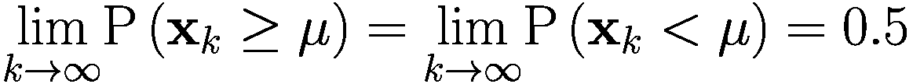     (2.17)

其中 P(*E*)是事件*E*的概率测度，且 0 ≤ P(*E*) ≤ 1。其最小化器**w**^*为渐近中位数*μ*的目标函数*J*(**w**[*k*];**x**[*k*])是

*J*(**w**[*k*]; **x**[*k*]) = ‖**x**[*k*] − **w**[*k*]‖。     (2.18)

*J*(**w**[*k*];**x**[*k*])关于**w**[*k*]的梯度为

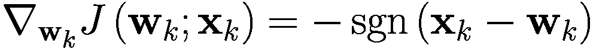，     (2.19)

其中 sgn(.)是符号算子（若*x*≥0 则 sgn(*x*)=1，若*x*<0 则 sgn(*x*)=–1）。根据公式(2.19)中的梯度，我们得到自适应梯度下降算法：

**w**[*k* + 1] = **w**[*k*] + *η*[*k*] sgn (**x**[*k*] − **w**[*k*])。     (2.20)

以下是使用算法(2.20)，利用数据`X[nDim,nSamples]`自适应计算中位数的 Python 代码：

```
for epoch in range(nEpochs):
for iter in range(nSamples):
cnt = nSamples*epoch + iter
x = X[:,iter]
x = x.reshape(nDim,1)
# 公式 2.20
md = md + (3.0/(1 + cnt)) * np.sign(x - md)
```


## 2.8 实验结果

这些实验旨在展示针对均值、相关、逆相关、逆协方差、归一化均值和中位数的自适应算法的性能与精度。

我生成了 1,000 个五维高斯数据（即 *n*=5）的样本向量 {**x**[*k*]}，其均值和协方差如下：

均值 = [10 7 6 5 1]，

协方差 = ![$$ \left[\begin{array}{ccccc}2.091&amp; 0.038&amp; \hbox{-} 0.053&amp; \hbox{-} 0.005&amp; 0.010\\ {}0.038&amp; 1.373&amp; 0.018&amp; \hbox{-} 0.028&amp; \hbox{-} 0.011\\ {}\hbox{-} 0.053&amp; 0.018&amp; 1.430&amp; 0.017&amp; 0.055\\ {}\hbox{-} 0.005&amp; \hbox{-} 0.028&amp; 0.017&amp; 1.084&amp; \hbox{-} 0.005\\ {}0.010&amp; \hbox{-} 0.011&amp; 0.055&amp; \hbox{-} 0.005&amp; 1.071\end{array}\right] $$](images/522202_1_En_2_Chapter/522202_1_En_2_Chapter_TeX_IEq29.png)。

对于每种算法，我计算了误差，即算法每次迭代的估计值与从全部 1,000 个样本计算出的实际值之间的 Frobenius 范数 [Frobenius 范数，维基百科]。

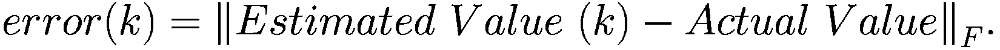

我分别通过自适应算法 (2.4) 和 (2.5) 计算了均值向量和相关矩阵。图 2-5 展示了结果。

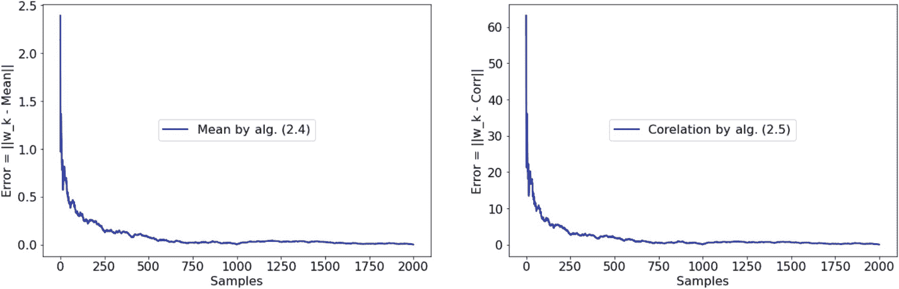

图 2-5

分别通过算法 (2.4) 和 (2.5) 得到的均值向量和相关矩阵的收敛情况

我分别通过算法 (2.7) 和 (2.8) 计算了相关矩阵和协方差矩阵的逆。图 2-6 展示了结果。

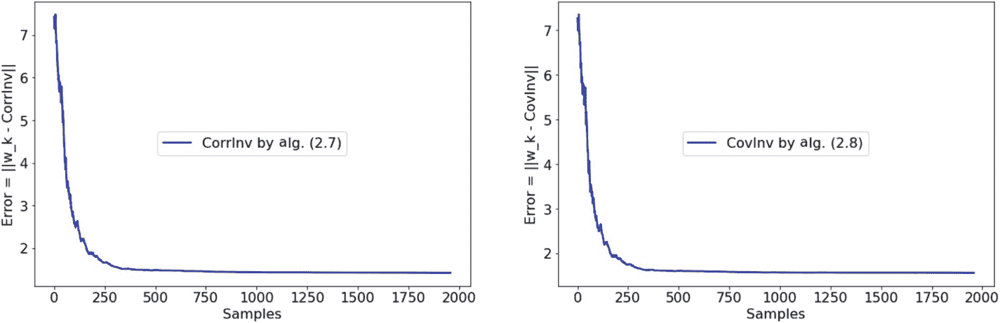

图 2-6

分别通过算法 (2.7) 和 (2.8) 得到的逆相关矩阵和逆协方差矩阵的收敛情况

我通过自适应算法 (2.12) 和 (2.14) 计算了归一化均值，并通过算法 (2.20) 计算了中位数。对于这些算法中的每个 *k* 值，我计算了 **w**[*k*]（估计值）与从全部 1,000 个样本数据中获得的归一化均值和中位数实际值之间的误差。所有算法均使用 5X1 零向量作为起始值（**w**[0]）。结果如图 2-7 所示。

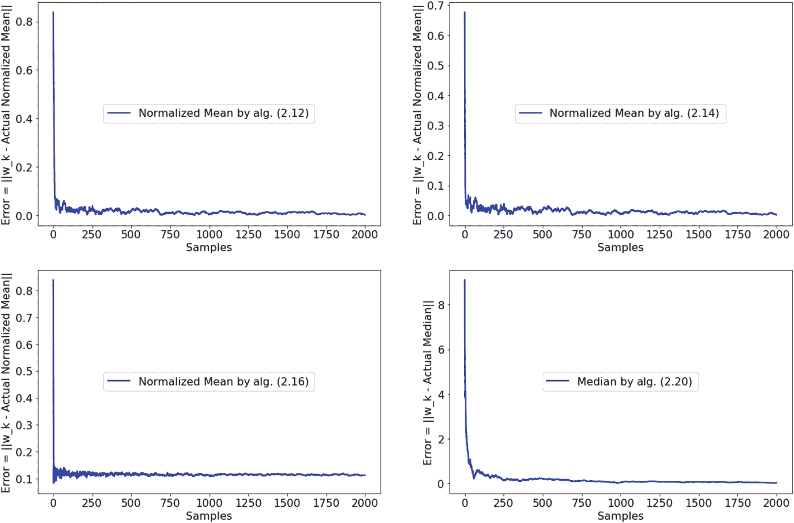

图 2-7

通过自适应算法 (2.12)、(2.14) 和 (2.16) 得到的 {**x**[k]} 归一化均值以及通过自适应算法 (2.20) 得到的中位数的收敛情况

所有自适应算法均快速收敛。在处理完 1,000 个样本后，算法 (2.14) 和 (2.16) 的误差为 0.0043，算法 (2.20) 的误差为 0.0408。代码请参见 [GitHub](https://github.com/cchatterj0/AdaptiveMLAlgorithms/tree/master/Chapter2-Cov-Mean-Median) 仓库 [Chatterjee GitHub]。

