# 3. 平方根与逆平方根

## 3.1 引言与用例

对流数据序列 {**x**[*k*]∈ℜ^(*n*)} 的实时相关矩阵进行平方根和逆平方根的自适应计算，在机器学习、数据分析和图像/信号处理中有众多应用。这些应用包括数据白化、分类器设计和数据归一化 [Foley and Sammon 75; Fukunaga 90]。

数据白化是一个去相关过程，使得所有分量具有单位方差。它是机器学习和数据分析中的数据预处理步骤，旨在“归一化”数据，使其更易于建模。主要应用包括：

*   将信号中的相关噪声转换为独立同分布 (iid) 噪声，便于分类
*   广义特征向量计算 [Chatterjee et al*.* Mar 97]（参见第 7 章）
*   线性判别分析计算 [线性判别分析，维基百科]
*   高斯分类器设计与距离度量计算 [Chatterjee et al*.* May 97]

图 3-1 展示了原始数据和白化数据的相关矩阵。原始数据高度相关，如所有轴上的颜色所示。白化数据完全去相关，分量之间无相关性，因为仅存在对角线值。

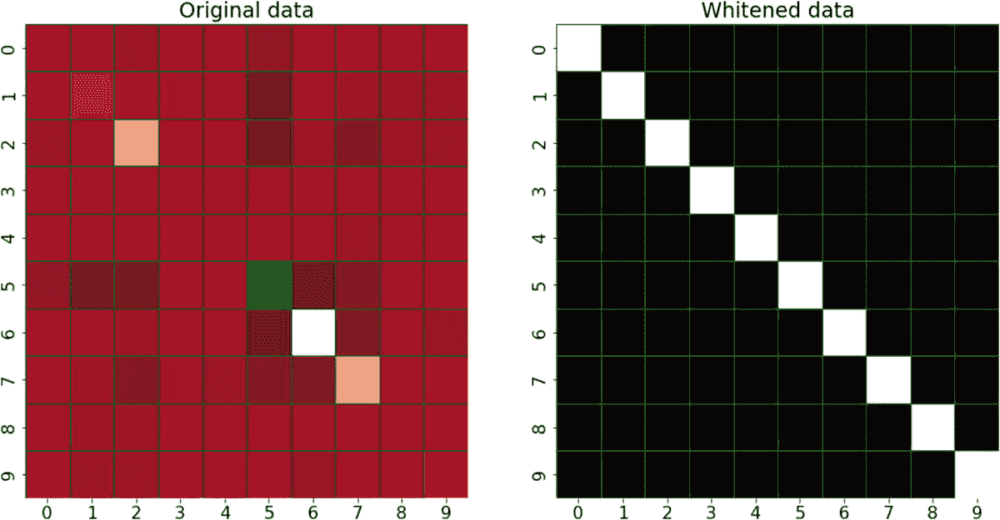

图 3-1

左侧为原始相关数据，右侧为不相关的“白化”数据

图 3-2 展示了从 Keras MNIST 数据集 [Keras, MNIST] 获取的手写数字 0。右侧的相关矩阵显示，所有像素的数据像素高度相关。

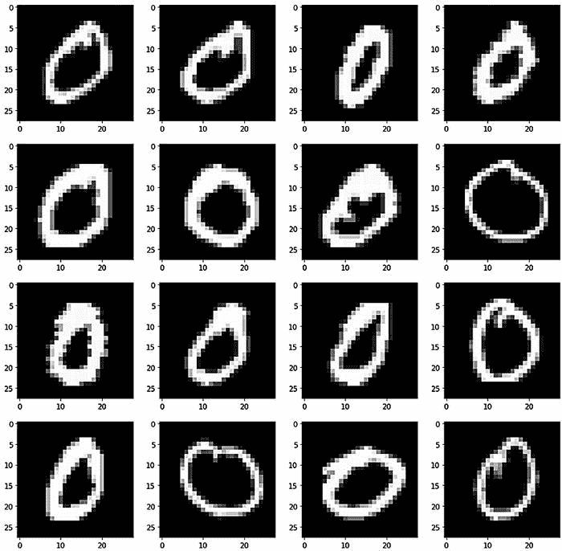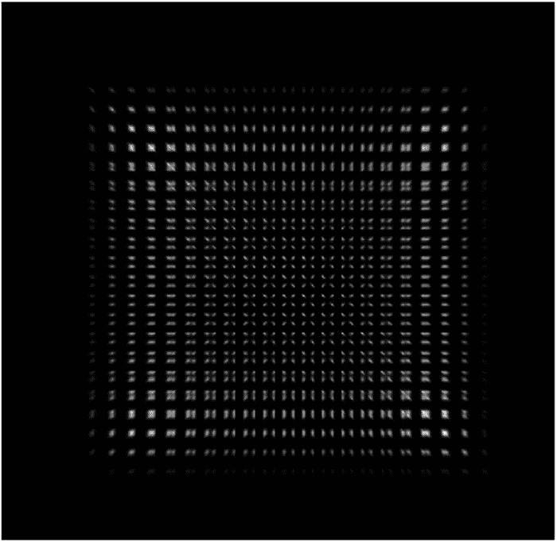

图 3-2

手写 MNIST 数字 0 及所有字符的相关矩阵

以下 Python 代码对数据样本 `X[nDim,nSamples]` 进行白化：

```
from scipy.linalg import eigh
nDim = X.shape[0]
corX = (X @ X.T) / nSamples
eigvals, eigvecs = eigh(corX)
V  = np.fliplr(eigvecs)
D = np.zeros(shape=(nDim,nDim))
for i in range(nDim):
if (eigvals[::-1][i] < 10):
D[i,i] = 0
else:
D[i,i] = np.sqrt(1/eigvals[::-1][i])
Z = V @ D @ V.T @ X
```

接下来，让我们看看变换后的数据和新的相关矩阵。图 3-3 显示，字符的差异化特征得到增强，相关矩阵呈对角线分布，而非沿所有像素分布，表明数据已白化，相关矩阵为单位矩阵。

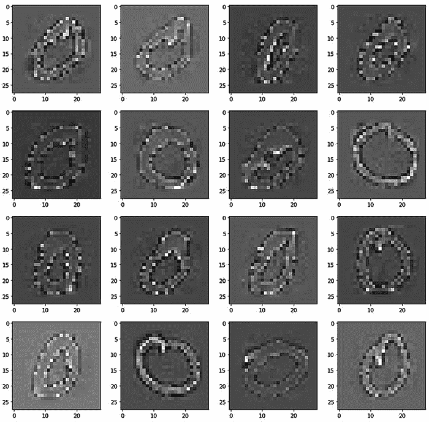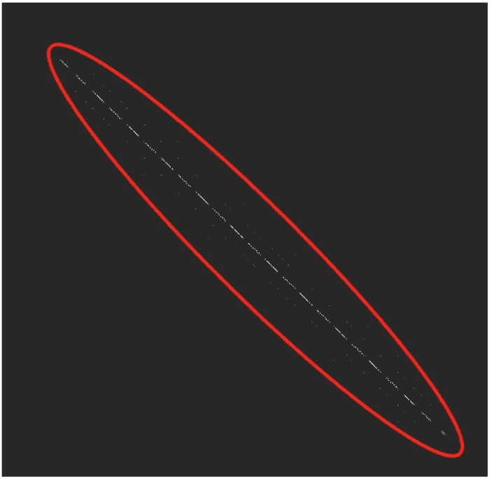

图 3-3

白化后的手写 MNIST 数字 0。所有字符的相关矩阵是对角矩阵。

我们将数据相关矩阵 *A* 定义为

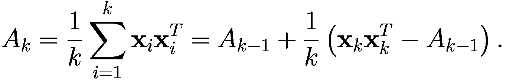

*A* 的平方根，也称为 Cholesky 分解 [Cholesky 分解，维基百科]，记作 *A*^½。类似地，*A*^(–½) 表示 *A* 的逆平方根。然而，如下文所述，这两个矩阵函数均无唯一解，并且可以得到各种自适应算法，每种算法都会导致不同的解。尽管这些矩阵函数有无数解，但在某些限制条件下（例如唯一的对称正定解）存在唯一解。

在本章中，我为每个矩阵函数 *A*^½ 和 *A*^(–½) 各介绍三种自适应算法。在这三种算法中，一种自适应算法得到对称正定解，另外两种得到更一般的解。


### A^½ 和 A^(–½) 的多种解法

设 *A*=ΦΛΦ^(*T*) 为实对称正定 *n*×*n* 矩阵 *A* 的特征分解，其中 Φ 和 Λ 分别是 *A* 的特征向量矩阵和特征值矩阵。这里 Λ=diag(*λ*[1],…,*λ*[*n*]) 是对角特征值矩阵，满足 *λ*[1]≥…≥*λ*[*n*]>0，且 Φ∈ℜ^(*nXn*) 是标准正交矩阵。*A*^½ 的一个解是 *L*=Φ*D*，其中 *D*=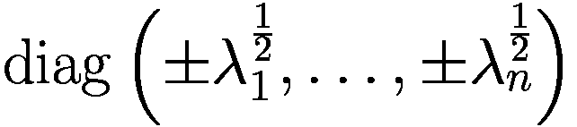。然而，这通常不是一个对称解，并且对于任何标准正交^(¹)矩阵 *U*，Φ*DU* 也是一个解。我们可以证明，*A*^½ 是对称的当且仅当其形式为 Φ*DΦ*^(*T*)，并且 *A*^½ 有 2^(*n*) 个对称解。当 *D* 正定时，我们得到 *A*^½ 的唯一对称正定解为 ΦΛ^½Φ^(*T*)，其中 Λ^½ = 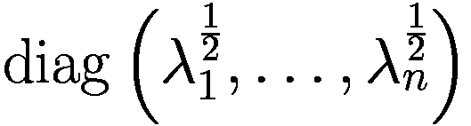。类似地，*A* 的逆平方根 *A*^(–½) 的一个通解是 Φ*D*^(–1)*U*，其中 *D* 如前定义，*U* 是任意标准正交矩阵。*A*^(–½) 的唯一对称正定解是 ΦΛ^(–½)Φ^(*T*)，其中 Λ^(–½) =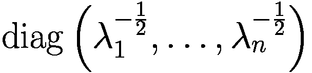。

### 本章概要

在第 3.2、3.3 和 3.4 节中，我将讨论三种用于自适应计算 *A*^½ 的算法。第 3.4 节讨论了 *A*^½ 的唯一对称正定解。在第 3.5、3.6 和 3.7 节中，我将讨论三种用于自适应计算 *A*^(–½) 的算法。第 3.7 节描述了 *A*^(–½) 的唯一对称正定解。第 3.8 节展示了使用 10 维高斯数据对六种算法的实验结果。第 3.9 节对本章进行总结。

## 3.2 自适应平方根算法：方法 1

设 {**x**[*k*∈]ℜ^(*n*)} 是一个数据向量序列，其在线数据相关矩阵 *A*[*k*∈]ℜ^(*nXn*) 由下式给出：

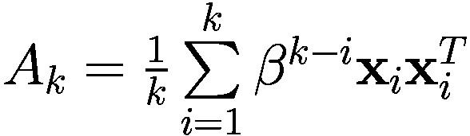。     (3.1)

这里 **x**[*k*] 是时刻 *k* 的观测向量，0<*β*≤1 是用于非平稳序列的遗忘因子。如果数据是平稳的，渐近相关矩阵 *A* 为：

![$$ A=\underset{k\to \infty }{\lim }E\left[{A}_k\right] $$](images/522202_1_En_3_Chapter/522202_1_En_3_Chapter_TeX_IEq5.png)。     (3.2)

### 目标函数

遵循第 1.​4 节描述的方法，我首先给出一个目标函数 *J*，该函数关于矩阵 *W* 的最小值给出了渐近数据相关矩阵 *A* 的平方根。目标函数为：

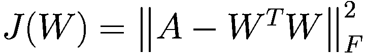。     (3.3)

*J*(*W*) 关于 *W* 的梯度为：

∇[*W*]*J*(*W*) =  − 4*W*(*A* − *W*^(*T*)*W*)。     (3.4)

### 自适应算法

根据 (3.4) 中的梯度，我们得到以下自适应梯度下降算法：

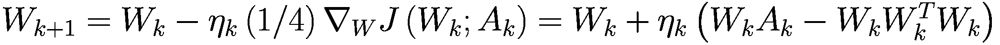，     (3.5)

其中 *η*[*k*] 是一个小的递减常数，并遵循 GitHub [Chatterjee GitHub] 上收敛性证明中的假设 A1.2。

以下 Python 代码使用数据 `X[nDim,nSamples]` 实现了此算法：

```
for epoch in range(nEpochs):
for iter in range(nSamples):
cnt = nSamples*epoch + iter
x = X[:,iter]
x = x.reshape(nDim,1)
A = A + (1.0/(1 + cnt))*((np.dot(x, x.T)) - A)
etat1 = 1.0/(50 + cnt)
# 算法 1
W1 = W1 + etat1 * (W1 @ A - W1 @ W1.T @ W1)
```

## 3.3 自适应平方根算法：方法 2

### 目标函数

目标函数 *J*(*W*)，其关于 *W* 的最小值给出了 *A* 的平方根，为：

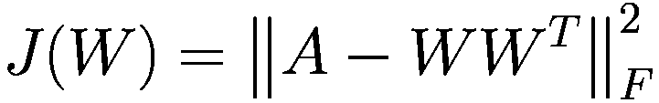。     (3.6)

*J*(*W*) 关于 *W* 的梯度为：

∇[*W*]*J*(*W*) =  − 4(*A* − *WW*^(*T*) )*W*。     (3.7)

### 自适应算法

我们得到以下用于 *A* 的平方根的自适应梯度下降算法：

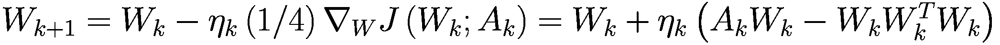，     (3.8)

其中 *η*[*k*] 是一个小的递减常数。

以下 Python 代码使用数据 `X[nDim,nSamples]` 实现了此算法：

```
for epoch in range(nEpochs):
for iter in range(nSamples):
cnt = nSamples*epoch + iter
x = X[:,iter]
x = x.reshape(nDim,1)
A = A + (1.0/(1 + cnt))*((np.dot(x, x.T)) - A)
etat1 = 1.0/(50 + cnt)
# 算法 2
W2 = W2 + etat1 * (A @ W2 - W2 @ W2.T @ W2)
```

## 3.4 自适应平方根算法：方法 3

### 自适应算法

遵循自适应算法 (3.5) 和 (3.8)，我现在提出一种用于计算 *A* 的对称正定平方根的算法：

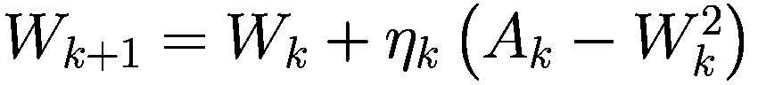，     (3.9)

其中 *η*[*k*] 是一个小的递减常数，且 *W*[*k*] 是对称的。

以下 Python 代码使用数据 `X[nDim,nSamples]` 实现了此算法：

```
for epoch in range(nEpochs):
for iter in range(nSamples):
cnt = nSamples*epoch + iter
x = X[:,iter]
x = x.reshape(nDim,1)
A = A + (1.0/(1 + cnt))*((np.dot(x, x.T)) - A)
etat2 = 1.0/(50 + cnt)
# 算法 3
W3 = W3 + etat2 * (A - W3 @ W3)
```

## 3.5 自适应逆平方根算法：方法 1

### 目标函数

目标函数 *J*(*W*)，其最小化器 *W*^(***) 给出了 *A* 的逆平方根，为：

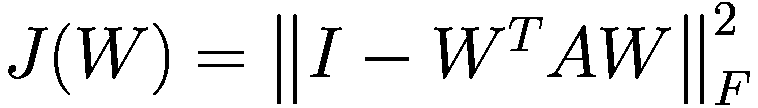。     (3.10)

*J*(*W*) 关于 *W* 的梯度为：

∇[*W*]*J*(*W*) =  − 4*AW*(*I* − *W*^(*T*)*AW*)。     (3.11)

### 自适应算法

根据 (3.11) 中的梯度，我们得到以下自适应梯度下降算法：

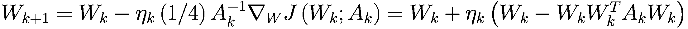     (3.12)

以下 Python 代码使用数据 `X[nDim,nSamples]` 实现了此算法：

```
for epoch in range(nEpochs):
for iter in range(nSamples):
cnt = nSamples*epoch + iter
x = X[:,iter]
x = x.reshape(nDim,1)
A = A + (1.0/(1 + cnt))*((np.dot(x, x.T)) - A)
etat1 = 1.0/(100 + cnt)
# 算法 1
W1 = W1 + etat1 * (W1 - W1 @ W1.T @ A @ W1)
```

## 3.6 自适应逆平方根算法：方法 2


### 目标函数

目标函数 *J*(*W*) 关于 *W* 的最小化给出了 *A* 的逆平方根，其表达式为：

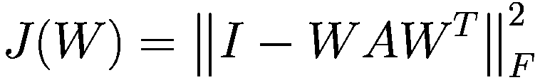。     (3.13)

*J*(*W*) 关于 *W* 的梯度为：

∇[*W*]*J*(*W*) =  − 4(*I* − *WAW*^(*T*))*WA*。     (3.14)

### 自适应算法

我们得到以下用于计算 *A* 的逆平方根的自适应算法：

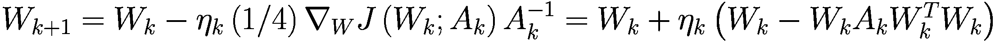，     (3.15)

其中 *η*[*k*] 是一个小的递减常数。

以下 Python 代码使用数据 `X[nDim,nSamples]` 实现了该算法：

```
for epoch in range(nEpochs):
for iter in range(nSamples):
cnt = nSamples*epoch + iter
x = X[:,iter]
x = x.reshape(nDim,1)
A = A + (1.0/(1 + cnt))*((np.dot(x, x.T)) - A)
etat1 = 1.0/(100 + cnt)
# 算法 2
W2 = W2 + etat1 * (W2 - W2 @ A @ W2.T @ W2)
```

## 3.7 自适应逆平方根算法：方法 3

### 自适应算法

通过扩展自适应算法 (3.12) 和 (3.15)，我现在提出一种用于计算 *A* 的对称正定逆平方根的自适应算法：

*W*[*k* + 1] = *W*[*k*] + *η**k*，     (3.16)

其中 *η*[*k*] 是一个小的递减常数，且 *W*[*k*] 是对称的。

以下 Python 代码使用数据 `X[nDim,nSamples]` 实现了该算法：

```
for epoch in range(nEpochs):
for iter in range(nSamples):
cnt = nSamples*epoch + iter
x = X[:,iter]
x = x.reshape(nDim,1)
A = A + (1.0/(1 + cnt))*((np.dot(x, x.T)) - A)
etat2 = 1.0/(100 + cnt)
# 算法 3
W3 = W3 + etat2 * (I - W3 @ A @ W3)
```

## 3.8 实验结果

我生成了 500 个 10 维（即 *n*=10）高斯数据样本 {**x**[*k*]}，其均值为零，协方差如下所示。该协方差矩阵是通过将 [Okada and Tomita 85] 中的第一个协方差矩阵乘以 3 得到的。协方差矩阵为：

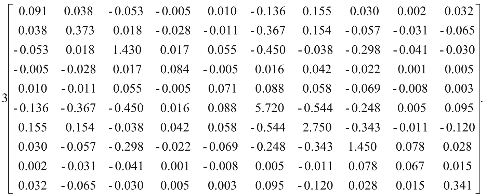

该协方差矩阵的特征值为：

[17.699, 8.347, 5.126, 3.088, 1.181, 0.882, 0.261, 0.213, 0.182, 0.151]。

### 自适应平方根算法实验

我分别使用方法 1、2、3 的自适应算法 (3.5)、(3.8) 和 (3.9) 来计算平方根 *A*，其中 *A* 是根据所有收集到的样本计算出的相关矩阵，如下所示：

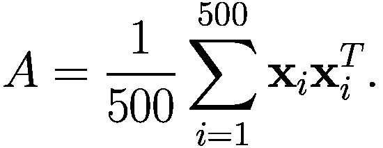

我以 *W*[0]=*I*（10X10 单位矩阵）启动算法。在每个算法的第 *k* 次更新时，我计算了实际相关矩阵 *A* 与每种方法对应的 *W*[*k*] 的平方之间的误差的 Frobenius 范数 [Frobenius 范数，维基百科]。我将此误差记为 *e*[*k*]，如下所示：

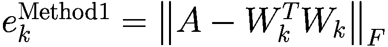，     (3.17)

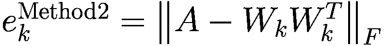，     (3.18)

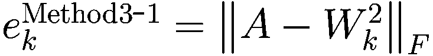，     (3.19)

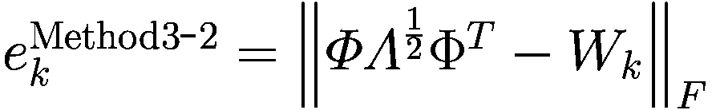。     (3.20)

对于每种算法，我通过 (2.5) 式（其中 *β*=1）从 **x**[*k*] 生成 *A*[*k*]。在 (3.9) 中，我计算了 *A*^½ 的唯一正定解与其估计值 *W*[*k*] 之间的误差。图 3-4 通过绘制四个误差 *e*[*k*] 随 *k* 的变化曲线，展示了所有三种方法的收敛图。在 500 个样本之后，*e*[*k*] 的最终值为：方法 1 和 2 的 *e*[500] = 0.451，方法 3-1 (3.19) 的 *e*[500] = 0.720，方法 3-2 (3.20) 的 *e*[500] = 0.250。

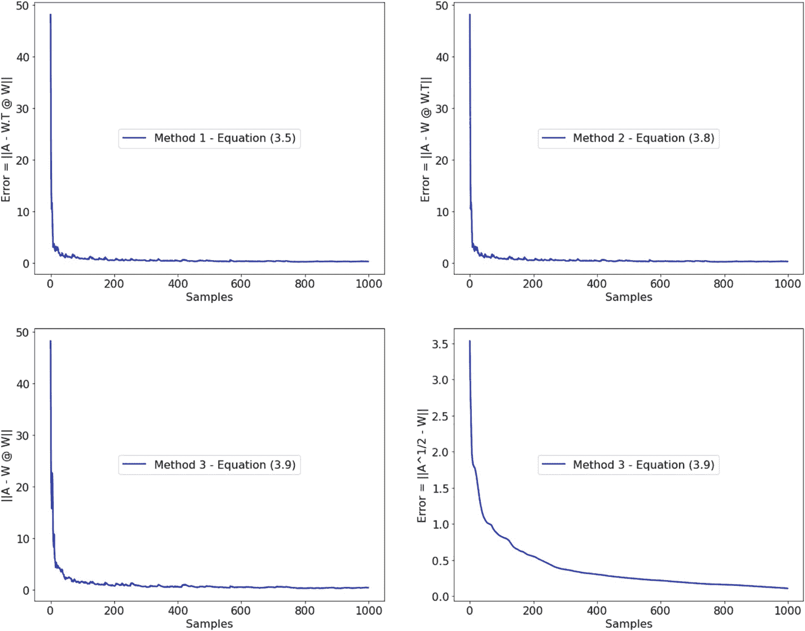

图 3-4

A^½ 算法 (3.5)、(3.8) 和 (3.9) 的收敛情况

从图 3-4 可以清楚地看出，所有误差都接近于零。与实际值相比的微小差异是由于输入数据变化导致 *W*[*k*] 元素中的随机波动造成的。

### 自适应逆平方根算法实验

我分别使用方法 1、2、3 的自适应算法 (3.12)、(3.15) 和 (3.16) 来计算逆平方根 *A*。我以 *W*[0]=*I*（10X10 单位矩阵）启动算法。在每个算法的第 *k* 次更新时，我计算了实际相关矩阵 *A* 与每种方法对应的 *W*[*k*] 的逆平方之间的误差的 Frobenius 范数。我将此误差记为 *e*[*k*]，如下所示：

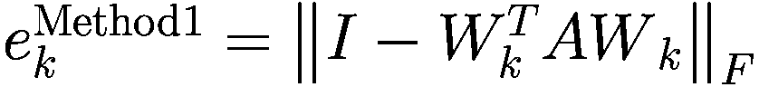，     (3.21)

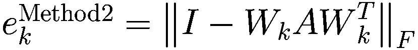，     (3.22)

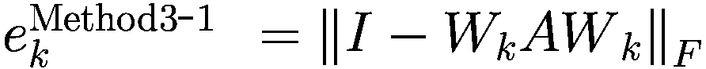，     (3.23)

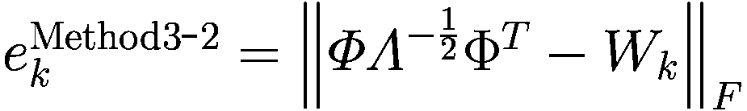，     (3.24)

在 (3.24) 中，我计算了 *A*^(–½) 的唯一正定解与其估计值 *W*[*k*] 之间的误差。图 3-5 通过绘制四个误差 *e*[*k*] 随 *k* 的变化曲线，展示了所有三种方法的收敛图。在 500 个样本之后，*e*[*k*] 的最终值为：方法 1 和 2 的 *e*[500] = 0.419，方法 3-1 (3.23) 的 *e*[500] = 0.630，方法 3-2 (3.24) 的 *e*[500] = 0.823。

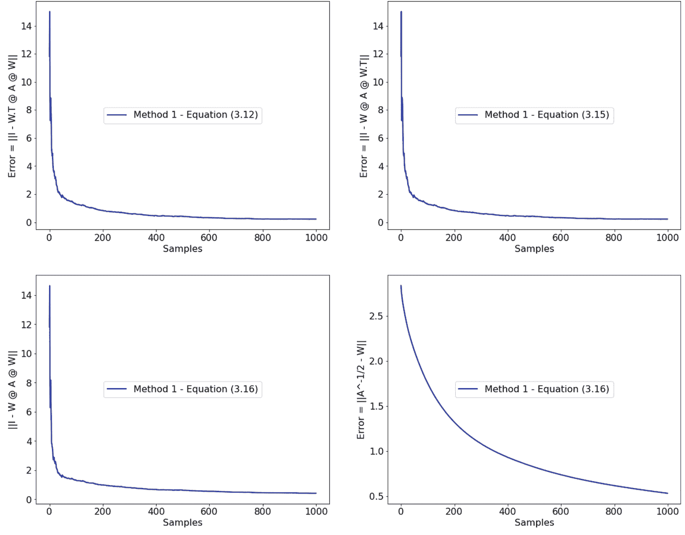

图 3-5

A^(–½) 算法 (3.12)、(3.15) 和 (3.16) 的收敛情况

从图 3-5 可以清楚地看出，所有误差都接近于零。与之前一样，使用更多轮次的实验显示估计精度有所提高。


## 3.9 结论

我提出了六种自适应算法，用于计算随机向量序列相关矩阵的平方根和逆平方根。在四种情况下，我给出了目标函数，并且在所有情况下，我都讨论了算法的收敛特性。请注意，虽然我在这些目标函数上应用了梯度下降技术，但我本可以应用任何其他非线性优化技术，例如最速下降法、共轭方向法、牛顿-拉夫森法或递归最小二乘法。目标函数的可用性使我们能够通过在其上应用新的优化技术来推导新算法，并且还可以对自适应算法进行收敛性分析。

脚注 1

