# 4. 第一主特征向量

## 4.1 引言与用例

在本章中，我提出了一个统一的框架，用于推导和讨论十种用于主特征向量计算的自适应算法（其中一些是众所周知的），这也被称为主成分分析（PCA）或卡洛南-洛伊变换。一个对称正定矩阵 *A*∈ℜ^(*nXn*) 的*第一主特征向量*，是对应于 *A* 的最大特征值 λ[1] 的特征向量 **ϕ**[1]。这里 *A***ϕ**[*i*]= λ[*i*]**ϕ**[*i*] 对于 *i*=1,…,*n*，其中 λ[1]>λ[2]≥...≥λ[*n*]>0 是 *A* 的 *n* 个最大特征值，分别对应于特征向量 **ϕ**[1],…,**ϕ**[*n*]。

机器学习中的一个重要问题是提取最能代表多维数据变化的最显著特征。这将多维数据降维到一维，从而易于建模。然而，在实际应用中，数据统计特性会随时间变化（非平稳）。因此，设计一种能够在低内存、低计算量的边缘设备上适应变化数据的解决方案颇具挑战性。

图 4-1 展示了一个流式 10 维非平稳数据的示例，该数据在 500 个样本点后统计特性发生突变。叠加的红色曲线显示了由自适应算法估计出的主特征向量。主特征向量的自适应估计值在 50 个样本点内收敛到其真实值。当数据在 500 个样本点后发生突变时，它会重新适应变化后的数据，并在 100 个样本点内重新收敛到其真实值。所有这些都是在低计算量、低内存和低延迟的条件下实现的。

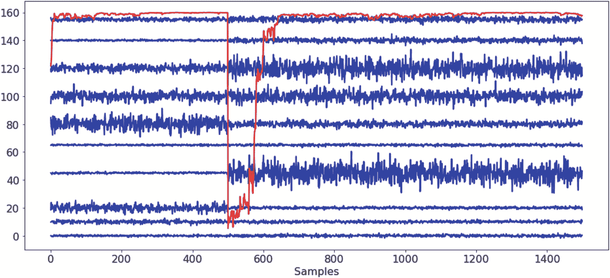

图 4-1

尽管数据发生突变，自适应算法仍能快速计算出第一主特征向量并使其收敛

除了这个例子，在机器学习、模式分析、信号处理、蜂窝通信和自动控制等领域 [Haykin 94, Owsley 78, Pisarenko 73, Chatterjee et al*.* 97-99, Chen et al*.* 99, Diamantaras and Strintzis 97] 中，还有若干应用需要在线（即实时）求解主特征分解。正如第 2 章所讨论的，在这些实时场景中，底层的相关矩阵 *A* 是未知的。相反，我们有一个随机向量序列 {**x**[*k*]∈ℜ^(*n*)}，从中我们可以获得一个瞬时矩阵序列 {*A*[*k*]∈ℜ^(*nxn*)}，使得 *A* = lim[*k→*∞]*E*[*A*[*k*]]。对于每一个新输入的样本 **x**[*k*]，我们需要获得主特征向量 **ϕ**[1] 的当前估计值 **w**[*k*]，使得 **w**[*k*] 强收敛于其真实值 **ϕ**[1]。

计算 **ϕ**[1] 的在线估计值 **w**[*k*] 的一种常用方法是最大化*瑞利商* (RQ) [Golub and VanLoan 83] 准则 *J*(**w**[*k*];*A*[*k*])，其中

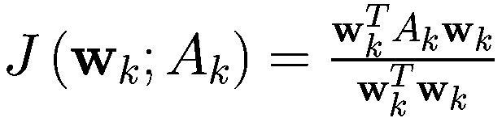。     (4.1)

信号 **x**[*k*] 可以通过将其投影到 **w**[*k*] 上压缩为单个值，即 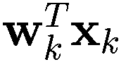。

关于 PCA 算法的文献非常多样化，从业者从不同的背景出发来处理这个问题，包括信号处理、神经学习和统计模式识别。在每个学科内，自适应 PCA 算法都是从其自身的角度推导出来的，其中可能包括特设方法。由于 PCA 算法的方法和解决方案分散在不同的学科领域，因此需要一个统一的框架来推导和分析这些算法。

在本章中，我提供了一个通用框架，用于按照第 1.​4 节概述的四个步骤，对十种自适应算法进行推导、收敛性和速率分析。对于每种算法，我都给出了每个步骤的结果。这个统一框架有助于对这十种算法进行比较研究。在此过程中，我对已知算法提供了新的视角，并提出了两种新的 PCA 自适应算法。对于已知算法，如果先前实现中已有结果，我会加以说明；否则，我会提供新的结果。对于新算法，我会证明我的结果。

### 本章概要

在第 4.2 节中，我列出了本章将推导和讨论的自适应 PCA 算法。我还列出了推导这些算法所依据的目标函数以及必要的假设。第 4.3 节介绍了 Oja PCA 算法并描述了其收敛特性。在第 4.4 节中，我分析了三种基于瑞利商准则 (4.1) 的算法。在第 4.5 节中，我讨论了基于信息论准则的 PCA 算法。第 4.6 节描述了均方误差目标函数及其算法。在第 4.7 节中，我讨论了基于惩罚函数的算法。第 4.8 和 4.9 节提出了基于增广拉格朗日准则的新 PCA 算法。第 4.10 节总结了收敛性结果。第 4.11 节讨论了实验结果。最后，第 4.12 节对本章进行了总结。

## 4.2 算法与目标函数


### 自适应算法

[Chatterjee *神经网络*，第 18 卷，第 2 期，第 145-149 页，2005 年 3 月]。

我根据算法的发明者或其推导所依据的目标函数，对它们进行了分类。所有算法的形式均为

**w**[*k* + 1] = **w**[*k*] + *η*[*k*]*h*(**w**[*k*], *A*[*k*]),     (4.2)

其中函数 *h*(**w**[*k*],*A*[*k*]) 遵循特定的连续性和正则性属性 [Ljung 77,92]，而 *η*[*k*] 是一个递减的增益序列。各种自适应算法的项 *h*(**w**[*k*];*A*[*k*]) 如下：

*   OJA: 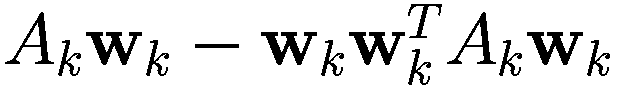.

*   RQ: 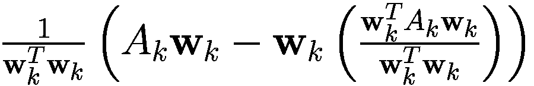.

*   OJAN: 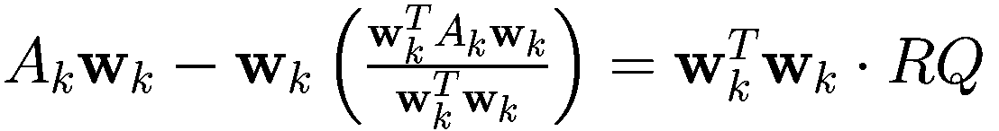.

*   LUO: 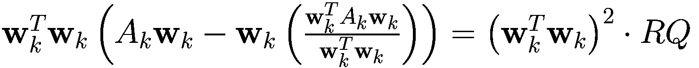.

*   IT: 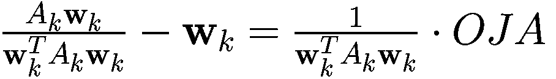

*   XU: 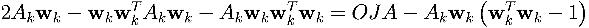.

*   PF: 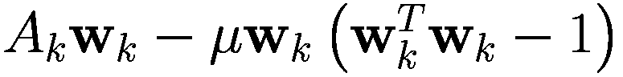.

*   OJA+: 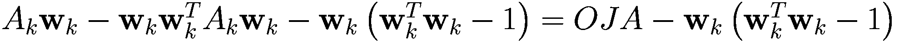

*   AL1: 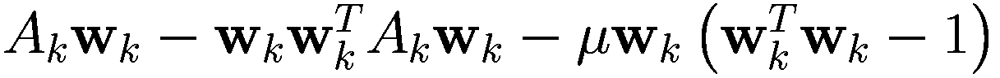.

*   AL2: 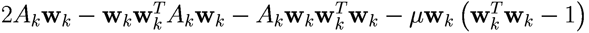.

这里 IT 代表信息论，AL 代表增广拉格朗日法。尽管这些算法大多已知，但新的 AL1 和 AL2 算法是从本章后面讨论的增广拉格朗日目标函数推导出来的。

### 目标函数

按照我在第 2.2 章中提出的方法论，前面提到的所有算法都是从目标函数推导出来的。其中一些目标函数包括：

*   OJA 算法的目标函数，
*   最小均方误差准则，
*   瑞利商准则，
*   罚函数法，
*   信息论准则，以及
*   增广拉格朗日法。

## 4.3 OJA 算法

该算法由 Oja 等人 [Oja 85, 89, 92] 提出。直观上，OJA 算法是通过将瑞利商准则表示为拉格朗日函数推导出来的，该函数在约束条件  下最小化 。

### 目标函数

根据数据样本 **x**[*k*]，OJA 算法的目标函数可以写为

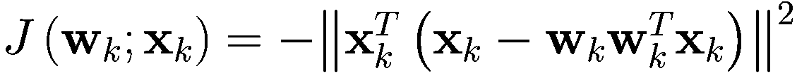     (4.3)

如果我们用数据相关矩阵 *A*[*k*] 的瞬时值 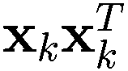 来表示它，那么 (4.3) 等价于以下目标函数：

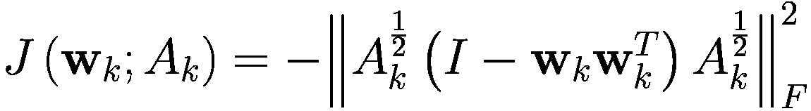.     (4.4)

从 (4.4) 中我们可以看到，目标函数 *J*(**w**[*k*];**x**[*k*]) 表示样本 **x**[*k*] 与其经过矩阵 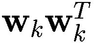 变换后的结果之间的差异。在神经网络中，这种变换被称为*自联想*^(²) [Haykin 94]。图 4-2 展示了一个两层自联想网络。

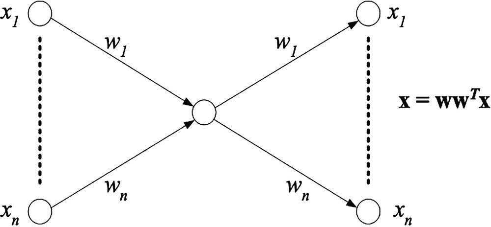

图 4-2

用于第一主特征向量的两层线性自联想神经网络

### 自适应算法

(4.4) 关于 **w**[*k*] 的梯度为

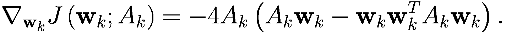

用于 PCA 的自适应梯度下降 OJA 算法为

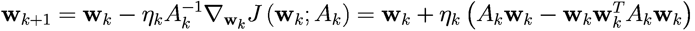,     (4.5)

其中 *η*[*k*] 是一个小的递减常数。

该算法针对多维数据 `X[nDim,nSamples]` 的 Python 代码如下：

```
A = np.zeros(shape=(nDim,nDim)) # 存储自适应相关矩阵
w = 0.1 * np.ones(shape=(nDim,11)) # 所有算法的权重向量
for epoch in range(nEpochs):
for iter in range(nSamples):
cnt = nSamples*epoch + iter
x = X[:,iter]
x = x.reshape(nDim,1)
A = A + (1.0/(1 + cnt))*((np.dot(x, x.T)) - A)
# OJA 算法
v = w[:,0].reshape(nDim, 1)
v = v + (1/(100+cnt))*(A @ v - v @ (v.T @ A @ v))
w[:,0] = v.reshape(nDim)
```

### 收敛速度

主特征向量 **ϕ**[1] 的收敛时间常数为 1/*λ*[1]，对于次要特征向量 **ϕ**[*i*]（*i*=2,…,*n*），其时间常数为 1/(*λ*[1]–*λ*[*i*])。这些时间常数取决于数据相关矩阵 *A* 的特征结构。

## 4.4 RQ、OJAN 和 LUO 算法

### 目标函数

这三种算法是以下瑞利商目标函数的不同推导形式：

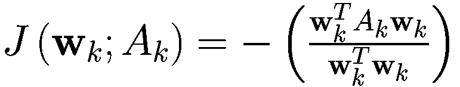.     (4.6)

这些算法最初由 Luo 等人 [Luo 等人 97; Taleb 等人 99; Cirrincione 等人 00] 和 Oja 等人 [Oja 等人 92] 提出。许多实践者提出了 RQ 算法的变体 [Chauvin 89; Sarkar 等人 89; Yang 等人 89; Fu and Dowling 95; Taleb 等人 99; Cirrincione 等人 00]。


### 自适应算法

关于 **w**[*k*] 的 (4.7) 的梯度为

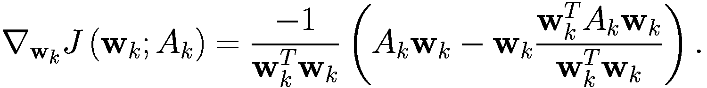

用于 PCA 的自适应梯度下降 RQ 算法为

.     (4.7)

用于 PCA 的自适应梯度下降 OJAN 算法为

.     (4.8)

用于 PCA 的自适应梯度下降 LUO 算法为

.     (4.9)

这些算法处理多维数据 `X[nDim,nSamples]` 的 Python 代码如下

```
A = np.zeros(shape=(nDim,nDim)) # stores adaptive correlation matrix
w = 0.1 * np.ones(shape=(nDim,11)) # weight vectors of all algorithms
for epoch in range(nEpochs):
for iter in range(nSamples):
cnt = nSamples*epoch + iter
x = X[:,iter]
x = x.reshape(nDim,1)
A = A + (1.0/(1 + cnt))*((np.dot(x, x.T)) - A)
# OJAN Algorithm
v = w[:,1].reshape(nDim, 1)
v = v + (1/(10+cnt))*(A @ v - v @ ((v.T @ A @ v) / (v.T @ v)) )
w[:,1] = v.reshape(nDim)
# LUO Algorithm
v = w[:,2].reshape(nDim, 1)
v = v + (1/(20+cnt))*(A @ v * (v.T @ v) - v @ (v.T @ A @ v))
w[:,2] = v.reshape(nDim)
# RQ Algorithm
v = w[:,3].reshape(nDim, 1)
v = v + (1/(100+cnt))*(A @ v - v @ ((v.T @ A @ v) / (v.T @ v)) )
w[:,3] = v.reshape(nDim)
```

### 收敛速度

对于*主特征向量* **ϕ**[1] 的收敛时间常数为

RQ: ‖**w**[0]‖²/*λ*[1].

OJAN: 1/*λ*[1].

LUO: ‖**w**[0]‖^(–2)/*λ*[1].

对于次要特征向量 **ϕ**[*i*] (*i*=2,…,*n*) 的收敛时间常数为

RQ: ‖**w**[0]‖²/(*λ*[1]–*λ*[*i*]) 对于 *i*=2,…,*n*.

OJAN: 1/(*λ*[1]–*λ*[*i*]) 对于 *i*=2,…,*n*.

LUO: ‖**w**[0]‖^(–2)/(*λ*[1]–*λ*[*i*]) 对于 *i*=2,…,*n*.

这些时间常数依赖于 *A* 的特征结构。

## 4.5 IT 算法

### 目标函数

信息论（IT）准则的目标函数为

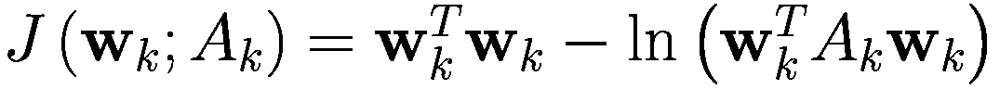.     (4.10)

Plumbley [Pumbley 95] 以及 Miao 和 Hua [Miao and Hua 98] 研究了该目标函数。

### 自适应算法

关于 **w**[*k*] 的 (4.12) 的梯度为

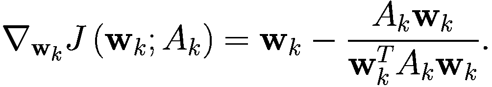

用于 PCA 的自适应梯度下降 IT 算法为

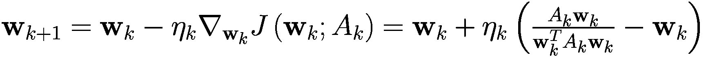.     (4.11)

该算法处理多维数据 `X[nDim,nSamples]` 的 Python 代码如下

```
A = np.zeros(shape=(nDim,nDim)) # stores adaptive correlation matrix
w = 0.1 * np.ones(shape=(nDim,11)) # weight vectors of all algorithms
for epoch in range(nEpochs):
for iter in range(nSamples):
cnt = nSamples*epoch + iter
x = X[:,iter]
x = x.reshape(nDim,1)
A = A + (1.0/(1 + cnt))*((np.dot(x, x.T)) - A)
# IT Algorithm
v = w[:,5].reshape(nDim, 1)
v = v + (4/(1+cnt))*((A @ v / (v.T @ A @ v)) - v)
w[:,5] = v.reshape(nDim)
```

### 收敛速度

该算法的一个独特之处在于 ‖**w**(*t*)‖ 的时间常数为 1，并且*独立于* *A* 的特征结构。

### η[k] 的上界

我已经证明存在一个统一的 η[k] 上界，使得 **w**[k] 一致有界。此外，如果 ‖**w**[*k*]‖² ≤ α+1，那么当满足以下条件时，‖**w**[*k*+1]‖² ≤ ‖**w**[*k*]‖²

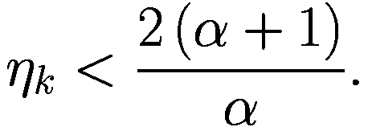

## 4.6 XU 算法

### 目标函数

最初由 Xu [Xu 91, 93] 提出，XU 算法的目标函数为

     (4.12)

目标函数 *J*(**w**[*k*];*A*[*k*]) 表示样本 **x**[*k*] 与其经矩阵  变换后的结果之间的均方误差。这种变换也称为*自关联*，如图 4-1 所示。我们定义 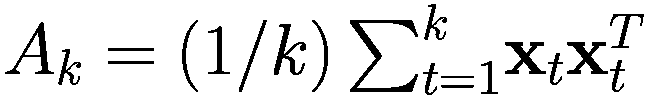。那么，均方误差目标函数为


这与 (4.12) 相同。

### 自适应算法

关于 **w**[*k*] 的 (4.12) 的梯度为

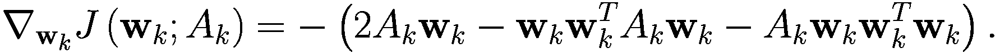

用于 PCA 的自适应梯度下降 XU 算法为

.     (4.13)

该算法处理多维数据 `X[nDim,nSamples]` 的 Python 代码如下

```
A = np.zeros(shape=(nDim,nDim)) # stores adaptive correlation matrix
w = 0.1 * np.ones(shape=(nDim,11)) # weight vectors of all algorithms
for epoch in range(nEpochs):
for iter in range(nSamples):
cnt = nSamples*epoch + iter
x = X[:,iter]
x = x.reshape(nDim,1)
A = A + (1.0/(1 + cnt))*((np.dot(x, x.T)) - A)
# XU Algorithm
v = w[:,6].reshape(nDim, 1)
v = v + (1/(50+cnt))*(2*A@ v - v@(v.T @ A @ v) - A@ v@ (v.T @ v))
w[:,6] = v.reshape(nDim)
```


### 收敛速率

主特征向量 **ϕ**[1] 的收敛时间常数为 1/*λ*[1]，次特征向量 **ϕ**[*i*]（*i*=2,…,*n*）的收敛时间常数为 1/(*λ*[1]–*λ*[*i*])。这些时间常数取决于数据相关矩阵 *A* 的特征结构。

### η[k] 的上界

存在一个统一的 η[*k*] 上界，使得 **w**[*k*] 几乎必然一致有界。如果 ‖**w**[k]‖² ≤ α+1，且 *θ* 是 *A*[*k*] 的最大特征值，则当满足以下条件时，有 ‖**w**[*k*+1]‖² ≤ ‖**w**[*k*]‖²：

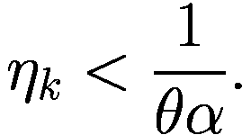

## 4.7 惩罚函数算法

### 目标函数

惩罚函数（PF）算法的目标函数最初由 Chauvin [Chauvin 89] 提出，其形式为：

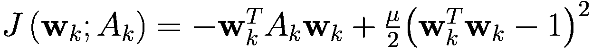, *μ* > 0.     (4.14)

目标函数 *J*(**w**[*k*];*A*[*k*]) 是瑞利商准则 (4.1) 的一种实现，其中约束条件  通过非线性优化中的惩罚函数方法强制执行，*μ* 是一个正的惩罚常数。

### 自适应算法

(4.14) 关于 **w**[*k*] 的梯度为：

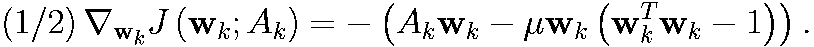

用于 PCA 的自适应梯度下降 PF 算法为：

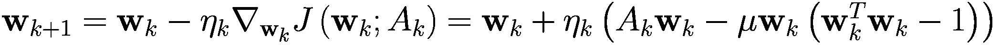,     (4.15)

其中 *μ* > 0。

该算法针对多维数据 `X[nDim,nSamples]` 的 Python 代码如下：

```
mu = 10
A = np.zeros(shape=(nDim,nDim)) # stores adaptive correlation matrix
w = 0.1 * np.ones(shape=(nDim,11)) # weight vectors of all algorithms
for epoch in range(nEpochs):
for iter in range(nSamples):
cnt = nSamples*epoch + iter
x = X[:,iter]
x = x.reshape(nDim,1)
A = A + (1.0/(1 + cnt))*((np.dot(x, x.T)) - A)
# PF Algorithm
v = w[:,7].reshape(nDim, 1)
v = v + (1/(50+cnt)) * (A @ v - mu * v @ (v.T @ v - 1))
w[:,7] = v.reshape(nDim)
```

### 收敛速率

主特征向量 **ϕ**[1] 的收敛时间常数为 1/(*λ*[1] + *μ*)，次特征向量 **ϕ**[*i*]（*i*=2,…,*n*）的收敛时间常数为 1/(*λ*[1]–*λ*[*i*])。这些时间常数取决于数据相关矩阵 *A* 的特征结构。

### η[k] 的上界

存在一个统一的 η[k] 上界，使得 **w**[k] 一致有界。如果 ‖**w**[k]‖² ≤ α+1，且 *θ* 是 *A*[k] 的最大特征值，则当满足以下条件时，有 ‖**w**[k+1]‖² ≤ ‖**w**[k]‖²：

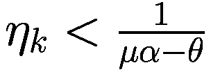，假设 μα>θ。

## 4.8 增广拉格朗日 1 算法

### 目标函数与自适应算法

增广拉格朗日 1（AL1）算法的目标函数是通过应用非线性优化的增广拉格朗日方法，在约束条件  下最小化 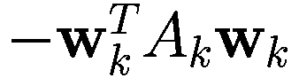 而得到的：

,     (4.16)

其中 *α*[*k*] 是拉格朗日乘子，*μ* 是正的惩罚常数。*J*(**w**[*k*];*A*[*k*]) 关于 **w**[*k*] 的梯度为：

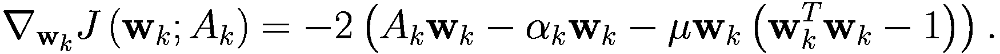

令该梯度等于 **0** 并利用约束条件 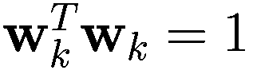，我们得到 *α*[*k*]=**w**[*k*]^(*T*)*A*[*k*]**w**[*k*]。将此 *α*[*k*] 代入梯度中，得到 AL1 算法：

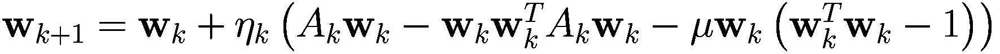,     (4.17)

其中 *μ* > 0。注意，当 *μ* =1 时，(4.17) 与 OJA+ 算法相同。

该算法针对多维数据 `X[nDim,nSamples]` 的 Python 代码如下：

```
mu = 10
A = np.zeros(shape=(nDim,nDim)) # stores adaptive correlation matrix
w = 0.1 * np.ones(shape=(nDim,11)) # weight vectors of all algorithms
for epoch in range(nEpochs):
for iter in range(nSamples):
cnt = nSamples*epoch + iter
x = X[:,iter]
x = x.reshape(nDim,1)
A = A + (1.0/(1 + cnt))*((np.dot(x, x.T)) - A)
# AL1 Algorithm
v = w[:,8].reshape(nDim, 1)
v = v + (1/(50+cnt))*(A@v - v@(v.T @A @ v) - mu* v@ (v.T@v - 1))
w[:,8] = v.reshape(nDim)
```

### 收敛速率

主特征向量 **ϕ**[1] 的收敛时间常数为 1/(*λ*[1] + *μ*)，次特征向量 **ϕ**[*i*]（*i*=2,…,*n*）的收敛时间常数为 1/(*λ*[1]–*λ*[*i*])。这些时间常数取决于数据相关矩阵 *A* 的特征结构。

### η[k] 的上界

存在一个统一的 η[k] 上界，使得 **w**[k] 一致有界。如果 ‖**w**[k]‖² ≤ α+1，且 *θ* 是 A[k] 的最大特征值，则当满足以下条件时，有 ‖**w**[k+1]‖ ² ≤ ‖**w**[k]‖²：

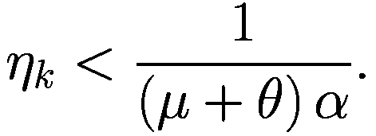

## 4.9 增广拉格朗日 2 算法

### 目标函数

增广拉格朗日 2（AL2）算法的目标函数为：

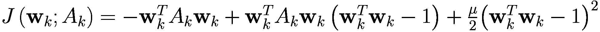     (4.18)

目标函数 *J*(**w**[*k*];*A*[*k*]) 是增广拉格朗日方法在瑞利商准则 (4.1) 上的一个应用。它使用了 XU 目标函数，同时也使用了惩罚函数方法 (4.14)，其中 *μ* 是一个正的惩罚常数。


### 自适应算法

关于 **w**[*k*] 的 (4.18) 的梯度为


用于 PCA 的自适应梯度下降 AL2 算法为

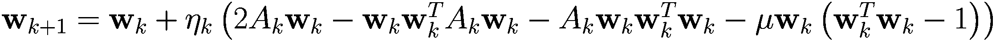,    (4.19)

其中 *μ* > 0。

该算法针对多维数据 `X[nDim,nSamples]` 的 Python 代码如下：

```
mu = 10
A = np.zeros(shape=(nDim,nDim)) # stores adaptive correlation matrix
w = 0.1 * np.ones(shape=(nDim,11)) # weight vectors of all algorithms
for epoch in range(nEpochs):
for iter in range(nSamples):
cnt = nSamples*epoch + iter
x = X[:,iter]
x = x.reshape(nDim,1)
A = A + (1.0/(1 + cnt))*((np.dot(x, x.T)) - A)
# AL2 Algorithm
v = w[:,9].reshape(nDim, 1)
v = v + (1/(50+cnt))*(2* A @ v - v @ (v.T @ A @ v) –
A@ v @ (v.T @ v) - mu* v @ (v.T @ v -1))
w[:,9] = v.reshape(nDim)
```

### 收敛速度

主特征向量 **ϕ**[1] 的收敛时间常数为 1/(*λ*[1] + (*μ*/2))，次特征向量 **ϕ**[*i*] 的收敛时间常数为 1/(*λ*[1]–*λ*[*i*])，其中 *i*=2,…,*n*。这些时间常数取决于数据相关矩阵 *A* 的特征结构。

### η[k] 的上界

存在一个统一的 η[k] 上界，使得 **w**[*k*] 一致有界。此外，如果 ‖**w**[k]‖² ≤ α+1 且 *θ* 是 *A*[*k*] 的最大特征值，那么当满足以下条件时，‖**w**[k+1]‖² ≤ ‖**w**[k]‖²：

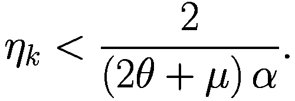

## 4.10 算法总结

表 4-1 总结了各算法的收敛结果。该表还显示了 *η*[*k*] 的上界（如果存在）。其中 *τ* 表示时间常数，**w**[0] 表示 **w**[*k*] 的初始值，α+1 表示 ‖**w**[*k*]‖² 的上界（即 ‖**w**[*k*]‖² ≤ α+1），*θ* 表示 *A*[*k*] 的第一主特征值。

表 4-1

收敛结果总结

| 算法 | 收敛时间常数 | *η*[*k*] 的上界 |
| --- | --- | --- |
| OJA | 1/*λ*[1] | 2/*αθ* |
| OJAN | 1/*λ*[1] | 不可用 |
| LUO | ‖**w**[0]‖^(–2)/*λ*[1] | 不可用 |
| RQ | ‖**w**[0]‖²/*λ*[1] | 不可用 |
| OJA+ | 1/(*λ*[1]+1) | 1/(*α*–*θ*) |
| IT | 1 | 2(*α*+1)/*α* |
| XU | 1/*λ*[1] | 1/*αθ* |
| PF | 1/(*λ*[1]+*μ*) | 1/(*μα*–*θ*) |
| AL1 | 1/(*λ*[1]+*μ*) | 1/(*μ*+*θ*)*α* |
| AL2 | 1/(*λ*[1]+(*μ*/2)) | 2/(*μ*+2*θ*)*α* |

请注意，时间常数越小，收敛速度越快。结论如下：

1.  对于除 IT 之外的所有算法，*λ*[1] 的值越大，**ϕ**[1] 的收敛效果越好。
2.  对于 LUO 算法，‖**w**[0]‖ 越大，时间常数越小，这意味着初始权重越大，收敛效果越好。
3.  对于 RQ 算法，‖**w**[0]‖ 越大，收敛效果越差。
4.  对于 PF、AL1 和 AL2 算法，*μ* 越大，时间常数越小，但 *μ* 值过大会因过度强调约束而导致算法性能不佳。

## 4.11 实验结果

我进行了三组实验。

1.  在第一组实验中，我对单个数据集使用了前面描述的自适应算法，并采用了不同的起始向量 **w**[0] [Chatterjee, *Neural Networks*, Vol. 18, No. 2, pp. 145-149, March 2005]。
2.  在第二组实验中，我生成了多个数据样本，并使用相同的起始向量 **w**[0] 应用了自适应算法 [Chatterjee, *Neural Networks*, Vol. 18, No. 2, pp. 145-149, March 2005]。
3.  在第三组实验中，我使用了一个来自公共数据集的**真实世界非平稳**数据集 [V. Souza et al*.* 2020]，以证明自适应算法能够快速收敛到集成相关矩阵的第一主特征向量。

### 不同起始向量 *w*[*0*] 的实验

[Chatterjee, *Neural Networks*, Vol. 18, No. 2, pp. 145-149, March 2005].

我生成了 1,000 个 10 维高斯数据样本（即 *n*=10），其均值为零，协方差如下所示。该协方差矩阵是通过将 [Okada and Tomita 85] 中的第二个协方差矩阵乘以 3 得到的，即：

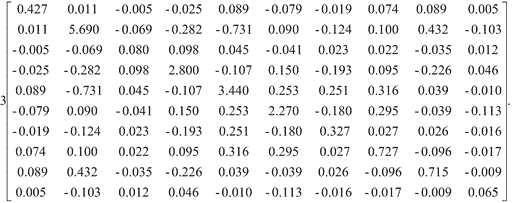     (4.20)

该协方差矩阵的特征值为：

17.9013, 10.2212, 8.6078, 6.5361, 2.2396, 1.8369, 1.1361, 0.7693, 0.2245, 0.1503。

我通过前面描述的自适应算法，从不同的起始向量 **w**[0] 计算了主特征向量（即对应于最大特征值 17.9013 的特征向量）。我取 **w**[0]=*c****r**，其中 **r∈ℜ**¹⁰ 是一个 *N*(0,1) 随机向量，*c*∈[0.05,2.0]。这导致 ‖**w**[0]‖ 从 0.1 变化到 5.0。

为了计算在线数据序列 {*A*[*k*]}，我从协方差矩阵 (4.20) 生成了随机数据向量 {**x**[*k*]}。我使用算法 (2.5) 且 *β*=1，从 {**x**[*k*]} 生成了 {*A*[*k*]}。在收集完所有 500 个样本 **x**[*k*] 后，我按如下方式计算相关矩阵 *A*：

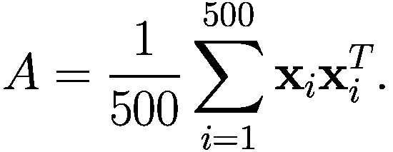

我将通过标准数值分析方法 [Golub and VanLoan 83] 从该 *A* 计算出的特征向量和特征值称为*实际值*。

为了衡量算法的收敛性和准确性，我计算了每个自适应算法在第 *k* 次更新时的百分比方向余弦，公式如下：

百分比方向余弦 (*k*) = 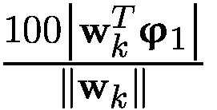,     (4.21)

其中 **w**[*k*] 是在第 *k* 次更新时对 *A*[*k*] 的第一主特征向量的估计值，**ϕ**[1] 是通过传统数值分析方法从所有收集的样本中计算出的实际第一主特征向量。对于所有算法，我使用了 *η*[*k*]=1/(200+*k*)。对于 PF、AL1 和 AL2 算法，我使用了 *μ*=10。结果总结在表 4-2 中。我报告了每个算法在样本值 *k*=*N*/2 和 *N*（即 *k*=250 和 500）之后的百分比方向余弦。

表 4-2

不同初始值 **w**[0] 下，自适应算法在样本值 k={250,500} 时对 A 的主特征向量的收敛情况


| ‖**w**[0]‖ | *k* | OJA | OJAN | LUO | RQ | OJA+ | IT | XU | PF | AL1 | AL2 |
| --- | --- | --- | --- | --- | --- | --- | --- | --- | --- | --- | --- |
| 0.1355 | 250 | 97.18 | 97.18 | 60.78 | 98.44 | 97.18 | 84.53 | 97.22 | 97.17 | 97.18 | 97.20 |
| 500 | 99.58 | 99.58 | 63.15 | 99.96 | 99.58 | 89.67 | 99.58 | 99.58 | 99.58 | 99.58 |
| 0.4065 | 250 | 97.18 | 97.18 | 82.44 | 98.54 | 97.18 | 84.96 | 97.18 | 97.18 | 97.18 | 97.16 |
| 500 | 99.58 | 99.58 | 90.88 | 99.96 | 99.58 | 90.35 | 99.58 | 99.58 | 99.58 | 99.58 |
| 0.6776 | 250 | 97.18 | 97.18 | 94.63 | 97.85 | 97.18 | 82.55 | 97.17 | 97.18 | 97.18 | 97.15 |
| 500 | 99.58 | 99.58 | 98.50 | 99.88 | 99.58 | 88.85 | 99.58 | 99.58 | 99.58 | 99.58 |
| 0.9486 | 250 | 97.18 | 97.18 | 97.05 | 97.28 | 97.18 | 79.60 | 97.18 | 97.18 | 97.18 | 97.17 |
| 500 | 99.58 | 99.58 | 99.52 | 99.63 | 99.58 | 86.90 | 99.58 | 99.58 | 99.58 | 99.58 |
| 1.2196 | 250 | 97.18 | 97.18 | 97.60 | 96.35 | 97.18 | 76.67 | 97.21 | 97.18 | 97.18 | 97.21 |
| 500 | 99.58 | 99.58 | 99.80 | 99.19 | 99.58 | 84.80 | 99.58 | 99.58 | 99.58 | 99.58 |
| 1.4906 | 250 | 97.18 | 97.18 | 97.97 | 94.43 | 97.18 | 73.99 | 97.26 | 97.18 | 97.17 | 97.27 |
| 500 | 99.58 | 99.58 | 99.90 | 98.41 | 99.58 | 82.68 | 99.59 | 99.58 | 99.58 | 99.59 |
| 1.7617 | 250 | 97.17 | 97.18 | 98.31 | 91.53 | 97.18 | 71.63 | 97.33 | 97.18 | 97.16 | 97.35 |
| 500 | 99.58 | 99.58 | 99.95 | 97.08 | 99.58 | 80.61 | 99.59 | 99.58 | 99.58 | 99.59 |
| 2.0327 | 250 | 97.17 | 97.18 | 98.57 | 88.04 | 97.17 | 69.61 | 97.44 | 97.17 | 97.15 | 97.51 |
| 500 | 99.58 | 99.58 | 99.96 | 95.08 | 99.58 | 78.63 | 99.60 | 99.58 | 99.58 | 99.60 |
| 2.3037 | 250 | 97.17 | 97.18 | 98.75 | 84.43 | 97.17 | 67.90 | 97.62 | 97.17 | 97.14 | 97.89 |
| 500 | 99.58 | 99.58 | 99.97 | 92.51 | 99.58 | 76.78 | 99.61 | 99.58 | 99.58 | 99.63 |
| 2.5748 | 250 | 97.16 | 97.18 | 98.89 | 81.00 | 97.16 | 66.46 | 97.96 | 97.16 | 97.11 | 98.55 |
| 500 | 99.58 | 99.58 | 99.98 | 89.59 | 99.58 | 75.07 | 99.63 | 99.58 | 99.58 | 99.77 |
| 2.8458 | 250 | 97.15 | 97.18 | 99.00 | 77.92 | 97.16 | 65.26 | 98.64 | 97.15 | 97.06 | 94.08 |
| 500 | 99.58 | 99.58 | 99.99 | 86.56 | 99.58 | 73.50 | 99.70 | 99.58 | 99.57 | 99.42 |
| 3.1168 | 250 | 97.14 | 97.18 | 99.06 | 75.25 | 97.15 | 64.24 | 16.90 | 97.14 | 96.91 | 95.92 |
| 500 | 99.58 | 99.58 | 99.99 | 83.61 | 99.58 | 72.08 | 60.47 | 99.58 | 99.57 | 99.51 |

表 4-2 展示了

*   除 RQ 和 IT 算法外，所有自适应算法的收敛性相似。

*   除 IT 外，所有算法均以时间常数 ∝ 1/*λ*[1] 收敛。

*   对于 IT 算法，主特征向量的时间常数为 1。由于 *λ*[1]=17.9，所有算法的收敛速度都快于 IT。

*   对于 RQ 和 LUO 算法，其时间常数分别为 ‖**w**[0]‖²/*λ*[1] 和 ‖**w**[0]‖^(–2)/*λ*[1]。

*   显然，对于较大的 ‖**w**[0]‖，RQ 的收敛速度慢于其他算法，而 LUO 的收敛速度快于时间常数为 1/*λ*[1] 的其他算法。

*   对于非常大的 ‖**w**[0]‖（例如 ‖**w**[0]‖=10.0），LUO 算法在 *η*[*k*]=1/(200+*k*) 时无法收敛，因为收敛变得不稳定。

*   对于较小的 ‖**w**[0]‖，RQ 的收敛性优于其他算法，因为其时间常数 ‖**w**[0]‖²/*λ*[1] 小于时间常数为 1/*λ*[1] 的其他算法。

### 不同数据集实验：数据集 1

[Chatterjee, *Neural Networks*, Vol. 18, No. 2, pp. 145-149, March 2005].

此处我使用了协方差矩阵 (4.20)，并添加了一个对称矩阵 *c*R*，其中 *R* 是一个均匀分布 (0,1) 的随机对称矩阵，*c*∈[0.05,2.0]。我生成了 12 组 1,000 个样本的 10 维高斯数据，均值为零，协方差矩阵如 (4.20) 所述为随机矩阵。我选择起始向量 **w**[0]= 0.5*****r**，其中 **r∈ℜ**¹⁰ 是一个 *N*(0,1) 随机向量。我使用 *η*[*k*]=1/(200+*k*)，对于 PF、AL1 和 AL2 算法，我选择 *μ*=10。我为每个数据集上的所有算法生成了百分比方向余弦 (4.21)，并将结果报告在表 4-3 中。对于每个数据集，我列出了最大的两个特征值 *λ*[1] 和 *λ*[2]。

表 4-3

不同数据集下，自适应算法在样本值 k={250,500} 时对 A 的主特征向量的收敛情况

| *λ*[1], *λ*[2] | *k* | OJA | OJAN | LUO | RQ | OJA+ | IT | XU | PF | AL1 | AL2 |
| --- | --- | --- | --- | --- | --- | --- | --- | --- | --- | --- | --- |
| 11.58,   6.32 | 250 | 95.66 | 95.67 | 97.61 | 91.70 | 95.66 | 72.19 | 95.97 | 95.66 | 95.65 | 95.82 |
| 500 | 99.50 | 99.50 | 99.86 | 98.14 | 99.50 | 80.97 | 99.51 | 99.50 | 99.50 | 99.51 |
| 11.63,   6.49 | 250 | 95.50 | 95.54 | 96.93 | 91.65 | 95.51 | 70.57 | 96.34 | 95.51 | 95.46 | 96.18 |
| 500 | 99.51 | 99.51 | 99.87 | 98.28 | 99.51 | 80.39 | 99.54 | 99.51 | 99.51 | 99.54 |
| 11.73,   6.92 | 250 | 87.62 | 86.61 | 97.10 | 56.91 | 87.54 | 47.80 | 46.00 | 86.78 | 88.08 | 36.39 |
| 500 | 98.94 | 98.89 | 99.80 | 91.38 | 98.93 | 60.20 | 96.82 | 98.90 | 98.96 | 98.06 |
| 11.84,   7.18 | 250 | 96.72 | 96.71 | 96.53 | 95.83 | 96.72 | 73.84 | 96.54 | 96.72 | 96.73 | 96.60 |
| 500 | 99.30 | 99.30 | 99.75 | 98.69 | 99.30 | 82.76 | 99.28 | 99.30 | 99.30 | 99.29 |
| 12.14,   7.64 | 250 | 96.23 | 96.22 | 95.66 | 95.62 | 96.23 | 71.62 | 96.01 | 96.22 | 96.24 | 96.06 |
| 500 | 99.10 | 99.10 | 99.67 | 98.54 | 99.10 | 81.39 | 99.08 | 99.10 | 99.10 | 99.08 |
| 12.52,   8.08 | 250 | 95.10 | 95.13 | 95.63 | 94.45 | 95.10 | 60.71 | 95.78 | 95.10 | 95.06 | 95.67 |
| 500 | 98.91 | 98.91 | 99.62 | 99.23 | 98.91 | 73.59 | 98.96 | 98.91 | 98.91 | 98.95 |
| 12.87,   8.67 | 250 | 95.38 | 95.37 | 93.65 | 96.51 | 95.38 | 68.84 | 95.08 | 95.37 | 95.39 | 95.14 |
| 500 | 98.57 | 98.57 | 99.39 | 98.60 | 98.57 | 79.91 | 98.53 | 98.57 | 98.57 | 98.54 |
| 13.57,   9.33 | 250 | 94.83 | 94.82 | 92.88 | 97.00 | 94.82 | 64.05 | 94.56 | 94.82 | 94.84 | 94.60 |
| 500 | 98.35 | 98.35 | 99.30 | 98.66 | 98.35 | 76.67 | 98.32 | 98.35 | 98.35 | 98.32 |
| 14.09,   9.88 | 250 | 95.95 | 95.97 | 92.21 | 94.23 | 95.94 | 40.40 | 96.05 | 95.99 | 95.97 | 95.86 |
| 500 | 98.33 | 98.33 | 99.17 | 99.82 | 98.33 | 50.26 | 98.34 | 98.33 | 98.33 | 98.31 |
| 17.97,  11.66 | 250 | 67.18 | 72.82 | 94.87 | 58.69 | 67.39 | 2.78 | 88.60 | 74.24 | 66.40 | 86.49 |
| 500 | 98.20 | 98.45 | 99.83 | 90.90 | 98.21 | 1.22 | 99.05 | 98.50 | 98.16 | 98.97 |
| 21.54,  12.72 | 250 | 95.14 | 95.19 | 97.25 | 84.30 | 95.14 | 0.35 | 95.66 | 95.19 | 95.12 | 95.57 |
| 500 | 99.79 | 99.79 | 99.96 | 98.49 | 99.79 | 3.94 | 99.80 | 99.79 | 99.79 | 99.79 |
| 25.66,  12.92 | 250 | 98.23 | 98.26 | 99.04 | 93.90 | 98.23 | 2.53 | 98.42 | 98.26 | 98.23 | 98.37 |
| 500 | 99.96 | 99.96 | 99.99 | 99.79 | 99.96 | 7.62 | 99.96 | 99.96 | 99.96 | 99.96 |

我们再次观察到，除 RQ 和 IT 算法外，所有算法都以相似的方式收敛。在这两者中，RQ 的收敛性远好于 IT，而 IT 在某些数据集上无法收敛。在其余算法中，LUO 在所有数据集上的收敛性均优于其他算法。


### 各类数据集实验：第二组

[Chatterjee，《神经网络》，第 18 卷，第 2 期，第 145-149 页，2005 年 3 月]。

我进一步生成了 12 组数据集，每组包含 500 个 10 维高斯分布样本，均值为零，协方差矩阵随机生成（4.20）。在此，我计算了协方差矩阵的特征向量和特征值（4.20）。接着，我将（4.20）的前两个主特征值修改为*λ*[1]=25 和*λ*[2]=*λ*[1]/*c*，其中*c*∈[1.1,10.0]，并使用之前计算的新特征值和特征向量生成了数据集。对于所有自适应算法，我使用了第 4.11.2 节中描述的**w**[0]、*η*[*k*]和*μ*。详见表 4-4。

请注意以下几点：

*   收敛情况与数据集 1 相似。
*   随着*k*值的增大以及*λ*[1]/*λ*[2]比值的增加，收敛性得到改善，这一点在表 4-1 和表 4-4 的实验结果中得到了支持。

表 4-4

在不同*λ*[1]/*λ*[2]比值的数据集上，自适应算法在样本值*k*={50,100}时主特征向量 A 的收敛情况

| *λ*[1]/*λ*[2] | *k* | OJA | OJAN | LUO | RQ | OJA+ | IT | XU | PF | AL1 | AL2 |
| --- | --- | --- | --- | --- | --- | --- | --- | --- | --- | --- | --- |
| 1.1 | 50 | 87.75 | 87.64 | 94.14 | 67.29 | 87.75 | 7.60 | 85.95 | 87.52 | 87.78 | 86.37 |
| 100 | 96.65 | 96.64 | 97.40 | 90.38 | 96.65 | 5.57 | 96.53 | 96.64 | 96.65 | 96.55 |
| 1.5 | 50 | 86.07 | 86.06 | 91.10 | 75.70 | 86.08 | 39.67 | 86.29 | 85.99 | 86.03 | 86.37 |
| 100 | 96.29 | 96.29 | 97.53 | 92.37 | 96.29 | 47.73 | 96.30 | 96.28 | 96.28 | 96.31 |
| 2.0 | 50 | 92.43 | 92.39 | 94.56 | 83.52 | 92.43 | 48.30 | 91.99 | 92.34 | 92.42 | 92.19 |
| 100 | 98.04 | 98.04 | 98.60 | 96.00 | 98.04 | 55.39 | 98.00 | 98.04 | 98.04 | 98.01 |
| 2.5 | 50 | 93.28 | 93.24 | 95.03 | 86.76 | 93.29 | 55.77 | 93.02 | 93.16 | 93.23 | 93.53 |
| 100 | 98.49 | 98.49 | 98.95 | 96.85 | 98.49 | 62.59 | 98.49 | 98.49 | 98.49 | 98.50 |
| 3.0 | 50 | 94.39 | 94.37 | 96.02 | 89.18 | 94.39 | 60.94 | 94.50 | 94.34 | 94.36 | 94.53 |
| 100 | 98.78 | 98.78 | 99.08 | 97.69 | 98.78 | 67.92 | 98.77 | 98.78 | 98.78 | 98.78 |
| 4.0 | 50 | 96.00 | 95.99 | 96.66 | 90.91 | 96.01 | 62.67 | 95.87 | 95.96 | 95.99 | 96.03 |
| 100 | 98.96 | 98.96 | 99.15 | 98.40 | 98.96 | 69.62 | 98.97 | 98.96 | 98.96 | 98.96 |
| 5.0 | 50 | 94.55 | 94.55 | 96.64 | 89.99 | 94.55 | 65.33 | 94.89 | 94.52 | 94.52 | 94.84 |
| 100 | 98.93 | 98.93 | 99.16 | 97.85 | 98.93 | 71.30 | 98.94 | 98.93 | 98.93 | 98.93 |
| 6.0 | 50 | 98.73 | 98.74 | 97.62 | 96.32 | 98.73 | 65.37 | 98.75 | 98.76 | 98.74 | 98.69 |
| 100 | 99.19 | 99.19 | 99.26 | 99.38 | 99.19 | 72.96 | 99.19 | 99.19 | 99.19 | 99.19 |
| 7.0 | 50 | 99.36 | 99.37 | 98.00 | 96.29 | 99.36 | 64.25 | 99.41 | 99.39 | 99.37 | 99.33 |
| 100 | 99.26 | 99.26 | 99.29 | 99.71 | 99.26 | 73.32 | 99.27 | 99.26 | 99.26 | 99.26 |
| 8.0 | 50 | 97.12 | 97.11 | 97.97 | 92.96 | 97.12 | 62.88 | 97.12 | 97.09 | 97.11 | 97.17 |
| 100 | 99.25 | 99.25 | 99.34 | 98.71 | 99.25 | 70.05 | 99.25 | 99.25 | 99.25 | 99.25 |
| 9.0 | 50 | 97.32 | 97.31 | 98.18 | 92.85 | 97.32 | 63.17 | 97.27 | 97.28 | 97.31 | 97.34 |
| 100 | 99.33 | 99.33 | 99.41 | 98.87 | 99.33 | 70.33 | 99.33 | 99.33 | 99.33 | 99.33 |
| 10.0 | 50 | 97.82 | 97.81 | 98.43 | 94.38 | 97.82 | 66.24 | 97.70 | 97.79 | 97.81 | 97.79 |
| 100 | 99.43 | 99.43 | 99.49 | 99.04 | 99.43 | 73.12 | 99.43 | 99.43 | 99.43 | 99.43 |

### 真实世界非平稳数据实验

在这些实验中，我使用了来自公开真实世界数据集（用于评估流学习算法）[Vinicius Souza 等人，2020] 的真实世界非平稳数据 `INSECTS-incremental-abrupt_balanced_norm.arff`。由于在实际边缘应用中，数据通常是时变的并随时间变化，因此展示这些算法在真实非平稳数据上的性能非常重要。

该数据包含 33 个分量和 80,000 个样本，并包含周期性的突变。图 4-3 展示了这些分量。

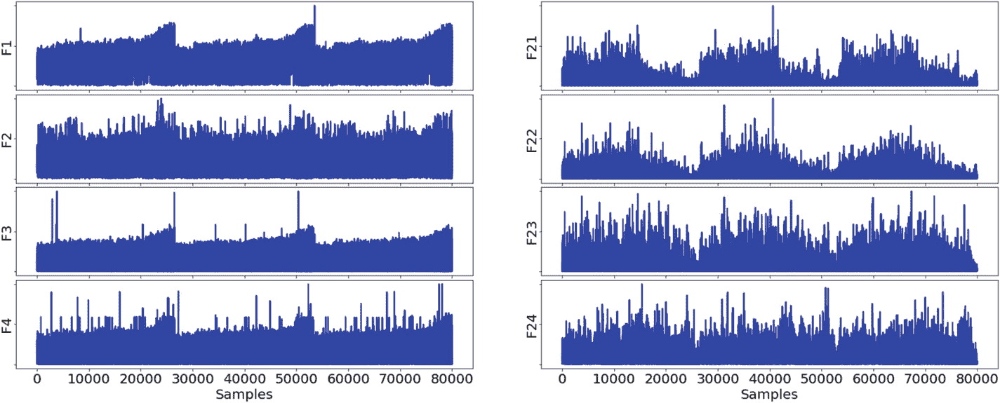

图 4-3

具有周期性突变的非平稳真实世界数据

所有样本相关矩阵的前八个特征值为：

[18.704, 10.473, 8.994, 7.862, 7.276, 6.636, 5.565, 4.894, …]。

我使用了本章讨论的自适应算法，并绘制了百分比方向余弦（4.21）。图 4-4 显示，尽管数据存在非平稳性，所有算法仍能良好收敛。

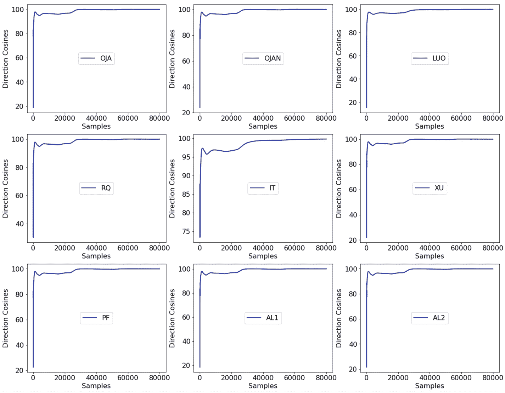

图 4-4

自适应算法在真实世界非平稳数据上对第一主特征向量的收敛情况（理想值=100）


## 4.12 结论

RQ、OJAN 和 LUO 算法要求 ‖**w**[0]‖=1，以便主特征向量 **w**[*k*] 收敛到单位范数（即 ‖**w**[*k*]‖→1）。所有其他算法（PF 除外）对于 **w**[0] 的各种非零值都能收敛到单位范数。根据定理 4.8，PF 算法成功收敛到 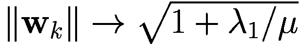。

统一的框架以及目标函数的可用性使我能够推导并分析每种算法的收敛性能。每种算法的结果总结在表 4-5 中。对于每种方法，我计算了当 *n*=10 时，自适应算法单次迭代的近似 MATLAB 浮点运算次数^(³)，并将其展示在表 4-5 中。

表 4-5

不同自适应算法的比较 [Chatterjee, Neural Networks 2005]

| 算法 | 优点 | 缺点 |
| --- | --- | --- |
| OJA | 收敛性随 *λ*[1] 和 *λ*[1]/*λ*[2] 的增大而增强。可确定 *η*[*k*] 的上界。每次迭代计算量较少（浮点运算次数=460）。 | 无法通过增大 ‖**w**[0]‖ 来改善收敛性。 |
| OJAN | 收敛性随 *λ*[1] 和 *λ*[1]/*λ*[2] 的增大而增强。每次迭代计算量较少（浮点运算次数=481）。 | 无法获得 *η*[*k*] 的上界。无法通过增大 ‖**w**[0]‖ 来改善收敛性。要求 ‖**w**[0]‖=1 以使 **w**[*k*] 收敛到单位范数。 |
| LUO | 收敛性随 *λ*[1] 和 *λ*[1]/*λ*[2] 的增大而增强。收敛性随 ‖**w**[0]‖ 的增大而增强。每次迭代计算量较少（浮点运算次数=502）。 | 无法获得 *η*[*k*] 的上界。收敛性随 ‖**w**[0]‖ 的减小而降低。要求 ‖**w**[0]‖=1 以使 **w**[*k*] 收敛到单位范数。 |
| RQ | 收敛性随 *λ*[1] 和 *λ*[1]/*λ*[2] 的增大而增强。收敛性随 ‖**w**[0]‖ 的减小而增强。每次迭代计算量较少（浮点运算次数=503）。 | 无法获得 *η*[*k*] 的上界。收敛性随 *v* 的增大而降低。要求 ‖**w**[0]‖=1 以使 **w**[*k*] 收敛到单位范数。 |
| OJA+ | 收敛性随 *λ*[1] 和 *λ*[1]/*λ*[2] 的增大而增强。可确定 *η*[*k*] 的上界。每次迭代计算量较少（浮点运算次数=501）。 | 无法通过增大 ‖**w**[0]‖ 来改善收敛性。 |
| IT | 可确定 *η*[*k*] 的上界。每次迭代计算量较少（浮点运算次数=460）。 | 收敛性与 *λ*[1] 无关。实验结果表明收敛性较差。 |
| XU | 收敛性随 *λ*[1] 和 *λ*[1]/*λ*[2] 的增大而增强。可确定 *η*[*k*] 的上界。 | 无法通过增大 ‖**w**[0]‖ 来改善收敛性。每次迭代计算量较多（浮点运算次数=800）。 |
| PF | 收敛性随 *λ*[1] 和 *λ*[1]/*λ*[2] 的增大而增强。收敛性随 *μ* 的增大而增强。可确定 *η*[*k*] 的上界。每次迭代计算量最小（浮点运算次数=271）。 | 无法通过增大 ‖**w**[0]‖ 来改善收敛性。**w**[*k*] 不收敛到单位范数。 |
| AL1 | 收敛性随 *λ*[1] 和 *λ*[1]/*λ*[2] 的增大而增强。收敛性随 *μ* 的增大而增强。可确定 *η*[*k*] 的上界。每次迭代计算量较少（浮点运算次数=511）。 | 无法通过增大 ‖**w**[0]‖ 来改善收敛性。 |
| AL2 | 收敛性随 *λ*[1] 和 *λ*[1]/*λ*[2] 的增大而增强。收敛性随 *μ* 的增大而增强。可确定 *η*[*k*] 的上界。 | 无法通过增大 ‖**w**[0]‖ 来改善收敛性。每次迭代计算量最大（浮点运算次数=851）。 |

总之，我从一个包含各自目标函数的通用框架出发，讨论了十种用于 PCA 的自适应算法，其中一些是新的。请注意，虽然我在这些目标函数上应用了梯度下降技术，但我也可以应用任何其他非线性优化技术，例如最速下降法、共轭方向法、牛顿-拉夫逊法或递归最小二乘法。

脚注 1   2

