# 5. 主特征向量与次特征向量

## 引言与应用场景

在第 4 章中，我讨论了用于计算在线相关矩阵 `A[k]∈ℝ^(n×n)` 主特征向量的自适应算法。然而，在某些应用中，仅计算主特征向量是不够的；我们还需要计算 `A[k]` 的次特征向量。其中一个应用是多维数据压缩或多媒体视频传输中的数据降维 [Le Gall 91]。例如，在使用 JPEG 技术进行静态视频压缩时，图像被划分为 8x8 的块。通过将高维视频数据投影到其在线相关矩阵的主特征向量子空间上，可以将其降维到较低维度。通过线性变换将数据投影到特征向量子空间的过程被称为主成分分析（PCA），它与 Karhunen-Loève 变换（KLT）密切相关 [Fukunaga 90]。我们通过离散余弦变换（DCT）给出的固定变换向量来近似特征向量，DCT 是 MPEG 标准的核心压缩方法 [Le Gall 91]。可以证明，对于来自一阶马尔可夫模型的信号（这是数字图像的一个合理模型），DCT 渐近等价于 PCA。

图 5-1 左侧显示了原始的 128 维信号。右侧，我使用自适应算法，仅用 16 个主成分重建了信号，实现了 8 倍压缩。结果表明，重建后的数据几乎与原始数据相同。

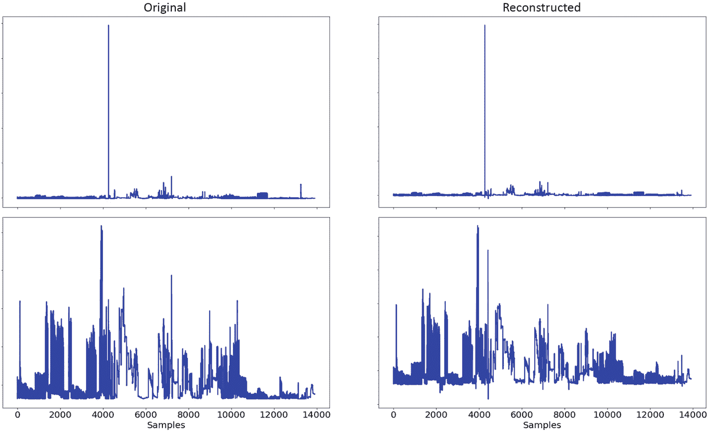

**图 5-1**
左侧为原始信号，右侧为使用主成分进行 8 倍压缩后的重建信号

关于此应用的更多细节和代码见第 8 章。

图 5-2 显示了来自 Keras MNIST 数据集 [Keras, MNIST] 的数字 9。原始数据是 28x28=784 维的。我使用了前 100 个主成分并重建了图像。这实现了 7.8 倍的数据缩减。重建后的图像看起来与原始图像相似。

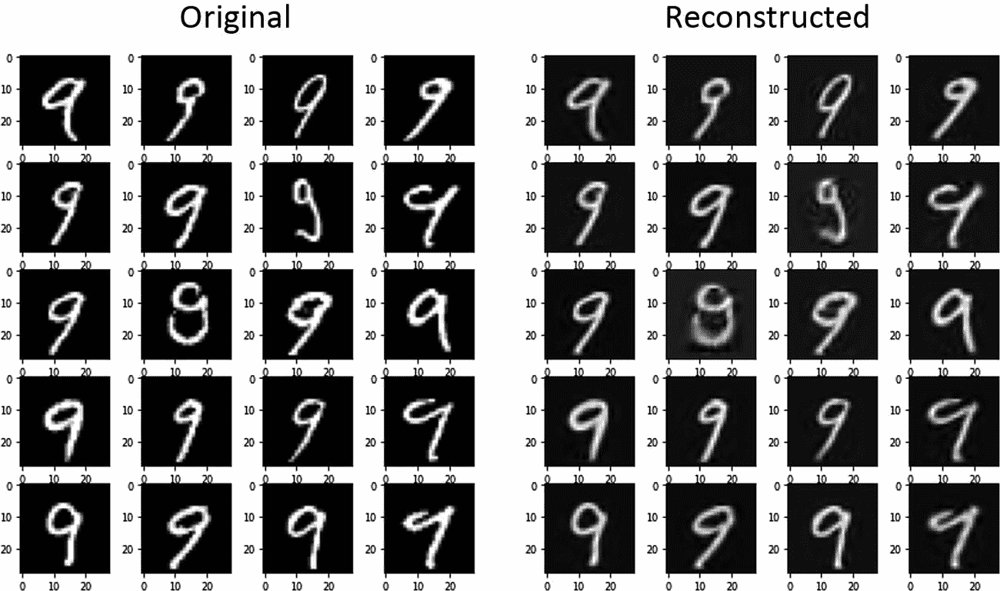

**图 5-2**
左侧为原始 MNIST 数字 9，右侧为使用主成分进行 7.8 倍压缩后的重建数字

以下 Python 代码可用于对数据 `X[nDim,nSamples]` 进行 PCA 压缩：

```python
# 计算前 100 个主成分并对数据进行 PCA 压缩
from scipy.linalg import eigh
nSamples = X.shape[1]
nDim = X.shape[0]
corX = (X @ X.T) / nSamples
eigvals, eigvecs = eigh(corX)
V  = np.fliplr(eigvecs)
# PCA 变换后的数据
Y = V[:,:100] @ V[:,:100].T @ X
```

由于 PCA 在均方误差意义上是最优的，它已被广泛应用于信号与图像处理、数据分析、模式识别、通信和控制工程等领域。诸如信号子空间与噪声子空间分离等应用在数字通信和数字图像处理中非常重要。PCA 在信号处理中的应用包括时域和空域谱分析。例如，多信号分类（MUSIC）技术、最小范数方法、ESPIRIT 估计器以及用于估计正弦波频率或入射到天线阵列的平面波到达方向（DOA）的加权子空间拟合（WSF）方法。最近，PCA 被应用于盲数字通信和语音处理。例如，在 [Chatterjee et al. 97-99; Chen et al. 99] 中，PCA 被用于基于 DS-CDMA 的空频处理中的盲二维 RAKE 接收机，以解决远近问题。在 [Diamantaras and Strintzis 97] 中，PCA 被用于存在噪声情况下的最优线性矢量编码和解码。

### 统一框架

在本章中，我提出了一个统一框架，用于推导和分析几种（部分知名的）自适应特征分解算法。其步骤包括以下内容：

1. 描述一个目标函数，我通过使用非线性优化的梯度下降法，从该函数推导出自适应算法。

2. 对于每个目标函数，我提供了三种推导自适应算法的方法，从而得到三组自适应算法，每组算法在计算成本、收敛特性和实现简易性上各有特点：
    1. *齐次自适应规则：* 这类算法不计算特征值递减的真正归一化特征向量。相反，它们生成单位特征向量的线性组合。然而，这类算法计算速度快，且可在并行网络中实现。
    2. *收缩自适应规则：* 在此规则下，我们失去了算法的齐次性，但能生成特征值递减的单位特征向量，从而满足许多应用需求。然而，训练是顺序进行的，第 `n` 个神经元的权值学习规则依赖于前 `n–1` 个神经元的训练，这使得训练过程难以并行实现。
    3. *加权自适应规则：* 这类算法通过为每个特征向量使用不同的标量权重，打破了齐次算法的对称性而获得。单位特征向量被显式地按特征值递减顺序得到。这些算法也可以在并行网络中实现。然而，它们需要额外的计算。

有趣的是，这里介绍的许多算法是在超过十年的时间里独立发现的。例如，Oja 等人 [Oja and Karhunen 85] 于 1985 年首次提出了 Oja 齐次算法 (5.5)。众多从业者在 1989 年至 1998 年间的不同出版物中广泛分析了该算法（参见第 5.3.1 节）。Sanger [Sanger 89] 于 1989 年展示了该算法的收缩版本 (5.8)。随后，Oja、Brockett、Xu 和 Chen 等人在 1992-98 年间提出了该算法的加权变体 (5.10)（参见第 5.3.2 节）。本章将这些算法以及许多其他算法（包括几种新算法）统一到一个具有简单推导过程的单一框架中。请注意，尽管这些算法是从不同角度发现的，但我将它们建立在一个共同的基础上。

给定一个已中心化为零均值的渐近平稳序列 `{x[k]∈ℝ^(n)}`，其渐近数据相关矩阵由 $$A=\lim_{k\to \infty}E\left[{\mathbf{x}}_k{\mathbf{x}}_k^T\right]$$ 给出。`A` 的 `p≤n` 个正交单位主特征向量 `ϕ[1],...,ϕ[p]` 由下式给出：

$${\boldsymbol{\upvarphi}}_i^TA{\boldsymbol{\upvarphi}}_j={\lambda}_i{\delta}_{ij}$$ ，且 $${\boldsymbol{\upvarphi}}_i^T{\boldsymbol{\upvarphi}}_j={\delta}_{ij}$$ 对于 `i=1,…,p`， (5.1)

其中 `λ[1]> ... >λ[p]>λ[p+1]≥ ... ≥λ[n]>0` 是 `A` 按幅值降序排列的 `p` 个最大特征值。如果序列 `{x[k]}` 是非平稳的，我们通过 (2.3) 或 (2.5) 计算在线数据相关矩阵 `A[k]∈ℝ^(n×n)`。

在我对算法的分析中，我遵循第 1.4 节概述的方法论。对于这些算法，我描述了一个目标函数 `J(w[i]; A)` 和一个形式如下的更新规则：

`W[k + 1] = W[k] + η[k]h(W[k], A[k])`， (5.2)

其中 `h(W[k],A[k])` 遵循某些连续性和正则性属性 [Ljung 77, 92]，且 `η[k]` 是一个递减的增益序列。

### 本章概要

在第 5.2 节中，我讨论了本章分析的目标函数及其变体。在第 5.3 节中，我针对 OJA 目标函数提出了齐次、收缩和加权变体的自适应算法及其收敛结果。在第 5.4 节中，我分析了均方误差 (XU) 目标函数的相同三种变体。在第 5.5 节中，我讨论了从罚函数 (PF) 目标函数推导出的算法，并证明了收敛结果。在第 5.6 节中，我考虑了增广拉格朗日 1 (AL1) 目标函数；在第 5.7 节中，我介绍了增广拉格朗日 2 (AL2) 目标函数。在第 5.8 节中，我介绍了信息论 (IT) 准则；在第 5.9 节中，我描述了瑞利商 (RQ) 准则。在第 5.10 节中，我给出了此处讨论的所有算法的总结。在第 5.11 节中，我讨论了实验结果，并在第 5.12 节中对本章进行了总结。

## 算法与目标函数

遵循我在第 2.2 章中提出的方法论，对于每个算法，我描述一个目标函数并为其推导出自适应算法。我根据算法的发明者或推导它们所依据的目标函数对它们进行了分类。这些目标函数是：

1. Oja 目标函数 [Oja 92; Oja et al. 92]，
2. 用于 Xu 算法的均方误差目标函数 [Xu 91, 93]，
3. 罚函数法 [Chauvin 89; Mathew et al. 95]，
4. 增广拉格朗日方法 1，
5. 增广拉格朗日方法 2，
6. 信息论准则 [Pumbley 95; Miao and Hua 98]，

# 7. 瑞利商准则 [Luo 97; Sarkar and Yang 89; Yang et al. 89; Fu and Dowling 94, 95]

## 自适应算法目标函数总结

每种算法均采用 (5.2) 的形式，该形式由目标函数 `*J*(**w**[*i*]; *A*)` 推导得出，其中 `*W* = [**w**[1], …, **w**[*p*]] (*p*≤*n*)`。每种自适应算法的目标函数 `*J*(**w**[*i*]; *A*)` 如表 5-1 所示。

### 表 5-1：本文讨论的自适应特征分解算法的目标函数

| 算法 | 类型 | 目标函数 *J*(·) |
| --- | --- | --- |
| OJA | 齐次型 | 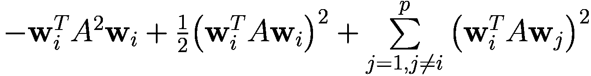 |
| | 收缩型 | 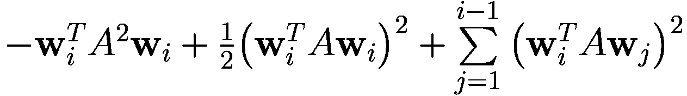 |
| | 加权型 | 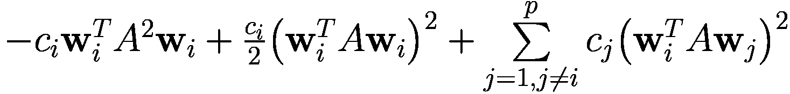 |
| XU | 齐次型 | 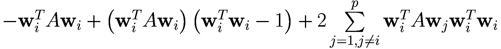 |
| | 收缩型 | 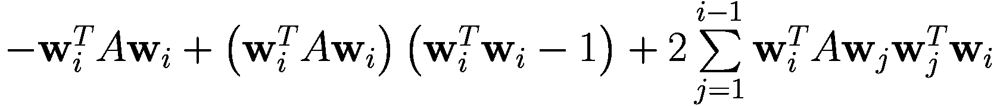 |
| | 加权型 | 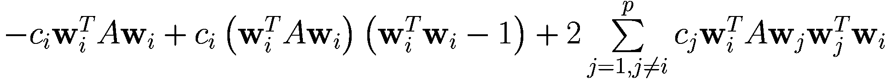 |
| PF | 齐次型 | 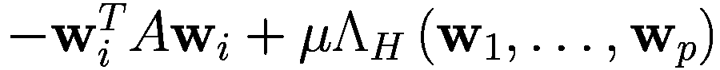 |
| | 收缩型 | 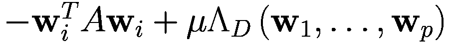 |
| | 加权型 | 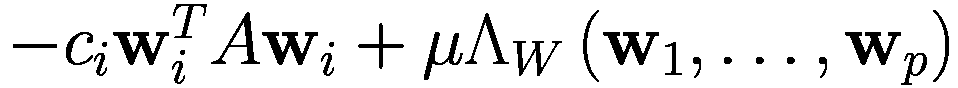 |
| AL1 | 齐次型 | 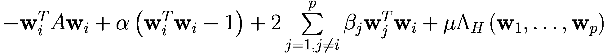 |
| | 收缩型 | 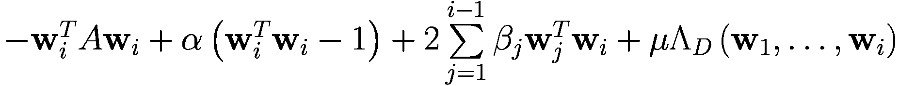 |
| | 加权型 | 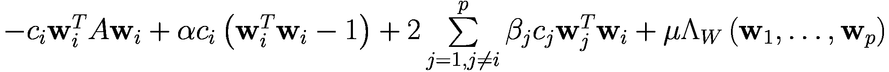 |
| AL2 | 齐次型 |  |
| | 收缩型 |  |

| 加权型 |  |
| IT | 齐次型 | 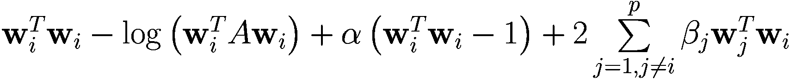 |
| 收缩型 | 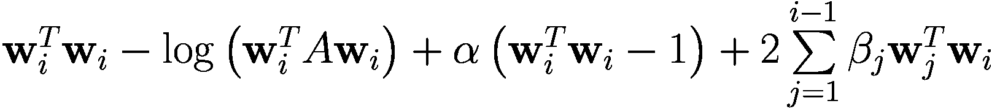 |
| 加权型 | 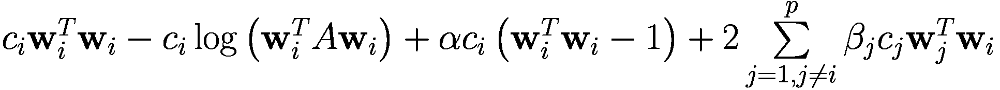 |
| RQ | 齐次型 | 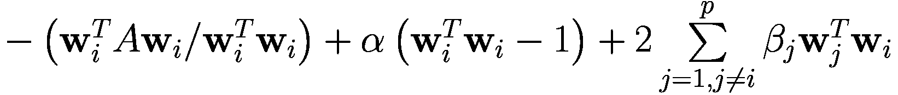 |
| 收缩型 | 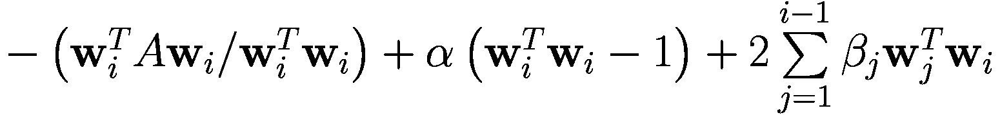 |
| 加权型 | 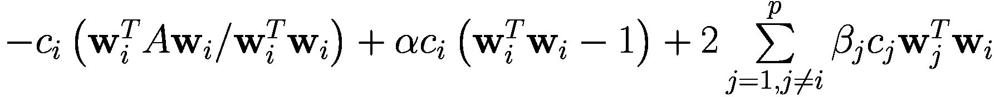 |

在这些表达式中，`Λ[H]`、`Λ[D]`、`Λ[W]`的定义如下：

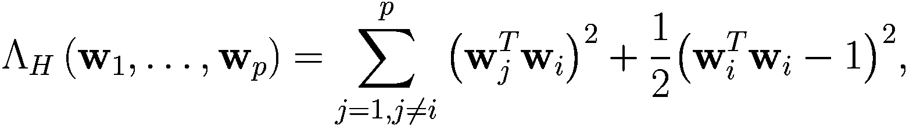

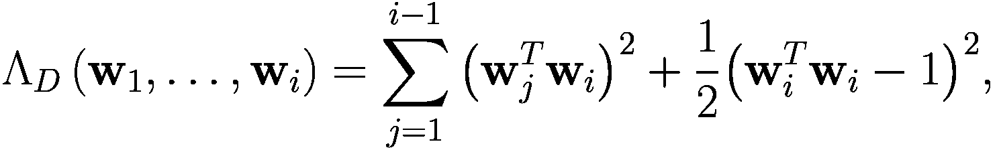

以及

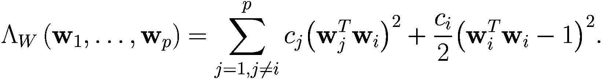

## 5.3 OJA 算法

### OJA 齐次算法

OJA 齐次算法的目标函数为

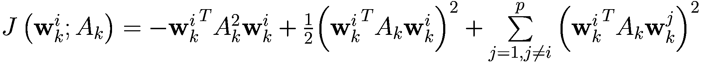, (5.3)

其中 `i`=1,…,`p` (`p`≤`n`)。通过对 (5.3) 关于 `{\mathbf{w}}_k^i` 求梯度，我们得到以下自适应算法：

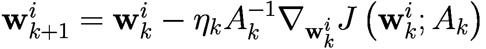 其中 `i`=1,…,`p`,

或

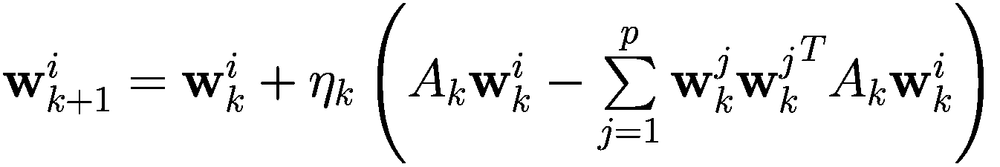 (5.4)

其中 `i`=1,…,`p`，`η[k]` 是一个小的递减常数。我们定义一个矩阵 `{W}_k=\left[{\mathbf{w}}_k¹\dots {\mathbf{w}}_k^p\right]` (`p`≤`n`)，其列是 `p` 个权重向量，分别收敛于 `A` 的 `p` 个主特征向量。我们可以将 (5.4) 表示为

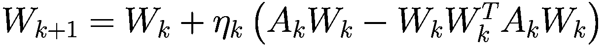 (5.5)

这是由 Oja 提出的*主子空间学习算法*的矩阵形式 [Oja 85,89,92]。

`W[k]` 收敛于 `W^* = ΦDU`，其中 `D = [D[1] | 0]^T ∈ ℝ^{n×p}`, `D[1] = diag(d[1], ..., d[p]) ∈ ℝ^{p×p}`, `d[i] = ±1` 对于 `i = 1,...,p`，且 `U ∈ ℝ^{p×p}` 是一个任意旋转矩阵（即 `U^T U = U U^T = I[p]`）。

### OJA 收缩算法

OJA 收缩自适应 PCA 算法的目标函数为

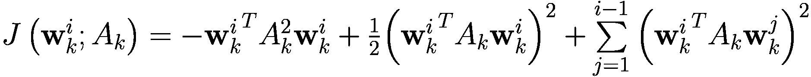 对于 `i = 1,…,p`。 (5.6)

通过对 (5.6) 求梯度，我们得到 OJA 收缩自适应梯度下降算法：

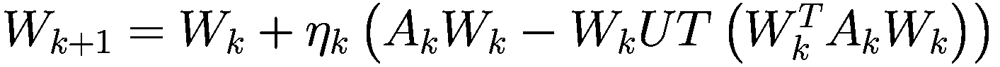,     (5.7)

其中 `UT[⋅]` 将其矩阵参数中对角线以下的所有元素设置为零，从而使其成为上三角矩阵。该算法也称为*广义 Hebbian 算法* [Sanger 89]。Sanger 证明了当 `k→∞` 时，`W[k]` 收敛于 `W^* = [±ϕ[1] ±ϕ[2] … ±ϕ[p]]`。

### OJA 加权算法

OJA 加权自适应 PCA 算法的目标函数为

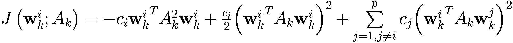     (5.8)

其中 `i = 1,…,p`，且 `c[1],…,c[p]` 是满足 `c[1] > c[2] > … > c[p] > 0`, `p ≤ n` 的小正数。由 (5.8)，我们得到 PCA 的 OJA 加权自适应梯度下降算法：

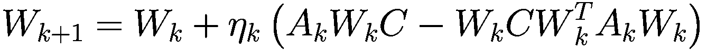     (5.9)

其中 `C = diag(c[1], ..., c[p])`。该算法也称为*Brockett 子空间*算法 [Xu 93, Chen, Amari, Lin 98]。Xu [Xu 93, 定理 5 和 6] 证明了当 `k→∞` 时，`W[k]` 收敛于 `W^* = [±ϕ[1] ±ϕ[2] … ±ϕ[p]]`。

### OJA 算法 Python 代码

以下 Python 代码使用数据 `X[nDim,nSamples]` 实现了 OJA PCA 算法：

```
from numpy import linalg as la
nEA = 4 # number of PCA components computed
nEpochs  = 2
A  = np.zeros(shape=(nDim,nDim)) # stores adaptive correlation matrix
W1 = 0.1 * np.ones(shape=(nDim,nEA)) # weight vectors of all algorithms
W2 = W1
W3 = W1
c = [2-0.3*k for k in range(nEA)]
C = np.diag(c)
for epoch in range(nEpochs):
    for iter in range(nSamples):
        cnt = nSamples*epoch + iter
        # Update data correlation matrix A with current data sample x
        x = X[:,iter]
        x = x.reshape(nDim,1)
        A = A + (1.0/(1 + cnt))*((np.dot(x, x.T)) - A)
        # Homogeneous Gradient Descent
        W1 = W1 + (1/(100 + cnt))*(A @ W1 - W1 @ (W1.T @ A @ W1))
        # Deflated Gradient Descent
        W2 = W2 + (1/(100 + cnt))*(A @ W2 - W2 @ np.triu(W2.T @ A @ W2))
        # Weighted Gradient Descent
        W3 = W3 + (1/(220 + cnt))*(A @ W3 @ C - W3 @ C @ (W3.T @ A @ W3))
```

## 5.4 XU 算法

### XU 齐次算法

XU 齐次自适应 PCA 算法的目标函数为

     (5.10)

其中 `i = 1,…,p`。通过对 (5.10) 关于 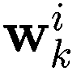 求梯度，我们得到 PCA 的 XU 齐次自适应梯度下降算法：

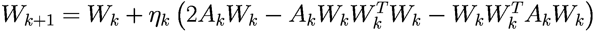.     (5.11)

该算法也称为*最小均方误差重构* (*LMSER*) *算法* [Xu 91,93]，并且是从前馈神经网络的*最小均方误差*准则推导出来的。Xu [Xu 93, 定理 2, 3] 证明了 `W[k]` 收敛于 `W^* = ΦDU`，其中 `D = [D[1] | 0]^T ∈ ℝ^{n×p}`, `D[1] = diag(d[1], ..., d[p]) ∈ ℝ^{p×p}`, `d[i] = ±1` 对于 `i = 1,...,p`，且 `U ∈ ℝ^{p×p}` 是一个任意旋转矩阵。

### XU 收缩算法

XU 收缩自适应 PCA 算法的目标函数为

     (5.12)

其中 `i = 1,…,p`。PCA 的 XU 收缩自适应梯度下降算法为

# 5.5 PF 算法

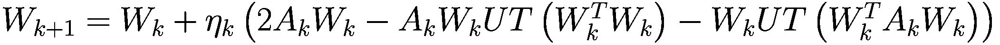，     (5.13)

其中 `UT[⋅]` 将其矩阵参数中对角线以下的所有元素设置为零。Chatterjee 等人[Mar 00, 定理 1,2] 证明了当 `k`→∞ 时，`W[k]` 收敛于 `W^(*)= [±ϕ[1] ±ϕ[2] … ±ϕ[p]]`。

### XU 加权算法

XU 加权自适应 PCA 算法的目标函数为

     (5.14)

其中 `i`=1,…,`p` 且 `c[1]>c[2]>…>c[p]>0`。根据 (5.14)，用于 PCA 的 XU 加权自适应梯度下降算法为

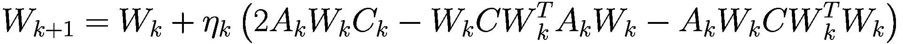     (5.15)

其中 `C=diag(c[1],…,c[p])`。Xu [Xu 93, 定理 5, 6] 证明了当 `k`→∞ 时，`W[k]` 收敛于 `W^(*)= [±ϕ[1] ±ϕ[2] … ±ϕ[p]]`。

### XU 算法 Python 代码

以下 Python 代码使用数据 `X[nDim,nSamples]` 实现了 XU PCA 算法：

```python
from numpy import linalg as la
nEA = 4 # 计算的 PCA 分量数量
nEpochs  = 2
A  = np.zeros(shape=(nDim,nDim)) # 存储自适应相关矩阵
W1 = 0.1 * np.ones(shape=(nDim,nEA)) # 所有算法的权重向量
W2 = W1
W3 = W1
c = [2-0.3*k for k in range(nEA)]
C = np.diag(c)
for epoch in range(nEpochs):
    for iter in range(nSamples):
        cnt = nSamples*epoch + iter
        x = X[:,iter]
        x = x.reshape(nDim,1)
        A = A + (1.0/(1 + cnt))*((np.dot(x, x.T)) - A)
        # 齐次梯度下降
        W1 = W1 + (1/(100 + cnt))*(A @ W1 - 0.5 * W1 @ (W1.T @ A @ W1) -0.5 * A @ W1 @ (W1.T @ W1))
        # 收缩梯度下降
        W2 = W2 + (1/(100 + cnt))*(A @ W2 - 0.5 * W2 @ np.triu(W2.T @ A @ W2) -0.5 * A @ W2 @ np.triu(W2.T @ W2))
        # 加权梯度下降
        W3 = W3 + (1/(100 + cnt))*(A @ W3 @ C - 0.5 * W3 @ C @ (W3.T @ A @ W3) -0.5 * A @ W3 @ C @ (W3.T @ W3))
```

### PF 齐次算法

通过将瑞利商准则表示为以下惩罚函数，我们得到了惩罚函数齐次 PCA 算法的目标函数：

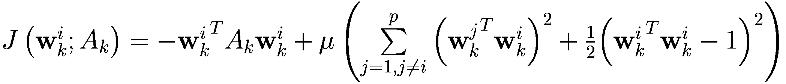,  (5.16)

其中 `μ`>0 且 `i`=1,…,`p`。根据 (5.16) 对  的梯度，我们得到用于 PCA 的 PF 齐次自适应梯度下降算法为

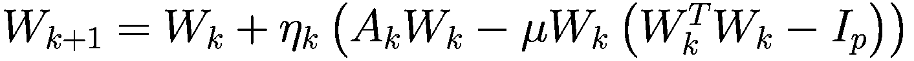,     (5.17)

其中 `I[p]` 是一个 `p`X`p` 的单位矩阵。

`W[k]` 收敛于 `W^*=ΦDU`，其中 `D=[D[1]|0]^T∈ℜ^(nXp)`，`D[1]=diag(d[1],...,d[p])∈ ℜ^(pXp)`，对于 i=1,...,`p`，`d[i]=±`，且 `U∈ℜ^(pXp)` 是一个任意旋转矩阵。回顾一下，`λ[1]>λ[2]>...>λ[p]>λ[p+1]≥...>λ[n] >0` 是 `A` 的特征值，`ϕ[i]` 是对应于 `λ[i]` 的特征向量，使得 `Φ=[ϕ[1] ... ϕ[n]]` 是标准正交的。

### PF 收缩算法

PF 收缩 PCA 算法的目标函数为

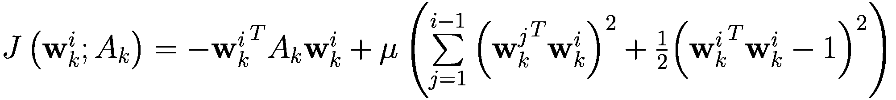,  (5.18)

其中 `μ` > 0 且 `i`=1,…,`p`。用于 PCA 的 PF 收缩自适应梯度下降算法为

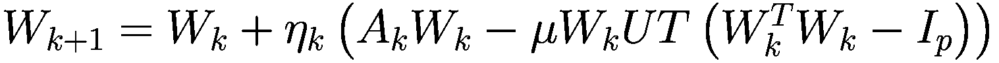,     (5.19)

其中 `UT[⋅]` 将其矩阵参数对角线以下的所有元素设置为零。`W[k]` 收敛于 `W^*=[d[1]ϕ[1] d[2]ϕ[2] … d[p]ϕ[p]]`，其中 `d[i] = ±`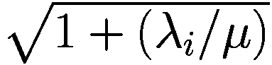。

### PF 加权算法

PF 加权 PCA 算法的目标函数为

 (5.20)

其中`c[1]`>`c[2]`>…>`c[p]`>0，`μ` > 0，且 `i`=1,…,`p`。用于 PCA 的 PF 加权自适应梯度下降算法为

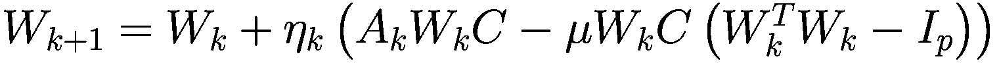, (5.21)

其中`C=diag(c[1],…,c[p])`。`W[k]` 收敛于`W^(***)=[d[1]ϕ[1] d[2]ϕ[2] … d[p]ϕ[p]]`，其中 `d[i]` = ±。

### PF 算法 Python 代码

以下 Python 代码使用数据 `X[nDim,nSamples]` 实现了 PF PCA 算法：

```
from numpy import linalg as la
nEA = 4 # 计算的 PCA 分量数量
nEpochs  = 2
A  = np.zeros(shape=(nDim,nDim)) # 存储自适应相关矩阵
W1 = 0.1 * np.ones(shape=(nDim,nEA)) # 所有算法的权重向量
W2 = W1
W3 = W1
c = [2-0.3*k for k in range(nEA)]
C = np.diag(c)
I  = np.identity(nEA)
mu = 2
for epoch in range(nEpochs):
    for iter in range(nSamples):
        cnt = nSamples*epoch + iter
        x = X[:,iter]
        x = x.reshape(nDim,1)
        A = A + (1.0/(1 + cnt))*((np.dot(x, x.T)) - A)
        # 齐次梯度下降
        W1 = W1 + (1/(100 + cnt))*(A @ W1 - mu * W1 @ ((W1.T @ W1) - I))
        # 收缩梯度下降
        W2 = W2 + (1/(100 + cnt))*(A @ W2 - mu * W2 @ np.triu((W2.T @ W2) - I))
        # 加权梯度下降
        W3 = W3 + (1/(100 + cnt))*(A @ W3 @ C - mu * W3 @ C @ ((W3.T @ W3) - I))
```

## 5.6 AL1 算法

### AL1 齐次算法

通过将非线性优化的增广拉格朗日方法应用于瑞利商准则，我们得到增广拉格朗日方法 1（AL1）齐次 PCA 算法的目标函数如下：

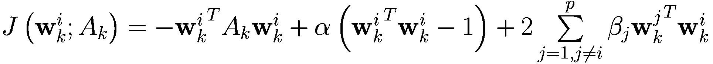,

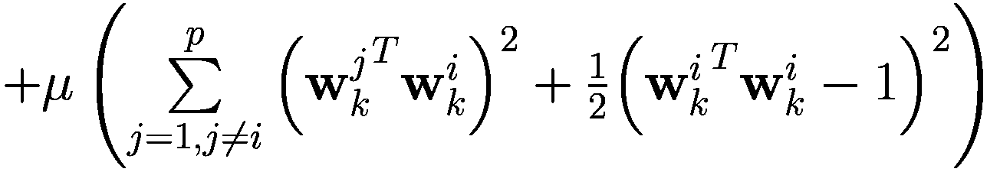 (5.22)

其中 `i`=1,…,`p`，(`α`,`β[1]`,`β[2]`,…,`β[p]`) 是拉格朗日乘子，`μ` 是一个正的惩罚常数。目标函数 (5.22) 在约束条件 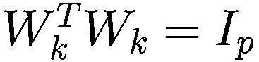 下等价于 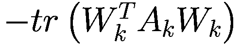，该函数也作为 AL1 算法的能量函数。

令 (5.22) 关于  的梯度等于 **0**，并利用约束条件 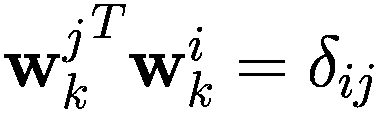，我们得到

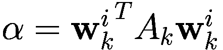 和 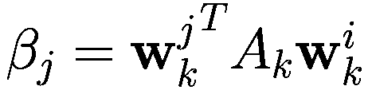，其中 `j`=1,…,`p`，`j`≠`i`。(5.23)

将 (5.22) 梯度中的 (`α`,`β[1]`,`β[2]`,…,`β[p]`) 替换后，我们得到用于 PCA 的 AL1 齐次自适应梯度下降算法：

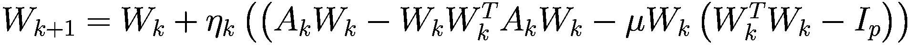 (5.24)

其中 `μ`>0，`I[p]` 是一个 `p`X`p` 的单位矩阵。当 `μ`=0 时，该算法与 OJA 算法 (5.5) 相同。我们可以证明 `W[k]` 收敛于`W^(***)=Φ*DU`，其中 `D=[D[1]|0]^(T)∈ℜ^(nXp)`，`D[1]= diag(d[1],...,d[p])∈ℜ^(pXp)`，`d[i]=±1`，`i=`1,...,`p`，而 `U∈ℜ^(pXp)` 是一个任意旋转矩阵。

### AL1 收缩算法

AL1 收缩 PCA 算法的目标函数为

 (5.25)

其中 `i`=1,…,`p`。通过求解 (`α`,`β[1]`,`β[2]`,…,`β[i–1]`)，并将其代入 (5.25) 的梯度中，我们得到

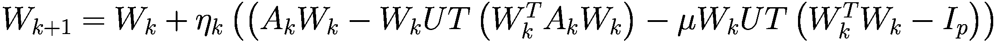，     (5.26)

其中 `μ`>0，`UT[⋅]` 将其矩阵参数中对角线以下的所有元素设置为零。当 `k`→∞ 时，`W[k]` 收敛于 `W^(***)=[±ϕ[1] ±ϕ[2] … ±ϕ[p]]`。

### AL1 加权算法

AL1 加权 PCA 算法的目标函数为

,

     (5.27)

其中 `i`=1,…,`p`，(`α`,`β[1]`,`β[2]`,…,`β[p]`) 是拉格朗日乘子，`μ` 是一个正的惩罚常数。通过求解 (`α`,`β[1]`,`β[2]`,…,`β[p]`)，并将其代入 (5.27) 的梯度中，我们得到 AL1 加权自适应梯度下降算法：

，     (5.28)

其中 `μ`>0，`c[1]`>`c[2]>…>`c[p]`>0，`C`=`diag(c[1],…,c[p])`。我们可以证明，当 `k`→∞ 时，`W[k]` 收敛于 `W^(***)= [±ϕ[1] ±ϕ[2] … ±ϕ[p]]`。

### AL1 算法 Python 代码

以下 Python 代码实现了使用数据 `X[nDim,nSamples]` 的 AL1 PCA 算法：

```python
from numpy import linalg as la
nEA = 4 # 计算的 PCA 分量数量
nEpochs  = 2
A  = np.zeros(shape=(nDim,nDim)) # 存储自适应相关矩阵
W1 = 0.1 * np.ones(shape=(nDim,nEA)) # 所有算法的权重向量
W2 = W1
W3 = W1
c = [2-0.3*k for k in range(nEA)]
C = np.diag(c)
I  = np.identity(nEA)
mu = 2
for epoch in range(nEpochs):
    for iter in range(nSamples):
        cnt = nSamples*epoch + iter
        x = X[:,iter]
        x = x.reshape(nDim,1)
        A = A + (1.0/(1 + cnt))*((np.dot(x, x.T)) - A)
        # 齐次梯度下降
        W1 = W1 + (1/(100 + cnt))*(A @ W1 - W1 @ (W1.T @ A @ W1) -mu * W1 @ ((W1.T @ W1) - I))
        # 收缩梯度下降
        W2 = W2 + (1/(100 + cnt))*(A @ W2 - W2 @ np.triu(W2.T @ A @ W2) -mu * W2 @ np.triu((W2.T @ W2) - I))
        # 加权梯度下降
        W3 = W3 + (1/(300 + cnt))*(A @ W3 @ C - W3 @ C @ (W3.T @ A @ W3) -mu * W3 @ C @ ((W3.T @ W3) - I))
```

## 5.7 AL2 算法

### AL2 齐次算法

AL2 目标函数可以从 AL1 齐次目标函数 (5.22) 推导得出，方法是将 (5.23) 中的 `α`,`β[1]`,`β[2]`,…,`β[p]` 代入 (5.22)：


，     (5.29)

其中 `i`=1,…,`p` 且 `μ`>0。正如在 XU 目标函数 (5.10) 中所见，(5.29) 也内嵌了约束条件 。用于 PCA 的 AL2 齐次自适应梯度下降算法为

     (5.30)

其中 `I[p]` 是一个 `p`X`p` 的单位矩阵。`W[k]` 收敛于 `W^(***)*=ΦDU*`，其中 `D`=[`D[1]`|0]^(`T`)∈ℜ^(`nXp`)，`D[1]`= diag(`d[1]`,...`d[p]`)∈ℜ^(`pXp`)，`d[i]`=±1，`i`=1,...,`p`，而 `U`∈ℜ^(`pXp`) 是一个任意旋转矩阵。

### AL2 收缩算法

AL2 收缩 PCA 算法的目标函数为


进入`/path.to/xxx`目录，找到`xxx.json`。

在表达式 `cvar = avar + bvar` 中，加法运算符（`+`）将 `avar` 与 `bvar` 相加，得到它们的和 `cvar`。

在 `List.of(arg0, arg1, arg2)` 中，`List` 接口的工厂方法 `of()` 接受一系列的元素，返回包含它们的只读列表。

之后我们这样调用 `cmd` 命令：`cmd arg0 arg1 arg2`。

```
if (condVar > someVal) {console.log("xxx")}
```

信息论收缩 PCA 算法的目标函数为

,     (5.38)

其中 (`α`,`β`[1],`β`[2],…,`β`[`i`–1]) 是拉格朗日乘子，且 `i`=1,…,`p`。通过求解 (`α`,`β`[1],`β`[2],…,`β`[`i`–1]) 并将其代入 (5.38) 的梯度中，我们得到用于 PCA 的 IT 收缩自适应梯度下降算法：

.     (5.39)

当 `k`→∞ 时，`W`[`k`] 以概率 1 收敛于 `W`^(***)= [±**ϕ**[1] ±**ϕ**[2] … ±**ϕ**[`p`]]。

### IT 加权算法

IT 加权 PCA 算法的目标函数为

     (5.40)

其中 `i`=1,…,`p` 且 (`α`,`β`[1],`β`[2],…,`β`[`p`]) 是拉格朗日乘子。IT 加权自适应梯度下降算法为：

,     (5.41)

其中 `C`=`diag`(`c`[1],…,`c`[`p`]) 且 `c`[1]>`c`[2]>…>`c`[`p`]>0。这里，当 `k`→∞ 时，`W`[`k`] 收敛于 `W`^(***)= [±**ϕ**[1] ±**ϕ**[2] … ±**ϕ**[`p`]]。

### IT 算法 Python 代码

以下 Python 代码使用数据 `X[nDim,nSamples]` 实现了 IT PCA 算法：

```
from numpy import linalg as la
nEA = 4 # number of PCA components computed
nEpochs  = 3
A  = np.zeros(shape=(nDim,nDim)) # stores adaptive correlation matrix
W1 = 0.1 * np.ones(shape=(nDim,nEA)) # weight vectors of all algorithms
W2 = W1
W3 = W1
c = [2-0.3*k for k in range(nEA)]
C = np.diag(c)
for epoch in range(nEpochs):
for iter in range(nSamples):
cnt = nSamples*epoch + iter
x = X[:,iter]
x = x.reshape(nDim,1)
A = A + (1.0/(1 + cnt))*((np.dot(x, x.T)) - A)
# Homogeneous Gradient Descent
W1 = W1 + (1/(50 + cnt))*(A @ W1 - W1 @ (W1.T @ A @ W1)) @ \inv(np.diag(
np.diagonal(W1.T @ A @ W1)))
# Deflated Gradient Descent
W2 = W2 + (1/(20 + cnt))*(A @ W2 - W2 @ np.triu(W2.T @ A @ W2)) @ \inv(np.diag(
np.diagonal(W2.T @ A @ W2)))
# Weighted Gradient Descent
W3 = W3 + (1/(10 + cnt))*(A @ W3 @ C - W3 @ C @ (W3.T @ A @ W3)) @ \inv(np.diag(
np.diagonal(W3.T @ A @ W3)))
```

## 5.9 RQ 算法

### RQ 齐次算法

我们从瑞利商出发，为瑞利商齐次 PCA 算法推导出如下目标函数：

，     (5.42)

其中 `i`=1,…,`p`，(`α`,`β`[1],`β`[2],…, `β`[`p`]) 为拉格朗日乘子。通过令 (5.42) 关于  的梯度等于 **0**，并利用约束条件 ，我们得到

`α` = 0 且 ，其中 `j`=1,…,`p`，`j`≠`i`。     (5.43)

将 (5.42) 梯度中的 (`α`,`β`[1],`β`[2],…,`β`[`p`]) 替换，并进行近似，我们得到用于 PCA 的 RQ 齐次自适应梯度下降算法：

，     (5.44)

其中 `DIAG`[⋅] 将其矩阵参数中除对角线外的所有元素置零。这里 `W`[`k`] 收敛于 `W`^(***)= Φ`DU`，其中 `D`=`[`D`[1]|0]`(`T`)∈ℜ`(`nXp`)，`D`[1]=`diag`(`d`[1]`,`...`,`d`[`p`])∈ℜ`(`pXp`)，`d`[`i`]=±1，`i`=1,...,`p`，而 `U`∈ℜ`(`pXp`) 是一个任意旋转矩阵*。*

### RQ 收缩算法

RQ 收缩 PCA 算法的目标函数为

     (5.45)

其中 *i*=1,…,*p*，(*α*,*β*[1],*β*[2],…, *β*[*i*–1]) 为拉格朗日乘子。通过求解 (*α*,*β*[1],*β*[2],…,*β*[*i*–1]) 并将其代入 (5.45) 的梯度中，我们得到自适应梯度下降算法：

     (5.46)

当 *k*→∞ 时，*W*[*k*] 以概率 1 收敛于 *W*^(***)= [±**ϕ**[1] ±**ϕ**[2] … ±**ϕ**[*p*]]。

### RQ 加权算法

RQ 加权 PCA 算法的目标函数为

     (5.47)

其中 *i*=1,…,*p*，(*α*,*β*[1],*β*[2],…,*β*[*p*]) 为拉格朗日乘子。通过求解 (*α*,*β*[1],*β*[2],…,*β*[*p*]) 并将其代入 (5.47) 的梯度中，我们得到算法

     (5.48)

其中 *C*=*diag*(*c*[1],…,*c*[*p*]) 且 *c*[1]>*c*[2]>…>*c*[*p*]>0。当 *k*→∞ 时，*W*[*k*] 以概率 1 收敛于 *W*^(***)= [±**ϕ**[1] ±**ϕ**[2] … ±**ϕ**[*p*]]。

### RQ 算法 Python 代码

以下 Python 代码使用数据 `X[nDim,nSamples]` 实现了 RQ PCA 算法：

```
from numpy import linalg as la
nEA = 4 # number of PCA components computed
nEpochs  = 2
A  = np.zeros(shape=(nDim,nDim)) # stores adaptive correlation matrix
W1 = 0.1 * np.ones(shape=(nDim,nEA))# weight vectors of all algorithms
W2 = W1
W3 = W1
c = [2-0.3*k for k in range(nEA)]
C = np.diag(c)
for epoch in range(nEpochs):
for iter in range(nSamples):
cnt = nSamples*epoch + iter
x = X[:,iter]
x = x.reshape(nDim,1)
A = A + (1.0/(1 + cnt))*((np.dot(x, x.T)) - A)
# Homogeneous Gradient Descent
W1 = W1 + (1/(50 + cnt))*(A @ W1 - W1 @ (W1.T @ A @ W1)) @ \
inv(np.diag(np.diagonal(W1.T @ W1)))
# Deflated Gradient Descent
W2 = W2 + (1/(20 + cnt))*(A @ W2 - W2 @ np.triu(W2.T @ A @ W2)) @ \inv(np.diag(
np.diagonal(W2.T @ W2)))
# Weighted Gradient Descent
W3 = W3 + (1/(200 + cnt))*(A @ W3 @ C - W3 @ C @ (W3.T @ A @ W3)) @ \inv(np.diag(
np.diagonal(W3.T @ W3)))
```

## 5.10 自适应特征向量算法总结

我将本章讨论的算法总结在表 5-2 中。每个算法均采用 (5.1) 中给出的形式。(5.1) 中每个自适应算法的项 *h*(*W*[*k*],*A*[*k*]) 在表 5-2 中给出。请注意以下几点：

表 5-2

自适应特征分解算法列表

| 算法 | 类型 | 自适应算法 *h*(*W*[*k*],*A*[*k*]) | 备注 |
| --- | --- | --- | --- |
| OJA | 压缩 |  | n³p⁶, 6 |
| 加权 |  | n⁴p⁶, 6 |
| XU | 压缩 |  | 2n³p⁶, 8 |
| 加权 |  | 2n⁴p⁶, 8 |
| PF | 压缩 |  | n²p⁴, 7 |
| 加权 |  | n³p⁴, 7 |
| AL1 | 压缩 |  | n³p⁶+ n²p⁴, 9 |
| 加权 |  | n⁴p⁶+ n³p⁴, 9 |

### 算法性能总结

| 算法 | 类型 | 更新公式 | 计算复杂度 | 收敛评分 |
| :--- | :--- | :--- | :--- | :--- |
| AL2 | 压缩 |  | 2n³p⁶+ n²p⁴ | 10 |
| 加权 |  | 2n⁴p⁶+ n³p⁴ | 10 |
| IT | 压缩 |  | 不适用 | 不适用 |
| 加权 |  | 不适用 | 不适用 |
| RQ | 压缩 |  | 不适用 | 不适用 |
| 加权 |  | 不适用 | 不适用 |

### 算法评级

对于每个算法，我对其计算性能和收敛性能进行了评级。

我跳过了齐次算法，因为它们在实际应用中用处不大，会产生特征向量的任意旋转。

请注意，`A[k]`∈ℜ^(`n`X`n`) 且 `W[k]`∈ℜ^(`n`X`p`)。我根据矩阵维度 `n` 和 `p` 给出了每个算法的计算复杂度。

收敛性能根据主分量和次分量的收敛速度确定。我按 1-10 的等级对收敛性能进行评级，其中 10 表示性能最佳。

我跳过了 IT 和 RQ 算法，因为与其他算法相比，它们的性能不佳，并且矩阵求逆增加了计算复杂度。

请注意以下几点：

1.  OJA 算法复杂度最低，性能良好。
2.  AL2 算法复杂度最高，性能最佳。
3.  AL1 是仅次于 AL2 的最佳算法，PF 和 Xu 紧随其后。

复杂度和精度的权衡将决定在实际场景中使用哪种算法。如果计算资源允许，AL2 算法是最佳选择。XU 算法在复杂度和收敛速度之间取得了良好的平衡。

### 5.11 实验结果

我生成了 500 个 10 维高斯数据（即 `n`=10）的样本 `x[k]`，其均值为零，协方差如下所示。该协方差矩阵由[Okada and Tomita 85]中的第二个协方差矩阵乘以 3 得到。协方差矩阵为


该协方差矩阵的特征值为

17.9013, 10.2212, 8.6078, 6.5361, 2.2396, 1.8369, 1.1361, 0.7693, 0.2245, 0.1503。

我通过本文所述的自适应算法计算了前四个主特征向量（即对应最大四个特征值的特征向量）（即 `p`=4）。为了计算在线数据序列 `{A[k]}`，我从上述协方差矩阵生成了随机数据向量 `{x[k]}`。我使用算法（第 2.​4 节中的公式 2.5）且 `β`=1，从 `{x[k]}` 生成了 `{A[k]}`。在收集完所有 500 个样本 `x[k]` 后，我将相关矩阵 `A` 计算为


我将通过标准数值分析方法[Golub and VanLoan 83]从该 `A` 计算出的特征向量和特征值称为*实际值*。

所有算法均以 `w[0]` = 0.1*ONE 启动，其中 ONE 是一个所有元素均为 1 的 10X4 矩阵。为了衡量算法的收敛性和准确性，我在每个自适应算法的第 `k` 次更新时计算方向余弦，公式如下：

方向余弦 (`k`) =      (5.49)

其中  是第 `k` 次更新时 `A[k]` 的估计特征向量，`ϕ[i]` 是通过传统数值分析方法从所有收集的样本中计算出的第 `i` 个实际主特征向量。

图 5-3 展示了 OJA 算法（消去法和加权法）计算 `A` 的前四个主特征向量的迭代过程。图 5-4 展示了 XU 算法的相同过程。图 5-5 展示了 PF 算法的相同过程。图 5-6 展示了 AL1 算法（消去法和加权法）计算 `A` 的前四个主特征向量的迭代过程。图 5-7 展示了 AL2 算法的相同过程。图 5-8 展示了 IT 算法的相同过程。图 5-9 展示了 RQ 算法的相同过程。


图 5-9

通过 RQ 消去法(5.46)和 RQ 加权法(5.48)自适应算法得到的 `A` 的前四个主特征向量的收敛情况


图 5-8

通过 IT 消去法(5.39)和 IT 加权法(5.41)自适应算法得到的 `A` 的前四个主特征向量的收敛情况


图 5-7

通过 AL2 消去法(5.32)和 AL2 加权法(5.34)自适应算法得到的 `A` 的前四个主特征向量的收敛情况


图 5-6

通过 AL1 消去法(5.26)和 AL1 加权法(5.28)自适应算法得到的 `A` 的前四个主特征向量的收敛情况


图 5-5

通过 PF 消去法(5.19)和 PF 加权法(5.21)自适应算法得到的 `A` 的前四个主特征向量的收敛情况


图 5-4

通过 XU 消去法(5.13)和 XU 加权法(5.15)自适应算法得到的 `A` 的前四个主特征向量的收敛情况


图 5-3

通过 OJA 消去法(5.7)和 OJA 加权法(5.9)自适应算法得到的 `A` 的前四个主特征向量的收敛情况

用于加权算法的对角权重矩阵 `C` 为 `DIAG(2.0, 1.7, 1.4, 1.1)`。我对所有算法运行了数据的*三个周期*，其中一个周期表示以随机顺序呈现所有训练数据一次。我没有展示同质化算法的结果，因为同质化方法会产生 `A` 的实际特征向量的线性组合。因此，方向余弦不能反映同质化情况下算法的性能。

### 5.12 结论

在本章中，我讨论了 21 种不同的自适应 PCA 算法，并展示了它们的收敛结果。对于每种算法，我提出了一个通用框架，包括一个目标函数，并从中推导出自适应算法。消去法和加权算法对所有四个主特征向量都收敛，尽管第一个主特征向量的性能最佳。除 IT 算法外，所有算法的收敛性相似，IT 算法的表现不如其他算法。

请注意，虽然我在目标函数上应用了梯度下降技术，但我也可以应用任何其他非线性优化技术，例如最速下降法、共轭方向法、牛顿-拉夫森法或递归最小二乘法。目标函数的可用性使我们能够通过在其上使用新的优化技术来推导新算法，并对自适应算法进行收敛性分析。