# 6. 特征向量的加速计算

## 6.1 引言

在第 5 章中，我讨论了几种自适应算法，用于从向量序列 {**x**[*k*]∈ℜ^(*n*)} 中计算在线相关矩阵 *A*[*k*]∈ℜ^(*n*X*n*) 的主特征向量和次特征向量。我通过在目标函数上应用梯度下降法推导了这些算法。然而，众所周知[Baldi and Hornik 95, Chatterjee et al*.* Mar 98, Haykin 94]，基于梯度下降的*主成分分析*（PCA）算法收敛缓慢。此外，分析和实验研究均表明，这些算法的收敛性取决于增益序列 {*η*[*k*]} 的适当选择。而且，已有证明[Chatterjee et al*.* Nov 97; Chatterjee et al*.* Mar 98; Chauvin 89]指出，如果增益序列超过上限，算法可能会发散或收敛到错误解。

由于这些算法大多用于实时（即在线）处理，因此在在线过程开始时确定增益参数的适当选择尤其困难。因此，为了更广泛地应用这些算法，重要的是：

*   加快算法的收敛速度，以及
*   根据当前数据样本自动选择增益参数。


### 基于梯度的自适应 PCA 的目标函数

第 4 章和第 5 章讨论的部分目标函数已被实践者用于通过先进非线性优化技术推导加速自适应 PCA 算法，这些技术包括：

*   最速下降法 (SD)，
*   共轭方向法 (CD)，
*   牛顿-拉夫逊法 (NR)，以及
*   递归最小二乘法 (RLS)。

与第 4 章和第 5 章讨论的梯度下降法相比，这些优化方法使算法收敛速度更快。它们还帮助我们计算增益序列 {*η*[*k*]} 的值，这在梯度下降法中是无法获得的。唯一的缺点是这些改进算法需要额外的计算量。请注意，每种优化方法应用于不同的目标函数时，都会产生一种新的自适应 PCA 算法。

在信号处理应用中，第一个广泛用于加速 PCA 的目标函数是瑞利商 (RQ) 目标函数，详见第 4.​4 节和第 5.​9 节。Sarkar 等人 [Sarkar et al*.* 89; Yang et al*.* 89] 将最速下降法和共轭方向法应用于该目标函数，以计算极值（最大或最小）特征向量。Fu 和 Dowling [Fu and Dowling 94, 95] 推广了共轭方向算法，用于计算所有特征向量。Zhu 和 Wang [Zhu and Wang 97] 也对该目标函数的正则化总体最小二乘版本使用了共轭方向法。关于基于共轭方向法处理 RQ 目标函数的综述，可参见 [Yang et al*.* 89]。

第二个用于加速 PCA 的目标函数是惩罚函数 (PF) 目标函数，详见第 4.​7 节和第 5.​5 节。Chauvin [Chauvin 97] 提出了一种基于 PF 目标函数的梯度下降算法，并分析了该函数的景观。Mathew 等人 [Mathew et al*.* 94, 95, 96] 也使用该目标函数，提出了一种用于自适应 PCA 的牛顿型算法。

第三个用于加速 PCA 的目标函数是信息论 (IT) 目标函数，详见第 4.​5 节和第 5.​8 节。Miao 和 Hua [Miao and Hua 98] 提出了用于自适应主子空间分析的梯度下降和 RLS 算法。

第四个用于加速 PCA 的目标函数是 XU 目标函数，详见第 4.​6 节和第 5.​4 节。例如，Xu [Xu 93]、Yang [Yang 95]、Fu 和 Dowling [Fu and Dowling 94]、Bannour 和 Azimi-Sadjadi [Bannour and Azimi-Sadjadi 95] 以及 Miao 和 Hua [Miao and Hua 98] 都使用了该目标函数的变体。如第 5.​4 节所述，该目标函数有几种变体，包括两层线性自联想神经网络输出的均方误差。Xu 通过使用梯度下降法推导出一种自适应主子空间分析算法。Yang 使用了梯度下降法和递归最小二乘优化方法。Bannour 和 Azimi-Sadjadi 也描述了一种基于递归最小二乘法的自适应 PCA 算法，该算法使用了此目标函数。Fu 和 Dowling 将该目标函数简化为类似于 RQ 目标函数的形式，从而可以通过 Sarkar 等人 [Sarkar et al*.* 89; Yang et al*.* 89] 提出的共轭方向法进行最小化。他们还通过使用近似和紧缩技术计算了次分量。

### 本章概要

第 4 章和第 5 章讨论的任何目标函数，都可以通过使用非线性优化技术（针对该目标函数）来获得加速的自适应 PCA 算法，这些技术包括：

*   梯度下降法，
*   最速下降法，
*   共轭方向法，
*   牛顿-拉夫逊法，以及
*   递归最小二乘法。

然而，在本章的讨论中，我将只使用这些目标函数中的一个。我注意到，这些分析可以推广到第 4 章和第 5 章中的其他目标函数。本章我选择的目标函数是第 5.​4 节讨论的 XU 紧缩目标函数。

尽管对 XU 目标函数（见第 5.​4 节）进行梯度下降会产生著名的 Xu 最小均方误差重构 (LMSER) 算法 [Xu 93]，但最速下降法、共轭方向法和牛顿-拉夫逊法则为 PCA 产生了新的自适应算法 [Chatterjee et al. Mar 00]。惩罚函数 (PF) 紧缩目标函数（见第 5.​5 节）也已通过 Kang 等人 [Kang et al*.* 00] 的最速下降法、共轭方向法和拟牛顿优化方法得到了加速。

我将把这些算法应用于平稳和**非平稳多维**高斯数据序列。我通过实验表明，与 Xu [Xu 93] 提出的传统梯度下降技术相比，自适应最速下降法、共轭方向法和牛顿-拉夫逊算法收敛得更快。此外，新算法能根据当前数据样本自动选择增益序列 {*η*[*k*]}。我进一步将最速下降算法与最先进的方法进行比较，例如 Yang 的投影近似子空间跟踪 (PASTd) [Yang 95]、Bannour 和 Sadjadi 的递归最小二乘法 (RLS) [Bannour et al*.* 95] 以及 Fu 和 Dowling 的共轭梯度特征结构跟踪 (CGET1) [Fu and Dowling 94, 95] 算法。

用于自适应 PCA 算法的 XU 紧缩目标函数在第 5.​4 节的公式 (5.12) 中给出：

，     (6.1)

其中 *i*=1,…,*p*，*A*[*k*]∈ℜ^(*n*X*n*) 是在线观测矩阵。我现在将不同的非线性最小化方法应用于公式 (6.1) 中的目标函数 ，以获得用于自适应 PCA 的各种算法。

在第 6.2 节、6.3 节、6.4 节和 6.5 节中，我将梯度下降法、最速下降法、共轭方向法和牛顿-拉夫逊优化方法应用于公式 (6.1) 中给出的用于 PCA 的无约束 XU 目标函数。在此，我获得了用于自适应 PCA 的新算法。在第 6.6 节中，我展示了使用平稳和非平稳高斯序列的实验结果，从而证明了新算法比传统的梯度下降自适应 PCA 算法收敛更快。我还将最速下降算法与最先进的算法进行了比较。第 6.7 节对本章进行了总结。


## 6.2 梯度下降算法

[Chatterjee 等人，《IEEE 神经网络汇刊》，第 11 卷，第 2 期，第 338-355 页，2000 年 3 月]

(6.1) 关于 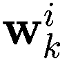 的梯度为

 对于 *i*=1,…,*p*。     (6.2)

因此，用于 PCA 的 XU 紧缩自适应梯度下降算法（见第 5.4.2 节）为

 对于 *i*=1,…,*p*，     (6.3)

其中 *η*[*k*] 是一个递减的增益常数。我们可以简单地用其瞬时值 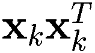 或第 2 章中的递归公式（公式 2.3 或 2.4）来表示 *A*[*k*]。为了方便，定义一个矩阵 ![$$ {W}_k=\left[{\mathbf{w}}_k¹\dots {\mathbf{w}}_k^p\right] $$](images/522202_1_En_6_Chapter/522202_1_En_6_Chapter_TeX_IEq7.png) (*p*≤*n*)，其列是分别收敛到 *A*[*k*] 的 *p* 个主特征向量的 *p* 个权重向量。那么，(6.2) 可以表示为（与第 5.​4.​2 节中的 (5.​14) 相同）：

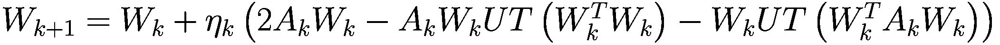，     (6.4)

其中 UT[⋅] 将其矩阵参数中对角线以下的所有元素设置为零，从而使其成为上三角矩阵。注意，(6.2) 是 Xu [Xu 93] 提出的 LMSER 算法，该算法源自前馈神经网络的最小均方误差准则（见第 5.​4 节）。

## 6.3 最速下降算法

[Chatterjee 等人，《IEEE 神经网络汇刊》，第 11 卷，第 2 期，第 338-355 页，2000 年 3 月]

用于 PCA 的自适应最速下降算法由 (6.1) 中的 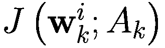 推导得出：

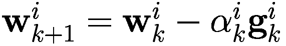，     (6.5)

其中  由 (6.2) 给出，而  是一个非负标量，用于最小化 。由于我们在 (6.1) 中有  的表达式，我们对函数  关于 *α* 求最小值，并得到以下三次方程：

*c*[3]*α*³ + *c*[2]*α*² + *c*[1]*α* + *c*[0] = 0，     (6.6)

其中

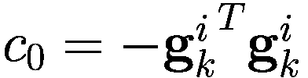，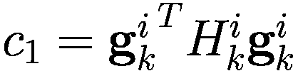，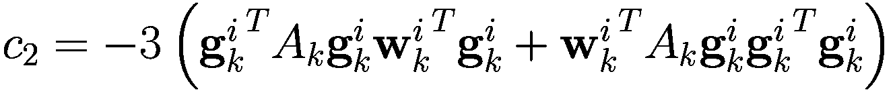，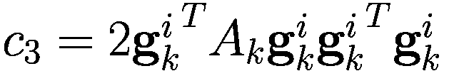。

这里 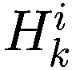 是  的 Hessian 矩阵，如下所示：

     (6.7)

在已知  和 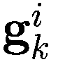 的值的情况下，可以求解这个三次方程以获得使 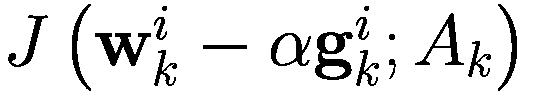 最小化的 *α*。下一节将描述 *α* 的计算方法。

我们现在用矩阵形式表示自适应 PCA 算法 (6.5)。我们定义矩阵：

![$$ {W}_k=\left[{\mathbf{w}}_k¹,\dots, {\mathbf{w}}_k^p\right] $$](images/522202_1_En_6_Chapter/522202_1_En_6_Chapter_TeX_IEq26.png)，![$$ {G}_k=\left[{\mathbf{g}}_k¹,\dots, {\mathbf{g}}_k^p\right] $$](images/522202_1_En_6_Chapter/522202_1_En_6_Chapter_TeX_IEq27.png)，以及 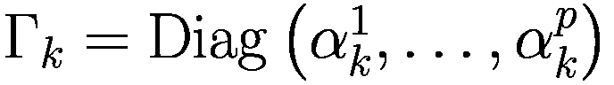。

那么，自适应最速下降 PCA 算法为

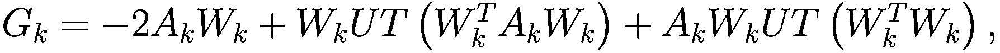

*W*[*k* + 1] = *W*[*k*] − *G*[*k*]Γ[*k*]。     (6.8)

这里 UT[·] 与 (6.4) 中的相同。


### 最速下降法中  的计算

根据 (6.1) 中的 *J*(**w**[*i*];*A*)，我们计算使 *J*(**w**[*i*] − *α***g**[*i*]; *A*) 最小化的 *α*，其中

。

我们有

![$$ \frac{d J\left({\mathbf{w}}_i-\alpha {\mathbf{g}}_i\right)}{d\alpha}=\frac{1}{2} tr\left[{\nabla}_{{\mathbf{w}}_i-\alpha {\mathbf{g}}_i}J\left({\mathbf{w}}_i-\alpha {\mathbf{g}}_i\right)\frac{d{\left({\mathbf{w}}_i-\alpha {\mathbf{g}}_i\right)}^T}{d\alpha}\right]=-\frac{1}{2}{\mathbf{g}}_i^T{\nabla}_{{\mathbf{w}}_i-\alpha {\mathbf{g}}_i}J\left({\mathbf{w}}_i-\alpha {\mathbf{g}}_i\right), $$](images/522202_1_En_6_Chapter/522202_1_En_6_Chapter_TeX_Equa.png)

其中


简化此方程，我们得到以下三次方程：

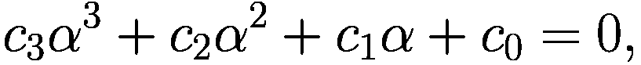

其中

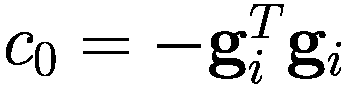, 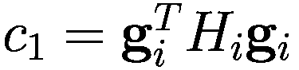, 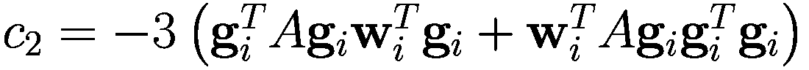, 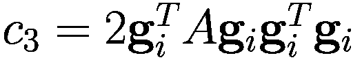。

这里 *H*[*i*] 是 (6.7) 中给出的 *J*(**w**[*i*]; *A*) 的 Hessian 矩阵。

众所周知，三次多项式至少有一个实根（一个实根加两个共轭复根，或三个实根）。这些根也可以如 [Artin 91] 所示以闭式形式计算。如果根是复数，那么 **w**[*i*] − *α***g**[*i*] 也是复数，显然这不是我们要找的根。如果我们有三个实根，那么我们可以取对应于最小 *J*(**w**[*i*] − *α***g**[*i*]; *A*) 的根，或者取对应于 3*c*[3]*α*² + 2*c*[2]*α* + *c*[1] > 0 的根。

### 最速下降法算法代码

以下 Python 代码使用数据 `X[nDim,nSamples]` 实现了此算法：

```
from numpy import linalg as la
A  = np.zeros(shape=(nDim,nDim)) # 存储自适应相关矩阵
W1 = 0.1 * np.ones(shape=(nDim,nEA)) # 所有算法的权重向量
W2 = W1
I  = np.identity(nDim)
Weight = 1
nEpochs = 1
for epoch in range(nEpochs):
for iter in range(nSamples):
cnt = nSamples*epoch + iter
# 使用当前样本 x 更新数据相关矩阵 A
x = X1[:,iter]
x = x.reshape(nDim,1)
A = Weight * A + (1.0/(1 + cnt))*((np.dot(x, x.T)) - Weight * A)
# 最速下降法
G = -2 * A @ W2 + A @ W2 @ np.triu(W2.T @ W2) + \
W2 @ np.triu(W2.T @ A @ W2)
for i in range(nEA):
M = np.zeros(shape=(nDim,nDim))
for k in range(i):
wk = W2[:,k].reshape(nDim,1)
M = M + (A @ (wk @ wk.T) + (wk @ wk.T) @ A)
wi = W2[:,i].reshape(nDim,1)
F = - 2*A + 2*A @ (wi @ wi.T) + 2 * (wi @ wi.T) @ A + \
A * (wi.T @ wi) + (wi.T @ A @ wi) * I  +  M
gi = G[:,i].reshape(nDim,1)
a0 = np.asscalar(gi.T @ gi)
a1 = np.asscalar(- gi.T @ F @ gi)
a2 = np.asscalar(3 * ((wi.T @ A @ gi) @ (gi.T @ gi) + \
(gi.T @ A @ gi)*(wi.T @ gi)))
a3 = np.asscalar(- 2 * (gi.T @ A @ gi) @ (gi.T @ gi))
c  = np.array([a3, a2, a1, a0])
rts = np.roots(c)
rs = np.zeros(3)
r  = np.zeros(3)
J  = np.zeros(3)
cnt1 = 0
for k in range(3):
if np.isreal(rts[k]):
re = np.real(rts[k])
rs[cnt1] = re
r = W2[:,i] - re * G[:,i]
J[cnt1] = np.asscalar(-2*(r.T @ A @ r) + (r.T @ A @ r) * \
(r.T @ r) + (r.T @ M @ r))
cnt1 = cnt1 + 1
yy = min(J)
iyy = np.argmin(J)
alpha = rs[iyy]
W2[:,i] = (W2[:,i] - alpha * G[:,i]).T
```


## 6.4 共轭方向算法

[Chatterjee 等人，《IEEE 神经网络汇刊》，第 11 卷，第 2 期，第 338-355 页，2000 年 3 月]

用于 PCA 的自适应共轭方向算法可推导如下：

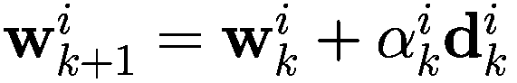

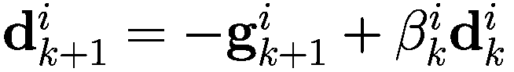，     (6.9)

其中 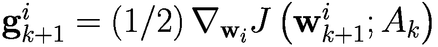。增益常数  被选为使  最小化的 *α* 值。与最速下降法类似，我们得到以下三次方程：

*c*[3]*α*³ + *c*[2]*α*² + *c*[1]*α* + *c*[0] = 0，     (6.10)

其中

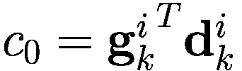，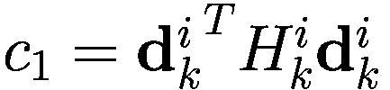，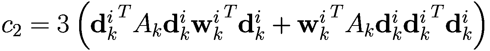，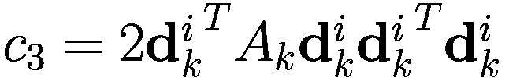。

这里，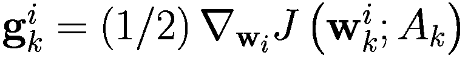 如 (6.2) 所示。求解方程 (6.10) 以获得使 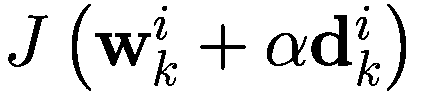 最小化的 *α* 值。对于  的选择，我们可以使用多种方法，例如 Hestenes-Stiefel、Polak-Ribiere、Fletcher-Reeves 和 Powell（在维基百科上有描述）。

现在，我们将自适应共轭方向 PCA 算法 (6.9) 表示为矩阵形式。我们定义以下矩阵：

![$$ {W}_k=\left[{\mathbf{w}}_k¹,\dots, {\mathbf{w}}_k^p\right] $$](images/522202_1_En_6_Chapter/522202_1_En_6_Chapter_TeX_IEq48.png)，![$$ {G}_k=\left[{\mathbf{g}}_k¹,\dots, {\mathbf{g}}_k^p\right] $$](images/522202_1_En_6_Chapter/522202_1_En_6_Chapter_TeX_IEq49.png)，![$$ {D}_k=\left[{\mathbf{d}}_k¹,\dots, {\mathbf{d}}_k^p\right] $$](images/522202_1_En_6_Chapter/522202_1_En_6_Chapter_TeX_IEq50.png)，

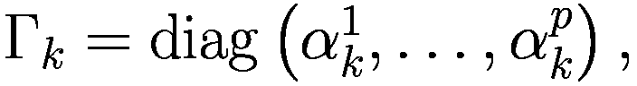 和 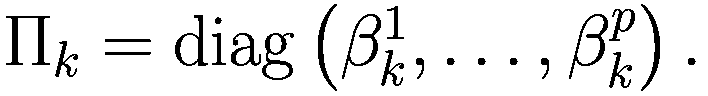。

那么，自适应共轭方向 PCA 算法为

*W*[*k* + 1] = *W*[*k*] + *D*[*k*]Γ[*k*]，

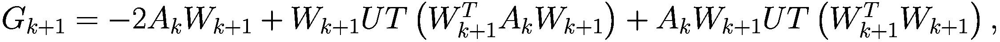，

*D*[*k* + 1] =  − *G*[*k* + 1] + *D*[*k*]Π[*k*]。     (6.11)

这里 UT[·] 与 (6.4) 中的相同。

### 共轭方向算法代码

以下 Python 代码使用数据 `X[nDim,nSamples]` 实现了该算法：

```
from numpy import linalg as la
A  = np.zeros(shape=(nDim,nDim)) # 存储自适应相关矩阵
W1 = 0.1 * np.ones(shape=(nDim,nEA)) # 所有算法的权重向量
W2 = W1
I  = np.identity(nDim)
Weight = 1
nEpochs = 1
for epoch in range(nEpochs):
for iter in range(nSamples):
cnt = nSamples*epoch + iter
# 使用当前样本 x 更新数据相关矩阵 A
x = X1[:,iter]
x = x.reshape(nDim,1)
A = Weight * A + (1.0/(1 + cnt))*((np.dot(x, x.T)) - Weight * A)
# 共轭方向法
# 初始化 D
G = -2 * A @ W2 + A @ W2 @ np.triu(W2.T @ W2) + \
W2 @ np.triu(W2.T @ A @ W2)
if (iter == 0):
D = G
# 更新 W
for i in range(nEA):
gi = G[:,i].reshape(nDim,1)
wi = W2[:,i].reshape(nDim,1)
di = D[:,i].reshape(nDim,1)
M = np.zeros(shape=(nDim,nDim))
for k in range(i):
wk = W2[:,k].reshape(nDim,1)
M = M + (A @ (wk @ wk.T) + (wk @ wk.T) @ A)
F = - 2*A + 2*A @ (wi @ wi.T) + 2 * (wi @ wi.T) @ A + A * \
(wi.T @ wi) + (wi.T @ A @ wi) * I  +  M
a0 = np.asscalar(gi.T @ di)
a1 = np.asscalar(- di.T @ F @ di)
a2 = np.asscalar(3 * ((wi.T @ A @ di) * (di.T @ di) + \
(di.T @ A @ di) * (wi.T @ di)))
a3 = np.asscalar(- 2 * (di.T @ A @ di) * (di.T @ di))
c  = np.array([a3, a2, a1, a0])
rts = np.roots(c)
rs = np.zeros(3)
r  = np.zeros(3)
J  = np.zeros(3)
cnt1 = 0
for k in range(3):
if np.isreal(rts[k]):
re = np.real(rts[k])
rs[cnt1] = re
r = (W2[:,i] - re * di.T).reshape(nDim,1)
J[cnt1] = np.asscalar(-2*(r.T @ A @ r) + (r.T @ A @ r) * \
(r.T @ r) + (r.T @ M @ r))
cnt1 = cnt1 + 1
yy = min(J)
iyy = np.argmin(J)
alpha = rs[iyy]
W2[:,i] = W2[:,i] - alpha * di.T
# 更新 d
gi = G[:,i].reshape(nDim,1)
wi = W2[:,i].reshape(nDim,1)
di = D[:,i].reshape(nDim,1)
M = np.zeros(shape=(nDim,nDim))
for k in range(i):
wk = W2[:,k].reshape(nDim,1)
M = M + (A @ (wk @ wk.T) + (wk @ wk.T) @ A)
F = - 2*A + 2*A @ (wi @ wi.T) + 2 * (wi @ wi.T) @ A + \
A * (wi.T @ wi) + (wi.T @ A @ wi) * I  +  M
beta = (gi.T @ F @ di) / (di.T @ F @ di)
di = gi + 1*beta*di
D[:,i] = di.T
```


## 6.5 牛顿-拉夫森算法

[Chatterjee 等人，《IEEE 神经网络汇刊》，第 11 卷，第 2 期，第 338-355 页，2000 年 3 月]

用于 PCA 的自适应牛顿-拉夫森算法为：

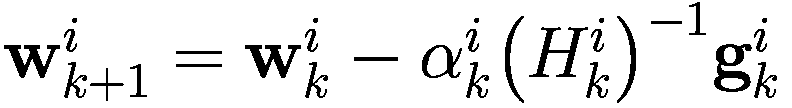，     (6.12)

其中  是一个非负标量， 是 (6.7) 中给出的在线海森矩阵。搜索参数  通常通过以下方式选择：(1) 最小化 ，其中 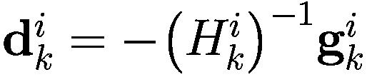；(2) 作为一个标量常数；或 (3) 作为一个递减序列 {}，使得当 *k*→∞ 时，→0。

该算法的主要关注点在于， 应为正定矩阵，并且我们应自适应地获得 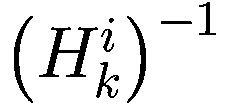 的估计值，以使算法计算高效。如果我们通过舍弃项 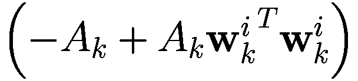 来近似海森矩阵，则可以解决这两个问题，因为当  接近解时，该项接近于 0。新的海森矩阵为：

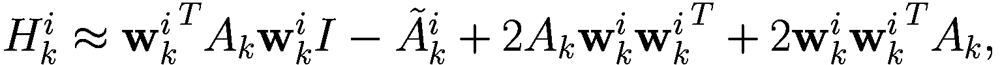     (6.13)

其中

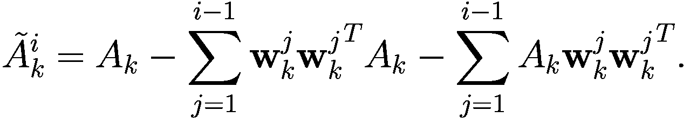

我们可以通过关于 *i* 的迭代方程来计算 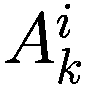，如下所示：

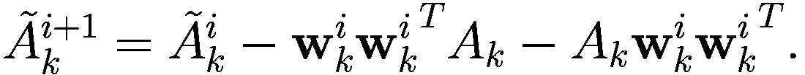

对该海森矩阵求逆包括对矩阵 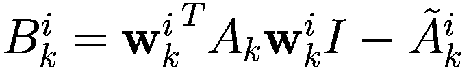 求逆以及两次秩一更新。该矩阵 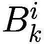 的近似逆由下式给出：

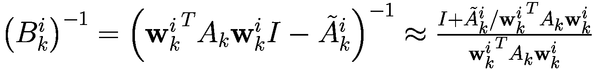。     (6.14)

通过对 (6.13) 中的海森矩阵  进行两次秩一更新，可以得到一个自适应求逆算法。我们定义

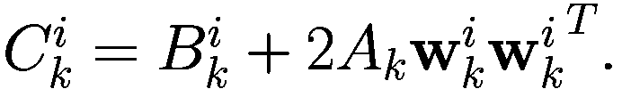     (6.15)

那么，根据 (6.13)， 的更新公式为：

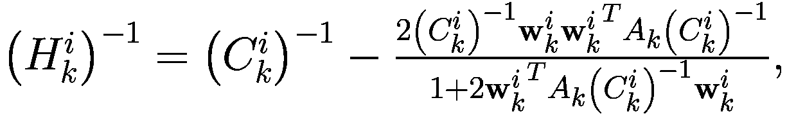     (6.16)

其中 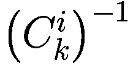 由 (6.15) 得到：

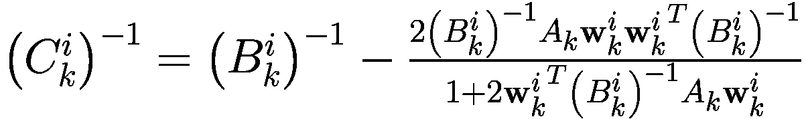     (6.17)

并且 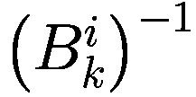 由 (6.14) 给出。

### 牛顿-拉夫森算法代码

以下 Python 代码使用数据 `X[nDim,nSamples]` 实现了该算法：

```
from numpy import linalg as la
A  = np.zeros(shape=(nDim,nDim)) # stores adaptive correlation matrix
W1 = 0.1 * np.ones(shape=(nDim,nEA)) # weight vectors of all algorithms
W2 = W1
I  = np.identity(nDim)
Weight = 1
nEpochs = 1
for epoch in range(nEpochs):
for iter in range(nSamples):
cnt = nSamples*epoch + iter
# Update data correlation matrix A with current sample x
x = X1[:,iter]
x = x.reshape(nDim,1)
A = Weight * A + (1.0/(1 + cnt))*((np.dot(x, x.T)) - Weight * A)
# Newton Rhapson
G = -2* A @ W4 + A@ W4@ np.triu(W4.T @ W4) + W4@ np.triu(W4.T @ A @ W4)
# Update W
for i in range(nEA):
M = np.zeros(shape=(nDim,nDim))
for k in range(i):
wk = W4[:,k].reshape(nDim,1)
M = M + (A @ (wk @ wk.T) + (wk @ wk.T) @ A)
wi = W4[:,i].reshape(nDim,1)
F = - 2*A + 2*A @ (wi @ wi.T) + 2 * (wi @ wi.T) @ A + \
A * (wi.T @ wi) + (wi.T @ A @ wi) * I  +  M
lam = wi.T @ A @ wi
Atilde = A
if (iter > 0):
invB = (I + (Atilde/lam))/lam
invC = invB- (2*invB@ A @wi @wi.T @ invB)/(1 + 2*wi.T@ invB@ A @ wi)
invF = invC- (2*invC@ wi @wi.T @A @ invC)/(1 + 2*wi.T@ A @invC @ wi)
gi = G[:,i].reshape(nDim,1)
di = -invF @ gi
a0 = np.asscalar(gi.T @ di)
a1 = np.asscalar(di.T @ F @ di)
a2 = np.asscalar(3* ((wi.T @ A @ di) @ (di.T @ di) + \
(di.T @ A @ di)*(wi.T @ di)))
a3 = np.asscalar(2 * (di.T @ A @ di) @ (di.T @ di))
c  = np.array([a3, a2, a1, a0])
rts = np.roots(c)
rs = np.zeros(3)
r  = np.zeros(3)
J  = np.zeros(3)
cnt1 = 0
for k in range(3):
if np.isreal(rts[k]):
re = np.real(rts[k])
rs[cnt1] = re
r = W4[:,i] + re * di.reshape(nDim)
J[cnt1] = np.asscalar(-2*(r.T @ A @ r) + (r.T @ A @ r) * \
(r.T @ r) + (r.T @ M @ r))
cnt1 = cnt1 + 1
iyy = np.argmin(J)
alpha = rs[iyy]
W4[:,i] = (W4[:,i] + alpha * di.reshape(nDim)).T
```

## 6.6 实验结果

我进行了两组实验来测试加速 PCA 算法的性能。第一组实验在*平稳*高斯数据上进行，第二组在*非平稳*高斯数据上进行。然后，我将最速下降算法与最先进的自适应 PCA 算法进行了比较，例如 Yang 的投影近似子空间跟踪算法、Bannour 和 Sadjadi 的递归最小二乘算法，以及 Fu 和 Dowling 的共轭梯度特征结构跟踪算法。


### 平稳数据的实验

我生成了 2000 个 10 维高斯数据样本（即 *n*=10），均值为零，协方差如下所示。请注意，该协方差矩阵源自[Okada and Tomita 85]中的第一个协方差矩阵乘以 2。协方差矩阵为

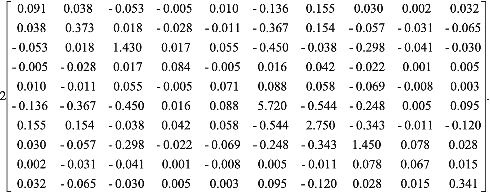

该协方差矩阵的特征值为

11.7996, 5.5644, 3.4175, 2.0589, 0.7873, 0.5878, 0.1743, 0.1423, 0.1213, 0.1007。

显然，前四个特征值显著，我自适应地计算了对应的特征向量（即 *p*=4）。10 维随机平稳数据的图示见图 6-1。

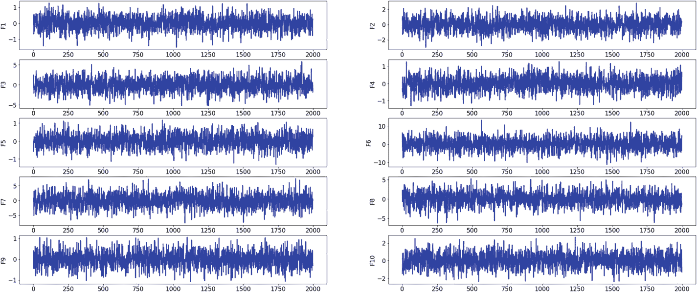

图 6-1

10 维平稳随机正态数据

为了计算在线数据序列 {*A*[*k*]}，我根据上述协方差矩阵生成了随机数据向量 {**x**[*k*]}。我使用第 2 章中的算法(2.3)，从 {**x**[*k*]} 生成了 {*A*[*k*]}。在收集完所有 500 个样本 **x**[*k*] 后，我计算了相关矩阵 *A*，公式如下：

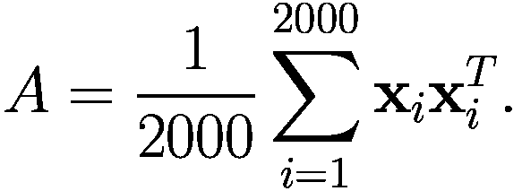

我将通过标准数值分析方法[Golub and VanLoan 83]从该 *A* 计算出的特征向量和特征值称为*实际值*。

我在随机数据序列 {*A*[*k*]} 上使用了自适应梯度下降法(6.4)、最速下降法(6.8)、共轭方向法(6.11)和牛顿-拉夫逊法(6.12)。所有算法均以 *W*[0] = 0.1*ONE 初始化，其中 ONE 是一个 10 行 4 列的矩阵，所有元素均为 1。为了衡量算法的收敛性和精度，我计算了每个自适应算法在第 *k* 次更新时的方向余弦，公式如下：

方向余弦 (*k*) = ，     (6.18)

其中  是 *A*[*k*] 在第 *k* 次更新时的估计特征向量，**ϕ**[*i*] 是通过传统数值分析方法从所有收集样本中计算出的实际特征向量。

图 6-2 至 6-4 展示了四种算法计算 *A* 的前四个主特征向量的迭代过程。对于梯度下降法(6.4)，我使用了 *η*[*k*]=1/(400+*k*)。对于共轭方向法，我使用了 Hestenes-Stiefel[非线性共轭梯度法，维基百科]方法（见第 6.4 节）来计算 。对于最速下降法、共轭方向法和牛顿-拉夫逊法，我通过求解三次方程来选择 ，具体方法分别在第 6.3 节、第 6.4 节和第 6.5 节中描述。


图 6-4

平稳数据下，梯度下降法(6.4)和牛顿-拉夫逊法(6.12)算法对 A 的前四个主特征向量的收敛情况


图 6-3

平稳数据下，梯度下降法(6.4)和共轭方向法(6.11)算法对 A 的前四个主特征向量的收敛情况


图 6-2

平稳数据下，梯度下降法(6.4)和最速下降法(6.8)算法对 A 的前四个主特征向量的收敛情况

从图 6-2 至 6-4 可以清楚地看出，尽管为梯度下降法精心选择了 *η*[*k*]，但最速下降法、共轭方向法和牛顿-拉夫逊法的收敛速度仍快于梯度下降法。此外，新算法无需临时选择 *η*[*k*]。相反，增益参数  和  是根据在线数据序列计算得出的。

四种算法之间的比较显示，对于 *A* 的前四个主特征向量，它们之间的差异很小。在三种收敛速度更快的算法中，最速下降法(6.8)每次迭代所需的计算量最小。因此，这些实验表明，在本文介绍的四种算法中，最速下降自适应算法(6.8)在速度和计算量方面最为合适。


### 非平稳数据实验

为了展示算法对非平稳数据的跟踪能力，我生成了 500 个样本的零均值 10 维高斯数据（即 *n*=10），其协方差矩阵如前所述。随后，我通过生成 1000 个样本的零均值 10 维高斯数据（协方差矩阵如下，该矩阵来自[Okada and Tomita 85]中的第五个协方差矩阵乘以 4）来突然改变数据序列：


该协方差矩阵的特征值为：

23.3662, 16.5698, 6.8611, 1.8379, 1.5452, 0.7010, 0.3851, 0.3101, 0.2677, 0.2278，

这些值与之前的特征值截然不同。图 6-5 绘制了这 10 维非平稳数据。


图 6-5

在 500 个样本后发生突变的 10 维非平稳随机数据

我使用算法（第 2 章中的 2.5 式）从{**x**[*k*]}生成了{*A*[*k*]}，其中*β*=0.995。我在随机观测序列{*A*[*k*]}上应用了自适应梯度下降法(6.4)、最速下降法(6.8)、共轭方向法(6.11)和牛顿-拉夫逊法(6.12)，并通过计算每个自适应算法在第*k*次更新时的方向余弦（如(6.18)式所示）来衡量算法的收敛精度。所有算法均以*W*[0] = 0.1*ONE 初始化，其中 ONE 是一个所有元素均为 1 的 10×4 矩阵。此处我同样计算了前四个特征向量（即 *p*=4）。

图 6-6 至 6-8 展示了四种算法在计算前述两个协方差矩阵的前四个主特征向量时的迭代过程。对于共轭方向法，我使用了 Hestenes-Stiefel [非线性共轭梯度法，维基百科]方法来计算 。对于最速下降法、共轭方向法和牛顿-拉夫逊法，我通过求解一个三次方程（如第 6.3 节至 6.5 节所述）来选择 。


图 6-8

梯度下降法(6.4)和牛顿-拉夫逊法(6.12)算法对非平稳数据两个协方差矩阵前四个主特征向量的收敛情况


图 6-7

梯度下降法(6.4)和共轭方向法(6.11)算法对非平稳数据两个协方差矩阵前四个主特征向量的收敛情况


图 6-6

梯度下降法(6.4)和最速下降法(6.8)算法对非平稳数据两个协方差矩阵前四个主特征向量的收敛情况

从图 6-6 至 6-8 可以再次清晰地看出，最速下降法、共轭方向法和牛顿-拉夫逊法比传统的梯度下降法收敛更快，并且能更好地跟踪数据的变化。在某些情况下，例如图 6-6 中针对第三个主特征向量，当数据序列发生变化时，梯度下降法失效，但新算法仍能正确执行。

图 6-8 中四种算法之间的比较显示，对于前四个主特征向量，它们之间的差异很小。同样，在三种收敛更快的算法中，由于最速下降法(6.8)每次迭代所需的计算量最小，因此它最适合在速度和计算量之间取得最优平衡。

### 与最新算法的比较

我将最速下降法(6.8)与 Yang 的 PASTd 算法、Bannour 和 Sadjadi 的 RLS 算法以及 Fu 和 Dowling 的 CGET1 算法进行了比较。我首先在第 6.6.1 节所述的平稳数据上测试了这四种算法。

我将 ONE 定义为一个所有元素均为 1 的 10×4 矩阵。每种算法的初始值如下：

1.  最速下降法：

*W*[0] = 0.1*ONE。

1.  Yang 的 PASTd 算法：

*W*[0] = 0.1*ONE, *β*=0.997，且对于 *i* = 1, 2, …, *p* (*p*≤*n*)，有 。

1.  Bannour 和 Sadjadi 的 RLS 算法：

*W*[0] = 0.1*ONE 且 *P*[0] = ONE。

1.  Fu 和 Dowling 的 CGET1 算法：

*W*[0] = 0.1*ONE 且 。

我发现 PASTd 和 RLS 算法的性能在很大程度上分别取决于  和 *P*[0] 的初始选择。因此，我选择了在大多数实验中能给出最佳结果的初始值。本次实验的结果如图 6-9 所示。


图 6-9

最速下降法(6.8)、PASTd、RLS 和 CGET1 算法对平稳数据 A 的前四个主特征向量的收敛情况

从图 6-9 可以观察到，最速下降法和 CGET1 算法对所有四个主特征向量都表现良好。对于次要特征向量，RLS 算法的表现略优于 PASTd 算法。对于主要特征向量，所有算法都表现良好。算法之间的差异在次要（第三和第四）特征向量上尤为明显。

接下来，我将这四种算法应用于第 6.6.2 节所述的非平稳数据，其中公式(2.5, 第 2 章)中的*β*=0.995。本次实验的结果如图 6-10 所示。


图 6-10

最速下降法(6.8)、PASTd、RLS 和 CGET1 算法对非平稳数据两个协方差矩阵前四个主特征向量的收敛情况

可以观察到，最速下降法和 CGET1 算法对所有四个主特征向量都表现良好。在处理非平稳性方面，PASTd 算法的表现优于 RLS 算法。这是预料之中的，因为 PASTd 算法通过遗忘因子*β*=0.995 来应对非平稳性，而 RLS 算法没有此选项。


## 6.7 结论

我提出了一种无约束目标函数，通过使用诸如梯度下降、最速下降、共轭梯度和牛顿-拉夫森等非线性优化方法，来获得各种新的主成分分析自适应算法。使用平稳和非平稳数据对这些算法进行比较表明，与梯度下降算法相比，最速下降、共轭梯度和牛顿-拉夫森算法具有更快的跟踪能力。

应进一步考虑算法的计算复杂度。最速下降、共轭梯度和牛顿-拉夫森算法的计算复杂度为 *O*(*pn*²)。然而，如果在梯度下降算法中使用估计值  代替公式 (6.4)，则计算复杂度降至 *O*(*pn*)，尽管收敛速度会变慢。CGET1 算法的复杂度为 *O*(*pn*²)。PASTd 和 RLS 算法的复杂度为 *O*(*pn*)。然而，如图 6-9 和 6-10 所示，它们的收敛速度慢于最速下降和 CGET1 算法。此外，如 [Cichocki and Unbehauen 93] 中的示例所示，梯度下降算法可以通过并行架构实现。

