# 7. 广义特征向量

## 7.1 引言与应用场景

本章关注广义特征值问题 `AΦ=BΦΛ`、`ABΦ=ΦΛ` 和 `BAΦ=ΦΛ` 的自适应求解，其中 `A` 和 `B` 是实对称 `n×n` 矩阵，且 `B` 是正定的。我们将特别考虑问题 `AΦ=BΦΛ`，尽管其余两个问题与之类似。矩阵对（束）`(A,B)` 通常被称为*对称正定束* [Golub and VanLoan 83]。

如前所述，计算 `Φ` 和 `Λ` 的传统（数值分析）方法需要在收集所有样本后计算 `(A,B)`，然后应用数值过程 [Golub and VanLoan 83]；换句话说，该方法以*批处理*方式工作。相比之下，对于在线情况，矩阵 `(A,B)` 是未知的。相反，存在两个随机矩阵序列 `{A[k],B[k]}`，满足 `lim[k→∞]E[A[k]]=A` 和 `lim[k→∞]E[B[k]]=B`。对于每个样本 `(A[k],B[k])`，我们需要分别获得 `(Φ,Λ)` 的当前估计值 `(Φ[k],Λ[k])`，使得 `(Φ[k],Λ[k])` 强收敛于 `(Φ,Λ)`。

### 广义特征值分解在模式识别中的应用

在模式识别中，存在一些问题，我们拥有来自不同总体或模式类别的样本 `x∈ℜ^(n)`。著名的线性判别分析问题 [Chatterjee et al. Nov 97, May 97, Mar 97] 寻求一个变换 `W∈ℜ^(nXp) (p≤n)`，使得类间距离（通过模式围绕其混合均值的散布度量）最大化，同时类内距离（通过模式围绕其各自类别均值的散布度量）尽可能小。该变换的目标是将类别分组为分离良好的簇。前者称为混合散布矩阵，记为 `A`；后者称为类内散布矩阵，记为 `B` [Fukunaga 90]。当需要 `W` 的第一列 `w` 时（即 `p=1`），该问题可以在约束优化框架中表述为

最大化 `w^(T)Aw`，约束条件为 `w^(T)Bw = 1`。     (7.1)

与 (7.1) 类似的问题是最大化关于 `w` 的瑞利商准则 [Golub and VanLoan 83]：

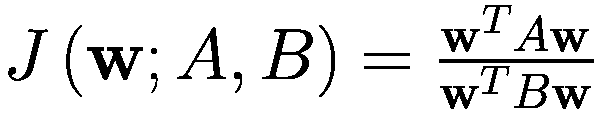。     (7.2)

问题 (7.1) 或 (7.2) 的解导致广义特征分解问题 `Aw=λBw`，其中 `λ` 是 `A` 相对于 `B` 的最大广义特征值。通常，`W` 的 `p` 列是 `A` 相对于 `B` 的 `p≤n` 个正交单位广义特征向量 `ϕ[1],...,ϕ[p]`，其中

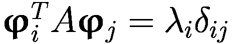，且 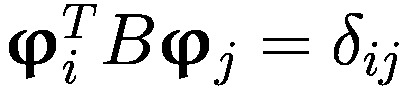，对于 `i=1,…,p`，     (7.3)

其中 `λ[1]> ... >λ[p]>λ[p+1]≥ ... ≥λ[n]>0` 是 `A` 相对于 `B` 的 `p` 个最大广义特征值，按降序排列。总之，线性判别分析是一种用于类别可分性特征的强大特征提取工具 [Chatterjee May 97]，我们的自适应算法适用于此。

### 广义特征值分解在信号处理中的应用

接下来，让我们讨论一个在存在干扰的情况下检测期望信号的类似问题。在这里，我们寻求最优线性变换 `W` 来对信号加干扰进行加权，以便以最大功率和最小干扰检测到期望信号。给定矩阵对 `(A,B)`，其中 `A` 是信号加干扰加噪声的相关矩阵，`B` 是干扰加噪声的相关矩阵，我们可以将信号检测问题表述为 (7.1) 中的约束最大化问题。在这里，我们最大化信号功率并最小化干扰功率。`W` 的解由矩阵束 `(A,B)` 的 `p≤n` 个最大广义特征向量组成。自适应广义特征分解算法还允许跟踪输入数据中的缓慢变化 [Chatterjee et al. Nov 97, Mar 97; Chen et al. 2000]。

### 广义特征分解方法

我们首先定义非自适应情况下的问题。三种广义特征值问题（`AΦ=BΦΛ`、`ABΦ=ΦΛ` 和 `BAΦ=ΦΛ`，其中 `A` 和 `B` 是实对称 `n×n` 矩阵，且 `B` 正定）均可通过将 `B` 进行 Cholesky 分解（`B=LL^(T)` 或 `B=U^(T)U`）简化为标准对称特征值问题。利用 `B = LL^(T)`，我们可以将 `AΦ=BΦΛ` 写为：

`(L^(−1)AL^(−T))(L^(T)Φ) = (L^(T)Φ)Λ` 或 `CΨ = ΨΛ`。     (7.4)

这里 `C` 是对称矩阵 `C = L^(–1) A L^(–T)`，且 `Ψ = L^(T) Φ`。表 7-1 总结了三种类型的问题如何简化为标准形式 `CΨ=ΨΛ`，以及如何从简化问题的特征向量 `Ψ` 恢复原始问题的特征向量 `Φ`。

**表 7-1**

广义特征分解问题的类型及其解

| 问题类型 | `B` 的分解 | 简化形式 | 广义特征向量 |
| --- | --- | --- | --- |
| `AΦ=BΦΛ` | `B = LL^(T)` | `C = L^(–1) A L^(–T)` | `Φ = L^(–T) Ψ` |
| `B = U^(T)U` | `C = U^(–T) A U^(–1)` | `Φ = U^(–1) Ψ` |
| `ABΦ=ΦΛ` | `B = LL^(T)` | `C = L^(T) A L` | `Φ= L^(–T) Ψ` |
| `B = U^(T)U` | `C = U A U^(T)` | `Φ = U^(–1) Ψ` |
| `BAΦ=ΦΛ` | `B = LL^(T)` | `C = L^(T) A L` | `Φ = L Ψ` |
| `B = U^(T)U` | `C = U A U^(T)` | `Φ = U^(T) Ψ` |

在自适应情况下，我们可以扩展这些技术：首先（自适应地）为每个样本 `B[k]` 计算一个矩阵 `W[k]`，其中当 `k→∞` 时，`W[k]` 以概率 1 (w.p.1) 趋近于 `B` 的逆 Cholesky 分解 `L^(–1)`。此处可考虑第 3 章中的任意算法。接下来，我们考虑一个序列 {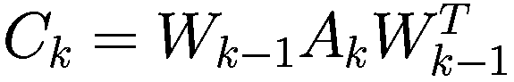}，用于自适应地计算矩阵 `V[k]`，其中当 `k→∞` 时，`V[k]` 以概率 1 趋近于 `lim[k→∞]E[C[k]]` 的特征向量矩阵。为此，可考虑第 5 章和第 6 章中的任意算法。结合这两个步骤，得到 `W[k]V[k]`，已证明当 `k→∞` 时，该乘积以概率 1 收敛于 `Φ`。因此，这两个步骤可以*同时*进行，并强收敛于特征向量矩阵 `Φ`。该方法的完整描述见 [Chatterjee et al. May 97, Mar 97]。在本章中，我将提供多种新技术来解决自适应情况下的广义特征分解问题。

### 本章概要

在第 7.2 节中，我将列出推导自适应广义特征分解算法的目标函数。在第 7.3、7.4 和 7.5 节中，我将分别基于 OJA 目标函数，介绍齐次、收缩和加权变体的自适应算法。在第 7.6、7.7 和 7.8 节中，我将分析均方误差 (XU) 目标函数的相同三种变体，并给出收缩情况下的收敛性证明。在第 7.9、7.10 和 7.11 节中，我将讨论基于惩罚函数 (PF) 目标函数推导的算法。在第 7.12、7.13 和 7.14 节中，我将考虑增广拉格朗日 1 (AL1) 目标函数；在第 7.15、7.16 和 7.17 节中，我将介绍增广拉格朗日 2 (AL2) 目标函数。在第 7.18、7.19 和 7.20 节中，我将介绍信息论 (IT) 准则；在第 7.21、7.22 和 7.23 节中，我将描述瑞利商 (RQ) 准则。在第 7.24 节中，我将讨论实验结果，并在第 7.25 节中给出结论。

## 7.2 算法与目标函数

与 PCA 算法（第 5 章）类似，在本章中，我将介绍几种用于广义特征向量计算的自适应算法。我考虑两个已中心化为零均值的渐近平稳序列 {`x[k]∈ℜ^(n)`} 和 {`y[k]∈ℜ^(n)`}。我们可以通过其瞬时值 {`x_k x_k^T`, `y_k y_k^T`} 或通过公式 (2.3) 计算的运行平均值来表示 {`x[k]`,`y[k]`} 对应的在线相关矩阵 {`A[k]`,`B[k]`}。然而，如果 {`x[k]`,`y[k]`} 是非平稳的，我们可以通过公式 (2.5) 从数据样本 {`x[k]`,`y[k]`} 构建相关矩阵 {`A[k]`,`B[k]`}。

### 自适应 GEVD 算法的目标函数总结

遵循第 2.​3 节的方法论，对于每种算法，我将描述目标函数并推导其自适应算法。目标函数包括：

*   Oja 目标函数 (OJA)
*   Xu 均方误差目标函数 (XU)
*   惩罚函数法 (PF)
*   增广拉格朗日法 1 (AL1)
*   增广拉格朗日法 2 (AL2)
*   信息论准则 (IT)
*   瑞利商准则 (RQ)

与 PCA 情况相同，从每个目标函数可以推导出三种算法变体，分别是：

1.  *齐次自适应规则：* 这些算法不计算特征值递减的归一化广义特征向量。
2.  *收缩自适应规则：* 在此，我们生成特征值递减的单位广义特征向量。然而，训练是顺序进行的，这使得并行实现的训练过程更加困难。
3.  *加权自适应规则：* 这些算法通过对每个广义特征向量使用不同的标量权重而获得，使得它们归一化并按特征值递减的顺序排列。

### 广义特征向量算法总结

对于所有算法，我描述了一个目标函数 `J(w[i]; A, B)` 以及如下形式的更新规则：

```
W_{k+1} = W_k + η_k h(W_k, A_k, B_k)
```

其中 `h(W[k], A[k], B[k])` 遵循特定的连续性和正则性属性 [Ljung 77,92]，并在表 7-2 中给出。

**表 7-2：自适应广义特征分解算法列表**

| 算法 | 类型 | 自适应算法 `h(W[k], A[k])` |
| :--- | :--- | :--- |
| OJA | 齐次型 | `A_k W_k - B_k W_k W_k^T A_k W_k` |
|  | 紧缩型 | `A_k W_k - B_k W_k UT(W_k^T A_k W_k)` |
|  | 加权型 | `A_k W_k C - B_k W_k C W_k^T A_k W_k` |
| XU | 齐次型 | `2 A_k W_k - A_k W_k W_k^T B_k W_k - B_k W_k W_k^T A_k W_k` |
|  | 紧缩型 | `2 A_k W_k - A_k W_k UT(W_k^T B_k W_k) - B_k W_k UT(W_k^T A_k W_k)` |
|  | 加权型 | `2 A_k W_k C - B_k W_k C W_k^T A_k W_k - A_k W_k C W_k^T B_k W_k` |
| PF | 齐次型 | `A_k W_k - μ B_k W_k (W_k^T B_k W_k - I_p)` |
|  | 紧缩型 | `A_k W_k - μ B_k W_k UT(W_k^T B_k W_k - I_p)` |
|  | 加权型 | `A_k W_k C - μ B_k W_k C (W_k^T B_k W_k - I_p)` |
| AL1 | 齐次型 | `A_k W_k - B_k W_k W_k^T A_k W_k - μ B_k W_k (W_k^T B_k W_k - I_p)` |
|  | 紧缩型 | `A_k W_k - B_k W_k UT(W_k^T A_k W_k) - μ B_k W_k UT(W_k^T B_k W_k - I_p)` |
|  | 加权型 | `A_k W_k C - B_k W_k C W_k^T A_k W_k - μ B_k W_k C (W_k^T B_k W_k - I_p)` |
| AL2 | 齐次型 | `2 A_k W_k - B_k W_k W_k^T A_k W_k - A_k W_k W_k^T B_k W_k - μ B_k W_k (W_k^T B_k W_k - I_p)` |
|  | 紧缩型 | `2 A_k W_k - B_k W_k UT(W_k^T A_k W_k) - A_k W_k UT(W_k^T B_k W_k) - μ B_k W_k UT(W_k^T B_k W_k - I_p)` |
|  | 加权型 | `2 A_k W_k C - B_k W_k C W_k^T A_k W_k - A_k W_k C W_k^T B_k W_k - μ B_k W_k C (W_k^T B_k W_k - I_p)` |
| IT | 齐次型 | `(A_k W_k - B_k W_k W_k^T A_k W_k) DIAG(W_k^T A_k W_k)^{-1}` |
|  | 紧缩型 | `(A_k W_k - B_k W_k UT(W_k^T A_k W_k)) DIAG(W_k^T A_k W_k)^{-1}` |

|  | 加权型 | 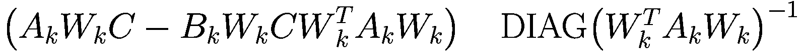 |
| --- | --- | --- |
| RQ | 齐次型 | 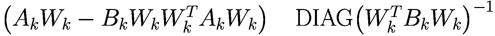 |
|  | 紧缩型 |  |
|  | 加权型 |  |

在接下来的讨论中，我将 Φ=[`ϕ`[1] ... `ϕ`[*n*]]∈ℜ^(*n*X*n*) 表示为 *A* 相对于 *B* 的标准正交广义特征向量矩阵，并将 Λ= `diag`(`λ`[1],...,`λ`[*n*]) 表示为广义特征值矩阵，使得 *λ*[1]>*λ*[2]>...>*λ*[*p*]>*λ*[*p*+1]≥...≥*λ*[*n*]>0。我使用下标 (*i*) 来表示索引集 {1,2,…,*n*} 的第 *i*^(*th*) 个排列。

## 7.3 OJA GEVD 算法

### OJA 齐次算法

OJA 齐次算法的目标函数可以写为

，     (7.5)

其中 *i*=1,…,*p* (*p*≤*n*)。通过对 (7.5) 关于 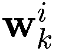 求梯度，我们得到以下自适应算法：

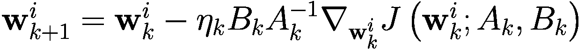 对于 *i*=1,…,*p*，     (7.6)

其中 *η*[*k*] 是一个递减的增益常数。定义 ![$$ {W}_k=\left[{\mathbf{w}}_k¹\dots {\mathbf{w}}_k^p\right] $$](images/522202_1_En_7_Chapter/522202_1_En_7_Chapter_TeX_IEq31.png)，由 (7.6) 我们得到

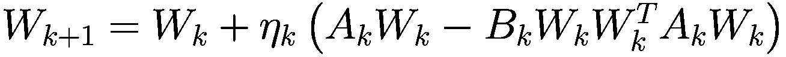。     (7.7)

### OJA 紧缩算法

OJA 紧缩自适应 GEVD 算法的目标函数是

，     (7.8)

其中 *i*=1,…,*p*。通过对 (7.8) 关于  求梯度，我们得到 OJA 紧缩自适应梯度下降算法为

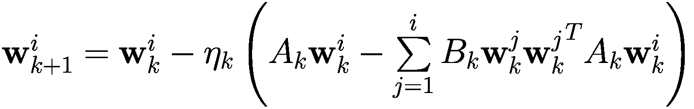，     (7.9)

其中 *i*=1,…,*p* (*p*≤*n*)。该算法的矩阵形式为

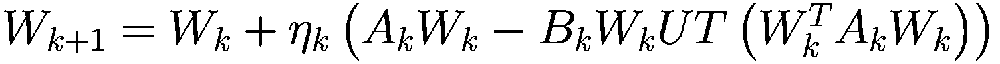，     (7.10)

其中 `UT[⋅]` 将其矩阵参数对角线以下的所有元素设置为零。

### OJA 加权算法

OJA 加权自适应 GEVD 算法的目标函数为

     (7.11)

其中 *i*=1,…,*p*，*c*[1],…,*c*[*p*] (*p*≤*n*) 是满足以下条件的小正数：

*c*[1] > *c*[2] > … > *c*[*p*] > 0, *p* ≤ *n*.     (7.12)

给定一个对角矩阵 *C* = `diag` (*c*[1], …, *c*[*p*])，*p* ≤ *n*，OJA 加权自适应算法为

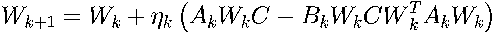.     (7.13)

### OJA 算法 Python 代码

以下 Python 代码适用于多维数据 `X[nDim,nSamples]` 和 `Y[nDim,nSamples]`：

```python
# 示例代码框架 (请在此处插入具体实现)
import numpy as np

def oja_homogeneous(A_k, B_k, n_dim, n_samples):
    # 初始化
    # 实现OJA齐次算法
    pass

def oja_concise(A_k, B_k, n_dim, n_samples):
    # 初始化
    # 实现OJA紧缩算法
    pass

def oja_weighted(A_k, B_k, C, n_dim, n_samples):
    # 初始化
    # 实现OJA加权算法
    pass
```

# 7.4 XU GEVD 算法

## XU 齐次算法

XU 齐次自适应 GEVD 算法的目标函数为

     (7.14)

其中 `i`=1,…,`p` (`p`≤`n`)。通过对 (7.14) 关于  求梯度，我们得到 XU 齐次自适应梯度下降算法：

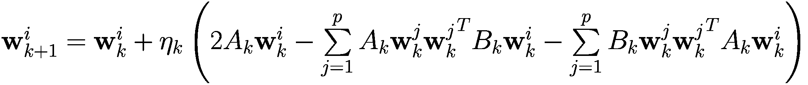     (7.15)

其中 `i`=1,…,`p`，其矩阵形式为

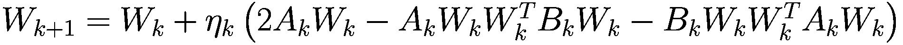.     (7.16)

## XU 收缩算法

XU 收缩自适应 GEVD 算法的目标函数为

     (7.17)

其中 `i`=1,…,`p` (`p`≤`n`)。通过对 (7.17) 关于  求梯度，我们得到

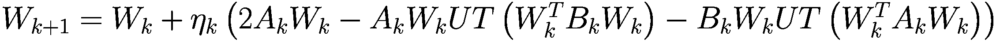, (7.18)

其中 `UT[⋅]` 将其矩阵参数中对角线以下的所有元素设为零。Chatterjee 等人 [Mar 00, Thms 1, 2] 证明，当 `k`→∞ 时，`W[k]` 以概率 1 收敛到 [±**ϕ**[1] ±**ϕ**[2] … ±**ϕ**[`p`]]。

## XU 加权算法

XU 加权自适应 GEVD 算法的目标函数为

     (7.19)

其中 `i`=1,…,`p` (`p`≤`n`)，`c[1]`,…,`c[p]` 是满足 (7.12) 的小正数。自适应算法为

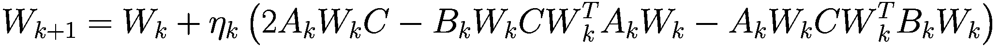,  (7.20)

其中 `C` = `diag(c[1],…,c[p])`。

## XU 算法 Python 代码

以下 Python 代码适用于多维数据 `X[nDim,nSamples]` 和 `Y[nDim,nSamples]`：

```python
from numpy import linalg as la
A = np.zeros(shape=(nDim,nDim)) # 存储自适应相关矩阵
B = np.zeros(shape=(nDim,nDim)) # 存储自适应相关矩阵
W2 = 0.1 * np.ones(shape=(nDim,nEA)) # 所有算法的权重向量
W3 = W2
c = [2.6-0.3*k for k in range(nEA)]
C = np.diag(c)
I  = np.identity(nDim)
for epoch in range(nEpochs):
    for iter in range(nSamples):
        cnt = nSamples*epoch + iter
        # 使用当前数据向量 x,y 更新数据相关矩阵 A,B
        x = X[:,iter]
        x = x.reshape(nDim,1)
        A = A + (1.0/(1 + cnt))*((np.dot(x, x.T)) - A)
        y = Y[:,iter]
        y = y.reshape(nDim,1)
        B = B + (1.0/(1 + cnt))*((np.dot(y, y.T)) - B)
        # 收缩梯度下降
        W2 = W2 + (1/(150 + cnt))*(A @ W2 - B @ W2 @ np.triu(W2.T @ A @ W2))
        # 加权梯度下降
        W3 = W3 + (1/(500 + cnt))*(A @ W3 @ C - B @ W3 @ C @ (W3.T @ A @ W3))
```

# 7.5 PF GEVD 算法

## PF 齐次算法

我们将瑞利商准则 (7.2) 写成以下惩罚函数，从而得到 PF 齐次广义特征向量算法的目标函数：

,     (7.21)

其中 `μ` > 0 且 `i`=1,…,`p` (`p`≤`n`)。通过对 (7.21) 关于 $${\mathbf{w}}_k^i$$ 求梯度，我们得到 PF 齐次自适应算法：

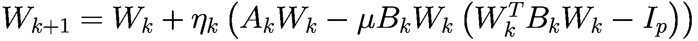,     (7.22)

其中 `I[p]` 是一个 `p`X`p` 的单位矩阵。

## PF 消去算法

PF 消去 GEVD 算法的目标函数为

, (7.23)

其中 `μ` > 0 且 `i`=1,…,`p`。自适应算法为

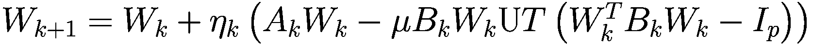,     (7.24)

其中 `UT[⋅]` 将其矩阵参数中对角线以下的所有元素设置为零。

## PF 加权算法

PF 加权 GEVD 算法的目标函数为

, (7.25)

其中 `c[1]` > `c[2]` > … > `c[p]` > 0 (`p` ≤ `n`), `μ` > 0, 且 `i`=1,…,`p`。相应的自适应算法为

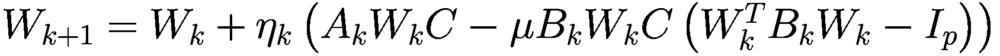,     (7.26)

其中 `C` = `diag` (`c[1]`, …, `c[p]`)。

## PF 算法 Python 代码

以下 Python 代码适用于多维数据 `X[nDim,nSamples]` 和 `Y[nDim,nSamples]`：

```python
from numpy import linalg as la
A  = np.zeros(shape=(nDim,nDim)) # 存储自适应相关矩阵
B  = np.zeros(shape=(nDim,nDim)) # 存储自适应相关矩阵
W2 = 0.1 * np.ones(shape=(nDim,nEA)) # 所有算法的权向量
W3 = W2
c = [2.6-0.3*k for k in range(nEA)]
C = np.diag(c)
I  = np.identity(nDim)
for epoch in range(nEpochs):
    for iter in range(nSamples):
        cnt = nSamples*epoch + iter
        # 使用当前数据向量 x,y 更新数据相关矩阵 A,B
        x = X[:,iter]
        x = x.reshape(nDim,1)
        A = A + (1.0/(1 + cnt))*((np.dot(x, x.T)) - A)
        y = Y[:,iter]
        y = y.reshape(nDim,1)
        B = B + (1.0/(1 + cnt))*((np.dot(y, y.T)) - B)
        # 消去梯度下降
        W2 = W2 + (1/(100 + cnt))*(A @ W2 - mu * B @ W2 @ \
              np.triu((W2.T @ B @ W2) - I))
        # 加权梯度下降
        W3 = W3 + (1/(500 + cnt))*(A @ W3 @ C - mu * B @ W3 @ C @ \
              ((W3.T @ B @ W3) - I))
```

# 7.6 AL1 GEVD 算法

## AL1 齐次算法

我们将非线性优化的增广拉格朗日方法应用于瑞利商准则 (7.4)，得到 AL1 齐次 GEVD 算法的目标函数：

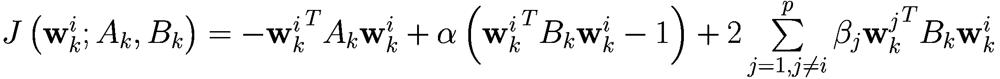,

# AL1 算法

## AL1 齐次自适应梯度下降广义特征向量算法

对于 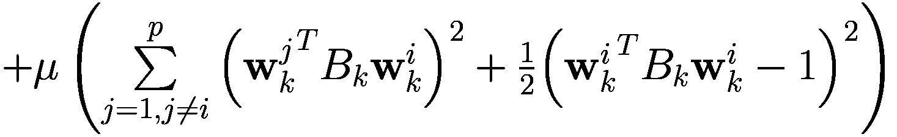，(7.27)

对于 `i`=1,…,`p` (`p`≤`n`)，其中 (`α`, `β[1]`, `β[2]`, …, `β[p]`) 是拉格朗日乘子，`μ` 是一个正的惩罚常数。对 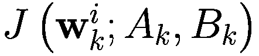 关于  求梯度，令梯度等于 `0`，并利用约束条件 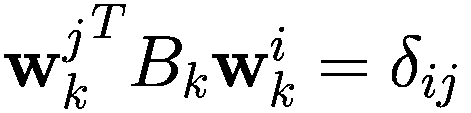，我们得到

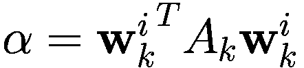 且 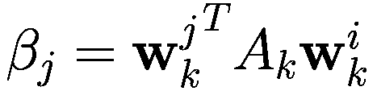 对于 `j`=1,…,`p`。(7.28)

将 (7.27) 梯度中的 (`α`, `β[1]`, `β[2]`, …, `β[p]`) 替换，我们得到 AL1 齐次自适应梯度下降广义特征向量算法：

 (7.29)

其中 `μ` > 0。定义 ![$$ {W}_k=\left[{\mathbf{w}}_k¹\dots {\mathbf{w}}_k^p\right] $$](images/522202_1_En_7_Chapter/522202_1_En_7_Chapter_TeX_IEq63.png)，我们得到

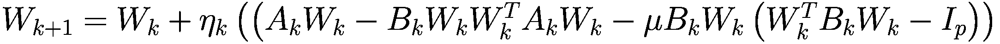，(7.30)

其中 `I[p]` 是一个 `p`X`p` 的单位矩阵。

## AL1 消去算法

AL1 消去 GEVD 算法的目标函数为

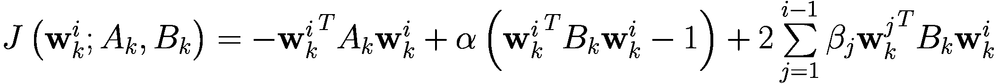

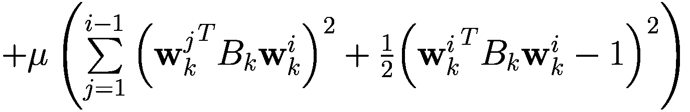，(7.31)

对于 `i`=1,…,`p` (`p`≤`n`)。按照第 7.6.1 节的步骤，我们得到自适应算法：

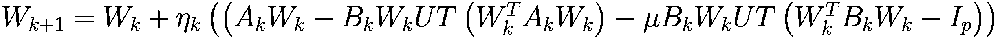。(7.32)

## AL1 加权算法

AL1 加权 GEVD 算法的目标函数为

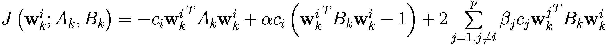，

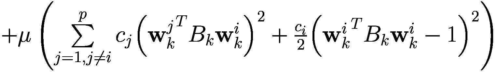，(7.33)

对于 `i`=1,…,`p` (`p`≤`n`)，其中 (`α`, `β[1]`, `β[2]`, …, `β[p]`) 是拉格朗日乘子，`μ` 是一个正的惩罚常数，且 `c[1]` > `c[2]` > … > `c[p]` > 0。自适应算法为

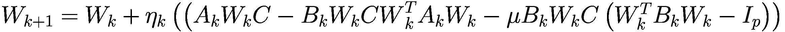，(7.34)

其中 `C` = `diag(c[1], …, c[p])`。

## AL1 算法 Python 代码

以下 Python 代码适用于多维数据 `X[nDim,nSamples]` 和 `Y[nDim,nSamples]`：

```
[Python 代码]
```

## 7.7 AL2 GEVD 算法

### AL2 齐次算法

AL2 齐次 GEVD 算法的无约束目标函数为


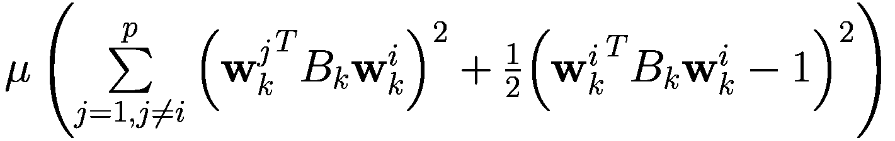,     (7.35)

其中 `i`=1,…,`p`，`μ` 为正惩罚常数。由 (7.35) 可得自适应梯度下降算法：

, (7.36)

其中 `i`=1,…,`p`，其矩阵形式为

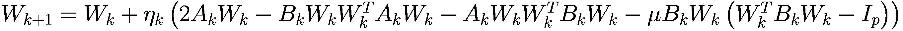.     (7.37)

### AL2 收缩算法

AL2 收缩 GEVD 算法的目标函数为


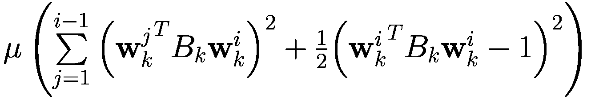, (7.38)

其中 `i`=1,…,`p`。自适应 GEVD 算法为

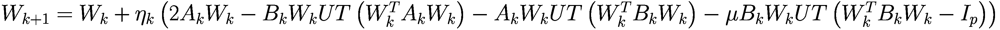. (7.39)

### AL2 加权算法

AL2 加权广义特征向量算法的目标函数为


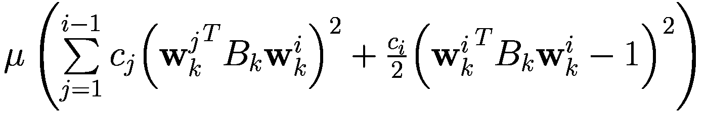,     (7.40)

其中 `i`=1,…,`p`，且 `c`[1] > `c`[2] > … > `c`[`p`] > 0 (`p` ≤ `n`)。自适应算法为

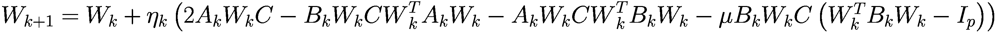, (7.41)

```python
from numpy import linalg as la
A  = np.zeros(shape=(nDim,nDim)) # 存储自适应相关矩阵
B  = np.zeros(shape=(nDim,nDim)) # 存储自适应相关矩阵
W2 = 0.1 * np.ones(shape=(nDim,nEA)) # 所有算法的权重向量
W3 = W2
c = [2.6-0.3*k for k in range(nEA)]
C = np.diag(c)
I  = np.identity(nDim)
mu = 2
for epoch in range(nEpochs):
    for iter in range(nSamples):
        cnt = nSamples*epoch + iter
        # 使用当前数据向量 x,y 更新数据相关矩阵 A,B
        x = X[:,iter]
        x = x.reshape(nDim,1)
        A = A + (1.0/(1 + cnt))*((np.dot(x, x.T)) - A)
        y = Y[:,iter]
        y = y.reshape(nDim,1)
        B = B + (1.0/(1 + cnt))*((np.dot(y, y.T)) - B)
        # 收缩梯度下降
        W2 = W2 + (1/(500 + cnt))*(A @ W2 - B @ W2 @ np.triu(W2.T @ A @ W2) \
            - mu * B @ W2 @ np.triu((W2.T @ B @ W2) - I))
        # 加权梯度下降
        W3 = W3 + (1/(1000 + cnt))*(A @ W3 @ C - B @ W3 @ C @ (W3.T @ A @ W3) \
            - mu * B @ W3 @ C @ ((W3.T @ B @ W3) - I))
```

其中 `C` = `diag` (`c[1]`, …, `c[p]`)，`p` ≤ `n`。

## 7.8 IT GEVD 算法

### AL2 算法 Python 代码

以下 Python 代码适用于数据 `X[nDim,nSamples]` 和 `Y[nDim,nSamples]`：

```python
from numpy import linalg as la
A  = np.zeros(shape=(nDim,nDim)) # 存储自适应相关矩阵
B  = np.zeros(shape=(nDim,nDim)) # 存储自适应相关矩阵
W2 = 0.1 * np.ones(shape=(nDim,nEA)) # 所有算法的权重向量
W3 = W2
c = [2.6-0.3*k for k in range(nEA)]
C = np.diag(c)
I  = np.identity(nDim)
mu = 1
for epoch in range(nEpochs):
    for iter in range(nSamples):
        cnt = nSamples*epoch + iter
        # 使用当前数据向量 x,y 更新数据相关矩阵 A,B
        x = X[:,iter]
        x = x.reshape(nDim,1)
        A = A + (1.0/(1 + cnt))*((np.dot(x, x.T)) - A)
        y = Y[:,iter]
        y = y.reshape(nDim,1)
        B = B + (1.0/(1 + cnt))*((np.dot(y, y.T)) - B)
        # 收缩梯度下降
        W2 = W2 + (1/(100 + cnt))*(A @ W2 - 0.5 * B @ W2 @ np.triu(W2.T @ A \
            @ W2) - 0.5 * A @ W2 @ np.triu(W2.T @ B @ W2) - \
            0.5 * mu * B @ W2 @ np.triu((W2.T @ B @ W2) - I))
        # 加权梯度下降
        W3 = W3 + (1/(300 + cnt))*(A @ W3 @ C - 0.5 * B @ W3 @ C @ (W3.T @ A \
            @ W3) - 0.5 * A @ W3 @ C @ (W3.T @ B @ W3) - \
            0.5 * mu * B @ W3 @ C @ ((W3.T @ B @ W3) - I))
```

### IT 齐次算法

信息论齐次 GEVD 算法的目标函数为

     (7.42)

其中 `i`=1,…,`p`，(`α`, `β[1]`, `β[2]`, …, `β[p]`) 为拉格朗日乘子，`ln`(.) 是以 `e` 为底的对数。通过令 (7.42) 关于 `w_k^i` 的梯度等于 **0**，并利用约束条件 `w_k^j^T B_k w_k^i = δ_{ij}`，我们得到

`α` = 0 且 `β_j = (w_k^j^T A_k w_k^i) / (w_k^i^T A_k w_k^i)`，     (7.43)

其中 `j`=1,…,`p`。将 (`α`, `β[1]`, `β[2]`, …, `β[p]`) 代入 (7.42) 的梯度中，我们得到广义特征向量的 IT 齐次自适应梯度下降算法：

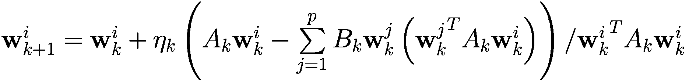，     (7.44)

其中 `i`=1,…,`p`，其矩阵形式为

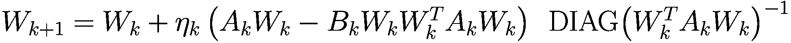，     (7.45)

其中 `DIAG[⋅]` 将其矩阵参数中除对角线以外的所有元素置零。

### IT 收缩算法

IT 收缩 GEVD 算法的目标函数为

     (7.46)

其中 `i`=1,…,`p`，(`α`, `β[1]`, `β[2]`, …, `β[p]`) 为拉格朗日乘子。由 (7.43) 我们得到自适应梯度算法：

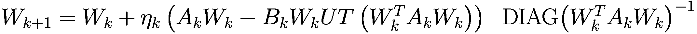 (7.47)

### IT 加权算法

IT 加权 GEVD 算法的目标函数为

     (7.48)

其中 `i`=1,…,`p`，(`α`, `β[1]`, `β[2]`, …, `β[p]`) 为拉格朗日乘子。通过求解 (`α`, `β[1]`, `β[2]`, …, `β[k]`) 并将其代入 (7.48) 的梯度中，我们得到自适应算法：

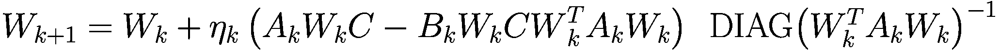。     (7.49)

### IT 算法 Python 代码

以下 Python 代码适用于数据 `X[nDim,nSamples]` 和 `Y[nDim,nSamples]`：

```
from numpy import linalg as la
A  = np.zeros(shape=(nDim,nDim)) # 存储自适应相关矩阵
B  = np.zeros(shape=(nDim,nDim)) # 存储自适应相关矩阵
W2 = 0.1 * np.ones(shape=(nDim,nEA)) # 所有算法的权向量
W3 = W2
c = [2.6-0.3*k for k in range(nEA)]
C = np.diag(c)
for epoch in range(nEpochs):
    for iter in range(nSamples):
        cnt = nSamples*epoch + iter
        # 使用当前数据向量 x,y 更新数据相关矩阵 A,B
        x = X[:,iter]
        x = x.reshape(nDim,1)
        A = A + (1.0/(1 + cnt))*((np.dot(x, x.T)) - A)
        y = Y[:,iter]
        y = y.reshape(nDim,1)
        B = B + (1.0/(1 + cnt))*((np.dot(y, y.T)) - B)
        # 收缩梯度下降
        W2 = W2 + (1/(50 + cnt))*(A @ W2 - B @ W2 @ np.triu(W2.T @ A @ W2)) \
              @ inv(np.diag(np.diagonal(W2.T @ A @ W2)))
        # 加权梯度下降
        W3 = W3 + (1/(100 + cnt))*(A @ W3 @ C – B @ W3 @ C @ (W3.T @ A @ W3)) \
              @ inv(np.diag(np.diagonal(W3.T @ A @ W3)))
```

## 7.9 RQ GEVD 算法

### RQ 齐次算法

我们根据瑞利商准则 (7.2) 得到瑞利商齐次 GEVD 算法的目标函数如下：

 (7.50)

其中 `i`=1,…,`p`，`(`α`, `β`[1], `β`[2], …, `β`[`p`])` 为拉格朗日乘子。通过令 (7.50) 关于 `{\mathbf{w}}_k^i` 的梯度等于 **0**，并利用约束条件 `{{\mathbf{w}}_k^j}^T{B}_k{\mathbf{w}}_k^i={\delta}_{ij}`，我们得到

α = 0 且 `{\beta}_j=\frac{{{\mathbf{w}}_k^j}^T{A}_k{\mathbf{w}}_k^i}{{{\mathbf{w}}_k^i}^T{B}_k{\mathbf{w}}_k^i}` 其中 `j`=1,…,`p`。     (7.51)

将 `(`α`, `β`[1], `β`[2], …, `β`[`p`])` 代入 (7.50) 的梯度中并进行小幅近似，我们得到广义特征向量的 RQ 齐次自适应梯度下降算法：

`{\mathbf{w}}_{k+1}^i={\mathbf{w}}_k^i+{\eta}_k\left({A}_k{\mathbf{w}}_k^i-\sum \limits_{j=1}^p{B}_k{\mathbf{w}}_k^j\left({{\mathbf{w}}_k^j}^T{A}_k{\mathbf{w}}_k^i\right)\right)/{{\mathbf{w}}_k^i}^T{B}_k{\mathbf{w}}_k^i`，     (7.52)

其中 `i`=1,…,`p`，其矩阵形式为

`{W}_{k+1}={W}_k+{\eta}_k\left({A}_k{W}_k-{B}_k{W}_k{W}_k^T{A}_k{W}_k\right)\kern0.5em \mathrm{DIAG}{\left({W}_k^T{B}_k{W}_k\right)}^{-1}`。     (7.53)

### RQ 收缩算法

RQ 收缩 GEVD 算法的目标函数为

`J\left({\mathbf{w}}_k^i;{A}_k,{B}_k\right)=-\frac{{{\mathbf{w}}_k^i}^T{A}_k{\mathbf{w}}_k^i}{{{\mathbf{w}}_k^i}^T{B}_k{\mathbf{w}}_k^i}+\alpha \left({{\mathbf{w}}_k^i}^T{B}_k{\mathbf{w}}_k^i-1\right)+2\sum \limits_{j=1}^i{\beta}_j{{\mathbf{w}}_k^j}^T{B}_k{\mathbf{w}}_k^i`， (7.54)

其中 `i`=1,…,`p`，`(`α`, `β`[1], `β`[2], …, `β`[`p`])` 为拉格朗日乘子。通过求解 `(`α`, `β`[1], `β`[2], …, `β`[`k`])` 并将其代入 (7.54) 的梯度中，我们得到自适应算法：

`{W}_{k+1}={W}_k+{\eta}_k\left({A}_k{W}_k-{B}_k{W}_k UT\left({W}_k^T{A}_k{W}_k\right)\right)\kern0.5em \mathrm{DIAG}{\left({W}_k^T{B}_k{W}_k\right)}^{-1}`。 (7.55)

### RQ 加权算法

RQ 加权 GEVD 算法的目标函数为

`J\left({\mathbf{w}}_k^i;{A}_k,{B}_k\right)=-{c}_i\frac{{{\mathbf{w}}_k^i}^T{A}_k{\mathbf{w}}_k^i}{{{\mathbf{w}}_k^i}^T{B}_k{\mathbf{w}}_k^i}+\alpha {c}_i\left({{\mathbf{w}}_k^i}^T{B}_k{\mathbf{w}}_k^i-1\right)+2\sum \limits_{j=1}^i{\beta}_j{c}_j{{\mathbf{w}}_k^j}^T{B}_k{\mathbf{w}}_k^i`，     (7.56)

其中 `i`=1,…,`p`，`(`α`, `β`[1], `β`[2], …, `β`[`p`])` 是拉格朗日乘子。通过求解 `(`α`, `β`[1], `β`[2], …, `β`[`k`])` 并将其代入 (7.56) 的梯度中，我们得到自适应算法：

`{W}_{k+1}={W}_k+{\eta}_k\left({A}_k{W}_kC-{B}_k{W}_k{CW}_k^T{A}_k{W}_k\right)\kern0.5em \mathrm{DIAG}{\left({W}_k^T{B}_k{W}_k\right)}^{-1}`。     (7.57)

### RQ 算法 Python 代码

以下 Python 代码适用于数据 `X[nDim,nSamples]` 和 `Y[nDim,nSamples]`：

## 7.10 实验结果

```
from numpy import linalg as la
A  = np.zeros(shape=(nDim,nDim)) # 存储自适应相关矩阵
B  = np.zeros(shape=(nDim,nDim)) # 存储自适应相关矩阵
W2 = 0.1 * np.ones(shape=(nDim,nEA)) # 所有算法的权向量
W3 = W2
c = [2.6-0.3*k for k in range(nEA)]
C = np.diag(c)
I  = np.identity(nDim)
for epoch in range(nEpochs):
    for iter in range(nSamples):
        cnt = nSamples*epoch + iter
        # 使用当前数据向量 x,y 更新数据相关矩阵 A,B
        x = X[:,iter]
        x = x.reshape(nDim,1)
        A = A + (1.0/(1 + cnt))*((np.dot(x, x.T)) - A)
        y = Y[:,iter]
        y = y.reshape(nDim,1)
        B = B + (1.0/(1 + cnt))*((np.dot(y, y.T)) - B)
        # 压缩梯度下降
        W2 = W2 + (1/(20 + cnt))*(A @ W2 - B @ W2 @ np.triu(W2.T @ A @ W2)) \
              @ inv(np.diag(np.diagonal(W2.T @ B @ W2)))
        # 加权梯度下降
        W3 = W3 + (1/(300 + cnt))*(A @ W3 @ C - B @ W3 @ C @ (W3.T @ A @ W3)) \
              @ inv(np.diag(np.diagonal(W3.T @ B @ W3)))
```

我从 10 维高斯数据（即 `n`=10）中生成了 1,000 个样本（{`x[k]`} 和 {`y[k]`}），其均值为零，协方差如下所示。{`x[k]`} 的协方差矩阵 `A` 由 [Okada and Tomita 85] 中的第二个协方差矩阵乘以 3 得到：

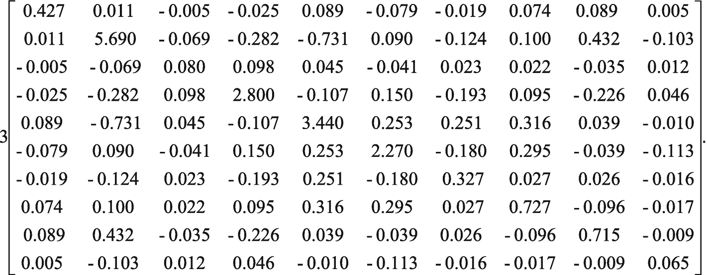

{`y[k]`} 的协方差矩阵 `B` 由 [Okada and Tomita 85] 中的第三个协方差矩阵乘以 2 得到：

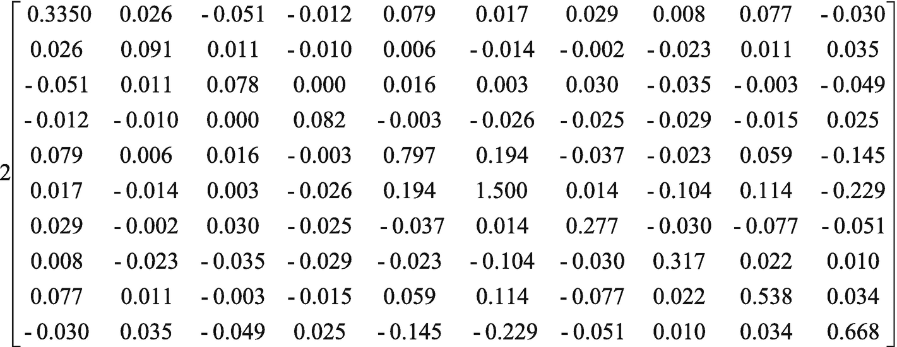

(`A`,`B`) 的广义特征值为

107.9186, 49.0448, 8.3176, 5.1564, 2.8814, 2.3958, 1.9872, 1.2371, 0.9371, 0.1096。

我通过前述自适应算法计算了前四个主广义特征向量（即对应最大四个特征值的特征向量）（即 `p`=4）。为了计算在线数据序列 {`A[k]`}，我从上述协方差矩阵 `A` 生成了随机数据向量 {`x[k]`}。然后使用第 2 章中的算法 (2.21) 从 {`x[k]`} 生成 {`A[k]`}。类似地，我从协方差矩阵 `B` 生成随机数据向量 {`y[k]`}，然后从 {`y[k]`} 生成 {`B[k]`}。在分别收集完所有 500 个样本 `x[k]` 和 `y[k]` 后，我计算了相关矩阵 `A[computed]` 和 `B[computed]`，如下所示：

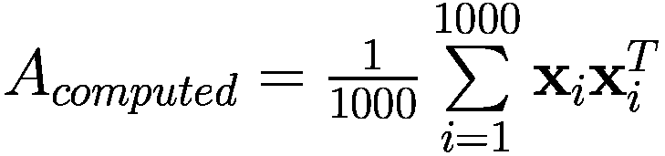 和 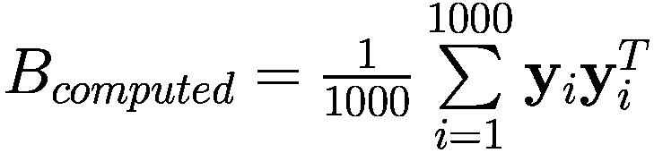。

我将通过标准数值分析方法 [Golub and VanLoan 83] 从这些 `A` 和 `B` 计算出的广义特征向量和特征值称为*实际值*。

所有算法均以 `w[0]` = 0.1*`ONE` 启动，其中 `ONE` 是一个所有元素均为 1 的 10 X 4 矩阵。为了衡量算法的收敛性和准确性，我计算了每个自适应算法在第 `k` 次更新时的方向余弦，如下所示：

方向余弦 (`k`) = 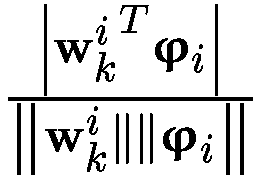，     (7.58)

其中  是在第 `k` 次更新时估计的 (`A[k]`,`B[k]`) 的广义特征向量，`ϕ[i]` 是通过传统数值分析方法从所有收集的样本中计算出的实际第 `i` 个广义特征向量。

图 7-1 展示了 OJA 算法（压缩和加权）计算 (`A[k]`,`B[k]`) 前两个主广义特征向量的迭代过程。图 7-2 展示了 XU 算法的相同过程，图 7-3 为 PF 算法，图 7-4 为 AL1 算法，图 7-5 为 AL2 算法，图 7-6 为 IT 算法，图 7-7 为 RQ 算法。

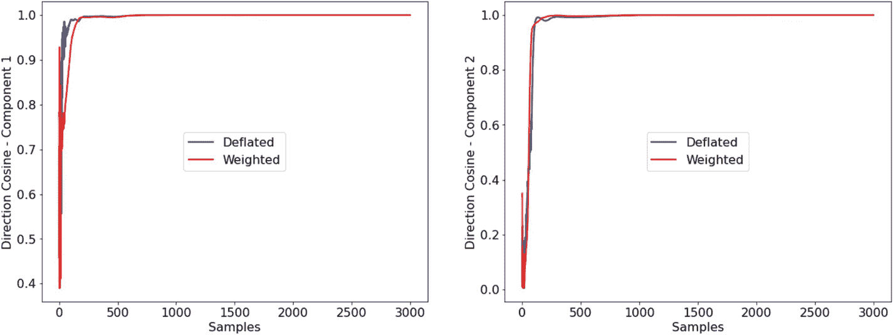

图 7-7

通过 RQ 压缩 (7.55) 和 RQ 加权 (7.57) 自适应算法得到的 (`A`,`B`) 前两个主广义特征向量的收敛性

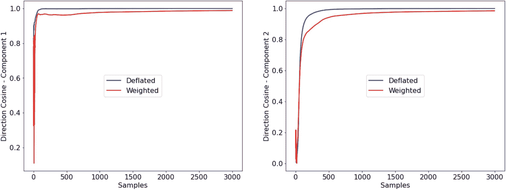

图 7-6

通过 IT 压缩 (7.47) 和 IT 加权 (7.49) 自适应算法得到的 (`A`,`B`) 前两个主广义特征向量的收敛性

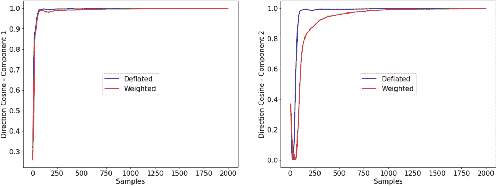

图 7-5

通过 AL2 压缩 (7.39) 和 AL2 加权 (7.41) 自适应算法得到的 (`A`,`B`) 前两个主广义特征向量的收敛性


图 7-4

通过 AL1 压缩 (7.32) 和 AL1 加权 (7.34) 自适应算法得到的 (`A`,`B`) 前两个主广义特征向量的收敛性


图 7-3

通过 PF 压缩 (7.24) 和 PF 加权 (7.26) 自适应算法得到的 (`A`,`B`) 前两个主广义特征向量的收敛性


图 7-2

通过 XU 压缩 (7.18) 和 XU 加权 (7.20) 自适应算法得到的 (`A`,`B`) 前两个主广义特征向量的收敛性


图 7-1

通过 OJA 压缩 (7.10) 和 OJA 加权 (7.13) 自适应算法得到的 (`A`,`B`) 前两个主广义特征向量的收敛性

对于所有算法，压缩算法使用 `η[k]`=1/(140+`k`)，加权算法使用 `η[k]`=1/(500+`k`)。加权算法使用的对角权重矩阵 `C` 为 `DIAG(2.6,2.3,2.0,1.7)`。我对数据运行了所有算法*三个周期*，其中一个周期意味着将所有训练数据以随机顺序呈现一次。我没有展示齐次算法的结果，因为齐次方法产生的是 (`A`,`B`) 实际广义特征向量的线性组合。因此，方向余弦不能指示算法在齐次情况下的性能。

## 7.11 结论

可以观察到，所有算法对于次要广义特征向量的收敛性逐渐降低，而对于主广义特征向量的收敛性最佳。这是符合预期的，因为这些自适应算法的收敛性是相对广义特征值的函数。此外，可在并行硬件上实现的加权算法，其表现与收缩算法非常相似。

我完成了以下工作：

表 7-3

自适应 GEVD 算法、复杂度与性能列表

| 算法 | 类型 | 自适应算法 `h(W[k],A[k])` | 备注 |
| --- | --- | --- | --- |
| OJA | 收缩 |  | n³p⁶, 6 |

| 加权 |  | n⁴p⁶, 6 |
| XU | 收缩 |  | 2n³p⁶, 8 |
| 加权 |  | 2n⁴p⁶, 8 |
| PF | 收缩 |  | n²p⁴, 7 |
| 加权 |  | n³p⁴, 7 |
| AL1 | 收缩 |  | n³p⁶+ n²p⁴, 9 |
| 加权 |  | n⁴p⁶+ n³p⁴, 9 |
| AL2 | 收缩 |  | 2n³p⁶+ n²p⁴, 10 |
| 加权 |  | 2n⁴p⁶+ n³p⁴, 10 |
| IT | 收缩 |  | 不适用 |
| 加权 |  | 不适用 |
| RQ | 收缩 |  | 不适用 |
| 加权 |  | 不适用 |

对于每种算法，我评估了其计算性能和收敛性能。

我跳过了齐次算法，因为它们在实际应用中用处不大，会产生特征向量的任意旋转。

注意，`A[k]∈ℜ^(n×n)`、`B[k]∈ℜ^(n×n)` 且 `W[k]∈ℜ^(n×p)`。我根据矩阵维度 `n` 和 `p` 给出了每种算法的计算复杂度。

收敛性能根据主分量和次分量的收敛速度确定。我按 1-10 的等级对收敛性进行评分，其中 10 表示收敛最快的算法。

我跳过了 `IT` 和 `RQ` 算法，因为与其他算法相比，它们表现不佳，并且矩阵求逆增加了计算复杂度。参见表 7-3。

可以观察到以下几点：

1.  OJA 算法复杂度最低，性能良好。
2.  AL2 算法复杂度最高，性能最佳。
3.  AL1 算法性能仅次于 AL2，PF 和 XU 算法紧随其后。

复杂度和精度的权衡将决定在实际场景中使用哪种算法。如果计算资源充足，AL2 算法是最佳选择。XU 算法在复杂度和性能之间取得了良好的平衡。

总之，我从一个通用框架出发，展示了 21 种算法，其中许多是新的，并且每种算法都有对应的目标函数。请注意，虽然我对这些目标函数应用了梯度下降技术，但我本可以应用任何其他非线性优化技术，例如最速下降法、共轭方向法、牛顿-拉夫逊法或递归最小二乘法。目标函数的可用性使我们能够通过对其应用新的优化技术来推导新算法，并对自适应算法进行收敛性分析。