# 8. 自适应线性算法的实际应用

在本章中，我将探讨线性自适应算法的实际应用案例。这些算法的一些最佳应用场景源于设备上的边缘计算，这需要管理以下方面：

*   大规模设备计算的功耗

*   输入的非平稳性

*   设备计算的延迟

*   设备的内存和带宽

在这些情况下，存在以下约束：

*   数据以随机向量序列 {**x**[*k*]} 或随机矩阵序列 {*A*[*k*]} 的形式到达。

*   数据随时间变化，导致输入特征发生显著漂移，使得模型随着时间的推移不再有效。

*   数据量巨大，我们没有足够的设备存储空间、带宽或电量来存储或上传数据。

*   数据维度可能很大。

在这些情况下，我将演示如何使用线性自适应算法来管理设备的功耗、内存和带宽，以保持预训练模型的准确性。我将涵盖的示例如下：

*   计算传入数据的特征漂移，并提前检测训练-服务偏差 [Kaz Sato 等人*.* 21]

*   适应传入数据漂移，并计算最适合数据的特征

*   将传入数据压缩为特征，用于创建新模型

*   计算传入数据中的异常值，以便模型使用干净良好的数据

在这些示例中，我使用了来自以下存储库的数据：用于评估流学习算法的公开真实世界数据集。该数据集代表了真实的流式非平稳数据 [Vinicius Souza 等人*.* 20]。

请注意，除了本章讨论的示例外，我在整本书中还考虑了许多其他实际的自适应示例，例如：

*   使用自适应均值进行手写字符识别

*   使用自适应中位数进行异常检测

*   数据表示特征计算

*   数据分类特征计算

## 8.1 检测特征漂移

随着传入数据的底层统计特性随时间变化，用于机器学习的模型性能会下降。及早检测特征漂移并重新训练模型，可以保持机器学习解决方案的准确性。


### INSECTS-incremental_balanced_norm 数据集：特征向量测试

该数据集的名称为 `INSECTS-incremental_balanced_norm.arff`。该数据集包含 33 个分量。其分量逐渐增加，导致了如图 8-1 所示的特征漂移。

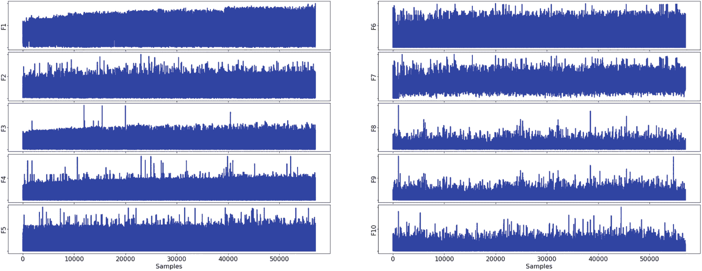

图 8-1

具有增量漂移的非平稳多维真实世界数据

#### 半平稳分量的自适应 EVD

我剔除了漂移分量，并对剩余分量使用了第 5 章中的 EVD 线性自适应算法 (5.13)，如下所示：

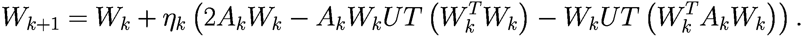

(5.13)

请注意，剩余分量要稳定得多，但仍然存在一些非平稳性。对于序列中的每个输入样本，我绘制了前四个主特征向量的范数，以展示这些特征向量的收敛质量；见图 8-2。

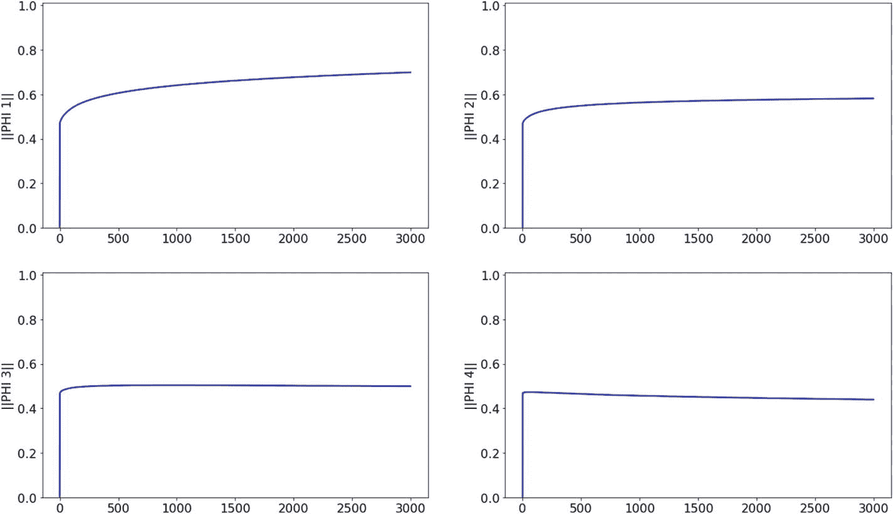

图 8-2

自适应 EVD 算法 (5.13) 在平稳数据上前四个特征向量的范数

前四个特征向量的范数随着流式样本的输入迅速收敛到稳定值。曲线的水平上升斜率表明收敛稳定。第三和第四主特征向量的轻微下降斜率表明数据存在轻微的非平稳性。但数据总体上是稳定和平稳的。我们可以得出结论，这些特征与当前的机器学习模型一致，无需更改模型。

以下 Python 代码适用于多维数据 `dataset2 [nDim, nSamples]`：

```
# 自适应算法
from numpy import linalg as la
nSamples = dataset2.shape[0]
nDim = dataset2.shape[1]
A = np.zeros(shape=(nDim,nDim)) # 存储自适应相关矩阵
N = np.zeros(shape=(1,nDim)) # 存储特征范数
W = 0.1 * np.ones(shape=(nDim,nDim)) # 存储自适应特征向量
for iter in range(nSamples):
cnt = iter + 1
# 使用当前数据向量 x 更新数据相关矩阵 A
x = np.array(dataset2.iloc[iter])
x = x.reshape(nDim,1)
A = A + (1.0/cnt)*((np.dot(x, x.T)) - A)
etat = 1.0/(25 + cnt)
# 缩减梯度下降法
W = W + etat*(A @ W - 0.5*W @ np.triu(W.T @ A @ W) - \
0.5*A @ W @ np.triu(W.T @ W))
newnorm = la.norm(W, axis=0)
N = np.vstack([N, newnorm])
```

#### 非平稳分量的自适应 EVD

接下来，我使用数据的非平稳分量，通过自适应算法来检测特征漂移。我使用了相同的自适应 EVD 算法 (5.13)，并为每个数据样本绘制了前四个主特征向量的范数，如图 8-3 所示。

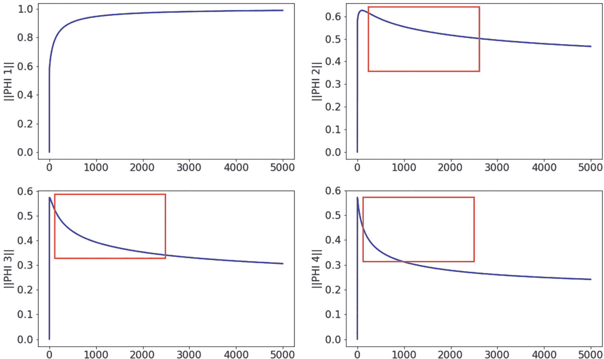

图 8-3

自适应 EVD 算法 (5.13) 在非平稳数据上前四个特征向量的范数

你可以清晰地看到，第二到第四个特征向量发生了发散，表现为图中的下降斜率，这表明在序列早期就出现了特征漂移。第二到第四个特征向量的下降斜率表明了特征的逐渐漂移。该结果表明，特征正在偏离用于构建机器学习模型的原始特征。

我使用了与第 8.1.1 节中对平稳数据所使用的相同 Python 代码。

### INSECTS-incremental-abrupt_balanced_norm 数据集

该数据集的名称为 `INSECTS-incremental_abrupt_balanced_norm.arff`。该数据集的特征存在重复的突变，如图 8-4 所示。

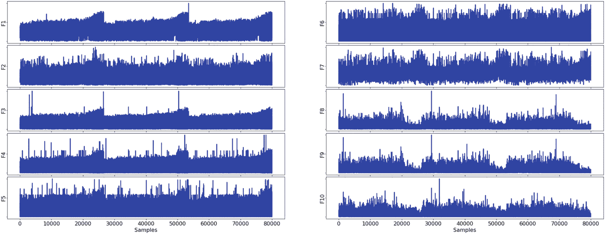

图 8-4

具有周期性突变漂移的非平稳多维真实世界数据

我使用了相同的自适应 EVD 算法 (5.13)，观察了前四个主特征向量的范数，并为每个数据样本绘制了它们，如图 8-5 所示。

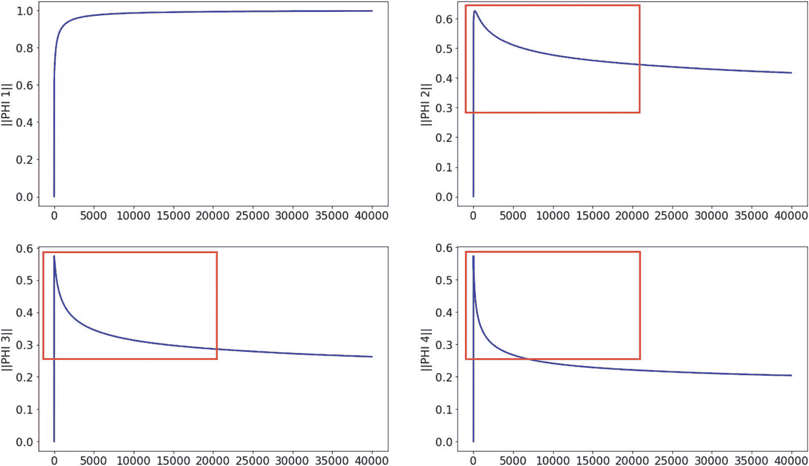

图 8-5

自适应 EVD 算法 (5.13) 在非平稳数据上前四个特征向量的范数

同样，第二到第四个特征向量发生了发散，表明在数据序列早期就出现了特征漂移。第二到第四个特征向量的下降斜率在序列早期就检测到了特征的漂移。

我使用了与第 8.1.1 节中对平稳数据所使用的相同 Python 代码。

### Electricity 数据集

该数据集的名称为 `elec.arff`。该数据集包含多种非平稳分量，如图 8-6 所示。

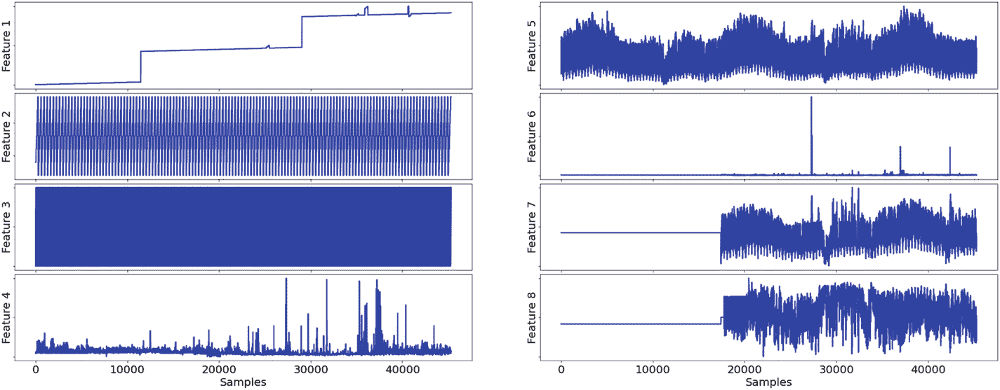

图 8-6

具有突变漂移和趋势的非平稳多维真实世界数据

自适应 EVD 算法 (5.13) 为我们提供了如图 8-7 所示的前两个主特征向量，表明在序列早期就存在非平稳性。

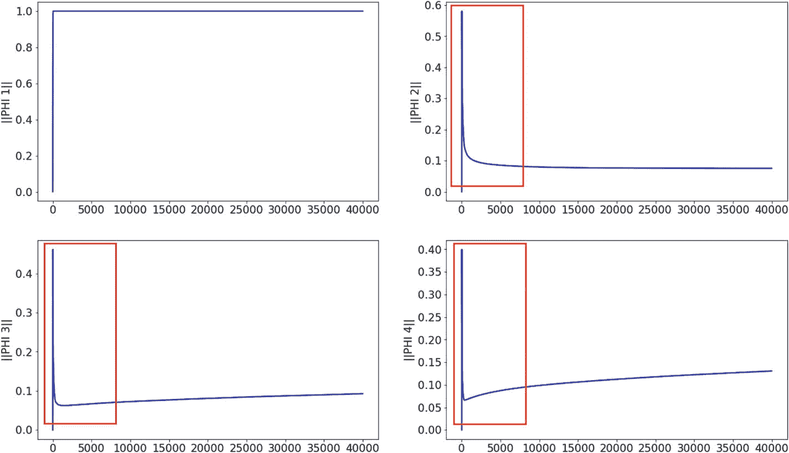

图 8-7

自适应 EVD 算法 (5.13) 在非平稳数据上前四个特征向量的范数

图 8-7 显示了由自适应算法 (5.13) 计算出的第二到第四个特征向量的范数快速下降。这个例子表明，数据中的大规模非平稳性通过数据序列开始时范数的大幅下降被非常迅速地指示出来。

我使用了与第 8.1.1 节中对平稳数据所使用的相同 Python 代码。

## 8.2 适应传入的数据漂移

虽然检测非平稳数据的漂移很重要，但我们的算法能够快速适应数据漂移也同样重要。请参见图 8-8 中*模拟数据*的示例，该数据在 500 个样本后突然变为不同的底层统计量。

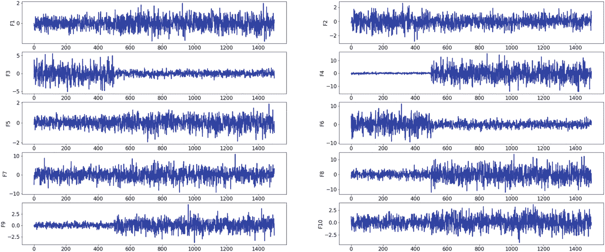

图 8-8

在 500 个样本后发生突变的非平稳多维模拟数据

我使用了自适应最速下降算法 (6.8) 来计算主特征向量。自适应算法帮助我们适应这种突变，并重新计算底层的 PCA 统计量——在本例中，是数据的前两个主特征向量。见图 8-9。

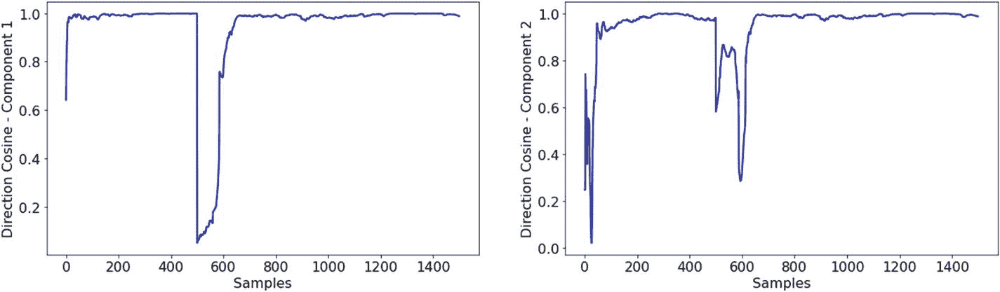

图 8-9

自适应最速下降算法 (6.8) 快速适应突变的非平稳数据，用于主特征向量计算。

该算法的 Python 代码在第 6.3 节中给出。


## 8.3 压缩高容量与高维数据

当输入数据量很大时，将这些数据存储在设备上用于训练机器学习模型可能会变得极其困难。如果数据是高维的（例如超过 100 维），问题会变得更加复杂。在这种情况下，我们希望将数据压缩成批次，并存储特征向量的序列，以供将来用于机器学习训练。

在本例中，我使用了开源的 `gassensor.arff` 数据。该数据集包含 129 个分量/维度，共 13,910 个样本。我使用了自适应 EVD 算法（5.13）来计算前 16 个主成分 [**ϕ**[1] **ϕ**[2] … **ϕ**[16]]。然后我从这 16 维的主成分中重建了数据。在图 8-10 中，左列是原始数据，右列是重建数据。显然，它们看起来非常相似，并且实现了 8 倍的数据压缩。

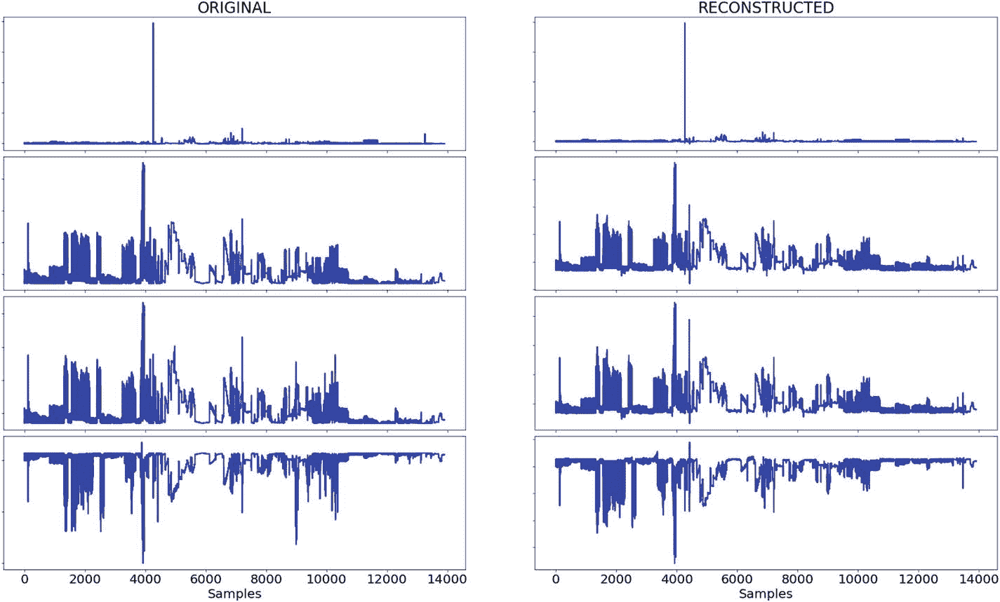

图 8-10

使用自适应 EVD 算法（5.13）实现 8 倍压缩的原始数据（左）与重建数据（右）

Python 代码见第 5.4 节，以及下方针对 `dataset[nDim,nSamples]` 的代码：

```
from numpy import linalg as la
nSamples = dataset.shape[0]
nDim = dataset.shape[1]
nEA = 16
A = np.zeros(shape=(nDim,nDim)) # 存储自适应相关矩阵
N = np.zeros(shape=(1,nEA)) # 存储特征范数
W = 0.1 * np.ones(shape=(nDim,nEA)) # 存储自适应特征向量
for iter in range(nSamples):
cnt = iter + 1
# 使用当前样本 x 更新数据相关矩阵 A
x = np.array(dataset.iloc[iter])
x = x.reshape(nDim,1)
A = A + (1.0/cnt)*((np.dot(x, x.T)) - A)
etat = 1.0/(500 + cnt)
# 缩减梯度下降
W = W + etat*(A @ W - 0.5*W @ np.triu(W.T @ A @ W) - \
0.5*A @ W @ np.triu(W.T @ W))
```

### 数据表示（PCA）特征

让我们通过比较传统方法计算的批次相关矩阵的特征值和特征向量，与自适应算法（5.13）在每个自适应步骤中针对前四个主特征向量的结果，来展示自适应算法的成功。

为了衡量自适应算法的收敛性和准确性，我计算了每个自适应算法在第 *k* 次更新时的特征向量的方向余弦，公式如下：

方向余弦 (*k*) = 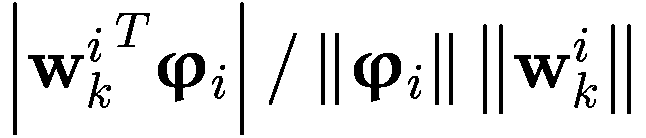，

其中 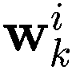 是在第 *k* 次更新时对 *A*[*k*] 的估计特征向量，**ϕ**[*i*] 是通过传统数值分析方法从所有收集的样本中计算出的实际第 *i* 个主特征向量。我按如下方式测量了第 *k* 次更新时特征值的误差：

绝对误差 (*k*) = 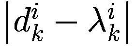，

其中 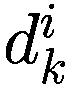 是在第 *k* 次更新时对 *A*[*k*] 的估计特征值，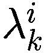 是通过传统数值分析方法从所有收集的样本中计算出的实际第 *i* 个主特征值。

我执行了以下操作：

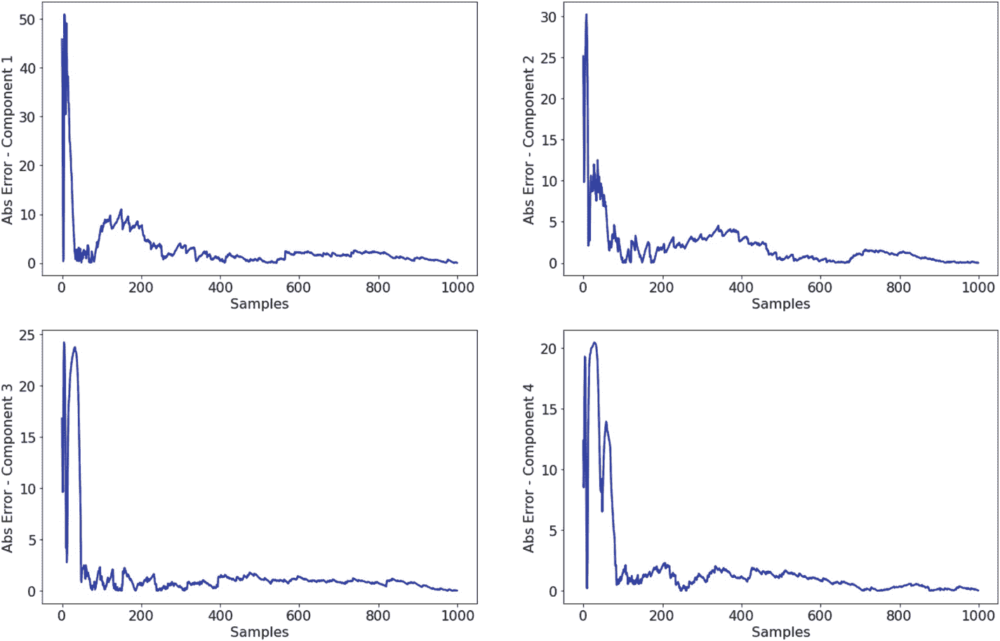

图 8-12

使用自适应算法（5.13）时前四个主特征值的绝对误差

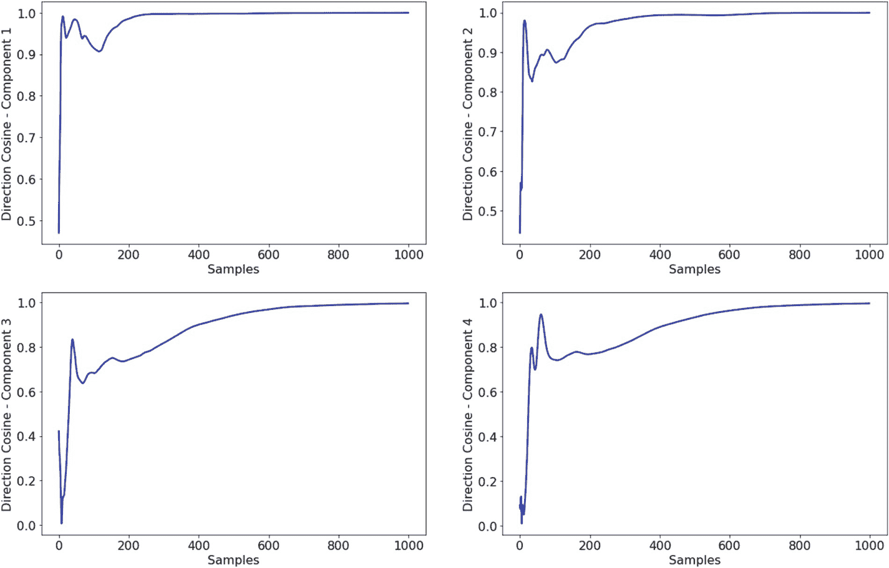

图 8-11

使用自适应算法（5.13）时前四个主特征向量的方向余弦（理想值为 1）

1.  我绘制了每个自适应步骤中特征向量与批次特征向量的方向余弦图。见图 8-11。

2.  我绘制了每个自适应步骤中特征值与批次特征值的误差图。见图 8-12。

最终结果如下：

*   实际特征值：[57.865, 36.259, 27.087, 21.833]

*   自适应特征值：[57.857, 36.251, 27.054, 21.881]

这些结果表明，自适应算法准确地计算了 PCA 特征，这将实现 8 倍的数据压缩，以替代庞大的原始数据。

此处使用的 Python 代码与上一节相同。

## 8.4 检测特征异常

这里我使用自适应线性算法来检测数据中的异常。

### Yahoo 真实数据集

该数据集是 `real_data.csv`，来源于 Yahoo Research Webscope：S5 - 一个带标签的异常检测数据集 [Yahoo Research Webscope]。检测机器中的异常是制造业市场的一项重要机器学习任务。我收集了来自机器的 8 维数据，这些数据偶尔会出现异常读数。检测异常的一种方法是计算当前样本与其运行中位数的偏差，并将其与一个统计量进行比较。

我使用了自适应中位数算法（2.20）来计算运行中位数，并使用一个简单的统计量来检测异常。结果见图 8-13。我将数据绘制为蓝色，自适应中位数为绿色，异常点为红色。

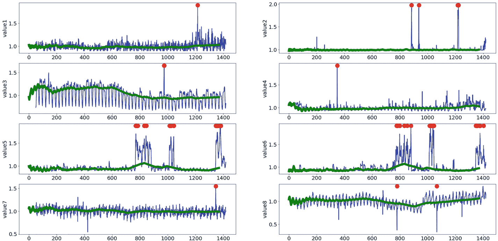

图 8-13

Yahoo Webscope 多维真实数据集，其中多个分量的异常由自适应中位数算法（2.20）检测到

以下 Python 代码用于多维数据集 `X[nDim, nSamples]`：

```
from numpy import linalg as la
nSamples = X.shape[0]
nDim = X.shape[1]
w = np.zeros(shape=(nDim,1)) # 存储自适应特征向量
anam = np.zeros(shape=(nDim,nSamples))
mdks = np.zeros(shape=(nDim,nSamples))
for iter in range(nSamples):
cnt = iter + 1
# 当前数据向量 x
x = np.array(X.iloc[iter])
x = x.reshape(nDim,1)
# 公式 2.20
w = w + (1/(1 + iter)) * np.sign(x - w)
mdks[:,iter] = w.T
y = (np.abs(x-w) > 0.5*w) # 异常检测阈值
anam[:,iter] = y.T
```

### NOAA 数据集

数据集名称为 `NOAA.arff`。数据序列有八个分量。如图 8-14 所示，分量 F3 有一个异常尖峰。

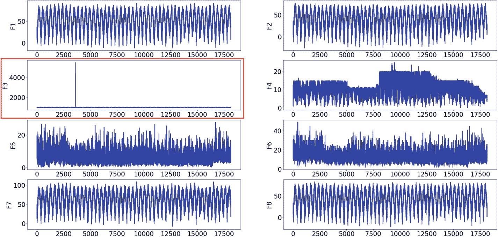

图 8-14

NOAA 真实世界数据集，仅在一个分量中存在异常，由自适应中位数算法（2.20）检测到

我对该数据集的所有分量使用了自适应中位数检测算法（2.20）。我使用了一个简单的测试算法来确定异常：

异常 = 绝对值（样本值 – 自适应中位数）> 4 x 自适应中位数。

图 8-15 中，数据为蓝色，自适应中位数为绿色，异常点为红色。显然，自适应中位数算法（2.20）准确地检测到了异常。

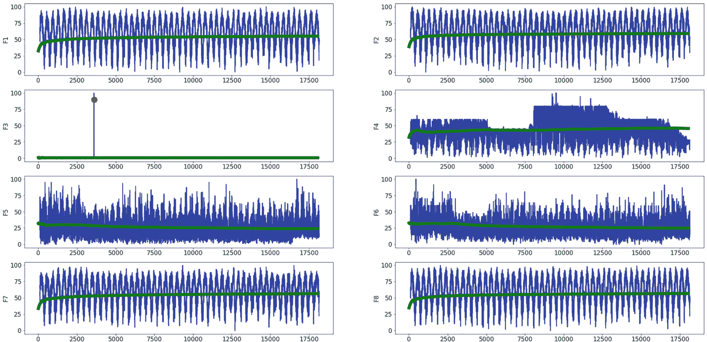

图 8-15

使用自适应中位数算法（2.20）检测到的 NOAA 数据集中的异常

此处使用的 Python 代码与上一个示例相同，只是检测阈值不同：

```
y = (np.abs(x-w) > 4*w) # 异常检测阈值。
```


索引 A, B  
自适应算法  
批处理方法  
学习过程  
方法论  
优势  
贡献  
矩阵函数  
目标函数  
实际应用  
需求  
解决方案  
流数据  
优势  
传统解决方案  
劣势  
电商数据  
主特征向量  
自适应计算  
类别可分性  
数据分类  
数据特征  
数据表示  
机器学习/数据分析  
模式识别  
流数据  
自适应线性算法  
约束条件  
电力数据集  
特征漂移检测  
EVD  
非平稳  
EVD  
半平稳  
INSECTS-incremental_balanced_norm.arff  
高容量/高维数据  
数据压缩  
数据表示  
特征向量  
Python 代码  
传入数据漂移  
INSECTS-incremental_abrupt_balanced_norm.arff  
NOAA 数据集  
非平稳  
非平稳数据  
预训练模型  
仓库  
需求  
Yahoo 真实数据集  
增广拉格朗日 1 (AL1) 算法  
增广拉格朗日 2 (AL2) 算法  
自关联  
C  
Cholesky 分解  
计算/次特征向量  
共轭方向算法  
相关矩阵  
实验  
梯度下降算法  
牛顿-拉夫逊算法  
非线性优化技术  
非平稳数据  
非平稳多维目标函数  
随机数据向量  
最先进算法  
平稳数据  
最速下降算法  
更广泛的适用性  
共轭方向算法  
D, E, F  
波达方向 (DOA)  
离散余弦变换 (DCT)  
G  
广义特征值问题  
AL1 算法  
收缩  
同质  
Python 代码  
加权 GEVD 算法  
AL2  
GEVD 算法  
收缩  
同质  
Python 代码  
加权算法  
算法/目标函数  
连续/正则性性质  
传统方法  
实验结果  
实际值  
AL1/AL2 算法  
算法/复杂度/性能  
协方差矩阵  
特征向量  
IT 算法  
OJA 算法  
PF 算法  
RQ 算法  
XU 算法  
IT GEVD 算法  
收缩  
同质  
Python 代码  
加权算法  
目标函数  
OJA GEVD 算法  
收缩  
自适应  
同质算法  
Python 代码  
加权算法  
XU GEVD 算法  
模式识别  
罚函数  
瑞利商 (RQ)  
信号处理  
对称-正定束  
对称矩阵  
变体  
梯度下降算法  
H  
赫布学习/神经生物学  
Hestenes-Stiefel 方法  
异关联网络  
I, J  
信息论 (IT)  
自适应算法  
收敛性  
GEVD 算法  
收缩  
同质  
Python 代码  
加权  
次特征向量  
收缩  
同质  
Python 代码  
加权算法  
目标函数  
符号 104 f “Symbol”k 的一致上界  
逆平方根  
自适应算法  
实验  
目标函数  
Python 代码  
K  
卡洛南-洛伊定理  
卡洛南-洛伊变换 (KLT)  
L  
最小均方误差重构 (LMSER)  
线性判别分析 (LDA)  
线性变换  
数据白化  
定义  
特征  
线性判别分析  
多学科  
参见多学科  
推导  
主成分分析  
奇异值  
总结  
M  
矩阵代数问题  
自适应均值/协方差  
渐近中位数  
相关矩阵  
协方差/逆矩阵  
数据相关性  
实验  
手写字符识别  
逆相关  
归一化均值  
平稳和非平稳流数据  
二维表示  
变体  
向量和相关  
次特征向量  
自适应算法  
AL2 算法  
收缩  
同质  
Python 代码  
加权  
算法/目标函数  
增广拉格朗日方法 1  
收缩  
同质  
Python 代码  
加权  
协方差矩阵  
分解算法  
实验结果  
信息论  
均方误差  
多媒体视频传输  
目标函数  
OJA 算法  
收缩算法  
同质算法  
Python 代码  
加权算法  
原始维度信号  
罚函数 (PF)  
收缩  
同质  
Python 代码  
加权算法  
Python 代码  
瑞利商  
重构图像  
统一框架  
XU 算法  
收缩  
同质  
Python 代码  
加权算法  
多学科  
推导  
自关联  
特征  
赫布学习  
异关联网络  
信息论  
优化理论  
统计模式识别  
多信号分类 (MUSIC)  
N  
牛顿-拉夫逊算法  
归一化均值算法  
代价函数  
梯度下降算法  
目标函数  
变体  
O  
优化理论  
P, Q  
罚函数 (PF)  
自适应算法  
收敛时间  
目标函数  
一致上界  
主成分分析 (PCA)  
特征向量  
参见主特征向量计算  
次特征向量  
参见次特征向量  
非线性优化技术  
主特征向量计算  
实际值  
自适应算法  
算法  
增广拉格朗日 1 方法  
增广拉格朗日 2 方法  
收敛结果  
协方差矩阵  
数据集  
多样且实践者  
实验  
框架  
信息论 (IT)  
多维数据  
目标函数  
Oja 算法  
自适应梯度算法  
自关联  
收敛时间  
目标函数  
罚函数 (PF)  
快速收敛  
瑞利商 (RQ)  
真实世界非平稳数据  
RQ/OJAN/LUO 算法  
自适应算法  
收敛性  
目标函数  
对称矩阵  
统一框架  
向量 *w*[*0*]  
XU 算法  
自适应算法  
收敛时间  
目标函数  
符号 104 f “Symbol”k 的上界  
主子空间学习算法  
R  
瑞利商 (RQ)  
收缩  
同质  
Python 代码  
加权  
S, T, U, V, W, X, Y, Z  
奇异值分解 (SVD)  
平方根/逆平方根  
自适应算法  
Cholesky 分解  
收敛性质  
相关矩阵  
协方差矩阵  
数据向量  
实验  
梯度下降算法  
手写 MNIST 数字  
逆  
参见逆平方根  
目标函数  
突出应用  
Python 代码  
实时矩阵解 (A^½ 和 A^(–½))  
最先进算法  
平稳和非平稳序列  
统计模式识别  
最速下降算法  
计算  
三次方程  
矩阵  
Python 代码
