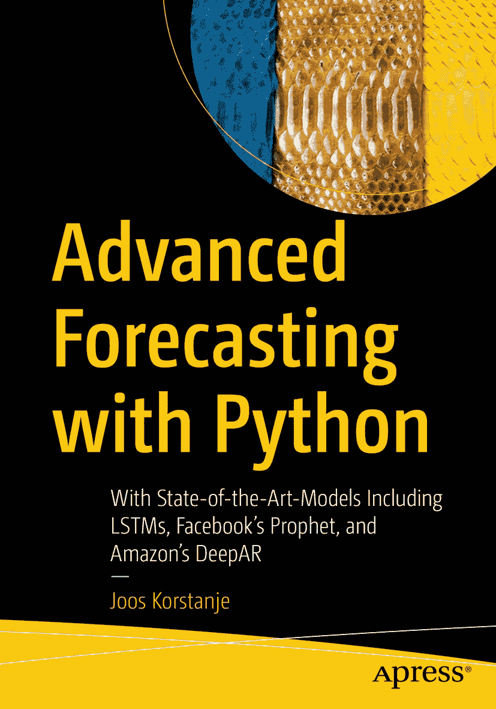

ISBN 978-1-4842-7149-0e-ISBN 978-1-4842-7150-6 [`doi.org/10.1007/978-1-4842-7150-6`](https://doi.org/10.1007/978-1-4842-7150-6) © Joos Korstanje 2021 本作品受版权保护。出版商保留所有权利，无论是涉及材料的全部或部分，特别是翻译、重印、重用插图、朗诵、广播、以缩微胶卷或任何其他物理方式复制，以及传输或信息存储与检索、电子改编、计算机软件，或采用目前已知或未来开发的类似或不同方法。在本书中使用通用描述性名称、注册商标名称、商标、服务标志等，即使没有明确声明，也不意味着这些名称不受相关保护法律和法规的约束，因此可自由用于一般用途。出版商、作者和编辑假定本书中的建议和信息在出版之日是真实准确的。出版商、作者或编辑均不对本书所含材料或可能存在的任何错误或遗漏提供明示或暗示的担保。出版商对已出版地图中的管辖权主张和机构归属保持中立。

本 Apress 印记由注册公司 APress Media, LLC（Springer Nature 的一部分）出版。

注册公司地址为：1 New York Plaza, New York, NY 10004, U.S.A.

*谨以此书献给我的伴侣奥利维亚，感谢她在写作期间给予的帮助和支持。*

# 引言

*《Python 高级预测》* 涵盖了所有与预测问题相关的机器学习技术，范围从单变量和多变量时间序列到监督学习，再到最先进的深度预测模型，如 `LSTM`、循环神经网络（`RNN`）、Facebook 的开源 `Prophet` 模型以及亚马逊的 `DeepAR` 模型。

本书并非专注于某一特定模型集，而是全面概述了所有与预测实践者相关的技术。它首先用高层次语言解释了与预测相关的不同模型类别。接着，介绍了单变量和多变量时间序列模型，随后是高级机器学习和深度学习模型，例如循环神经网络、`LSTM`、Facebook 的 `Prophet` 和亚马逊的 `DeepAR`。最后，本书对模型选择进行了反思，如基准分数与模型可理解性及计算时间之间的权衡，以及模型的自动重新训练和更新。本书中介绍的每个模型都进行了深入讲解，包括对模型的直观简单解释、该思想的数学转换，以及将模型应用于示例数据集的 Python 代码。

对于那些希望为当前预测技能集增添竞争优势的人来说，本书是一个极好的资源。本书也适合刚开始从事预测工作、并希望找到一本全面书籍，以便从传统模型入手并逐步过渡到更高级模型的人。

您可以使用 GitHub 仓库中的代码进行学习，该仓库每章包含一个 Jupyter 笔记本。建议您使用 Jupyter 笔记本进行跟随学习，但您也可以在任何其他您选择的 Python 环境中运行代码。

## 关于作者 关于技术审校