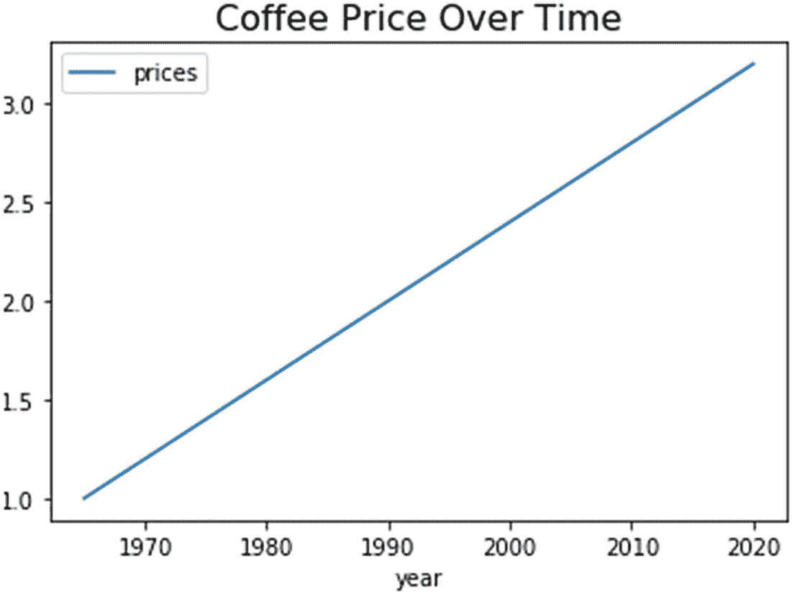
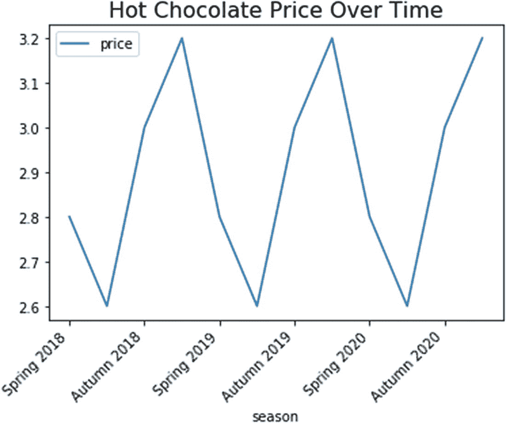
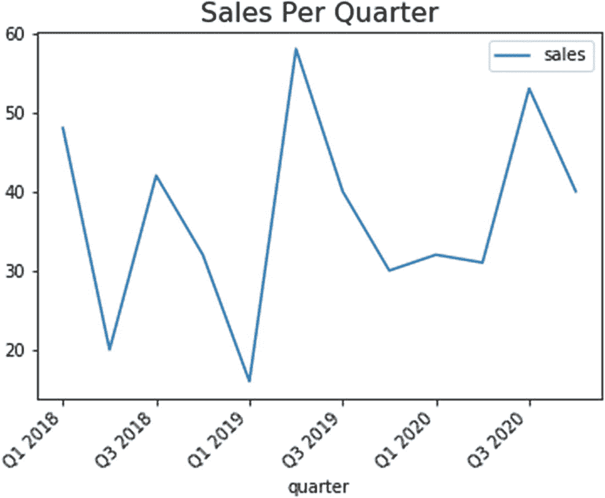
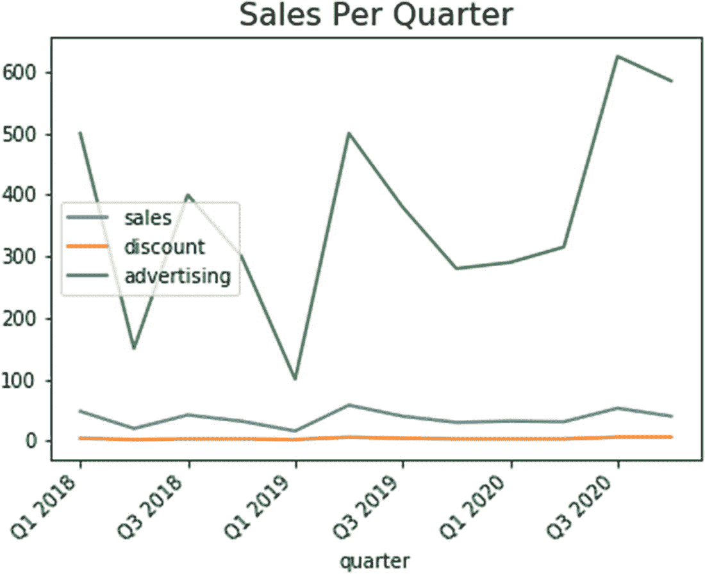
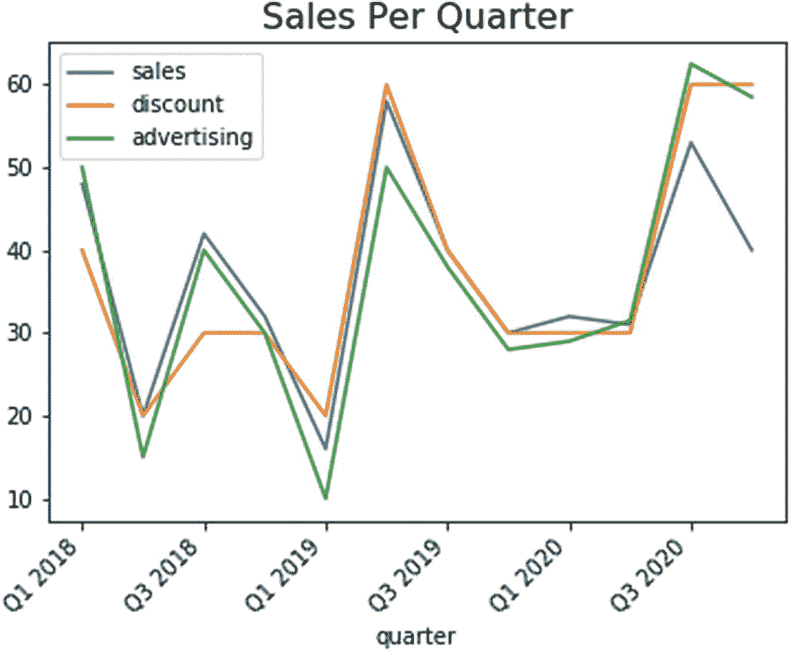
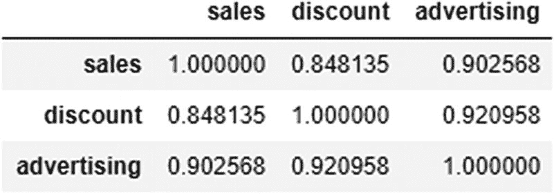

# 1. 预测模型

预测，粗略地翻译为预测未来的任务，在人类社会中已经存在了很长时间。无论是通过占卜师、天气预报还是算法股票交易，人类一直对预测未来会发生什么感兴趣。

然而，预测未来并不容易。想想占卜师、股市大师或天气预报员：许多人试图预测未来，但很少有人成功。而对于那些成功的人，你永远不知道那是运气还是技巧。

近年来，计算机的计算能力比 30 年前变得普遍得多。这引发了人工智能的巨大繁荣。人工智能，尤其是机器学习，可用于广泛的任务，包括机器人技术、自动驾驶汽车，以及预测——前提是你有足够多的关于过去的数据，可以将其投射到未来。

在本书中，你将学习与现代预测相关的机器学习技术。我将介绍大量的机器学习模型，并附上对模型的直观解释、其数学原理以及一个应用案例。

本书的目标是让你真正深入了解这些机器学习模型的应用。你将看到应用于真实数据集的完整示例，以及对结果的诚实评估：有些成功，有些不那么成功。

通过这种方式，本书不同于许多其他资源，后者通常展示在模拟数据上完美拟合的用例。要学习现实世界中的机器学习和预测，了解模型如何工作固然重要，但更重要的是知道如何诚实、客观地评估模型。这种务实的观点将贯穿各章节。

## 本书阅读指南

在深入探讨本书中的不同模型之前，我将首先概述机器学习领域：存在许多类型和系列的模型。每种模型都有其应用。在开始之前，了解机器学习中存在的模型类型以及哪些与预测相关是很重要的。

之后，我将介绍评估预测模型的几种策略和指标。在实践之前理解客观评估很重要：你需要在开始实践之前了解你的目标。

本书的其余章节将分别介绍一个特定模型，包括对模型的直观解释、其数学定义以及在真实数据集上的应用。你将从常见但简单的方法开始，逐步学习到市场上最新、最先进的方法。

## 机器学习领域

在深入了解细节之前，先掌握机器学习模型的全局图景，将有助于你理解不同模型之间的比较，并帮助你在整本书中保持全局观。你首先会看到单变量时间序列和监督回归模型：预测模型的主要类别。之后，你将看到对与预测相关性较低的机器学习技术的简要描述。

### 单变量时间序列模型

我想谈的第一类机器学习模型是时间序列模型。尽管单变量时间序列已经存在很长时间，但它们仍在使用。它们也构成了几种最先进技术的重要基础。它们是任何预测者都应熟悉的经典技术。

时间序列模型是仅通过观察变量自身的历史发展来对该变量进行预测的模型。这意味着，与其他模型家族不同，时间序列模型并不试图描述变量之间的任何“逻辑”关系。它们不试图解释趋势或季节性的“原因”，而只是对过去应用一个数学公式，并试图将其投射到未来。

时间序列建模有时因这种“缺乏科学性”而受到批评。但由于其性能，时间序列模型在预测中占据了重要地位，不容忽视。


#### 时间序列方法快速示例

让我们看一个超级简单、纯假设性的例子：预测一个名为 X 的虚构城市中一杯咖啡的平均价格。假设有人花了 90 年时间，以五年为间隔收集了这个城镇的咖啡平均价格，并由此得到了表 1-1 中的数据。

表 1-1

一个假设性示例：历年一杯咖啡的价格

| 年份 | 平均价格 |
| --- | --- |
| 1960 | 0.80 |
| 1965 | 1.00 |
| 1970 | 1.20 |
| 1975 | 1.40 |
| 1980 | 1.60 |
| 1985 | 1.80 |
| 1990 | 2.00 |
| 1995 | 2.20 |
| 2000 | 2.40 |
| 2005 | 2.60 |
| 2010 | 2.80 |
| 2015 | 3.00 |
| 2020 | 3.20 |

这些虚构数据清晰地显示，价格每五年上涨 20 美分。这是一个**线性增长趋势**：线性是因为每年增长幅度相同，增长是因为数值变得越来越大而非越来越小。

让我们将这些数据导入 Python，看看如何使用清单 1-1 绘制这个线性增长趋势。本书的源代码可通过图书产品页面在 GitHub 上获取，网址为[`www.apress.com/978-1-4842-7149-0`](http://www.apress.com/978-1-4842-7149-0)。请注意，库导入操作每章只执行一次。

```
import pandas as pd
import matplotlib.pyplot as plt
years = [1965, 1970, 1975, 1980, 1985, 1990, 1995, 2000, 2005, 2010, 2015, 2020]
prices = [1.00, 1.20, 1.40, 1.60, 1.80, 2.00, 2.20, 2.40, 2.60, 2.80, 3.00, 3.20]
data = pd.DataFrame({
'year' : years,
'prices': prices
})
ax = data.plot.line(x='year')
ax.set_title('Coffee Price Over Time', fontsize=16)
plt.show()
清单 1-1
将咖啡示例导入 Python 并绘制趋势图
```

你将得到图 1-1 所示的图形。



图 1-1

咖啡价格示例的折线图

要预测这个假设城镇的咖啡价格，你只需将尺子放在图表旁边，然后继续向上画线即可：这个变量的预测除了其过去的值之外，不需要任何**解释变量**。这个示例的历史数据让你能够预测未来。这是**时间序列模型**的一个决定性特征。

现在让我们看一个类似的例子，但这次是热巧克力的价格，而不是一杯咖啡的价格，并且数据是季度数据，而不是每五年一次的数据（表 1-2）。

表 1-2

历年热巧克力价格

| 时期 | 平均价格 |
| --- | --- |
| 2018 年春季 | 2.80 |
| 2018 年夏季 | 2.60 |
| 2018 年秋季 | 3.00 |
| 2018 年冬季 | 3.20 |
| 2019 年春季 | 2.80 |
| 2019 年夏季 | 2.60 |
| 2019 年秋季 | 3.00 |
| 2019 年冬季 | 3.20 |
| 2020 年春季 | 2.80 |
| 2020 年夏季 | 2.60 |
| 2020 年秋季 | 3.00 |
| 2020 年冬季 | 3.20 |

你看到趋势了吗？在热巧克力的例子中，价格并没有逐年上涨，但你确实发现了**季节性**：在这个例子中，热巧克力的价格随季节温度变化。让我们将这些数据导入 Python，看看如何绘制这个季节性趋势（使用清单 1-2 来获得图 1-2 中的图形）。



图 1-2

热巧克力价格折线图

```
seasons = ["Spring 2018", "Summer 2018", "Autumn 2018", "Winter 2018",
"Spring 2019", "Summer 2019", "Autumn 2019", "Winter 2019",
"Spring 2020", "Summer 2020", "Autumn 2020", "Winter 2020"]
prices = [2.80, 2.60, 3.00, 3.20,
2.80, 2.60, 3.00, 3.20,
2.80, 2.60, 3.00, 3.20]
data = pd.DataFrame({
'season': seasons,
'price': prices
})
ax = data.plot.line(x='season')
ax.set_title('Hot Chocolate Price Over Time', fontsize=16)
ax.set_xticklabels(ax.get_xticklabels(), rotation=45, ha='right')
plt.show()
清单 1-2
将热巧克力示例导入 Python 并绘制趋势图
```

与前面的例子一样，你可以利用热巧克力价格的历史数据轻松预测其未来价格：价格仅取决于季节，不受任何解释变量的影响。

注意

单变量时间序列模型基于自身历史数据中观察到的趋势和季节性进行预测，并且除了**目标变量**（即你想要预测的变量）之外，不使用其他解释变量。

你可以想象这两种过程的无数种组合形式，例如，同时具有季度季节性和线性增长趋势等等。有许多类型的过程可以通过对目标变量的历史值进行建模来预测。在第 3 章到第 7 章中，你将看到许多用于预测的单变量时间序列模型。

### 监督式机器学习模型

现在你已经熟悉了利用单个变量过去值的概念，接下来你将发现一种不同的建模方法。你刚刚看到了单变量时间序列模型，这些模型仅使用变量自身的历史数据来预测其未来。

有时，这种方法并不合理：过程并不总是遵循趋势和季节性。你可能想要进行的某些预测可能依赖于其他独立的信息来源：**解释变量**。

在这些情况下，你可以使用一系列称为**监督式机器学习**的方法，这些方法允许你对解释变量和目标变量之间的关系进行建模。


#### 监督式机器学习方法快速示例

为了理解这个案例，我们准备了表 1-3 中的虚构数据：这是一个包含某公司每季度销售额的新示例，其中包含三年的历史数据。

表 1-3

季度销售额

| 期间 | 季度销售额 |
| --- | --- |
| 2018 年第一季度 | 48,000 |
| 2018 年第二季度 | 20,000 |
| 2018 年第三季度 | 35,000 |
| 2018 年第四季度 | 32,0000 |
| 2019 年第一季度 | 16,000 |
| 2019 年第二季度 | 58,000 |
| 2019 年第三季度 | 40,000 |
| 2019 年第四季度 | 30,000 |
| 2020 年第一季度 | 32,000 |
| 2020 年第二季度 | 31,000 |
| 2020 年第三季度 | 63,000 |
| 2020 年第四季度 | 57,000 |

要将这些数据导入 Python，你可以使用以下代码（清单 1-3）。

```
quarters = ["Q1 2018", "Q2 2018", "Q3 2018", "Q4 2018",
"Q1 2019", "Q2 2019", "Q3 2019", "Q4 2019",
"Q1 2020", "Q2 2020", "Q3 2020", "Q4 2020"]
sales = [48, 20, 42, 32,
16, 58, 40, 30,
32, 31, 53, 40]
data = pd.DataFrame({
'quarter': quarters,
'sales': sales
})
ax = data.plot.line(x='quarter')
ax.set_title('Sales Per Quarter', fontsize=16)
ax.set_xticklabels(ax.get_xticklabels(), rotation=45, ha='right')
plt.show()
清单 1-3
将季度销售额示例导入 Python 并绘制趋势图
```

你得到的图形是一个折线图，展示了销售额随时间的变化（图 1-3）。



图 1-3

季度销售额图

你在此图中看到的情况与之前的示例不同：没有明显的线性趋势（既没有上升也没有下降），也没有明显的季度周期性。

但由于数据是关于销售额的，你可以想象出许多影响销售额的因素。让我们寻找能够帮助解释销售额的解释变量。在表 1-4 中，数据已更新了两个解释变量：折扣和广告预算。两者都是可能影响销售额的潜在变量。

表 1-4

季度销售额、折扣和广告预算

| 期间 | 季度销售额 | 平均折扣 | 广告预算 |
| --- | --- | --- | --- |
| 2018 年第一季度 | 48,000 | 4% | 500 |
| 2018 年第二季度 | 20,000 | 2% | 150 |
| 2018 年第三季度 | 35,000 | 3% | 400 |
| 2018 年第四季度 | 32,0000 | 3% | 300 |
| 2019 年第一季度 | 16,000 | 2% | 100 |
| 2019 年第二季度 | 58,000 | 6% | 500 |
| 2019 年第三季度 | 40,000 | 4% | 380 |
| 2019 年第四季度 | 30,000 | 3% | 280 |
| 2020 年第一季度 | 32,000 | 3% | 290 |
| 2020 年第二季度 | 31,000 | 3% | 315 |
| 2020 年第三季度 | 63,000 | 6% | 625 |
| 2020 年第四季度 | 57,000 | 6% | 585 |

让我们看看是否可以使用清单 1-4 中的这些变量来预测销售额。

```
quarters = ["Q1 2018", "Q2 2018", "Q3 2018", "Q4 2018",
"Q1 2019", "Q2 2019", "Q3 2019", "Q4 2019",
"Q1 2020", "Q2 2020", "Q3 2020", "Q4 2020"]
sales = [48, 20, 42, 32,
16, 58, 40, 30,
32, 31, 53, 40]
discounts = [4,2,3,
3,2,6,
4,3,3,
3,6,6]
advertising = [500,150,400,
300,100,500,
380,280,290,
315,625,585]
data = pd.DataFrame({
'quarter': quarters,
'sales': sales,
'discount': discounts,
'advertising': advertising
})
ax = data.plot.line(x='quarter')
ax.set_title('Sales Per Quarter', fontsize=16)
ax.set_xticklabels(ax.get_xticklabels(), rotation=45, ha='right')
plt.show()
清单 1-4
将季度销售额示例导入 Python 并绘制趋势图
```

这将得到图 1-4 中显示的图形：一个展示三个变量随时间变化的图形。



图 1-4

带相关变量的季度销售额图

此时，从视觉上看，你可能会说这三个变量之间没有非常重要的关系。但让我们更仔细地观察同一个图形（清单 1-5）。

```
quarters = ["Q1 2018", "Q2 2018", "Q3 2018", "Q4 2018",
"Q1 2019", "Q2 2019", "Q3 2019", "Q4 2019",
"Q1 2020", "Q2 2020", "Q3 2020", "Q4 2020"]
sales = [48, 20, 42, 32,
16, 58, 40, 30,
32, 31, 53, 40]
discounts = [4,2,3,
3,2,6,
4,3,3,
3,6,6]
discounts_scale_adjusted = [x * 10 for x in discounts]
advertising = [500,150,400,
300,100,500,
380,280,290,
315,625,585]
advertising_scale_adjusted = [x / 10 for x in advertising]
data = pd.DataFrame({
'quarter': quarters,
'sales': sales,
'discount': discounts_scale_adjusted,
'advertising': advertising_scale_adjusted
})
ax = data.plot.line(x='quarter')
ax.set_title('Sales Per Quarter', fontsize=16)
ax.set_xticklabels(ax.get_xticklabels(), rotation=45, ha='right')
plt.show()
清单 1-5
放大观察季度销售额示例中的相关变量
```

这将得到图 1-5 中显示的图形：你可以突然观察到三个变量之间非常清晰的关系！这种关系在前一个图形（图 1-4）中已经存在，但由于曲线的尺度差异，在视觉上并不明显。



图 1-5

季度销售额示例中相关变量的放大视图

想象一下，你观察到了如图 1-5 中那样强的相关性。如果你需要预测下个月的销售额，你只需询问同事下个月的平均折扣和广告预算是多少，就能对未来销售额做出合理的猜测。

这种类型的关系正是你在进行监督式机器学习时通常要寻找的。对这些关系的智能运用，是你在本书中将要看到的各种不同技术背后的基本思想。


#### 相关系数

通过可视化方式检测相关性固然很好，但还有一种更精确的方法来研究变量之间的关系：相关系数。**相关系数**是统计学和机器学习中一个非常重要的度量指标，它决定了两个变量之间的相关程度。

两个变量 x 和 y 之间的相关系数可按如下方式计算：

**相关矩阵**是一个包含数据集中每对变量之间相关性的矩阵。使用清单 1-6 可获取相关矩阵。

```
data.corr()
清单 1-6
将季度销售示例导入 Python 并绘制趋势图
```

它将给出数据集中每对变量之间的相关性，如图 1-6 所示。



图 1-6

季度销售示例的相关性表

相关系数始终**介于 -1 和 1 之间**。相关系数为正值意味着两个变量呈正相关：如果一个变量值较高，那么另一个变量值通常也较高。如果相关系数为负值，则存在负相关：如果一个变量值较高，那么另一个变量值通常较低。这就是**相关性的方向**。

此外，还有**相关性强弱**的概念。接近 1 或接近 -1 的相关性为强相关。接近 0 的相关系数为弱相关。强相关性通常更有意义，因为与目标变量强相关的解释变量可用于预测该变量。

在示例的变量中，你可以看到销售额与折扣之间存在强正相关（0.848），销售额与广告投入之间也存在强正相关（0.90）。由于这些相关性很强，它们可能有助于预测未来的销售额。

你还可以观察到两个解释变量——折扣和广告投入之间也存在强相关性（0.92）。这一点很重要，因为如果两个解释变量高度相关，那么同时使用它们可能带来的附加价值很小：它们包含几乎相同的“信息”，只是衡量尺度不同。

稍后，你将了解众多数学模型，这些模型能让你建立目标变量与解释变量之间关系的模型。这将帮助你选择在预测模型中使用哪些相关变量。

### 机器学习模型的其他分类

为了完善机器学习领域的宏观概览，还有几个分组需要提及。

#### 监督学习 vs. 无监督学习

你刚刚了解了监督学习模型的概念。但还有无监督学习模型。无监督学习模型与之前所有方法的不同之处在于，无监督学习模型中没有目标变量。

无监督学习模型非常适合进行细分。一个经典的例子是根据顾客的相似性对商店顾客进行重新分组。这种细分有许多很好的应用场景，但该方法通常不适用于预测。

#### 分类模型 vs. 回归模型

在监督学习模型组内，有一个重要的划分：**分类**和**回归**。回归是一种监督学习建模方法，其目标变量是**数值型**的。在前面的示例中，只有数值型的目标变量（例如，销售额）。因此，它们被视为回归问题。

在分类问题中，目标变量是**类别型**的。分类问题的一个例子是根据特定客户的行为预测其是否会购买产品（是或否）。

分类问题有许多重要的应用场景，但在讨论预测未来时，通常涉及数值问题，因此会用到回归模型。想想天气预报：与其试图预测天气是热还是冷（天气的类别），不如尝试预测温度（数值）。同样，与其预测雨天还是晴天（类别），不如预测降雨概率。

#### 单变量模型 vs. 多变量模型

机器学习中不同方法之间的最后一个重要划分是**单变量模型**和**多变量模型**之间的区别。

到目前为止，你看到的示例中始终只有一个目标变量（销售额）。但在某些情况下，你需要同时预测多个相关变量。例如，在社交媒体上，你可能想预测你会获得多少个赞，同时还想预测会有多少条评论。

处理此问题的第一种方法是构建两个模型：一个用于预测点赞数，另一个用于预测评论数。但有些模型能够利用目标变量之间的相关性。这些模型被称为多变量模型，它们利用目标变量之间的相关性，从而通过同时预测两个变量来提高预测精度。

你将在第 8 章和第 9 章中看到多变量模型。多变量模型可以很好地科学描述现实，但需要注意其预测性能。有时，多个模型比一个进行多次预测的模型性能更优。数据驱动的模型评估策略将帮助你做出最佳选择。这将是下一章的内容。

## 要点总结

1.  单变量时间序列模型利用目标变量的历史数据进行预测。
2.  季节性和趋势是时间序列模型中可以使用的重要影响因素。
3.  监督式机器学习利用变量之间的相关性来预测目标变量。
4.  监督式机器学习可分为分类和回归。在分类中，目标变量是类别型的；在回归中，目标变量是数值型的。回归与预测最为相关。
5.  相关系数是衡量两个变量之间关系的关键绩效指标。如果该值接近 1 或 -1，则相关性很强；如果接近 0，则相关性很弱。解释变量与目标变量之间的强相关性在监督式机器学习中很有用。
6.  单变量模型预测一个变量。多变量模型预测多个变量。大多数预测模型是单变量的，但也存在一些多变量模型。

