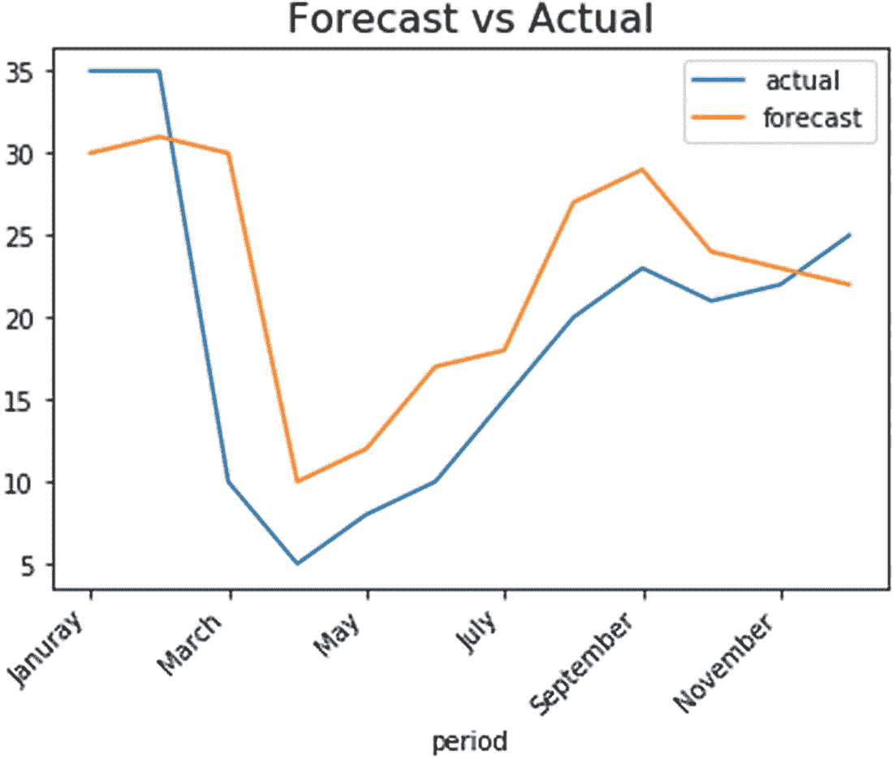
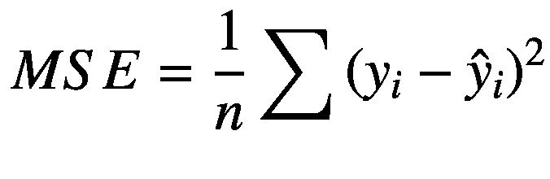
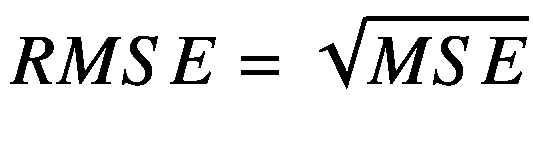
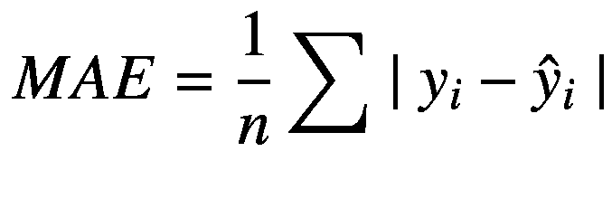
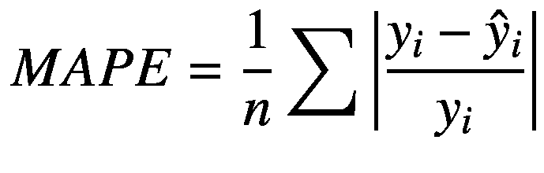
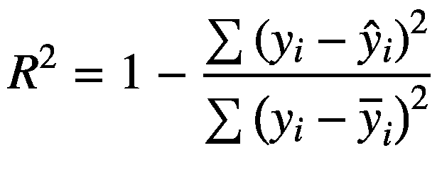
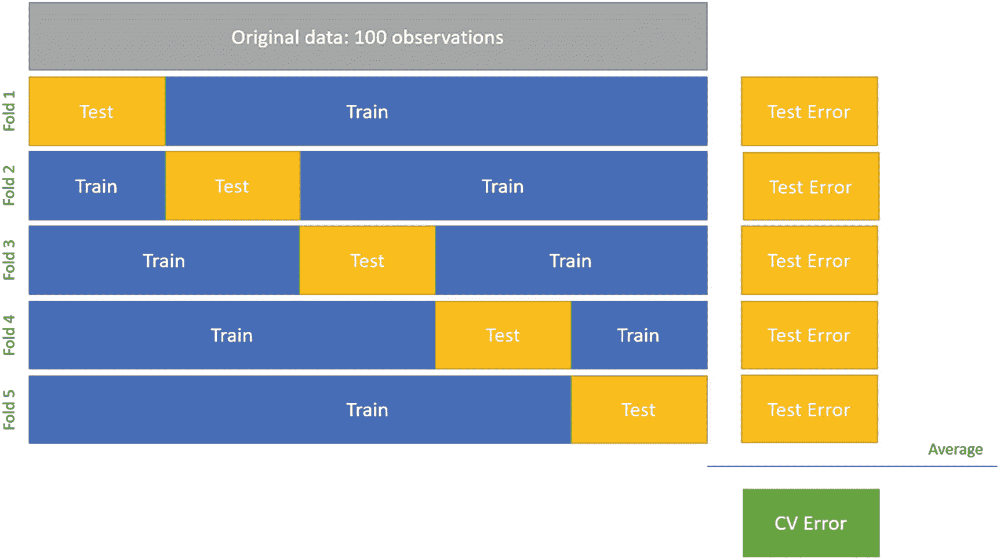
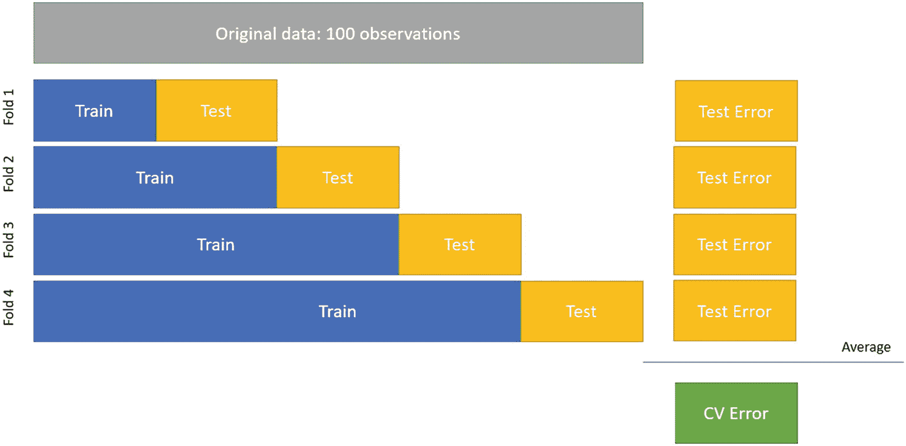
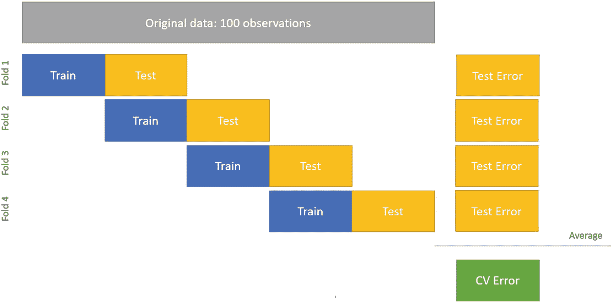

# 2. 预测模型评估

在开发机器学习模型时，你通常会在构建阶段对多个模型进行基准测试。然后，你评估这些模型的性能，并选择你认为最有可能表现良好的模型。你需要客观的性能度量指标来决定保留哪个预测结果作为你的实际预测。

在本章中，你将了解众多用于模型评估的工具。你将看到评估机器学习模型的不同通用策略，以及针对预测需要特别考虑的调整和注意事项。你还将看到用于评估模型性能的不同指标。


## 通过示例预测进行评估

让我们看一个纯假设的例子，其中包含 2020 年每月的股票价格以及某人对该年所做的预测（表 2-1）。假设该预测是在 2019 年 12 月为整个年度做出的，并且此后未再更新。

表 2-1

股票价格数据

| 月份 | 股票价格 | 预测值 |
| --- | --- | --- |
| 一月 | 35 | 30 |
| 二月 | 35 | 31 |
| 三月 | 10 | 30 |
| 四月 | 5 | 10 |
| 五月 | 8 | 12 |
| 六月 | 10 | 17 |
| 七月 | 15 | 18 |
| 八月 | 20 | 27 |
| 九月 | 23 | 29 |
| 十月 | 21 | 24 |
| 十一月 | 22 | 23 |
| 十二月 | 25 | 22 |

你已经可以看到实际值与预测值之间存在相当大的差异。但这种情况时有发生。我们首先将数据导入 Python，并使用代码清单 2-1 绘制两条线。

```
import pandas as pd
import matplotlib.pyplot as plt
period = ['January', 'February', 'March',
'April', 'May', 'June',
'July', 'August', 'September',
'October', 'November', 'December']
actual = [35, 35, 10,
5, 8, 10,
15, 20, 23,
21, 22, 25]
forecast = [30, 31, 30,
10, 12, 17,
18, 27, 29,
24, 23, 22]
data = pd.DataFrame({
'period': period,
'actual': actual,
'forecast': forecast
})
ax = data.plot.line(x='period')
ax.set_title('Forecast vs Actual', fontsize=16)
ax.set_xticklabels(ax.get_xticklabels(), rotation=45, ha='right')
plt.show()
代码清单 2-1
将股票数据示例导入 Python
```

这将生成图 2-1 中的图表，该图展示了实际值与预测值随时间的变化趋势。



图 2-1

股票价格与预测股票价格随时间的变化

接下来简单的步骤是计算每个预测值与每个实际值之间的差异，如表 2-2 所示。

表 2-2

将每个预测值的误差添加到数据中

| 月份 | 股票价格 | 预测值 | 误差 |
| --- | --- | --- | --- |
| 一月 | 35 | 30 | -5 |
| 二月 | 35 | 31 | -4 |
| 三月 | 10 | 30 | 20 |
| 四月 | 5 | 10 | 5 |
| 五月 | 8 | 12 | 4 |
| 六月 | 10 | 17 | 7 |
| 七月 | 15 | 18 | 3 |
| 八月 | 20 | 27 | 7 |
| 九月 | 23 | 29 | 6 |
| 十月 | 21 | 24 | 3 |
| 十一月 | 22 | 23 | 1 |
| 十二月 | 25 | 22 | -3 |

## 模型质量指标

这种逐月误差对于模型改进是有用的信息。然而，尽管它提供了对模型质量的初步印象，但这种模型评估方式存在一些问题。首先，这种详细程度对于模型比较来说过于繁琐：你无法查看每个模型的长串误差列表，而是理想情况下希望每个模型只有一个或少数几个关键绩效指标（KPI）。

其次，你应该注意到，简单地计算此误差列的平均值并将其视为误差指标是不可行的。由于存在正负误差度量，它们会相互抵消。这将严重低估你的误差。

为了解决这个问题，你需要通过取绝对值或对误差进行平方来标准化误差。这将确保负误差和正误差不会相互抵消。你现在将看到五种常见的指标，它们正是这样做的。

### 指标 1：MSE

均方误差（MSE）是机器学习中最常用的指标之一。它计算为平方误差的平均值。要计算 MSE，你需要取每行数据的误差，对这些误差进行平方，然后取它们的平均值。



你可以使用 scikit-learn 库在 Python 中计算它，如代码清单 2-2 所示。

```
from sklearn.metrics import mean_squared_error
print(mean_squared_error(data['actual'], data['forecast']))
代码清单 2-2
在 Python 中计算均方误差
```

对于当前示例，这给出了**53.7**的 MSE。

这个误差指标背后的逻辑是多方面的。首先，你可以理解使用平方误差而不是原始误差的原因，因为对原始误差求和是不可能的。由于原始误差中存在正值和负值，它们会相互抵消。想象一个案例，有一个大的负误差和一个大的正误差：这两个误差的总和可能接近于零，这显然是错误的。一个值的平方总是正的，这就是为什么这是解决这个问题的一种可能性。

你可以理解的公式的第二部分是它作为一个平均值。你取所有值的总和并除以观测值的数量。在 MSE 中，你取平方误差的平均值。

MSE 误差指标非常适合在同一数据集上比较不同的模型。应用于同一数据集的每个模型的 MSE 尺度都是相同的。然而，该指标的尺度并不直观，这使得它在基准测试多个模型之外难以解释。

MSE 是一个误差指标，因此应如下解释：误差越小，模型越好。由于缺乏固定的指标尺度，无法将其转换为准确度度量。误差没有上限，因此它确实只应用于比较。

### 指标 2：RMSE

RMSE，即均方根误差，是均方误差的平方根。正如你可以理解的，当你想要使用误差指标对性能进行排序时，取 MSE 的平方根并不会产生差异。



然而，使用 RMSE 而不是 MSE 有一个优势。取 MSE 平方根的原因是 RMSE 的尺度与原始变量的尺度相同。在 MSE 公式中，你取平方误差的平均值。这使得该值难以解释。使用平方根将使误差指标的尺度恢复到实际值的尺度。

如果你使用代码清单 2-3 计算 RMSE，你会看到 RMSE 是**7.3**。这与你正在处理的股票价格更加一致。这对于解释和沟通目的可能具有优势。

```
from sklearn.metrics import mean_squared_error
from math import sqrt
print(sqrt(mean_squared_error(data['actual'], data['forecast'])))
代码清单 2-3
在 Python 中计算均方根误差
```

由于 RMSE 是一个误差度量，较低的 RMSE 表示更好的模型。

尽管 RMSE 更直观易懂，但其尺度仍然依赖于实际值。这使得无法像 MSE 一样，将不同数据集的 RMSE 值相互比较。


### 指标 3：MAE

平均绝对误差（MAE）的计算方法是取每一行预测值与实际值之间的绝对差值。这些绝对误差的平均值即为平均绝对误差。



MAE 在求平均值之前先取误差的绝对值。对绝对误差取平均值是为了确保误差在求和时不会相互抵消。

你已经看到 MSE 通过使用误差的平方来避免这个问题，而 MAE 是另一种替代方案。MAE 的公式更直观：它是大多数人凭直觉就能想到的误差指标。然而，RMSE 通常比 MAE 更受青睐。

由于 RMSE 使用平方而非绝对值，因此在需要求导的数学计算中，RMSE 更容易使用。平方误差的导数比绝对误差的导数更容易计算。由于导数是优化和最小化中常用的函数，这是一个重要的考量因素。

MAE 的解释与 RMSE 的解释类似。两者得出的分数都与实际值处于相同的数值范围内。MAE 和 MSE 之间总会存在差异。当使用平方误差时，如果某个单独的误差非常高，这个值可能会在整体评估中占据更大的权重。然而，并没有一种确定的方法来判断哪种误差度量更好或更差。

你可以使用清单 2-4 中的代码在 Python 中计算平均绝对误差。你应该会得到一个 **5.67** 的 MAE 值。

```
from sklearn.metrics import mean_absolute_error
print(mean_absolute_error(data['actual'], data['forecast']))
清单 2-4
在 Python 中计算平均绝对误差
```

### 指标 4：MAPE

MAPE 是平均绝对百分比误差（Mean Absolute Percent Error）的缩写，其计算方法是取每个预测值的误差，然后除以实际值。这样做是为了获得相对于实际值的误差。这将使误差度量成为一个百分比，因此它是标准化的。

正如你从之前的误差度量中所了解的，它们并没有在 0 到 1 的范围内进行标准化。然而，这种标准化非常有用。这使得性能结果的沟通变得非常容易。

要计算 MAPE，你需要取每一行这些百分比的绝对值，然后计算它们的平均值。对于清单 2-5 中的示例，你将得到 **0.46**。



MAPE 衡量的是百分比误差。它是一个误差度量，因此 MAPE 的值越低越好。然而，你可以通过计算 1 – MAPE 来轻松地将 MAPE 转换为拟合优度度量。在许多情况下，用正面结果而非负面结果来沟通性能更容易。

尽管 MAPE 函数很直观，但它有一个严重的缺点：当实际值为 0 时，公式会将误差除以实际值。这会导致除以零，这在数学上是不可能的。这使得它的使用存在问题。

```
from sklearn.metrics import mean_absolute_percentage_error
print(mean_absolute_percentage_error(data['actual'], data['forecast']))
清单 2-5
在 Python 中计算平均绝对百分比误差
```

### 指标 5：R2

R2（R 平方）指标是一个非常接近 1 – MAPE 指标的度量。它是一个性能度量而非误差度量，这使得它非常适合用于沟通。

R2 的值通常介于 0 和 1 之间，0 表示差，1 表示完美。因此，通过将其乘以 100，可以很容易地将其用作百分比。R2 可能为负的唯一情况是你的预测错误率超过 100%。



该公式进行了一个有趣的计算。它计算了平方误差之和与预测值和平均值之间的偏差之和的比率。这相当于你的模型相对于使用平均值作为模型的性能提升百分比。如果你的模型预测效果和使用平均值一样差，那么 R2 将为 0。由于平均值常被用作基准模型，这是一个非常实用的性能度量。

在 Python 中，你可以使用清单 2-6 中列出的代码来计算 R2。

```
from sklearn.metrics import r2_score
r2_score(data['actual'], data['forecast'])
清单 2-6
在 Python 中计算 R2
```

这将给你一个（四舍五入后的）值 **0.4**。由于 R 平方是在 0 到 1 的范围内衡量的，你可以将其理解为性能比平均值好 40%。尽管这种精确的解释对你的业务伙伴和管理者来说可能不太清晰，但使用百分比来跟踪模型性能在许多情况下会非常有说服力。

## 模型评估策略

现在你已经了解了五个重要的指标，让我们来看看如何为模型比较设置测试。在进行高级预测时，你通常会同时使用大量模型。有许多模型可供使用，本书的其余部分将介绍它们。

但是，在处理所有这些不同的模型时，你通常需要做出最终的预测：*如何决定哪个模型最准确？*

理论上，你当然可以使用多个模型来预测（短期的）未来，然后等待并观察哪个模型效果最好。这在实践中确实会发生，并且这是确保你提供高质量预测的好方法。然而，你可以做得更多。与其等待，更有趣的是尝试使用过去的数据来估计误差。

在实践中，问题是：*如何在不等待未来验证你的模型的情况下，决定哪个模型最准确？*

### 过拟合与样本外误差

在进行预测时，你是在历史数据上构建模型，并将预测投射到未来。这样做时，重要的是要避免某些偏差。一个非常常见的偏差是在历史数据上拟合模型，计算这些历史数据上的误差，如果误差良好，就将其用于预测。

然而，由于过拟合，这行不通。过拟合模型意味着你的模型过于具体地学习了过去的数据。利用市场上可用的先进方法，模型几乎可以 100% 地拟合任何历史趋势。然而，这完全不能保证样本外预测的性能。

当模型过拟合时，它们在历史数据上获得非常高的分数，但在未来数据上表现不佳。过拟合的模型不是学习普遍的、真实的趋势，而是记住了过去大量“无用的”和“有噪声的”变化，并将这些噪声投射到未来。

机器学习模型是强大的学习模型：它们会学习你给它们的任何东西。但当它们过拟合时，它们学得太多。这种情况经常发生，并且存在许多策略来避免它。


### 策略一：训练-测试集划分

一种常用的初步划分方法是训练-测试集划分。应用训练-测试集划分时，你会将数据行分为两部分。通常会将 20% 或 30% 的数据保留在测试集中。

然后，你可以在剩余数据（即训练数据）上拟合模型。你可以对训练数据应用多种模型，并在测试数据上进行预测。通过比较机器学习模型在测试集上的表现，你会发现，在训练数据上表现良好的模型，在测试数据上未必同样出色。

在训练数据上得分较高、在测试数据上得分较低的模型，属于过拟合模型。在这种情况下，一个在训练数据上误差略高的模型，其在测试集上的表现很可能优于前者。

测试性能才是关键，因为它最能复现未来的情况：模型试图对“未知”数据进行预测——这模拟了你未来进行预测时的场景。

现在，你可能会问如何选择测试集。在大多数机器学习问题中，你会随机选择数据作为测试集。但预测问题在这方面比较特殊。由于数据通常存在顺序，将测试集保留为最后 20% 的观测值更为合理：这能模拟未来应用预测时的实际情况。

作为应用训练-测试集划分的一个示例，我们来构建一个非常简单的预测模型：均值模型。该模型计算训练数据的平均值，并将其作为预测值。当然，它的性能不会很好，但常被用作预测模型中的“最低”基准。任何表现比它还差的模型都不值得考虑。

那么，让我们用之前清单 2-7 中的股票价格数据来看一个例子。

```
from sklearn.model_selection import train_test_split
y = data['actual']
train, test = train_test_split(y, test_size=0.3, shuffle=False)
forecast = train.mean() # 预测值为 17.25
train = pd.DataFrame(train)
train['forecast'] = forecast
train_error = mean_squared_error(train['actual'], train['forecast'])
test = pd.DataFrame(test)
test['forecast'] = forecast
test_error = mean_squared_error(test['actual'], test['forecast'])
print(train_error, test_error)
清单 2-7
Python 中的训练-测试集划分
```

这将得到训练误差 122.9375 和测试误差 32.4375。注意：如果只有一年的数据，训练-测试集划分会带来问题。训练数据将不包含完整的一年数据，导致模型无法充分学习任何季节性。此外，你应该力求每个周期至少有三个观测值（在本例中，即三年的训练数据）。

在选择测试周期时，通常最好将季节性考虑在内。在非预测场景中，你经常会看到测试集占数据的 20% 或 30%。在预测中，我建议使用一个完整的季节性周期。如果你有年度季节性，应该使用一整年作为测试周期，以避免出现例如模型在夏季表现很好，但在冬季表现很差的情况（这可能是由于不同季节预测对象的动态变化不同所致）。

### 策略二：训练-验证-测试集划分

在进行**模型比较**时，你需要对多个模型的性能进行基准测试。如前所述，你可以通过在训练集上训练模型、在测试集上测试模型来避免过拟合。

在此基础上，你可以增加一个额外的划分：**验证集划分**。当使用训练-验证-测试集划分时，你会在训练数据上训练模型，然后在验证数据上对模型进行基准测试，这将作为你模型选择的基础。最后，你使用选定的模型在测试集上计算误差：这应该能确认模型的估计误差。

如果测试集上的误差明显差于验证集上的误差，这将提醒你模型并没有预期中那么好：验证误差被低估了，需要重新审视。

当使用训练-验证-测试集划分时，会有相当数量的数据完全用于模型比较和测试。因此，当数据量较少时，应避免使用此方法。

如前所述，考虑将哪些时间段留作验证和测试数据非常重要。例如，如果你有五年的月度数据，并决定用三年进行训练、一年进行验证、一年进行测试，那么你将错过最近两年的数据：这不是一个好主意。

在这种情况下，你可以先选出最佳模型（即**模型类型**及其最优**超参数**）；一旦模型选定并完成基准测试，你可以使用包含最新数据的最优模型进行重新训练。

清单 2-8 展示了一个非常基础的示例，其中比较了两个模型：均值模型和中位数模型。当然，不应期望这些模型有很好的性能：这里的目标是展示如何使用验证数据进行模型比较。

```
# 划分为 70% 训练集、15% 验证集和 15% 测试集
train, test = train_test_split(data['actual'], test_size = 0.3, shuffle = False, random_state=12345)
val, test = train_test_split(test, test_size = 0.5, shuffle = False, random_state=12345)
# 在训练数据上拟合（估计）两个模型
forecast_mean = train.mean() # 17.25
forecast_median = train.median() # 12.5
# 计算两个模型在验证数据上的 MSE
val = pd.DataFrame(val)
val['forecast_mean'] = forecast_mean
val['forecast_median'] = forecast_median
mean_val_mse = mean_squared_error(val['actual'], val['forecast_mean'])
median_val_mse = mean_squared_error(val['actual'], val['forecast_median'])
# 你观察到以下验证 MSE：均值模型 MSE：23.56，中位数模型 MSE：91.25
print(mean_val_mse, median_val_mse)
# 最佳性能是均值模型，因此在测试数据上验证其误差
test = pd.DataFrame(test)
test['forecast_mean'] = forecast_mean
mean_test_mse = mean_squared_error(test['actual'], test['forecast_mean'])
# 你观察到测试 MSE 为 41.3125，几乎是验证 MSE 的两倍
print(mean_test_mse)
清单 2-8
Python 中的训练-验证-测试集划分
```

如果你按照示例操作，会观察到均值模型在验证集上的 MSE 为 **23.56**，中位数模型为 **91.25**。这将是保留均值模型而非中位数模型的理由。作为最终评估，你需要验证验证误差是否受到验证集选择（随机地）对均值模型有利的影响。

这通过在测试集上获取最终误差度量来完成。由于验证集和测试集对于均值模型来说都是未见过的数据，它们的误差应该接近。然而，你观察到测试 MSE 为 **41.3125**，几乎是验证误差的两倍。测试误差与验证误差相差甚远这一事实表明，你的误差估计存在偏差。在这个特定案例中，偏差很容易找到：验证集中的数据点太少（只有两个数据点），这使得误差估计不可靠。

训练-验证-测试集划分会为你的模型误差指标提供早期预警。因此，它可以防止你依赖这个预测结果进行未来的估计。虽然评估策略不能改进模型，但它绝对可以改进你对预测模型的选择！因此，它对模型的准确性有间接影响。

### 策略三：用于预测的交叉验证

当数据量非常少时，训练-测试集划分可能会出现问题。在某些情况下，你无法“承担”将 20% 的数据从模型中分离出来。在这种情况下，交叉验证是一个很好的解决方案。


#### K 折交叉验证

最常见的交叉验证类型是 K 折交叉验证。K 折交叉验证类似于训练-测试分割的补充。在训练-测试分割中，你只计算一次每个模型的误差：在测试数据上。而在 K 折交叉验证中，你将同一个模型拟合 k 次，并每次评估误差。然后你会得到 k 个误差度量，取其平均值。这就是你的交叉验证误差。

为此，K 折交叉验证会生成多个不同的训练-测试分割。如果你选择 k 为 10，你会将数据分成十份。然后，每一份数据都会依次作为测试数据一次。这意味着剩下的九份数据被用作训练数据。

对于 k 的取值，通常范围在 3 到 10 之间。如果取值过高，测试数据会变得很小，可能导致有偏的误差估计。如果取值过低，折数会非常少，从而失去交叉验证的附加价值。请注意，当 k 为 1 时，你实际上只是在应用一次训练-测试分割。

作为一个假设的例子，想象一个有 100 个数据点和五折交叉验证的情况。你会生成五个不同的训练-测试数据集，如图 2-2 的示意图所示。



图 2-2

Python 中的 K 折交叉验证

在这五个训练-测试分割上，你在被选为训练数据的观测值上训练模型，并在被选为测试数据的观测值上计算误差。交叉验证误差就是这五个测试误差的平均值（代码清单 2-9）。

```
import numpy as np
from sklearn.model_selection import KFold
kf = KFold(n_splits=5)
errors = []
for train_index, test_index in kf.split(data):
train = data.iloc[train_index,:]
test = data.iloc[test_index,:]
pred = train['actual'].mean()
test['forecast'] = pred
error = mean_squared_error(test['actual'], test['forecast'])
errors.append(error)
print(np.mean(errors))
代码清单 2-9
Python 中的 K 折交叉验证
```

这个示例会给你一个 **106.1** 的交叉验证误差。这是一个均方误差（MSE），因此它只能与同一数据集上其他模型的误差进行比较。

#### 时间序列交叉验证

拥有多个误差估计值会改善误差估计。可以想象，当你只有一个误差估计值时，你的测试数据可能非常有利：所有难以预测的事件可能都落入了训练数据中！交叉验证通过对所有数据进行评估，降低了这种风险。这使得误差估计通常更加可靠。

然而，必须注意预测这一特定情况。如图所示，K 折交叉验证在整个数据中均匀地创建测试分割。在示例中，你可以看到许多测试集在时间上位于训练集之前的情况。这意味着你正在使用这些方法衡量预测过去而非未来的误差。

对于监督模型这一类，你利用目标变量与一组解释变量之间的关系，这不一定是个问题：可以假设变量之间的关系在过去和现在是相同的。

然而，对于时间序列模型这一类，这是一个严重的问题。时间序列模型通常基于趋势和/或季节性进行预测：它们利用目标变量的过去来预测未来。

你遇到的第一个问题是，许多时间序列模型无法处理缺失数据：如果中间缺少一个月，这些方法根本无法进行估计。

第二个问题是，即使模型可以被估计，它们通常也不够现实准确：估计数据点之间的时间段比估计完全未来的时间段要容易得多。

一种可用的解决方案称为**时间序列分割**（图 2-3）。在这种方法中，你只使用测试期之前的数据进行模型训练。



图 2-3

Python 中的时间序列交叉验证

你可以使用代码清单 2-10 中的代码来应用时间序列交叉验证。

```
from sklearn.model_selection import TimeSeriesSplit
tscv = TimeSeriesSplit()
errors = []
for train_index, test_index in tscv.split(data):
train = data.iloc[train_index,:]
test = data.iloc[test_index,:]
pred = train['actual'].mean()
test['forecast'] = pred
error = mean_squared_error(test['actual'], test['forecast'])
errors.append(error)
print(np.mean(errors))
代码清单 2-10
Python 中的时间序列交叉验证
```

这种交叉验证方法估计的误差为 **194.7**。同样，这个误差不应单独使用，而应作为比较同一数据上多种方法性能的一种方式。

这种方法至少可以用于时间序列模型，因为数据中没有间隙。然而，使用这种方法会存在偏差。对于第一个折，你拥有的历史数据会比最后一个折少得多。这使得各折的误差不可比较：如果它们无法使用足够的历史数据来拟合模型，那么第一个折的误差可能被认为是不公平的。这是该方法固有的弱点，如果你使用它，应该牢记这一点。

#### 滚动时间序列交叉验证

另一种被提出的替代方案是**滚动时间序列分割**。它在交叉验证的每个折中使用相同的时间段。你可以在图 2-4 中看到这种方法的示意图。这将解决误差不相等的问题：所有折都使用相同数量的历史数据进行训练。然而，仍然存在一个问题，即使用这种方法，你无法基于非常久远的历史数据来构建模型。

但它只应在你拥有大量数据，或者预测未来时不需要参考非常久远的历史数据的情况下使用。



图 2-4

Python 中的滚动时间序列交叉验证

你可以使用代码清单 2-11 中的代码在股票价格示例上执行滚动时间序列交叉验证。

```
from sklearn.model_selection import TimeSeriesSplit
tscv = TimeSeriesSplit(max_train_size = 2)
errors = []
for train_index, test_index in tscv.split(data):
train = data.iloc[train_index,:]
test = data.iloc[test_index,:]
pred = train['actual'].mean()
test['forecast'] = pred
error = mean_squared_error(test['actual'], test['forecast'])
errors.append(error)
print(np.mean(errors))
代码清单 2-11
Python 中的滚动时间序列交叉验证
```

这种模型评估方法估计的误差为 **174.0**。你现在已经看到了三个不同的交叉验证误差。然而，它们都使用了相同的模型。这告诉你两件事：首先，它强调只能使用相同的度量标准、在相同的数据集上比较误差估计值。其次，你观察到滚动时间序列分割的误差显著更低。这可能暗示，在这种情况下，使用较少历史数据的模型（滚动）可能是性能更好的模型。然而，要确信这个结论，你需要进一步研究结果。一个很好的起点是将多个模型加入基准测试。这留待以后讨论，因为你将在本书中发现众多模型。


## 回测

作为最后一种策略，我想提一下回测。回测是一个在数据科学和机器学习中不太常用的术语，但它却是股票交易和金融领域的首选模型验证技术。回测建立在与模型评估相同的原理之上。

回测与使用指标进行模型评估之间存在根本性区别。在回测中，你衡量的不是预测模型的准确性，而是（股票交易）策略的结果。你不是试图预测股票的未来价格，而是定义在哪个事件或触发条件下买入或卖出。例如，你可以定义一个策略，规定在价格 x 时买入某只股票，在价格 y 时卖出。

为了评估该策略的表现，你在股票价格的历史数据上运行该策略：如果你按照指定的价格买卖股票，会发生什么情况。然后，你评估可以获得多少利润。

尽管回测应用于交易策略而非预测，但我认为将其列入本章作为预测中模型评估的一种替代方案是很有趣的。

有几个用于金融领域的 Python 库提供了回测解决方案。一个非常易于使用的例子是 **fastquant**，可在 GitHub 上找到：[`https://github.com/enzoampil/fastquant`](https://github.com/enzoampil/fastquant)。

## 为了安全预测，应该使用哪种策略？

在了解了多种预测模型评估方法之后，你可能会想知道应该选择哪种方案。我认为你不必做出选择。作为预测者或建模者，最重要的任务是对模型的评估充满信心。一个可靠的评估策略是成功的关键！因此，我建议你不要只选择一种策略，而是结合使用多种策略，让你对自己的预测最有信心。

你可以使用的一种**组合策略**是：在训练数据上使用交叉验证来训练和调整模型。下一步，你可以衡量验证数据上的预测误差：在验证数据上误差最小的模型将成为你的首选模型。作为最后的验证（你永远不能过于确定），你使用选定的模型对测试数据进行预测，并确保其误差与在验证数据上观察到的误差相同。如果是这样，你就可以确信你的模型在未来数据上应该会给出相同范围的误差。

随着你进行更多的预测性预测，你会逐渐培养出对哪些评估指标重要的感觉。请记住，模型评估的目标是双重的：一方面，你用它来改进模型性能；另一方面，你用它来进行客观的性能衡量。

请注意，有时预测建模者过于关注性能改进部分，以至于开始调整他们的评估方法以提高性能分数。这是应该避免的：你希望尽可能对自己模型未来的性能充满信心。指标是其中的重要部分；建立一个客观的模型评估策略则更为重要。

## 关于模型评估的最终思考

除了查看指标，你还需要理解你的模型在拟合什么：模型考虑了哪些解释变量？这些变量在直觉上合理吗？它们是否符合关于你数据的业务知识？

这种对你模型的科学性（或解释性）理解会给你带来额外的信心，这是对预测误差数值最小化的重要补充。

例如，如果你预测股票市场，你可能会基于过去的数据获得 90% 的准确率。但通过反思你所做的事情，你可能会意识到过去的数据中并没有出现简单的市场崩盘。你可能会由此理解，你的模型在市场崩盘的情况下会完全出错，而这也许正是你风险最大的时刻！

有一本关于此话题的好书是*《黑天鹅》*，作者尼古拉斯·塔勒布在书中强调了在股票市场交易中考虑极罕见事件的重要性。这里的一个要点是，股票交易历史上的极端危机对交易成功影响巨大，而日常交易中使用的方法（并）不总是考虑这种风险管理。你甚至可能更喜欢一个在日常表现较差，但在预测重大崩盘方面更好的模型。

简而言之，你并不总是需要获得尽可能低的均方误差！有时，稳定的性能才是最重要的。其他时候，你可能希望避免任何高估，而低估则不是问题（例如，在餐厅，由于高估需求预测而购买过多食物，可能比购买过少更糟糕）。要达到这种理解水平，深入理解你的模型至关重要。模型不是一个为你做预测的黑箱：它是你正在构建的一个数学公式。为了获得良好的结果，你需要使用适合你用例的评估标准来评估该公式的性能：有许多策略和指标可用，但没有一种能放之四海而皆准。只有你自己知道哪种评估方法符合你特定问题陈述的成功标准。

## 关键要点

*   指标
    *   最适合回归问题的指标是 R 平方 (R2)、均方根误差和均方误差。

    *   R2 给出一个类似百分比的值。RMSE 给出一个与实际值尺度相同的值。MSE 给出的值尺度难以解释。

    *   指标应用于在同一数据集上对不同模型进行基准测试。

*   模型评估策略
    *   交叉验证能提供非常可靠的误差估计。需要对其进行调整才能适用于时间序列。

    *   训练集、测试集和验证集的划分可用于基准测试。

    *   组合策略能提供最安全的估计：在训练数据上使用交叉验证，用验证数据进行模型选择，并用测试数据对误差进行最终估计。

*   过拟合模型
    *   如果你的模型从训练数据中学习过多，无法泛化到未来，则属于过拟合。

    *   过拟合表现为在训练数据上表现良好，但在测试数据上表现不佳。

*   欠拟合模型
    *   如果你的模型未能从训练数据中充分学习，则属于欠拟合。

    *   欠拟合表现为在训练数据上表现不佳。

