# 3. 自回归模型

在本章中，你将了解 AR 模型：自回归模型。AR 模型是单变量时间序列最基本的构建模块。正如你之前所见，单变量时间序列是一类仅利用`目标变量`的过去信息来预测其未来的模型，它们不依赖其他`解释变量`。

单变量时间序列模型可以直观地理解为构建模块：它们从最简单的模型开始，逐步叠加到复杂的模型，这些复杂模型结合了各个模型所描述的不同效应。AR 模型是单变量时间序列模型中最简单的一个。

在接下来的章节中，你将了解更多的构建模块，并将其添加到这个基础之上。这将从 AR 模型逐步构建到 SARIMA 模型。你可以在表 3-1 中看到单变量时间序列构建模块的概览示意图。

表 3-1 单变量时间序列的构建模块

| 名称 | 解释 | 章节 |
| --- | --- | --- |
| AR | 自回归 | 3 |
| MA | 移动平均 | 4 |
| ARMA | AR 和 MA 模型的组合 | 5 |
| ARIMA | 在 ARMA 模型中加入差分（I） | 6 |
| SARIMA | 在 ARIMA 模型中加入季节性（S） | 7 |
| SARIMAX | 在 SARIMA 模型中加入外部变量（X）（注意，外部变量使得模型不再是单变量模型） | 8 |

这里我必须提醒你一点。正如我在第 1 章中所说，本书的强项在于它包含了真实案例以及诚实客观的模型评估。我怎么强调模型评估的重要性都不为过，因为任何预测模型的目标都应该是获得最佳的预测性能。

由于 AR 模型是最简单的构建模块，期望它在大多数真实数据集上表现出色是不现实的。虽然我本可以调整示例使其完美拟合，或者使用模拟数据集，但我更愿意向你展示某些模型的弱点。

AR 模型是开始学习单变量时间序列的好起点，但在实践中，你不太可能单独使用 AR 模型而不结合它的“兄弟姐妹”。你通常会使用某种组合模型（SARIMA 或 SARIMAX），并测试哪些构建模块能够提高你预测任务的预测性能。

## 自相关：过去影响现在

自回归模型描述了变量当前值与其过去值之间的关系。因此，它适用于过去值与当前值相关的变量。

举个直观的例子，考虑在医生诊所排队的情况。假设医生计划每位患者有 20 分钟的就诊时间。如果每位患者都恰好用 20 分钟，那就没问题。但如果某位患者多花了一点时间呢？如果一次就诊的时长对下一次就诊的时长产生了影响，那么就存在`自相关`。因此，如果医生因为前一次就诊时间过长而需要加快当前就诊速度，你就会观察到过去与现在之间的相关性。过去的值会影响未来的值。

### 计算地震次数的自相关

在本章中，你将看到应用于著名的`地震数据集`的示例。该数据集由美国国家地震信息中心收集。你可以在 Kaggle 上找到该数据集的副本（[`www.kaggle.com/usgs/earthquake-database`](http://www.kaggle.com/usgs/earthquake-database)）。

注意：要快速了解数据集，你可以使用`df.describe()` 获取数据框每列的快速统计信息：计数、均值、标准差、最小值、最大值和分位数。要获得更详细的描述，你可以使用`pandas profiling 包`。本书的 GitHub 仓库中提供了这两种方法的示例。

如果你使用 pandas 导入数据，可以使用 `describe` 方法获取数据框的描述信息，如代码清单 3-1 所示。注意：此代码最好在 Jupyter notebook 或 Jupyter lab 中执行。这些是进行探索性数据分析的绝佳工具。你可以直接安装它们，或者考虑安装 Anaconda，它附带了许多有用的 Python 和数据科学工具。

```python
import pandas as pd

# 导入数据框
eq = pd.read_csv('Ch03_Earthquake_database.csv')
# 描述数据框
eq.describe()
```

代码清单 3-1 描述数据框

请随意浏览这个描述性表格，以便更好地理解数据内容。如果你想要更详细的数据描述，可以使用 `pandas profiling 包`，它会自动生成数据框变量的非常详细的描述。你可以使用代码清单 3-2 来获取 `分析报告`。

```python
# 导入 pandas profiling 包
from pandas_profiling import ProfileReport

# 获取 pandas profiling 报告
eq.profile_report()
```

代码清单 3-2 分析数据框

你要执行的任务是预测`每年强震的次数`。该数据集目前格式不正确，因为它每行对应一次地震，而不是每年一行。为了准备数据以进行进一步分析，你需要使用代码清单 3-3 对数据进行聚合。

```python
import matplotlib.pyplot as plt

# 将年份转换为日期
eq['year'] = pd.to_datetime(eq['Date']).dt.year
# 筛选震级为 7 级或以上的地震
eq = eq[eq['Magnitude'] >= 7]
# 计算每年地震次数
earthquakes_per_year = eq.groupby('year').count()
# 移除年份中的错误值
earthquakes_per_year = earthquakes_per_year.iloc[1:-2, 0]
# 绘制每年地震次数图
ax = earthquakes_per_year.plot()
ax.set_ylabel("地震次数")
plt.show()
```

代码清单 3-3 将地震数据转换为每年地震次数

这段代码应该会生成图 3-1 所示的图形。你可以看到年份之间可能存在某种关系。某一年较高，某一年较低。这可能是由于负自相关造成的。请记住，负相关意味着一个变量中的较高值对应于另一个变量中的较低值。对于自相关而言，这意味着今年的较高值对应于明年的较低值。

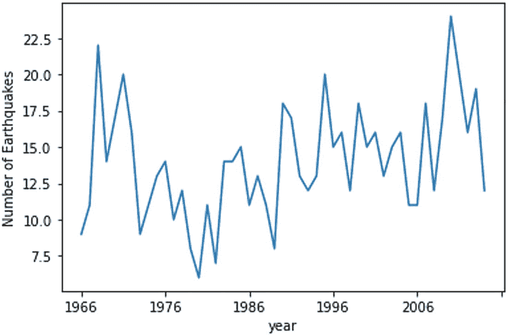

图 3-1 每年地震次数评估

现在你已经获得了每年地震次数，你应该通过数值计算来检查自相关。你需要找出任意一年地震次数与其前一年地震次数之间是否存在相关性。

为此，你可以使用第 2 章中介绍的计算相关性的相同方法。相关性是成对计算的，作用于两列数据。但目前你只有一列数据（每年的数据）。你需要在数据中添加一列包含前一年数据的内容。这可以通过对原始数据应用`移位`操作，并将移位后的数据与原始数据拼接来实现。清单 3-4 展示了如何操作。图 3-2 展示了数据如何向后移动了 1 年。

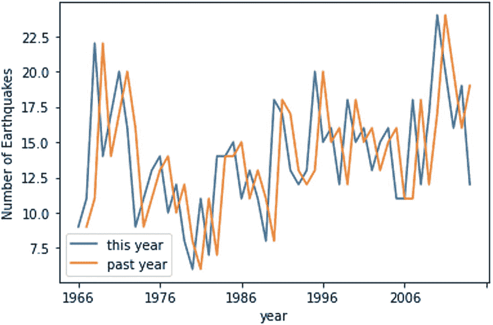

图 3-2 移位后的数据

```python
shifts = pd.DataFrame(
    {
        'this year': earthquakes_per_year,
        'past year': earthquakes_per_year.shift(1)
    }
)
ax = shifts.plot()
ax.set_ylabel('Number of Earthquakes')
plt.show()
```

清单 3-4 绘制移位后的数据

这个方法效果不错，但有一个问题。如数据所示，观测值覆盖了 1966 年到 2014 年。这意味着 1966 年没有前一年的值：这引入了一个 `nan 值`（`缺失值`）。这种边界效应在时间序列分析中非常常见，在这种情况下，最好的解决方案是将 1966 年排除在外。你可以使用清单 3-5 删除所有包含缺失数据的行。

```python
shifts = shifts.dropna()
```

清单 3-5 删除缺失数据

下一步是使用你在第 2 章中见过的代码计算皮尔逊相关系数。如果你忘记了，可以在清单 3-6 中找到它。结果如图 3-3 所示。

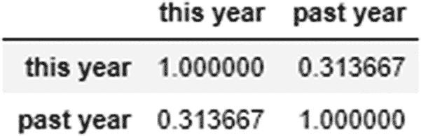

图 3-3 相关性矩阵

```python
shifts.corr()
```

清单 3-6 计算移位数据框的相关性矩阵

在接下来的段落中，你将了解如何解读这种自相关性。

### 正自相关与负自相关

就像“常规”相关性一样，自相关性可以是正的，也可以是负的。正自相关意味着当前的高值很可能导致下一时期的高值。例如，这在股票交易中可以观察到：一旦很多人想买入某只股票，其价格就会上涨。这种积极趋势使得人们更想买入这只股票，因为它表现良好。买入的人越多，股价涨得越高，想买入的人可能就越多。

正相关也适用于下跌趋势。如果今天的股票价值低，那么明天的价值很可能更低，因为人们开始抛售。当很多人抛售时，价值下跌，就会有更多人想抛售。这也是正自相关的一个例子，因为过去和现在朝着相同的方向变化。如果过去是低的，现在也是低的；如果过去是高的，现在也是高的。

如果两个趋势相反，则存在负自相关。医生问诊时长的例子就是这种情况。如果一次问诊时间较长，下一次问诊时间就会较短。如果一次问诊时间较短，医生可能会在下一次问诊上多花点时间。

如果你已经应用了清单 3-6 中的代码，你会观察到当前年份和过去年份之间的相关性约为`0.31`。这个相关性是正的，而不是根据图表预期的负值。这个相关性强度中等。看起来相关性捕捉到了数据中的趋势。如果你查看图表，可以看到地震次数存在一个趋势：在最早几年略高，然后在一段时间内略低，在最后几年又略高。这是一个问题，因为趋势并不是你这里想要捕捉的关系。

## 平稳性与 ADF 检验

数据中存在趋势的问题在单变量时间序列建模中很普遍。时间序列的`平稳性`意味着时间序列没有（长期）趋势：它围绕同一个平均值稳定波动。如果不是这样，我们就说时间序列是`非平稳的`。

AR 模型理论上可以在模型中包含趋势系数，但由于平稳性是时间序列一般理论中的一个重要概念，最好立即学会如何处理它。许多模型只能处理平稳时间序列。

一个随时间强烈增长或衰减的时间序列很容易被识别。但有时很难判断一个时间序列是否平稳。这时`增广迪基-富勒（ADF）检验`就派上用场了。增广迪基-富勒检验是一种假设检验，允许你检验时间序列是否平稳。其应用方式如清单 3-7 所示。

```
from statsmodels.tsa.stattools import adfuller
result = adfuller(earthquakes_per_year.dropna())
print(result)
pvalue = result[1]
if pvalue < 0.05:
print('stationary')
else:
print('not stationary')
清单 3-7
增广迪基-富勒检验
```

在地震数据的案例中，你会看到一个`p值`小于`0.05`（参考值），这意味着该序列在理论上是平稳的：你无需做任何更改即可应用 AR 模型。

注意

如果你不熟悉假设检验，你应该知道 p 值是假设检验的结论性数值。在假设检验中，你试图证明备择假设相对于零假设成立。p 值表示如果零假设为真，你观察到当前数据的概率。如果这个概率很低，你就得出结论，零假设必定是错误的，因此备择假设必定为真。p 值的参考值通常是 0.05，但在某些应用中可能有所不同。

## 时间序列的差分

尽管 ADF 检验告诉你数据是平稳的，但你发现自相关呈现正值，而原本预期应为负值。假设认为这可能是由趋势引起的。

现在你有了两个相互矛盾的指标。一个告诉你数据是平稳的，另一个则表明存在趋势。为稳妥起见，最好还是移除趋势。这可以通过`差分`来实现。

差分意味着你不再对时间序列的原始值进行建模，而是对每个值与下一个值之间的差异进行建模。即使原始数据中存在趋势，差分后的数据很可能不再有趋势。为了确认，你可以再次进行 ADF 检验。如果结果仍不理想，你可以对差分后的时间序列再次进行差分，直到获得正确的结果。

清单 3-8 展示了如何在 pandas 中轻松地对数据进行差分。

```
# 对数据进行差分
differenced_data = earthquakes_per_year.diff().dropna()
# 绘制差分后的数据
ax = differenced_data.plot()
ax.set_ylabel('差分后的地震次数')
plt.show()
清单 3-8
在 pandas 中进行差分
```

你可以在图 3-4 中看到差分后的数据是什么样子。

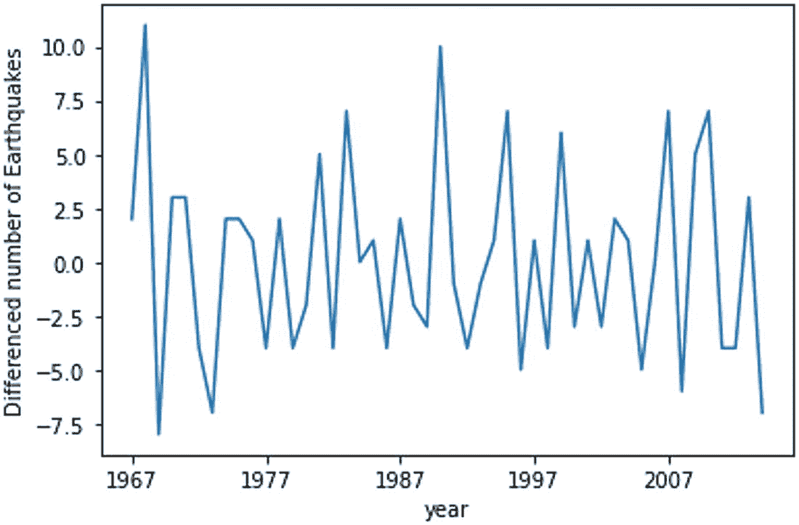

图 3-4

差分后的数据

现在，为了查看这是否将自相关转向了正确的方向，你可以像之前一样计算相关系数。相关代码见清单 3-9。你可以在图 3-5 中看到这个经过平移和差分的数据。相关矩阵（图 3-6）显示了平移后的差分数据与未平移的差分数据之间的相关系数。

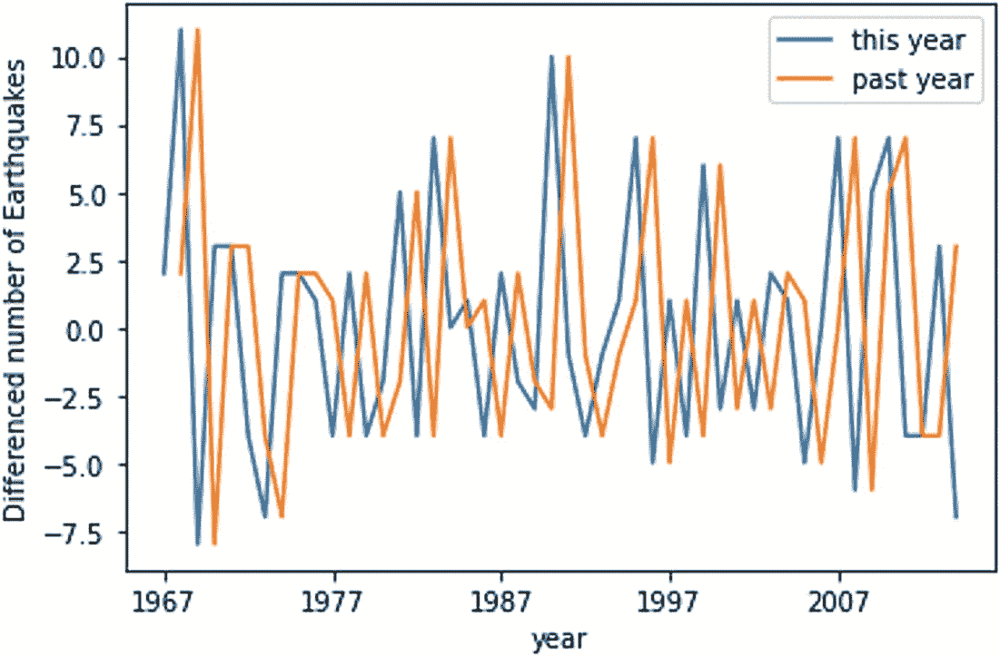

图 3-5

平移并差分后的数据

```
shifts_diff = pd.DataFrame(
{
'今年': differenced_data,
'去年': differenced_data.shift(1)
}
)
ax = shifts_diff.plot()
ax.set_ylabel('差分后的地震次数')
plt.show()
shifts_diff.corr()
清单 3-9
差分数据的自相关
```

你现在得到的相关系数是`-0.37`，如图 3-6 所示：你已经成功地从数据中移除了趋势。你的相关性现在变成了你预期的负相关。如果某一年地震较多，那么下一年地震通常会较少。

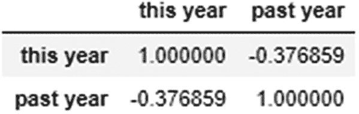

图 3-6

差分数据的自相关

## 自相关中的滞后

除了自相关的方向，`滞后`的概念也很重要。这个概念仅适用于自相关，而不适用于“常规”相关性。

自相关的滞后数指的是对当前值有影响的过去时间步的数量。在许多情况下，如果存在自相关，不仅前一个时间步有影响，可能多个时间步都有影响。

应用到医生问诊时长的例子中，你可以想象一位医生在某次问诊中延误了很长时间，因此需要在接下来的三次问诊中加快速度。这意味着第三次“快速”问诊仍然受到那次延误的影响。所以自相关的滞后至少为三：即回溯三个时间步。

医生问诊时长的例子非常直观，因为医生时间有限是合乎逻辑的。在每年地震次数的例子中，并没有如此清晰的逻辑来解释过去值与当前值之间的关系。这使得凭直觉判断应包含的滞后数量变得困难。

一个同时研究多个滞后自相关的绝佳工具是使用`statsmodels`包中的自相关图。相关代码如清单 3-10 所示。`ACF`是`自相关函数`的缩写：即作为滞后函数的自相关。

请注意，选择 20 个滞后是任意的：仅用于绘图目的。20 个滞后意味着回溯 20 年，这应该足以显示相关的自相关，但选择 40 个甚至更多也是可以接受的选项。

```
from statsmodels.graphics.tsaplots import plot_acf
import matplotlib.pyplot as plt
plot_acf(differenced_data, lags=20)
plt.show()
清单 3-10
差分数据的自相关
```

你将得到图 3-7 中的图形。该图显示了哪些自相关是重要的。在 y 轴上，你看到的是`非滞后数据`（原始数据）与`滞后数据`之间的`相关系数`。相关系数介于-1 和 1 之间。在 x 轴上，你看到的是应用的`滞后数量`，本例中为 0 到 20。第一个相关性为 1，因为这是 0 滞后的数据：即原始数据。

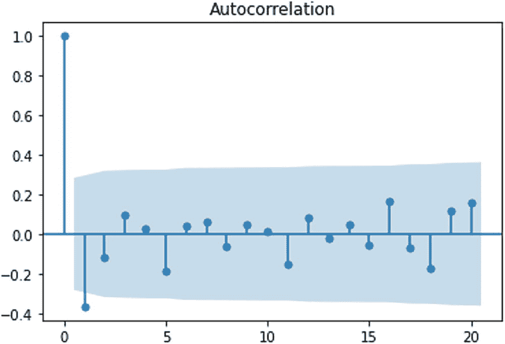

图 3-7

自相关图

在此图中，你应该寻找`自相关`值至少高于 0.2 或低于-0.2 的数值。低于此范围的值可视为噪声。使用 0.3 或 0.4 作为最小值也是可能的：在解释相关系数方面没有严格的标准，因为某些领域的数据天生噪声更大。例如，在社会研究中，处理问卷调查的测量数据时，你通常会看到比处理精确物理测量数据时更多的噪声。

图中的蓝色区域可以帮助你直观地检测哪些自相关只是噪声：如果尖峰超出蓝色区域，则存在显著的自相关；但如果尖峰保持在蓝色区域内，则观察到的自相关不显著。通常可以预期，离当前时间越近的滞后，其自相关越高，并随着向更远的时刻推移而减弱。

在图 3-7 的图形中，你观察到一个非常强的第一个尖峰（在滞后 0 处）。这是正常的，因为它是原始数据。一个变量与自身的相关性总是 1（100%）。第二个尖峰是与滞后 1 的相关性。这就是你之前使用相关矩阵计算的自相关。相关系数为-0.37，你在此图中再次看到了这个值。

其余的自相关强度较弱。这意味着，要了解今天的地震次数，我们主要应查看滞后一个时间步的值；在当前示例中，这意味着去年的地震次数。如果去年地震很多，我们可以预期今年地震较少：这由滞后 1 的负自相关所指示。

为了理解如何解释更远的滞后，想象一个不同的（假设的）ACF 图，其中仅在滞后 5 处有一个正尖峰，而其他滞后均为 0。这意味着，要了解今年的地震次数，你需要查看五年前发生了什么：如果五年前地震很多，那么今年地震也会很多。中间发生的事件不相关：由于与前四年没有自相关，前四年的地震次数无法帮助你确定今年的地震次数。例如，这可能是一个周期为 5 年的季节性案例。

### 偏自相关

**偏自相关图**是另一个你应该关注的图表。自相关与偏自相关的区别在于，偏自相关确保任何相关性不会因多个滞后而被重复计算。因此，每个滞后的偏自相关是相对于每个较低滞后的**额外自相关**。更数学化的说法是，偏自相关是**基于较早滞后的条件自相关**。


这具有附加价值，因为自相关图中的相关性之间可能存在冗余。

通过一个假设的例子更容易理解这个想法。想象一个假设情况：当前值、滞后 1 和滞后 5 的值完全相同。自相关会告诉你，滞后 1 和滞后 5 都存在完美的自相关。而偏自相关会告诉你，滞后 1 存在完美的自相关，但不会显示滞后 5 的自相关。由于你应该始终尝试使用所需变量数量最少的模型（通常称为**奥卡姆剃刀**或**简约原则**），在这种情况下，最好只包含滞后 1，而不包含滞后 5。

你可以使用`statsmodels`计算偏自相关图，如代码清单 3-11 所示。**`PACF`** 是**偏自相关函数**的缩写：自相关作为滞后的函数。

```python
from statsmodels.graphics.tsaplots import plot_pacf
plot_pacf(differenced_data, lags = 20)
plt.show()
代码清单 3-11
差分数据的偏自相关
```

这段代码将生成图 3-8 所示的图表。根据图中的蓝色背景阴影区域可以看出，`PACF`显示第一个和第二个滞后位于阴影区域之外。这意味着在 AR 模型中也包含第二个滞后会很有意义。

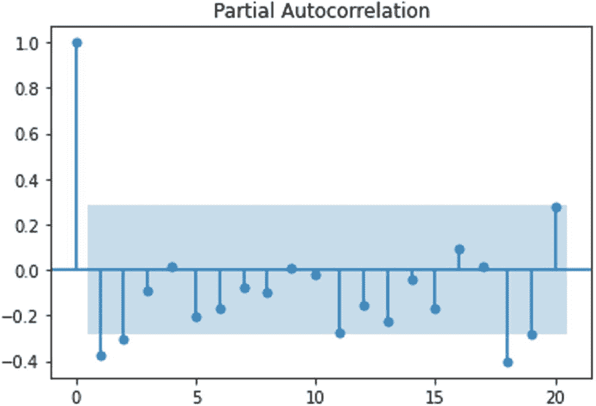

图 3-8

偏自相关

### 应该包含多少个滞后？

现在，时间序列分析中的大问题始终是应该包含多少个滞后。这被称为**时间序列的阶数**。符号 **`AR(1)`** 表示**阶数为 1**，**`AR(p)`** 表示**阶数为 p**。

阶数由你决定。从理论上讲，你可以根据 `PACF` 图来确定阶数。理论告诉你，要取自相关变为 0 之前的滞后数量。所有其他滞后应为 0。

在理论中，你经常看到一些很棒的图表，其中第一个尖峰非常高，其余部分为零。在这些情况下，选择很容易：你正在处理一个非常“纯粹”的 `AR(1)` 示例。另一种常见情况是，你的自相关从高值开始，然后缓慢衰减到零。在这种情况下，你应该使用所有 `PACF` 尚未为零的滞后。

然而，在实践中，情况并不总是这么简单。请记住那句名言：“所有模型都是错的，但有些是有用的。”很难找到完全符合 AR 模型的案例。通常，自回归过程有助于解释变量的一部分变化，但并非全部。

在地震示例中，更远的滞后上仍然存在一点偏自相关，并且这种情况一直持续到非常远的滞后。甚至在滞后 18 处也有一个 `PACF` 尖峰。这可能意味着很多事情：也许确实存在与较远滞后的自相关。或者可能有一个隐藏的过程是 AR 模型未能很好捕捉的。

在实践中，你将尝试选择能为模型带来**最佳预测性能**的滞后数量。最佳预测性能通常不是通过查看自相关图来定义的：这些图只给你一个理论上的估计。然而，预测性能的最佳定义是通过进行**模型评估和基准测试**，使用你在第 2 章中看到的技术。在本章后面，你将看到如何使用模型评估来为 AR 模型选择一个高性能的阶数。但在深入探讨之前，是时候更深入地了解 AR 模型的确切定义了。

## AR 模型定义

到目前为止，你已经直观地了解了自回归模型的许多方面。如前所述，自相关显示了每个滞后是否与当前值存在相关性。AR 模型利用这些相关性来构建预测模型。

但最重要的部分仍然缺失：AR 模型的数学定义。为了基于自相关进行预测，你需要将目标变量的未来值表示为滞后变量的函数。对于 AR 模型，这给出了以下模型定义：

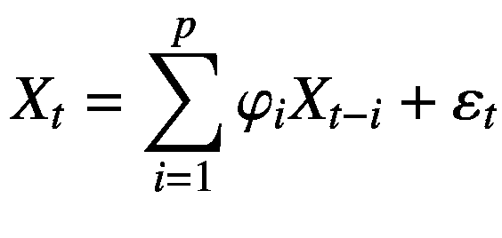

在这个公式中，*`X[t]`* 是当前值，它被计算为每个滞后值 *`X[t-i]`* 乘以该特定滞后的系数 *`φ[i]`* 的总和。最后的误差项 *`ε[t]`* 是你无法预测的随机噪声，但你可以对其进行估计。

## 使用 Yule-Walker 方程估计 AR

你现在已经了解了**`AR 模型的定义`**。也就是说，你已经定义了它的形式。然而，只要没有可以代入公式的值，你就无法使用它。下一步是**拟合模型**：你需要找到每个系数的最优值才能使用它。这也被称为**估计系数**。

一旦你有了参数的值，使用模型就相对容易了：只需代入滞后值即可。但正如任何机器学习理论一样，困难的部分总是在于估计模型。

在公式中，你看到过去的值 (*`X[t-i]`*) 乘以一个系数 (*`φ[i]`*)。这些值的总和将给出当前值 `X[t]`。当开始拟合模型时，你已经知道过去的值和当前值。你唯一不知道的是 φ 值 (*`φ[i]`*)。φ 值是需要通过数学方法找到的，以定义模型。一旦你估计出这些 φ 值，你将能够使用估计出的 φ 值和已知的今天及之前的值来计算明天的 `X[t]` 值。

对于 AR 模型，已经找到了不同的方法来估计系数（φ 值），但 Yule-Walker 方法被普遍认为是最合适的方法。

### 尤尔-沃克方法

**尤尔-沃克方法**包含一组方程：

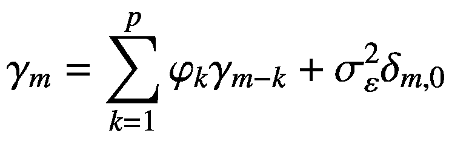

在此公式中，*`γ[m]`* 是 *`X[t]`* 的**自协方差函数**。*`m`* 是从 0 到 p 的滞后数（p 为最大滞后数）。因此共有 p + 1 个方程。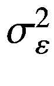 是误差的标准差。

*`δ[m, 0]`* 是**克罗内克δ函数**：若两个值相等（即 m 等于 0），则返回 1；若 m 不等于 0，则返回 0。由此可见，当 m 为 0 时，加号后的所有项等于 ，否则整体等于 0。因此，只有一个方程包含加号后的部分，而其他方程（从 m = 1 到 m = p）则不包含该部分。

求解的关键在于，首先仅将 m = 1 到 m = p 的方程（共 p 个方程）写成**矩阵形式**：

![$$ \left(\begin{array}{c}{\gamma}_1\\ {}{\gamma}_2\\ {}{\gamma}_3\\ {}\dots \\ {}{\gamma}_p\end{array}\right)=\left(\begin{array}{cccc}{\gamma}_0&amp; {\gamma}_{-1}&amp; {\gamma}_{-2}&amp; \dots \\ {}{\gamma}_1&amp; {\gamma}_0&amp; {\gamma}_{-1}&amp; \dots \\ {}{\gamma}_2&amp; {\gamma}_1&amp; {\gamma}_0&amp; \dots \\ {}\dots &amp; \dots &amp; \dots &amp; \dots \\ {}{\gamma}_{p-1}&amp; {\gamma}_{p-2}&amp; {\gamma}_{p-3}&amp; \dots \end{array}\right)\left(\begin{array}{c}{\varphi}_1\\ {}{\varphi}_2\\ {}{\varphi}_3\\ {}\dots \\ {}{\varphi}_p\end{array}\right) $$](img/508548_1_En_3_Chapter_TeX_Equd.png)

这可以用**矩阵符号**表示为：

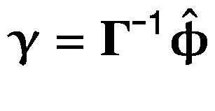

## 普通最小二乘法

要获得 φ 的值，可以使用`普通最小二乘法`（OLS）。普通最小二乘法是一种矩阵计算方法，广泛应用于统计学中来解决此类问题。当您拥有包含历史数据的矩阵和包含历史结果的向量时，该方法可用于估计系数。找到 φ 的最佳估计值的解如下：

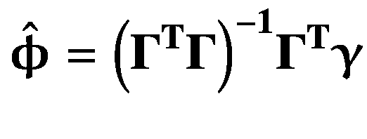

您将在本书的第 11 章及其他章节中再次看到 OLS 方法。

一旦应用了 OLS，您将获得 φ 的估计值，然后可以通过使用估计出的 φ 来求解以下方程，从而计算 σ：

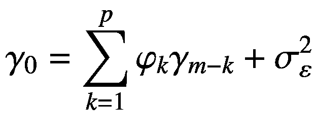

## 在 Python 中拟合 AR 模型

现在，您将使用清单 3-12 在 Python 中开始拟合 AR 模型。在此情况下，拟合模型意味着为 φ 确定最佳可能值。由于您处理的是真实数据而非模拟样本，请注意，在本示例中，您将致力于使 AR 模型达到最佳拟合效果。

```
from statsmodels.regression.linear_model import yule_walker
coefficients, sigma = yule_walker(differenced_data, order = 3)
print('coefficients: ', -coefficients)
print('sigma: ', sigma)
```

清单 3-12 使用阶数 3 估计尤尔-沃克 AR 系数

## 使用系数进行预测

通过此方法获得的`系数`是每个滞后变量的系数。在此例中，阶数为 3，因此需要将这三个最近的值应用于计算新值。您可以根据当前系数，通过计算后续`步数`来进行预测。相关代码如清单 3-13 所示。注意：您想要预测的步数越多，难度就越大——误差很可能会随着步数的增加而增大。

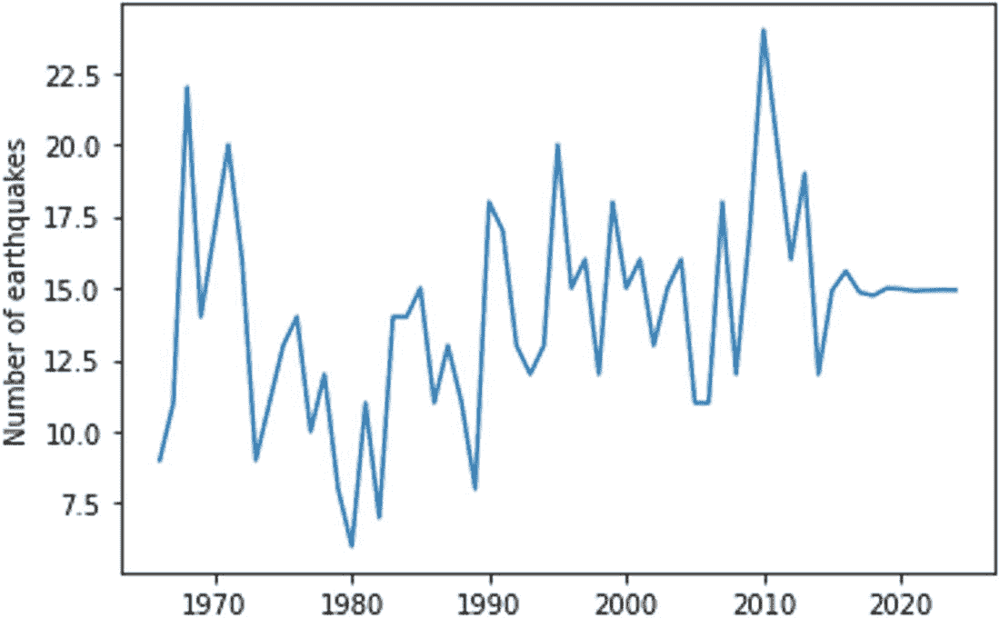

图 3-9 AR(3) 模型未能捕捉到任何信息：预测结果为一条平直线

```
coefficients, sigma = yule_walker(differenced_data, order = 3)
# 创建一个差分值列表
val_list = list(differenced_data)
# 反转列表，使顺序与系数的顺序对应
val_list.reverse()
# 定义要预测的年数
n_steps = 10
# 对于每个要预测的年份
for i in range(n_steps):
    # 计算新值，即滞后值与其对应系数乘积之和
    new_val = 0
    for j in range(len(coefficients)):
        new_val += coefficients[j] * val_list[j]
    # 将新值插入列表开头
    val_list.insert(0, new_val)
# 再次反转以恢复时间顺序
val_list.reverse()
# 将原始第一个值加回列表，并进行累积求和以撤销差分操作
val_list = [earthquakes_per_year.values[0]] + val_list
new_val_list = pd.Series(val_list).cumsum()
# 绘制新得到的列表
plt.plot(range(1966, 2025), new_val_list)
plt.ylabel('Number of earthquakes')
plt.show()
```

清单 3-13 使用 AR 系数进行预测

您将得到图 3-9 中的图形。前几个值为实际数据，最后十步为预测数据。遗憾的是，您可以看到模型并未捕捉到任何有趣的信息：它只是一条平直线！但您的工作尚未完成。这次让我们尝试阶数为 20，看看是否有任何改善。

只需更改第一行中的阶数，您将得到图 3-10 中的图形。它得到的预测结果与图 3-9 中的结果截然不同。当您将阶数增加到 20 时，您的模型似乎学习到了更有趣的内容：它捕捉到了一些变化。

尽管这在视觉上与数据拟合得很好，您仍需验证模型是否正确：它是否预测出了接近真实情况的结果？为此，您将使用第 2 章中的一些策略和指标，并将其应用于此预测。

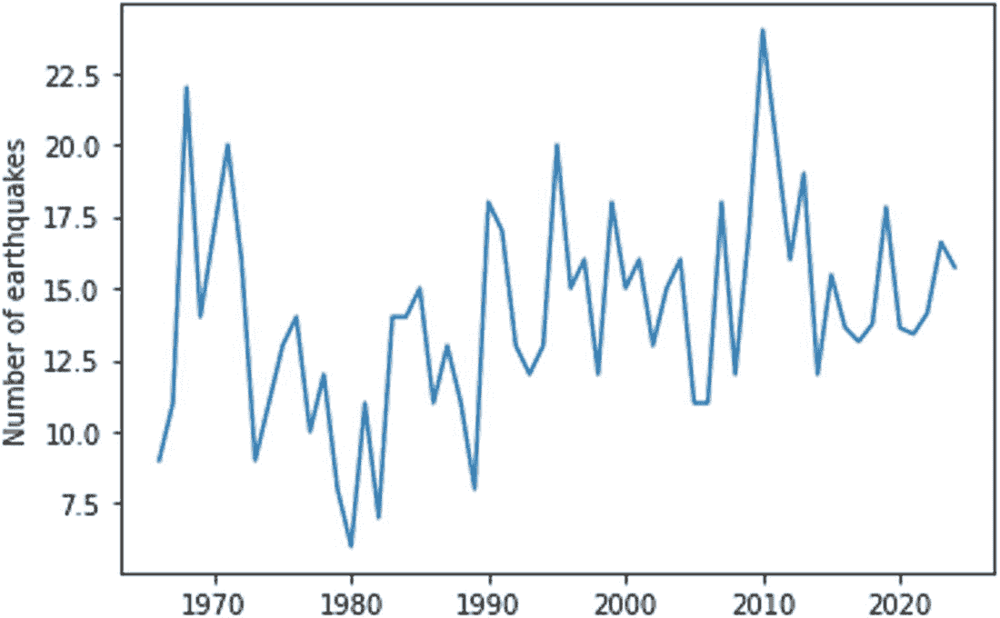

图 3-10 阶数为 20 的预测捕捉到了一些信息，但结果正确吗？

### 训练-测试评估与调优

在本例中，我们将应用训练-测试分割。你将截取数据集的最后 10 年作为测试集。这样，你就可以使用其余数据（训练集）来拟合模型。在训练集上完成拟合后，你可以计算测试集与预测值之间的误差。清单 3-14 中的代码实现了这一过程。

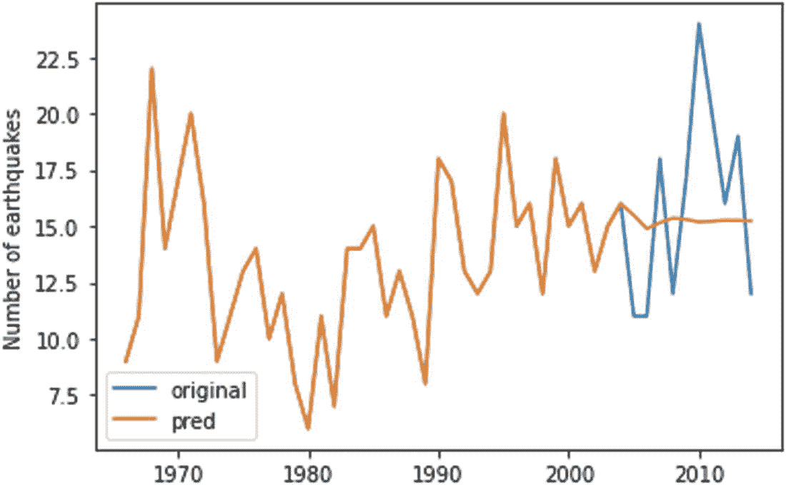

图 3-11 阶数为 3 的 AR 模型的评估图

# 要点总结

- AR 模型通过利用变量过去值与当前值之间的相关性来预测变量的未来。
- 自相关是指时间序列与其自身先前值之间的相关性。
- 偏自相关是条件于更早滞后项的自相关：它避免了相关性的重复计算。
- AR 模型中包含的滞后阶数可以基于理论（ACF 和 PACF 图）确定，也可以通过网格搜索确定。
- 网格搜索包括对模型超参数的每个取值进行模型评估。这是一种用于选择超参数的优化方法。
- 超参数不同于模型系数。模型系数由模型优化，而超参数由建模者选择。然而，模型可以使用像网格搜索这样的优化技术来找到最佳超参数。

## 网格搜索与模型优化

不幸的是，阶数为 3 的模型表现相当糟糕，其 R2 值甚至为负（`-0.04`）。从图（图 3-11）中可以看出，该模型存在**欠拟合**问题：它未能捕捉到任何模式，只是预测了未来的一个平均值。这证实了你之前对阶数 3 的观察。

在前面的例子中，你尝试了阶数 20，想看看是否能得到更好的结果。然而，选择阶数 20 相当随意。为了找到一个表现良好的阶数，你可以应用**网格搜索**。

网格搜索包括对**超参数**的每个取值进行模型评估。超参数是指不由模型估计，而是由建模者选择的参数。模型的阶数就是这样一个例子。其他模型通常有更多的超参数，这使得选择超参数成为一个不容小觑的决策。

针对单个参数的网格搜索编码起来非常简单：你只需为超参数的每个可能取值拟合模型，然后选择表现最好的那个。你可以使用清单 3-15 中的示例。

```
def evaluate(order):
    train = list(differenced_data)[:-10]
    test = list(earthquakes_per_year)[-10:]
    coefficients, sigma = yule_walker(train, order = order)
    # Make a list of differenced values
    val_list = list(train)
    # Reverse the list to corresponds with the order of coefs
    val_list.reverse()
    # Define the number of years to predict
    n_steps = 10
    # For each year to predict
    for i in range(n_steps):
        # Compute the new value
        new_val = 0
        for j in range(len(coefficients)):
            new_val += coefficients[j] * val_list[j]
        # Insert the new value at the beginning of the list
        val_list.insert(0, new_val)
    # Redo the reverse to have the order of time
    val_list.reverse()
    # Undo the differencing with a cumsum
    val_list = [earthquakes_per_year[0]] + val_list
    new_val_list = pd.Series(val_list).cumsum()
    # Plot the newly obtained list
    validation = pd.DataFrame({
        'original': earthquakes_per_year.reset_index(drop=True),
        'pred': new_val_list })
    return r2_score(validation.iloc[-10:, 0], validation.iloc[-10:, 1])

# For each order between 1 and 30, fit and evaluate the model
orders = []
r2scores = []
for order in range(1, 31):
    orders.append(order)
    r2scores.append(evaluate(order))

# Create a results data frame
results = pd.DataFrame({'orders': orders,
                         'scores': r2scores})

# Show the order with best R2 score
results[results['scores'] == results.max()['scores']]
```
**Listing 3-15**  Apply a grid search to find the order that gives the best R2 score on the test data

这给出了阶数 19 时最高的 R2 分数，其 R2 值为 **0.13**。这意味着 `AR(19)` 模型解释了测试数据中约 13%的变异。

你可以复用清单 3-13 中的代码，使用阶数 19 重新生成带有预测的图表。只需在拟合 Yule-Walker 系数的那一行更改阶数即可。图表如图 3-12 所示。

这段代码还会为阶数 19 的模型绘制一张图，并观察到，尽管不完美，但该模型确实比阶数 3 的模型拟合得稍好一些。

AR 模型是单变量时间序列的基本构建模块之一。它仅在非常罕见和特定的情况下才能作为**独立**模型使用。在这个预测地震的真实例子中，0.13 的 R2 分数并不理想：通过引入单变量时间序列的其他构建模块，你肯定可以做得更好。你将在接下来的章节中了解这些构建模块。

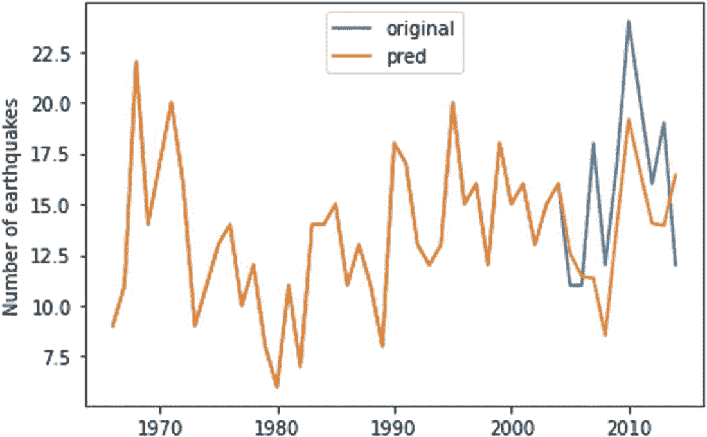
**图 3-12** 阶数为 19 的 AR 模型在测试集上的预测

```
from sklearn.metrics import r2_score
train = list(differenced_data)[:-10]
test = list(earthquakes_per_year)[-10:]
coefficients, sigma = yule_walker(train, order = 3)
# Make a list of differenced values
val_list = list(train)
# Reverse the list so that the order corresponds with the order of the coefficients
val_list.reverse()
# Define the number of years to predict
n_steps = 10
# For each year to predict
for i in range(n_steps):
    # Compute the new value as the sum of lagged values multiplied by their corresponding coefficient
    new_val = 0
    for j in range(len(coefficients)):
        new_val += coefficients[j] * val_list[j]
    # Insert the new value at the beginning of the list
    val_list.insert(0, new_val)
# Redo the reverso to have the order of time
val_list.reverse()
# Add the original first value back into the list and do a cumulative sum to undo the differencing
val_list = [earthquakes_per_year[0]] + val_list
new_val_list = pd.Series(val_list).cumsum()
# Plot the newly obtained list
validation = pd.DataFrame({
    'original': earthquakes_per_year.reset_index(drop=True),
    'pred': new_val_list })
print('Test R2:', r2_score(validation.iloc[-10:, 0], validation.iloc[-10:, 1]))
# Plot the newly obtained list
plt.plot(range(1966, 2015), validation)
plt.legend(validation.columns)
plt.ylabel('Number of earthquakes')
plt.show()
```
**Listing 3-14**  Fit the model on a train set and evaluate it on a test set

*   Yule-Walker 方程用于拟合 AR 模型。拟合模型意味着找到模型的系数。