# 4. MA 模型

MA 模型，即**移动平均模型**，是单变量时间序列中第二个重要的构建模块（见表 4-1）。与 AR 模型一样，它通常作为更复杂时间序列的一部分来使用，但也可以单独使用。

表 4-1
单变量时间序列的构建模块

| 名称 | 解释 | 章节 |
| --- | --- | --- |
| AR | 自回归 | 3 |
| MA | 移动平均 | 4 |
| ARMA | AR 与 MA 模型的组合 | 5 |
| ARIMA | 在 ARMA 模型中加入差分（I） | 6 |
| SARIMA | 在 ARIMA 模型中加入季节性（S） | 7 |
| SARIMAX | 在 SARIMA 模型中加入外部变量（X）*（注意，加入外部变量后，模型不再是单变量模型）* | 8 |

在本章中，你将看到 MA 模型应用于一个预测示例。请注意，与上一章一样，该模型被优化为**一个独立的模型**。在实际应用单变量时间序列时，你通常会直接使用 SARIMA 或 SARIMAX 模型：毕竟，MA 模型只是该模型的一个组成部分。然而，单独观察 MA 模型的应用仍有其价值，因为分别理解 SARIMAX 模型的每个构建模块非常重要。

## 模型定义

MA 模型背后的数学模型在形式上与 AR 模型非常相似，但在直观理解上却大相径庭。AR 模型通过观察目标变量的滞后值来预测未来，而 MA 模型则观察**过去预测的模型误差**。模型定义如下：

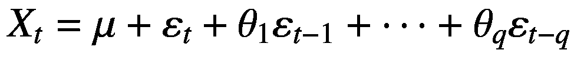

在这个方程中，**Xt** 是当前值（非滞后值），*μ*（mu）是序列的平均值，*ε*（epsilon）是模型的误差，*θ*（theta）是与每个过去值相乘的系数。

如你所见，该模型只包含过去的误差，而不包含过去的值。这意味着，要预测未来，你不需要看过去发生了什么，而只需要看过去你错得有多离谱！

这看起来可能有些奇怪，但其中自有逻辑。想象一个场景，你试图根据过去进行预测。在某些时刻，过程与你预期的结果大相径庭，而你却不明白原因。假设在某个时间点，股票价格出现了巨大且意外的暂时性下跌。

AR 模型和 MA 模型都能随着时间的推移考虑到这种下跌，但方式不同。AR 模型会将其建模为一个过去的低值。而 MA 模型则会将其建模为一个巨大的误差，这个误差可以被解释为一个巨大的冲击。在这种情况下，将误差视为冲击本身而非数值是合理的，因为正是这种冲击的意外性，将成为未来几天股票价格的驱动因素——股票交易者会对这种意外冲击做出反应。

这样看来，*过去的模型误差会影响未来，过去的误差可以帮助你进行预测*。这就是 MA 模型背后的思想。

注意

“移动平均”这个术语也用于指代对最近的值取平均。在时间序列分析中，这通常用于平滑时间序列。这与 MA 模型无关。

## 拟合 MA 模型

拟合 MA 模型比拟合 AR 模型更复杂。从宏观层面看，MA 模型似乎与 AR 模型相对可比：MA 依赖于过去的误差，而 AR 模型依赖于过去的值。

然而，这里有一个巨大的区别。在拟合 MA 模型时，你还没有得到模型过去的误差。由于你尚未定义模型，你无法估计模型的误差。而你需要模型的误差来估计系数。

这里存在某种循环依赖关系，这使得无法找到一种直接的方法来一次性拟合模型。不过，可以使用不同的技术来拟合 MA 模型，其中最常用的是非线性最小二乘法。它假设时间 0 处的误差可以忽略不计。然后可以使用以下公式估计 theta 值：

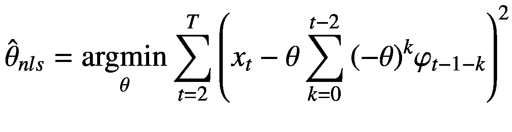

由于该公式使用了**argmin**，因此这是一个对 theta 最优值的数值搜索过程。这意味着拟合模型只需通过迭代搜索不同的 theta 值，并确定哪些 theta 值能使公式其余部分的值最小，即以下公式的值最小：

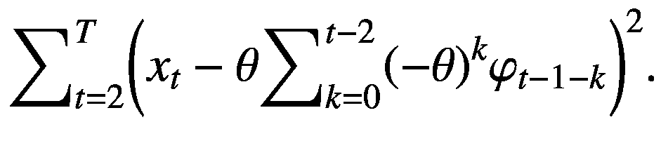

图 4-1 中展示了这样一个最小化的示例。该图显示了一条依赖于参数的误差曲线。目标是找到能让你获得最低模型误差的参数。这并非易事，因为你通常对这些参数一无所知。

我不会深入探讨可用于此最小化任务的优化方法，因为这超出了本书的范围。但你应该知道，有许多算法可以执行此类优化任务。

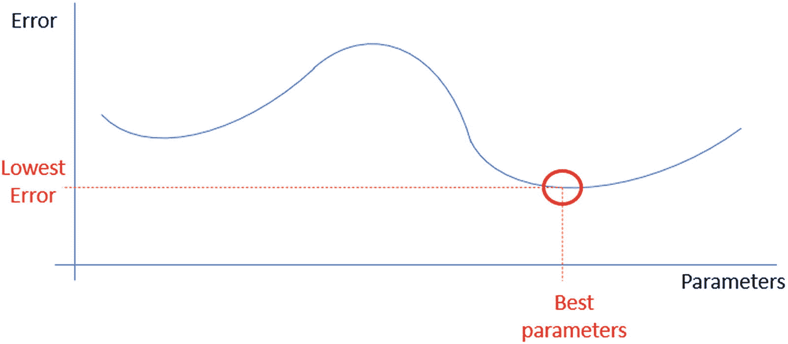

图 4-1
使误差最小化的参数

## 平稳性

需要注意的是，MA 模型绝对需要平稳性。AR 模型可以适应非平稳的情况，而 MA 模型则不能。增广迪基-富勒检验和差分这些概念已在第 3 章中介绍过，此处同样适用。

## 在 AR 模型和 MA 模型之间进行选择

与 AR 模型一样，MA 模型的滞后阶数可以通过观察 PACF 图（偏自相关函数）来确定。但 PACF 曲线的用途不仅仅在于选择最佳的理论滞后阶数。

PACF 图还可以帮助你选择正确的模型类型。例如，你现在已经了解了 AR 模型和 MA 模型，但可能不知道应该使用哪一个。自相关的类型可以成为决策的一个因素。

以下是用于判断模型类型的指标：

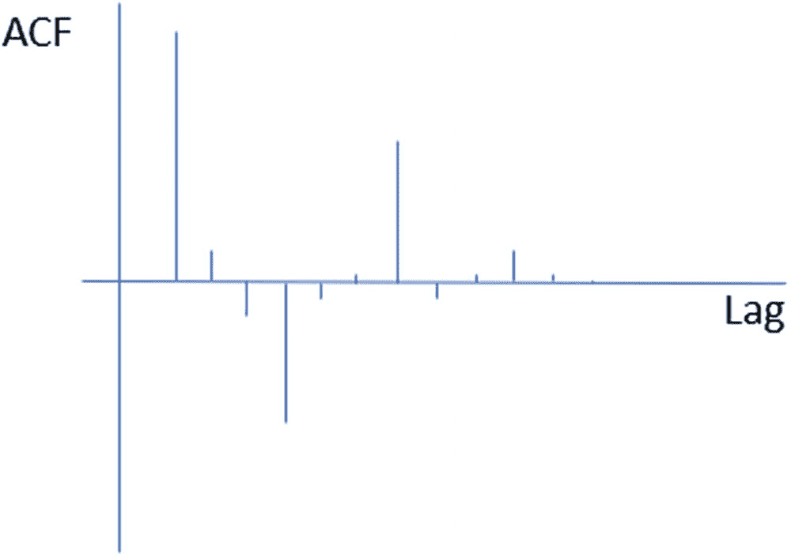

图 4-3
典型的 MA 模型 ACF

*   自回归（典型的 PACF 图见图 4-2）：

    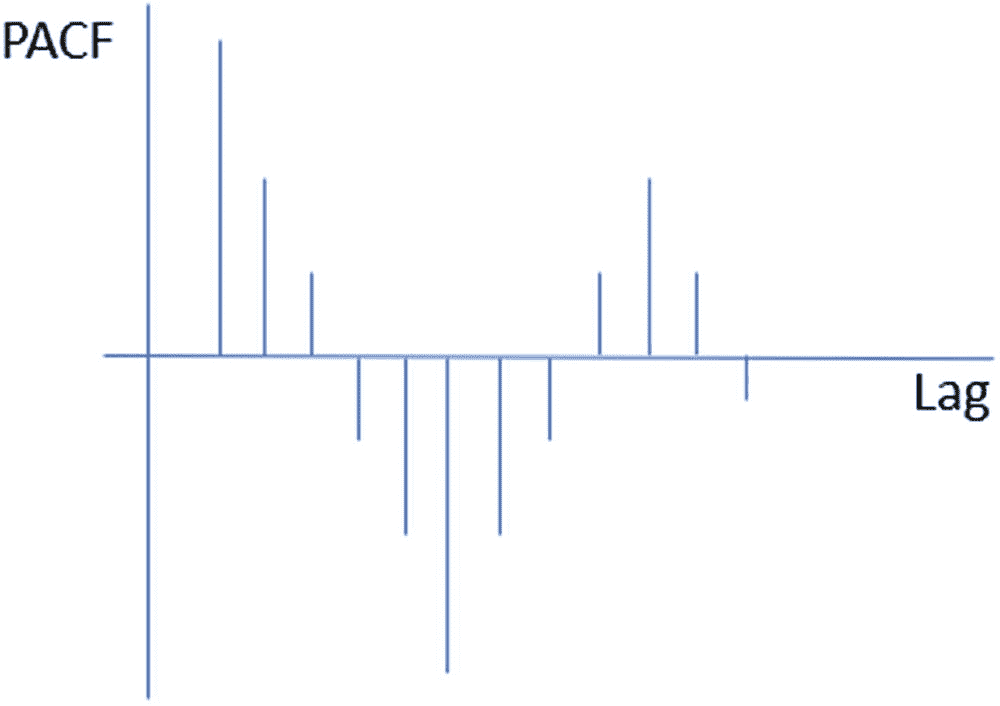

    图 4-2
    典型的 AR 模型 PACF

    *   自相关衰减至 0。
    *   自相关呈指数衰减。
    *   自相关在正负之间交替并衰减至 0。

*   移动平均（典型的 ACF 图见图 4-3）：
    *   许多值（几乎）为零，并伴有少数尖峰。


## MA 模型的应用

现在让我们通过一个例子来应用它。本例中使用的数据是微软股票的收盘价。你可以通过雅虎财经 Python 包获取这些数据，如代码清单 4-1 所示。

注意

雅虎财经包是一个 Python 包，允许从雅虎财经网站下载股票数据。

```
from pandas_datareader import data as pdr
import yfinance
data = pdr.get_data_yahoo('MSFT', start='2019-01-01', end='2019-12-31')
data = data['Close']
代码清单 4-1
使用雅虎财经包导入股票价格数据
```

如你所知，初步了解数据非常重要，因此我们先绘制收盘价的图表。这在代码清单 4-2 中完成。

```
import matplotlib.pyplot as plt
ax = data.plot()
ax.set_ylabel("Stock Price")
plt.show()
代码清单 4-2
绘制股票价格数据
```

这将输出图 4-4 中的图表。

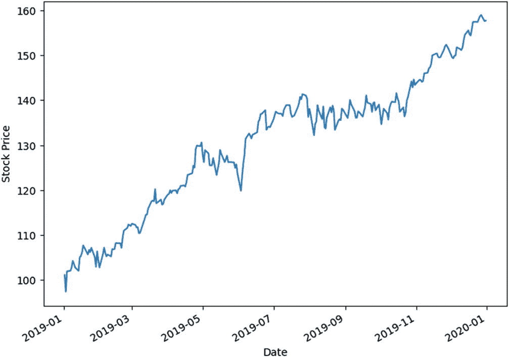

图 4-4

原始数据图

在这张图中，你可以清晰地看到一个上升趋势。这里甚至不需要应用增广迪基-富勒检验就能看出这些数据是**非平稳的**。由于 MA 模型无法在非平稳状态下运行，我们应用标准的解决方案：差分。这在代码清单 4-3 中完成，并将显示图 4-5 中的图表。

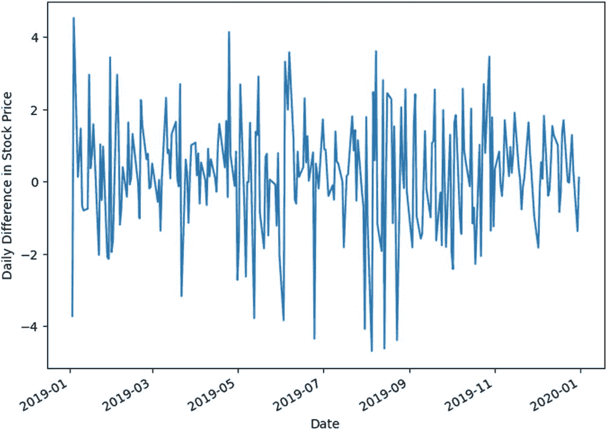

图 4-5

差分后数据图

```
# 需要进行差分
data = data.diff().dropna()
ax = data.plot()
ax.set_ylabel("Daily Difference in Stock Price")
plt.show()
代码清单 4-3
计算差分数据并绘制图表
```

这个差分后的数据看起来是平稳的。为了保持一致性，代码清单 4-4 展示了如何对这些差分数据应用增广迪基-富勒检验，尽管通过目视检查，这一点毫无疑问：数据明显围绕着一个固定均值 0 波动。

```
from statsmodels.tsa.stattools import adfuller
result = adfuller(data)
pvalue = result[1]
if pvalue < 0.05:
print('stationary')
else:
print('not stationary')
代码清单 4-4
对差分数据应用 ADF 检验
```

这证实了差分序列的平稳性。让我们查看自相关函数和偏自相关函数，看看是否存在明显的滞后阶数选择，使用代码清单 4-5 来获取图 4-6 中的 ACF 和图 4-7 中的 PACF。

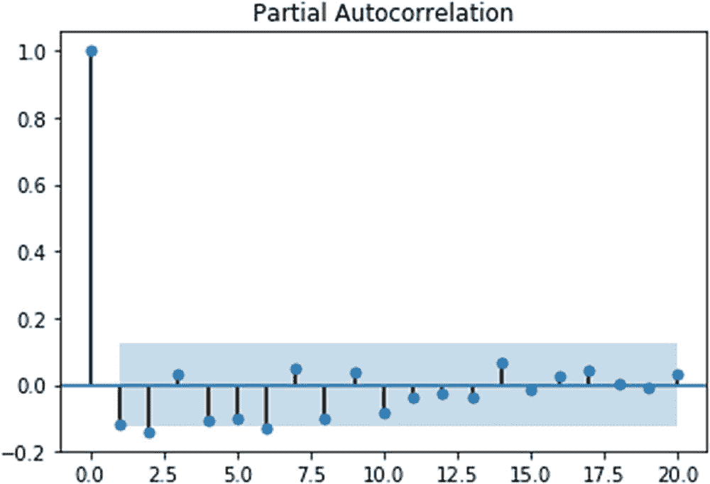

图 4-7

偏自相关函数

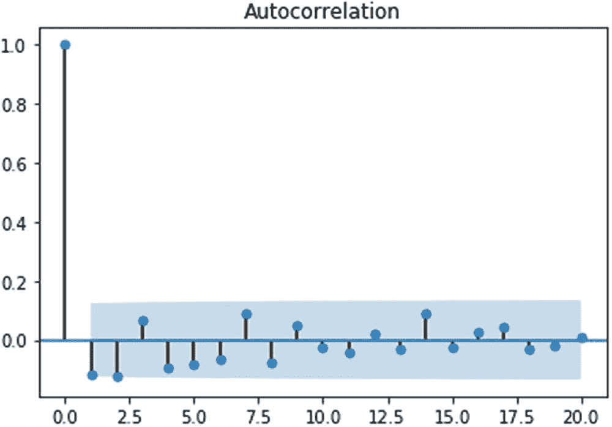

图 4-6

自相关函数

```
from statsmodels.graphics.tsaplots import plot_acf, plot_pacf
plot_acf(data, lags=20)
plot_pacf(data, lags=20)
plt.show()
代码清单 4-5
绘制自相关函数和偏自相关函数
```

不幸的是，自相关函数和偏自相关函数中都没有非常清晰的模式来确认阶数的选择。你可以观察到偏自相关函数有一些衰减，这是使用时间序列方法的一个积极信号。但在滞后阶数的选择上并不明显。让我们拟合阶数为 1 的 MA 模型，看看效果如何。

要在 Python 中拟合 MA 模型，你需要使用 statsmodels 中的 ARIMA 函数。ARIMA 是一个你将在下一章看到的模型。它包含多个单变量时间序列的构建模块，包括用于 AR 模型的 AR 和用于 MA 模型的 MA。你可以分别为每个“子”模型指定阶数，因此通过将所有除 MA 之外的参数设置为 0，就可以得到 MA 模型。这可以使用代码清单 4-6 来完成。

```
from sklearn.metrics import r2_score
from statsmodels.tsa.arima.model import ARIMA
# 预测第一个 MA(1) 模型
mod = ARIMA(data.diff().dropna(), order=(0,0,1))
res = mod.fit()
orig_data = data.diff().dropna()
pred = res.predict()
plt.plot(orig_data)
plt.plot(pred)
plt.show()
print(r2_score(orig_data, pred))
代码清单 4-6
拟合 MA 模型并绘制预测结果
```

这将给出拟合图（图 4-8）以及整个周期上的 R2 分数。

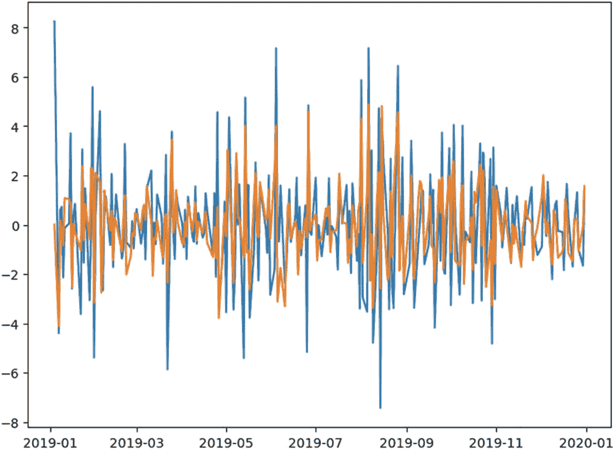

图 4-8

训练数据集上的实际值与预测值对比

这张图看起来还不错：橙色曲线（预测值）跟随蓝色曲线（实际值）的总体趋势。你可以观察到预测曲线的预测值不那么极端（高点更低，低点更高）。R2 分数为 **0.51**。

作为解释，你可以观察到这个模型存在欠拟合：它捕捉到了基本情况，但没有捕捉到足够的趋势来成为一个非常好的模型。在这个阶段，你可以通过创建训练集和测试集来检查其样本外表现。这可以使用代码清单 4-7 如下完成。

```
train = data.diff().dropna()[0:240]
test = data.diff().dropna()[240:250]
# 预测第一个 MA(1) 模型
mod = ARIMA(train, order=(0,0,1))
res = mod.fit()
orig_data = data.diff().dropna()
pred = res.predict()
fcst = res.forecast(steps = len(test))
print(r2_score(train, pred))
print(r2_score(test, fcst))
代码清单 4-7
在训练数据上拟合 MA 模型并评估训练集和测试集上的 R2 分数
```

这将给出训练集 R2 为 **0.51**，测试集 R2 为 **0.13**。训练数据上的表现不佳，测试数据上的表现更差（测试数据中只有 13% 的变异可以由 MA 模型解释）。测试数据实际值与预测值的可视化对比应该能证实这种较差的拟合（使用代码清单 4-8 得到图 4-9）。

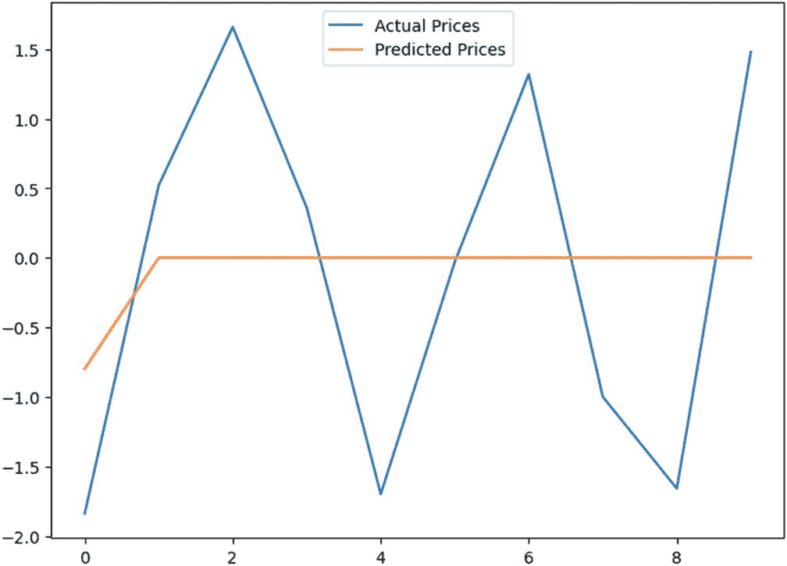

图 4-9

MA(1) 模型的样本外表现

```
plt.plot(list(test))
plt.plot(list(fcst))
plt.legend(['Actual Prices', 'Predicted Prices'])
plt.show()
代码清单 4-8
绘制 MA(1) 模型（阶数为 1 的 MA 模型）的样本外预测结果
```

但是，查看这张图时，你会发现测试集上的预测有些奇怪。MA(1) 预测除了第一步之外，其余所有值都预测了平均值。

这背后有数学原因：MA(q) 模型使用过去 q 步的模型误差来预测未来。当预测未来一步时，没有问题：模型拥有预测之前每个时间步的实际值和拟合值。但是，当预测第二个时间步时，模型不知道时间 t + 1 的实际值，而这是预测 t + 2 所需的输入。


## 带模型重训练的多步预测

在上一章中，我们进行了向前十步的预测。然而，我们尚未关注预测中的一个关键区别，即单步预测与多步预测之间的差异。

单步预测是基础。预测下一步相对容易。而使用时间序列进行多步预测并非易事，因为每向前一步，误差都会累积。

在许多情况下，最精确的解决方案是每一步都重新训练模型。事实上，只要你获得一个新的数据点就立即更新模型，这是可行的。这意味着你将进行重复的单步预测。在某些情况下，这种方法有效，而在其他情况下，则需要对更远的未来进行预测。

在模型评估中，考虑预测的时长非常重要。如果你进行多步预测，就应该在多步训练-测试集划分上进行评估。如果你进行单步预测，就应该在单步训练-测试集划分上进行评估。

如果你进行单步预测，会发现测试数据集不足：你无法仅根据一个数据点的测试数据来计算预测误差。一个可行的解决方案是迭代地拟合单步模型，并基于多个单步预测构建一个多步预测。这在代码清单 4-9 中实现。

```
import pandas as pd
train = data.diff().dropna()[0:240]
test = data.diff().dropna()[240:250]
# 从 statsmodels 导入 ARMA 模块
from statsmodels.tsa.arima.model import ARIMA
fcst = []
for step in range(len(test)):
# 预测第一个 MA(1) 模型
mod = ARIMA(train.reset_index(drop=True), order=(0,0,1))
res = mod.fit()
orig_data = data.diff().dropna()
pred = res.predict()
fcst += list(res.forecast(steps = 1))
train = train.append(pd.Series(test[step]))
print(r2_score(list(test), fcst))
plt.plot(list(test))
plt.plot(fcst)
plt.legend(['实际价格', '预测价格'])
plt.show()
代码清单 4-9
评估 MA(1) 模型在十次重新拟合的单步预测中的误差
```

使用此方法获得的 R2 分数是 **0.48**：虽然不完美，但已开始显现出一定的实用性。预测值与实际值的对比图如图 4-10 所示。

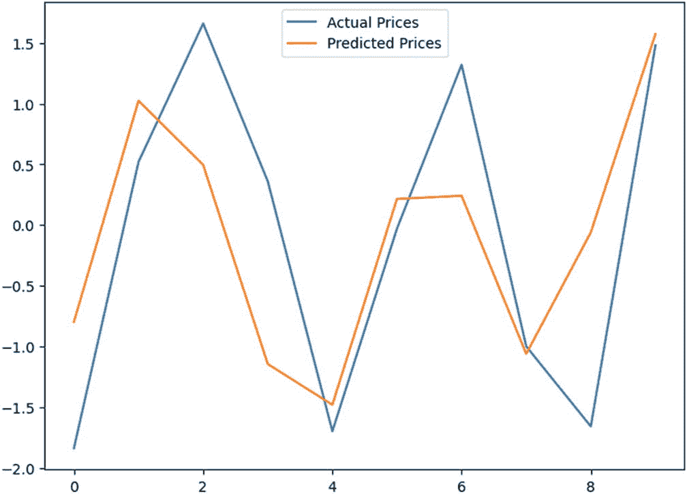

图 4-10

多次单步预测产生了相对可接受的预测结果

当然，通过这种方式获得的误差估计仅适用于下一个时间步的预测，对于更长的周期则无效。如何在实践中应用这一点，取决于你的具体用例。

对于这个特定示例，你可以认为，如果你能完美预测第二天的股票市场，这已经是相当了不起的成就了：在这种情况下，我们保留单步误差。

## 网格搜索寻找最佳 MA 阶数

作为下一步，让我们尝试进行网格搜索，以找到在测试集上获得最低误差的 MA 模型阶数。回想一下上一章的网格搜索：其基本版本就是简单地遍历阶数的每个可能值，并在测试数据上评估模型。

还有其他更优的自动化超参数优化方法：你将在接下来的章节中看到它们，所以请确保你现在理解了基本版本背后的思想。现在，让我们使用代码清单 4-10 来找出是否存在某个特定的 MA 阶数能为我们带来更好的预测性能。

```
def evaluate2(order):
train = data.diff().dropna()[0:240]
test = data.diff().dropna()[240:250]
fcst = []
for step in range(len(test)):
# 预测第一个 MA(1) 模型
mod = ARIMA(train.reset_index(drop=True), order=(0,0,order))
res = mod.fit()
orig_data = data.diff().dropna()
pred = res.predict()
fcst += list(res.forecast(steps = 1))
train = train.append(pd.Series(test[step]))
return r2_score(list(test), fcst)
scores = []
for i in range(1, 21):
scores.append((i, evaluate2(i)))
# 观察到最佳阶数为 4，R2 为 0.566
scores = pd.DataFrame(scores)
print(scores[scores[1] == scores.max()[1]])
代码清单 4-10
网格搜索以获取优化预测 R2 的 MA 阶数
```

这将给出最佳阶数为 4，样本外 R2 为 **0.57**。你可以使用代码清单 4-11 中的代码查看由此产生的最终预测。你将得到的图表如图 4-11 所示。

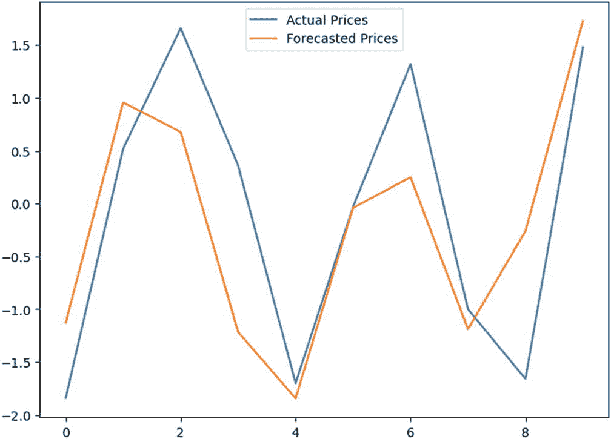

图 4-11

最终结果：MA(4) 预测

```
train = data.diff().dropna()[0:240]
test = data.diff().dropna()[240:250]
fcst = []
for step in range(len(test)):
# 预测第一个 MA(1) 模型
mod = ARIMA(train.reset_index(drop=True), order=(0,0,4))
res = mod.fit()
orig_data = data.diff().dropna()
pred = res.predict()
fcst += list(res.forecast(steps = 1))
train = train.append(pd.Series(test[step]))
print(r2_score(list(test), fcst))
plt.plot(list(test))
plt.plot(fcst)
plt.legend(['实际价格', '预测价格'])
plt.show()
代码清单 4-11
获取最终预测
```

## 要点总结

*   移动平均模型基于过去的冲击来预测未来。
    *   这些冲击以模型误差来衡量。

    *   其背后的思想是，意外的冲击实际上可能对未来产生重大影响。

    *   MA 模型系数没有一次性计算方法，因此与 AR 模型相比，估计该模型所需的时间稍长。

    *   MA 模型是 SARIMA 模型的第二个构建块。AR 和 MA 模型共同构成了 ARMA 模型，这是下一章的主题。

*   多步预测是对未来多个时间步的预测。这对于 MA 模型来说很困难，尤其是当阶数较低时。有时，一个解决方案是进行多次单步预测，并在每次收到新数据时重新训练模型。

*   自相关函数和偏自相关函数可以帮助你判断正在处理的是 AR 预测还是 MA 预测。AR 预测的自相关函数呈指数衰减至 0，并在正负值之间交替。MA 自相关函数的特征是许多值接近零，并伴有少数几个尖峰。

