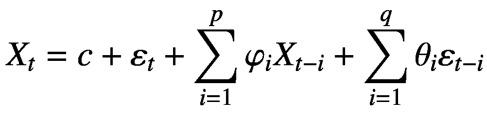
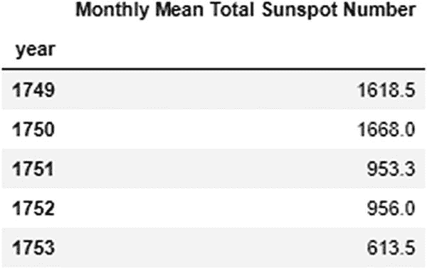
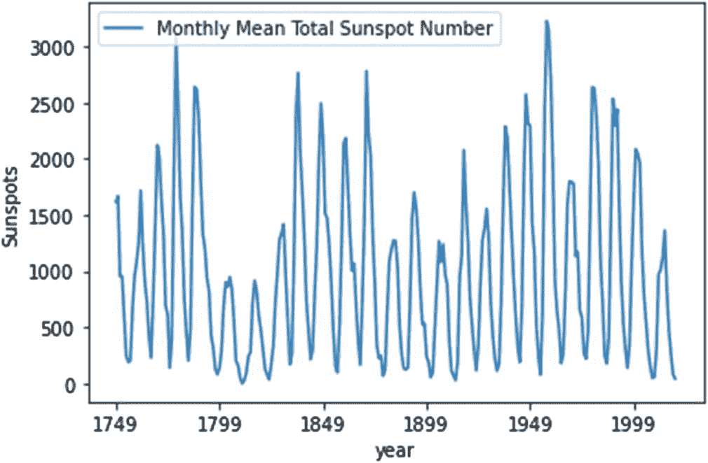
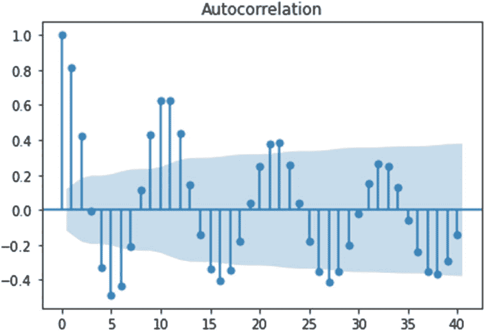
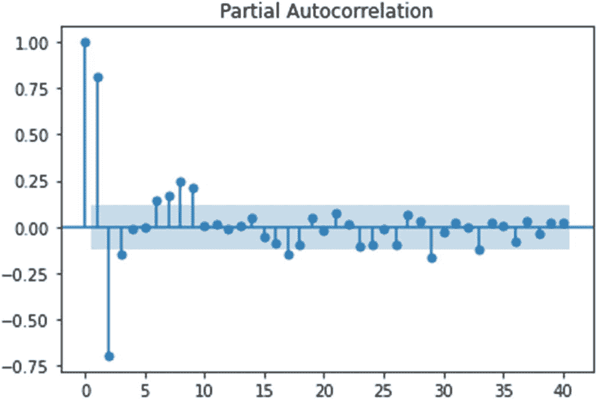
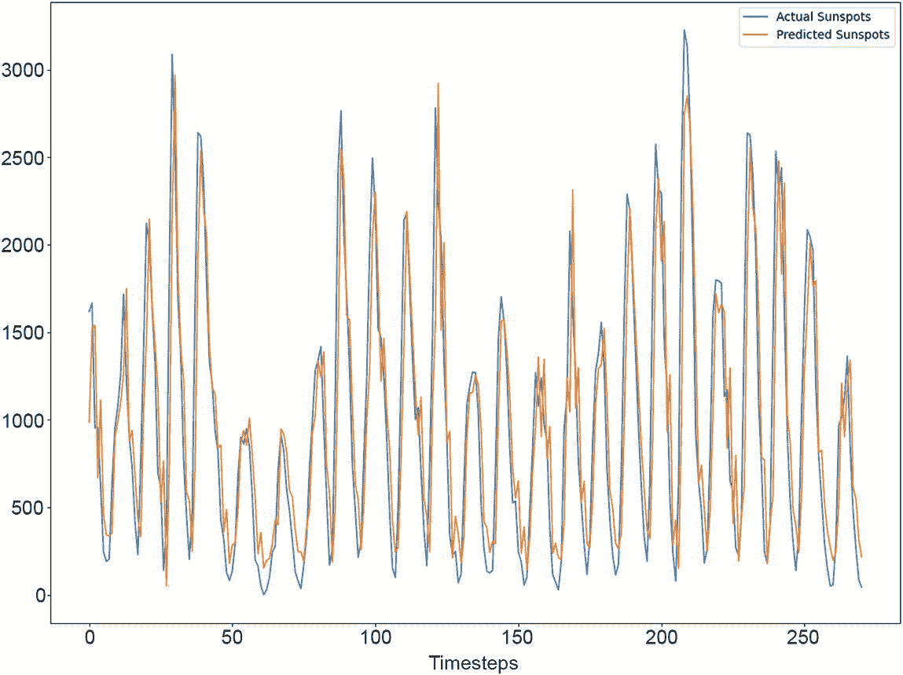
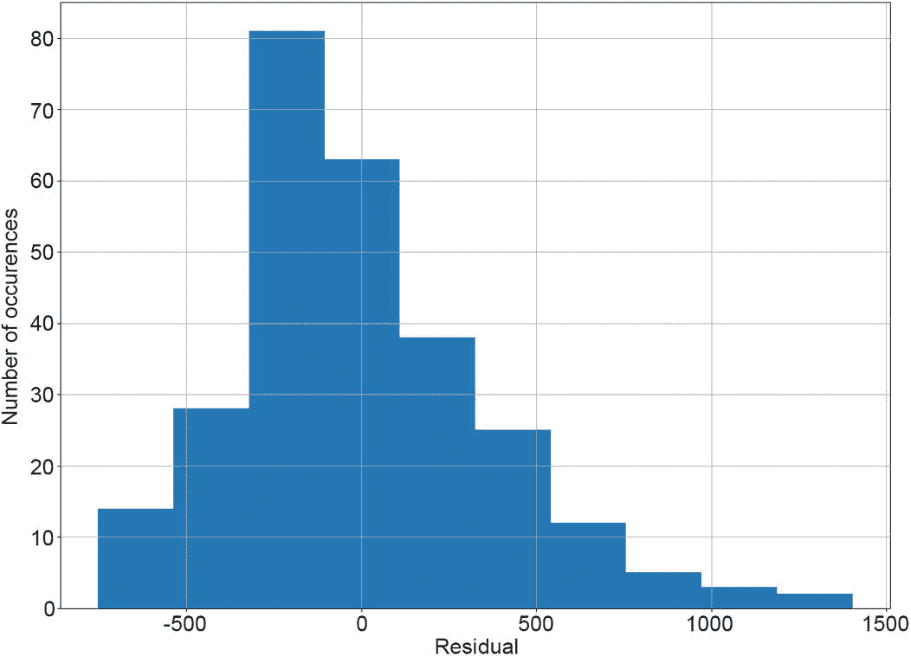
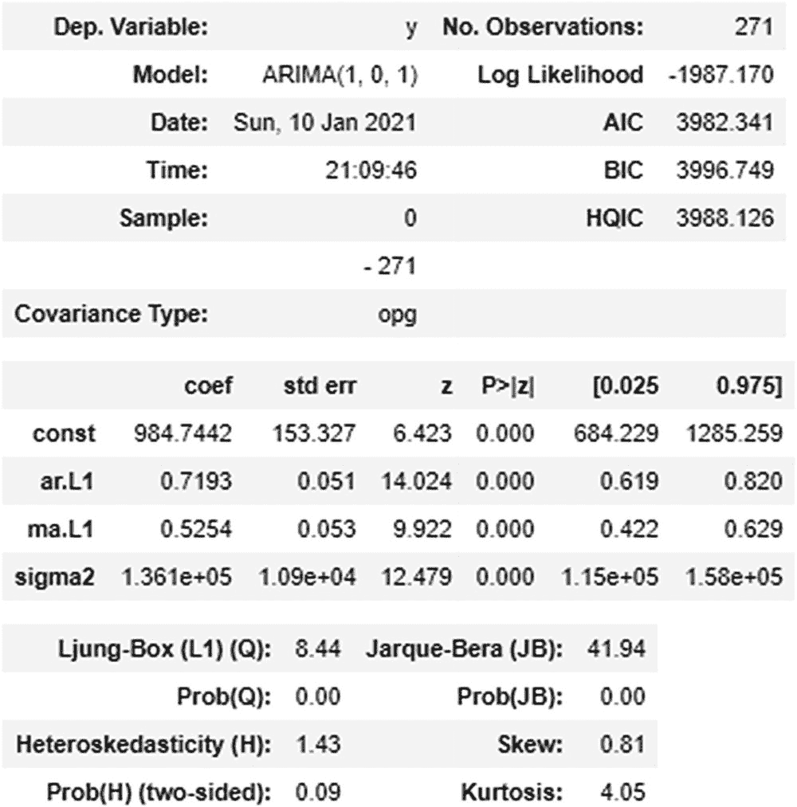
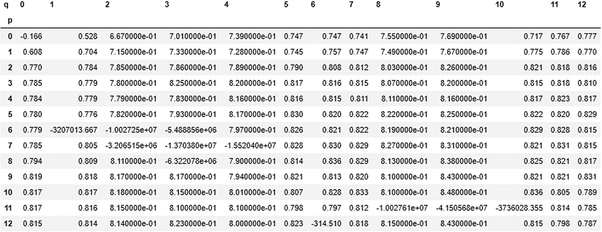
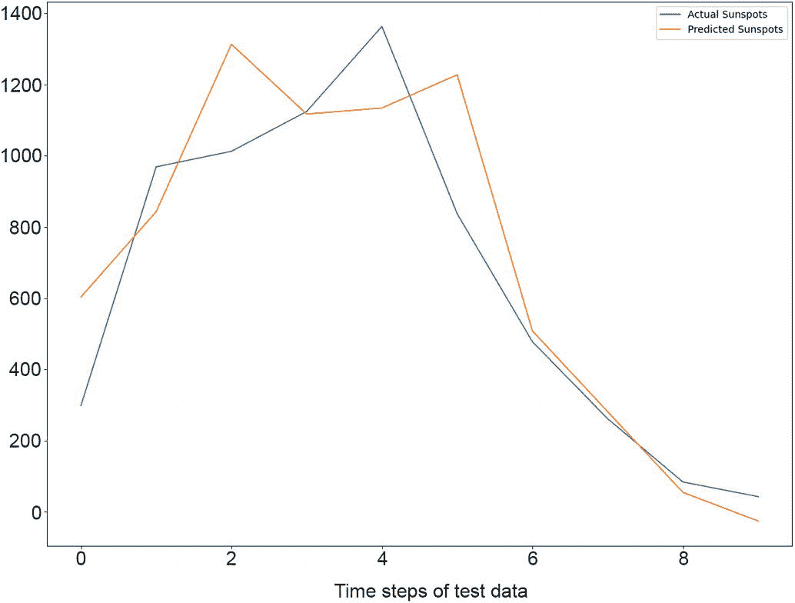

# 5. ARMA 模型

在本章中，你将了解 ARMA 模型。它是你在前两章中看到的 AR 模型和 MA 模型的组合。由于本章的理论对你来说应该已经相对熟悉，本章还将介绍一些额外的模型质量指标，这些指标适用于 ARMA 模型，但也可以分别用于 AR 和 MA 模型。

## ARMA 模型背后的思想

ARMA 模型是 AR 模型和 MA 模型的简单组合。将 AR 和 MA 模型合并为一个模型背后的思想是，组合后的模型比单一模型性能更优。一个变量随时间的发展可以同时遵循多个过程。

让我们分别简要回顾一下 AR 和 MA 模型。AR 模型试图通过**将过去的值乘以一个系数**来预测未来。这个 AR 过程基于自相关的存在：目标变量的当前值与过去的值相关。MA 模型不使用目标变量的过去值来预测其未来，而是使用**过去预测的误差**作为预测值的驱动力。

ARMA 模型只不过是一个允许这两个过程同时存在的模型：

*   变量未来的部分由过去的值解释（AR 效应）。
*   变量的另一部分由过去的误差解释（MA 效应）。

两者合并到一个模型中使得使用起来更加简单：你可以想象，使用两个独立的模型会非常繁琐。

## ARMA 模型的数学定义

ARMA 模型由以下方程定义：



在这个方程中，你可以清晰地看到 AR 部分和 MA 部分。AR 部分使用系数 `φ_i`（phi）乘以过去的观测值 `X_{t-i}`，对应**滞后阶数**定义为 `p`，也称为 **AR 阶数**。MA 部分使用系数 `θ_i`（theta）乘以过去的误差 `ε_{t-i}`（epsilon），对应**滞后阶数 q**，即 **MA 阶数**。

这些 `p` 和 `q` 与你之前遇到的超参数相同。对于模型表示法，你使用 *AR(p) 表示阶数为 p 的 AR 模型*，*MA(q) 表示阶数为 q 的 MA 模型*。在 ARMA 模型中，`p` 和 `q` 保持不变。这给出了以下表示法：**ARMA(p, q)**。

这里你应该注意，`p` 和 `q` 之间没有依赖关系，就像方程中 AR 和 MA 的定义之间没有依赖关系一样。这意味着 `ARMA(p, q)` 模型可以取任意阶数的 `p` 和 `q`。特殊情况是当 `p = 0` 时，表示你有一个 MA 模型；当 `q = 0` 时，表示你有一个 AR 模型。

由于 `p` 和 `q` 是超参数，它们是由建模者选择的参数，而 `c`、`φ` 和 `θ` 是模型的系数，因此将由模型估计。

## 示例：使用 ARMA 预测太阳黑子

现在，让我们开始一个示例，看看 AR 和 MA 模型的组合能力是否能提供良好的预测。你将使用太阳黑子数据集，这是一个相对著名的数据集，包含对太阳黑子数量非常长期的历史观测数据。你可以使用代码清单 5-1 将数据导入 Python，并在图 5-1 中查看数据框的前几行。

```python
import pandas as pd
data = pd.read_csv('Ch05_Sunspots_database.csv', usecols = [1, 2])
```

**代码清单 5-1 将太阳黑子数据导入 Python**



**图 5-1 太阳黑子数据摘录**

太阳黑子数据集以其在 11 年周期内具有特定的季节性效应模式而闻名。该数据集并不十分详细：它只包含每月的计数数据。由于有大量数据可供使用，让我们设定目标，使用年度数据进行预测。为此，需要将数据聚合为年度数据。你可以使用代码清单 5-2 来完成此操作。

```python
data['year'] = data.Date.apply(lambda x: x[:4])
data = data[['Monthly Mean Total Sunspot Number', 'year']].groupby('year').sum()
data.head()
```

**代码清单 5-2 将太阳黑子数据聚合为年度数据**

让我们也绘制一个随时间变化的图，看看你正在处理的是哪种类型的波动。你可以使用代码清单 5-3 来完成此操作。使用此代码，你应该得到图 5-2 中的图形。

```python
import matplotlib.pyplot as plt
ax = data.plot()
ax.set_ylabel('Sunspots')
plt.show()
```

**代码清单 5-3 绘制年度太阳黑子数据**



**图 5-2 太阳黑子数据图**

观察此图，模式已经非常清晰：在规则的时间间隔内出现高峰。让我们看看如何使用 ARMA 模型来捕捉这种模式并对未来进行预测。第一步，一如既往，是验证数据是否平稳。

请记住，平稳性意味着数据中没有长期趋势：平均值随时间保持恒定。查看数据时，没有明显的长期趋势，但你可以使用 ADF 检验（增广迪基-富勒检验）来确认这一点。代码清单 5-4 展示了如何执行此操作。

```python
from statsmodels.tsa.stattools import adfuller
result = adfuller(data['Monthly Mean Total Sunspot Number'])
print(result)
pvalue = result[1]
if pvalue < 0.05:
    print('stationary')
else:
    print('not stationary')
```

**代码清单 5-4 对太阳黑子年度总数应用 ADF 检验**

应用此检验得到的结果出乎意料：ADF 检验告诉你数据**不平稳**。在这种情况下，直观的判断是假设平稳，而 ADF 检验却告诉你并非如此。必须做出选择。

现在，让我们尽可能保持简单，继续使用原始数据。

接下来要关注的是自相关函数（ACF）和偏自相关函数（PACF）。请记住，ACF 和 PACF 图可以帮助你确定你正在处理的是 AR 还是 MA 过程。你可以使用代码清单 5-5 获取 ACF 和 PACF。

```python
from statsmodels.graphics.tsaplots import plot_acf, plot_pacf
import matplotlib.pyplot as plt
plot_acf(data['Monthly Mean Total Sunspot Number'], lags=40)
plot_pacf(data['Monthly Mean Total Sunspot Number'], lags=40)
plt.show()
```

**代码清单 5-5 创建 ACF 和 PACF 图**

你将得到图 5-3 和图 5-4 中的图形。



**图 5-3 自相关函数（ACF）**



**图 5-4 偏自相关函数（PACF）**

图 5-3 和图 5-4 中的 ACF 和 PACF 图是研究时间序列模式的绝佳案例；在真实数据中观察到如此强烈的模式是罕见的。请记住前面章节中你应该关注哪些类型的模式：

*   AR 过程的识别特征为：
    *   偏自相关呈指数衰减
    *   偏自相关向零衰减
    *   偏自相关在负值和正值之间摆动
*   MA 过程的识别特征为：
    *   ACF 和 PACF 中出现突然的尖峰

这意味着在太阳黑子案例中，你有一个强烈的指标表明观察到 AR 模式：PACF 呈指数衰减，同时在负值和正值之间切换。观察这些图时，没有真正的证据表明存在 MA 过程。

## 拟合 ARMA(1,1) 模型

ARMA(p,q) 模型只是 AR 模型和 MA 模型的简单组合，重要的是要认识到，其中存在一个优化过程，旨在找到使模型均方误差最小化的系数。这与第 4 章中讨论的方法是相同的。

请记住，系数和超参数之间存在重要区别。系数由模型估计，而超参数必须由建模者选择。在 `ARMA(p,q)` 模型中，`p` 和 `q` 是您必须通过图表、性能指标等方式来决定的超参数。

首先，让我们看看如何在 Python 中拟合 `ARMA(1,1)` 模型。`ARMA(1,1)` 模型是指一个 AR 分量为 1 阶、MA 分量也为 1 阶的 ARMA 模型。请记住，阶数指的是用于解释当前值的历史值的数量。

# 对于这个阶数为 (1,1) 的首次尝试

选择它只是为了从最简单的 ARMA 模型开始。在整个示例中，您将看到如何微调这个决策。

对太阳黑子数据应用 `ARMA(1,1)` 模型意味着，您将通过观察今天的实际值（AR 部分）和今天的误差（MA 部分）来预测明天的值。由于阶数仅为 1，您不需要回溯更远的历史数据。

这个模型可以使用清单 5-6 中的代码在 Python 中创建。

```python
from sklearn.metrics import r2_score
from statsmodels.tsa.arima.model import ARIMA
# 预测第一个 ARMA(1,1) 模型
mod = ARIMA(list(data['Monthly Mean Total Sunspot Number']), order=(1,0,1))
res = mod.fit()
pred = res.predict()
print(r2_score(data, pred))
plt.plot(list(data['Monthly Mean Total Sunspot Number']))
plt.plot(pred)
plt.legend(['实际太阳黑子数', '预测太阳黑子数'])
plt.xlabel('时间步长')
plt.show()
清单 5-6
拟合 ARMA(1,1) 模型
```

这段代码还会生成一个实际值与拟合值的对比图（图 5-5）。它还会给出模型拟合的 `R2` 分数。由于您尚未创建训练-测试集划分，此 `R2` 分数并不代表任何未来的性能。然而，它可以用来查看当前模型的误差程度：这为您如何改进模型提供了直观感受。在这种情况下，`R2` 分数为 `0.76`，您可以得出结论：该模型的拟合效果已经相当不错了。



图 5-5
ARMA(1,1) 模型的实际值与拟合值对比

## 更多模型评估 KPI

作为性能指标的补充，我想借此机会检查更多模型拟合的 KPI。到目前为止，您已经了解了如何使用增强迪基-富勒检验来帮助您决定差分阶数，以及如何使用 `ACF` 和 `PACF` 图来帮助您决定所需的模型类型（AR 与 MA）并帮助您选择最佳阶数。您还了解了将训练-测试集划分与超参数搜索相结合，以识别最大化样本外性能的阶数。

另一个可以帮助您评估模型拟合的 KPI 是查看模型的残差。如果模型拟合良好，您通常会观察到残差服从正态分布。如果发现相反的情况，通常意味着您的模型遗漏了重要信息。

您可以使用清单 5-7 中的代码绘制模型残差的直方图。

```python
ax = pd.Series(res.resid).hist()
ax.set_ylabel('出现次数')
ax.set_xlabel('残差')
plt.show()
清单 5-7
绘制残差直方图
```

您应该会得到图 5-6 中的图形。



图 5-6
ARMA(1,1) 模型残差的直方图

您可以通过观察发现，残差的直方图并未遵循 `正态分布` 的钟形曲线。这意味着可能需要添加一些滞后项，这很合理：您已经知道太阳黑子数据具有 11 年的季节性，而目前模型中只包含了一个滞后周期（回溯 1 年）。

注意：有许多不同的方法可以检验变量的分布，包括直方图、QQ 图和众多的假设检验。虽然正态性假设检验在许多情况下很有用，但预测的目标通常是最大化未来性能。为此，并不要求残差完全服从正态分布，在实践中，通过图形方式判断残差的正态性通常就足够了。

在评估了模型残差的正态性之后，您还可以查看模型的汇总表。您可以使用清单 5-8 中的代码获取此汇总表。

```python
res.summary()
清单 5-8
获取模型拟合的汇总表
```

您应该会得到如图 5-7 所示的汇总表。



图 5-7
ARMA(1,1) 模型的汇总表

您可以从该表中获得的重要信息包括 `系数的估计值` 和相应的 `p 值`。请记住，您正在处理一个 `ARMA(1,1)` 模型，因此您将有一个 AR 模型的系数（对应回溯一个时间步的数据点）和一个 MA 模型的系数（对应回溯一个时间步的误差）。

当您在数据上拟合模型时，模型会为这些系数估计出最佳可能值。您可以在表中看到系数的估计值，位于标记为 `ar.L1` 的行（第一个滞后项的 AR 系数为 `0.7193`）和标记为 `ma.L1` 的行（第一个滞后项的 MA 系数为 `0.5254`）。

您可以通过回顾公式来解释这些值。基本上，这些估计值表明，您可以通过使用 `const` 作为 `c`，`ar.L1` 作为系数 *φ*[*i*] (phi)，以及 `ma.L1` 作为系数 *θ*[*i*] (theta) 来填充 ARMA 公式，从而预测未来的数据点。填入这些系数将 `允许您计算下一个值`。这对于理解您的模型使用哪些信息来预测未来非常有帮助。

现在你已经知道了系数的估计值，还可以查看这些系数的假设检验。对于每个系数，汇总表会显示一个假设检验，告诉你该系数是否 `显著不为零`。如果某个系数为零，则意味着将该参数纳入模型是没有用的。然而，如果假设检验证明某个系数显著不为零，则意味着将该系数添加到模型中是有用的。这有助于你决定在 ARMA 预测中使用哪个阶数。

假设检验的 `p` 值可以在系数所在行、`P>|z|` 列下找到。该列给出了假设检验的 `p` 值。`p` 值必须 `小于 0.05` 才能证明该系数显著不为零。

在这种情况下，解释如下：
* `ar.L1` 系数的 `p` 值为 `0.000`，因此显著。
* `ma.L1` 系数的 `p` 值也为 `0.000`，因此显著。
* 两者都小于 `0.05`，因此你可以得出结论，两个系数都应保留在模型中。

可以想象，这在创建模型时是非常有用的信息。你可以在 `独立地增加和减少 AR 和 MA 的阶数` 之间来回尝试，并找出系数开始变得不显著（`p` 值高于 `0.05`）的点，此时，你将仍然显著的滞后最高阶数作为最佳模型。当然，请记住，显著性只是多个指标中的一个指标。

## 自动超参数调优

尽管这种理论方法可能非常有趣，但你应该将其与预测性能测试结合起来，就像你在第 3 章和第 4 章中使用非常基础的超参数优化方法所做的那样。

如果你还记得，你所做的是创建一个训练-测试集划分，然后遍历超参数的所有可能值，并评估在测试集上的性能。保留在测试集上表现最佳的阶数。

在本部分中，你将通过正式引入网格搜索和交叉验证的概念来对此方法进行补充。

### 网格搜索：为预测性能调优

我特意等到现在才解释 `网格搜索`，因为用一个包含两个超参数的例子来解释会更好。在 ARMA 模型中，需要同时优化两个超参数：`p` 和 `q`。

用于超参数优化的网格搜索的目标是简化选择超参数的任务。你已经看到了多种可以帮助你做出选择的统计工具：
* 自相关函数 (ACF)
* 偏自相关函数 (PACF)
* 模型残差
* 汇总表

面对多个指标，很难决定最佳参数。网格搜索是一种会测试每个 `超参数` 组合，并评估该超参数组合的预测误差的方法。这将为你提供一个关于哪些超参数能获得最佳性能的客观估计。

网格搜索的一个基本方法是创建一个 `训练-测试集划分`，然后在训练集上使用每个超参数组合拟合模型，并在测试集上评估模型。在实践中，网格搜索通常与 `交叉验证` 结合使用。正如你在第 2 章中所见，交叉验证是对训练-测试集划分方法的增强，其中训练-测试集划分会重复多次。这会产生更可靠的误差估计。

要应用带交叉验证的网格搜索，你需要实现一个循环，遍历每个超参数组合（在本例中为 `p` 和 `q`）。对于每个组合，代码会将数据分割成多个 `交叉验证划分`：多个训练-测试集划分的组合。这些划分也称为折。对于每个折，你在训练集上训练模型，并在测试集上测试模型。这会为每个折产生一个误差，取这些误差的平均值，即可得到每个超参数组合的误差。具有最佳误差的超参数组合将是你为预测保留的模型。

清单 5-9 展示了如何在代码中实现这一点。

# ARMA模型网格搜索与优化

```python
import numpy as np
from sklearn.model_selection import TimeSeriesSplit
data_array = data.values
avg_errors = []
for p in range(13):
    for q in range(13):
        errors = []
        tscv = TimeSeriesSplit(test_size=10)
        for train_index, test_index in tscv.split(data_array):
            X_train, X_test = data_array[train_index], data_array[test_index]
            X_test_orig = X_test
            fcst = []
            for step in range(10):
                try:
                    mod = ARIMA(X_train, order=(p,0,q))
                    res = mod.fit()
                    fcst.append(res.forecast(steps=1))
                except:
                    print('errorred')
                    fcst.append(-9999999.)
                X_train = np.concatenate((X_train, X_test[0:1,:]))
                X_test = X_test[1:]
            errors.append(r2_score(X_test_orig, fcst))
        pq_result = [p, q, np.mean(errors)]
        print(pq_result)
        avg_errors.append(pq_result)
avg_errors = pd.DataFrame(avg_errors)
avg_errors.columns = ['p', 'q', 'error']
result = avg_errors.pivot(index='p', columns='q')
```
`Listing 5-9`
Grid search with cross-validation for optimal `p` and `q`

网格搜索的结果是一个表格，其中包含在你指定的范围内（0 到 11 之间）每个 `p` 和 `q` 组合的估计误差。得益于交叉验证方法，你可以对这个误差估计充满信心：毕竟，它是五个独立误差测量的平均值，这使得因有利的测试集选择而产生任何偏差的可能性很小。你可以在图 5-8 中看到结果表格。



图 5-8

每个 `p` 和 `q` 组合的 R2 分数表

产生最佳 R2 分数的组合是 `p = 10 和 q = 9` 的组合，其在测试集上产生的估计 R2 分数为 **0.84**。作为最后一步，你可以在训练-测试集划分上重新拟合模型，并将其绘制在训练-测试集上，以查看此误差的样子。这在清单 5-10 中完成，并应为你提供图 5-9 中显示的图形。



图 5-9

最终模型在测试集上的预测

```python
data_array = data.values
X_train, X_test = data_array[:-10], data_array[-10:]
X_test_orig = X_test
fcst = []
for step in range(10):
    mod = ARIMA(X_train, order=(10,0,9))
    res = mod.fit()
    fcst.append(res.forecast(steps=1))
    X_train = np.concatenate((X_train, X_test[0:1,:]))
    X_test = X_test[1:]
plt.plot(X_test_orig)
plt.plot(fcst)
plt.legend(['Actual Sunspots', 'Predicted Sunspots'])
plt.xlabel('Time steps of test data')
plt.show()
```
`Listing 5-10`
Showing the test prediction of the final model

## 关键要点

*   `ARMA` 模型是自回归模型和移动平均模型的组合。
*   `ARMA` 的超参数是 `p` 和 `q`：`p` 代表自回归阶数，`q` 代表移动平均阶数。
*   网格搜索是优化超参数选择的常用工具。它可以与交叉验证结合使用，以产生更可靠的误差估计。
*   你可以使用残差的分布来评估模型的拟合度。如果残差不遵循正态分布，通常意味着模型设定有问题。
*   你可以使用模型汇总表查看模型拟合的详细指标。你还可以找到模型系数的估计值，以及检验模型系数是否为零的假设检验。