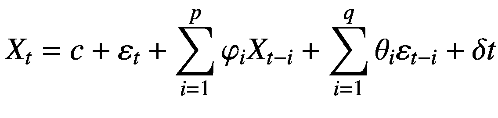
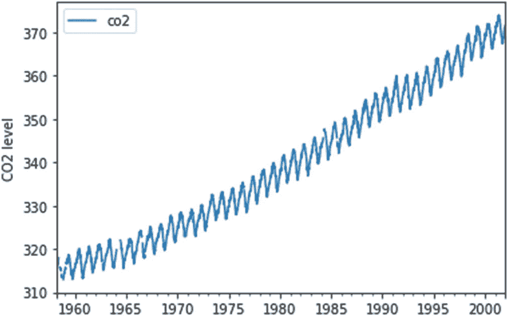
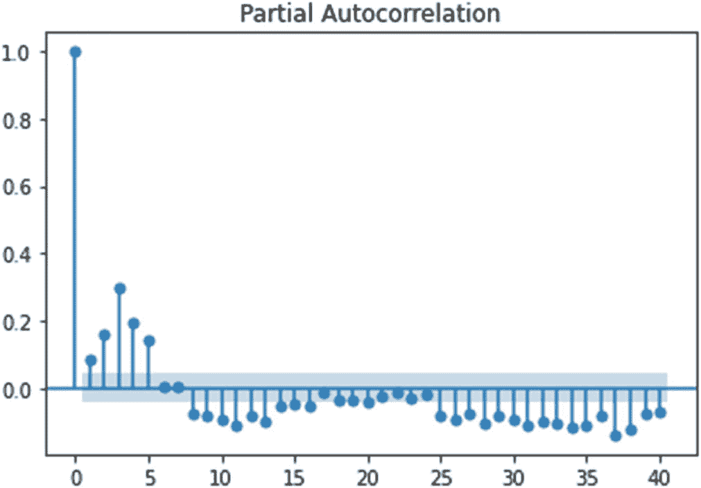
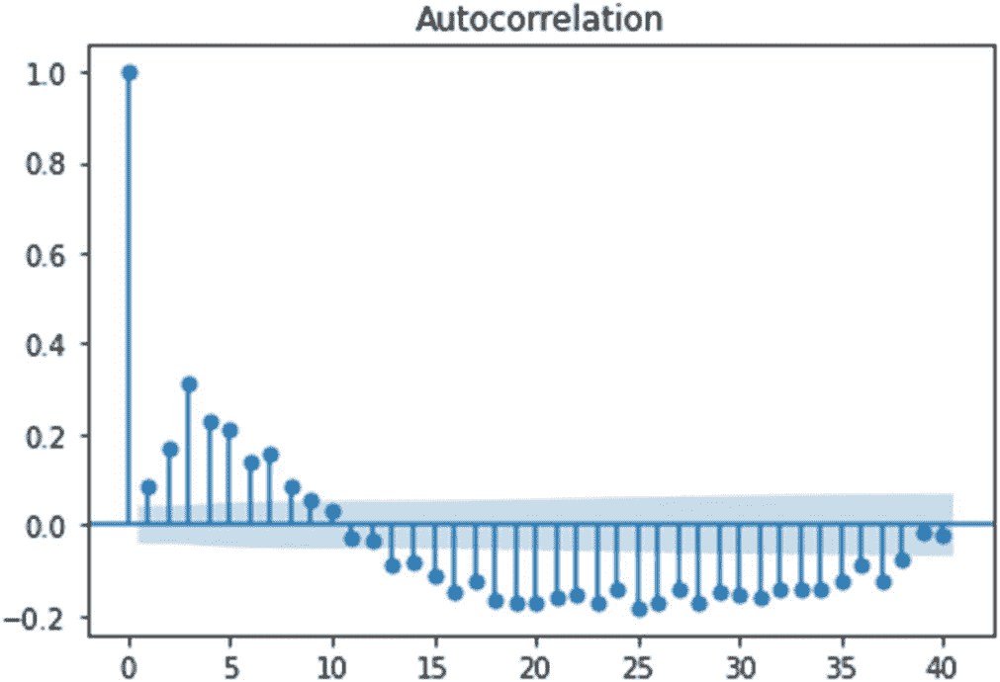
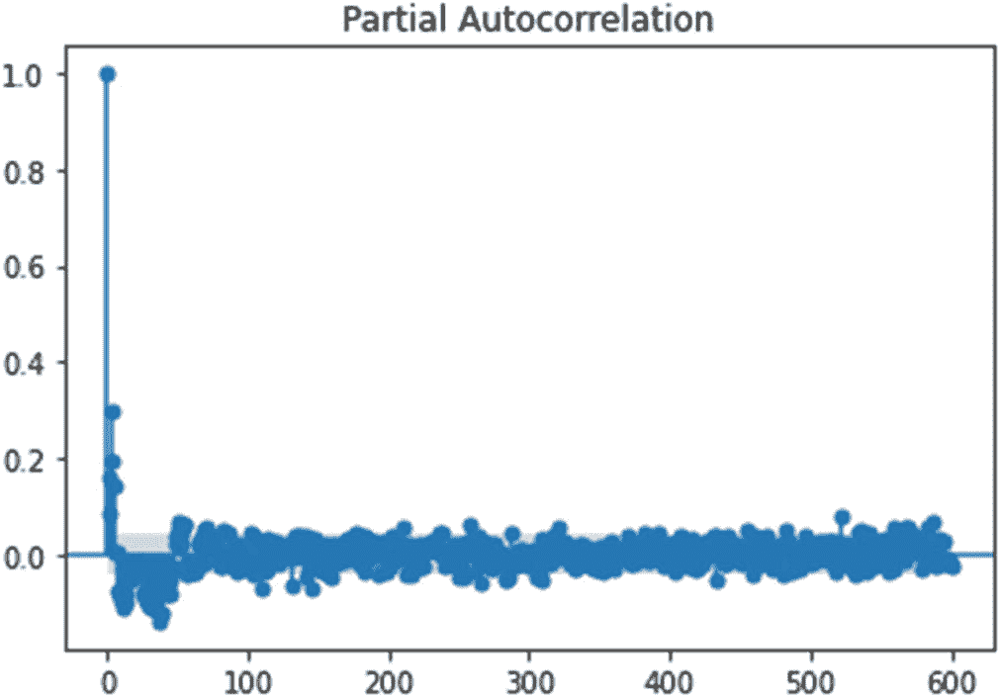
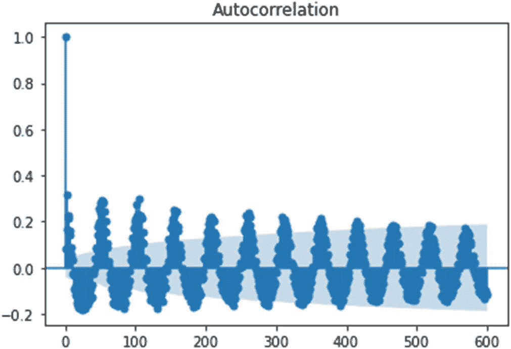
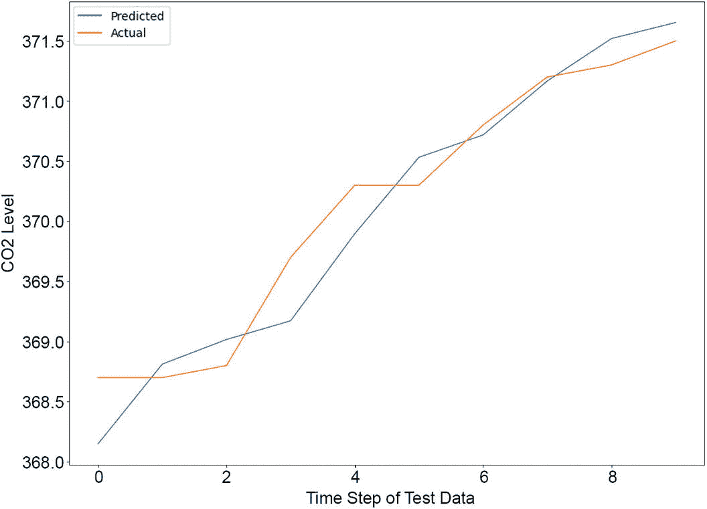

# 6. ARIMA 模型

在了解了单变量时间序列的几个基本构建模块后，本章将介绍一个整合了更多时间序列组件的模型：ARIMA 模型。

为了追踪这些不同的构建模块，让我们回到时间序列组件表（表 6-1），看看 ARIMA 模型所处的位置。

表 6-1

单变量时间序列的构建模块

| 名称 | 解释 | 章节 |
| --- | --- | --- |
| AR | 自回归 | 3 |
| MA | 移动平均 | 4 |
| ARMA | AR 和 MA 模型的组合 | 5 |
| ARIMA | 在 ARMA 模型中加入差分 (I) | 6 |
| SARIMA | 在 ARIMA 模型中加入季节性 (S) | 7 |
| SARIMAX | 在 SARIMA 模型中加入外部变量 (X) *(注意：加入外部变量后，模型不再是单变量)* | 8 |

如你所见，ARIMA 已经非常接近最终模型了。唯一尚未包含的部分是 S（季节性）和 X（外部变量）。某些时间序列过程既没有季节性也没有外部变量，这使得 ARIMA 经常被用作一个独立的模型。

在实践中，如果你在处理单变量时间序列，并且对季节性没有预期，通常会直接使用 ARIMA；如果预期存在季节性，则会直接使用 SARIMA（这将在下一章中介绍）。

## ARIMA 模型定义

ARIMA 模型是一个结合了 AR 和 MA 构建模块的模型，正如你在上一章中看到的 ARMA 模型一样。ARIMA 的额外之处在于“I”这个构建模块，它代表**非平稳时间序列的自动差分**。

你应该还记得，在之前的章节中，平稳性被介绍为时间序列中的一个重要概念。平稳时间序列是指没有长期趋势的时间序列。如果一个时间序列不是平稳的，你可以通过应用差分使其变得平稳：用实际值与前一时刻值的差来替换实际值。

ARIMA 中的“I”代表**整合**。整合是对非平稳时间序列进行差分的更数学化的同义词。在 ARIMA 中，这种差分不再是在建模阶段之前进行，而是在模型拟合过程中完成。

## 模型定义

ARIMA 模型是自回归整合移动平均模型（Autoregressive Integrated Moving Average model）的简称。它与 ARMA 模型的区别很小：只是增加了一个使时间序列变得非平稳的额外效应。一个简单的例子是线性增长趋势，如下式所示：



当你对一个时间序列进行差分时，实际上是在建模从一个时间步到下一个时间步的差异，而不是原始值。如果变量的实际值随时间不稳定，那么这些差值仍然有可能随时间保持稳定。

线性趋势就是一个很好的例子。想象一个从 0 开始，每个时间步增加 2 的线性趋势。这些值将完全不是平稳的：它们会无限增大。然而，每个值与下一个值之间的差值始终是 2，因此差分后的时间序列是完全平稳的。

## ARIMA 在 CO2 示例中的应用

差分作为超参数的一部分，为模型构建带来了巨大的附加价值。这使得可以对应该进行差分的次数进行自动超参数调优。让我们通过一个例子来看看。

本例中的数据是每周的 CO2 数据，可通过 `statsmodels` 库获取。你可以使用清单 6-1 中的代码获取这些数据。

```
import statsmodels.api as sm
data = sm.datasets.co2.load_pandas()
data = data.data
data.head()
清单 6-1
导入数据
```

为了解你正在处理的数据，像往常一样，最好绘制一个数据随时间变化的图。使用清单 6-2 中的代码可以得到图 6-1 中的图形。



图 6-1

CO2 数据随时间变化的图

```
import matplotlib.pyplot as plt
ax = data.plot()
ax.set_ylabel('CO2 level')
plt.show()
清单 6-2
绘制数据图
```

这些数据显示出非常明显的上升趋势，且相当稳定。同时，这些数据中也有非常清晰的季节性模式（上下波动）。

现在回想一下，根据前几章的内容，通常首先要查看的是自相关和偏自相关函数。请记住，自相关（ACF）和偏自相关（PACF）图仅适用于平稳数据。你可以使用清单 6-3 直接在差分后的数据上创建 ACF 和 PACF 图。

```
from statsmodels.graphics.tsaplots import plot_acf, plot_pacf
plot_acf(data.diff().dropna(), lags=40)
plot_pacf(data.diff().dropna(), lags=40)
plt.show()
清单 6-3
ACF 和 PACF 图
```

你应该会得到图 6-2 所示的 ACF 图和图 6-3 所示的 PACF 图。



图 6-3

偏自相关函数图



图 6-2

自相关函数图

有趣的是，自相关和偏自相关中有许多滞后值。这意味着什么？通常，如果相关性没有衰减到零，则意味着数据不是平稳的。然而，数据已经过差分，看起来是平稳的。

这里的答案是，衰减发生在自相关中相对较晚的位置。ACF 和 PACF 图有 40 个滞后，但对于当前示例来说还不够。你可以使用清单 6-4 获取回溯更远的 ACF 和 PACF 图，你会观察到存在向零的衰减。相应的图分别显示在图 6-4 和图 6-5 中。



图 6-5

具有 600 个滞后的偏自相关函数图



图 6-4

具有 600 个滞后的自相关函数图

```
plot_acf(data.diff().dropna(), lags=600)
plot_pacf(data.diff().dropna(), lags=600)
plt.show()
清单 6-4
具有更多滞后的 ACF 和 PACF 图
```

这使得它成为探讨模型阶数问题的一个有趣案例。让我们看看如何通过将 I 作为第三个超参数添加到优化中，来增强上一章的网格搜索交叉验证。相关代码见清单 6-5。


```
import pandas as pd
from statsmodels.tsa.arima.model import ARIMA
from sklearn.metrics import r2_score
import numpy as np
from sklearn.model_selection import TimeSeriesSplit
data_array = data[['co2']].values
avg_errors = []
for p in range(6):
for q in range(6):
for i in range(3):
errors = []
tscv = TimeSeriesSplit(test_size=10)
for train_index, test_index in tscv.split(data_array):
X_train, X_test = data_array[train_index], data_array[test_index]
X_test_orig = X_test
fcst = []
for step in range(10):
try:
mod = ARIMA(X_train, order=(p,i,q))
res = mod.fit()
fcst.append(res.forecast(steps=1))
except:
print('errorred')
fcst.append(-9999999.)
X_train = np.concatenate((X_train, X_test[0:1,:]))
X_test = X_test[1:]
errors.append(r2_score(X_test_orig, fcst))
pq_result = [p, i, q, np.mean(errors)]
print(pq_result)
avg_errors.append(pq_result)
avg_errors = pd.DataFrame(avg_errors)
avg_errors.columns = ['p', 'i', 'q', 'error']
avg_errors.sort_values('error', ascending=False)
代码清单 6-5
超参数调优
```

这段代码的运行结果将为你提供一个按 R2 分数排序的数据框。最佳的 R2 分数是 **0.741**，该分数由 **p = 4、q = 4** 和 **I = 1** 的组合获得。这意味着存在一个 4 阶的自回归效应和一个 4 阶的移动平均效应。数据必须进行一次差分。代码清单 6-6 展示了如何显示模型的测试拟合结果，对应的图表如图 6-6 所示。



图 6-6

最佳预测结果

```
X_train, X_test = data_array[:-10], data_array[-10:]
X_test_orig = X_test
fcst = []
for step in range(10):
mod = ARIMA(X_train, order=(4,1,4))
res = mod.fit()
fcst.append(res.forecast(steps=1))
X_train = np.concatenate((X_train, X_test[0:1,:]))
X_test = X_test[1:]
plt.plot(fcst)
plt.plot(X_test_orig)
plt.legend(['Predicted', 'Actual'])
plt.ylabel('CO2 Level')
plt.xlabel('Time Step of Test Data')
plt.show()
代码清单 6-6
绘制最终结果
```

## 关键要点

*   ARIMA 模型结合了三种效应：
    *   AR 过程，基于过去值与当前值之间的自相关

    *   MA 过程，基于过去误差与当前值之间的相关关系

    *   若时间序列非平稳，则自动进行差分整合

*   ARIMA(p,I,q) 模型有三个超参数：
    *   AR 过程的阶数，用 p 表示

    *   MA 过程的阶数，用 q 表示

    *   差分阶数，用 I 表示（某些记法中写作 d）

