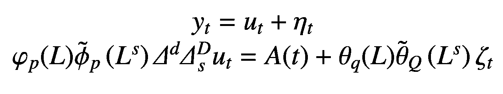
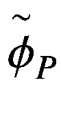
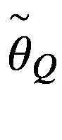
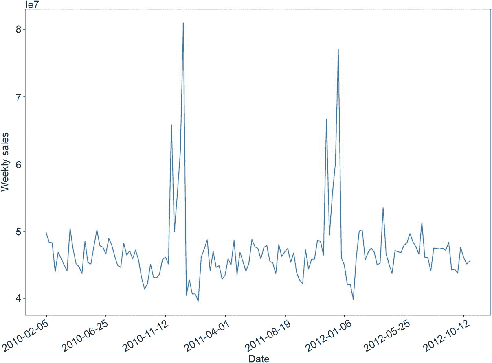
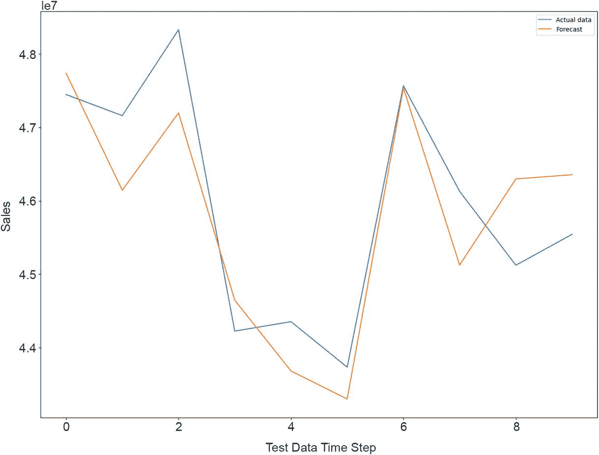
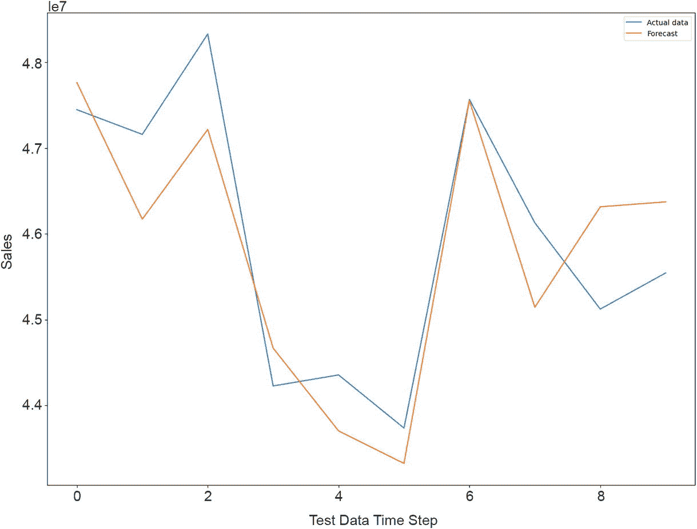

# 7. SARIMA 模型

在本章中，你将了解单变量时间序列模型的最终模型：SARIMA 模型。本章将汇集单变量时间序列的所有内容。

## 单变量时间序列模型分解

借助前几章介绍的 ARIMA 组件，你现在可以对自回归过程、移动平均组件以及差分整合进行建模。但时间序列中一个常见的过程仍未涉及：**季节性**。

让我们看一下单变量时间序列分解表，了解其位置（表 7-1）。你可以看到，比 SARIMA 模型更复杂的模型只有一个：SARIMAX 模型。

表 7-1

单变量时间序列的构建模块

| 名称 | 说明 | 章节 |
| --- | --- | --- |
| AR | 自回归 | 3 |
| MA | 移动平均 | 4 |
| ARMA | AR 与 MA 模型的组合 | 5 |
| ARIMA | 在 ARMA 模型中加入差分（I） | 6 |
| SARIMA | 在 ARIMA 模型中加入季节性（S） | 7 |
| SARIMAX | 在 SARIMA 模型中加入外部变量（X）*（注意：加入外部变量后，模型不再是单变量模型）* | 8 |

SARIMAX 模型与 SARIMA 模型有很大不同：它使用与目标变量相关的外部变量。这也使得 SARIMAX 成为一个非常强大的工具，但仅在你拥有外部变量时才能应用。使用外部变量会使模型不再是单变量时间序列模型。

SARIMA 模型的优势在于它仅需使用目标变量的历史数据，这使其可应用于非常多的预测场景。在单变量时间序列建模中，SARIMA 模型是最完整的模型，它综合运用了 AR、MA、趋势建模的差分整合以及季节性。

## SARIMA 模型定义

SARIMA 模型将多种不同的过程结合在同一个模型中。因此，其模型定义在数学上相对复杂。以下是 SARIMA 模型的定义方程：



在该模型中，你可以观察到以下部分：

*   常规 AR 部分，系数为 *φ*[*p*]（小写 phi）

*   季节性 AR 部分，系数为 （大写 phi）

*   常规 MA 部分，系数为 *θ*[*q*]（小写 theta）

*   季节性 MA 部分，系数为 （大写 theta）

*   常规差分部分，由阶数 d 表示

*   季节性差分部分，由阶数 D 表示

*   季节性周期系数 s

如你所见，在 ARIMA 模型中加入季节性使得模型复杂得多。季节性并非仅仅是在先前模型上增加一个构建模块，而是为每个构建模块都增加了季节性部分。这也使得 SARIMA 模型的滞后阶数选择变得更加困难。之前相同的超参数仍需确定：

*   p 表示 AR 阶数

*   q 表示 MA 阶数

*   I 表示差分阶数

在此基础上，又增加了三个阶数：

*   P 表示季节性 AR 阶数

*   Q 表示季节性 MA 阶数

*   D 表示季节性差分阶数

最后，还需要选择参数 **s，即季节性周期**。这个 s 不像其他阶数那样是一个超参数。s 不应通过网格搜索来测试，而应基于逻辑来确定。s 是季节性的周期。如果你处理的是月度数据，应选择 12；如果是周度数据，应选择 52；以此类推。


## 示例：沃尔玛销售额的 SARIMA 模型

在本章中，你将把 SARIMA 模型应用于 Kaggle 上提供的沃尔玛销售预测数据集（[`www.kaggle.com/c/walmart-recruiting-store-sales-forecasting/`](http://www.kaggle.com/c/walmart-recruiting-store-sales-forecasting/)）。

让我们用 Python 获取这些数据，并通过清单 7-1 初步了解其内容。请注意，沃尔玛数据包含许多门店和产品，但在此练习中，你将使用每周数据的总和。

```
import pandas as pd
import matplotlib.pyplot as plt
data = pd.read_csv('train.csv')
data = data.groupby('Date').sum()
ax = data['Weekly_Sales'].plot()
ax.set_ylabel('Weekly sales')
plt.gcf().autofmt_xdate()
plt.show()
清单 7-1
导入数据并创建图表
```

这将得到如图 7-1 所示的图表。



图 7-1

沃尔玛销售额随时间变化图

让我们首先尝试一个初始模型：SARIMA(1,1,1)(1,1,1)52。这种表示法表明每个超参数的阶数均为 1。季节性周期为 52，因为你处理的是周数据。你将进行十步预测，而不是进行十次单步预测。这是一个多步预测的案例。清单 7-2 展示了如何拟合模型并获取测试集上的性能图表（图 7-2）。你还将获得测试数据上的 R2 分数。



图 7-2

SARIMA 模型的预测性能

```
import random
random.seed(12345)
import statsmodels.api as sm
from sklearn.metrics import r2_score
train = data['Weekly_Sales'][:-10]
test = data['Weekly_Sales'][-10:]
mod = sm.tsa.statespace.SARIMAX(data['Weekly_Sales'][:-10], order=(1,1,1), seasonal_order=(1,1,1,52))
res = mod.fit(disp=False)
fcst = res.forecast(steps=10)
plt.plot(list(test))
plt.plot(list(fcst))
plt.legend(['Actual data', 'Forecast'])
plt.ylabel('Sales')
plt.xlabel('Test Data Time Step')
plt.show()
r2_score(test, fcst)
清单 7-2
拟合 SARIMA(1,1,1)(1,1,1)52 模型
```

在此版本中，未经任何超参数优化，SARIMA 模型获得了**0.73**的 R2 分数。这意味着该模型能够解释测试数据中 73%的变异。这是一个非常有前景的分数。

这个分数已经相当不错的原因，可能在于 SARIMA 模型的灵活性。它结合了多种效应，使其能够适应许多不同的底层过程。接下来你将看到，通过网格搜索超参数，这个分数如何得到提升。

为了加快代码运行速度，你在此处的网格搜索中将不会使用交叉验证。执行速度也是机器学习的一个重要方面。作为第二个优化点，你将进行十步预测，而不是更新十次单步预测。这样，观察季节性效应在捕捉长期趋势方面是否更有效，将会很有趣。这将在清单 7-3 中完成。

请注意，已添加一个 try-except 块，以避免在拟合模型时因发生错误而导致代码停止运行。根据你的硬件配置，某些拟合可能计算量过大并导致内存溢出错误。这不成问题，因为它仍然能让你找到最佳的超参数组合。

```
scores = []
for p in range(2):
for i in range(2):
for q in range(2):
for P in range(2):
for D in range(2):
for Q in range(2):
try:
mod = sm.tsa.statespace.SARIMAX(train, order=(p,0,q), seasonal_order=(P,D,Q,52))
res = mod.fit(disp=False)
score = [p,i,q,P,D,Q,r2_score(test, res.forecast(steps=10))]
print(score)
scores.append(score)
del mod
del res
except:
print('errored')
res = pd.DataFrame(scores)
res.columns = ['p', 'i', 'q', 'P', 'D', 'Q', 'score']
res.sort_values('score')
清单 7-3
SARIMA 模型的网格搜索
```

你会发现这里的最佳阶数是(0,1,1)(1,1,1)。零表示不存在常规的自回归（AR）过程。存在一个季节性自回归过程。同时存在常规和季节性的移动平均（MA）过程。需要常规和季节性的差分。

这个模型在测试数据上的 R2 分数为**0.734**，仅比未优化的模型略好。作为最后一步，你可以查看此预测在测试数据上的图表。这可以通过更新清单 7-2 中的阶数来实现，从而得到图 7-3 中的图表。



图 7-3

优化后的 SARIMA 模型的预测性能

这里展示的网格搜索是调整 SARIMA 模型的一个好方法。此时，我想提一下**pyramid**库中一个名为**auto_arima**的函数，它可以自动调整 ARIMA 和 SARIMA 模型。使用这个函数，你可以用更少的代码实现相同的优化。你可以在此处查看如何使用 auto_arima：[`https://pypi.org/project/pyramid-arima/`](https://pypi.org/project/pyramid-arima/)。

## 关键要点

*   SARIMA 模型在 ARIMA 模型的基础上增加了季节性效应。

*   SARIMA 模型是单变量时间序列模型最完整的版本。

*   SARIMA 模型有四个额外的超参数：
    *   季节性自回归阶数

    *   季节性移动平均阶数

    *   季节性差分阶数

    *   周期（基于季节性逻辑上会重复出现的周期数）

