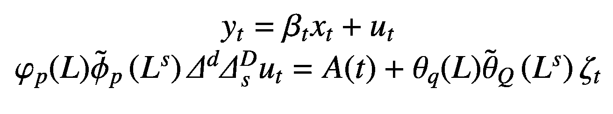
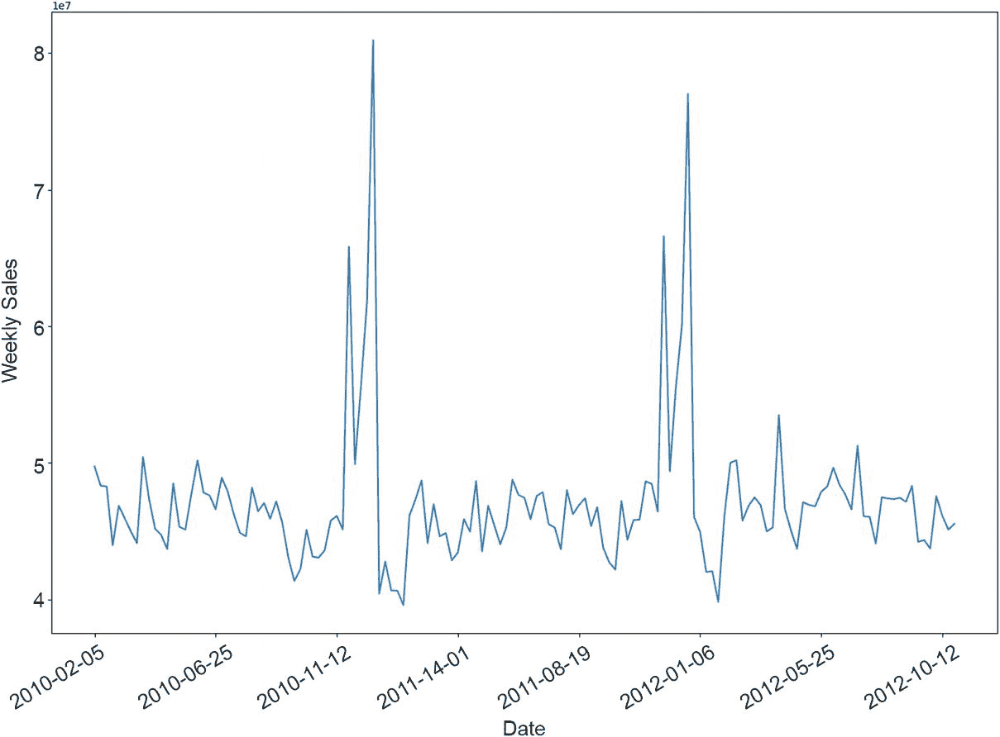
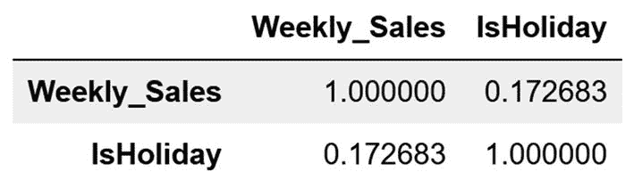
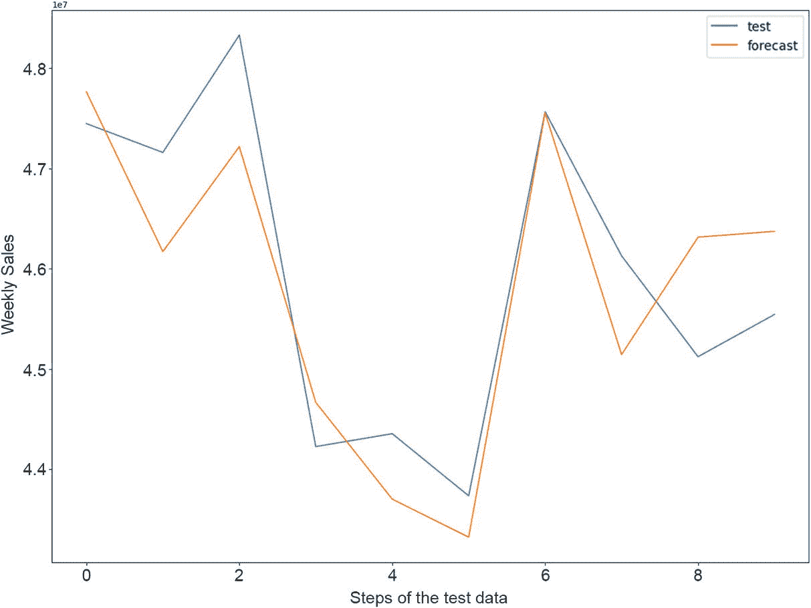

# 8. SARIMAX 模型

在本章中，你将了解 SARIMAX 模型。该模型是经典时间序列模型中最完整的版本，因为它包含了你在本书前几章中学习到的所有组件。它增加了 X 组件：外部变量。

## 时间序列构建模块

让我们通过表 8-1 快速回顾一下你在前几章中看到的时间序列的不同组成部分。

表 8-1 单变量时间序列的构建模块

| 名称 | 解释 | 章节 |
| --- | --- | --- |
| `AR` | 自回归 | 3 |
| `MA` | 移动平均 | 4 |
| `ARMA` | `AR` 和 `MA` 模型的组合 | 5 |
| `ARIMA` | 在 `ARMA` 模型中加入差分（I） | 6 |
| `SARIMA` | 在 `ARIMA` 模型中加入季节性（S） | 7 |
| `SARIMAX` | 在 `SARIMA` 模型中加入外部变量（X）*（注意，外部变量使得该模型不再是单变量模型）* | 8 |

这些章节从简单到复杂逐步构建时间序列模型。`SARIMAX` 模型不被视为单变量时间序列模型的完美范例。单变量时间序列模型仅使用目标变量的变化，而 `SARIMAX` 模型还使用了外部变量。

## 模型定义

`SARIMAX` 模型的数学定义如下：



第一个公式中的 `β`（`beta`）部分代表外部变量。其余部分与 `SARIMA` 模型非常相似，但为完整起见，让我们重新列出该模型的超参数：

- `p` 代表自回归阶数
- `q` 代表移动平均阶数
- `I` 代表差分阶数
- `P` 代表季节性自回归阶数
- `Q` 代表季节性移动平均阶数
- `D` 代表季节性差分
- `s` 代表季节性系数

## 监督模型 vs. SARIMAX

在后续章节中，你将看到许多监督模型的案例。你可能还记得第一章的内容，监督模型使用外部变量来预测目标变量。这个想法与 `SARIMAX` 中的 X 部分非常相似。

当然，问题在于实践中应该使用哪一种。从理论角度来看，当时间序列部分比外部变量部分更突出时，`SARIMAX` 可能是更优选择。如果仅靠外部变量就能解释很多，并且自相关或季节性部分对此进行了补充，那么监督模型可能是更好的选择。

然而，一如既往，合理的做法是在模型基准测试中使用多个模型。模型的选择应直接基于其预测性能。

## 沃尔玛数据集上的 SARIMAX 示例

在上一章中，你看到了使用 `SARIMA` 模型预测沃尔玛每周销售额的案例。但该数据集不仅仅包含每周销售额数据：还有一个指标，用于指示某周是否包含节假日。

你在 `SARIMA` 模型中没有使用节假日信息，因为无法向其添加外部数据。这其实无关紧要，因为测试数据中没有因节假日导致的极端峰值。尽管模型中缺少了节假日信息，但这并未在误差估计中体现出来。

然而，添加此类信息非常重要，因为它可能能够解释模型中的大部分变异。让我们看看如何使用外部变量来改进沃尔玛的示例。

第一步，你应该导入并准备数据。你可以使用代码清单 8-1 来完成此操作。这段代码还向你展示了如何创建销售额随时间变化的图表。

```python
import pandas as pd
import matplotlib.pyplot as plt
data = pd.read_csv('walmart/train.csv')
data = data.groupby('Date').sum()
data['IsHoliday'] = data['IsHoliday'] > 0
data['IsHoliday'] = data['IsHoliday'].apply(
    lambda x: float(x)
)
ax = data['Weekly_Sales'].plot()
ax.set_ylabel('Weekly Sales')
plt.gcf().autofmt_xdate()
plt.show()
```

*代码清单 8-1 准备数据并绘制图表*

你应该会得到如图 8-1 所示的图形。



*图 8-1 每周销售额图*

下一步是使用相关性分析来研究将节假日信息添加到模型中是否可能带来改进。如果销售额与节假日之间完全没有相关性，那么将其添加到模型中是不明智的。让我们使用代码清单 8-2 来计算相关系数。

```python
data[['Weekly_Sales', 'IsHoliday']].corr()
```

*代码清单 8-2 销售额与节假日之间存在相关性吗？*

这将输出一个如图 8-2 所示的相关性矩阵。



*图 8-2 相关性矩阵*

销售额与节假日之间的相关系数为 **0.17**。这个值不算很高，但足以考虑将该变量添加到模型中。模型本身会为该变量计算最合适的系数。

要创建一个 `SARIMAX` 模型，你可以使用代码清单 8-3。注意 `endog` 和 `exog` 的术语非常重要：

- `内生变量`（`endog`）是目标变量。所有时间序列成分都将据此进行估计。在当前案例中，它是每周销售额。
- `外生变量`（`exog`）是解释变量。模型从中获取额外的相关性。在当前示例中，它是节假日变量。

对于这个特定示例，我不会再次进行超参数搜索。如果你还记得上一章的内容，使用 `SARIMA(0,1,1)(1,1,1),52` 找到了最优得分。因此，对于这个示例，我们使用 `SARIMAX(0,1,1)(1,1,1)52`。该代码还会计算 R2 分数，并显示在 10 周测试集上的性能图。

```python
import random
random.seed(12345)
import statsmodels.api as sm
from sklearn.metrics import r2_score
train = data['Weekly_Sales'][:-10]
test = data['Weekly_Sales'][-10:]
mod = sm.tsa.statespace.SARIMAX(
    endog=data['Weekly_Sales'][:-10],
    exog=data['IsHoliday'][:-10],
    order=(0,1,1),
    seasonal_order=(1,1,1,52),
)
res = mod.fit(disp=False)
fcst = res.forecast(steps=10, exog = data['IsHoliday'][-10:])
plt.plot(list(test))
plt.plot(list(fcst))
plt.xlabel('Steps of the test data')
plt.ylabel('Weekly Sales')
plt.legend(['test', 'forecast'])
plt.show()
r2_score(test, fcst)
```

*代码清单 8-3 拟合 SARIMAX 模型*

此预测获得的 R2 分数为 **0.734**。其性能可以直观地见图 8-3。



*图 8-3 测试数据上的预测性能*

本章向你展示了如何使用一个额外变量来构建 `SARIMAX` 模型。但请记住，`SARIMAX` 模型中包含的外生变量数量没有限制。只要你能提供这些变量的未来值，这种方法就可能有效。

这里需要注意：许多能够提升模型性能的变量在实践中并无用处。例如，你可以使用天气数据来解释销售额。然而，未来的天气数据是未知的。因此，尽管这个变量可能对销售额有重要影响，但它不能用于提高预测准确性。

## 关键要点

- `SARIMAX` 模型允许向 `SARIMA` 模型添加外部变量。
- `SARIMAX` 有两种类型的变量：
    - `内生变量`：目标变量
    - `外生变量`：外部变量
- 进行预测时，你需要指定外生变量的未来值。因此，在使用外生变量时，重要的是要确保你拥有关于它们未来的确定信息。
    - 像节假日这样的变量是可行的，因为你知道未来会有哪些节假日。
    - 像天气这样的变量是不可行的，因为你无法预知未来的天气情况。