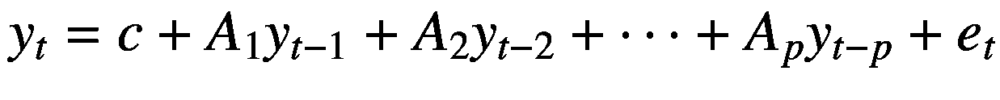
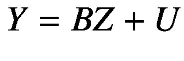
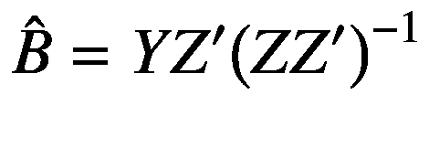
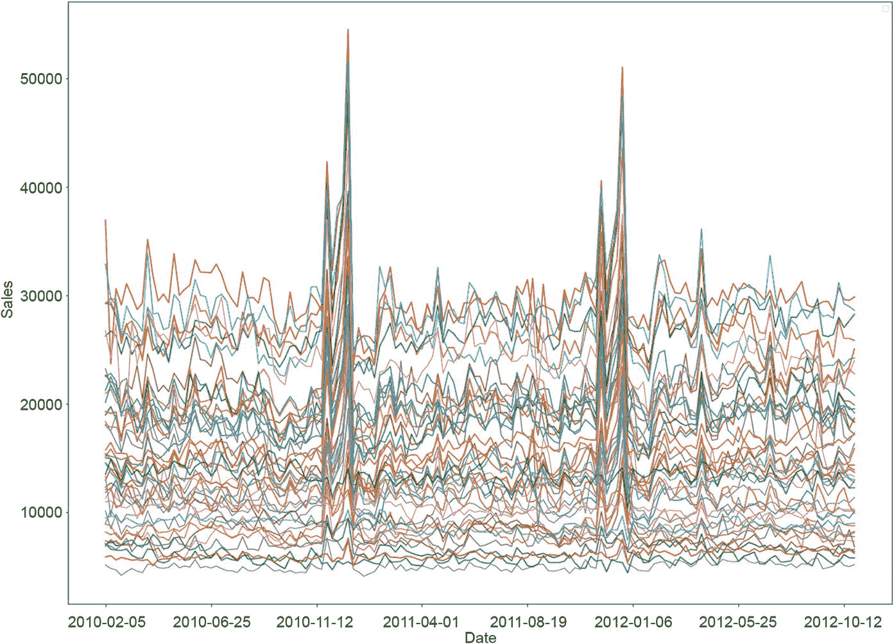

# 9. VAR 模型

在本章中，你将了解 VAR 模型，即**向量自回归模型**的简称。向量自回归模型同时模拟多个变量随时间的发展变化。

自回归这个术语在前面的章节中应该听起来很熟悉。向量自回归模型属于时间序列模型家族。与该类别中的其他模型一样，它基于目标变量的历史发展来预测未来。

向量自回归有一个重要的特性。与大多数其他模型不同，向量自回归模型同时模拟多个目标变量。这些多个变量同时被用作目标变量和彼此的解释变量。在一个模型中使用多个目标变量的模型被称为**多元模型**，或者更具体地说，**多元时间序列**。

## 模型定义

由于 VAR 模型为多个目标变量提出了一个统一的模型，它将这些变量重组为一个向量。这解释了该模型名称的由来。模型定义如下：



在此公式中：

*   `y[t]` 是一个向量，包含每个变量的当前值。
*   VAR 模型的阶数 `p` 决定了用于预测未来所回溯的时间步长数量。
*   `c` 是一个常数向量：每个目标变量对应一个常数。
*   每个滞后项都有一个系数向量 `A`。
*   误差项表示为 `e`。

### 阶数：唯一的超参数

那么，滞后项的数量在 VAR 模型中是如何工作的呢？在之前的模型中，你已经看到过相对复杂的情况，需要为不同类型过程的阶数估计超参数。

在这方面，VAR 模型要简单得多。只需要定义一个阶数：整个模型的阶数。这个阶数的记法为 `VAR(p)`，其中 `p` 就是阶数。

该阶数定义了在解释当前值时，需要考虑多少个过去的时间步长。阶数为 1 意味着只考虑前一个时间步长。阶数为 2 意味着使用前两个时间步长。以此类推。你也可以将其称为所包含的滞后项数量。

如果包含了一个滞后项，那么它对所有变量都是包含的。在 VAR 模型中，无法为不同变量使用不同的滞后项。

### 平稳性

你之前接触过的另一个概念是平稳性，那么让我们来看看它在 VAR 模型中是如何运作的。

如果你还记得，平稳性意味着时间序列没有趋势：它在长期内是稳定的。你可以使用增广迪基-富勒检验来测试一个时间序列是否平稳。

你也已经了解过一种称为差分或整合的技术，用于将非平稳时间序列转换为平稳序列。

这一理论对于 VAR 模型也非常重要。VAR 模型只有在*模型中的每个变量都是平稳的*情况下才能正常工作。在进行 VAR 建模时，你通常同时处理多个变量，因此如果某些时间序列是平稳的而其他不是，处理起来可能会有些繁琐。在这种情况下，应该只对非平稳的时间序列进行差分。

这条规则有一个例外：向量误差修正模型是一种不需要平稳性的 VAR 模型。这个模型可以作为 VAR 模型的一个良好替代方案，因此我建议你在这里查看一下：[`www.statsmodels.org/stable/generated/statsmodels.tsa.vector_ar.vecm.VECM.html`](http://www.statsmodels.org/stable/generated/statsmodels.tsa.vector_ar.vecm.VECM.html)。

### VAR 系数的估计

VAR 模型的系数可以使用一种称为多元最小二乘法的技术来估计。VAR 模型使用这种技术使得它在计算上相对高效。为了理解这种估计技术，让我们用矩阵形式来表示 VAR 模型：



在这种情况下：

*   `Y` 是一个矩阵，包含每个变量（每行）和每个未来滞后项（每列）的 `y` 值。
*   `B` 是系数矩阵。
*   `Z` 是一个包含 `y` 变量过去滞后项的矩阵。
*   `U` 是一个包含模型误差的矩阵。

多元最小二乘法允许你通过以下矩阵计算来求解系数：



这样估计出的系数就是你稍后将看到的模型的基础。

## 一个多元模型 vs. 多个单变量模型

向量自回归应应用于相互关联的多个目标变量。如果变量之间没有或只有非常小的相关性，那么将它们组合在同一个模型中就无法获益。

除了仅在将变量组合到同一个模型中有意义的情况下使用 VAR 模型之外，更重要的是使用基于训练-测试集和交叉验证的客观模型评估技术。这可以帮助你在“为多个变量使用一个模型”和“为每个变量分别使用一个单变量模型”之间做出正确的选择。

## 示例：使用 VAR 模型预测沃尔玛销售额

在本示例中，你将沿用上一章介绍的沃尔玛销售数据。不过，与之前按周汇总销售额不同，这里将按门店汇总每周数据。由于数据集中包含 45 家门店，因此将生成 45 个周度时间序列。你可以使用清单 9-1 中的代码创建数据并绘制图表。

```
import pandas as pd
import matplotlib.pyplot as plt
data = pd.read_csv('walmart/train.csv')
data = data.pivot_table(index = 'Date', columns = 'Store', values = 'Weekly_Sales')
ax = data.plot(figsize=(20,15))
ax.legend([])
ax.set_ylabel('Sales')
plt.show()
清单 9-1
准备每家门店的沃尔玛数据
```

这段代码将生成图 9-1 所示的图表。从图中可以看出，每家门店的数据遵循相同的模式。例如，几乎所有门店都在同一时间点达到峰值。这体现了使用多元时间序列的价值。



图 9-1
45 家门店的图表

现在，让我们开始拟合 VAR 模型。与之前一样，我们将使用十步测试数据集进行十步预测。创建 VAR 模型的代码见清单 9-2。

```
from sklearn.metrics import mean_absolute_percentage_error
from statsmodels.tsa.api import VAR
train = data.iloc[:-10,:]
test = data.iloc[-10:,:]
model = VAR(train)
results = model.fit(maxlags=2)
lag_order = results.k_ar
fcst = results.forecast(train.values[-lag_order:], 10)
model_accuracy = 1 - mean_absolute_percentage_error(test, fcst)
print(model_accuracy)
清单 9-2
拟合 VAR 模型
```

这段代码中有几个值得注意的有趣之处，与你之前所见有所不同。

首先，请注意模型拟合所用的数据是一个多元数据集：它同时使用了所有列。这对于多元时间序列模型来说是意料之中的。

其次，请注意示例并未进行网格搜索，而是使用了名为 `maxlags` 的参数。这意味着 VAR 模型将在尊重最大滞后阶数的前提下，自行优化模型阶数的选择。在本例中，`maxlags` 被设为 2，因为超过 2 阶将需要估计比当前数据允许的更多的系数。

`maxlags` 使用 `AIC`（**赤池信息准则**）来选择模型的理想阶数。赤池信息准则是衡量模型拟合优度的著名指标。`AIC` 仅基于训练数据，因此更容易导致过拟合模型。

`AIC` 更多用于经典统计模型，在现代机器学习中较少使用。但它是一种快速实用的阶数选择方法，因此了解它很重要。VAR 模型的缺点在于需要估计大量参数，这使得它**需要海量数据**才能拟合高阶模型。在当前示例中，使用高于 2 的阶数是不可能的。

此外，你还需要注意代码中，在应用 `forecast` 方法时，必须提供训练数据的最后一部分。这是为了让模型能够通过对滞后变量应用系数来计算未来值。

该模型获得的模型精度为 **0.89**。

尽管该模型的调优可能性较低，但必须承认其性能相对良好。但一如既往，请记住在实践中，判断其是否足够好的唯一方法是通过基准测试并与其他模型进行比较。

## 要点总结

*   VAR 模型利用多元相关性，为多个目标变量构建单一模型。
*   VAR 模型的阶数 `p` 决定了用于预测未来的时间步长回溯数量。
*   VAR 模型实现可以通过 `maxlags` 参数和赤池信息准则定义理想的滞后阶数。
*   VAR 模型需要估计大量参数，因此需要海量历史数据。这使得估计更高阶的滞后项变得困难。