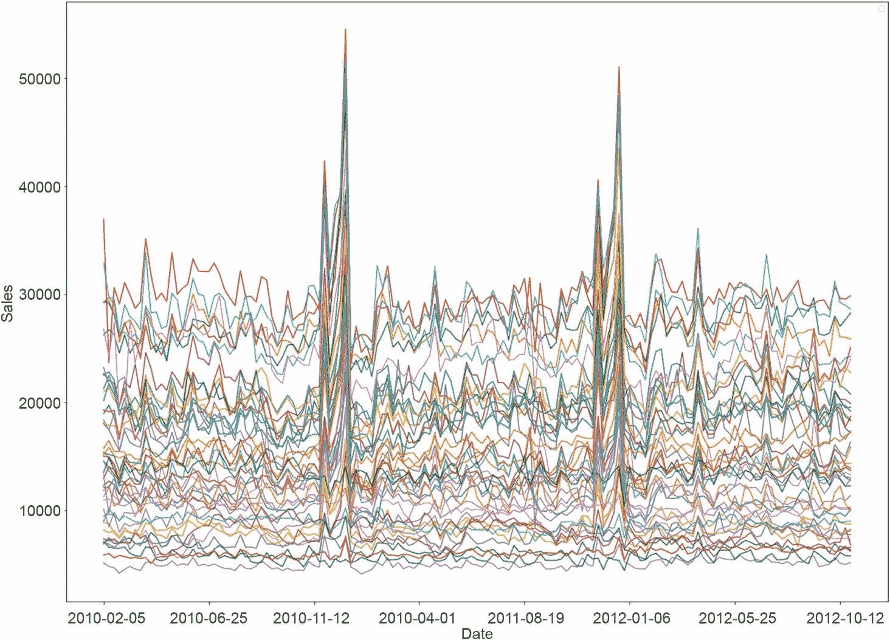

# 10. VARMAX 模型

你在上一章了解了 VAR 模型。与单变量时间序列类似，可以在 VAR 模型基础上构建一些模块，以处理不同类型的过程。这可以从较小且更常见的 **VAR** 模型逐步构建到更复杂的 **VARMAX** 模型。

必须指出，多元时间序列建模技术属于更高级的技术范畴。它们并非总有 Python 实现，并且使用频率低于单变量时间序列技术。虽然 VAR 模型的使用仍然相对普遍，但该分支中更高级的模型在互联网上的文档资料越来越少。

在本章中，你将了解 VARMAX 模型。它是多元时间序列的首选模型。它在 VAR 模型的基础上增加了**移动平均分量**，并且还可以包含外部变量（即外生变量）。因此，VARMAX 模型中的组成部分包括：

*   **V** 代表向量，表示这是一个多元模型
*   **AR** 代表自回归
*   **MA** 代表移动平均
*   **X** 代表使用外生变量（除内生变量之外）

需要注意的是，VARMAX 模型*不*包含季节性分量。这不一定是个问题，因为季节性可以通过*外生变量*来包含。例如，月度季节性可以通过添加外生变量“月份”来建模。对于周度季节性，你可以添加变量“周数”。

另一个缺失的模块是积分模块。VARMAX 模型不包含非平稳时间序列的差分处理。与 VAR 模型一样，所有输入的时间序列必须已经是*平稳的*。

## 模型定义

VARMAX 模型的数学定义如下：

*y*[*t*] = *v* + *A*[1]*y*[*t* − 1] + ⋯ + *A*[*p*]*y*[*t* − *p*] + *Bx*[*t*] + ∈[*t*] + *M*[1]∈[*t* − 1] + ⋯ + *M*[*q*]∈[*t* − *q*]

在该模型中，*y*[*t*] 是当前值的向量，其他 *y* 是滞后值。**A** 是自相关系数：对于每个滞后阶数，它们是一个长度与时间序列数量相同的向量。**M** 是滞后模型误差的系数向量。它们代表了模型的移动平均部分。

由于 VARMAX 模型仅仅是你在前七章中看到的各个构建模块的组合，这里就不再赘述。如果你需要更深入地了解不同构建模块背后的直觉和解释，请随时回顾前面的章节。现在，让我们深入探讨 Python 实现和示例。


## 含外生变量的多元时间序列

首先，我们按门店和周次来准备沃尔玛数据。正如你在前一章所见，该数据集非常适合进行多元时间序列建模。

```
import pandas as pd
import matplotlib.pyplot as plt
data = pd.read_csv('walmart/train.csv')
exog = data.groupby('Date')['IsHoliday'].sum() > 0
exog = exog.apply(lambda x: float(x))
data = data.pivot_table(index = 'Date', columns = 'Store', values = 'Weekly_Sales')
ax = data.plot(figsize=(20,15))
ax.legend([])
ax.set_ylabel('Sales')
plt.show()
代码清单 10-1
为 VARMAX 模型准备沃尔玛数据
```

请注意，在代码清单 10-1 中，外生数据也已创建。它们是每周是否存在节假日的指示变量。在本例中，它们将是唯一用作外生数据的变量，但在理论上，使用更多外生变量并无限制。

通过此代码得到的图表如图 10-1 所示。你可以观察到这些时间序列遵循的模式似乎相对相关。



图 10-1

各门店的时间序列图

在上一章中，你仅使用阶数 p 估计了 VAR 模型。这个 p 决定了 AR 分量的阶数。在 VARMAX 模型中，同时包含 AR 分量和 MA 分量。因此，需要分别确定 AR 部分和 MA 部分的阶数。VARMAX(p,q) 的超参数为：

*   AR 分量的阶数，记为 p
*   MA 分量的阶数，记为 q

现在，要估计一个 VARMAX 模型，你可以使用代码清单 10-2 所示的代码。为避免模型占用你硬件过多的计算资源，该代码示例使用了数据集中的前三家门店。

```
import statsmodels.api as sm
from sklearn.metrics import mean_absolute_percentage_error
train = data.iloc[:-10,[0,1,2]]
test = data.iloc[-10:,[0,1,2]]
train_exog = exog[:-10]
test_exog = exog[-10:]
mod = sm.tsa.VARMAX(train, order=(1,1), exog=train_exog)
res = mod.fit(maxiter=100, disp=False)
fcst = res.forecast(exog=test_exog.values, steps=10)
mape = mean_absolute_percentage_error(test, fcst)
model_accuracy = 1 - mape
print(model_accuracy)
代码清单 10-2
运行 VARMAX(1,1) 模型
```

VARMAX 模型，尤其是在应用于变量数量较多的示例时，运行时间可能非常长。这里耗时较长的是模型移动平均部分的估计。众所周知，MA 模型的拟合速度异常缓慢，而在当前情况下，还需要对 45 个变量进行估计，这更增加了难度。

在此示例上获得的 R² 为 **0.96**。这是一个很高的分数。这是在**十步预测**上得到的结果。你可能还记得第 4 章的内容，移动平均分量*不适合多步预测*。

鉴于模型训练时间已经如此之长，为模型增加重复再训练的程序几乎不是一个可行的解决方案。VARMAX 模型应仅在训练时间不成问题，或者 VARMAX 能获得其他训练方法无法达到的性能时使用。

在你的预测工具箱中拥有 VARMAX 这种更高级的建模技术是件好事。该模型能拟合比许多其他时间序列模型更复杂的过程。然而，它也有其缺点：与更简单的模型相比，训练时间相对较长，并且需要相对大量的数据才能正确估计。

顺便提一下，你会发现，对于任何更复杂的时间序列和机器学习技术而言，这些训练时间和数据可用性的要求几乎是不可避免的。这在一定程度上可以通过计算能力来弥补，但批判性地评估模型选择仍然很重要。

## 要点总结

*   VARMAX 模型由以下部分组成：
    *   V 代表向量：它是一个多元模型，因为同时建模多个时间序列。
    *   AR 代表自回归。
    *   MA 代表移动平均。
    *   X 代表外生变量的加入。
*   VARMAX(p,q) 模型有两个超参数：
    *   p 代表 AR 部分的阶数
    *   q 代表 MA 部分的阶数
*   VARMAX 中的时间序列必须是平稳的。

