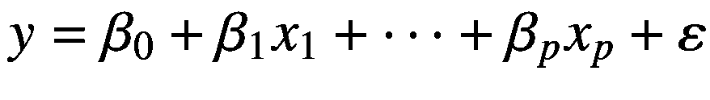
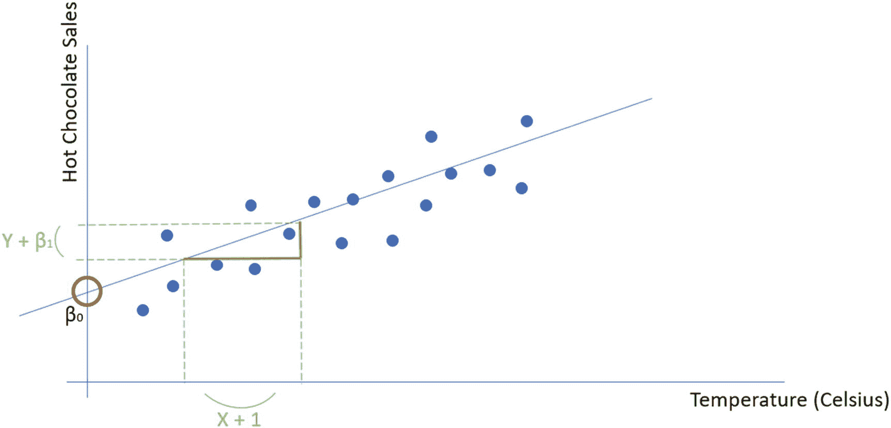
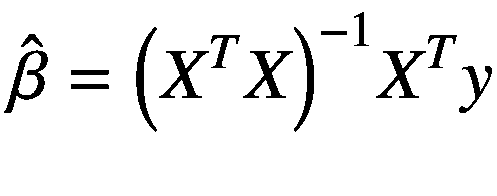
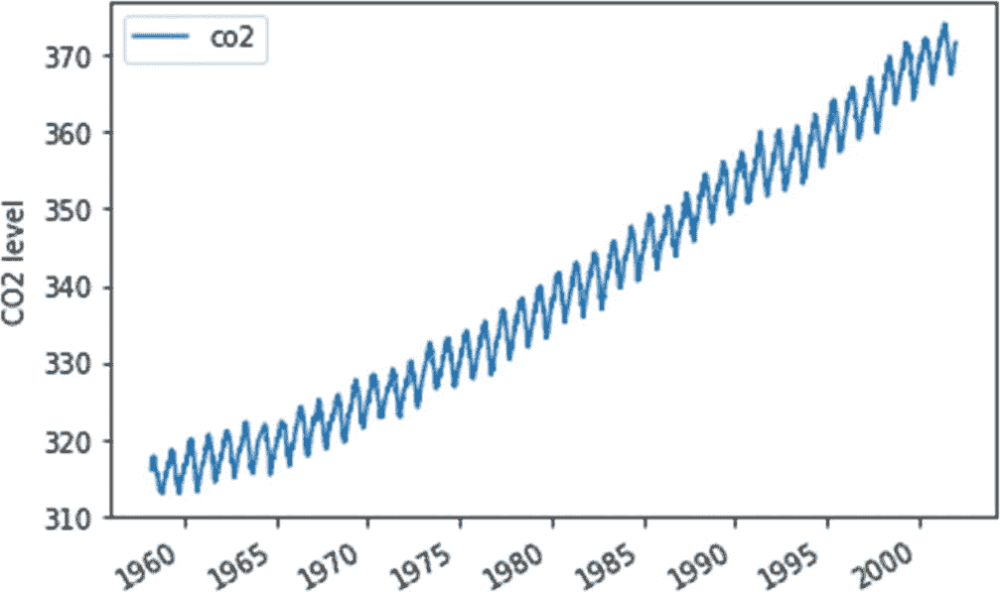
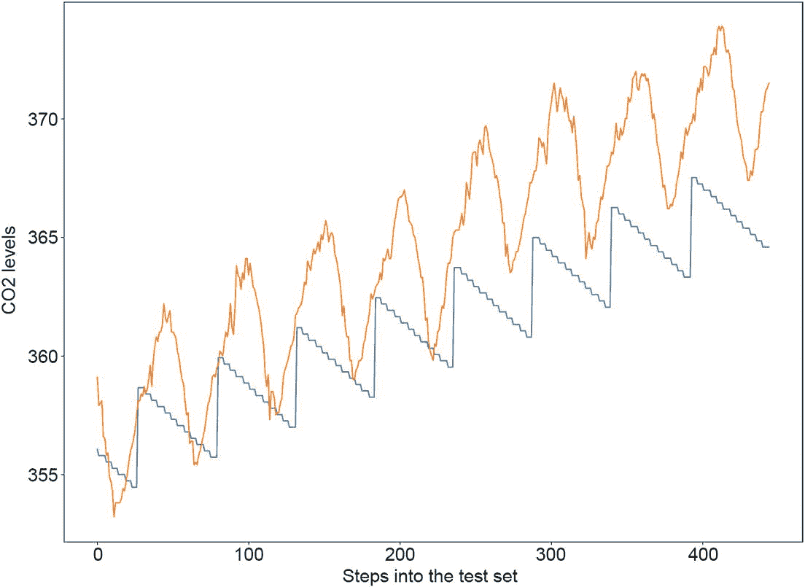
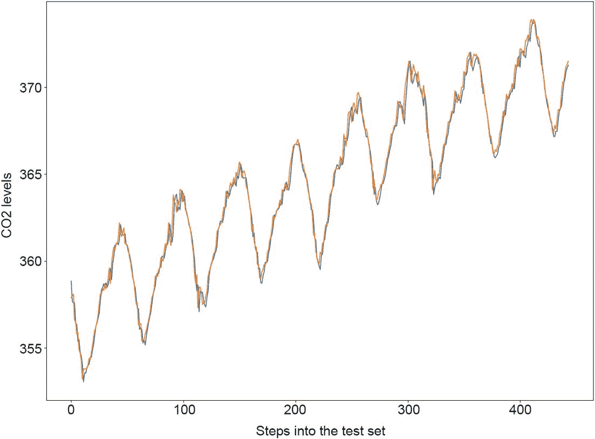

# 11. 线性回归

在接下来的章节中，你将看到最常见的监督式机器学习模型。正如你在第 1 章中记得的那样，监督式机器学习算法的工作原理与时间序列模型不同。

在监督式机器学习模型中，你试图识别不同变量之间的关系：

*   **目标变量**：你试图预测的变量
*   **解释变量**：帮助你预测目标变量的变量

对于预测而言，理解哪些类型的解释变量可以使用或不能使用非常重要。举个例子，假设热巧克力的销量在很大程度上取决于温度。天气寒冷时，销量高；天气温暖时，销量低。

你可以建立一个模型来整合这种基本的 if/else 逻辑。然而，仔细想想，这种逻辑不能用于未来的预测。毕竟，如果你想预测明天热巧克力的销量，你必须知道明天的温度。而这是你无法事先知道的：这需要对温度进行额外的预测！

另一个例子是，不基于天气，而是基于周次来预测热巧克力销量。你可以尝试根据历史数据识别与周次的关系。然后，要预测未来的销量，你可以将下一周的周次输入模型，从而获得预测值。这里之所以可行，是因为周次是你事先确定知道的信息。

总的来说，在做监督式模型时，牢记这一点很重要。现在，让我们更深入地了解线性回归。

## 线性回归背后的思想

线性回归背后的思想是，在目标变量和多个解释变量之间定义一个线性关系，以预测目标变量。线性回归被广泛使用，不仅限于预测。与任何监督式模型一样，只要将未来的解释变量作为模型输入，它就能完美工作。


## 模型定义

线性回归的定义如下：



在该公式中：

*   存在 **p** 个解释变量，称为 **x**。
*   存在一个目标变量，称为 **y**。
*   y 的值通过一个常数（*β*[0]）加上 x 变量的值与其系数 *β*[1] 至 *β*[*p*] 的乘积来计算。

图 11-1 直观展示了如何解释 B0 和 B1。该图表明，当 x 变量增加 1 时，y 变量的增量即为 *β*[1]。*β*[0] 是当 x 为 0 时 y 的值。



图 11-1

线性回归的直观解释

要使用线性回归，你需要在训练数据集上估计系数（贝塔值）。然后，可以使用以下矩阵形式的公式来估计系数：



该公式被称为 **OLS**：即**普通最小二乘法**。该模型拟合速度非常快，因为它只需要进行矩阵计算就能得到贝塔值。尽管易于拟合，但它不太适用于更复杂的过程。毕竟，它是一个线性模型，因此只能拟合线性过程。

线性模型可以拟合任何单向关系。例如：“如果温度升高，热巧克力销量就会下降。”然而，线性模型无法拟合任何非线性关系。非线性过程的一个例子是：“如果温度低于零度，热巧克力销量低；如果温度在零到十度之间，热巧克力销量高；如果温度高，热巧克力销量低。”

如你所见，第二个例子是非线性的，因为你无法画出一条从低到高的热巧克力销量的直线。相反，你最好使用 if/else 语句来捕捉这种逻辑。

你应该记住，线性模型不太擅长捕捉非线性趋势。然而，非线性模型在正确调优后，通常可以很好地近似线性趋势。这就是许多更高级的机器学习技术采用大量非线性方法的原因。你将在接下来的章节中看到这一点。

## 示例：用于预测 CO[2] 水平的线性模型

作为线性模型的示例，你将使用之前章节中已经了解过的 CO[2] 数据集。该数据集的优点是相对易于处理，并且它将是一个完美的案例，用于展示如何将**滞后变量、季节性和趋势**添加到监督式机器学习模型中。

让我们首先将数据导入 Python 并绘制图表。相关代码如代码清单 11-1 所示。

```
import statsmodels.api as sm
import pandas as pd
import matplotlib.pyplot as plt
data = sm.datasets.co2.load_pandas()
co2 = data.data
co2 = co2.dropna()
ax = co2.plot()
ax.set_ylabel('CO2 level')
plt.show()
代码清单 11-1
导入数据并绘制图表
```

图 11-2 显示了你应该得到的图形。



图 11-2

随时间变化的 CO[2] 水平

现在，你只有日期和 CO[2] 值。这里有趣的一步是进行**特征工程**：基于原始变量创建额外的变量。尽管该数据集中的信息非常少，但你可以从中创建出许多变量。

让我们从日期变量中提取季节性变量开始。从图中可以看出，存在一个强烈的季节性模式。你可以尝试通过向模型添加月度季节性来捕捉这一点。为此，需要在数据集中创建一个变量 month。你可以使用代码清单 11-2 来完成此操作。

```
co2['month'] = [x.month for x in co2.index]
代码清单 11-2
创建变量 month
```

现在你已经有了这个用于月度季节性的变量，让我们看看是否可以创建一个捕捉长期上升趋势的变量。解决这个问题的方法是添加一个变量 year，即从日期变量中提取年份。由于数据存在年度增长，该变量可以捕捉到趋势效应。这在代码清单 11-3 中完成。

```
co2['year'] = [x.year for x in co2.index]
代码清单 11-3
创建变量 year
```

现在，作为起步，让我们尝试仅使用 month 和 year 这两个解释变量来拟合一个线性回归。你之前见过的 scikit-learn 包包含大量监督式模型，将用于本次练习。这个基础模型在代码清单 11-4 中创建。

```
# 创建 X 和 y 对象
X = co2[['year', 'month']]
y = co2['co2']
# 创建训练测试集划分
from sklearn.model_selection import train_test_split
X_train, X_test, y_train, y_test = train_test_split(X, y, test_size=0.20, random_state=12345,shuffle=False)
# 拟合模型
from sklearn.linear_model import LinearRegression
from sklearn.metrics import r2_score
my_lm = LinearRegression()
my_lm.fit(X = X_train, y = y_train)
train_fcst = my_lm.predict(X_train)
test_fcst = my_lm.predict(X_test)
train_r2 = r2_score(y_train, train_fcst)
test_r2 = r2_score(y_test, test_fcst)
print(train_r2, test_r2)
# 绘制结果
plt.plot(list(test_fcst))
plt.plot(list(y_test))
plt.xlabel('测试集中的步数')
plt.ylabel('CO2 水平')
plt.show()
代码清单 11-4
使用两个变量拟合线性回归
```

该模型的训练 R2 为 **0.96**，这非常好。然而，测试 R2 为 **0.34**，相对较差。在图 11-3 中，你可以看到测试集上的拟合效果，并发现还有改进空间。



图 11-3

简单模型的预测性能图


接下来你要向模型添加的是自回归组件。这可以通过特征工程来实现。与监督模型中的一贯做法相同，你需要提取任何信息作为解释变量。在本例中，我们来看看如何使用 `shift` 方法创建滞后变量。例如，你可以使用清单 11-5 轻松添加五个滞后变量。

```
co2['co2_l1'] = co2['co2'].shift(1)
co2['co2_l2'] = co2['co2'].shift(2)
co2['co2_l3'] = co2['co2'].shift(3)
co2['co2_l4'] = co2['co2'].shift(4)
co2['co2_l5'] = co2['co2'].shift(5)
清单 11-5
向数据中添加滞后变量
```

请注意，添加滞后变量会在数据集中产生 NA 值。这是一种边界效应，并非问题所在。只需使用清单 11-6 删除所有缺失数据即可。

```
co2 = co2.dropna()
清单 11-6
删除缺失值
```

作为最后一步，让我们拟合并评估包含月度季节性、年度趋势以及五个自回归滞后变量的模型。这里你必须注意，由于我们将滞后值添加到了训练集中，因此无法对多个未来步骤进行预测。你使用今天的数据计算第一个未来值，再使用明天的数据计算第二个未来值。因此，你在此评估的误差应被解释为单步预测误差，而之前的代码块执行的是多步预测。这在清单 11-7 中完成。

```
# 创建 X 和 y 对象
X = co2[['year', 'month', 'co2_l1', 'co2_l2', 'co2_l3', 'co2_l4', 'co2_l5']]
y = co2['co2']
# 训练集与测试集划分
X_train, X_test, y_train, y_test = train_test_split(X, y, test_size=0.20, random_state=12345,shuffle=False)
# 拟合模型
my_lm = LinearRegression()
my_lm.fit(X = X_train, y = y_train)
train_fcst = my_lm.predict(X_train)
test_fcst = my_lm.predict(X_test)
train_r2 = r2_score(y_train, train_fcst)
test_r2 = r2_score(y_test, test_fcst)
print(train_r2, test_r2)
# 绘制结果
plt.plot(list(test_fcst))
plt.plot(list(y_test))
plt.xlabel('测试集步数')
plt.ylabel('CO2 浓度')
plt.show()
清单 11-7
拟合完整的线性回归模型
```

该模型的训练集 R2 得分为 **0.998**，测试集 R2 得分为 **0.990**。这是一个非常出色的表现！你可以在图中（图 11-4）看到，预测值几乎完美地跟随实际值。



图 11-4

完整模型的预测性能图

总之，你已经了解了如何将时间序列趋势添加到监督模型中。你使用线性模型获得了这一结果。在接下来的章节中，你将发现如何以同样的方式应用越来越复杂的模型。

## 关键要点

*   线性模型是最简单的监督式机器学习模型。

*   线性模型通过寻找外部变量的最佳线性组合来预测未来。

*   线性模型难以适应非线性情况。

*   特征工程是在数据集中创建尽可能最佳变量的任务，目的是获得能够帮助模型取得最佳性能的解释变量。

*   当你引入季节性变量时，监督模型可以拟合季节性。

*   当你引入趋势变量时，监督模型可以拟合趋势。

*   当你将目标变量的滞后版本添加到解释变量中时，监督模型可以拟合自回归。

