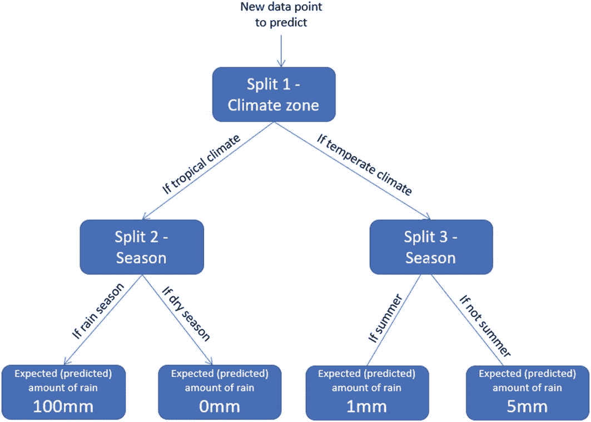
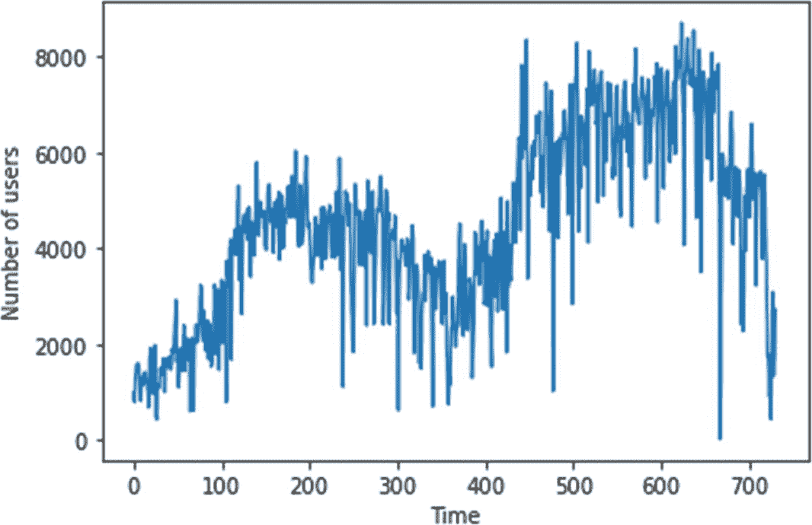
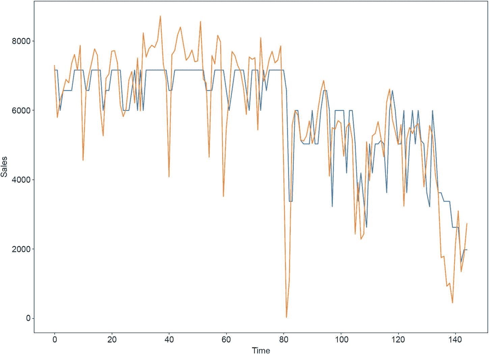
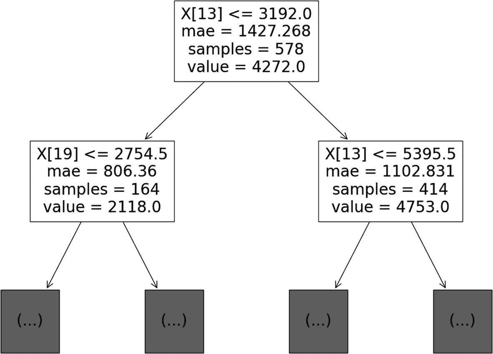

# 12. 决策树模型

正如你在前一章中所发现的，监督式机器学习模型分为线性模型和非线性模型。在本章中，你将了解**决策树**模型。它是最简单的非线性机器学习模型之一。

决策树模型背后的思想可以直观地理解为一长串 *if-else 语句*。这些 if-else 决策将用于预测阶段：如果某个条件为真，模型会预测某个**结果 x**，否则将**预测 y**。如你所见，这种逻辑中不存在线性趋势，因此，*决策树模型可以拟合非线性趋势*。

让我们先看一个实际应用这种决策树逻辑的例子，暂不讨论决策树从何而来。图 12-1 展示了一个示例决策树，它可以帮助你直观地理解决策树的工作原理。该决策树根据气候带和季节预测平均降雨量。



图 12-1

决策树的一个直观示例

## 数学原理

现在你将了解决策树算法的数学和算法组成部分。拟合决策树有多种方法，但最常见的方法包含两个步骤：分裂（也称为生长）树和剪枝树。

### 分裂

既然你已经看到决策树仅仅是多个决策分裂的层次化排序，那么合乎逻辑的问题就是这些决策从何而来。

这一切都始于一个包含目标变量和多个解释变量的数据集。现在存在大量可能的分裂，但你需要选择一个。第一个分裂应该是能够获得**最低均方误差**的分裂。最终，即使只有一个分裂的模型也能用作预测模型。

既然你知道了分裂的目标，剩下的唯一任务就是测试每个可能的分裂，并评估哪个分裂能产生最低的均方误差。一旦你确定了最佳的第一个分裂，你就得到了两个组。然后你对这两个组分别重复此过程，这样你就得到四个组，依此类推。

在某个时刻，你将无法进一步分裂。这个时刻就是当每个组中只有一个数据点时。从逻辑上讲，单个数据点无法再分裂。

### 剪枝与降低复杂度

尽管可以让树继续分裂直到无法进一步分裂，但这并不一定是最佳做法。也可以允许组中包含稍多一些的数据点，以避免过拟合。

这可以通过多种方式实现。一些实现允许一个剪枝过程，该过程首先强制树完全分裂所有节点，然后添加剪枝阶段来剪掉那些最不需要的分支。

其他实现则允许你直接添加一个复杂度参数，该参数将直接防止树变得过于详细。这是一个非常适合通过网格搜索进行优化的参数。


## 示例

在本章中，你将处理来自一家共享单车公司的数据。你可以通过以下链接从 UCI 机器学习档案库下载数据：[`https://archive.ics.uci.edu/ml/datasets/bike+sharing+dataset`](https://archive.ics.uci.edu/ml/datasets/bike%252Bsharing%252Bdataset)。

这将是一个颇具难度的示例。在这个数据集中，你需要预测每日租用单车用户的数量。可以想象，这个数量在很大程度上取决于天气。正如我在前一章所解释的，天气很难预测，如果你的预测与天气有很强的相关性，你就会知道这将是一个巨大的挑战。

首先，让我们看一下数据，了解你将要处理的内容。这在代码清单 12-1 中完成，并将得到图 12-2 中的图表。



图 12-2

共享单车用户数量图

```
import pandas as pd
import matplotlib.pyplot as plt
data = pd.read_csv('bikedata/day.csv')
ax = data['cnt'].plot()
ax.set_ylabel('Number of users')
ax.set_xlabel('Time')
plt.show()
代码清单 12-1
导入单车数据
```

如图所示，这里有很多信息。存在一个难以估计的趋势，同时也有大量的日常波动。当你查看数据集时，会发现其中包含大量天气数据。这就是挑战所在：共享单车用户的数量在很大程度上取决于当天的天气，但天气是无法提前预知的。

在这种情况下，你唯一能做的就是尝试进行大量的特征工程，为模型创建许多有价值的变量。在代码清单 12-2 的代码块中，你将使用一些现有变量，并了解如何创建多个变量。解释变量的完整列表如下：

*   *原始变量* ‘season’：（1：春季，2：夏季，3：秋季，4：冬季）
*   *原始变量* ‘yr’：年份
*   *原始变量* ‘mnth’：月份
*   *原始变量* ‘holiday’：是否为节假日
*   *原始变量* ‘weekday’：星期几
*   *原始变量* ‘workingday’：是否为工作日（非节假日/周末）
*   *‘cnt’的最近 7 天值*：用户数量的自回归成分
*   *‘weathersit’的最近 7 天值*：天气状况，从 4（非常恶劣）到 1（良好）
*   *‘temperature’的最近 7 天值*
*   *‘humidity’的最近 7 天值*

你还将**删除数据集中的一个有影响力的异常值**。这是一个极端的观测值，很难理解其出现的原因。你可以在图 12-2 中看到它，表现为索引 477 处的一个极低峰值。由于它可能对模型产生负面影响，最好将其排除在训练数据之外。

在 650 到 700 之间还有另一个低峰值，但由于这部分数据将是我们的测试集，对其进行处理是不公平的。**从测试集中移除异常值相当于作弊**，因为这会使我们的测试分数高于实际情况。目标始终是获得尽可能可靠的模型误差估计，以便在实际应用模型时预测其行为。

```
# 用户数量的最近 7 天值（自回归）
data['usersL1'] = data['cnt'].shift(1)
data['usersL2'] = data['cnt'].shift(2)
data['usersL3'] = data['cnt'].shift(3)
data['usersL4'] = data['cnt'].shift(4)
data['usersL5'] = data['cnt'].shift(5)
data['usersL6'] = data['cnt'].shift(6)
data['usersL7'] = data['cnt'].shift(7)
# 天气状况的最近 7 天值
data['weatherL1'] = data['weathersit'].shift(1)
data['weatherL2'] = data['weathersit'].shift(2)
data['weatherL3'] = data['weathersit'].shift(3)
data['weatherL4'] = data['weathersit'].shift(4)
data['weatherL5'] = data['weathersit'].shift(5)
data['weatherL6'] = data['weathersit'].shift(6)
data['weatherL7'] = data['weathersit'].shift(7)
# 温度的最近 7 天值
data['tempL1'] = data['temp'].shift(1)
data['tempL2'] = data['temp'].shift(2)
data['tempL3'] = data['temp'].shift(3)
data['tempL4'] = data['temp'].shift(4)
data['tempL5'] = data['temp'].shift(5)
data['tempL6'] = data['temp'].shift(6)
data['tempL7'] = data['temp'].shift(7)
# 湿度的最近 7 天值
data['humL1'] = data['hum'].shift(1)
data['humL2'] = data['hum'].shift(2)
data['humL3'] = data['hum'].shift(3)
data['humL4'] = data['hum'].shift(4)
data['humL5'] = data['hum'].shift(5)
data['humL6'] = data['hum'].shift(6)
data['humL7'] = data['hum'].shift(7)
data = data.dropna()
data = data.drop(477)
X = data[['season', 'yr', 'mnth', 'holiday', 'weekday', 'workingday',
'weatherL1', 'weatherL2', 'weatherL3', 'weatherL4', 'weatherL5', 'weatherL6', 'weatherL7',
'usersL1','usersL2', 'usersL3', 'usersL4', 'usersL5', 'usersL6', 'usersL7',
'tempL1', 'tempL2', 'tempL3', 'tempL4', 'tempL5', 'tempL6', 'tempL7',
'humL1', 'humL2','humL3', 'humL4', 'humL5', 'humL6', 'humL7']]
y = data['cnt']
代码清单 12-2
创建训练数据集
```

现在，让我们进入模型构建阶段。首先，我们构建一个不进行任何超参数调优的模型。示例如代码清单 12-3 所示。

```
# 创建训练集和测试集划分
from sklearn.model_selection import train_test_split
X_train, X_test, y_train, y_test = train_test_split(X, y, test_size=0.20, random_state=12345, shuffle=False)
from sklearn.tree import DecisionTreeRegressor
my_dt = DecisionTreeRegressor(random_state=12345)
my_dt.fit(X_train, y_train)
from sklearn.metrics import r2_score
print(r2_score(list(y_test), list(my_dt.predict(X_test))))
代码清单 12-3
拟合模型
```

这个未经优化的初始模型在测试集上的 R2 得分为 **0.166**。结果还不理想，因此我们来看看通过网格搜索能做些什么。在这个网格搜索中，我们将调整几个超参数：

*   min_samples_split：分裂一个内部节点所需的最小样本数。值越大，分裂次数越少。分裂次数越少，树的特异性越低，因此有助于防止过拟合。
*   max_features：寻找最佳分裂时需要考虑的特征（变量）数量。使用较少的特征时，会强制分裂彼此不同，但同时可能会阻碍树找到真正最佳的分裂。
*   *误差准则*：由于我们在优化 R2，我们可能希望使用 R2 作为最佳分裂决策的误差准则。然而，它并不可用。因此，尝试使用 MSE 和 MAE，看看哪一个能让我们优化整棵树的 R2，会是一个有趣的做法。

DecisionTreeRegressor 中还有更多超参数。你可以参考 scikit-learn 的 DecisionTreeRegressor 页面来查找它们。请大胆尝试并调整这些不同的参数。网格搜索如代码清单 12-4 所示。


```
from sklearn.model_selection import GridSearchCV
my_dt = GridSearchCV(DecisionTreeRegressor(random_state=44),
{'min_samples_split': list(range(20,50, 2)),
'max_features': [0.6, 0.7, 0.8, 0.9, 1.],
'criterion': ['mse', 'mae']},
scoring = 'r2', n_jobs = -1)
my_dt.fit(X_train, y_train)
print(r2_score(list(y_test), list(my_dt.predict(X_test))))
清单 12-4
添加网格搜索
```

在示例笔记本中运行此代码时，它生成了一个 **0.55** 的 R2 分数。虽然这仍然不算出色，但相比之前的模型已经有了很大的提升。要找出选择了哪些参数，你可以使用清单 12-5 中的代码获取最佳参数。

```
print(my_dt.best_estimator_)
清单 12-5
查找最佳参数
```

这将显示最佳参数，如下所示：

```
DecisionTreeRegressor(criterion='mae', max_features=0.8, min_samples_split=48,random_state=44)
```

显然，这种由误差准则 **MAE 而非 MSE**、**max_features 为 0.8** 和 **min_samples_split 为 48** 组成的组合，是预测性能最佳的模型。现在，让我们用这个模型进行预测，并使用清单 12-6 绘制其拟合效果图。

```
fcst = my_dt.predict(X_test)
plt.plot(list(fcst))
plt.plot(list(y_test))
plt.ylabel('销售额')
plt.xlabel('时间')
plt.show()
清单 12-6
绘制预测图
```

你将得到的图如图 12-3 所示。



图 12-3

共享单车用户预测图

决策树模型另一个非常实用的地方是，你可以获得一个显示已识别出的不同分裂点的图。这种图有时也被称为**树状图**。尽管决策树模型的性能较低，但其强项之一在于能够详细解释模型的决策。你可以使用清单 12-7 来实现这一点。

```
from sklearn.tree import plot_tree
plot_tree(my_dt.best_estimator_, max_depth=1)
plt.show()
清单 12-7
绘制树状图
```

这段代码将显示决策树的起始部分，如图 12-4 所示。你可以通过增加绘图的 max_depth 来进行更大范围的提取。



图 12-4

绘制决策树

这种图展示了使用像决策树模型这样更简单的模型所带来的真正附加价值之一。它们允许对模型进行解释，这在许多情况下可能是必需的。你在后续章节中看到的模型，其可解释性将越来越差。

## 要点总结

*   决策树模型是最简单的非线性监督机器学习模型之一。

*   你可以调整决策树的复杂度，这决定了决策树的长度和复杂程度。

*   复杂的树存在过拟合的风险：它们会学习训练数据中过于细节的模式。你可以使用网格搜索来优化树的复杂度。

*   你可以为拟合后的决策树创建树状图，以获取模型使用的所有分裂点和变量。

