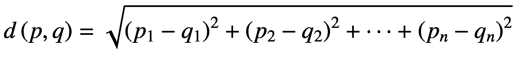
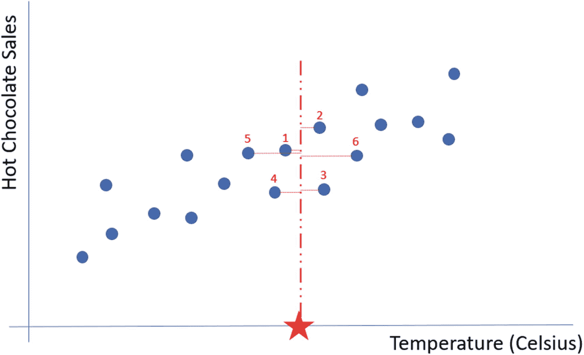
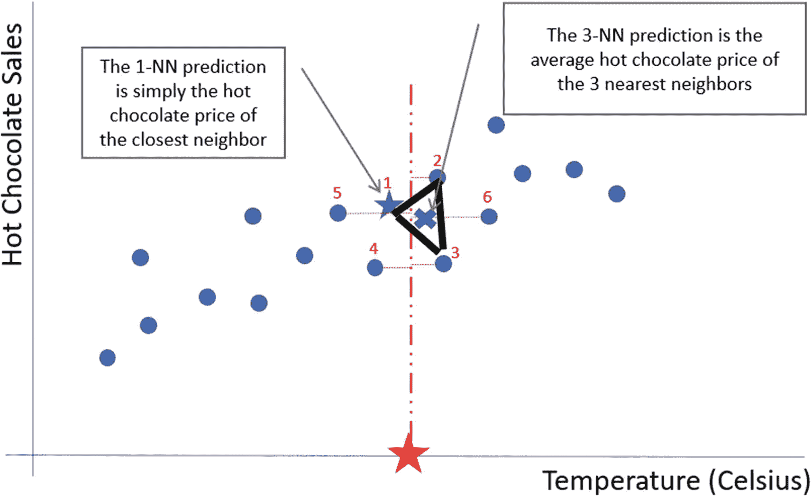
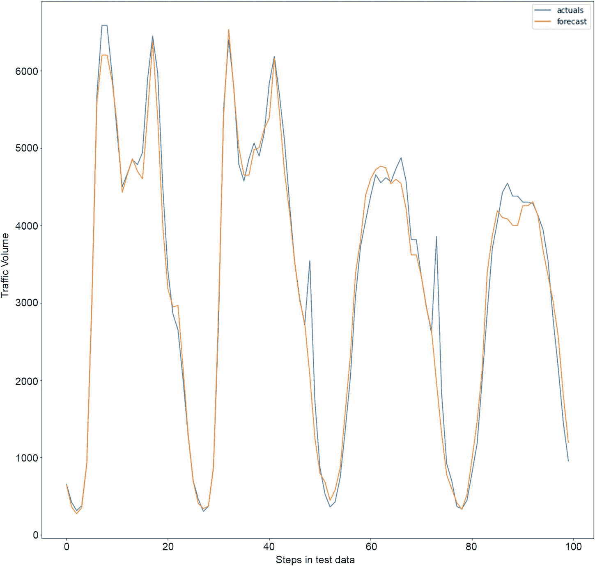

# 13. kNN 模型

在本章中，你将了解 **kNN 模型**。kNN 模型是本书介绍的第三种监督机器学习模型。与前两种模型一样，kNN 模型也属于较简单的模型。从直觉上理解该模型的工作原理也很容易。其缺点是，有时它的性能不足以与后续章节中你将看到的更高级的机器学习模型相竞争。

## 直观解释

那么 kNN 模型究竟是关于什么的呢？其背后的直观想法很简单：你使用离新数据点最近的数据点来预测它。如何最好地预测明天的天气？看看今天的天气！而要预测下个月的销售额，它很可能与这个月的销售额相当接近。

然而，当考虑到最近的数据点可能存在于多个维度时，情况就变得更加复杂了。例如，如果下个月的销售额是在十二月，那么该数据点在月份维度上可能最接近另一个十二月。

一旦你有了多个变量，这种距离的概念就成为了预测新值的一个非常强大的概念。简而言之，kNN 模型试图找到数据点的**最近邻**，并使用它们的值作为预测。

## 最近邻的数学定义

最近邻的定义基于计算新数据点到每个现有数据点的**欧几里得距离**。欧几里得距离是最常见的距离度量。你可能每天都在使用它，比如谈论从家到工作地点的距离等等。你可以用数学公式表示如下：



在这个公式中，**p** 和 **q** 是两个数据点，每个都有 n 个维度。这通常意味着数据集中有 **n** 个解释变量。你对每个维度的平方距离求和，最后取平方根。

字母 **k** 用于表示要使用的邻居数量。要计算 *k 个最近邻*，你只需计算新数据点与训练数据中每个数据点之间的距离。根据你为 k 选择的数值，取距离最小的 k 个数据点。

图 13-1 中的图表展示了该算法在二维情况下的工作原理。训练数据集中的所有数据点都可以被选为任何新点的邻居。作为一个虚拟示例，让我们再次想象这是关于基于温度的热巧克力销售情况。



图 13-1：一个新数据点的六个最近邻

图中的蓝点是过去的真实观测值，我们观测到了温度和热巧克力的价格。假设我们已经知道明天的温度，并且想要预测明天的热巧克力销售额。

如果我们为此使用 kNN 算法，我们需要识别最近的邻居：在图中，它们根据距离进行了标注。在这种情况下，“最近”的概念仅基于一个变量：温度。在变量更多的情况下，使用前面提到的公式进行计算是相同的，但很难将这种多变量情况可视化。

### 将 k 个邻居合并为一个预测

一旦你确定了离新数据点最近的 **k 个邻居**，你还没有得到预测结果。还需要一步才能将多个邻居转换为一个预测。有两种常用的方法：

1.  第一种方法是简单地取 k 个最近邻的目标值的**平均值**。然后将这个平均值用作预测。

2.  第二种方法是取 k 个最近邻的**加权平均值**，并使用它们的距离作为反比权重，这样距离更近的点在预测中权重更大。

### 确定邻居数量 k

最后还需要决定一件事，那就是在预测中要包含多少个最近邻居。这由 k 的值决定。为了将其应用于之前的例子，我们来看两种不同的情况——一个最近邻居和三个最近邻居——并观察预测结果有何不同。这两种情况如图 13-2 所示。



图 13-2：使用不同邻居数量得到的两种备选预测结果

要使用的邻居数量，即 *k*，是 kNN 模型中的一个超参数，最好通过超参数调优来优化。你在本书中看到的方法是网格搜索交叉验证，这是超参数调优的首选方法之一。在本章中，你还会发现另一种方法：随机搜索。我们先介绍一个例子，使其更具实践性。

### 使用 kNN 预测交通流量

在这个例子中，你将使用来自 94 号州际公路的每小时交通流量数据集。你可以在 UCI 机器学习仓库中找到这个数据集：`https://archive.ics.uci.edu/ml/datasets/Metro+Interstate+Traffic+Volume`。

如果你下载这些数据，你会发现它包含每小时的交通流量，以及一些天气数据和节假日信息。对于当前这个例子，我们避免依赖天气数据，而是基于季节性和节假日进行预测。毕竟，我们可以想象交通流量在很大程度上取决于一天中的时间、工作日和节假日。

要将数据导入 Python，你可以使用代码清单 13-1 中的代码。

```python
import pandas as pd
data = pd.read_csv('Metro_Interstate_Traffic_Volume.csv.gz',compression='gzip')
```

*代码清单 13-1：导入交通流量数据*

导入这些数据后，我们来创建对于本例的建模练习似乎必要的季节性变量。使用代码清单 13-2 中的代码创建以下变量：

*   年份
*   月份
*   星期几
*   小时
*   是否节假日

```python
data['year'] = data['date_time'].apply(lambda x: x[:4])
data['month'] = data['date_time'].apply(lambda x: x[5:7])
data['weekday'] = pd.to_datetime(data['date_time']).apply(lambda x: x.weekday())
data['hour'] = pd.to_datetime(data['date_time']).apply(lambda x: x.hour)
data['isholiday'] = (data['holiday'] == 'None').apply(float)
```

*代码清单 13-2：特征工程，创建额外的解释变量*

下一步是将数据拆分为训练集和测试集，并拟合一个默认的 kNN 模型。这将让你初步了解使用此类模型可能获得的 R² 值。该代码如代码清单 13-3 所示。

```python
# 创建对象 X 和 y
X = data[['year', 'month', 'weekday', 'hour', 'isholiday']]
y = data['traffic_volume']
# 创建训练集测试集划分
from sklearn.model_selection import train_test_split
X_train, X_test, y_train, y_test = train_test_split(X, y, test_size=100, random_state=12345, shuffle=False)
from sklearn.neighbors import KNeighborsRegressor
my_dt = KNeighborsRegressor()
my_dt.fit(X_train, y_train)
fcst = my_dt.predict(X_test)
from sklearn.metrics import r2_score
print(r2_score(list(y_test), list(fcst)))
```

*代码清单 13-3：创建训练-测试集划分并计算默认模型的 R²*

令人惊喜的是，这个模型的 R² 得分已经非常好了：**0.969**。这意味着预测结果与完美值相差不远，所以让我们尝试使用代码清单 13-4 中的代码进行可视化验证。

```python
import matplotlib.pyplot as plt
plt.figure(figsize=(20,20))
plt.plot(list(y_test))
plt.plot(list(fcst))
plt.legend(['实际值', '预测值'])
plt.ylabel('交通流量')
plt.xlabel('测试数据步数')
plt.show()
```

*代码清单 13-4：在测试集数据上创建图表*

这段代码将生成如图 13-3 所示的图表。



图 13-3：该图显示了在测试数据集上的预测性能

### 对 kNN 进行网格搜索

scikit-learn 实现默认使用的邻居数量是五个。现在作为最后一步，我们尝试添加一个网格搜索，看看不同数量的邻居是否能带来更好的性能。我们以 2 为增量测试邻居数量，以稍微加快速度。这在代码清单 13-5 中完成。

```
from sklearn.model_selection import GridSearchCV
my_knn = GridSearchCV(KNeighborsRegressor(),
{'n_neighbors':[2, 4, 6, 8, 10, 12]},
scoring = 'r2', n_jobs = -1)
my_knn.fit(X_train, y_train)
print(r2_score(list(y_test), list(my_knn.predict(X_test))))
print(my_knn.best_estimator_)
代码清单 13-5
为 kNN 模型添加网格搜索交叉验证
```

使用这个调优后的模型获得的 R² 得分是 `0.9695`。该模型使用了八个最近邻居而不是五个，并且在 R² 得分上提高了 0.0002 点。这个提升非常小，因此几乎可以认为改进不存在。在这种情况下，默认模型从一开始就相当不错。

### 随机搜索：网格搜索的替代方案

作为本章的最后一个主题，我想介绍一种网格搜索的替代方案。这种替代方案称为随机搜索。随机搜索在直观上非常容易理解：它不是检查网格上超参数的每一种组合，而是检查超参数的一个随机选择。

这样做的主要原因是它快得多。此外，人们发现随机搜索通常能够获得与网格搜索非常接近的结果，因此速度上的提升是完全值得的。代码清单 13-6 展示了如何用随机搜索替换网格搜索。

```
from sklearn.model_selection import RandomizedSearchCV
my_knn = RandomizedSearchCV(KNeighborsRegressor(),
{'n_neighbors':list(range(1, 20))},
scoring = 'r2', n_iter=10, n_jobs = -1)
my_knn.fit(X_train, y_train)
print(r2_score(list(y_test), list(my_knn.predict(X_test))))
print(my_knn.best_estimator_)
代码清单 13-6
为 kNN 模型添加随机搜索交叉验证
```

随机搜索被允许在 1 到 20 之间选择任意 k 值。参数 `n_iter` 决定了在此范围内应**随机选择**的值的数量。请注意，选择是随机的，因此这可能会给出与网格搜索不同的结果。无法保证某个特定值会被包含在测试中。

为了与网格搜索进行公平比较，我们将 `n_iter` 设置为 6。由于网格搜索中测试了六个值，这使得两者等效。执行代码时，返回的解与网格搜索返回的解完全相同。

## 要点总结

*   kNN 模型基于其最近邻居的值进行预测。
*   通过计算平均值或基于距离的加权平均值，将邻居的值合并为预测结果。
*   距离度量通常使用欧几里得距离。
*   在组合中使用的邻居数量记为 k，是模型的一个超参数。
*   k 的值可以通过超参数调优来优化，例如通过网格搜索交叉验证。
*   随机搜索是网格搜索的一种替代方案，它速度更快，并且通常能给出（几乎）同样好的结果。