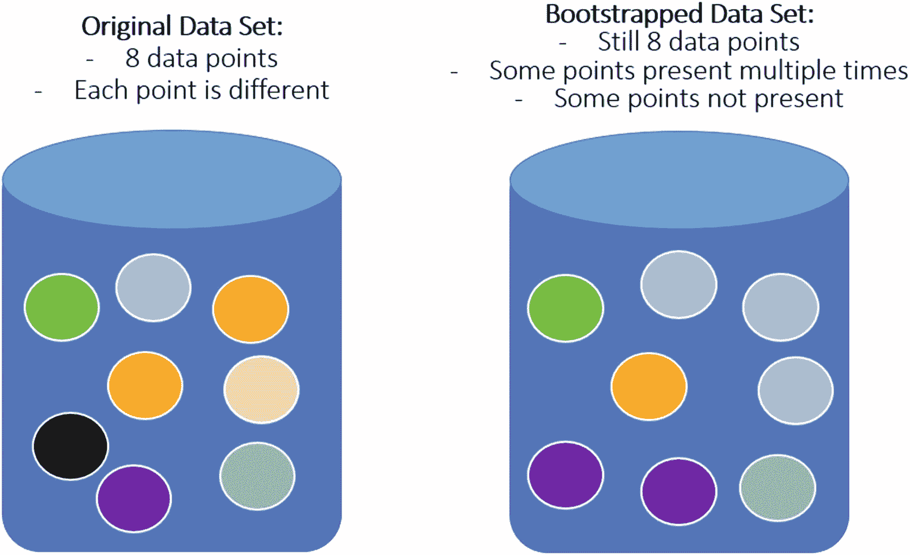
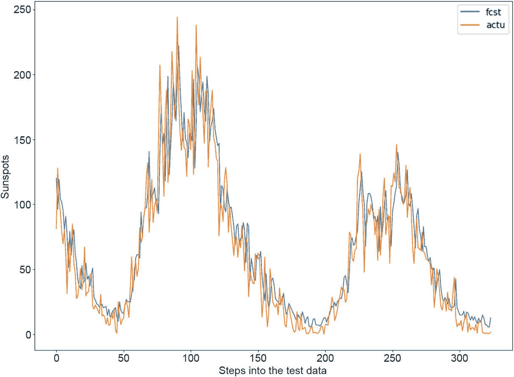
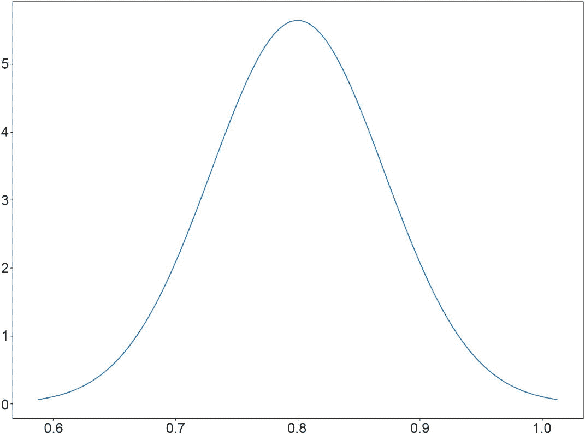
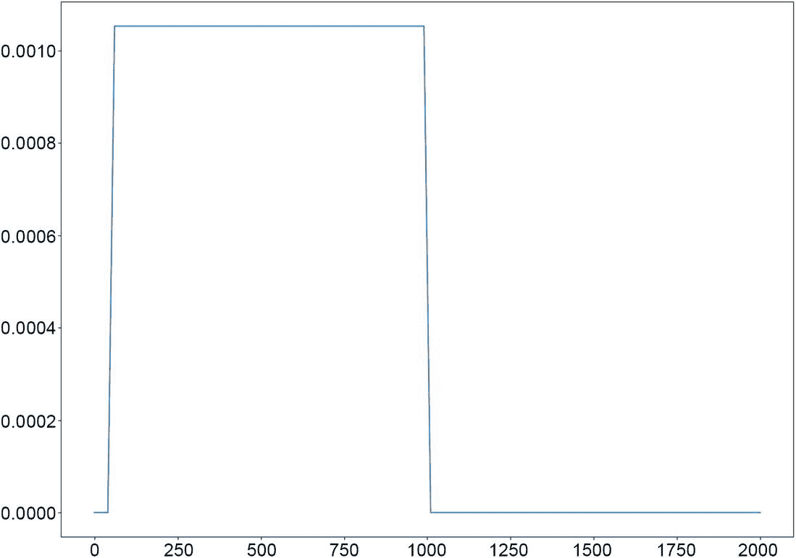
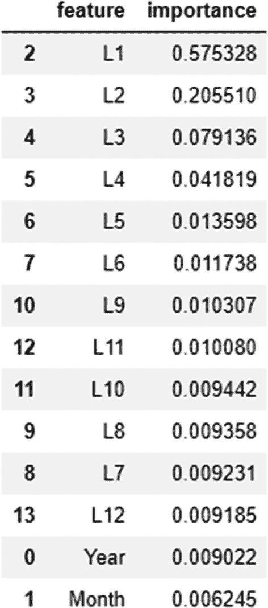

# 14. 随机森林

在本章中，你将了解**随机森林模型**。这是一个易于使用的模型，并且以性能卓越而闻名。随机森林以及你将在下一章中了解的 XGBoost 模型，是现代应用中最常用的两种机器学习算法。

市场上存在大量随机森林和 XGBoost 的变体，但如果你理解了这两种基础模型，适应任何变体都将相对容易。

## 随机森林背后的直观思想

随机森林*强烈基于决策树模型*，但为其增加了更多复杂性。顾名思义，随机森林由大量决策树组成，每棵树都有细微的差异。

随机森林的性能远优于决策树。通常，随机森林可以组合数百甚至数千个决策树模型。这些模型将在略有不同的数据上进行拟合，以确保它们不完全相同。简而言之，它是由大量决策树组成的，这些决策树做出的预测应该彼此接近，但又并非完全相同。

当单个机器学习模型有时会出错时，大量机器学习模型的平均预测则不太可能出错。这一思想是**集成学习**的基础。

在随机森林中，集成学习应用于许多决策树的重复组合。集成学习可以应用于大量机器学习模型的任何组合。之所以使用决策树，是因为它已被证明是一种性能卓越且易于配置的模型。

## 随机森林概念 1：集成学习

那么集成学习究竟是如何工作的呢？你可以理解，拥有 1000 棵完全相同的决策树，与只使用一棵决策树相比，没有任何附加价值。

在集成模型中，每个单独的模型都必须与其他模型略有不同。有两种著名的创建集成的方法：**装袋**和**提升**。

随机森林使用装袋来创建决策树的集成。在下一章中，你将了解 XGBoost 算法，它使用了另一种称为提升的技术。

让我们来探索装袋背后的思想。装袋是 Bootstrap 聚合的简称。其思想包含两个部分：

1.  Bootstrap

2.  聚合

### 装袋概念 1：Bootstrap

**Bootstrap** 是该算法的关键部分之一，它确保每个单独的学习器都能拟合出略有不同的决策树。Bootstrap 意味着对于每个单独的学习器，数据集是通过**重采样过程**创建的。

重采样意味着基于原始数据集创建一个新的数据集。新数据集将通过从原始数据集中随机选择数据点来创建。然而，这里需要认识到的重要一点是，重采样是**有放回地**进行的。

有放回地重采样会将每个被采样的数据点放回母总体中。这使得原始数据集中的单个数据点有可能在 bootstrap 数据集中被多次选中。原始数据中也会有一些数据点不会被选入 bootstrap 数据集。示意图如图 14-1 所示。



图 14-1

Bootstrap 过程

### 装袋概念 2：聚合

**聚合**部分描述了使用多个学习器的事实。在随机森林中，bootstrap 过程会执行多次。具体次数由一个名为 **n_estimators** 的超参数定义。

对于每个 n_estimators，都会使用一个 bootstrap 数据集构建一棵决策树。这将生成大量决策树，由于数据集的差异，这些树都略有不同。最后，你可以使用每棵决策树进行预测。然而，你会得到许多略有不同的预测。

这个问题的解决方案在于聚合部分。为了将所有单独的决策树预测组合成一个随机森林预测，你只需取所有单独预测的平均值。这相对简单，但却是该算法的关键部分。

其背后的思想是，许多弱学习器的聚合将导致误差相互平均抵消。这使得随机森林成为一种性能非常卓越的机器学习算法。

## 随机森林概念 2：变量子集

除了 bootstrap 方法之外，随机森林还有**第二个过程**来确保各个学习器不相同。这个过程不适用于使用或不使用的数据点，而是**适用于使用或不使用的变量**。

如第 12 章所述，决策树会检查每个变量以找到最佳分裂点并将其添加到树中。然而，当使用每个变量的一个子集时，你只让树在随机选择的变量数量中检查分裂点。具体数量在大多数数学描述中由一个名为 **mtry** 的超参数定义，在 scikit-learn 中则称为 **max_features**。虽然这有时可能导致选择次优的分裂点，但它确实有助于使各个决策树彼此不同。

这个值通常在 **80%** 左右，但也可以更高或更低。**n_estimators** 和 **max_features** 共同构成了随机森林模型的主要超参数。


## 使用随机森林预测太阳黑子

让我们来开发一个随机森林模型的示例。在这个例子中，你将再次使用第 5 章中用过的太阳黑子数据。第 5 章中的 ARMA 模型能够获得 **0.84** 的 R2 值。这次，我们尝试预测每月的太阳黑子数量，而不是像之前例子那样预测年度总和。你可以使用代码清单 14-1 导入数据。

```
import pandas as pd
data = pd.read_csv('Ch05_Sunspots_database.csv')
data = data.iloc[:,[1,2]]
代码清单 14-1
导入数据
```

现在需要添加一些特征工程。让我们添加年份和月份变量以考虑季节性，以及目标变量过去 12 个月的滞后版本。这项任务预计会稍微困难一些，因为模型需要学习更细微的变化。代码清单 14-2 展示了如何实现这一点。

```
# 季节性变量
data['Date'] = pd.to_datetime(data['Date'])
data['Year'] = data['Date'].apply(lambda x: x.year)
data['Month'] = data['Date'].apply(lambda x: x.month)
# 添加一年的滞后数据
data['L1'] = data['Monthly Mean Total Sunspot Number'].shift(1)
data['L2'] = data['Monthly Mean Total Sunspot Number'].shift(2)
data['L3'] = data['Monthly Mean Total Sunspot Number'].shift(3)
data['L4'] = data['Monthly Mean Total Sunspot Number'].shift(4)
data['L5'] = data['Monthly Mean Total Sunspot Number'].shift(5)
data['L6'] = data['Monthly Mean Total Sunspot Number'].shift(6)
data['L7'] = data['Monthly Mean Total Sunspot Number'].shift(7)
data['L8'] = data['Monthly Mean Total Sunspot Number'].shift(8)
data['L9'] = data['Monthly Mean Total Sunspot Number'].shift(9)
data['L10'] = data['Monthly Mean Total Sunspot Number'].shift(10)
data['L11'] = data['Monthly Mean Total Sunspot Number'].shift(11)
data['L12'] = data['Monthly Mean Total Sunspot Number'].shift(12)
代码清单 14-2
特征工程
```

现在你已经有了一个数据集，让我们进行训练-测试分割，并使用默认超参数拟合随机森林。使用代码清单 14-3 中的代码来拟合这个默认模型。

```
# 创建 X 和 y 对象
data = data.dropna()
y = data['Monthly Mean Total Sunspot Number']
X = data[['Year', 'Month', 'L1', 'L2', 'L3', 'L4', 'L5', 'L6', 'L7', 'L8', 'L9', 'L10', 'L11', 'L12']]
# 创建训练测试分割
from sklearn.model_selection import train_test_split
X_train, X_test, y_train, y_test = train_test_split(X, y, test_size=0.1, random_state=12345, shuffle=False)
from sklearn.ensemble import RandomForestRegressor
my_rf = RandomForestRegressor()
my_rf.fit(X_train, y_train)
fcst = my_rf.predict(X_test)
from sklearn.metrics import r2_score
r2_score(list(y_test), list(fcst))
代码清单 14-3
拟合默认的随机森林回归器
```

使用这个模型，你将获得预测的 R2 分数 **0.863**。

## 对随机森林的两个主要超参数进行网格搜索

这已经是一个很好的结果，但一如既往，让我们看看是否可以通过网格搜索超参数调优来优化它。这将在代码清单 14-4 中展示。

```
from sklearn.model_selection import GridSearchCV
my_rf = GridSearchCV(RandomForestRegressor(),
{'max_features':[0.65, 0.7, 0.75, 0.8, 0.85, 0.9, 0.95],
'n_estimators': [10, 50, 100, 250, 500, 750, 1000]},
scoring = 'r2', n_jobs = -1)
my_rf.fit(X_train, y_train)
print(r2_score(list(y_test), list(my_rf.predict(X_test))))
print(my_rf.best_params_)
代码清单 14-4
使用超参数调优拟合随机森林回归器
```

这将获得 **0.870** 的 R2 分数，略优于默认版本。识别出的最优超参数是 max_features (mtry) 为 **0.7**，n_estimators (ntrees) 为 **750**。

现在查看性能图以了解其在测试数据上的表现会很有用。这可以通过代码清单 14-5 完成，并将得到图 14-2。



图 14-2

每月太阳黑子预测图

```
import matplotlib.pyplot as plt
plt.plot(list(fcst))
plt.plot(list(y_test))
plt.legend(['fcst', 'actu'])
plt.ylabel('Sunspots')
plt.xlabel('Steps into the test data')
plt.show()
代码清单 14-5
获取测试数据上的预测图
```

## 使用分布进行随机搜索 CV

作为本章的额外步骤，让我们更深入地探讨你在上一章中了解的**随机搜索 CV**。你会明白，模型越复杂，网格搜索的负担就越重。替代方法变得越来越有趣。你将在接下来的章节中发现更多超参数调优的方法。

在这个随机搜索的应用中，你将使用**分布**而不是可能值的列表来指定要为不同超参数测试哪些值。这是 `RandomizedSearchCV` 的一个强大功能，尤其是当你对超参数最可能的值有所了解时。

让我们从识别 max_features 和 n_estimators 的分布开始，然后将它们放入 `RandomizedSearchCV` 中。

### max_features 的分布

对于 max_features 的值，你之前测试了 0.65 到 0.95 之间的值，步长为 0.05。最常用的分布是**正态分布**，所以让我们看看如何将正态分布用于此。

你可以使用代码清单 14-6 中的代码来尝试不同的正态分布，并检查它们是否合适。正态分布由均值和标准差定义，因此你可以调整这两个值。

```
import numpy as np
import scipy.stats as stats
import math
mu = 0.8
variance = 0.005
sigma = math.sqrt(variance)
x = np.linspace(mu - 3*sigma, mu + 3*sigma, 100)
plt.plot(x, stats.norm.pdf(x, mu, sigma))
plt.show()
代码清单 14-6
测试 max_features 的正态分布
```

如图 14-3 所示，均值为 0.8、标准差为 0.05 的正态分布很好地覆盖了 0.65–1.0 的范围。该图中的 x 轴表示 max_features 的值，y 轴表示该值被采样到随机搜索中的相应概率。



图 14-3

均值为 0.8、标准差为 0.05 的正态分布

由于这些值似乎非常适合 max_features，我们将在 `RandomizedSearchCV` 中使用这个分布。


### n_estimators 的分布

对于 n_estimators 的分布，我们尝试一些不同的方法。假设我们想要测试 50 到 1000 之间的值，但我们对 n_estimators 的实际值应该是什么并没有很好的想法。

这意味着**均匀分布**可能是合适的：在均匀分布中，你指定一个最小值和最大值，介于两者之间的所有值被选中的概率**均等**。如代码清单 14-7 所示。

```
x = np.linspace(0, 2000, 100)
plt.plot(x, stats.uniform.pdf(x, 50, 950))
plt.show()
代码清单 14-7
测试 n_estimators 的均匀分布
```

生成的图表如图 14-4 所示。



图 14-4

最小值为 50、最大值为 1000 的均匀分布

然而，这里有一个小问题。均匀分布返回的是浮点数，而 n_estimators 只能接受**整数**。对于均匀整数，更好的替代方案是使用 **scipy.stats.randint** 函数，该函数返回一个介于最小值和最大值之间的随机整数。

### 拟合 RandomizedSearchCV

现在，我们使用代码清单 14-8 中的代码来拟合 RandomizedSearchCV。

```
from sklearn.model_selection import RandomizedSearchCV
# 指定要从中抽样的分布
distributions = {
'max_features': stats.norm(0.8, math.sqrt(0.005)),
'n_estimators': stats.randint(50, 1000)
}
# 创建搜索对象
my_rf = RandomizedSearchCV(RandomForestRegressor(),
distributions, n_iter=10,
scoring = 'r2',
n_jobs = -1,
random_state = 12345)
# 拟合搜索
my_rf.fit(X_train, y_train)
# 打印结果
print(r2_score(list(y_test), list(my_rf.predict(X_test))))
print(my_rf.best_params_)
代码清单 14-8
使用两个分布的 RandomizedSearchCV
```

你应该得到的结果是 R2 为 **0.86**，选定的超参数如下所示。请注意，由于随机性，你可能会得到略有不同的结果：

*   ‘max_features’: 0.70
*   ‘n_estimators’: 819

R2 略低于网格搜索得到的结果。然而，你应该会观察到执行时间的大幅提升。RandomizedSearchCV 速度更快，而性能损失却非常微小：这是使用 RandomizedSearchCV 而非 GridSearchCV 的有力论据。

## 随机森林的解释：特征重要性

到目前为止，你应该已经明白，随机森林是一个相对复杂的模型。在进行预测时，它结合了许多决策树的预测结果。这使得模型具有出色的性能，但也使得模型相对难以解释。

对于决策树模型，你已经了解了如何绘制树形图并根据新观测值跟踪其决策过程。而对于随机森林，你需要多次执行此操作，这使得过程非常困难。

幸运的是，存在一种解释随机森林的替代方法。这种方法称为特征重要性。

每个变量的特征重要性是在随机森林拟合过程中全程计算的。每当一个变量被用于分裂时，该分裂带来的误差减少量就会被累加到该变量的特征重要性上。在算法结束时，这些累加的误差会被标准化，使得所有变量的特征重要性之和为 1.0。

变量的特征重要性越高，它在模型中扮演的角色就越重要，因此对你的预测也就越有价值。

你可以使用代码清单 14-9 从随机森林中获取特征重要性。请注意，这里的随机森林是通过 RandomizedSearchCV 拟合的，这就是为什么你首先要调用 best_estimator。你还会看到如何将特征重要性数组组合成一个更易于访问的数据框。

```
fi = pd.DataFrame({
'feature': X_train.columns,
'importance': my_rf.best_estimator_.feature_importances_})
fi.sort_values('importance', ascending=False)
代码清单 14-9
特征重要性
```

结果如图 14-5 所示。



图 14-5

随机森林的特征重要性

如你所见，这里最重要的特征是 L1：1 阶滞后自回归分量。接下来的重要性是其他滞后项。我们可以从中理解到，模型主要是在学习自回归效应，其中较近的滞后项更为重要。这对于理解模型来说是一个有趣的发现。在某些情况下，这些信息还可以通过改进变量选择来帮助你进一步优化模型，或者为你如何改进特征工程提供线索。

## 关键要点

*   随机森林将 Bagging 方法应用于决策树模型。
*   Bagging 是一种集成方法：它多次拟合相同的模型，并将其平均值作为预测结果。
*   随机森林有两个主要的超参数：
    *   森林中使用的树的数量
    *   每次决策树分裂时使用的随机选择变量的数量
*   随机搜索是一种更快的超参数调优方法，其结果通常不比网格搜索差太多。你可以为每个要调优的超参数指定概率分布，随机搜索将在这些分布中进行一定次数的抽样。
*   变量重要性是解释随机森林模型结果的一种方法。它也可以提示如何进一步改进模型。

