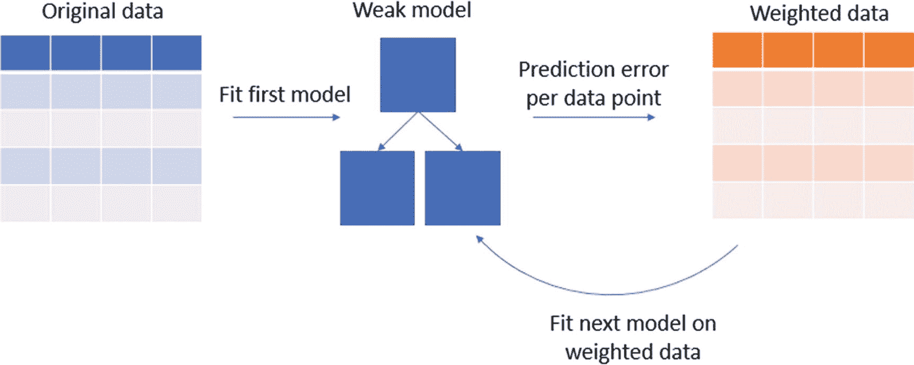
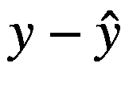
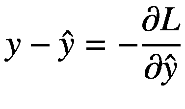
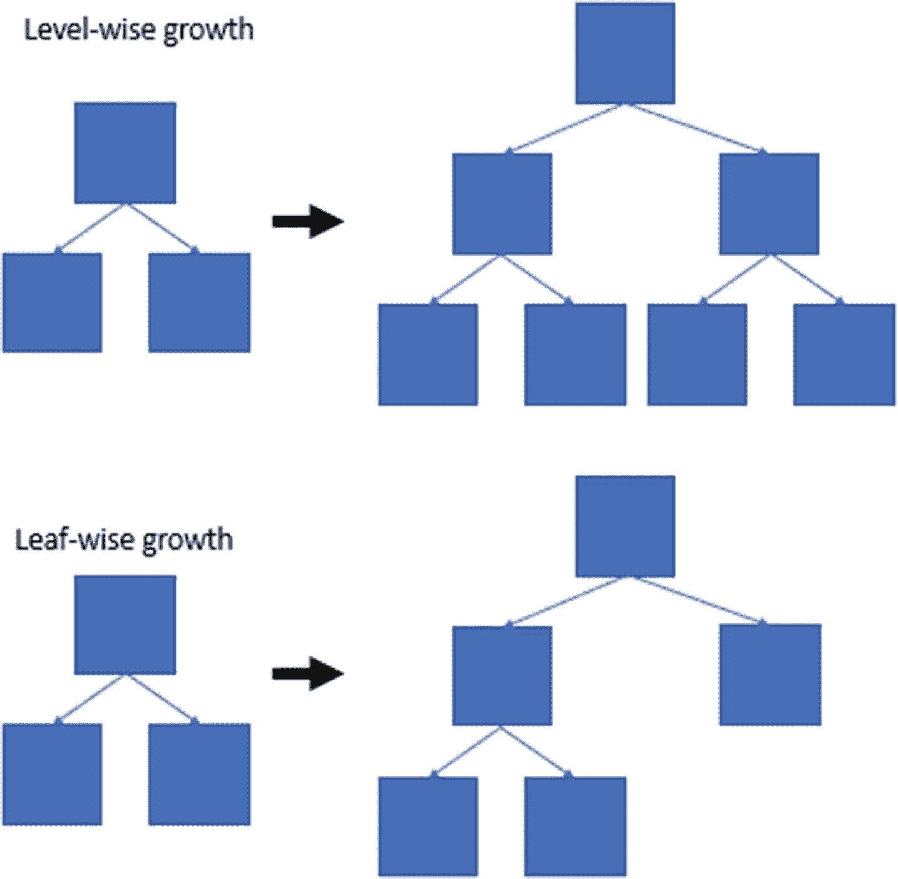
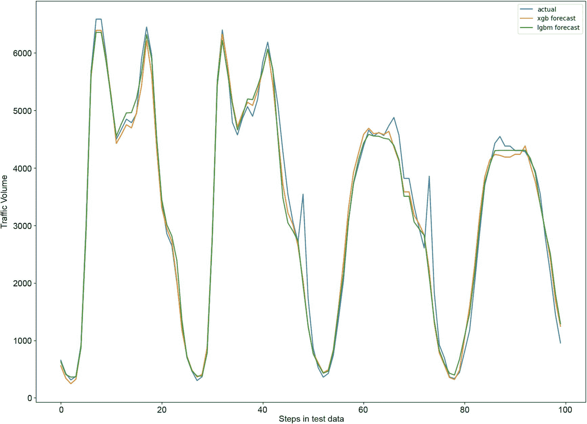
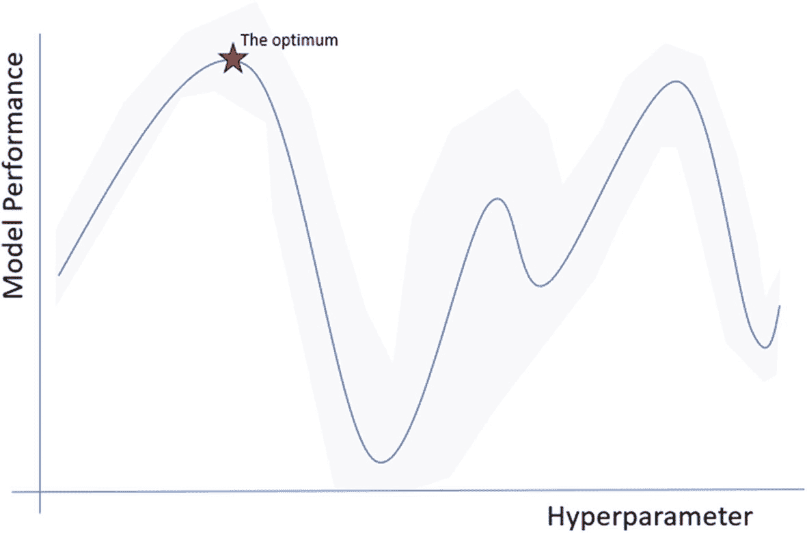
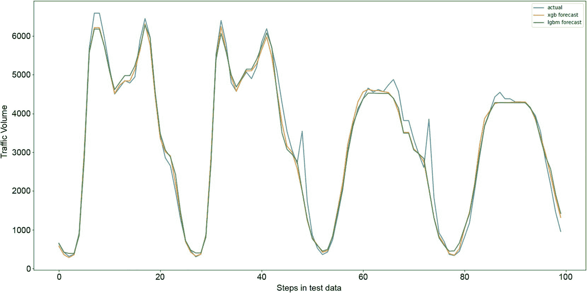

# 15. 使用 XGBoost 和 LightGBM 的梯度提升

在本章中，你将了解**梯度提升模型**。在上一章中，你了解了集成方法背后的思想。回顾一下，集成方法通过结合众多小型、低性能模型的预测来做出强大的预测。

## 提升：集成学习的一种不同方式

梯度提升结合了众多小型决策树模型来进行预测。当然，这些小决策树彼此不同；否则，使用更多数量的它们就没有任何优势了。

这里需要理解的重要概念是这些决策树是如何变得彼此不同的。这是通过一个称为**提升**的过程实现的。提升和你在上一章中看到的 Bagging 是集成学习的两种主要方法。

提升是一个**迭代过程**。它以智能的方式向集成模型中添加越来越多的弱学习器。在每一步中，单个数据点都会被赋予权重。已经预测良好的数据点对于将要添加的学习器来说并不重要。因此，新的弱学习器将*专注于学习尚未理解的内容，从而改进集成模型*。

你可以在图 15-1 中看到提升过程的示意图。通过这种方法，你迭代地拟合那些专注于数据中尚未理解部分的弱模型。在此过程中，你保留所有中间的弱模型。集成模型是所有那些弱学习器的组合。



图 15-1

提升过程


## 梯度提升中的梯度

这个迭代过程之所以被称为*梯度*提升，是有原因的。梯度是一个数学术语，指的是指向最陡坡度方向的偏导数向量场。简单来说，我们常将梯度比作上坡路的坡度：坡度越高，山丘越陡。梯度是通过对函数求导或求偏导来计算的。

在梯度提升中，当向模型添加额外的树时，目标是添加一棵能够最好地解释先前树未能解释的变异的树。因此，新树的目标是：



这可以改写为损失函数对 y 预测值的负偏导数：



你将其设置为新树的目标，以确保添加这棵树将解释整体梯度提升模型中最大量的额外变异。这就解释了为什么该模型被称为*梯度*提升。

## 梯度提升算法

有许多算法各自执行略有不同版本的梯度提升。当梯度提升方法首次被发明时，算法性能并不高，但随着 AdaBoost 算法的出现，情况发生了改变：这是第一个能够适应弱学习器的算法。

梯度提升算法是市场上性能最高的机器学习工具之一。在 AdaBoost 之后，文献中又增加了一系列略有不同的提升算法，包括 XGBoost、LightGBM、LPBoost、BrownBoost、MadaBoost、LogitBoost 和 TotalBoost。目前仍有许多贡献致力于改进梯度提升理论。在本章中，将介绍两种算法：XGBoost 和 LightGBM。

**XGBoost** 是最常用的机器学习算法之一。XGBoost 是快速获得良好性能的途径。由于它易于使用且性能卓越，是许多机器学习从业者的首选算法。

**LightGBM** 是另一种需要了解的梯度提升算法。目前，它不如 XGBoost 普及，但其受欢迎程度正在显著上升。LightGBM 相对于 XGBoost 的预期优势在于速度和内存使用方面的提升。

在本章中，你将了解这两种梯度提升算法的实现。

## XGBoost 与 LightGBM 的区别

如果你打算使用这两种梯度提升算法，理解它们之间的区别很重要。这也能让你洞察到市场上存在如此大量模型的原因所在。

区别在于它们在弱学习器（即单个决策树）中识别最佳分裂点的方式。请记住，决策树中的分裂是指树需要找到最能改进模型的那个分裂点。

寻找最佳分裂点最直观简单的想法是遍历所有潜在的分裂点并找到最佳的那个。然而，这非常耗时，而近期的算法提出了更好的替代方案。

XGBoost 提出的替代方案是使用**基于直方图的分裂**。在这种情况下，模型不是遍历所有可能的分裂点，而是为每个变量构建直方图，并利用这些直方图来找到每个变量的最佳分裂点。然后保留全局最佳的分裂点。

LightGBM 由微软发明，它有一种更高效的方法来定义分裂点。这种方法称为**基于梯度的单边采样（GOSS）**。GOSS 为每个数据点计算梯度，并利用此信息过滤掉梯度较低的数据点。毕竟，梯度低的数据点已经被很好地理解了，而梯度高的个体则需要更好地学习。LightGBM 还使用了一种称为**互斥特征捆绑（EFB）**的方法，该特性可以在有许多相关变量可供选择时加速处理。

另一个区别是，LightGBM 模型采用按叶子节点生长（最佳优先）的树生长方式，而 XGBoost 则按层级生长树。你可以在图 15-2 中看到这种区别。理论上，这种区别在准确性方面有利于 LightGBM，但在数据量较少的情况下，它伴随着更高的过拟合风险。



图 15-2

按叶子节点生长与按层级生长

有关梯度提升算法之间差异的更多详细信息，你可以查看微软的论文（[`www.microsoft.com/en-us/research/publication/lightgbm-a-highly-efficient-gradient-boosting-decision-tree/`](http://www.microsoft.com/en-us/research/publication/lightgbm-a-highly-efficient-gradient-boosting-decision-tree/)）。

## 使用 XGBoost 预测交通流量

在本章中，我们将使用与 kNN 模型相同的数据集：州际交通流量。在之前的示例中，我们获得了 **0.9695** 的 R2 值。梯度提升是一种性能更高的算法，让我们看看是否可以用它来改进这个已经很不错的分数。

你可以在 UCI 机器学习库中找到此数据集：[`https://archive.ics.uci.edu/ml/datasets/Metro+Interstate+Traffic+Volume`](https://archive.ics.uci.edu/ml/datasets/Metro%252BInterstate%252BTraffic%252BVolume)。你可以使用清单 15-1 导入数据。

```
import pandas as pd
data = pd.read_csv('Metro_Interstate_Traffic_Volume.csv')
清单 15-1
导入数据
```

为了在梯度提升模型和 kNN 模型之间进行公平的基准测试，让我们执行与第 13 章完全相同的特征工程。该特征工程如清单 15-2 所示。

```
data['year'] = data['date_time'].apply(lambda x: int(x[:4]))
data['month'] = data['date_time'].apply(lambda x: int(x[5:7]))
data['weekday'] = pd.to_datetime(data['date_time']).apply(lambda x: x.weekday())
data['hour'] = pd.to_datetime(data['date_time']).apply(lambda x: x.hour)
data['isholiday'] = (data['holiday'] == 'None').apply(float)
清单 15-2
应用与之前 kNN 模型相同的特征工程
```

现在，让我们使用清单 15-3 对 XGBoost 进行首次测试。为此，你需要使用 XGBoost 包。

注意

由于需要不同的依赖项，使用 Python 安装库有时会很麻烦。如果你在安装这些提升库时遇到问题，可以查看 Google Colaboratory 笔记本（[`https://colab.research.google.com`](https://colab.research.google.com)）或 Kaggle 笔记本（kaggle.com/notebooks），它们是免费的笔记本环境，为你准备好了所有现代机器学习库。

```
# 创建对象 X 和 y
X = data[['year', 'month', 'weekday', 'hour', 'isholiday']]
y = data['traffic_volume']
# 创建训练测试集划分
from sklearn.model_selection import train_test_split
X_train, X_test, y_train, y_test = train_test_split(X, y, test_size=100, random_state=12345, shuffle=False)
from xgboost import XGBRegressor
my_xgb = XGBRegressor()
my_xgb.fit(X_train, y_train)
xgb_fcst = my_xgb.predict(X_test)
from sklearn.metrics import r2_score
print(r2_score(list(y_test), list(xgb_fcst)))
清单 15-3
应用默认的 XGBoost 模型
```

这得到的 R2 分数为 **0.920**。这比使用 kNN 获得的 0.9695 要差一些。


## 使用 LightGBM 预测交通流量

现在，我们用 LightGBM 做同样的事情，并通过清单 15-4 来比较其结果。

```
from lightgbm import LGBMRegressor
my_lgbm = LGBMRegressor()
my_lgbm.fit(X_train, y_train)
lgbm_fcst = my_lgbm.predict(X_test)
print(r2_score(list(y_test), list(lgbm_fcst)))
清单 15-4
应用默认的 LightGBM 模型
```

LightGBM 的 R2 分数是 **0.972**。这比默认的 XGBoost 模型好得多，也优于调优后的 kNN 模型。让我们创建一个图表，看看 XGBoost 模型和 LightGBM 模型在哪些地方的预测有所不同。你可以使用清单 15-5 来创建图表。该图表应如图 15-3 所示。



图 15-3

比较两种梯度提升模型

```
import matplotlib.pyplot as plt
plt.figure(figsize=(20,10))
plt.plot(list(y_test))
plt.plot(list(xgb_fcst))
plt.plot(list(lgbm_fcst))
plt.legend(['actual', 'xgb forecast', 'lgbm forecast'])
plt.ylabel('Traffic Volume')
plt.xlabel('Steps in test data')
plt.show()
清单 15-5
创建图表以比较 XGBoost 和 LightGBM 的预测值与实际值
```

正如你在该图表中所见，两种模型性能的差异非常显著：XGBoost 在某些地方严重偏离。这表明存在一些它未能学习到的信息。

## 使用贝叶斯优化进行超参数调优

因此，目前 LightGBM 表现更好，但我们希望对这两个模型进行调优，以观察调优后的版本性能如何。这可能会带来巨大的差异。

这里我们将使用**贝叶斯优化**，而不是 GridSearchCV。到目前为止，你应该已经熟悉了前面介绍的两种超参数调优方法：GridSearchCV 和 RandomizedSearchCV。

### 贝叶斯优化理论

在贝叶斯优化中，它不是尝试每一种超参数组合，也不是仅仅进行随机猜测，而是通过对超参数某个特定值为最优值的可能性进行建模，从而做出智能猜测。这是通过对超参数周围的概率分布进行建模来实现的。

该概念如图 15-4 所示。图中只显示了一个超参数，但它可以推广到多个超参数的情况。贝叶斯优化会首先对超参数的一些值进行采样，并观察这些点上的模型性能。

其目标不是随机找到一个表现良好的值，而是估计*曲线周围的灰色区域*。某些超参数值会比其他值带来更好的性能。在测试这些值时，贝叶斯优化会建立一个关于最优值位于此位置的概率分布模型。

通过这种方式，贝叶斯优化比你目前看到的两种调优方法要**智能**得多。它可以基于概率对接下来应该测试的点做出智能猜测。这使得它在优化超参数方面更加强大。



图 15-4

贝叶斯优化

### 使用 scikit-optimize 进行贝叶斯优化

在这一部分，你将看到如何使用 `scikit-optimize` 包对 XGBoost 和 LightGBM 应用贝叶斯超参数调优。之后，你将比较这两个模型。让我们从清单 15-6 中的 XGBoost 开始。

```
from skopt import BayesSearchCV
from skopt.space import Real, Categorical, Integer
import random
random.seed(0)
xgb_opt = BayesSearchCV(
XGBRegressor(),
{
'learning_rate': (10e-6, 1.0, 'log-uniform'),
'max_depth': Integer(0, 50, 'uniform'),
'n_estimators' : (10, 1000, 'log-uniform'),
},
n_iter=10,
cv=3
)
xgb_opt.fit(X_train, y_train)
xgb_tuned_fcst = opt.best_estimator_.predict(X_test)
r2_score(list(y_test), list(xgb_tuned_fcst))
清单 15-6
对 XGBoost 应用贝叶斯优化
```

调优后模型的 R2 分数是 **0.969**。让我们直接继续处理 LightGBM 模型，如清单 15-7 所示。

```
Random.seed(0)
lgbm_opt = BayesSearchCV(
LGBMRegressor(),
{
'learning_rate': (10e-6, 1.0, 'log-uniform'),
'max_depth': Integer(-1, 50, 'uniform'),
'n_estimators' : (10, 1000, 'log-uniform'),
},
n_iter=10,
cv=3
)
lgbm_opt.fit(X_train, y_train)
lgbm_tuned_fcst = lgbm_opt.best_estimator_.predict(X_test)
r2_score(list(y_test), list(lgbm_tuned_fcst))
清单 15-7
对 LightGBM 应用贝叶斯优化
```

LightGBM 的 R2 分数是 **0.973**。因此，在使用贝叶斯优化对这两个模型进行调优后，分数发生了逆转：现在是 XGBoost 赢得了基准测试。作为最终确认，让我们使用清单 15-8 中的代码绘制两个模型所做的预测，你将得到图 15-5 中的图表。



图 15-5

比较两个调优后模型的性能

```
import matplotlib.pyplot as plt
plt.figure(figsize=(20,10))
plt.plot(list(y_test))
plt.plot(list(xgb_tuned_fcst))
plt.plot(list(lgbm_tuned_fcst))
plt.legend(['actual', 'xgb forecast', 'lgbm forecast'])
plt.ylabel('Traffic Volume')
plt.xlabel('Steps in test data')
plt.show()
清单 15-8
绘制两个调优后的模型
```

在当前执行中，**n_iter**（即迭代次数）被固定为 20。使用这个迭代次数执行相对较快。如果你想尝试一下，可以测试更高的 `n_iter` 值是否能让贝叶斯优化找到更高的分数。

## 结论

总之，你在本章中发现了两种性能非常优越的机器学习算法。你还了解了如何对两个模型进行基准测试。在实践中，你经常需要对更多模型进行基准测试。你将在本书的最后一章中了解更多关于模型基准测试的内容。然而，重要的是要认识到模型开发应该始终是数据驱动的：你选择的模型应该是你确信在未来能拥有最佳性能的那个。

## 关键要点

*   梯度提升是一种集成学习技术，它允许集成中的后续个体模型学习模型尚未充分理解的部分。

*   你了解了两种梯度提升模型：
    *   *XGBoost*：一种更传统的梯度提升方法

    *   *LightGBM*：一个更新但性能非常优越的竞争者

*   贝叶斯优化是一种更智能的超参数调优方法。它估计最优值位于某个位置的概率，从而对最优值做出智能猜测。

