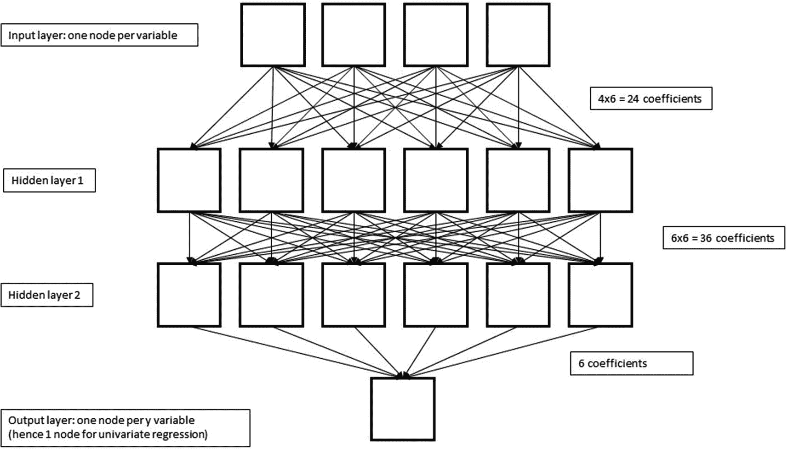
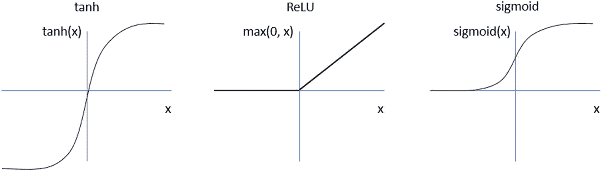
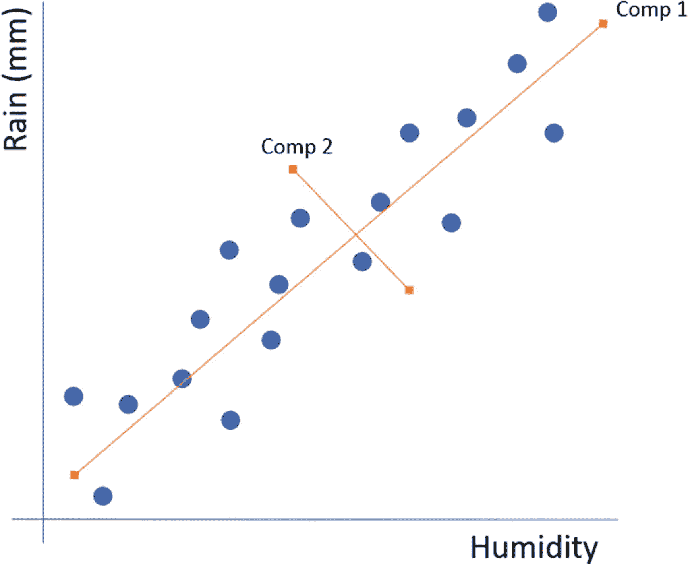
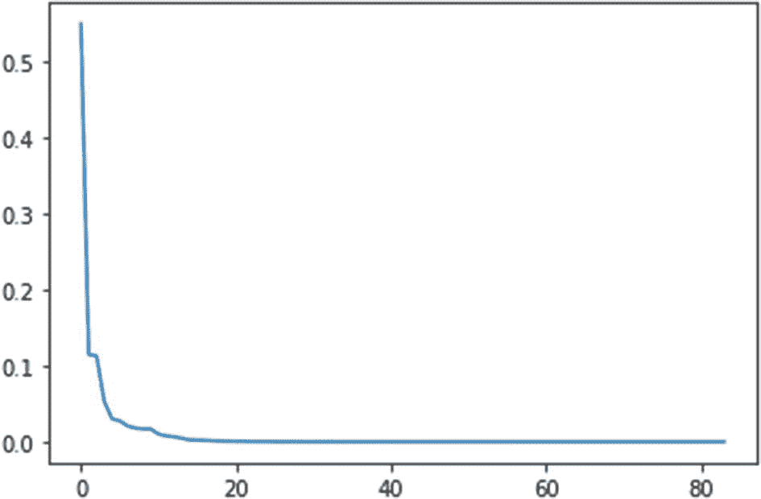
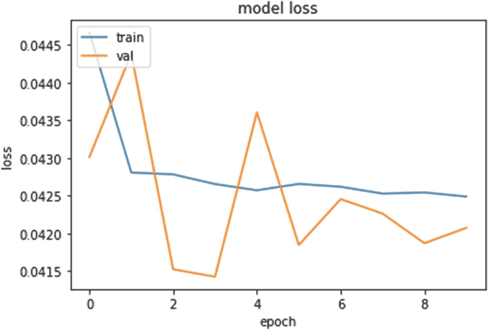
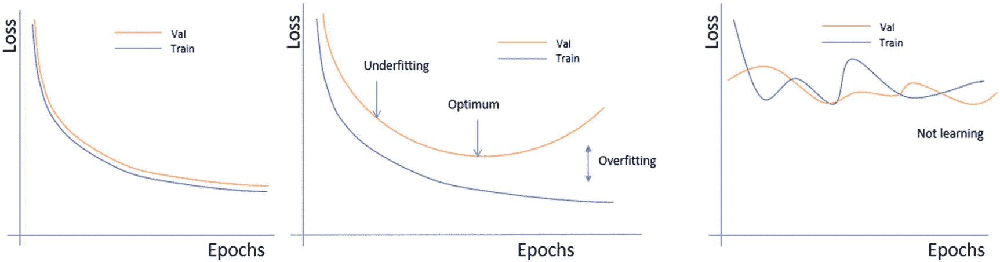
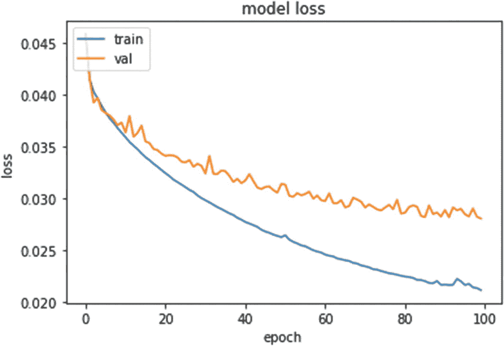

# 16. 神经网络

在前五章中，你了解了许多监督式机器学习模型，从线性回归到梯度提升。在本章中，你将了解**神经网络**。

神经网络的范围非常广泛。你在本章中看到的版本是一个称为**全连接神经网络**的子类。这些神经网络在直觉上与之前的监督模型非常接近。在接下来的章节中，你还将了解**循环神经网络**，并看到一个名为 **LSTM** 神经网络的特定网络。

本章的目标是熟悉神经网络的一般概念。

## 全连接神经网络

首先，让我们通过图 16-1 中的模型示意图来开始讲解。



图 16-1：全连接神经网络示意图

你可以从上到下阅读这张示意图。该模型始终包含一个输入层和一个输出层。网络的输入层为每个变量包含一个节点。输出层包含的节点数与输出变量数相同。在单变量回归的情况下，只有一个输出变量（目标变量 y），但有时可能同时存在多个输出变量，例如你在 VAR 模型中看到的那样。在这种情况下，输出层中会有多个节点。

在输入之后，进入第一个隐藏层。粗略地说，隐藏层的值是通过**将输入乘以权重**，然后**将值通过激活函数**计算得出的。这种乘法与激活函数的组合在每个节点中重复，直到到达输出节点。这种模型被称为全连接模型，因为每个节点都与下一层的每个节点相连。也存在其他架构形式，其中并非如此：我们将在接下来的两章中看到一些例子。

## 激活函数

当你选择神经网络的架构时，还需要选择在每个位置使用的激活函数类型。激活函数在网络的每个节点中应用，然后才进入下一层。

三种相对常见的激活函数选择是 `tanh`、`ReLU` 和 `sigmoid`。你可以在图 16-2 中看到它们的具体行为。我们使用激活函数的原因是，它们允许模型用更少的节点拟合更复杂的问题，因为它们为计算引入了非线性。



图 16-2：三种常见的激活层

在不深入探讨激活层细节的情况下，了解如何使用它们很重要。`ReLU` 通常是一个不错的起始选择，而 `tanh` 常用于你将在下一章看到的循环神经网络。

激活层的选择，就像拟合神经网络中的许多事情一样，并非显而易见：通过反复试验来获得一个有效的神经网络是唯一的方法。有时，如果你运气好，也可以在文献中找到应用于与你类似案例的神经网络示例。需要记住的重要一点是，要得到准确的结果需要花费时间和精力，但如果你成功了，就能获得出色的性能。

## 权重：反向传播

因此，当输入值在神经网络中传递时，除了激活层之外，你还会遇到其他东西：权重。这些权重是在模型拟合时通过一种称为反向传播算法的算法来估计的。

反向传播算法一次一层地计算损失函数相对于网络权重的梯度。然后从最后一层开始向后迭代，这就是它被称为反向传播的原因。这是一种拟合神经网络所需的大量权重的有效方法。然而，它仍然是一种复杂的算法，并且计算需要时间。

## 优化器

反向传播算法的性能取决于优化器的选择。这又是一个必须由建模者做出的决定。有许多可用的优化器。第一个可用的优化器是梯度下降法，如前一段所述。

`SGD`，即**随机梯度下降法**的缩写，是梯度下降算法的一种改进版本。它更高效，因为它在每次迭代时不是在整个数据集上计算，而只在数据集的一个子集上计算。

在 `SGD` 的基础上进行了两项改进，从而产生了两个新的优化器：`RMSProp` 和 `AdaGrad`。一个更先进的优化器称为 `Adam`，它结合了这两者的优点。

虽然我不会深入探讨优化器之间深层的数学差异，但了解存在不同的优化器是很重要的。此外，这方面的工作仍在进行中，在不久的将来很可能会出现更新更好的版本。这里需要记住的重点是，优化器的选择是一个由模型开发者选择的超参数。尝试不同的优化器可能有助于为你的模型增加最后那一点精度。

## 优化器的学习率

你需要作为超参数选择的下一项是优化器的学习率。你可以这样理解。你的优化器会找到正确的移动方向，并朝着那个方向迈出一步。然而，这些步骤可以是大步，也可以是小步。这取决于你选择的学习率。

选择较大的学习率意味着你在正确的方向上迈出了大步。然而，风险在于你迈的步子太大，因此会越过最优值并错过它。

另一方面，较小的学习率可能会让你陷入局部最优而无法摆脱，因为你的步长太小。你也可能需要很长时间才能收敛。

## 开发神经网络时涉及的超参数

到目前为止，这里的概述与我们之前看到的，例如在随机森林和 XGBoost 中，并没有太大不同。然而，在开发神经网络方面有一个很大的区别：超参数的数量和模型训练的时间如此之大，以至于简单地启动一个超参数优化工具变得不可能。

这完全归因于用于拟合神经网络的反向传播算法。简而言之，该算法在网络中来回传递，并更新权重。它不会一次性传递所有数据，而是一批一批地传递，直到所有数据都被传递完毕。当所有数据都被传递一次时，这被称为一个**周期**。

正如你所看到的，对于神经网络，需要进行大量的超参数调整。其中很多是手动完成的，使用特定的工具来判断模型拟合的质量。构建神经网络比拟合经典的机器学习模型要复杂得多。

作为概述，神经网络的主要超参数包括：

*   层数。
*   每层中的节点数。
*   `优化器`是通过反向传播更新权重的方法。标准的优化器之一是 `Adam`，但还有很多其他优化器。
*   优化器的`学习率`影响优化器的步长。学习率太小会使朝向最优值的步长过小，可能导致收敛过慢，或者陷入局部最优。

你还需要选择的另外两个超参数与数学关系不大，但它们仍然非常重要：

*   `批量大小`指定了算法每次传递时将使用的样本数量。如果太大，可能会耗尽内存；但如果太小，可能会太慢。
*   `周期数`是整个数据集通过网络传递的次数。周期越多，模型继续训练的时间就越长。但这实际上应该取决于你何时达到最优值。

## 介绍示例数据

在进入神经网络的拟合与优化之前，我们先来介绍示例数据和两种数据准备方法。本章将使用马克斯·普朗克生物地球化学研究所的示例数据。该数据集名为耶拿气候数据集，包含每 10 分钟记录一次的温度、湿度等气象测量值。

你可以从 [`https://storage.googleapis.com/tensorflow/tf-keras-datasets/jena_climate_2009_2016.csv.zip`](https://storage.googleapis.com/tensorflow/tf-keras-datasets/jena_climate_2009_2016.csv.zip) 下载数据。也可以下载并解压后，使用 pandas 通过代码清单 16-1 导入数据。

```python
import keras
import pandas as pd
from zipfile import ZipFile
import os
uri = "https://storage.googleapis.com/tensorflow/tf-keras-datasets/jena_climate_2009_2016.csv.zip"
zip_path = keras.utils.get_file(origin=uri, fname="jena_climate_2009_2016.csv.zip")
zip_file = ZipFile(zip_path)
zip_file.extractall()
csv_path = "jena_climate_2009_2016.csv"
df = pd.read_csv(csv_path)
del zip_file
df = df.drop('Date Time', axis=1)
cols = ['p',  'T', 'Tpot', 'Tdew', 'rh', 'VPmax', 'VPact', 'VPdef', 'sh', 'H2OC', 'rho', 'wv', 'mwv', 'wd']
df.columns = cols
```
代码清单 16-1：导入数据

在本示例中，我们将进行**12 小时后的温度预测**。为此，我们需要为自变量创建滞后变量，并构建正确的数据框。由于数据量相当大，我们可以添加多个滞后值，以便为模型提供尽可能多的信息。我们将使用代码清单 16-2 来添加 72 个滞后值（72 个 10 分钟间隔，以及向后 84、96、108、120 和 132 步的值）。

y = df.loc[2*72:,'T']
lagged_x = []
for lag in range(72,2*72,12):
lagged = df.shift(lag)
lagged.columns = [x + '.lag' + str(lag) for x in lagged.columns]
lagged_x.append(lagged)
df = pd.concat(lagged_x, axis=1)
df = df.iloc[2*72:,:] #drop missing values due to lags
代码清单 16-2
创建滞后数据集
```

## 神经网络特定的数据准备需求

神经网络对输入数据的问题非常敏感。让我们看看两种在数据准备中常用的工具。

### 缩放与标准化

如果不对输入数据进行标准化，神经网络将无法学习。标准化意味着*将数据调整到同一尺度*。两个常见的例子是标准缩放器和最小-最大缩放器：

1. 标准缩放器将变量映射为服从标准正态分布。即变量的新均值为 0，新标准差为 1。其计算方式为：每个值减去变量的平均值，再除以标准差。
2. 最小-最大缩放器将变量缩放到 0–1 的范围内，方法是将每个值减去变量的最小值，再除以变量的极差。

你可以使用代码清单 16-3 中的语法来应用缩放器。

```
# apply a min max scaler
from sklearn.preprocessing import MinMaxScaler
scaler = MinMaxScaler()
df = pd.DataFrame(scaler.fit_transform(df), columns = df.columns)
代码清单 16-3
拟合最小-最大缩放器
```

### 主成分分析（`PCA`）

`PCA` 本身就是一个机器学习模型，属于降维模型家族。它允许将包含大量变量的数据集*投影到若干维度上，从而减少变量数量*。这些维度将包含大部分信息，并且噪声更少。

确保输入数据包含更少的噪声将极大地帮助神经网络的拟合。那么 `PCA` 是如何工作的呢？其思想是基于强相关变量的组合来创建新的变量，称为**主成分**。在图 16-3 中，你可以看到一个假设示例，其中包含两个可能相关的变量：降雨量和湿度。第一个主成分捕获了尽可能多的变异。



图 16-3 PCA

主成分是一个数学公式，它是原始变量的线性组合。你可以将这个得分作为一个新变量使用。如果主成分捕获了大量原始变量的信息，那么在机器学习模型中使用主成分而非原始变量会更有价值。

要拟合 `PCA`，通常从包含所有主成分的 `PCA` 开始。代码清单 16-4 展示了这一过程。

```
# Fit a PCA with maximum number of components
from sklearn.decomposition import PCA
mypca = PCA()
mypca.fit(df)
代码清单 16-4
拟合完整 PCA
```

使用这个 `PCA` 来绘制**碎石图**。碎石图是用于确定保留主成分数量的多种工具之一。在肘部位置，你可以选择主成分的数量。你可以使用代码清单 16-5 来绘制碎石图，结果如图 16-4 所示。



图 16-4 碎石图

```
# Make a scree plot
import matplotlib.pyplot as plt
plt.plot(mypca.explained_variance_ratio_)
plt.show()
代码清单 16-5
绘制碎石图
```

你可以在图 16-4 中看到碎石图。

在这张图中，x 轴显示从第一个到最后一个的主成分。y 轴显示这些主成分所捕获的变异量。因此，你可以清楚地看到，前*五到十个主成分*包含的信息远多于后面的主成分（更靠右的那些）。你可以看到肘部大约在 5 附近，但保留十个主成分似乎是个好主意，这样我们几乎保留了所有信息，同时只用了十个变量而不是 80 多个。最后，使用代码清单 16-6 重新拟合包含十个主成分的 `PCA`，并对数据进行转换。

```
mypca = PCA(10)
df = mypca.fit_transform(df)
代码清单 16-6
拟合包含十个主成分的 PCA
```

## 使用 Keras 构建神经网络

现在我们已经确认数据已正确准备，终于可以进入实际的神经网络构建环节了。

构建神经网络是一项繁重的工作，我希望在引导你入门和优化网络之间找到良好的平衡，而不是仅仅展示一个最终的高性能网络。

通常，一个好的起点是从相对简单的网络开始，然后逐步优化。这里，我们先从一个包含两个 64 节点全连接层的网络开始。其架构如下所示。

对于其他超参数，我们采用一些较为标准的设置：

- *优化器*：Adam
- *学习率*：0.01
- *批量大小*：32（如果内存不足，可减小此值）
- *训练轮数*：10

开始之前，我们先进行训练-测试集划分，如代码清单 16-7 所示。

```
from sklearn.model_selection import train_test_split
X_train, X_test, y_train, y_test = train_test_split(df, y, test_size=0.33, random_state=42)
代码清单 16-7
训练-测试集划分
```

现在，使用以下代码通过 `keras` 库构建模型。首先，使用代码清单 16-8 指定网络架构。Keras 是 Python 中用于神经网络的首选库。

```
from tensorflow.keras.models import Sequential
from tensorflow.keras.layers import Dense
import random
random.seed(42)
simple_model = Sequential([
Dense(64, activation='relu', input_shape=(X_train.shape[1],)),
Dense(64, activation='relu'),
Dense(1),
])
代码清单 16-8
指定模型及其架构
```

你可以使用代码清单 16-9 获取模型摘要，以检查一切是否正常。

```
simple_model.summary()
代码清单 16-9
获取模型架构摘要
```

然后，使用代码清单 16-10 编译模型。在编译部分，你需要指定优化器和学习率，同时指定损失函数，本例中为平均绝对误差。

```
simple_model.compile(
optimizer=keras.optimizers.Adam(learning_rate=0.01),
loss='mean_absolute_error',
metrics=['mean_absolute_error'],
)
代码清单 16-10
编译模型
```

接着，使用代码清单 16-11 拟合模型。在拟合调用中，你需要指定训练轮数和批量大小。你还可以指定验证集划分比例，从而形成训练-验证-测试场景，这样仍能保留测试集用于最终检查 R² 分数，避免模型开发过程带来的偏差。

```
smod_history = simple_model.fit(X_train, y_train,
validation_split=0.2,
epochs=10,
batch_size=32,
shuffle = True
)
代码清单 16-11
拟合模型
```

请注意，拟合神经网络可能会耗费大量时间。在 GPU 上运行通常很快，但并非总是可行，具体取决于你的计算机硬件。

现在，关键点在于判断该模型是否通过这些超参数学到了东西。有一个关键图表将在你构建神经网络时提供巨大帮助。你可以使用代码清单 16-12 获取该图表，如图 16-5 所示。

请注意，你得到的结果可能略有不同。设置随机种子并不足以强制 Keras 中的随机性保持一致。虽然可以在 Keras 中强制实现精确的可重复性，但过程相当复杂，因此我更倾向于忽略这一点，并接受结果并非 100% 可重复的事实。你可以查看以下说明，了解如何在 Keras 中固定随机性：[`https://keras.io/getting_started/faq/#how-can-i-obtain-reproducible-results-using-keras-during-development`](https://keras.io/getting_started/faq/%2523how-can-i-obtain-reproducible-results-using-keras-during-development)。

```
plt.plot(smod_history.history['loss'])
plt.plot(smod_history.history['val_loss'])
plt.title('model loss')
plt.ylabel('accuracy')
plt.xlabel('epoch')
plt.legend(['train', 'val'], loc='upper left')
plt.show()
```
代码清单 16-12
绘制训练历史



图 16-5
显示模型学习效果不佳的历史图

在图 16-6 中，你会看到几个你期望或不期望的图表示例。在图 1 中，你看到的是理想曲线，这正是你试图达到的目标。

在图 2 中，你看到一个学习效果良好的神经网络，同时也展示了实践中出现的过拟合现象：训练损失大幅下降，验证损失也随之下降。然而，在某个时刻，你需要减少训练轮数，否则模型将开始过拟合。如果你还记得前一章的内容，过拟合意味着模型学习了训练数据中的特定噪声，因此学到的趋势无法泛化。

在第三个图中，你看到一个什么都没学到的神经网络。你可以通过训练损失没有下降来识别这种情况。此时，可能是数据存在问题，或者你需要尝试一个完全不同的网络结构。



图 16-6
理想的历史图

那么，在我们的案例中发生了什么？很可能是情况 3：模型什么都没学到。为什么模型学不到东西？我们应该尝试一下，是否因为神经元数量太少而无法学习。从这里开始，你就知道需要增加层数和神经元数量，看看情况是否会好转。

从此刻起，这实际上是一个反复试错的过程。你尝试的第一个模型通常非常简单，并且学习效果不足。接下来，你应该寻找一个确实能学习的模型，即使最坏情况下它会过拟合。最后一步，你进行微调，直到获得一个与图 16-6 左侧图表足够接近的图形，并且得到一个你满意的误差分数。

经过反复试错，发现了一个更好的模型架构，如代码清单 16-13 所示。这远非最佳模型，但至少该模型能够在测试数据上获得相对较好的 `R²` 分数 `0.908`。欢迎尝试进一步调整该模型，看看会发生什么，以及你是否能改进它。

```python
random.seed(42)
model = Sequential([
Dense(256, activation='relu', input_shape=(X_train.shape[1],)),
Dense(256, activation='relu'),
Dense(256, activation='relu'),
Dense(256, activation='relu'),
Dense(256, activation='relu'),
Dense(256, activation='relu'),
Dense(256, activation='relu'),
Dense(256, activation='relu'),
Dense(256, activation='relu'),
Dense(256, activation='relu'),
Dense(256, activation='relu'),
Dense(256, activation='relu'),
Dense(256, activation='relu'),
Dense(256, activation='relu'),
Dense(256, activation='relu'),
Dense(256, activation='relu'),
Dense(256, activation='relu'),
Dense(256, activation='relu'),
Dense(256, activation='relu'),
Dense(256, activation='relu'),
Dense(1), ])
model.compile(
optimizer=keras.optimizers.Adam(learning_rate=0.001),
loss='mean_absolute_error',
metrics=['mean_absolute_error'],
)
history = model.fit(X_train, y_train,
#validation_data=(X_test, y_test),
validation_split=0.2,
epochs=100,
batch_size=32,
shuffle = True
)
plt.plot(history.history['loss'])
plt.plot(history.history['val_loss'])
plt.title('model loss')
plt.ylabel('accuracy')
plt.xlabel('epoch')
plt.legend(['train', 'val'], loc='upper left')
plt.show()
preds = model.predict(X_test)
print(r2_score(preds, y_test))
```
代码清单 16-13
一个更好的架构

结果图如图 16-7 所示。



图 16-7
更复杂模型的历史曲线图

## 结论

拟合神经网络真正困难的地方在于，你很难判断自己取得的成果是否还能改进，或者它已经足够好了。目前，本章展示了如何从一个非常简单的网络开始改进，并尝试获得优化版本。

有一些库可用于超参数优化。当然，你甚至可以对网络架构进行网格搜索。但要知道，拟合神经网络没有灵丹妙药。它比经典机器学习模型需要更多的努力和投入。训练时间非常长，并且你需要强大的计算能力才能开始考虑此类优化。不过，从好的方面来看，神经网络有时能获得比经典机器学习强大得多的结果，它是你机器学习工具箱中的重要工具。

神经网络和人工智能的科学领域有很多发展。在接下来的两章中，你将发现比密集结构更先进的神经网络结构，但它们可能非常适用于预测场景。

## 要点总结

*   神经网络是一种强大的监督式机器学习模型，但构建它比经典机器学习模型更困难。

*   超参数包括：

    *   层数

    *   每层的节点数

    *   `优化器`

    *   `学习率`

    *   `批量大小`

    *   `周期数`

*   显示训练损失和验证损失下降的曲线图是开发神经网络时非常重要的方面。

*   `PCA` 是一种降维模型。它也可用于数据准备，尤其是在存在许多相关变量时。

*   对输入数据进行缩放是神经网络的必要步骤。一些常用的方法包括标准缩放器和 `MinMax` 缩放器。