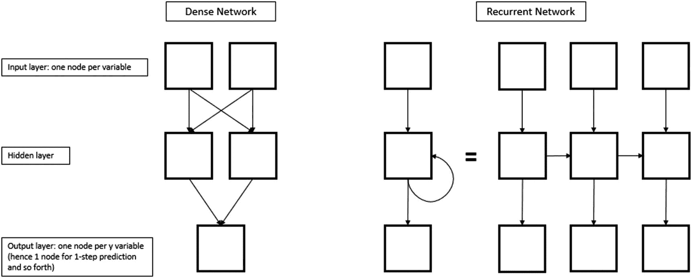
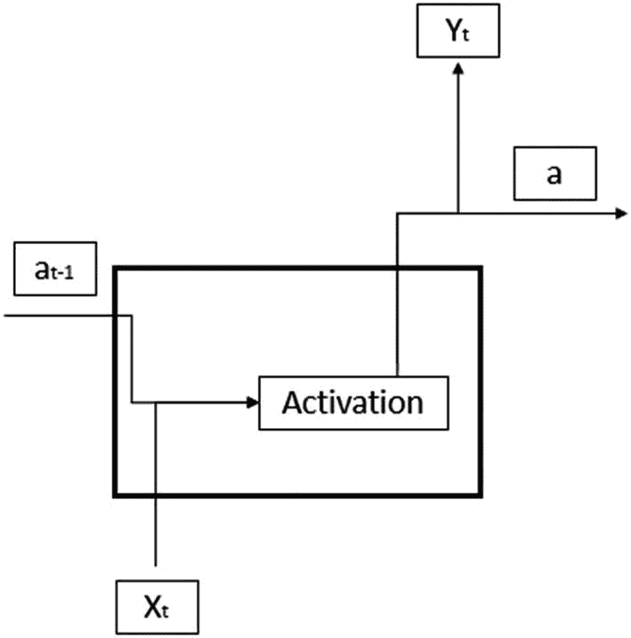
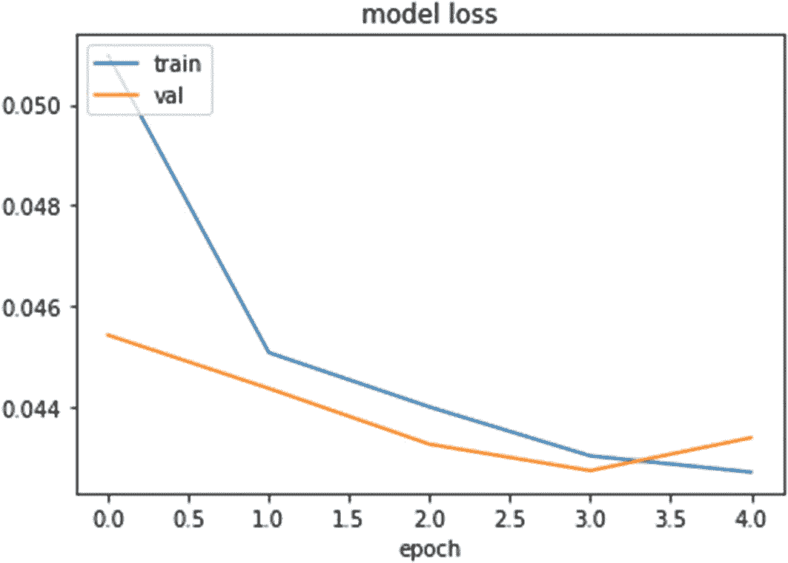
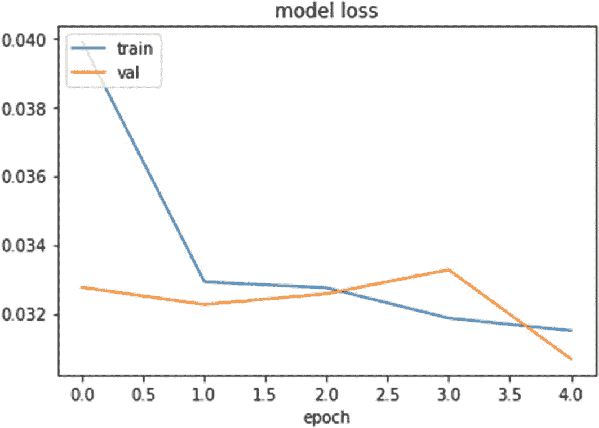
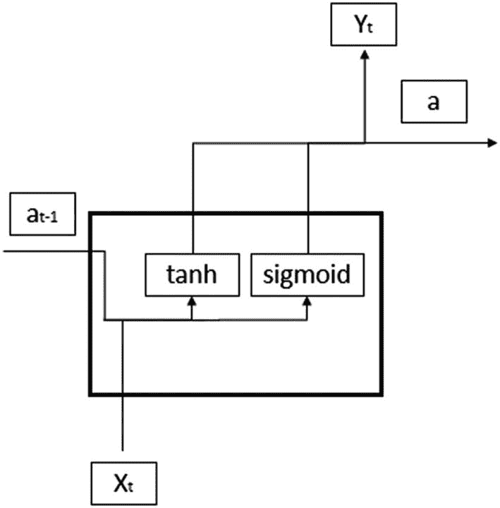
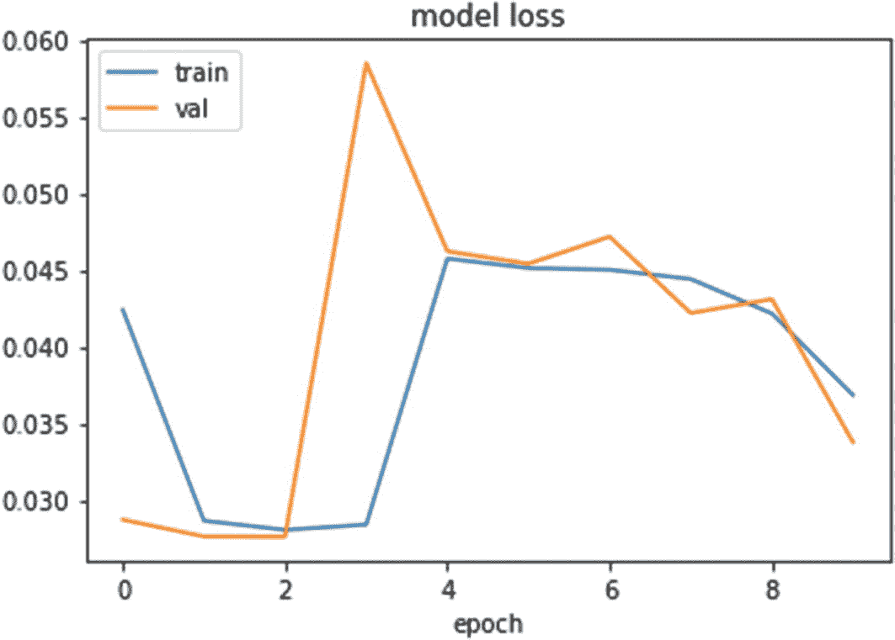
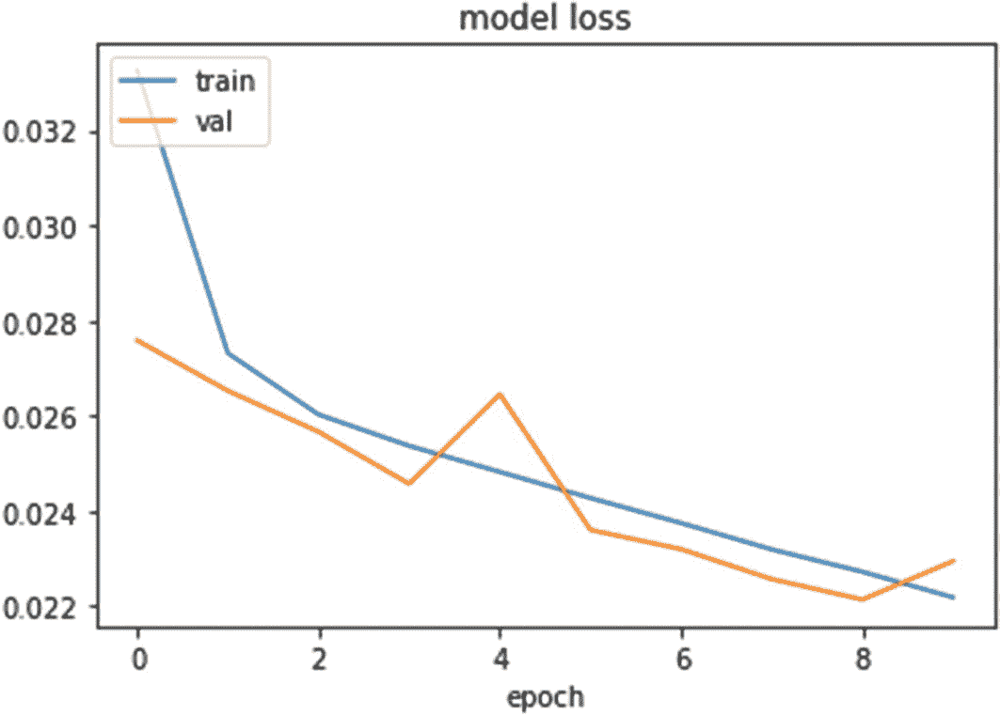

# 17. 使用 SimpleRNN 和 GRU 的循环神经网络

在本章中，你将发现一种更高级的神经网络版本，称为**循环神经网络**。RNN 有三种非常常见的版本：`SimpleRNN`、`GRU`（门控循环单元）和 LSTM（长短期记忆）。在实践中，由于我稍后会谈到的一些问题，`SimpleRNN` 已经很少使用了。因此，我将 `SimpleRNN` 和 `GRU` 归入本章，而 LSTM 则有单独的章节。

## 什么是 RNN：架构

那么，什么是循环神经网络，它们与你之前看到的密集神经网络有何不同？下图展示了一个全连接网络的节点与一个 `SimpleRNN` 节点的示例对比。



图 17-1：循环网络与密集网络对比

如图 17-1 所示，RNN 模块的最大区别在于存在一个反馈回路。全连接网络的每个输入完全独立，而 RNN 的输入之间具有反馈关系。这使得**RNN 非常适合处理具有序列的数据**，例如：

*   时间序列
*   书面文本（单词序列）
*   DNA 序列
*   地理位置序列

## SimpleRNN 单元内部结构

由于架构上的这种差异，单元内部也存在差异。如图所示，每个单元中不仅有一个输入，而是有两个输入。这两个输入都需要被考虑。作为示意图，其结构如图 17-2 所示，其中 `X` 是时间 `t` 的输入，`Y` 是时间 `t` 的目标变量，而 `a` 是图 17-1 中从左到右的权重，也就是使模型在时间上作为序列进行拟合的权重。



图 17-2：RNN 单元

在上一章中，你主要看到使用了 `ReLU` 激活层。然而，在循环神经网络中，`tanh` 层是标准配置。原因是对于长序列，`ReLU` 层会遇到梯度爆炸问题：与权重的重复乘法就像指数运算一样，会导致梯度爆炸。`tanh` 激活层没有这个问题，因为其值被强制限制在 -1 和 1 之间。

## 示例

RNN 在序列上进行学习。因此，我们需要调整问题描述。在本章中，让我们使用与上一章相同的数据，以便更好地感受数据准备和数据使用方式与全连接架构的不同之处。

快速回顾一下：你有一个包含天气测量数据的数据集，我们试图预测未来 12 小时（72 个 10 分钟时间步长）的温度。

在全连接模型中，我们做的是创建滞后变量。有一个 `y` 变量（未滞后），而自变量是 `y` 变量的滞后值以及许多其他变量。第一个滞后在 72 个时间步长处，这样模型将使用 12 小时前的数据来预测当前（使用从现在到 12 小时前的历史数据来预测当前，等同于使用当前数据来预测 12 小时后）。

## 预测序列而非单个值

在 RNN 中，我们不应该这样做，因为 RNN 学习的是序列。一个 72 个时间步长的大跳跃并没有真正尊重序列的变化。然而，我们也不只是想预测下一个时间步长，因为那意味着预测未来 10 分钟的温度，这并不太有趣。

我们要做的是*创建一个 `y` 变量矩阵*，也包含滞后项。之前，我们想预测未来 72 个时间步长后的一个值，但现在让我们建模来预测这 72 个值中的每一个。尽管用一个 `y` 变量也可能做到，但这也是一个有趣的*多步预测*案例，通常很有用。

## 单变量模型而非多变量模型

我们与之前模型相比的另一个变化是，在这种情况下，我们将只使用温度数据，而不使用其他变量。这可能会使任务稍微困难一些，但会让你更容易理解序列和 RNN 的使用。然而，你必须知道，向 RNN 中添加其他解释变量是可行的。例如，为了预测明天的温度，你可能不仅想使用今天的温度，还想使用今天的风向、风速和湿度。在这种情况下，你可以向输入数据添加第三个维度。

## 准备数据

你可以按照以下步骤准备数据。第一步是使用清单 17-1 导入数据。

```
import keras
import pandas as pd
from zipfile import ZipFile
import os
uri = "https://storage.googleapis.com/tensorflow/tf-keras-datasets/jena_climate_2009_2016.csv.zip"
zip_path = keras.utils.get_file(origin=uri, fname="jena_climate_2009_2016.csv.zip")
zip_file = ZipFile(zip_path)
zip_file.extractall()
csv_path = "jena_climate_2009_2016.csv"
df = pd.read_csv(csv_path)
del zip_file
```

清单 17-1：导入数据

下一步是删除除温度之外的所有列，因为我们正在构建一个单变量模型。这一步在清单 17-2 中完成。

```
df = df[['T (degC)']]
```

清单 17-2：仅保留温度数据

现在，正如你在第 16 章中记得的那样，神经网络需要经过标准化的数据。因此，让我们像清单 17-3 那样应用一个 `MinMaxScaler`。

```
# 应用一个 min max scaler
from sklearn.preprocessing import MinMaxScaler
scaler = MinMaxScaler()
df = pd.DataFrame(scaler.fit_transform(df), columns = ['T'])
```

清单 17-3：应用 `MinMaxScaler`

现在是一个可能较难直观理解的部分。我们需要将数据分割成一种形状，其中包含过去数据的序列和未来数据的序列。我们想要预测未来的 72 个时间步，并将使用过去的 `3*72` 个时间步。这是一个任意的选择，请随意尝试使用更多或更少的过去数据。清单 17-4 中的代码遍历数据并为模型训练创建序列。

```
ylist = list(df['T'])
n_future = 72
n_past = 3*72
total_period = 4*72
idx_end = len(ylist)
idx_start = idx_end - total_period
X_new = []
y_new = []
while idx_start > 0:
    x_line = ylist[idx_start:idx_start+n_past]
    y_line = ylist[idx_start+n_past:idx_start+total_period]
    X_new.append(x_line)
    y_new.append(y_line)
    idx_start = idx_start - 1
# 将列表的列表转换为 numpy 数组
import numpy as np
X_new = np.array(X_new)
y_new = np.array(y_new)
```

清单 17-4：准备序列数据

现在我们已经获得了用于模型训练的 `X` 和 `Y` 矩阵，和往常一样，我们需要将其分割为训练集和测试集，以便能够进行公平的模型评估。这一步在清单 17-5 中完成。

```
from sklearn.model_selection import train_test_split
X_train, X_test, y_train, y_test = train_test_split(X_new, y_new, test_size=0.33, random_state=42)
```

清单 17-5：分割为训练集和测试集

拟合 `SimpleRNN` 还需要最后一步。这一步可能难以直观理解，因为实际上并没有一个明确的理由。`SimpleRNN` 层需要一个 3D 的输入格式，其形状必须对应 `(n_samples, n_timesteps, n_features)`。这可以通过 `reshape` 实现。不幸的是，在使用 Keras 时，有时必须进行这种 `reshape`，因为它对输入数据的确切形状要求非常严格。

当你处理尚不了解的层类型时，这有时会让人非常头疼。但学习如何处理它是至关重要的。清单 17-6 向你展示了如何将数据重塑为 Keras 能够识别的正确格式。

```
batch_size = 32
n_samples = X_train.shape[0]
n_timesteps = X_train.shape[1]
n_steps = y_train.shape[1]
n_features = 1
X_train_rs = X_train.reshape(n_samples, n_timesteps, n_features )
X_test_rs = X_test.reshape(X_test.shape[0], n_timesteps, n_features )
```

清单 17-6：重塑数据以便 Keras 识别

## 一个简单的 `SimpleRNN`

现在让我们从一个使用 `SimpleRNN` 层的非常小的神经网络开始。你可以使用清单 17-7 对其进行参数化。

```
import random
random.seed(42)
from tensorflow.keras.models import Sequential
from tensorflow.keras.layers import Dense, SimpleRNN
simple_model = Sequential([
SimpleRNN(8, activation='tanh',input_shape=(n_timesteps, n_features)),
Dense(y_train.shape[1]),
])
simple_model.summary()
simple_model.compile(
optimizer=keras.optimizers.Adam(learning_rate=0.001),
loss='mean_absolute_error',
metrics=['mean_absolute_error'],
)
smod_history = simple_model.fit(X_train_rs, y_train,
validation_split=0.2,
epochs=5,
batch_size=batch_size,
shuffle = True
)
preds = simple_model.predict(X_test_rs)
from sklearn.metrics import r2_score
print(r2_score(preds, y_test))
import matplotlib.pyplot as plt
plt.plot(smod_history.history['loss'])
plt.plot(smod_history.history['val_loss'])
plt.title('model loss')
plt.xlabel('epoch')
plt.legend(['train', 'val'], loc='upper left')
plt.show()
清单 17-7
使用 SimpleRNN 参数化一个小型网络
```
得到的图如图 17-3 所示，得到的 R2 分数为 **0.66**。这个分数并不理想，训练历史也证实了模型没有正确指定：损失在下降，但似乎学习得不够。损失就是我们所说的贯穿模型的准确度，因为神经网络的误差函数通常被称为损失函数。一个更复杂的模型应该能让损失下降得更多。


图 17-3 SimpleRNN 的训练历史

## 带隐藏层的 SimpleRNN
作为对此的改进，让我们给这个网络添加第二个层。要做到这一点，你需要在除最后一个层之外的每个层中指定 `return_sequences = True`。拟合 `RNN` 甚至比拟合 **前馈神经网络** 还要慢，所以请注意本章中的计算时间可能会很长。
你可以构建清单 17-8 中稍微复杂一点的网络，并观察其性能。

```
random.seed(42)
simple_model = Sequential([
SimpleRNN(32, activation='tanh',input_shape=(n_timesteps, n_features), return_sequences=True),
SimpleRNN(32, activation='tanh', return_sequences = True),
SimpleRNN(32, activation='tanh'),
Dense(y_train.shape[1]),
])
simple_model.summary()
simple_model.compile(
optimizer=keras.optimizers.Adam(learning_rate=0.001),
loss='mean_absolute_error',
metrics=['mean_absolute_error'],
)
smod_history = simple_model.fit(X_train_rs, y_train,
validation_split=0.2,
epochs=5,
batch_size=batch_size,
shuffle = True
)
preds = simple_model.predict(X_test_rs)
print(r2_score(preds, y_test))
plt.plot(smod_history.history['loss'])
plt.plot(smod_history.history['val_loss'])
plt.title('model loss')
plt.xlabel('epoch')
plt.legend(['train', 'val'], loc='upper left')
plt.show()
清单 17-8
一个包含三层 SimpleRNN 的更复杂网络
```
这给出了一个多变量 R2 分数 0.90。你将观察到如图 17-4 所示的训练历史图。


图 17-4 三层 `SimpleRNN` 的训练历史
这个网络使得损失能够更早、更低地下降，尽管曲线看起来仍然不太令人印象深刻。同时，获得的 R2 相当不错，所以感觉事情正朝着正确的方向发展。

## 简单 GRU
现在我们可以进一步深入 `SimpleRNN` 并尝试优化它。但我们不会在这里这样做。`SimpleRNN` 已经不符合当今的标准了。它存在一些严重的问题。其中一个重大影响是它无法记住很久以前的信息。此外，它还有一些更技术性的问题。
一种更先进的 `RNN` 层被发明出来，称为 `GRU`，即门控循环单元（Gated Recurrent Unit）。如图 17-5 所示，`GRU` 单元拥有更多参数。这表明单元内部多了一条通道，从而可以估计一个额外的参数。这有助于学习长期趋势。


图 17-5 `GRU` 单元
由于这些差异，`GRU` 获得了比 `SimpleRNN` 更好的整体性能，而 `SimpleRNN` 已经很少使用了。让我们构建一个使用 `GRU` 的简单网络，看看它在数据上的表现如何。这在代码清单 17-9 中完成。

```
random.seed(42)
from tensorflow.keras.layers import GRU
simple_model = Sequential([
GRU(8, activation='tanh',input_shape=(n_timesteps, n_features)),
Dense(y_train.shape[1]),
])
simple_model.summary()
simple_model.compile(
optimizer=keras.optimizers.Adam(learning_rate=0.01),
loss='mean_absolute_error',
metrics=['mean_absolute_error'],
)
smod_history = simple_model.fit(X_train_rs, y_train,
validation_split=0.2,
epochs=10,
batch_size=batch_size,
shuffle = True
)
preds = simple_model.predict(X_test_rs)
print(r2_score(preds, y_test))
plt.plot(smod_history.history['loss'])
plt.plot(smod_history.history['val_loss'])
plt.title('model loss')
plt.xlabel('epoch')
plt.legend(['train', 'val'], loc='upper left')
plt.show()
代码清单 17-9
一个包含单层 GRU 的简单架构
```
你将获得 **0.88** 的 R2 值，对于一个单层模型来说，这还不错，并且你会得到如图 17-6 所示的历史记录图。然而，历史记录图显示拟合效果并不理想。损失并没有像预期的那样下降，应该对模型架构进行一些修改。


图 17-6 单层 `GRU` 模型的历史记录
## 带隐藏层的 GRU

现在作为下一步，让我们尝试通过添加更多层来改进这个网络，看看是否能让损失进一步下降。坦率地说，优化架构和超参数需要花费大量时间。这是一个反复试验的过程，同时需要关注多个模型指标，包括损失、R2 分数以及损失图。

测试不同的超参数并培养对所需更改类型的直觉也需要经验。但这完全正常；这些模型本身就有一个学习曲线。同样重要的是要意识到，拟合一个模型需要花费大量时间。这使得运行网格搜索或其他超参数优化变得困难，但同时，长时间等待却只得到一个糟糕的分数，也会令人沮丧。

你在代码清单 17-10 中看到的模型获得了 0.95 的 R2 分数，因此比简单的 GRU 模型好得多。

```
random.seed(42)
simple_model = Sequential([
GRU(64, activation='tanh',input_shape=(n_timesteps, n_features), return_sequences=True),
GRU(64, activation='tanh', return_sequences=True),
GRU(64, activation='tanh'),
Dense(y_train.shape[1]),
])
simple_model.summary()
simple_model.compile(
optimizer=keras.optimizers.Adam(learning_rate=0.001),
loss='mean_absolute_error',
metrics=['mean_absolute_error'],
)
smod_history = simple_model.fit(X_train_rs, y_train,
validation_split=0.2,
epochs=10,
batch_size=batch_size,
shuffle = True
)
preds = simple_model.predict(X_test_rs)
print(r2_score(preds, y_test))
plt.plot(smod_history.history['loss'])
plt.plot(smod_history.history['val_loss'])
plt.title('model loss')
plt.xlabel('epoch')
plt.legend(['train', 'val'], loc='upper left')
plt.show()
```

代码清单 17-10 一个包含三层 GRU 的更复杂网络



图 17-7 三层 GRU 模型的历史记录

该模型的历史记录图如图 17-7 所示。它可能不是最好的模型，但至少我们看到训练损失和验证损失都在下降。获得的 R2 值还不错。我把它留作练习，让你尝试使用损失图和模型指标来改进这个架构。

## 关键要点

*   循环神经网络具有集成的反馈回路，这使得它们非常适合对序列进行建模。

*   有几种类型的 RNN 单元：
    *   SimpleRNN 是一种基本的 RNN 单元，由于存在众多理论问题且无法学习长期趋势，目前已很少使用。
    *   GRU 单元是 RNN 单元的改进版，它拥有额外的参数，使其更容易记住长期趋势。
    *   LSTM 将在第 18 章中介绍。

*   RNN，尤其是在训练长序列时，使用 tanh 激活函数比密集网络中常见的 ReLU 更有优势。

*   你可以使用 RNN 预测多个步骤的序列，以进行多步预测。

*   你已经看到了一些实际的建模示例，这将帮助你理解哪些历史记录图是好的，哪些不是。