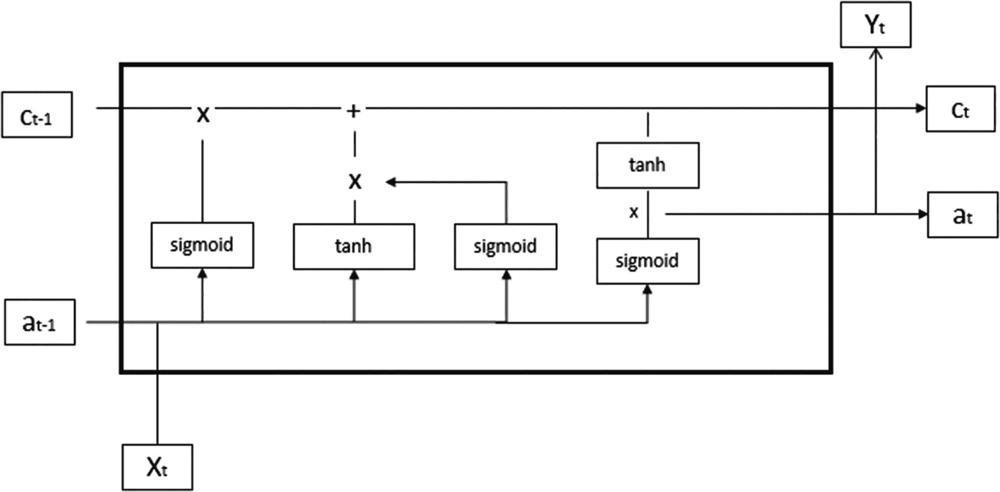
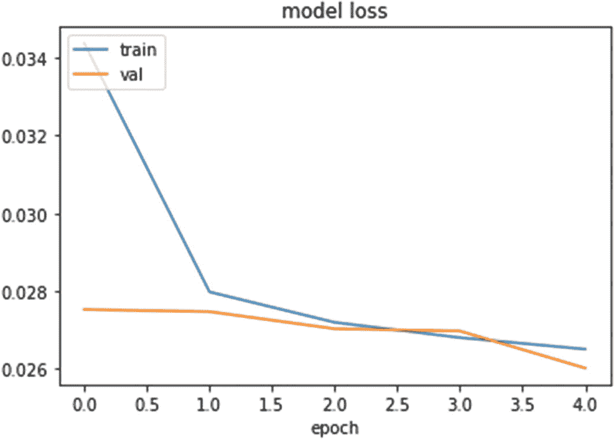
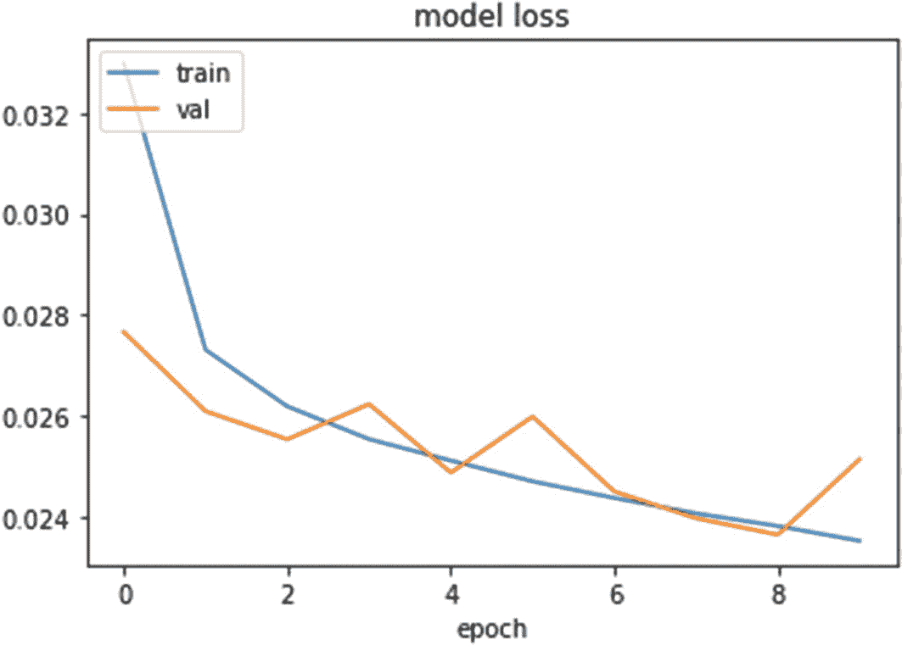

# 18. `LSTM` `RNN`

在上一章中，你了解了两种类型的循环神经网络单元，即 `SimpleRNN` 和 `GRU`（门控循环单元）。在本章中，你将了解第三种类型的单元，称为 `LSTM`，即`长短期记忆网络`。

## 什么是 `LSTM`

`LSTM` 作为第三种也是最后一种 RNN 单元，甚至比 `GRU` 单元更先进。如果你还记得上一章的内容，`SimpleRNN` 单元通过在连续值之间添加反馈回路，允许构建循环架构。因此，它是对不允许这样做的“简单”前馈单元的改进。

`SimpleRNN` 的一个问题是长期趋势，你可以称之为长期记忆。`GRU` 单元是对 `SimpleRNN` 的改进，它为单元添加了一个权重，用于学习长期过程。

`LSTM` 单元以更高效的方式增加了长期记忆，因为它允许学习更多的参数。这使得它成为最强大的用于预测的 RNN，尤其是当你的数据中存在长期趋势时。`LSTM` 是目前用于预测的最先进的模型之一。

## `LSTM` 单元

让我们看看 `LSTM` 单元与 `GRU` 单元有何不同。它拥有更多的组件。值得注意的是，同一个单元内组合了`三个 sigmoid 和两个 tanh 运算`。你可以在图 18-1 中看到一个示意图，其中有两个来自过去单元的权重（t-1 时刻的 c 和 a），经过变换后，又有两个权重输出（t 时刻的 c 和 a）。X 是该单元的输入，Y 是输出。


图 18-1

`LSTM` 单元

在实践中，这一切归结为有更多的参数需要估计，因此 `LSTM` 可以更好地拟合具有短期和长期趋势的数据。

## 示例

在应用机器学习中，将不同模型进行基准测试非常重要。因此，让我们最后一次使用相同的数据，将其作为我们见过的三种 RNN 模型的基准测试。作为简要回顾，第 17 章中模型获得的性能在表 18-1 中重复列出。

表 18-1

`SimpleRNN` 和 `GRU` 模型的性能

| 模型 | `SimpleRNN` | `GRU` |
| --- | --- | --- |
| 单层 8 单元 | 0.66 | 0.88 |
| 三层 64 单元 | 0.90 | 0.95 |

让我们看看 `LSTM` 与之相比如何。你可以使用与第 17 章相同的数据准备方法，该方法在代码清单 18-1 中重复给出。

```python
import keras
import pandas as pd
from zipfile import ZipFile
import os
uri = "https://storage.googleapis.com/tensorflow/tf-keras-datasets/jena_climate_2009_2016.csv.zip"
zip_path = keras.utils.get_file(origin=uri, fname="jena_climate_2009_2016.csv.zip")
zip_file = ZipFile(zip_path)
zip_file.extractall()
csv_path = "jena_climate_2009_2016.csv"
df = pd.read_csv(csv_path)
del zip_file
# retain only temperature
df = df[['T (degC)']]
# apply a min max scaler
from sklearn.preprocessing import MinMaxScaler
scaler = MinMaxScaler()
df = pd.DataFrame(scaler.fit_transform(df), columns = ['T'])
# convert to windowed data sets
ylist = list(df['T'])
n_future = 72
n_past = 3*72
total_period = 4*72
idx_end = len(ylist)
idx_start = idx_end - total_period
X_new = []
y_new = []
while idx_start > 0:
    x_line = ylist[idx_start:idx_start+n_past]
    y_line = ylist[idx_start+n_past:idx_start+total_period]
    X_new.append(x_line)
    y_new.append(y_line)
    idx_start = idx_start - 1
import numpy as np
X_new = np.array(X_new)
y_new = np.array(y_new)
# train test split
from sklearn.model_selection import train_test_split
X_train, X_test, y_train, y_test = train_test_split(X_new, y_new, test_size=0.33, random_state=42)
# reshape data into the right format for RNNs
n_samples = X_train.shape[0]
n_timesteps = X_train.shape[1]
n_steps = y_train.shape[1]
n_features = 1
X_train_rs = X_train.reshape(n_samples, n_timesteps, n_features )
X_test_rs = X_test.reshape(X_test.shape[0], n_timesteps, n_features )
```
代码清单 18-1
导入天气数据

## 单层 8 单元 `LSTM`

现在，正如我们在上一章中所做的那样，让我们从拟合一个简单的单层网络开始。代码与第 17 章的代码几乎相同；你只需将层的名称改为 `LSTM`。完整代码如代码清单 18-2 所示。

```python
import random
from tensorflow.keras.models import Sequential
from tensorflow.keras.layers import Dense, LSTM
random.seed(42)
batch_size = 32
simple_model = Sequential([
    LSTM(8, activation='tanh',input_shape=(n_timesteps, n_features)),
    Dense(y_train.shape[1]),
])
simple_model.summary()
simple_model.compile(
    optimizer=keras.optimizers.Adam(learning_rate=0.01),
    loss='mean_absolute_error',
    metrics=['mean_absolute_error'],
)
smod_history = simple_model.fit(X_train_rs, y_train,
    validation_split=0.2,
    epochs=5,
    batch_size=batch_size,
    shuffle = True
)
preds = simple_model.predict(X_test_rs)
print(r2_score(preds, y_test))
plt.plot(smod_history.history['loss'])
plt.plot(smod_history.history['val_loss'])
plt.title('model loss')
plt.xlabel('epoch')
plt.legend(['train', 'val'], loc='upper left')
plt.show()
```
代码清单 18-2
单层 `LSTM`

该模型的结果如下。该模型获得的 R2 分数为 `0.93`。训练损失图如图 18-2 所示。


图 18-2

单层 `LSTM` 的训练历史

在此图中，你可以看到训练损失和验证损失都略有下降。然而，验证损失的下降并不十分陡峭。这可以得出结论：模型正在学习一些东西，但我们可能能够从这个模型中获取更多信息。我们希望看到验证损失在趋于平稳之前有更大的下降。在当前图中，你几乎直接进入了平稳期。在表 18-2 中，你看到表格已更新了新值。

表 18-2

`SimpleRNN` 和 `GRU` 模型的性能

| 模型 | `SimpleRNN` | `GRU` | `LSTM` |
| --- | --- | --- | --- |
| 单层 8 单元 | 0.66 | 0.88 | 0.93 |

## 三层 64 单元 LSTM

正如你在上一章中记得的，并且可以在表中看到的，具有三层 64 个单元的 GRU 模型运行得相当好。在深入调整 LSTM 模型之前，让我们也尝试一下这种架构的性能。你可以使用代码清单`18-3`来实现。

```
random.seed(42)
simple_model = Sequential([
LSTM(64, activation='tanh',input_shape=(n_timesteps, n_features), return_sequences=True),
LSTM(64, activation='tanh', return_sequences=True),
LSTM(64, activation='tanh'),
Dense(y_train.shape[1]),
])
simple_model.summary()
simple_model.compile(
optimizer=keras.optimizers.Adam(learning_rate=0.001),
loss='mean_absolute_error',
metrics=['mean_absolute_error'],
)
smod_history = simple_model.fit(X_train_rs, y_train,
validation_split=0.2,
epochs=10,
batch_size=batch_size,
shuffle = True
)
preds = simple_model.predict(X_test_rs)
print(r2_score(preds, y_test))
plt.plot(smod_history.history['loss'])
plt.plot(smod_history.history['val_loss'])
plt.title('model loss')
plt.ylabel('accuracy')
plt.xlabel('epoch')
plt.legend(['train', 'val'], loc='upper left')
plt.show()
```

Listing 18-3
Three-layer LSTM

该模型获得的 R2 分数为`0.94`。当将此值与表 18-3 中的其他值进行比较时，你可以观察到它的性能略低于三层 GRU 模型。

表 18-3

SimpleRNN 和 GRU 模型的性能

| 模型 | SimpleRNN | GRU | LSTM |
| --- | --- | --- | --- |
| 单层 8 单元 | 0.66 | 0.88 | 0.93 |
| 三层 64 单元 | 0.90 | 0.95 | `0.94` |

让我们也看一下图 18-3 所示的历史图。在这个训练图中我们可以看到，损失比单层架构下降得更多。训练损失的形状看起来还不错：它具有正确的形状，尽管看起来下降可能会持续更长时间，因此平稳期会在更晚的时候以更低的损失达到。另一方面，验证损失并没有真正正确的形状，这告诉我们可能通过调整模型可以提升一些 R2 分数。



图 18-3

三层 LSTM 的训练历史

### 结论

那么这给我们带来了什么？最好的 RNN 是三层 GRU，紧随其后的是三层 LSTM 和单层 LSTM。分数的差异清楚地说明了为什么 `SimpleRNN` 层不再被广泛使用。`GRU` 和 `LSTM` 是两种在预测任务中表现良好的 RNN 模型。

LSTM 模型相对于 GRU 的优势在于能够拟合更长期的趋势。GRU 性能更好的一个假设原因是数据不包含非常长期的趋势，因为数据被重新处理，使得每一行数据只包含过去 36 小时的数据。

在实际建模时，运行像本例中这样的基准测试是非常常见的。重要的是掌握不同的模型，以便能够有效地调整和基准测试它们。之后，决策应基于基准测试期间的性能客观做出。在这种情况下，获胜的不是更新的 LSTM，而是 GRU。

### 关键要点

*   LSTM 是最先进的 RNN 类型，因为它拥有大量组件，使其能够记住更长期的趋势。
*   你已经看到了一个如何在同一个数据集上对多个模型进行模型基准测试的示例。这在应用机器学习中至关重要。
*   你还看到了一个如何解读和处理显示损失下降的神经网络历史图的示例。你可以利用它们来推断模型的学习方式以及如何改进。