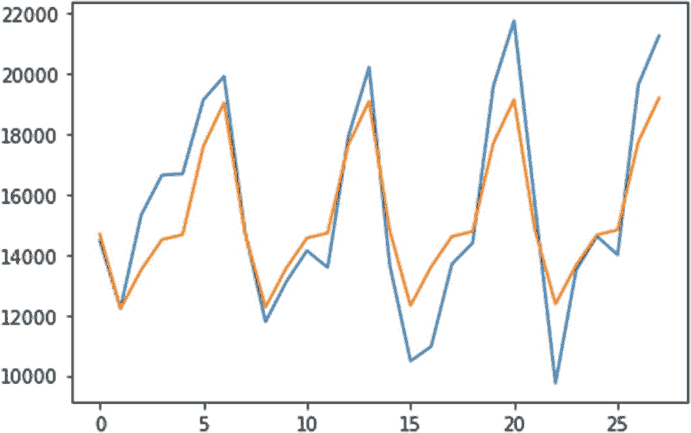
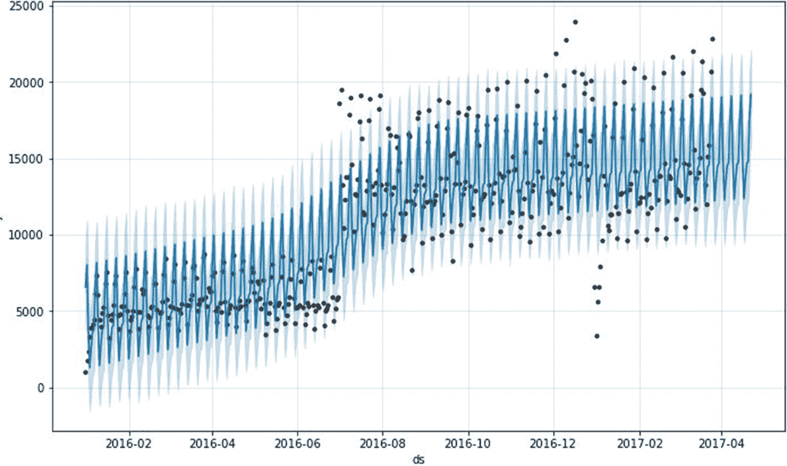
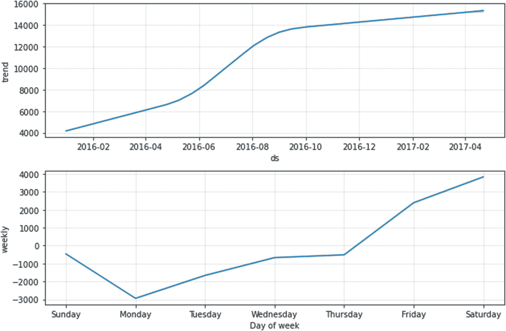
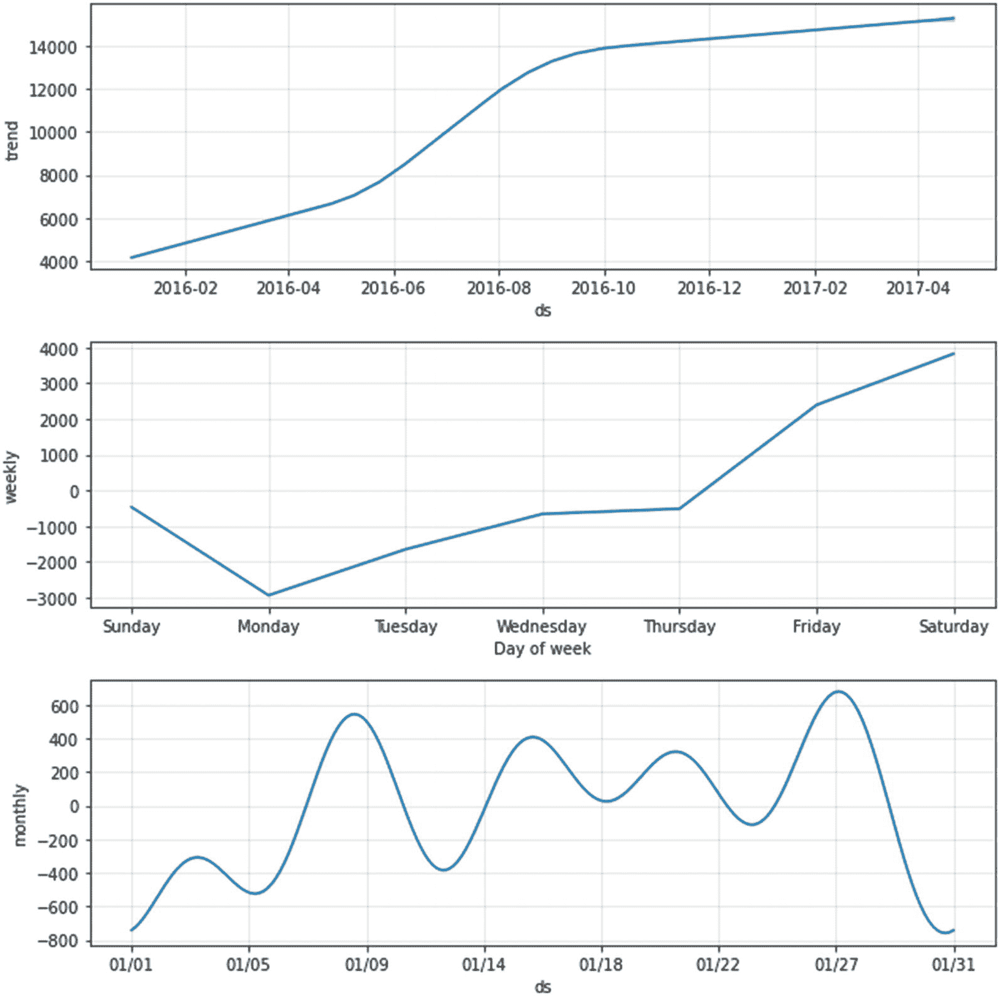
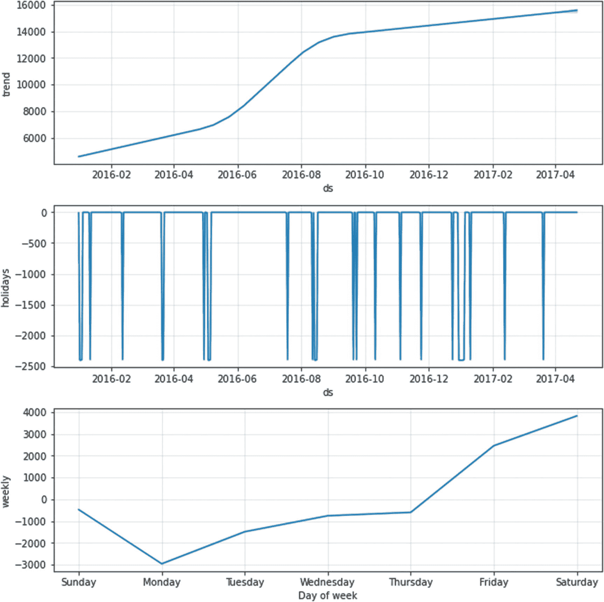
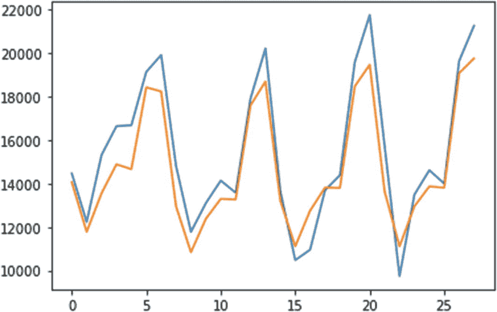
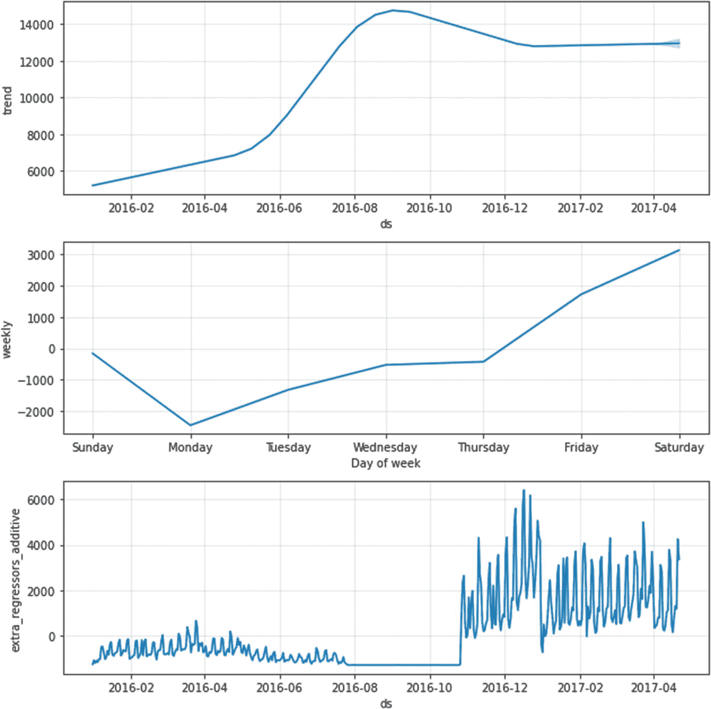
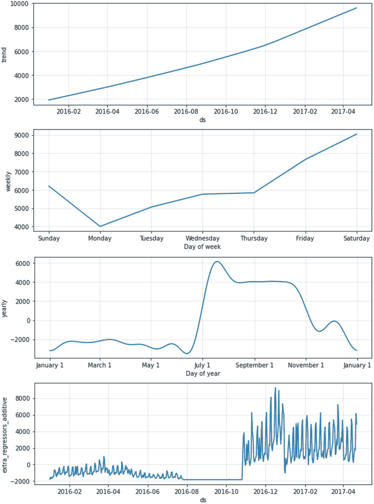
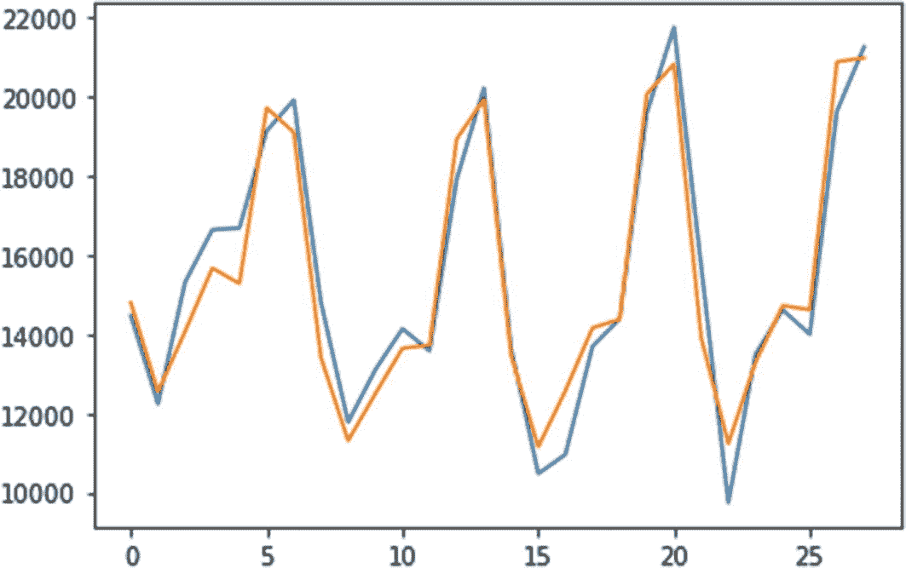

# 19. Prophet 模型

在本章中，你将了解 **Prophet 模型**，该模型由 Facebook 开源。它严格来说并非一个模型，而是一种构建预测模型的*自动化流程*。

你会注意到，使用此模型与使用 Keras 有很大不同，因为 Prophet 模型为你完成了大部分工作。它的用户友好性更高：与之前的章节不同，它不需要任何理论知识即可上手。

这样做的一个缺点可能是，你理解模型究竟如何学习以及学习什么的可能性较少。可调整的参数也更少，如果模型有效，这可能是一个优势；但如果无法达到所需的模型精度，这可能就是一个劣势。

来自开发者的一段话解释了 Facebook Prophet 的目标：

> *我们使用一个简单、模块化的回归模型，该模型在默认参数下通常表现良好，并且允许分析师选择与其预测问题相关的组件，并根据需要轻松进行调整。第二个组件是一个用于衡量和跟踪预测准确性的系统，并标记需要手动检查的预测，以帮助分析师进行增量改进。*
> 
> —[`https://peerj.com/preprints/3190/`](https://peerj.com/preprints/3190/)

由于 Facebook 的 Prophet 是一个流程而非实际模型，因此它并没有贡献某一特定的数学理论部分。有用的是不同过程的组合以及其背后的自动化调优方式。让我们直接进入一个示例，探索共同构成 Facebook Prophet 的不同组件。

## 示例

在本示例中，我们将使用来自一个 Kaggle 竞赛的数据集，该竞赛旨在预测餐厅访客数量。你可以从使用此数据集的竞赛的 Kaggle 页面下载数据：[`www.kaggle.com/c/recruit-restaurant-visitor-forecasting`](http://www.kaggle.com/c/recruit-restaurant-visitor-forecasting)。你需要从该页面获取以下数据集：'air_visit_data.csv.zip'、'date_info.csv.zip' 和 'air_reserve.csv.zip'。

我们将使用 Prophet，并且 **Prophet 只能进行单变量预测**。如果你还记得之前的内容，这意味着 Prophet 仅使用一个因变量进行预测。如果你想适应多变量预测，你需要为每个因变量分别训练一个 Prophet 模型。因此，我们将对所有餐厅的总和进行组合预测。你可以使用代码清单 19-1 准备因变量的数据。

```
import pandas as pd
y = pd.read_csv('air_visit_data.csv.zip')
y = y.pivot(index='visit_date', columns='air_store_id')['visitors']
y = y.fillna(0)
y = pd.DataFrame(y.sum(axis=1))
代码清单 19-1
准备因变量
```

## Prophet 数据格式

在构建 Prophet 模型时，你总是必须拥有一个包含 'ds' 和 'y' 列的数据集。这是模型识别日期列（'ds'）和因变量（'y'）的方式。你可以使用代码清单 19-2 创建此格式。

```
y = y.reset_index(drop=False)
y.columns = ['ds', 'y']
代码清单 19-2
准备建模数据框
```

我们还将通过将最后 28 天放入测试集来添加一个训练-测试分割。这可以使用代码清单 19-3 完成。

```
train = y.iloc[:450,:]
test = y.iloc[450:,:]
代码清单 19-3
创建训练-测试分割
```

## 基础 Prophet 模型

拥有一个包含两个正确列名的数据框就是你开始创建基础 Prophet 模型所需的全部。建模过程与 scikit-learn 没有太大区别，因此你应该相当熟悉。你可以使用代码清单 19-4 创建并拟合一个基础模型。

```
from fbprophet import Prophet
m = Prophet()
m.fit(train)
代码清单 19-4
创建基础 Prophet 模型
```

模型拟合后，你需要进行预测。为了进行预测，你可以使用 Prophet 函数创建一个未来数据框，该数据框将作为预测函数的输入。然后，你可以使用 predict 方法进行预测。代码清单 19-5 展示了如何操作。

```
future = m.make_future_dataframe(periods=len(test))
forecast = m.predict(future)
代码清单 19-5
进行预测
```

为了评估此预测的质量，让我们使用代码清单 19-6 计算测试数据上的 R2 分数。一旦你做出预测，你将获得一个数据框，其中 **'yhat'** 列包含预测值。

```
from sklearn.metrics import r2_score
print(r2_score(list(test['y']), list(forecast.loc[450:,'yhat'] )))
代码清单 19-6
计算 R2 分数
```

这个基础 Prophet 模型获得了 **0.808** 的 R2 分数。这已经相当不错了！让我们通过绘制预测值与测试数据的对比图来看看模型的拟合情况。该图使用代码清单 19-7 创建，如图 19-1 所示。



图 19-1

预测值与测试数据的对比图

```
import matplotlib.pyplot as plt
plt.plot(list(test['y']))
plt.plot(list(forecast.loc[450:,'yhat'] ))
plt.show()
代码清单 19-7
绘制模型拟合图
```

使用 Prophet 模型时，还有另外两个很棒的图表可用。第一个图表显示了预测值与过去和未来数据的观测数据点的对比。可以使用代码清单 19-8 访问它。你可以在图 19-2 中看到该图。



图 19-2

Prophet 预测图

```
fig1 = m.plot(forecast)
plt.show()
代码清单 19-8
创建 Prophet 预测图
```

你可以从 Prophet 模型获得的第二个图是模型不同影响的分解图。这意味着分解图可以显示每个时间步长上不同季节性的影响。这可以使用代码清单 19-9 完成。你可以在图 19-3 中看到该图。

```
fig2 = m.plot_components(forecast)
plt.show()
代码清单 19-9
创建 Prophet 分解图
```



图 19-3

Prophet 分解图

在此图中，你可以观察到已拟合的趋势。你可以看到当前模型标准地拟合了一个长期趋势和一个工作日效应。模型拟合的总体趋势似乎是整体上升的，但增长正在放缓。周度图显示，周六是餐厅的大日子，然后在一周内有一个趋势。

在本章的后续部分，我们将向模型添加所有可能的影响，以使模型性能越来越高。


## 为 Prophet 添加月度季节性

接下来，我们看看如何为 Prophet 添加额外的季节性效应。这里，我们添加一个月度季节性。如清单 19-10 所示。

```
m2 = Prophet()
m2.add_seasonality(name='monthly', period=30.5, fourier_order=5)
m2.fit(train)
future2 = m2.make_future_dataframe(periods=len(test))
forecast2 = m2.predict(future)
print(r2_score(list(test['y']), list(forecast2.loc[450:,'yhat'] )))
fig2 = m2.plot_components(forecast2)
plt.show()
清单 19-10
为图表添加月度季节性
```

该模型的 R2 得分为 **0.787**。这比之前的模型略低，因此我们可以得出结论：添加月度效应没有带来额外价值。由于此模型现在包含了一个新效应，你可以看到分解图中现在有三个图表。如图 19-4 所示。



图 19-4

包含月度的 Prophet 分解图

## 为基础 Prophet 添加假日数据

接下来，我们看看如何向 Prophet 添加假日数据。假日是 Prophet 的标准输入，这使得添加假日非常用户友好。唯一需要做的是确保你的假日数据采用正确格式的数据框。你应该获得的格式是一个包含以下内容的数据框：

*   一个名为 'ds' 的列，包含假日的日期。
*   一个名为 'holiday' 的列，包含假日的名称。
*   可选地，你可以添加 'upper_window' 和 'lower_window' 两列，它们包含可能受假日影响的假日前后天数。例如，可以将复活节和复活节星期一一起建模，方法是将日期设为复活节，并添加一个值为 1 的 upper_window。

清单 19-11 展示了如何实现这一点。

```
holidays = pd.read_csv('date_info.csv.zip')
holidays = holidays[holidays['holiday_flg'] == 1]
holidays = holidays[['calendar_date', 'holiday_flg']]
holidays = holidays.drop(['holiday_flg'], axis=1)
holidays['holiday'] = 'holiday'
holidays.columns = ['ds', 'holiday']
清单 19-11
准备假日数据
```

然后，你可以使用清单 19-12 在添加假日参数的同时拟合模型。

```
m3 = Prophet(holidays=holidays)
m3.fit(train)
future3 = m3.make_future_dataframe(periods=len(test))
forecast3 = m3.predict(future)
print(r2_score(list(test['y']), list(forecast3.loc[450:,'yhat'] )))
fig2 = m3.plot_components(forecast3)
plt.show()
清单 19-12
向模型添加假日
```

使用此模型，你得到的 R2 得分为 **0.806**。这再次没有比默认模型更好，意味着假日可能无助于模型更好地预测。包含各成分的图表如图 19-5 所示。



图 19-5

包含假日的 Prophet 分解图

## 为 Prophet 添加额外回归变量

数据集中还有一个包含预订信息的文件。当然，我们可以预期预订量是预测餐厅访客数量的一个很好的额外变量。你可以很容易地向 Prophet 模型添加一个额外的回归变量。首先，将额外变量添加到包含 'ds' 和 'y' 列的数据框中。你可以使用清单 19-13 来实现。

```
X_reservations = pd.read_csv('air_reserve.csv.zip')
X_reservations['visit_date'] = pd.to_datetime(X_reservations['visit_datetime']).dt.date
X_reservations = pd.DataFrame(X_reservations.groupby('visit_date')['reserve_visitors'].sum())
X_reservations = X_reservations.reset_index(drop = False)
train4 = train.copy()
train4['ds'] = pd.to_datetime(train4['ds']).dt.date
train4 = train4.merge(X_reservations, left_on = 'ds', right_on = 'visit_date', how = 'left')[['ds', 'y', 'reserve_visitors']].fillna(0)
清单 19-13
将预订数据添加到数据中
```

然后，在模型拟合中，你可以使用 "add_regressor" 方法将其添加到模型中。你还需要将额外变量添加到未来数据框中。你可以使用清单 19-14 来实现。

```
m4 = Prophet()
m4.add_regressor('reserve_visitors')
m4.fit(train4)
future4 = m4.make_future_dataframe(periods=len(test))
future4['ds'] = pd.to_datetime(future4['ds']).dt.date
future4 = future4.merge(X_reservations, left_on = 'ds', right_on = 'visit_date', how = 'left')[['ds', 'reserve_visitors']].fillna(0)
forecast4 = m4.predict(future4)
print(r2_score(list(test['y']), list(forecast4.loc[450:,'yhat'] )))
plt.plot(list(test['y']))
plt.plot(list(forecast4.loc[450:,'yhat'] ))
fig2 = m4.plot_components(forecast4)
plt.show()
清单 19-14
将预订数据添加到模型中
```

此模型获得的 R2 得分为 **0.849**。这比之前的任何配置都要好，这意味着预订数量是对模型的一个很好的补充。你可以在图 19-6 中看到预测结果的图表。



图 19-6

预测值与实际数据对比

你还可以在图 19-7 中看到此模型拟合的不同成分。在这个特定模型中，你可以看到额外变量“预订量”的影响。



图 19-7

模型分解图

## 使用网格搜索调整超参数

回顾一下，让我们在表 19-1 中列出我们目前看到的 Prophet 模型的不同变体。

表 19-1

Prophet 模型的结果

| 模型变体 | R2 得分 |
| --- | --- |
| **基础 Prophet** | **0.808** |
| **包含月度季节性** | **0.787** |
| **包含假日** | 0.806 |
| **包含预订量作为回归变量** | 0.849 |

现在 0.849 是一个很好的分数。我们已经涵盖了可以添加到模型中的所有附加项：额外季节性、假日和额外回归变量。通过调整一些超参数，仍有改进空间。Prophet 模型的超参数如下：

*   **傅里叶阶数**可以为每个季节性设置。傅里叶阶数越高，意味着变化频率越高，这意味着傅里叶阶数较高的季节性曲线不那么平滑。
*   **changepoint_prior_scale** 允许趋势拟合得或多或少灵活。值越高，趋势越灵活。
*   **holidays_prior_scale** 允许假日效应变得不那么重要。默认值为 10，值越低，假日的重要性越低。
*   **季节性**也有一个**先验尺度**。对于这个调优示例，我们将忽略它们；但要知道你也可以调整它们。

我们将对这些超参数进行网格搜索，看看是否能改进模型。既然要做，我们不妨将之前的测试也重新纳入考量。毕竟，当改变某些新超参数时，可能会改变其他选择上的最优值。

如前所述，网格搜索的基本方法是遍历超参数值的所有组合，然后选择性能最佳的组合。清单 19-15 展示了如何实现。


```
def model_test(holidays, weekly_seasonality,
yearly_seasonality, add_monthly, add_reserve, changepoint_prior_scale, holidays_prior_scale, month_fourier):
m4 = Prophet(
yearly_seasonality=yearly_seasonality,
weekly_seasonality=weekly_seasonality,
holidays=holidays,
changepoint_prior_scale=changepoint_prior_scale,
holidays_prior_scale=holidays_prior_scale)
if add_monthly:
m4.add_seasonality(
name='monthly',
period=30.5,
fourier_order=month_fourier)
if add_reserve:
m4.add_regressor('reserve_visitors')
m4.fit(train4)
future4 = m4.make_future_dataframe(periods=len(test))
future4['ds'] = pd.to_datetime(future4['ds']).dt.date
if add_reserve:
future4 = future4.merge(
X_reservations,
left_on = 'ds',
right_on = 'visit_date',
how = 'left')
future4 = future4[['ds', 'reserve_visitors']]
future4 = future4.fillna(0)
forecast4 = m4.predict(future4)
return r2_score(
list(test['y']),
list(forecast4.loc[450:,'yhat'] ))
# 设置网格
holidays_opt = [holidays, None]
weekly_seas = [ 5, 10, 30, 50]
yearly_seas = [ 5, 10, 30, 50]
add_monthly = [True, False]
add_reserve = [True, False]
changepoint_prior_scale = [0.1, 0.3, 0.5]
holidays_prior_scale = [0.1, 0.3, 0.5]
month_fourier = [5, 10, 30, 50]
# 遍历网格
grid_results = []
for h in holidays_opt:
for w in weekly_seas:
for ys in yearly_seas:
for m in add_monthly:
for r in add_reserve:
for c in changepoint_prior_scale:
for hp in holidays_prior_scale:
for mf in month_fourier:
r2=model_test(h,w,ys,m,r,c,hp,mf)
print([w,ys,m,r,c,hp,mf,r2])
grid_results.append([h,w,ys,m,r,c,hp,mf,r2])
# 将所有结果添加到数据框并提取最佳模型
benchmark = pd.DataFrame(grid_results)
benchmark = benchmark.sort_values(8, ascending=False)
h, w,ys, m, r, c,hp,mf,r2 = list(benchmark.iloc[0,:])
# 使用这些最佳超参数拟合 Prophet 模型
m4 = Prophet(
yearly_seasonality=ys,
weekly_seasonality=w,
holidays=h,
changepoint_prior_scale=c,
holidays_prior_scale=hp)
if m:
m4.add_seasonality(
name='monthly',
period=30.5,
fourier_order=mf)
if r:
m4.add_regressor('reserve_visitors')
m4.fit(train4)
future4 = m4.make_future_dataframe(periods=len(test))
future4['ds'] = pd.to_datetime(future4['ds']).dt.date
if r:
future4 = future4.merge(
X_reservations,
left_on = 'ds',
right_on = 'visit_date',
how = 'left')
future4 = future4[['ds', 'reserve_visitors']]
future4 = future4.fillna(0)
forecast4 = m4.predict(future4)
清单 19-15
网格搜索 Prophet
```

经过调优的模型给出的 R2 得分为 **0.928**。该模型使用了趋势、周和年季节性，并将预约数量作为额外的回归变量。周季节性阶数为 **50**，年季节性傅里叶阶数为 **10**。“changepoint_prior_scale”为 **0.1**，而“holidays_prior_scale”无关紧要，因为最终模型未使用节假日。您可以在图 19-8 中看到预测性能，最终模型的分解结果如图 19-9 所示。

网格之外可能存在更好的结果。请随意更改网格参数并重新运行网格搜索，看看是否能获得更优的分数。



图 19-9

调优模型的分解结果



图 19-8

调优模型的预测性能

## 关键要点

*   Facebook Prophet 是 Facebook 开发的一种用于构建预测模型的自动化流程。

*   该模型易于设置和调优，这是一个巨大的优势。

*   输入可能性包括：
    *   任意规则阶数的季节性

    *   节假日

    *   额外的回归变量

*   您只能将 Prophet 用于单变量模型。对于多变量模型，您需要构建多个 Prophet 模型。

*   该模型的目标是在无需过多干预的情况下获得良好结果，但仍有几个超参数可供调优：
    *   *季节性的傅里叶阶数*：阶数越高，灵活性越大。

    *   *changepoint_prior_scale* 影响趋势：值越高，趋势越灵活。

    *   *holidays_prior_scale*：该值越低，节假日对模型的重要性越低。

    *   *季节性的先验尺度*

