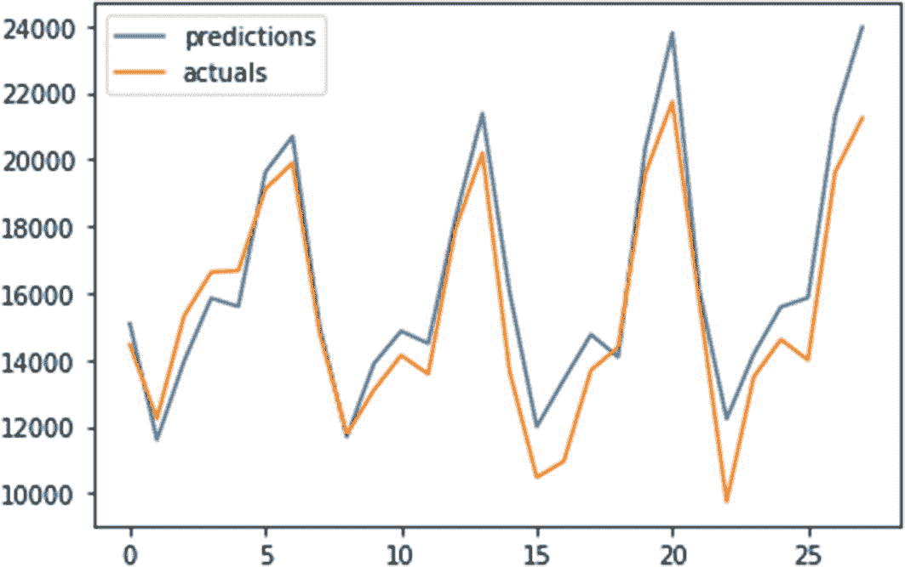
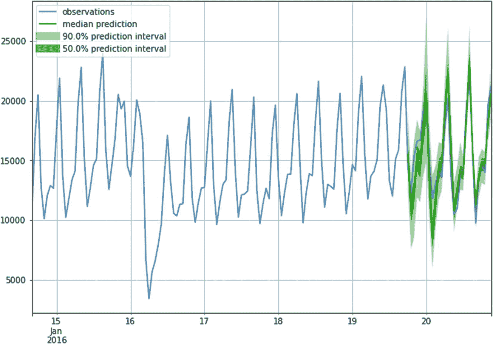

# 20. DeepAR 模型

`DeepAR` 是由亚马逊研究人员开发的一种模型。`DeepAR` 提供了一个使用基于 RNN 的深度学习架构构建时间序列模型的接口。使用 `DeepAR` 的优势在于，与 Keras 相比，它提供了一个更易于用于模型构建的接口。

`DeepAR` 可以被视为上一章中介绍的 Facebook Prophet 的竞争对手。这两种模型都试图为底层非常复杂的模型提供一个易于使用的模型接口。如果您希望以相对较少的工作量获得良好的模型，那么 `DeepAR` 和 Prophet 绝对值得加入您的模型基准测试中。

## 关于 `DeepAR`

`DeepAR` 使用 RNN 预测单变量或多变量时间序列。`DeepAR` 的理论附加价值在于，它同时对所有时间序列拟合一个单一模型。它旨在利用多个时间序列之间的相关性，因此它是多变量预测的绝佳模型。然而，它也可以应用于单个时间序列。

`DeepAR` 对多种类型的季节性变量进行建模。它还会为月中的第几天、年中的第几天以及其他派生变量创建变量。作为 `DeepAR` 模型的用户，我们对这些变量以及算法的内部工作机制没有太多控制权。除了我们稍后将讨论的几个超参数外，该模型相对而言是一个黑盒。

## 使用 `DeepAR` 进行模型训练

为了探索 `DeepAR` 模型，我们将使用上一章中用过的餐厅访问量数据集。这样，我们可以将 `DeepAR` 与 Facebook 的 Prophet 模型进行基准测试。数据可在 [`www.kaggle.com/c/recruit-restaurant-visitor-forecasting`](http://www.kaggle.com/c/recruit-restaurant-visitor-forecasting) 获取。你可以通过使用清单 20-1 对所有餐厅的数据求和来准备数据。

```python
import pandas as pd
y = pd.read_csv('air_visit_data.csv.zip')
y = y.pivot(index='visit_date', columns='air_store_id')['visitors']
y = y.fillna(0)
y = pd.DataFrame(y.sum(axis=1))
y = y.reset_index(drop=False)
y.columns = ['date', 'y']
```
清单 20-1 导入数据

回顾一下，经过调优的最终 Facebook Prophet 模型获得了 0.928 的 R2 分数。让我们看看 `DeepAR` 是否能达到这个性能。我们将使用 gluonts 库提供的 `DeepAR` 模型。我建议使用以下链接获取安装说明并了解依赖关系：[`https://ts.gluon.ai/install.html`](https://ts.gluon.ai/install.html)。

要使用这个库，我们首先需要将数据准备成该库能够理解的格式。Gluonts 使用一种相对不直观的数据格式。它使用一个名为 `ListDataset` 的对象。该对象必须包含*目标变量、起始时间戳和频率*。训练数据只需包含训练数据，而测试数据则需要包含训练数据和测试数据。

你可以使用清单 20-2 来构建这些对象。注意：不合逻辑的是，为了获得合理准确的预测，必须指定季节性为“H”（小时）而不是“D”（天）。这很可能是由于在撰写本文时 gluonts 中存在一个未解决的错误。

```python
from gluonts.dataset.common import ListDataset
start = pd.Timestamp("01-01-2016", freq="H")
# 训练数据集：裁剪最后一个长度为 "prediction_length" 的窗口，添加 "target" 和 "start" 字段
train_ds = ListDataset([{'target': y.loc[:450,'y'], 'start': start}], freq='H')
# 测试数据集：使用整个数据集，添加 "target" 和 "start" 字段
test_ds = ListDataset([{'target': y['y'], 'start': start}],freq='H')
```
清单 20-2 准备 gluonts 库所需的数据格式

现在，让我们开始在清单 20-3 中使用 gluonts 构建一个简单的 `DeepAR` 模型。为此，你需要创建一个名为 `DeepAREstimator` 的估计器，它内部会使用一个训练器。该函数中的重要参数如下：

*   `prediction_length`，即你想要预测的步数。
*   `ctx`，用于指定你希望在 CPU 还是 GPU 上运行。在 GPU 上运行要快得多，但前提是你的硬件上有可用的 GPU。
*   `epochs` 的数量，即你希望所有数据通过底层深度神经网络的次数。
*   `learning rate` 是神经网络优化器的步长：较大的学习率允许你迈出更大的步伐，但可能会错过最优值；而较小的学习率可能会使优化变慢，或让你陷入局部最优。

```python
from gluonts.model.deepar import DeepAREstimator
from gluonts.trainer import Trainer
import mxnet as mx
import numpy as np
np.random.seed(7)
mx.random.seed(7)
estimator = DeepAREstimator(
prediction_length=28,
context_length=100,
freq='H',
trainer=Trainer(ctx="gpu", # 如果在 Windows 上运行，请移除
epochs=5,
learning_rate=1e-3,
num_batches_per_epoch=100
)
)
predictor = estimator.train(train_ds)
```
清单 20-3 拟合默认的 `DeepAR` 模型

## 使用 `DeepAR` 进行预测

然后，要对测试集进行预测，你可以使用清单 20-4。这一步中有些复杂的事情。模型不仅仅做出一个预测，而是做出许多预测。默认情况下，它每个时间步会做出 100 个预测，每个预测都是一个备选的未来轨迹。

这听起来可能很奇怪，因为你通常只想要一个预测。这个预测应该尽可能准确。然而，其思路是，在预测了大量潜在轨迹后，你可以将这 100 个备选轨迹的中位数作为预测值。中位数也称为 0.5 分位数。

```python
predictions = predictor.predict(test_ds)
predictions = list(predictions)[0]
predictions = predictions.quantile(0.5)
```
清单 20-4 预测

让我们计算测试集的 R2 分数，并使用清单 20-5 绘制图表，看看这些预测结果是什么样的。

```python
from sklearn.metrics import r2_score
print(r2_score( list(test_ds)[0]['target'][-28:], predictions))
import matplotlib.pyplot as plt
plt.plot(predictions)
plt.plot(list(test_ds)[0]['target'][-28:])
plt.legend(['predictions', 'actuals'])
plt.show()
```
清单 20-5 R2 分数和预测图

该模型获得的 R2 分数是 0.83。请注意，即使设置了随机种子，`DeepAR` 的预测结果每次运行也不尽相同。你可能会得到不同的结果。你可以在图 20-1 中看到预测图。


图 20-1 默认 `DeepAR` 预测的预测结果

## 使用 `DeepAR` 进行概率预测

由于 `DeepAR` 为同一个预测构建了许多可能的轨迹，因此可以绘制一个类似的图表，但在曲线周围添加一个置信区间。你可以使用清单 20-6 来获取该图表，如图 20-2 所示。


图 20-2 预测周围的概率图

# 向 DeepAR 添加额外回归变量

为了进一步探索 DeepAR，我们来了解如何向模型添加额外的回归变量。在许多预测场景中，你掌握的未来信息能够提升预测质量。以餐厅客流量预测为例，我们有两个额外的数据集：节假日数据和餐厅预订数据。

可以想象，这些数据将帮助模型更好地学习。使用 DeepAR 这类模型的优势在于，你只需更新 `ListDataset` 来包含这些额外变量，模型便会自动对其进行建模。模型自身会决定如何在季节性和额外回归变量之间取得平衡。下面，我们通过代码清单 20-7 来看看如何指定包含额外回归变量的 `ListDataset`。

```python
X_reservations = pd.read_csv('air_reserve.csv.zip')
X_reservations['visit_date'] = pd.to_datetime(X_reservations['visit_datetime']).dt.date
X_reservations = pd.DataFrame(X_reservations.groupby('visit_date')['reserve_visitors'].sum())
X_reservations = X_reservations.reset_index(drop = False)
# 转换为日期时间格式以便正确合并
y.date = pd.to_datetime(y.date)
X_reservations.visit_date = pd.to_datetime(X_reservations.visit_date)
# 合并数据，缺失日期用 0 填充
y = y.merge(X_reservations, left_on = 'date', right_on =  'visit_date', how = 'left').fillna(0)
# 准备并合并节假日数据
holidays = pd.read_csv('date_info.csv.zip')
holidays.calendar_date = pd.to_datetime(holidays.calendar_date)
y = y.merge(holidays, left_on = 'date', right_on = 'calendar_date', how = 'left').fillna(0)
# 准备 ListDatasets
train_ds = ListDataset([{
'target': y.loc[:450,'y'],
'start': start,
'feat_dynamic_real': y.loc[:450,['reserve_visitors', 'holiday_flg']].values
}], freq='H')
test_ds = ListDataset([{
'target': y['y'],
'start': start,
'feat_dynamic_real': y.loc[:,['reserve_visitors', 'holiday_flg']].values
}],freq='H')
```

代码清单 20-7 准备节假日和预订数据，并将其添加到 `ListDataset` 中

现在，要使用这个模型，你只需使用与之前完全相同的代码：唯一的变化是在 `ListDataset` 中，通过 `feat_dynamic_real` 字段完成。DeepAR 会自动将其识别为额外的回归变量，并知道如何处理它。作为证明，代码清单 20-8 对模型进行了拟合，并打印了包含节假日和预订回归变量的模型的 `r2_score`。

```python
np.random.seed(7)
mx.random.seed(7)
# 构建并拟合模型
estimator = DeepAREstimator(
prediction_length=28,
context_length=100,
freq='H',
trainer=Trainer(ctx="gpu", # 如果在 Windows 上运行，请移除该参数
epochs=5,
learning_rate=1e-3,
num_batches_per_epoch=100
)
)
predictor = estimator.train(train_ds)
# 进行预测
predictions = predictor.predict(test_ds)
predictions = list(predictions)[0]
predictions = predictions.quantile(0.5)
# 计算并打印 R2 分数
print(r2_score( list(test_ds)[0]['target'][-28:], predictions))
```

代码清单 20-8 拟合不同模型的相同代码：该模型包含两个额外的回归变量

该模型获得的 R2 分数为 **0.872**。请注意，由于不可控的随机性，你的结果可能会有所不同。这个 R2 分数优于未添加额外回归变量的模型，因此我们继续在数据集中保留这些变量。

> **注意**
> 通常，在 CPU 与 GPU 上运行模型，或使用分布式计算时，很难控制随机性。这可能是一个缺点，但 GPU 和分布式计算能显著加快执行速度，因此牺牲对随机性的控制通常是值得的。毕竟，至少在理论上，随机性不应在获得良好结果中扮演关键角色。当结果不一致时，最好的做法是多次运行测试，并尝试评估你观察到的变化幅度。如果这种变化过大，导致预测不可靠，你始终可以切换到更简单的模型，或尝试调整模型使其更稳定。

## DeepAR 的超参数

现在，我们来研究一些超参数，看看如何调整这个模型。我们将把三个超参数放入一个小型网格搜索循环中，观察它们是否能提升 R2 分数：

*   `learning_rate`
*   `num_layers`：RNN 层数（默认值：2）
*   `num_cells`：每层 RNN 的单元数（默认值：40）

你可以使用代码清单 20-9 来遍历这三个超参数的一组选定值。

## 清单 20-6 概率预测图

```python
from gluonts.evaluation.backtest import make_evaluation_predictions
forecast_it, ts_it = make_evaluation_predictions(
dataset=test_ds,  # 测试数据集
predictor=predictor,  # 预测器
num_samples=100,  # 用于评估的样本路径数量
)
forecasts = list(forecast_it)
tss = list(ts_it)
ts_entry = tss[0]
forecast_entry = forecasts[0]
def plot_prob_forecasts(ts_entry, forecast_entry):
plot_length = 150
prediction_intervals = (50.0, 90.0)
legend = ["observations", "median prediction"] + [f"{k}% prediction interval" for k in prediction_intervals][::-1]
fig, ax = plt.subplots(1, 1, figsize=(10, 7))
ts_entry[-plot_length:].plot(ax=ax)  # 绘制时间序列
forecast_entry.plot(prediction_intervals=prediction_intervals, color='g')
plt.grid(which="both")
plt.legend(legend, loc="upper left")
plt.show()
plot_prob_forecasts(ts_entry, forecast_entry)
plt.show()
```

```
np.random.seed(7)
mx.random.seed(7)
results = []
for learning_rate in [1e-4, 1e-2]:
for num_layers in [2, 5]:
for num_cells in [30, 100]:
estimator = DeepAREstimator(
prediction_length=28,
freq='H',
trainer=Trainer(ctx="gpu", # 如果在 Windows 上运行，请移除该参数
epochs=10,
learning_rate=learning_rate,
num_batches_per_epoch=100
),
num_layers = num_layers,
num_cells = num_cells,
)
predictor = estimator.train(train_ds)
predictions = predictor.predict(test_ds)
r2 = r2_score(list(predictions)[0].quantile(0.5), list(test_ds)[0]['target'][-28:])
result = [learning_rate, num_layers, num_cells, r2]
print(result)
results.append(result)
```

此次网格搜索得出的最佳模型，其学习率为 `0.01`，包含 `两层` RNN 层，每层有 `100` 个单元。该模型获得的 R2 分数为 `0.874`。

这个超参数搜索特意设计得相对简短，因为模型运行需要相当长的时间。作为更通用的指导，以下是根据 DeepAR 相关文献，你可以尝试调整的所有超参数概览：

*   `learning_rate` 介于 1e-5 和 1e-1 之间

*   `num_layers` 介于 1 和 8 之间（默认值：2）

*   `num_cells` 介于 30 和 200 之间（默认值：40）

*   `epochs` 介于 1 和 1000 之间

*   `context_length`：在计算预测之前展开 RNN 的步数，介于 1 和 200 之间（默认值：无）

*   `dropout_rate`：Dropout 正则化参数，介于 0 和 0.2 之间（默认值：0.1）

## 基准测试与结论

现在，使用 DeepAR，你能够获得 `0.874` 的 R2 分数。这很不错，但并未超越经过最佳调优的 Facebook Prophet 模型，后者取得了 `0.928` 的分数。

我们在 DeepAR 中观察到一个难点：该模型中的随机性难以控制。在进行预测时，DeepAR 会生成大量潜在轨迹，这些轨迹的中位数可作为最终预测值。然而，当第二次运行代码时，这些轨迹并不相同，因此它们的中位数也会略有差异。这可以被视为 DeepAR 的一个缺点。

如果你想使用该模型进行精确预测，就需要彻底分析模型的变异性。DeepAR 是一个强大的模型，也可以作为一个出色的分析工具。获取大量轨迹还能为你提供非常有用的概率边界。在某些情况下，理解可能发生的不同情景，可能比获得一个最精确的预测更有价值。

例如，假设你正在预测餐厅的客流量，以估算是否有足够利润开设第二家分店。在这种情况下，了解客流量的下限可能非常有价值。如果在这种低客流情景下你会破产，那么你就知道选择开这家餐厅将承担巨大风险。

为了进行精确预测，还有其他因素需要考虑：DeepAR 比 Prophet 更适合进行多变量预测。这一点并未包含在基准测试中，因为 Prophet 根本无法实现。使用 Prophet，你需要为每个时间序列开发和调优一个模型，而一个经过调优的 DeepAR 模型可以同时处理所有时间序列。

在下一章中，我们将对模型基准测试和模型选择进行最终概述，以了解应使用哪些数据和其他决策规则来做出这些决策。

## 关键要点

*   DeepAR 是亚马逊构建的模型，基于 RNN 进行深度预测。

*   `gluonts` 包通过 `DeepAREstimator` 实现了 DeepAR。

*   DeepAR 模型可以同时从多个时间序列中学习趋势，并对多个时间序列进行预测。

*   预测时，它会生成大量潜在轨迹。你可以使用这些轨迹的中位数作为预测值。

*   DeepAR 具有较大的随机性成分，难以获得可重复的结果。根据你正在处理的具体用例，这可能会成为一个障碍。