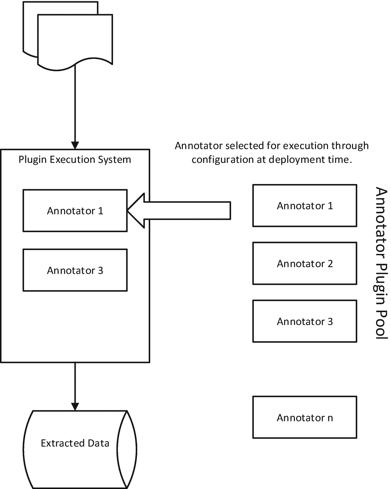
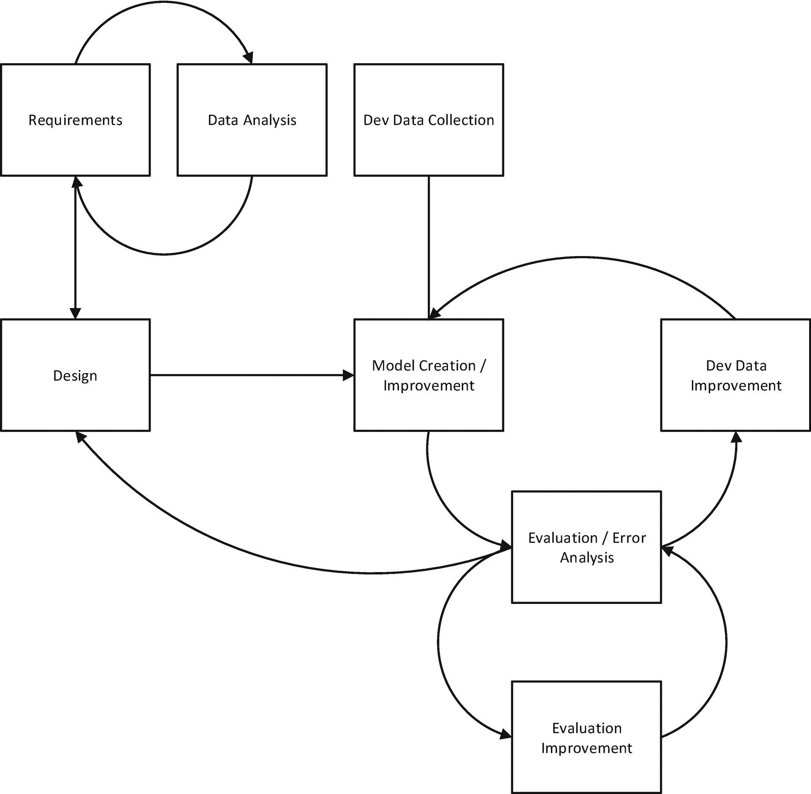
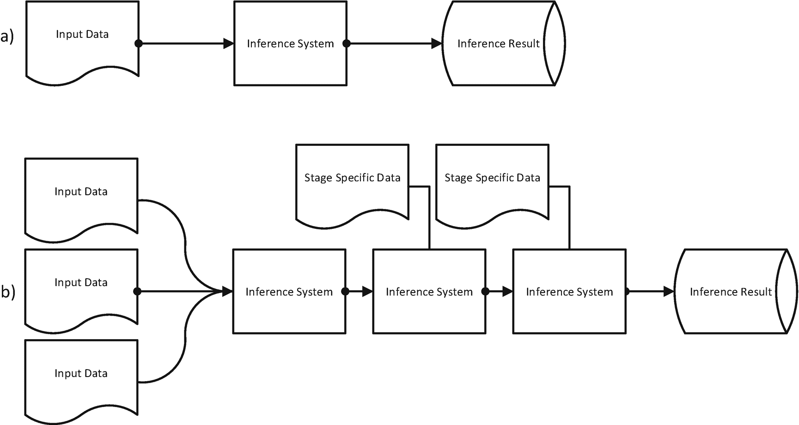
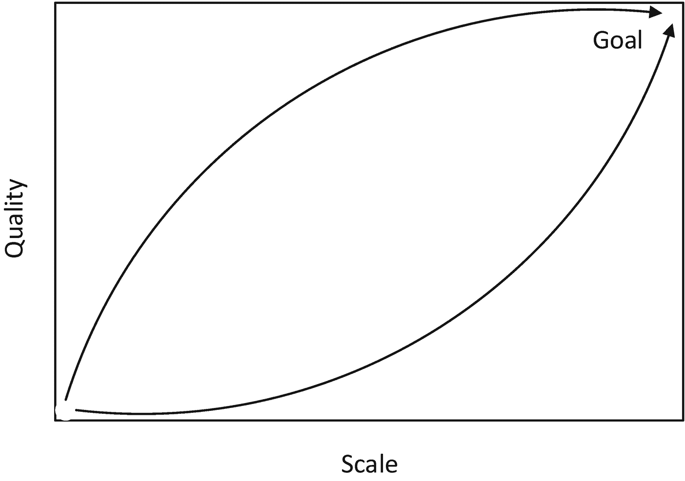

# 1. 尽早交付

> 我们的最高优先级是通过尽早并持续交付有价值的数据来满足客户。
>
> —agilemanifesto.org/principles

数据项目与传统软件工程项目不同，它们几乎完全受制于一种充满未知模式、分布和偏差的资源——数据。为了成功执行一个通过数据集推理来交付价值的项目，需要采用一套新颖的技能、流程和最佳实践。在本章中，我们将探讨项目的初始阶段，以及如何在面对这些未知因素时取得有意义的进展，同时让客户参与进来，并持续加深我们对数据、其价值及其对系统设计影响的理解。

首先，让我们看一个场景，它介绍了一个项目的早期阶段，该项目涉及从网络挖掘本地商业数据，这源于作者在微软必应搜索引擎上的工作经验。美国有数百万个本地商业地点。其中大约 50%^(³) 拥有某种形式的网站，无论是托管在拖放式网站托管服务上的简单单页设计，还是由专业网站团队开发和维护的复杂多品牌网站。出于经济激励，这些企业中的大多数会优先更新其网站，然后再更新其他任何形式的商业数据表示，以确保客户能找到关于它们的权威信息。^(⁴) 例如，如果电话号码错误，潜在客户将无法联系到他们；如果企业搬迁但地址未更新，则可能面临失去现有客户的风险；如果营业时间随季节变化，客户可能会流失。

本地搜索引擎的好坏取决于其数据质量。不准确或缺失的数据无法通过漂亮的界面来改善。我们的团队希望追溯到数据源——企业网站——以直接获取关于该企业的权威信息。作为数据聚合方，我们希望我们的数据能像企业自己在网络上呈现的数据一样好。此外，我们希望采用一种面向机器的策略，能够与竞争对手所依赖的大规模众包方法相抗衡。我们的愿景是构建一个实体提取系统，该系统能够摄取网站并生成描述网站上所呈现企业的结构化信息。

像这样的提取项目需要一个模式（schema）和一定的质量概念才能交付可行的产品，^(⁵) 这两者都由客户（即数据的主要消费者）决定。我们的目标是为一个现有系统提供额外数据，该系统已经摄入了多个本地数据源，并将它们合并以产生最终的融合输出。由于已有产品存在，模式是预先确定的，而当前数据的质量自然构成了所需质量的下限。模式包括核心属性：企业名称、地址、电话号码，以及扩展属性，包括营业时间、经纬度、菜单（针对餐厅）等。质量则根据这些字段中的错误来判定。

### 指标即客户

从传统敏捷软件项目转向数据项目时，第一个重大转变是，客户的许多角色转移到了为数据衡量的指标上。客户或产品负责人当然会启动项目，并与开发团队合作建立并商定评估流程。评估流程充当开发团队的“神谕”，用于指导投入方向并展示进展。

正如面向客户的指标用于指导项目和沟通进展一样，团队开发的任何组件都可以由指标驱动。建立内部指标为团队在内部循环^(⁶)（通常不被客户观察到）中迭代提供了一种高效方式。内部指标将指导旨在推动面向客户指标取得进展的某些工作领域。

一个指标需要一个数据集，该数据集基于目标输入总体的抽样过程，采用商定的模式，还需要一个评估函数（接收数据实例并产生某种形式的分数）和一个聚合函数（接收所有实例结果并产生一个总体分数）。这些组成部分中的每一个都需要由利益相关者讨论并达成一致。请注意，你需要区分质量指标（即数据的正确性如何）与影响或价值指标（即对使用该数据的产品有何益处）。你可以生成大量高质量的数据，但如果它没有以某种方式改进现有方法，那么它可能不会产生任何实际影响。

## 开始行动

我们最初是一个两人小团队（具备扎实的数据工程技能），只有一个简单的目标——在最短的时间内尽可能多地消除未知因素和假设。为此，我们最大限度地利用现有组件，以尽快实现端到端的数据流通。

### 推理

我们使用术语“推理”来描述任何超出简单数据操作、需要某种形式的概念建模和推理的数据转换，包括以下技术：

*   分类：确定将一条数据放入哪个类别
*   提取：识别并规范化文档中存在的信息
*   回归：根据一组输入预测一个标量值
*   逻辑推理：基于现有数据规则推导出新信息

数据的结构性转换（例如，在数据库中连接表）不包括在推理范围内，尽管它们可能是我们所描述系统的必要组成部分。

采用*寻找*技术而非*发明*技术的策略，使我们能够在几天内构建出一些东西，从而快速确定该方法的潜力，并找出需要关键投入的地方。我们很快认识到，研究现有系统的设计是学习如何构建下一个版本的一项宝贵投入。

但是，在编写一行代码之前，我们需要查看数据。通过审查与企业相关的网站的统一样本，我们发现了以下情况：

*   大多数企业网站规模较小，页面不超过十个。
*   大多数网站使用静态网页内容——也就是说，所有信息都存在于 HTML 数据中，而不是在访问者到达网站时动态获取和渲染的。
*   网站通常有一个包含联系信息的页面，尽管这些信息以某种形式出现在多个页面上也很常见，并且偶尔没有一个页面包含所有期望的信息。
*   许多企业在社交平台（Facebook、Instagram、Twitter）上有相关页面，少数企业只有社交平台上的存在。

这些宝贵的见解，花了一天时间得出，使我们能够就初始实施做出快速、广泛的决策。事后看来，我们认识到了一些重要的疏忽，例如（大型）连锁企业与较小的“单体”企业之间的区别。从搜索角度来看，连锁店数据价值更高。虽然连锁店在实际企业中只占少数，但它们可能是最重要的数据部分，因为用户倾向于搜索连锁企业。连锁店通常拥有更复杂的网站，往往需要更复杂的提取技术。从纯 HTML 中提取地址，远比从根据邮政编码搜索动态放置在地图上的一组实体中提取要容易得多。

### 每项任务都始于数据

开发者通过查看少量数据样本（少于 100 条），就能深入了解某个领域的基础知识。如果数据中存在某个占据主导地位的方面，通常很容易识别出来。审查数据的最佳实践包括：随机化数据（这有助于消除观察中的偏差），以及尽可能以原生形式查看数据（理想情况下，以机器将看到的形式查看数据；查看过程不应改变数据）。尽可能确保你查看的是生产环境中的数据^(⁷)（这是确保你有机会在端到端管道中发现问题的唯一途径）。

凭借对数据的早期广泛理解，我们迅速开始构建初始系统。我们对架构和基础设施采取了务实的态度。我们使用了为大量不同信息处理管道构建的现有基础设施，并采用了一种简单的顺序管道架构，该架构允许我们通过简单的数据模式连接少量阶段。具体来说，我们使用了必应的云计算平台，该平台旨在运行遵循 `MapReduce` 模式对大量数据进行脚本化处理的流程。我们并未假设该通用架构能最佳地解决此问题，也未假设其所支持的基础设施和计算范式完全适用于该问题领域。唯一的要求是，该平台可用，能够以合理的规模运行某些流程，并允许开发者在项目初始阶段快速迭代。

### 行动优先

总的来说，采取某种行动（审查数据、构建原型、运行实验）总会产生一些对团队取得进展有用的信息。这与争论选项、凭直觉判断数据、假设数据集的某些方面“显而易见”等做法形成对比。然而，这一原则不能鲁莽应用——行动本身必须有明确的终止点，并且理想情况下，应说明该产出将如何用于推动工作向前发展。

如果我们思考一下从网络挖掘本地商业网站以提取代表这些实体名称、地址和电话号码的高质量记录所需的组件，我们需要以下内容：

*   一种发现网站的方法
*   一个用于抓取这些网站的爬虫
*   用于在这些网站上定位名称、地址和电话号码的提取器
*   将这些提取的元素组装成一条或多条站点记录的逻辑
*   在某个生产基础设施上实现的管道，能够执行这些组件并整合结果

这五个元素中的每一个都需要设计迭代、测试等。在采用敏捷探索方法构建初始系统时，我们反而用以下五种解决方案来应对上述五个元素：

*   使用现有的包含网站信息的商业记录语料库来生成初始的待提取网站列表——暂时无需构建发现系统
*   通过仅处理已在我们将用于第一阶段工作的基础设施上运行的网络搜索引擎的生产网络语料库中的数据，消除了抓取数据的需要
*   使用现有的地址提取器，并构建了一个简单的电话号码提取器和名称提取器
*   实现了一种朴素的方法，将提取的元素组装成一条记录，我们称之为“`实体化`”
*   使用一个现有的、基于脚本的执行引擎来部署标注器和 `实体化` 组件，该引擎可供更大的必应工程团队使用，能够访问并设计为可对网络语料库中的数据进行扩展

在此过程中我们发现，没有现成的、开箱即用的方法可以从网站中提取商业名称。这因此成为了最初的创新焦点。在项目后期，有机会改进系统的其他部分，但最初最重要的投入是名称提取。

通过快速聚焦于关键创新领域，并在其他地方利用现有系统和朴素方法，我们在很短的时间内交付了第一个版本的数据。这为团队提供了一个数据集，使其能够更深入地了解项目的可行性。通过阅读该数据集，可以了解我们的朴素架构和通用提取器与满足整个项目需求所需的架构和提取器之间的差距。在早期，我们能够更深入地思考实际数据类型与确保高质量生产系统所需的架构和基础设施专业化之间的关系。

### 使用现成组件实现端到端

寻找能够近似构成系统的现有组件，以便评估项目的可行性，深入了解所需的架构，识别需要优先开发的组件，并发现内部循环中可能需要额外评估的地方。在大型组织中，你需要组装的许多组件很可能已经存在。还有许多开源资源可用于基础设施和推理组件。

快速启动并运行是一种递归策略。团队对基础设施选择（在验证项目之前，要避免对昂贵基础设施做出任何长期承诺）和架构（架构将根据数据和推理生态系统进行迭代并从中获取信息）做出高层决策。这使得团队能够发现哪里需要创新，然后该过程会递归进行。

为了构建名称提取器，我们采用了远程学习方法。我们拥有一个包含与网站 URL 相关联的本地实体记录的数据语料库。为了训练一个从网站中提取名称的模型，我们使用这些数据自动标注网页。我们的方法是：

1. 从所有商业-网站配对中随机创建一个训练集。
2. 抓取每个 URL 的第一层页面。
3. 使用合理的启发式方法（例如，在 HTML 元素内找到的任何 1-5 个标记的字符串）从页面生成 n-gram。
4. 如果 n-gram 与记录中现有的商业名称匹配，则将其标记为正例，否则标记为负例——这种匹配需要一定的灵活性。
5. 训练一个分类器来接受正例并拒绝负例。

如果我们思考创建分类器的通用方法，这种方法允许快速创建训练数据，同时避免了手动标注的成本，例如，创建和部署工具、寻找评判员、创建标注指南等。

### 关于组装通用系统的重要提醒

你可能会在某个时候说，你正在编写的代码、正在设计的系统或正在采用的平台只是一个临时措施，一旦你“摸清情况”，就会重新设计，或丢弃实验性代码，并构建真正的系统。要丢弃实验性代码，需要一个高度自律的团队和良好的向上管理能力。一旦系统运行起来，就会面临向客户交付的压力，这种压力不仅会开始建立对输出的依赖，还会建立对团队交付更多内容能力的依赖。这往往是以牺牲回头处理那些用于快速实现端到端的“临时”组件和设计为代价的。

## 数据分析与规划

现在系统已经就位，是时候审视初始输出，了解当前所处的位置了。拥有正式且受管理的系统，能够将数据通过评估人员输送，并提供训练数据或评估数据，这具有很大价值。但这绝不应在开发团队深入了解数据（包括输入和输出）的每个方面之前（或代替这一过程）进行。否则，团队将错失熟悉领域细微差别的最佳机会。

数据产品可以从两个角度来审视。第一个角度关注数据的`精确率`，回答的问题是“系统输出的记录质量如何？”这需要抽样输出，手动与输入进行比较，并判断输出本应是什么——机器是否做对了？第二个角度关注系统的`召回率`——对于所有本应提取出信息的输入，我们成功提取并做对的频率有多高？

通过审查初始输出所获得的洞察，验证了项目的可行性，并提供了待办工作清单，最终促使我们决定大幅扩充团队：

* 整体精确率虽有前景，但未达到所需水平。
* 名称精确率低于预期，我们需要判断方法是正确的（需要更多特征），还是方法存在根本性缺陷。
* 商品地址提取器过于偏向精确率，导致我们因未能找到地址而遗漏了太多商家。
* 我们对领域的理解还很肤浅，通过接触数据，我们现在对需要建模的世界的复杂性有了更深刻的认识。特别是，我们开始为这个领域构建一个新的模式，其中包含了单一商家、商家集团和连锁店，以及简单和复杂的商家与站点等概念。这些概念对我们的架构和爬取需求产生了重大影响。
* 我们为快速启动而利用的现有网络索引不足以满足我们的场景——它缺乏覆盖率，而且未能像网站访问者所体验的那样，准确捕捉某些类型页面的视图。

现在我们已经有了一个初步成型的系统，可以利用它进行一些额外的探索性调查，以了解该项目所开辟的更广泛的数据格局。我们在整个网络上运行了该系统（而不是仅局限于与现有商业数据记录语料库相关的网络子集）。更多细节将在后文介绍。

### 数据评估最佳实践

数据工程团队在早期阶段，常常使用临时工具来查看和判断数据。例如，你可能会以纯文本或电子表格程序（如 Excel）的形式查看组件的输出。然而，很快就会发现，即使是对于小数据集，开发能够尽可能消除数据分析工作流程中摩擦的专业工具，也能提高效率。

考虑审查一个从网络提取数据的流程的输出。如果你在 Excel 中查看此输出，则必须复制页面的 URL 并粘贴到浏览器中，然后才能将提取结果与原始页面进行比较。复制粘贴的操作很容易成为流程中成本最高的环节。当获取数据所需的活动比查看数据本身更昂贵时，团队应考虑构建（或购买）一个工具来消除这种低效。团队之间的区别在于，他们是否承认高质量数据生产力工具的核心重要性。

另一个考虑因素是评估过程本身的活动。通常，存在基于判断的过程（评估人员——即人类——会查看输出，并根据一些记录在案的指南对其正确性做出判断）和基于数据的过程（构建一个数据集——通常称为`真实数据标注集`——可用于完全自动化评估流程输出）。基于`真实数据标注集`的过程可以非常高效，使开发团队能够基本上以零成本进行持续评估。

工具开发和`真实数据标注集`的开发都涉及实际成本。避免这些投资，试图通过使用开发不良的工具和需要手动评估的迭代循环来勉强维持，是一种虚假的经济节约。

## 确立价值

在系统基础搭建完成后，我们接下来要确定如何传输数据并衡量其价值或影响力。从网络提取的数据旨在用于我们更大的本地搜索系统。该系统通过摄取约 100 个数据源，并通过合并/融合（或通常所说的记录链接）来整合结果，从而创建本地实体语料库。合并/融合系统拥有自己的机器学习模型，用于决定在合并/融合时选择哪些数据，因此我们希望尽一切努力确保我们网络提取的数据能被这个下游系统选中。我们通过衡量数据质量以及下游系统选择我们数据的频率，来了解我们系统的影响力。从我们网络挖掘数据流中被选中并呈现给用户的属性越多，其影响力就越大。通过确立这种下游影响力的概念，我们可以规划出一条持续交付递增影响力的路径——其核心理念是让网络挖掘的数据在必应本地搜索功能向用户展示的选定内容中占据越来越大的比重。

在为我们生成的数据设定质量标准时，我们考虑了多个因素。首先是现有数据的质量。令人惊讶的是，从许多覆盖面广的数据源（即那些涵盖多种类型企业的数据源，而非像餐馆这类特定类型企业的垂直数据源）中随机抽取企业记录样本显示，这些广泛覆盖的数据源的数据质量普遍不达标。我们本可以将这个低标准作为我们交付数据的要求。然而，垂直数据源和其他专业数据源的质量往往更高——每个属性的准确率约为 93%。因此，将这些“精品”垂直数据源作为我们的质量基准是合理的。

此外，我们还从质量能否通过测量进行可靠评估的角度来考量数据质量。决定测量准确性的因素有很多，其中最重要的是样本设计、样本量以及人为误差。这些因素都与评判成本相关（样本越大，评判成本越高；期望的误差率越低，通常每个人类智能任务所需的评判员就越多^(⁸)）。综合考虑这些因素，我们确定每个属性 98%的准确率是实际可测量质量的极限。换句话说，我们的目标是当数据质量与精品数据源相当时交付数据，并为数据源中的名称、地址和电话号码字段设定了 98%准确率的总体目标。

由于我们建立了一个简单的影响力衡量标准——下游系统从该数据源中选择属性的百分比——我们的基准影响力为 0%。因此，我们着手分析数据，以确定是否存在一种简单的方法，在不对我们即将生成的数据量造成直接压力的情况下达到准确率目标。总体策略是：从小处着手，有意保持较低的覆盖率，但提供高质量的数据源。在此基础上，我们可以通过两种方式逐步交付增量价值。第一种方式是通过一轮差距分析来扩展覆盖率（找出我们未能交付数据的环节，并进行必要的改进，以确保在这些特定的提取场景中能够成功）。第二种方式是识别我们可以交付的本地企业的其他属性。根据企业类型的不同，本地企业网站拥有许多对本地搜索用户有益的有趣属性，例如营业时间、便利设施、菜单、社交媒体账号、提供的服务等等。

### 发现价值平衡点

通过建立评估流程，客户帮助界定了价值的概念。在许多情况下，设定一个目标——例如，数据必须达到 80%的准确率和 100%的覆盖率——是可以接受的，但一个值得信赖的客户会提出更高的要求。在许多项目中，交付的数据将被更大系统的另一部分所消费，并在此基础上进行进一步的推断。这个下游过程可能会改变你所交付数据的感知质量，并对所设定的目标产生影响。在懒惰的客户（对他们来说，最简单的事情就是要求完美的数据）和懒惰的开发人员（对他们来说，最简单的事情就是交付基准数据）之间存在一种张力。设定目标很容易，但设定正确的目标需要投入。需要确定的最重要目标是，能够在下游产生积极影响的输出的形式和质量。这正是系统交付价值的精确点。虽然管理这种张力是客户与团队之间讨论的关键部分，但更好的做法是，在设定任何初始目标之前，就让下游客户参与消费数据，以便更好地理解并持续改进真正的需求。

当然，确定实现价值的精确点是一种理想状态。如果下游消费者不清楚*如何*实现他们的最终目标，那么确定你产品的价值点就需要他们先完成自己的系统。这有点像数据科学中的“先有鸡还是先有蛋”的问题。在某些情况下，务实的做法是就价值的某种近似值达成一致，并以此基准进行开发。之后，消费者可以自行判断这是否足以满足他们的需求。

有一种情况可以相对容易地确定数据产品的价值。如果存在现有产品，那么客户可以根据你所提供数据的相对质量，从经济角度来确定价值。他们可能愿意以较低的成本换取略低质量的数据，或者支付更多费用以获得显著更好的产品。

## 从早期交付到持续交付

我们搁置了从网络提取本地企业数据的项目，并开放了通过以下几种方式交付额外价值的可能性：

1. 交付更多实体，覆盖市场中更广泛的本地企业范围
2. 为每个企业提取更详细的属性（如图片或评论），为数据用户提供更丰富的信息维度

### 更多实体

一旦我们将信息源确立为第一方客户的可行数据来源，我们就开始从几个分析角度着手解决覆盖范围问题。一方面，网站的具体实现细节和呈现格式可能使提取所需信息变得更容易或更困难。以地址为例。如果地址出现在网站的单个 HTML 节点（如 `div` 或 `span`）中，并且网站以静态 HTML 文件形式呈现，那么提取就相对简单。另一方面，如果网站动态加载内容或使用图片来呈现地址，那么就需要更复杂的技术。这些挑战促使我们不断投资于我们称之为 `技术升级` 的领域。换句话说，为了获取更多数据，我们需要提高提取技术栈的复杂程度。

我们的数据分析提出的另一个考虑因素是底层业务的复杂性。一个只有单一地点的小型企业通常不会在其网站上呈现太多令人困惑的信息。它会有一个唯一的地址、一个电话号码等等。现在考虑一个稍微有趣一点的例子——一家在周末参加农贸市场的本地面包店。此时，网站可能会合理地包含额外的地址信息——未来几周内它将出现的市场的地址。在全面探索业务复杂性后，我们发现，多品牌、国际连锁店不仅在许多（可能成千上万个）地点以多个品牌呈现，而且必须利用动态和交互式网站架构来实现搜索引擎，以便客户找到连锁店的位置。

### 如何查看数据

以与系统视图完全相同的形式查看数据始终很重要，尤其是在网络上。如果你的系统正在处理网页，在浏览器中查看示例页面会隐藏许多细节，例如，底层 HTML 中可能存在不可见的文本部分。在浏览器中查看此类页面会隐藏这些内容，但你的推理系统会将其视为与可见数据等同。只有当你的团队完全理解了数据的底层“自然”形式后，才应采用以某种方式转换数据的视图。

有了这两个丰富（且并非完全独立）的维度可供探索，我们首先根据预期影响和预估成本对潜在投资进行优先级排序，从而着手规划。其次，我们在一个紧密的循环中迭代解决这些领域的方案：实施、评估和改进。

通过这种方式，我们通过覆盖范围带来更大影响，同时迭代我们的整体架构和各个组件，从而持续改进我们的产品。

被建模的概念与系统需求之间的关系可以通过我们需要调整系统以处理连锁网站的例子来说明。从技术上讲，连锁店是指任何拥有多个地点且客户体验可互换的企业。例如，麦当劳，因为你在任何地点都能获得基本相同的体验。连锁店通常通过搜索交互向网站访问者提供其位置数据，例如，你在星巴克门店定位器中输入邮政编码，就会收到一个响应，列出该位置或其附近的咖啡店列表。为了抓取和提取这些页面，我们需要模拟用户搜索，动态渲染结果页面，并跟踪该页面上的链接到各个门店的详细信息页面。

### 更多属性

我们迭代系统所交付价值的另一种方式是通过增加属性。早期，我们为系统核心选择了一种设计，其中包含一个简单的接口，用于我们称之为 `标注器` 的函数。标注器在计算上类似于人工标注员，后者查看页面并高亮显示表示特定类型事物的文本片段。我们创建了名称标注器、地址标注器、电话号码标注器等。每个标注器都可以完全独立地实现、测试、评估，并通过配置部署到流水线中——我们将这种方法称为插件架构（概述见图 1-1）。

图 1-1

在插件架构中，组件（此处指标注器）可以独立于运行时进行开发、测试和管理。使用配置将组件按需部署到流水线中。

这种隔离使我们能够独立处理一个标注器，无需依赖其他组件，并且可以在不额外测试其他组件的情况下进行部署。通过这种方式，我们可以从最初的三个属性（名称、地址、电话）扩展到任意一组属性。其中，最有趣的或许是营业时间标注器。了解其开发过程，可以为我们提供一些有趣的见解，了解现实世界中实体的本质、它们在网络上的呈现方式，以及为在本地搜索引擎中提取这些数据而设计的系统需求之间的关系。

凭直觉，我们可以对营业时间进行语义建模——许多企业都有简单的营业和打烊时间表示，每周每天各一个。但需要查看数据，即实际的商业网站，才能真正理解建模领域和构建正确提取技术所需的复杂性。企业可能使用包含性和排他性表述（“营业时间 9 点到 5 点，但 12 点到 1 点午休关门”），他们可能表述模糊（“营业至日落”），也可能描述例外情况（“国家法定节假日除外”）。在更复杂的网站上，营业时间可能实时呈现，即只有结合访问网站的日期才有意义（“今日：9–5，明日：9–6，等等”）。

研究数据让我们深入思考，我们最初是如何通过网络爬虫收集数据的。虽然通用网络索引作为起点不错，但如果我们的语料库中只有 1% 的企业每周更改营业时间，我们就需要比大规模索引更频繁地刷新数据，因为大规模索引更新大多数商业页面的速度远不及更新新闻网站或社交网站等更动态的页面。实际上，服务于本地商业提取系统所需的网站数量比通用网络搜索引擎所需的要少几个数量级。因此，我们完全有理由摆脱对这种初始方法的依赖，并投资于我们自己的爬取计划。

最后，营业时间在语言上与名称、地址或电话号码不同，其内部结构更复杂，表达方式也更多样。这意味着我们必须对特定的标注器投入更多资源，以提供营业时间数据。同样，研究数据为下一次架构、需求和技术选择的迭代提供了依据。

### 更多市场

随着项目的推进，我们开始与其他对通用方案感兴趣的团队建立联系——即利用网络作为本地搜索的许可数据源的替代方案。这促成了与负责为其他市场（例如，某个国家-语言对）提供本地数据的团队的合作。通过采用可插拔的架构方法并与其他团队合作，我们从一个单一场景的 `解决方案` 转变为一个服务于日益增多场景的 `平台`。

不同的市场呈现出不同的动机和变量。在某些情况下，用于许可数据的预算较少，这促使该市场的团队寻求更自动化的数据交付方法；而在另一些情况下，根本不存在能够达到最终产品所要求质量的可行数据源。为了持续在这一投资水平上交付成果，我们需要全面支持系统的运维方面（从部署自动化到 `DRI^(⁹)` 职责）。我们提供了交付可插拔组件的方法，这些方法既能利用最初实例化中的经验，又足够灵活以满足这些市场的特定需求，并且我们承诺为开发者工作流的每个部分创建、维护和改进工具。

### 更多质量

扩展系统的覆盖范围需要持续评估和维护输出质量。在某些情况下，这涉及调整和演进当前方法。在另一些情况下，则需要投入资源转向更通用的方法，或某种混合或集成方法。在我们从网络进行本地提取的历程中，我们遇到了许多这样的情况。

我们想要更换用于地址提取的方法。最初的通用解决方案虽然提供了合理的精确度，但召回率不足，因此必须被替换。我们选择了一种基于机器学习的方法（基于序列标注）和一种类似于主动学习的高效学习方法。为了完成过渡，我们创建了一个回归测试集，并持续改进模型，直到我们确信它是一个可行的替代方案。由此，我们可以利用一个更通用的模型来继续扩展我们的召回率并保持质量。

交付工业级推理系统的另一个非常现实的方面是管理那些影响当前性能或对某个消费者至关重要的错误。从网络提取数据的一个典型问题是，总体问题分布会随时间变化。例如，虽然系统可能已经愉快地从某个特定网站交付数据一段时间，但如果该网站更改了在开发期间不存在或很少见的呈现格式，系统可能会突然停止产生高质量的结果，甚至完全停止产生任何结果。如果消费系统出于某种原因对该网站的数据非常敏感，那么实施某种形式的保护或快速缓解流程将是务实的做法。

### 平台即产品：更多垂直领域和客户

通过覆盖范围、属性和市场扩展了网络挖掘投资的贡献之后，未来额外价值的增长点在于将平台本身转化为产品。达到这一水平需要围绕产品的商业模式做出决策。虽然我们最初的目标是交付商业数据，但扩展到将平台作为通用能力交付意味着我们将交付软件和服务。这条从解决方案到平台再到产品的路径并不罕见，并且代表着每一步投资价值数量级的跃升。

### 价值的早期与持续交付

旨在通过某种形式的推理从数据中提取价值的项目，本质上往往是研究项目。研究项目涉及许多未知因素，并伴随着特定类型的风险。这些未知因素和风险往往与传统应用开发中的截然不同。因此，我们需要重新思考我们对客户、核心开发迭代、产品形式以及交付方式的理解。

我们感兴趣的项目类型的核心是对潜在大量数据进行某种形式的推理。你的团队必须有能力在整体产品和明确定义的业务需求的背景下，智能地探索数据和推理解决方案的搜索空间，以便：

*   客户参与其中，并且他们的期望得到管理——参与其中的客户将确保最终产品的细节与业务案例需求保持一致。客户将看到项目的意义——特别是数据的性质和潜力如何影响最终结果并得到最佳利用。

*   进展得到恰当且持续的阐述——包括原型、低于最低可行产品（`MVP`）标准的初步改进，以及最终成功交付和维护数据产品。理想的客户甚至会提前于交付，通过构建消费系统的桩模块或原型（如果尚不存在）来协助项目的成功。

*   客户履行帮助团队确定工作优先级并安排工作的角色。客户理解其参与是至关重要且平等的发言权，有助于引导、塑造和落地项目。

无论是传统项目还是数据项目，通常都包含以下阶段：

1.  初始化

# 核心开发循环与工作流

2. 交付基线产品或最低可行产品（MVP）
3. 按需求交付
4. 维护
5. 扩展

在大多数阶段中，核心开发循环，即你的团队交付某种推理能力的过程，将由图 1-2 所示的工作流来表征。

*   需求生成是一个涉及客户和开发团队的迭代过程，通过分析代表系统目标群体的数据来细化初始任务。
*   确定并实施评估方法，以便跟踪向目标数据质量迈进的进展。
*   开发团队收集用于开发推理组件的数据，包括用于其内部循环的训练数据和评估数据。
*   评估、数据分析和错误分析用于改进模型，同时，在必要时，也用于改进评估过程本身。

本书的目标是帮助你驾驭通过此工作流进行交付的过程，并理解每个流程的上下文如何影响整体成功。

**图 1-2** 团队交付推理能力的过程

虽然很多关注点都集中在内部循环中核心模型和训练技术的进步上，但在工业环境中，认识到你的贡献在已部署系统的整体工作流中所处的位置也同样重要。如图 1-3 所示，你可能负责一个简单的单组件系统，或者正在构建一个更大的多组件系统，或者开发此类系统的一个子集。在任何这些情况下，你可能有一个或多个内部和外部客户。^(¹⁰)

**图 1-3** 简单的端到端系统 (a) 与多数据、多组件系统 (b)

最后，还需要选择合适的进展策略（图 1-4）。给定一个数据领域和一个推理问题，我们可以选择从一开始就全面覆盖该领域，并整体提升输出质量；或者将问题划分为数据领域的多个子区域（这些子区域具有独特特征，便于聚焦解决），在转向处理其他领域部分之前，先在这些子区域中实现高质量。例如，如果我们要构建一个识别视频中不同类型野生动物的系统，我们可以先为所有动物类型构建数据集，然后训练系统进行识别。在固定成本下，每种动物的数据量会很少，识别质量可能较低。同样的成本，我们也可以只为少数几种动物创建带标签的数据，并快速实现端到端的高质量结果。

另一个例子来自网络信息提取领域。“质量优先”策略会专注于网站间差异小、技术障碍少的简单网站（例如，我们可以将输入限制为纯 HTML，暂时忽略与动态渲染页面相关的问题——如图片、Flash、嵌入内容等）。而“广度优先”策略则会尝试用初始系统从所有这些输入形式中提取信息，最终很可能导致输出质量较低。

**图 1-4** 大规模推理项目的进展策略。上方线条代表优先考虑质量，然后再转向规模。这里，规模指的是处理越来越多输入类型的能力。例如，在文档处理系统中，这意味着处理多种文件格式的多种文档类型。下方线条代表优先考虑规模，然后再提升质量——换句话说，先投资处理大量不同类型的文档，再追求质量。在敏捷流程中，上方线条更受青睐，因为它是向客户交付价值的最短路径。

## 结论

在第 1 章“早期交付”中，我们探讨了团队如何启动并运行一个新的推理项目。我们提到了指标的核心作用，以及一种偏向行动的文化，这种文化能够利用数据分析快速迭代，从而推动项目各个方面的演进。

在第 2 章“变更的需求”中，我们将讨论如何构建为变更而设计的系统。

脚注 1   2   3   4   5   6   7   8