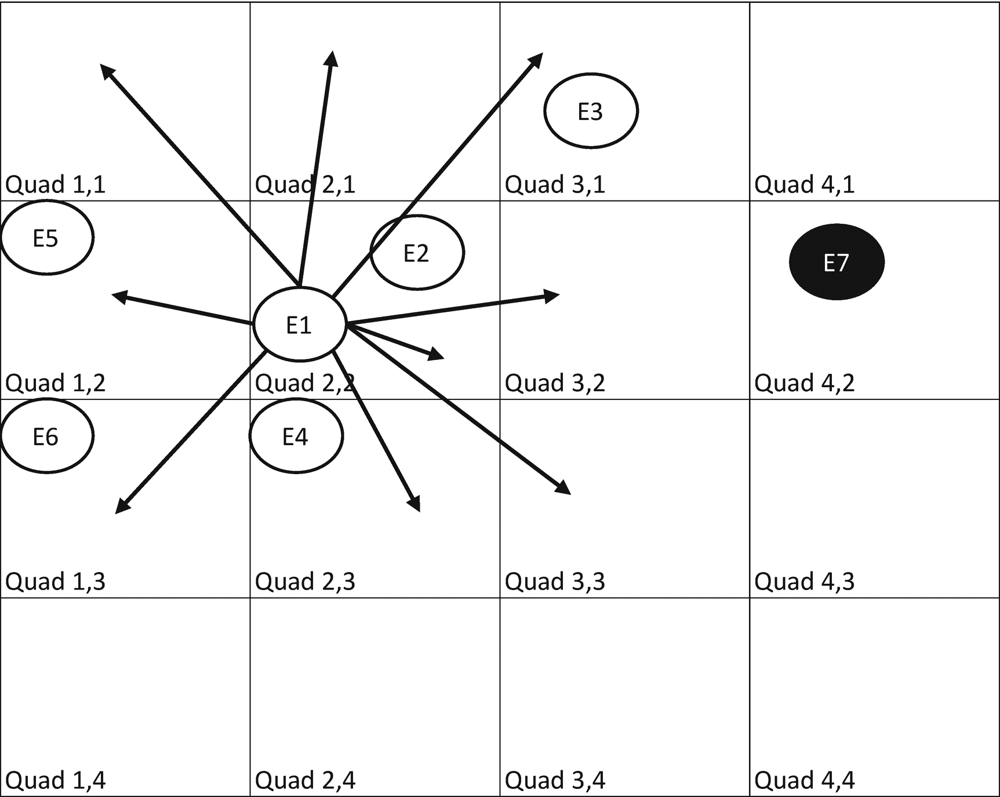
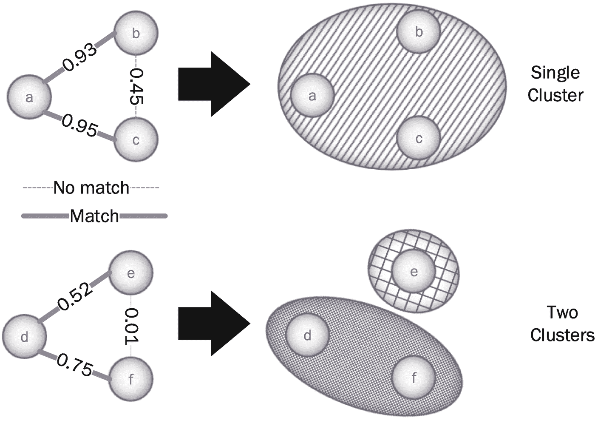
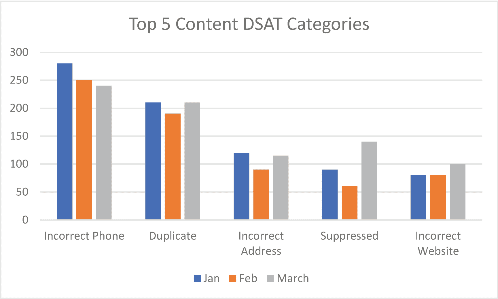
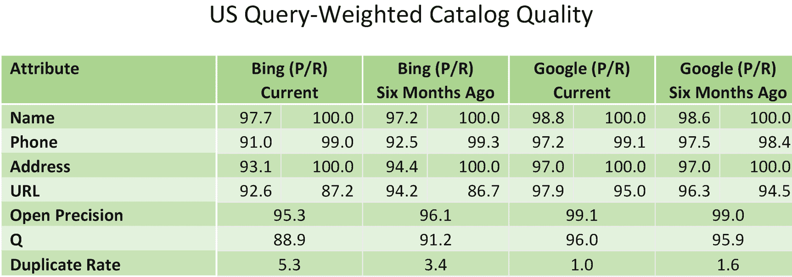
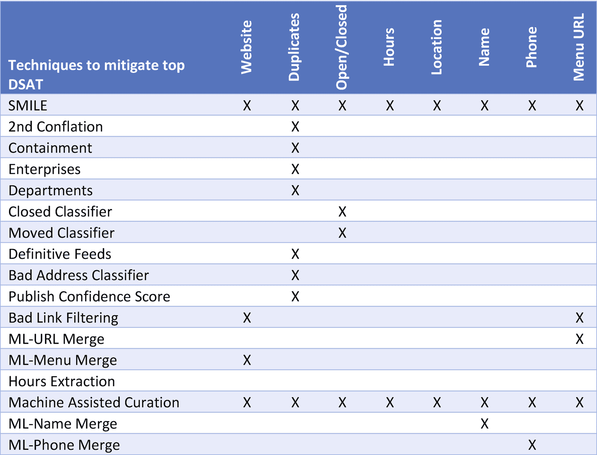

# 2. 变更的需求

> *欢迎* ***变更的需求*** *，即使在* ***开发后期*** *。敏捷流程利用变更，为客户创造* ***竞争优势***
>
> *。——agilemanifesto.org/principles*

数据工程项目中唯一不变的就是变化。有时变化来自数据本身——例如，用于检测欺诈数据模式的系统，最终会被未来的攻击所超越，导致系统效果下降。随着数据的探索和分析，解决数据问题的思路也会发生变化。客户可能反复无常，改变他们对需求以及哪些功能最重要的看法。可用的机器学习算法和技术也在变化——机器学习研究不断向前发展。最后，竞争对手的产品也在变化——强大的竞争对手往往难以追赶，必须密切跟踪，以确保他们不会获得难以逾越的竞争优势。

最成功的数据工程项目将变化视为不可避免，并在项目启动之初就构建应对变化的机制。在本章中，我们将讨论几种应对变化的策略，包括构建对变化更具弹性的模型、监控已发布功能和模型性能的变化、确保模型及其功能可测试且敏捷，以及衡量自身产品和竞争对手产品的性能。

## 为变更而构建

在数据工程团队中，尤其是初创团队，最难培养的文化理念或许是“我们着眼于长远”。如果你没有从一开始就秉持这一文化原则，那么所做的投入都将是短期收益，随着时间的推移，随着需求和数据环境的变化，这些收益将越来越难以维持。

同样重要的是，不要对某个特定组件或架构过于执着。如果系统从一开始就以松耦合的方式设计，那么重写一个有问题的组件或系统，应始终被视为重构或持续修复该组件中大量遗留错误的替代方案。正如第 1 章“早期交付”中所讨论的，这提供了一种启动策略——将许多现有组件连接起来，快速实现端到端的运行，但要以松耦合的方式进行，以便根据需要替换或升级系统的各个部分。你应该准备好抛弃最初构建的系统，因为随着你对要解决的问题有更深入的了解，你会发现最初的组件流水线并不适合当前的问题。

### 为变更而构建的度量

如第 1 章“早期交付”所述，团队早期需要建立的最重要事项之一就是指标。一旦指标确立，就必须投入专门的精力，确保指标与项目的业务目标保持一致。我们发现，在一个约有 50 名开发人员的项目中，安排 5 名开发人员专门专注于度量是一个好主意。有时甚至觉得这样的投入还是太少。我们称这五名开发人员组成的团队为“度量团队”。

### 度量

度量之于数据项目，就如同单元测试之于传统软件项目。如果你拥有稳健的度量体系，就能对照基准来评估新组件、新架构和新范式。如果你不重视度量，也不在这方面进行大量投入，那么你的数据工程项目就永远无法成功。

这五位开发者做了什么？首先，他们为团队其他成员提供了一道防火墙，防止其余开发团队（以及正在交付的模型）受到测试集的污染。机器学习中需要遵循的一个关键原则是，不要用测试数据污染训练数据，否则开发者会开始学习测试数据中的模式，对被测问题产生过拟合，并扭曲指标，使得结果看起来比实际情况更好。大多数重要的数据问题都会在你的训练数据中显现出来。

我们围绕这一原则建立了一个组织边界，只允许度量团队访问测试集。在实践中，我们发现，如果没有这个组织边界，测试数据很容易泄露到训练数据中，或者微妙地影响开发者的思维，从而有效地欺骗我们自己，让我们以为比实际水平更好。度量团队还负责为团队定义官方关键指标，这些指标会定期计算、跟踪，并通过门户网站进行报告。

度量团队创建了能够计算和跟踪团队所需任意数量数据指标的系统，并帮助维护和存储团队所需的数百个不同的测试集。从一开始，他们就构建了能够预见到训练集和测试集将会变化、团队指标也会变化的度量系统。

他们还设计了基于 Web 的应用程序，供人工评审员用于评分和标记数据，以及用于管理和跟踪对数据所做评审的系统。其中一些评审结果被用来评估我们在某些关键指标上的表现——例如，企业电话号码的准确性。另一些评审结果则被用作机器学习模型的训练数据。

这些标记用的 Web 应用程序被称为 HIT 应用。一个 HIT（人类智能任务）是评审员对一条数据做出的判断，该系统旨在最大化评审员每小时能做出的判断数量，同时最大化每个判断的准确性。HIT 应用构建在一个通用平台上，该平台服务于许多类似的团队，并确保每个团队不必重新发明我们评分和标记系统中使用的通用功能。这些系统的设计预期是，所需的 HIT 应用类型会随时间变化，甚至管理评审员的策略也会随时间变化。

### 投资于工具

许多团队在工具上的投入不足，而这些工具从长远来看能极大提升团队效率。正如编写代码的团队能从高质量的开发 IDE、源代码控制、持续集成和部署系统等工具中受益匪浅一样，数据工程团队也能从高质量的机器学习工具、HIT 应用创建工具以及数据探索和评估工具中获益良多。

如果一个团队是出于“长期”考虑来构建度量系统，那么他们的构建方式会截然不同。例如，拥有一个包含可重用组件的 HIT 应用系统就变得很重要，这样当团队决定不仅需要衡量企业电话号码的准确性，还需要衡量更复杂企业中相关部门的电话号码时，就能快速利用这些组件。如果你从一开始就假设长期内可能会拥有数千个这样的集合，那么跟踪训练集和测试集的系统构建方式就会大不相同。如果团队知道最终需要为多个不同市场报告数百个不同的指标——例如，不仅是在美国，还要在其他 30 个国家报告电话号码准确性——那么计算指标的系统设计方式也会截然不同。

对这类稳健系统的投入当然会拖慢初期工作——但从长远来看，速度的提升足以弥补从一开始就为应对变化而设计所增加的额外成本。

### “为长期构建”就是瀑布模型吗？

“为长期构建”听起来很像瀑布式开发——在开发之前就预先弄清楚所有需要构建的内容，这种方法似乎与敏捷开发背道而驰。我们在这里讨论的，或许更准确地表述为**选择能够支持长期变化的灵活架构模式**。举个例子，我们并没有立即构建对 30 个市场的支持——我们最初只构建了对美国市场的支持。但在代码中，只要有可能，我们就确保不硬编码为单一市场，因为我们知道必须支持多个市场。当后续迭代中我们开始支持第二、第三和第四个市场时，确实需要对现有代码进行修改，但这些修改的幅度，远不及我们当初没有至少通过架构模式来规划支持多个市场时那么大。

### 为变化而构建的管道

我们在 50 人团队中做出的第二项重大投入，是资助了一个管道和基础设施团队。这个团队提供了部署和运行所有模型及代码的基础设施，团队其他成员将利用这些模型和代码每天生成一个新的数据目录。在一个 50 人的团队中，我们专门分配了十名成员负责管道工作。我们称这个团队为“数据管道”团队。

数据管道团队创建了在线系统或“管道”，该系统每天会摄取我们所有不同数据源的更新，运行代码对这些数据进行标准化处理，托管各种模型来改进和聚合数据，托管我们称之为“合并/归并”的管道阶段（这是我们用来对我们拥有的、包含世界上同一实体信息的多个数据源进行去重，并尝试从多个可用来源中挑选最佳数据的方法），并最终将数据发布到我们的目录中。

### 环境或环

团队将系统部署到多个稳定性逐步提升的环境（有时也称为“环”）中是有益的。在微软，我们通常设有三个环境。“开发”环境运行着包含最新代码提交的流水线版本，开发人员在此环境中积极进行产品开发。该环境中的流水线负载仅代表系统实际需要处理负载的一小部分。当“开发”环境中的代码趋于稳定，所有测试通过且流水线验证无误后，代码将被移至“PPE”或预生产环境。此环境会承载更接近生产环境的负载，并作为代码迁移至“生产”环境前的最终冒烟测试环境。我们在环境之间设立了“关卡”——本质上是一系列测试和指标，代码必须通过这些测试且验证无性能回退，才能从开发环境进入 PPE 环境，再从 PPE 环境进入生产环境。

图 2-1

一个数据管道

作为对我们系统的简要说明（本书后续章节将讨论其各个方面），如图 2-1 所示的管道从全球多个数据提供商提供的数百个“数据源”中摄取关于本地企业的数据。例如，我们拥有从为提取网络主要网站上的本地企业而构建的系统中获取的数据源（这在第 1 章“早期交付”中讨论过）——比如，我们会爬取沃尔玛网站，获取全球每家沃尔玛的位置、电话号码及其他信息。我们还拥有来自第三方数据提供商（如 Yelp 和 TripAdvisor）的数据源，这些数据源包含关于企业的额外数据，例如评论。此外，我们还有来自扫描电话簿的第三方数据源。每天，所有这些数据都会被重新获取并摄入到我们的数据管道中。数据会被规范化（例如，统一大小写格式、标准化电话号码格式等）。然后，我们使用地理编码器将所有地址信息映射到地图上的一个经纬度点。

随后，数据会通过本章稍后描述的合并/融合记录链接系统进行匹配，该系统包含四个步骤：候选集生成、匹配、聚类和合并。该融合系统能够检测到 TripAdvisor 数据源中的记录 9875、Yelp 数据源中的记录 5324 以及网络提取数据源中的记录 1945 描述的是同一家企业。这三条记录（实际上，对于更热门的企业，我们通常会有 25 到 100 个数据源提供相应的记录）需要被合并在一起——每个提供商的数据都存在细微差异，因此我们必须使用机器学习来判断两条记录是否匹配、是否描述同一家企业，并在各提供商对电话号码意见不一时，决定是使用 Yelp、TripAdvisor 提供的电话号码，还是使用网络提取的数据。合并后的实体随后会被发布到我们的目录中。

团队在设计数据管道时，充分考虑了其未来需要处理多个市场的数据、将被微软内部众多不同团队使用、其他团队需要以不同方式扩展和配置管道、数据源和数据提供方可随时根据当前商业协议和可用数据进行修改、添加或移除，以及需要一种机制来手动修正数据并设置一个“修正”层，以覆盖数据管道可能为特定实体产生的任何错误结果。

为变更、可扩展性和可配置性而构建确实在初期增加了更多前期工作；但我们的长期目标是确保必应的本地企业目录能够通过利用多种数据源、网络和先进的机器学习模型，与谷歌展开竞争。我们希望在每个国家（而不仅仅是美国）都能与谷歌竞争。因此，数据管道从设计之初就具备了高度的可配置性和可扩展性。管道监控和工具的设计也预见了多个数据管道的存在——每个市场一个，彼此独立运行。后来，当我们上线新的国家时，整个过程非常迅速，因为我们从一开始就着眼于长期目标进行设计。

## 机器学习支持团队

到目前为止，我们基本上描述了团队内的两个专业领域——度量领域和大数据管道领域。这两个领域都必须熟悉机器学习，以确保度量和数据管道能够支持数据科学家创建将在生产环境中运行的模型。然而，这常常带来有趣的管理挑战。通常，“度量”领域或“大数据管道领域”的人员会看向组织中属于“数据科学家”领域、正在构建生产模型的开发者，并说：“我想做那个。”一般来说，我们会尽可能鼓励和支持有这种想法的人，因为这有助于整个团队变得更好——不同领域的知识在各个团队中流动。这有助于数据科学家理解，当拥有管道背景的人在他们领域工作时，“运行数据管道能有多难”。但奇怪的是，我们很少看到数据科学家要求花更多时间在管道工作上。为了弥补数据科学家对管道工作缺乏兴趣的情况，我们经常要求数据科学家在模型能在其机器上运行后，不仅要更进一步，不能只是将模型“扔过墙”交给数据管道团队并说“请运行这个”，而是要求数据科学家实际完成将模型签入并集成到数据管道中的工作，并确保其在生产环境中运行良好。

## 为变更而构建的模型

在本节中，我们将探讨如何构建能够适应变更的机器学习模型。本节将考虑的示例是必应的合并/融合系统，该系统用于链接来自多个数据提供商的记录，以创建每个本地实体。

### 融合系统简介

我们在 50 人团队中进行的第三项重大投资，是资助了融合/合并团队。该团队负责复杂的算法和机器学习模型，用于执行系统的记录链接，并在一个企业的每个关键属性可能有数十个不同值可供选择时，挑选出最佳值。这是我们系统中最复杂的领域，另有十名开发人员专门负责。我们称这个十人团队为“融合”团队。

融合团队创建的系统，用于匹配来自必应授权数据的众多不同本地数据提供商的数据，以及我们从网络提取的数据。这个记录链接系统遵循了第 1 章“早期交付”中描述的经典模型：它从简单开始，然后随着需求和衡量标准的演变，系统从一个简单的基于规则的系统，发展成为一个复杂得多的基于机器学习的系统。

一旦开发出显示我们记录链接系统弱点的指标，记录链接组件就被确定为需要改进和重写的关键领域。对于最终用户来说，我们系统中的这些弱点表现为“重复项”——例如，用户可能搜索星巴克，而实际情况是附近有五家星巴克，但搜索引擎可能返回六家。这种错误通常是由记录链接错误引起的，即列表中对应第五家星巴克的记录，由于记录中数据差异过大而未能正确链接到第五家星巴克，反而错误地成为了第六个条目。

图 2-2 展示了 2014 年必应中此类错误的一个实际例子。这两个实体是由来自 11 个提供商的 18 条记录构建而成，这些记录本应全部链接在一起，形成一个单一的剧院实体。但我们的记录链接系统发现，这 18 条记录中有足够多的记录与其他记录差异较大，因此决定创建两个实体。发生这种情况的原因是来自不同提供商的名称、电话号码和评论存在差异。与该实体相关的所有 18 条记录和 11 个提供商均列于表 2-1 中。

表 2-1

用于创建一个实体的多个数据提供商和记录

| 提供商 | 名称 | 已关闭？ | 地址 | 电话 | 网站 |

| --- | --- | --- | --- | --- | --- |

| **A** | Village Theatre | | 480 1st Ave NW, Issaquah | 4253950051 | Villagetheatre.org |

| **A** | Village Theatre | | 215 Front St N, Issaquah | 4253918190 | Villagetheatre.org |

| **B** | Village Theatre | | 303 Front St N, Issaquah | 4253922202 | Villagetheatre.org |

| **C** | Village Theatre | | 303 Front St N, Issaquah | 4253922202 | Villagetheatre.org |

| **C** | Francis J Gaudette Theatre | | 303 Front St N, Issaquah | 4253922202 | Villagetheatre.org |

| **D** | Francis J Gaudette Theatre | | 303 Front St N, Issaquah | 4255392202 | |

| **D** | The Village Theatre | | 215 Front St N, Issaquah | 4253918190 | Villagetheatre.org |

| **D** | Village Theatre | | 303 Front St N, Issaquah | 4253921942 | |

| **D** | Village Theatre | | 480 1st Ave NW, Issaquah | 4253950051 | |

| **E** | Village Theatre | False | 303 Front St N, Issaquah | 4253922202 | Villagetheatre.org |

| **F** | Village Theatre | | 303 Front N St, Issaquah | 4253922202 | |

| **F** | Francis J Gaudette Theatre | | 303 Front N St, Issaquah | 4253922202 | |

| **G** | Village Theatre | | 303 Front St N, Issaquah | +1 425-392-2202 | Villagetheatre.org |

| **G** | Francis J. Gaudette Theatre | | 303 Front St N, Issaquah | +1 425 392-1942 | |

| **H** | Village Theatre | | 303 Front St N, Issaquah | 4253922202 | Villagetheatre.org |

| **I** | Village Theatre | | 303 Front St N, Issaquah | 4253922202 | Villagetheatre.org |

| **J** | Village Theatre | | 303 Front St N, Issaquah | 4253922202 | |

| **K** | Village Theatre | | 303 Front St N, Issaquah | 4253922202 | VillageTheatre.org |

图 2-2

2014 年必应数据中的一个“欠匹配”或重复错误

### 不良数据蔓延

你可能想知道，为什么在上述例子中的 11 个提供商中，有多个提供商拥有完全相同的错误数据。这个问题在我们的领域频繁发生，原因是该领域存在数据集的买卖。单个数据提供商可能获取了错误的电话号码或名称（更可能是过时的旧号码）。该数据提供商可能将数据出售给其他数据提供商。这些数据提供商通常会在基础数据之上添加评论或其他价值。他们反过来转售数据，同时传递了错误的电话号码或名称。作为这些购买数据集的消费者，必应经常遇到多个提供商似乎“确认”某个实体存在的情况，因为他们的数据一致，但实际上，这种看似“确认”（即多个提供商以相同方式描述，因此必定是真实实体）的情况，实际上是数据提供商之间共享的错误数据。

### 现实世界的数据充满噪声

当你研究表 2-1（该表展示了来自 11 家数据提供商的真实名称、地址、营业状态、电话号码和网站信息）时，你会发现每个字段都存在大量差异。对于同一实体，名称有三种选择，地址有四种不同写法，电话号码经过标准化后有四种形式，并且每家提供商掌握的信息都存在多处空白。例如，在本例中，网站信息仅在 18 次记录中被提及 11 次，且只有一家提供商有足够把握断言该实体处于营业状态。

此外，你还会注意到某些提供商提供了大量重复数据——例如，提供商 D 有四条记录，均声称指向“Village Theatre”。

随着用户开始报告并投诉我们系统中这些重复的实体，我们开始开发一项名为“重复率”的衡量指标来量化该问题。我们会请人工评审员运行一组能够代表用户在网站上实际查询的语料，然后评判每次查询的结果，以查看产生了多少重复项。可以想象，评判过程十分复杂，因为两个返回结果是否为重复项往往并不明显。评审员必须更深入地查看我们关联在一起的记录，致电相关企业，或尝试查找主要网站来验证某个特定实体是否属于重复项。

在开发出重复率指标并定期进行测量后（我们大约每两周更新一次，当工程团队需要更频繁的更新时，更新周期会更短），我们开始了改进该指标的进程。团队还创建了广泛的记录标签，用以标明哪些记录对应现实世界中的实体。这实际上相当于人工完成了我们最终希望系统自动完成的工作。我们的做法是，收集某个特定邮政编码下的所有记录——这些记录通常包含来自不同提供商、代表同一企业的数十条记录——然后手动将这些记录聚类，以生成系统所需的训练数据。

随后，团队利用这些训练数据，采用更复杂的技术进行记录链接，并超越了基于规则的系统。团队必须对来自不同数据提供商的多条数据源中关于同一企业的多条信息进行匹配、聚类，然后合并。团队创建了一个基于机器学习的匹配函数，用于匹配过程，同时还使用了机器学习模型来合并数据，以及复杂的算法将相关数据聚类到同一簇中。代表记录聚类的人工标注训练数据语料，被用于确定可以添加到匹配模型或聚类与合并模型中的新特征，以确保我们的重复率下降。

随着匹配模型的改进和重复率的下降，用户开始抱怨一个新问题。该问题通常表现为：某个特定实体存在错误的电话号码、地址或关联评论。在调查该问题时，我们发现系统在减少重复记录方面变得过于激进，从而产生了我们称之为“过度匹配”的情况——即原本不同的企业（例如西雅图常见的、相隔一个街区的两家星巴克）或一家包含在另一家企业内的业务（如超市内的咖啡店）被关联在了一起。

图 2-3 展示了一个过度匹配的示例。在此例中，一条关于“Levi Store”的记录与一条名为“Seattle Premium Outlets”的购物中心记录被关联在一起。随后，合并系统会确定所有关联记录中的哪些数据被认为代表同一个实体。基于该判断，系统会从一家数据提供商提供的记录中提取名称（该记录被预测拥有最佳名称），并从另一家数据提供商提供的记录中提取网站（该记录被预测拥有最高质量的网站），从而构建出最终实体。不幸的是，第一家数据提供商提供的记录实际上代表的是现实世界中的实体“Seattle Premium Outlets”，而第二家数据提供商提供的记录实际上代表的是现实世界中的实体“The Levi’s Outlet”。

图 2-3：数据中的过度匹配示例——来自 2014 年的必应

针对过度匹配问题，我们开发了第二个“过度匹配”指标，并开始定期测量该指标，与重复率一同监控。现在，我们要求评审员运行一组查询，并检查系统为创建每个实体而选取的记录。随着时间的推移，我们认识到必须对系统进行微调，以同时优化重复率和过度匹配指标。通常，为降低重复率所做的工作可能会导致过度匹配指标恶化。有时，需要专门进行一些工作来减少过度匹配，而这些工作并不会直接影响过度匹配率。例如，过度匹配的一个常见原因就是前面提到的父实体“Seattle Premium Outlets”与子实体（即该奥特莱斯购物中心内的“Levi Store”）被混淆。为减少此类过度匹配所做的工作，通常最终会在目录中创建出之前被淹没在过度匹配实体中的新实体，而不会改变重复率。

#### 合并系统

我们将简要介绍合并系统用于关联记录并最终合并这些记录，以在系统中创建每个本地商业实体所采取的步骤，如图 2-4 所示。该系统消费了由多个数据提供商提供的、已经过标准化的数据。

图 2-4：合并系统

1.  **候选集生成**：在合并过程中，基本操作是查看系统中的两条记录，并判断它们的相似或相异程度。这是通过一个我们称之为“匹配函数”的机器学习函数来完成的，该函数将每个实体的所有属性以及基于每个实体属性计算的许多特征作为输入，并输出一个从 0 到 1 的相似度分数。匹配函数的运行成本很高——因此，当系统中的记录数量达到数亿条时，你不可能对整个 `n x n` 的记录矩阵运行该函数。这样做也没有意义——将堪萨斯州托皮卡市一家麦当劳的记录与爱达荷州博伊西市一家麦当劳的记录进行比较，纯粹是浪费计算时间。

因此，我们合并系统的第一阶段会遍历系统中的记录，并生成较小的记录集（我们称之为候选集），这些记录极有可能位于同一物理位置。例如，一个简单的实现方式是选择特定邮政编码内的所有记录集，然后对这些记录两两运行匹配函数。

实际上，我们将地图划分为更小的区块，称为四叉键（`quadkeys`，大约相当于一个城市街区的面积）。给定四叉键中的任何实体，都会与同一四叉键以及该四叉键周围其他八个四叉键中的所有商业实体进行比较，如图 2-5 所示。

图 2-5：四叉键——一个实体（E1）与同一四叉键及八个相邻四叉键中的所有实体进行比较。除 E7 之外的所有实体都将通过此算法进行比较。

2.  **匹配**：在此阶段，匹配函数会接收为实体对推断和计算出的数百个特征作为输入，并对候选集内的所有实体进行 `n x n` 的比较。作为进一步的优化，我们有一个成本较低的匹配函数，可以首先运行以排除明显不匹配的实体，然后对低成本匹配函数无法判定为相似或相异的实体运行成本较高的匹配函数。

例如，我们投入开发了一组自然语言处理（NLP）特征，它会接收实体的输入名称，并对实体名称中的每个单词进行标记，标记为判定为人物姓名 `[P]`、企业名称 `[B]`、企业类别 `[C]`、企业部门 `[D]` 等。对于名为“State Farm Insurance – John Smith”的企业，标记器会将其标记为“`State[B] Farm[B] Insurance[C] – John[P] Smith[P]`”。根据这些额外的推断标签，我们创建了匹配函数学习到的特征，例如“两个实体均包含人物姓名”或“人物姓名相似度分数”，这些特征将接收被比较的两个实体的标记数据作为输入，并输出一个 `0-1` 的分数。

然后，匹配函数会根据由评审员标注的数据进行训练，评审员会判断来自数据提供商的两条记录是否指向同一实体（参见表 2-1 了解来自数据提供商的数据示例）。匹配函数将学习在比较不同类型的实体时，其关注的数百个特征（例如“两个实体均包含人物姓名”或“两个实体拥有相同电话号码”）中哪些应该被赋予最高权重。

3.  **连接与聚类**：在此管道阶段，匹配函数现在已为所有彼此邻近的实体对输出了相似度分数。这产生了我们称之为“连通分量”的结果，其中所有运行了匹配函数的实体之间现在都有一条边相连。实体连接后，我们面临一个新问题，我们称之为“聚类”——即如何确定哪些记录应该被组合起来以创建一个特定的聚类，而该聚类最终将产生一个本地商业实体。

聚类决定了从该连通图中创建多少个实体。例如，图 2-6 展示了聚类如何在简单的连通图上运行。记录由节点 `a` 到 `f` 表示。匹配分数位于记录之间的边上。该图并非完全连通，因为记录 `a`、`b`、`c` 与 `d`、`e`、`f` 位于不同的候选集中（很可能是因为这些记录彼此距离太远）。在此示例中，从聚类中创建了三个实体：`abc`、`e` 和 `df`。记录之间边上大于 `0.5` 的匹配分数被视为匹配，而低于 `0.5` 的匹配分数则被视为不匹配。

图 2-6

从连通图创建聚类

#### 聚类修正

在此阶段，我们维护了系统中由用户报告的已知重复或过度匹配的列表，这些是合并系统仍未正确处理的。因此，我们会进行“强制匹配”以合并系统未能处理的重复项，并进行“强制取消匹配”以拆分过度匹配的实体。随着时间的推移，随着我们系统的改进，这些手动修正的需求越来越少。

#### ID 丰富化

我们将在本章后面讨论 ID 稳定性问题时再对此进行阐述。

#### 合并

在合并时，我们会获取聚类中所有关联在一起的记录，并决定从聚类中的所有记录中选用哪些数据来创建最终实体。在此，我们也使用机器学习来确定哪个数据提供商拥有最正确或最可信的数据以供选择。例如，在一个包含餐厅数据的聚类中，机器学习合并函数可能会学会信任某个专注于餐厅的数据提供商来获取实体名称，但信任某个扫描电话簿的数据提供商来获取实体的电话号码。

#### 合并修正

在此阶段，我们维护了由用户报告的已知合并失败列表（例如，当我们从某个特定提供商选取了某个属性值但该数据是错误数据，而另一个提供商为该属性提供了正确值的情况）。然后，我们会强制从已知正确的提供商那里选取数据。如果所有提供商的数据都不正确，我们还有自己提供的微软数据源，这些数据会聚合成一个我们已手动整理并确认为正确的实体。

## 构建支持变更的融合系统

该团队设计支持变更的融合系统时，最重要的方式或许是预见到单一的匹配函数无法同样适用于全球所有市场。例如，美国市场的匹配函数高度依赖精确的地址以及企业的经纬度信息。但在巴西这样的市场，地址结构远不如美国规范且模糊不清——例如，巴西的地址通常只标明社区，并附带该地点相对于社区内某个地标的方位。通过预判需要多种匹配函数，团队在构建融合系统时采用了可替换架构，使许多组件能够被更具市场针对性的元素替代——例如，在美国高度依赖地址的候选生成系统，可以替换为像巴西这类国家对地址敏感度较低的候选生成系统。

此外，意识到需要构建多种不同的匹配函数后，团队建立了一个可复用特征库，供各个市场专属模型调用。这个支持计算名称相似度、地址相似度、类别相似度、电话号码相似度、字符串空格数、标点符号以及命名实体识别器的可复用特征库，能够被后续创建的多个融合模型所利用，从而使团队能够稳健应对不断变化的需求。同时，该可复用特征库中还包含了用于生成和处理各特征训练数据的可复用工具。

### 支持变更的架构

团队早期做出的一个艰难决定，是根本性地为数据管道和数据目录选择一种支持变更的架构。这个架构决策被称为“每日从零重建世界”决策。这一决策有利有弊。我们将阐述这个决策是什么、为何做出、如何帮助我们以及带来了哪些弊端。

在创建必应本地数据管道的早期阶段，我们清楚地认识到融合模型仍不成熟，距离实现期望的去重率和过度匹配率还有很长的路要走。与谷歌不同，我们无法随时调动大量人力——无论是付费还是无偿——来修正目录中的所有错误。我们决定将重心押注在机器学习和从网络提取商业实体上，而非人工整理和修正。因此，我们决定每晚彻底丢弃目录，次日从零重建。我们的本地数据目录从根本上围绕 `MapReduce` 原则而非数据库原则构建——每天由数百台机器并行运行管道及所有算法和模型，从零开始创建。

我们确实建立了存储历史修正记录的机制——这些记录作为另一个数据源输入管道。但通过每晚从零重建目录，我们可以充分利用机器学习模型的任何改进。举例来说，如果匹配函数得到改进，显著提升了去重率，那么次日我们就能立即受益——只需用新匹配函数重新运行所有现有数据。同时，这也降低了因错误导致目录长期损坏或质量下降的风险，因为我们每晚都会丢弃旧目录。糟糕的模型或错误最多影响目录一两天，直到我们发现并修复问题。此外，如果模型或管道出现错误，我们还能轻松回滚到之前的目录。

### 一次性修正

当生产环境中出现融合错误时（例如需要合并的重复商家），手动修正系统能让我们快速解决问题。但实践证明，存储历史修正记录的系统难以管理。随着时间推移，对融合系统的手动修正往往会导致严重的质量问题。当融合系统不断改进且输入数据发生变化时，手动修正常常会适得其反——修正从纠正数据变成了制造数据错误。我们花费大量时间试图找出如何淘汰或移除错误的修正记录。最终，我们依靠人工评审定期审核哪些修正仍然有效、哪些已不再适用。

正如预期，采用每晚从零重建目录的方法确实带来了巨大收益。随着我们改进融合模型、提取模型、属性选择模型等，这些变更部署后，我们立即看到整个目录质量的大幅提升。同时，我们避免了在数据库中追踪这些变更的复杂性，并减少了对人工编辑数据的依赖。

然而，这种方法也存在一些显著弊端。首先，我们在构建数据管道时目光短浅地采用了根本性的“构建整个世界”方法，而非以有意义的方式支持增量更新。例如，即使某一天 Yelp 可能只提供了与前一天不同的几千个本地商业实体，我们的管道仍然会摄取、处理、融合并发布所有数据——无论特定实体的源数据是否发生任何变化。随着数据源数量的增加，管道性能逐渐下降。随着模型数量的增加，管道性能进一步恶化，最终需要数天时间才能构建新目录。这降低了本地数据目录的新鲜度。

第二个显著弊端与所谓的“ID 变更”有关。数据库系统能提供的基本优势之一是稳定的 `ID`。在我们这样的大型 `MapReduce` 系统中，数据每天重新聚类，这些聚类会因匹配分数的变化而每日变动——而匹配分数也会随匹配函数的改进而变化——`ID` 稳定性成了我们的难题。我们在图 2-4 的“ID 丰富”阶段采用了多种 `ID` 稳定技术，但始终无法达到数据库系统所能提供的 `ID` 稳定水平。

采用“每日从零重建世界”的系统最终成为了我们的竞争优势——与采用数据库式架构相比，它使我们能够更快速地变更目录、算法和模型。

## 支持变更的测试与监控

由于我们采用“每日从零重建世界”的系统，必须创新性地检测今日目录与昨日目录是否存在灾难性差异。我们通过三种方式实现：监控目录的增量变化、监控“哨兵”实体，以及计算数据的快速质量评分。

### 监控增量变化：数据 DRI

我们首先开发了一个广泛且可配置的系统，用于监控和警报每次运行之间数据的重大变化。例如，我们可以监控周一发布的电话号码数量，并与周二从头重建目录时发布的电话号码数量进行比较。可以在系统中配置阈值，以确定随着时间的推移，电话号码数量的变化达到何种程度才值得警惕并需要调查。由于我们每天都会重新获取所有数据源，并使用机器学习模型从众多不同来源中挑选最佳电话号码，因此目录中每天有数千个电话号码发生变化并非不合理。因此，我们通过数周的观察，为目录中可接受的变化建立了基线阈值，然后设置了警报，当这些数字超出阈值时就会触发。

当其中一个监控器被触发时——例如，“今天电话号码变化数量惊人”——数据 `DRI` 就会开始调查。`DRI` 代表“指定负责人”，每周会指派一名团队成员担任 `DRI`。`DRI` 拥有一套工具可供其调查数据变化，在调查自上次流水线运行以来对系统所做的更改，并对一些发生变化的电话号码进行手动验证后，数据 `DRI` 将决定是继续发布目录，还是触发团队进行额外调查。

有了这个系统，投资于工具以加快数据 `DRI` 做出目录“发布/不发布”决策的能力就变得非常重要。此外，这些警报可能在目录创建运行的早期阶段触发——因此，当数据 `DRI` 正在调查是否让运行继续时，宝贵的时间正在流逝，这会延迟我们下一批目录更新的发布。因此，除了在工具方面进行大量投资，以便 `DRI` 能够探索流水线出了什么问题之外，我们还投入了大量精力来调整警报并减少系统中的误报数量。

### 哨兵实体

第二种比我们预期更频繁发生的尴尬情况是，一个非常重要的实体在新一轮运行中突然从目录中消失——例如，有几次拉斯维加斯的大型赌场神秘地从目录中消失，而这与拉斯维加斯的魔术师无关。

为了解决这个问题，我们创建了一个包含数百个“重要到绝不能丢失”的实体列表，每天都会明确确保这些实体存在于目录中。丢失这些哨兵实体（有时也称为“英雄”实体）中的任何一个都是严重事件，我们总会停止目录的发布并调查发生了什么。

### 每日人工评判指标

我们监控这个“每天从头构建”系统的第三种方法是进行每日人工评判指标。进行人工评判指标成本高昂且耗时，因此我们做了大量工作，以减少在新目录发布时必须进行的实际评判次数，这得益于我们本地数据问题空间中极低的变化率。该指标的显著变化通常是由工程错误引起的，而非数据的真实变化。

我们的每日指标基于一组约 1500 个实体，这些实体是在一个 6 个月周期开始时根据实体热度从目录中随机抽样的。因此，展示频率较高的实体比展示频率较低的实体更有可能出现在这 1500 个实体集合中。在该 6 个月周期开始时，这些实体在名称、电话、地址、类别、经纬度、网站等方面都经过了详尽的人工评判。然后，每当新目录发布时，我们使用多种技术尝试在新目录中找到这 1500 个实体（由于无法保证 `ID` 相同，我们会先尝试通过 `ID` 查找，然后回退到其他匹配方法）。接着，我们会计算上次发布与当前发布之间哪些属性发生了变化，并立即将这些属性发送给评判员进行评判，然后通常在 1 小时内就能返回一个重新计算的指标，用于评估这些变化的整体准确性。

## 导言

这个指标是检测数据库中非预期变化的另一个绝佳工具，也为我们深入了解算法和模型如何影响1500个关键实体提供了宝贵的见解。我们能够构建各种工具来追踪这1500个实体在每次流水线运行时是如何被创建的，从而更好地理解我们系统的性能。

### 指标有时可兼作集成测试

如果你能开发出可以频繁重新计算的指标——理想情况下是每天，甚至更好的是在每次系统构建和运行时——那么这些指标也可以用作集成测试。我们有专门的集成测试，但通常我们的每日指标能够捕获集成测试无法发现的系统回归问题。

### 测试特征

许多机器学习项目的基本构建模块是从数据中提取的特征。在我们的系统中，我们广泛实现了两种类型的特征。第一种是实体属性相似度特征，它接收两个实体作为输入，并计算出一个相似度分数。第二种是实体附加数据特征，它接收单个实体以及一些额外的信息语料库或算法，通过推理为实体添加附加数据。

例如，从本地商业实体中提取并可用于匹配的实体属性相似度特征，可能包括一个计算系统所摄入的两个商业实体属性之间相似度分数的特征。可进行比较的属性包括商业名称、位置、类别、电话号码等。可用于计算相似度分数的算法可能包括两点之间的欧几里得距离，或两个名称之间的编辑距离，例如`莱文斯坦距离`。

实体附加数据特征的一些示例包括：将实体的电话号码与已知的有效电话号码目录进行比较，并为该实体添加一个名为`KnownToBeGoodNumber`的属性。另一个例子是对名称进行拼写纠正，为实体生成一个名为`SpellCheckedName`的新属性，或者使用地址验证组件添加一个名为`ValidatedAddress`的属性。这些额外的实体属性一旦创建，也可以与实体属性相似度特征结合使用。

随着新的推理技术和算法被不断探索，我们实现的特征集也在持续增长，最终发展到包含数千个特征。为了能够对特征集进行变更，有两种技术非常有用。首先，我们确保所有新特征都有良好的单元测试覆盖率。其次，我们将特征开发中常用的许多构建模块构建成一个共享公共库，特征编写者可以使用该库快速开发和创建新特征。

有一段时间，团队内部就我们需要多少单元测试展开了辩论。由于特征最终会被组合成对数据的更大规模的推理，并且生成数据的质量是通过指标来衡量的，因此特征中的错误通常可以通过指标下降来检测到——例如，目录中电话号码准确性的总体质量分数通常会反映出在`KnownToBeGoodNumber`特征中添加错误所造成的影响。最终，指标回归是测试系统的一种有用方法，但我们发现，通过在系统中尽早检测到故障，我们受益匪浅——一套健壮的单元测试以及高质量的共享公共库确保我们能够快速更改特征，并尽早发现故障，且故障点更接近问题根源，从而提高了我们开发额外特征的速度。

### 测试学习模型

我们开发的所有特征随后都会被额外的机器学习模型（通常是提升决策树）所利用，这些模型会学习数百个特征中哪些对当前的数据问题重要，哪些不重要。这个过程在机器学习中被称为“特征选择”。

例如，我们有一个模型用于预测目录中的某个商业实体是否已关闭。它消耗了许多特征，并在经过现实世界验证为已关闭的实体标记数据上进行训练。模型训练完成后，它会确定每个特征对于判断商业实体是否关闭的重要性。表 2-2 展示了由学习模型确定的一些最重要的特征。提供商 A 在提供商业数据时，其关闭数据看起来相当准确。此外，集群中一致认为实体已关闭的记录数量也是一个重要特征（再次提醒，可以将集群理解为表 2-1 中所示的内容）。

表 2-2 由机器学习关闭模型确定的各种特征的重要性

| 特征 | 相对重要性 |
| --- | --- |
| *提供商 A 表示该商家已搬迁或翻新* | 4.5 |
| *集群中已关闭实体的比例* | 4.3 |
| *提供商 A 表示该商家已关闭* | 2.5 |
| *集群中的实体数量* | 1.4 |
| *提供商 B 在集群中有一个实体* | 1.1 |
| *提供商 C 表示该商家已关闭* | 1.0 |
| *提供商 D 在集群中有一个实体* | .9 |

### 标记训练数据

系统中另一个需要正确处理的要点是标记训练数据的质量和时效性。我们在系统中使用了大量的标签。例如，在我们的融合系统中，我们使用数千个匹配和不匹配的实体示例来训练我们的匹配函数。

这里的挑战在于：拥有大量多样且新鲜的标记训练示例；提供关于哪两个实体是匹配、哪两个不匹配的清晰判断指南；并监控判断团队提供的判断质量。

拥有高质量的标记训练数据确实是打造强大产品的秘诀。我们非常重视判断员的管理和教育，以及对训练数据的审计。对我们来说，理想的设置是雇佣那些与开发团队坐在一起（最好是在同一楼层）的判断员。开发团队会与判断员合作，为标签编写非常详细的判断指南。例如，我们为商家主网站编写的判断指南长达48页，完全由开发团队创建，以确保我们为网站（我们有六个）获得的标签是正确的。这份48页的指南并非一蹴而就——最初，我们认为判断主网站的正确性会更容易。但随着时间的推移，判断团队在判断网站的过程中会发现新的场景，所需的标签也会发生变化，开发团队会发现他们需要为某个或某些特征提供更多数据，因此给判断员的指导也会随之改变。判断员也经常就特别棘手的问题向开发团队寻求判断建议，这反过来又会导致系统中出现新特征或更清晰的判断指南。

### 向评估员学习

评估员每天都会查看数百个数据示例，最终在某些情况下比开发团队自身更了解数据。请与评估员保持密切联系并经常与他们开会。将他们遇到的所有异常案例记录在评估指南中。评估员在定期向团队描述他们遇到的真实世界异常案例时，常常能激发开发团队创造新功能。开发团队与评估员每周举行一次会议，了解数据中的真实情况以及评估员遇到的问题类型，这是一个很好的做法。

例如，在最初的标注工作中，我们要求评估员回答这样一个问题：“该网站是否为该企业的官方网站——比如 `http://www.walmart.com`？”最初的标签选项是“是”、“不确定”或“否”。起初，`Walmart.com` 这个网站是可以接受的。但随着时间的推移，我们意识到用户想要的是特定门店的网址，因此 `https://www.walmart.com/store/3098/bellevue-wa` 比根域名 `Walmart.com` 更受欢迎，于是我们增加了“否——存在更合适的主网站”这个标签，用于标注像“`www.walmart.com`”这样的网站。

我们用于确保标签质量的其他技术包括：让多位评估员对同一实体执行相同的标注任务，然后检测多位评估员在特定实体的标签上出现分歧的情况。我们会定期审查提供错误标签的评估员的表现，并努力进一步培训这些评估员，同时更新评估指南，确保标注挑战被清晰记录和解释，以便未来的标签正确无误。

我们强烈建议开发团队与提供标签的评估员保持充分互动，并致力于创建越来越好的评估标准。特别是，我们不会使用类似`“土耳其机器人”`式的评估方式，除非任务极其简单——当你的评估指南（仅用于判断网站准确性）长达48页时，很难从众包中获得你想要的标签质量。

### 应对客户 DSAT

在必应中，我们使用“客户 DSAT”这个短语来指代数据或用户体验中导致客户不满的特定问题——“`D`is`SAT`isfaction”（不满意）。例如，一个常见的客户 DSAT 可能是：我们列出的某家企业在周末营业时间为上午9点到下午5点，但它在周日却关门了。更糟糕的 DSAT 是：我们列出的某家企业在周末营业时间为上午9点到下午5点，但它已经停业或搬到了不同的地址。

客户 DSAT 带来的最大挑战之一是判断它是否是一个需要大型团队投入和新策略来解决的重大问题，还是我们只需对当前的具体问题进行“热修复”并继续当前工作。这个困境的最佳例子是当团队收到一个令人非常头疼的“副总裁”级别的 DSAT。团队中的一个例子是：一位副总裁前往温哥华附近的一个城市，打算去一家服装店。这位副总裁在必应上搜索了这家服装店——显示为营业中。于是副总裁步行了几个街区到达该服装店，却发现这家店已经停业了。

在我们负责的地图和本地数据领域，出现这样的 DSAT 会产生现实世界的影响。在这个案例中，某人（也就是我们的副总裁）进行了一次原本可能愉快的散步，但当发现这显然是一次徒劳的步行时，这次散步就变得不愉快了。随后团队被问到的问题是：第一，我们做错了什么才提供了错误的商家信息？第二，这代表了一类新的问题，还是一个异常值——鉴于我们对该商家所掌握的数据，我们确实无法检测到这种情况？

总体而言，我们所谓的“歇业准确率”相当高——准确率高达90%以上。我们的竞争对手也拥有同样高的数字。但在一个拥有1000万个本地实体的目录中，假设歇业准确率为98%，你仍然会得到20万个显示错误歇业状态的实体。如果准确率提高到99%，你仍然有10万个实体显示错误的歇业状态。在像企业是否停业这样瞬息万变的事情上，要实现100%的准确率基本上是不可能的——尤其是当经营失败的企业主几乎没有动力让全世界知道这件事的时候。

以那家停业的服装店为例，当我们查看系统中关于该服装店的所有已知信息时，没有任何信号能告诉我们这家店已经关门了。我们所有提供该服装店信息的数据提供商都一致认为这家店仍在营业。我们的竞争对手也显示这家服装服装店在营业。因此，为了解决这个特定的 DSAT，我们只是根据副总裁在步行多个街区到达该服装店后获得的新信息，手动更正了该实体的状态。

### 识别 DSAT 的类别

不过，有时客户 DSAT 中确实会出现一些模式，这些模式可以催生出一类 DSAT，它们可以作为一个整体来解决，而不是作为一次性修复。当团队对每个客户 DSAT 进行认真的事后剖析，以确定发生了什么，以及系统中是否存在本可以预防该 DSAT 的数据时，这些模式就会显现出来。

当我们首次为 iPhone 和 Android 推出必应应用时，我们有一个功能，可以列出用户附近区域的所有餐厅。虽然我们的目录中一直都有这些数据，但必应通常呈现餐厅的方式是展示几个街区范围内最受欢迎的十家餐厅。相比之下，移动应用的工作方式是展示特定区域内的所有已知餐厅。于是，我们突然发现，该应用展示了更多的“长尾”或不太受欢迎的实体，这些实体的质量低于我们的“头部”或更受欢迎的实体。移动应用基本上暴露了一个数据问题，而之前我们目录的呈现方式，由于缺乏有效机制来展示超过十个左右的结果，这个问题一直被隐藏着。

这个新应用引发了一场数据危机，我们开始意识到，在不太受欢迎的实体长尾中，我们确实存在严重问题。这个问题之前从未在我们的数据指标中显现出来，因为我们根据受欢迎程度（即用户点击搜索结果的频率）来抽样评估实体——我们称之为“`印象加权`”指标。基本上，每次一个实体被点击，它就会被放入一个“袋子”中，我们在生成测量集以评估数据目录质量时，会从这个袋子中抽取样本。因此，像加州扬特维尔的`托马斯·凯勒的法式洗衣房`这样受欢迎的餐厅，被测量的可能性远高于同一地区不太受欢迎的餐厅，或者更糟的是，一家已关闭但仍在数据目录中显示为营业的餐厅。我们将这些明显糟糕、陈旧、已关闭的“`长尾`”实体称为“垃圾实体”。

当我们深入探究这个新的“`垃圾实体`”危机时，我们发现数据中存在一些特定的信号，我们可以利用这些信号来减少垃圾实体的数量。具体来说，我们发现这些垃圾实体通常来自那些数据源于扫描电话簿的数据提供商，他们的语料库更倾向于生成批量邮件，在这种情况下，一个糟糕的实体最坏的结果就是信封被退回给发件人——而不是让顾客走到一家已不存在的店铺前。

于是，我们能够专注于这一类 DSAT，并设计了一系列项目和模型变更，以从我们的目录中移除这些垃圾实体。举个例子，对于餐厅，我们训练了一些模型，这些模型会赋予来自数据优势在于餐厅而非电话簿扫描的提供商的“营业或关闭”信号更高的权重。我们还生成了一套新的指标，这些指标不是“`印象加权`”的，目录中的任何实体被选中进行测量的概率与其他实体相同。这为我们生成了一套不同的质量指标，这些指标更清晰地衡量了我们的垃圾实体问题以及整个目录中糟糕实体的数量。

### 垃圾必胜客实体

关于垃圾实体问题的一个有趣例子是，一个合作团队详尽地列出了我们在某个特定大都市区记录在案的所有必胜客。其中许多已经不再营业，因为它们倒闭了。这促使作者们发现了一个特别有趣的世界：所有那些在 20 世纪 70 年代和 80 年代大规模建造的红屋顶式必胜客建筑后来都怎么样了。书籍《必胜客狩猎》（[`www.pizzahunting.com`](http://www.pizzahunting.com)）展示了这些已倒闭的必胜客建筑中有多少至今仍被用作花店、医生办公室等各种场所。

### 定期自我评估：数据沉浸与质量评审

有时，数据危机对每个人来说都是显而易见的，就像我们在新的移动搜索结果处理方式中看到的垃圾实体问题一样。其他时候，它则不那么明显，因为团队正忙于构建新功能，而数据危机未能被正确识别。

我们发现有两种技术对于确保我们定期了解自身的数据问题非常有用，即“`数据沉浸`”和“`质量评审`”。

`数据沉浸`是指团队中的一小部分人（大约四到六人）会面一小时，深入查看数据的某个切片，以理解特定的数据问题。例如，当我们努力寻找解决数据语料库中垃圾实体问题的方法时，我们花了大量时间查看长尾实体，探究这些实体的来源，以及网络上或其他提供商或来源是否有额外的信号可用于将特定实体分类为垃圾实体。由于垃圾实体主要是过去某个时间点有效的实体，我们通过数据沉浸发现的一个来源是，对于某些垃圾实体，我们可以在网络上找到诸如“这家餐厅很棒，可惜已经关门了”之类的评论。因此，我们投资了网页提取和自然语言处理技术，以在我们能找到的特定实体评论中检测这些信号。`数据沉浸`将在第 6 章：有效沟通中更详细地描述。

`数据沉浸`会与另一种在必应被称为“`搜索质量评审`”的常规实践相结合。在这种通常每隔几个月举行一次的评审会议中，我们会汇总过去几个月报告的所有 DSAT，并尝试识别是否存在任何 DSAT 模式表明我们遇到了数据危机，如图 2-7 所示。

图 2-7

三个月内排名靠前的 DSAT 汇总示例——数字为虚构

我们还利用这些定期的质量评审会议来查看我们顶层指标的记分卡。图 2-8 显示了一份示例报告，其中列出了自上次质量评审以来哪些数字有所改善，哪些数字有所恶化。我们还将这些指标与主要竞争对手的测量结果进行比较，以了解我们相对于主要竞争对手的位置。

图 2-8

本地数据记分卡示例——数字为虚构。Q 是根据其他分数计算得出的综合加权分数。

基于这些作为我们关注重点的指导原则，我们会制定一个按优先级排序的技术和项目列表，以改进关键的 DSAT 领域，并在我们质量下降或竞争对手遥遥领先的指标上提升分数，如图 2-9 所示。

图 2-9

质量评审后解决关键 DSAT 的技术

### 成功质量评审的要素

遵循以下步骤，即可成功完成质量评审：

1.  自上次评审以来，尽可能多地查看并分析差评（DSAT）的根本原因。
2.  对差评进行分类，并按关注程度排序。
3.  确定关键顶层指标，并创建记分卡。
4.  结合排序后的差评与顶层指标，制定优先关注的领域清单。
5.  利用从差评根本原因分析中学到的经验，提出改进领域，并为下一阶段的工作确定优先级。
6.  定期重复上述步骤。

### 衡量竞争对手

我们在所处领域的一个优势是，拥有非常强大的竞争对手，我们可以定期衡量他们的质量，同时也衡量我们自己的质量。这常常帮助我们识别出竞争对手做得比我们好的领域，并给予我们信心和动力，去改进产品的特定方面。尽管我们会定期衡量竞争对手，但我们确保竞争对手的数据不会进入我们自己的目录。判断某个商家信息是否正确的“事实依据”，通常是通过直接致电该商家来确定的。如果无法做到这一点，我们会依赖该商家的官方网站或商家直接提供给我们的数据。我们不会将任何竞争对手的数据视为事实依据。

通过衡量，我们学到了几件事。首先，我们学会了对自己衡量的结果持怀疑态度，并随着时间的推移不断调整和完善我们的衡量方法。例如，我们开发了一个名为“`Q`”的质量指标。这个指标旨在成为一个复合指标，代表我们目录的整体质量。作为一个复合指标，它可以方便地作为多个其他指标的简略表达，这些指标包括名称准确率、电话准确率、电话覆盖率、停业准确率等等。对我们来说，`Q` 是一个很好的目标设定指标——例如，我们曾计划在 6 个月内，在 `Q` 指标上比竞争对手提升几个百分点。

但是，随着我们与竞争对手之间的 `Q` 值差距逐渐缩小，我们清楚地认识到，`Q` 指标并未正确捕捉我们与竞争对手之间的质量差距。我们还通过询问最终用户，他们更偏好“左侧”还是“右侧”的结果（其中一侧由我们提供，另一侧由竞争对手提供），来衡量我们捕捉质量差距的效果。

在这些用户“偏好投票”中，我们学到了几件事。首先，我们观察到某些品牌存在品牌通胀现象。例如，当在我们的目录和 Yelp 之间进行左右对比时，即使事实依据表明我们是对的，人们也倾向于认为 Yelp 是正确的。人们已经逐渐信任 Yelp，尤其是在餐厅数据方面。

我们学到的另一件事是，随着时间的推移，我们的复合`Q`指标过于简单，无法真实反映我们与竞争对手之间的质量差距。例如，人们更看重 Yelp 的数据而非我们的数据，是因为 Yelp 提供的餐厅评论数量和质量更高。我们注意到，人们更看重 Google 的数据而非我们的数据，是因为我们所谓的“屋顶经纬度”（即地图上图钉落点的位置）的准确性不如 Google。我们的图钉最初基本上是基于对商家地址进行地理编码生成的，对于提供驾车路线来说效果不错。但是，当人们在地图上搜索时，他们希望图钉能准确地落在建筑物上或建筑物入口处，而不是路边。因此，我们将“屋顶经纬度”加入到了我们的复合`Q`指标中。这虽然拉大了我们与 Google 之间的测量差距，但更准确地反映了我们相对于竞争对手的真实状况，并激励我们寻找新的数据源和技术来改进屋顶经纬度。

### 对自身指标保持怀疑

尤其是当指标显示你在某个领域领先于竞争对手，但真实客户却不这么认为时。持续改进你的指标，并随着时间的推移对其进行微调和优化，这一点至关重要。这样，指标才能激励团队并告知他们当前与竞争对手的差距所在，从而产生持续缩小差距的前进动力。

同样重要的是，将这些指标保留在内部，尤其不要与市场部门或团队外不了解这些指标是不断演进的衡量方式的人分享——否则，可能会有人宣称你比竞争对手好多少，而实际上并不存在真正的优势。要帮助人们理解指标的误差范围。例如，在图 2-8 中，幻灯片显示必应的名称准确率为 97.7，谷歌的名称准确率为 98.8。随着时间的推移，我们认识到，以这种精确度（精确到小数点后一位）报告数字是具有误导性的，因为这些数字的误差范围每次测量可能相差多达两个百分点。因此，谷歌的名称准确率实际上可能在 99% 的误差范围内，而我们的名称准确率则在 95% 的误差范围内。此外，正如本章前面所讨论的，我们的指标是按展示量加权的，这意味着热门实体比长尾实体更有可能被测量到。当我们发现“垃圾实体”问题时，当我们开始衡量长尾实体的质量时，我们的名称准确率测量值要低得多。最终，我们开始同时报告展示量加权结果和未加权结果，以更准确地反映我们目录的质量。

## 结论

在第二章“不断变化的需求”中，我们讨论了如何构建和开发能够预见变化的系统；如何通过测试、监控和衡量来预测和衡量变化；以及如何应对系统中的差评和已测量问题的策略。

在第三章“持续交付”中，我们将讨论如何确保团队持续构建、交付和验证软件与数据。