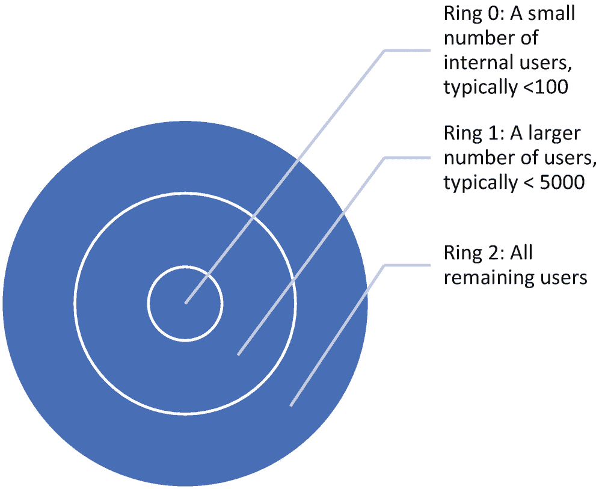

# 3. 持续交付

> *频繁地交付* ***可工作的软件*** *，交付的间隔可以从几周到几个月，倾向于更短的时间尺度。*
>
> *——agilemanifesto.org/principles*

本章所依据的敏捷原则描述了团队交付可工作软件的频率。我们将其扩展为包括频繁地交付数据，因为数据工程团队交付的很多内容都是高质量的数据。我们进一步扩展了这一原则，将“频繁”一词替换为“持续”——我们认为持续交付可工作的软件和准确的数据至关重要。我们对这一原则的改写是：“持续交付可工作的软件和准确的数据。”在任何一天，团队都应该拥有能够有效代表前一天增量工作的软件和数据。

如何从频繁交付转向持续交付？我们将分别考虑软件和数据如何实现这一点。对于软件，现代工程团队实践着称为“持续集成”和“持续部署”的技术。持续集成通过开发者在提交代码更改前进行验证，然后运行自动化系统来实现，这些系统会获取开发者最新的代码更改、构建这些更改、对这些更改运行测试，并最终部署这些更改——通常随着时间的推移，部署到一系列包含越来越多客户的环境中。

## 验证代码变更

对于持续构建产品的自动化系统而言，在代码变更检入代码库之前，必须有一套机制来验证这些变更。系统的这一部分必须精心设计，并得到所有开发人员的尊重，以确保只提交高质量的代码变更。为确保代码变更具有最高质量，通常采取的措施包括：

*   编码规范和首选模式在团队中有完善的文档记录并被理解，并且在可能的情况下，由开发人员在提交代码变更前可在本地机器上运行的自动化工具进行检查。
*   在本地机器上，开发人员可以构建他们正在处理的系统以及所有其他依赖或可能受影响的系统，以验证没有发生构建中断。
*   开发人员可以在本地机器或代表代码最终运行环境的在线开发环境中快速运行并验证修改后的系统。
*   开发人员可以快速运行一组单元测试，以验证开发系统时所做的假设——这些单元测试足够广泛，能够覆盖系统的大部分（我们通常力求达到 80% 的覆盖率），并且测试的编写方式使其能够极快地运行——通常通过使用模式来模拟启动成本高昂的系统部分。
*   新的代码变更会附带适当的单元测试或集成测试一起检入，以确保测试覆盖率保持在高水平。
*   遵循代码审查流程，代码的任何变更都会由团队中的另一位开发人员（通常是在可能的情况下对该系统更有经验的人）进行检查和复核。审查中提出的任何修改建议都会被采纳并重新验证。
*   开发人员可以快速运行一小套集成测试，以端到端地测试系统——这些测试会在本地机器环境或在线开发环境中启动整个系统，并测试必须始终正常工作的系统关键功能。
*   开发人员同步源代码库中的最新变更，如果其他开发人员检入了与正在处理的系统相同区域的冲突变更，则重新合并变更。在此过程中每当发生变更时，都会重新构建并通过再次运行测试来重新验证。
*   一旦所有步骤完成，开发人员提交最终的代码变更。

### 关注内循环

请注意，对于这些步骤，应尽一切努力使开发人员运行的测试和验证数量尽可能快。有时这个验证阶段被称为开发人员的“内循环”，我们将在第 5 章“积极主动的个体”中进一步讨论如何衡量这个内循环的健康状况。运行时间更长的更广泛测试可以放在持续集成“管道”的后面，这被称为开发人员的“外循环”。如果在管道后期发现开发人员检入的变更存在问题，系统可以自动拒绝该变更并将其发回，让开发人员找出问题所在。但是，在后期被外循环拒绝的变更代价也可能很高，因此必须在初始代码提交到持续集成系统之前在内循环中发现问题，与在后期外循环中发现问题的策略之间取得平衡。

## 持续集成系统

一旦经过验证的变更被检入，持续集成系统就会接管。像 `Azure DevOps` 或 `Jenkins` 构建系统这样的系统可以自动化代码变更的集成系统。这些系统通常会监视新的检入以进行验证，并运行与开发人员在本地执行的一系列类似的验证步骤，但现在是在团队关心的所有构建目标和设备上运行，同时运行团队拥有的所有单元测试和集成测试。如果任何步骤失败，系统会拒绝该检入，并通知开发人员并提供日志，以便调查问题所在。典型的持续集成系统会运行如下步骤：

*   将团队仓库中的所有代码排队进行完整的干净重建，目标是团队关心的所有构建目标。例如，持续集成系统可能会构建针对 `AMD-64` 处理器的代码，包括调试版和发布版，以及针对 iPhone 或 Android 设备等设备的代码。
*   在所有构建目标上运行更广泛的单元测试集。
*   将系统部署到模拟生产环境的在线开发环境中，并在该环境中运行更广泛的集成测试集。
*   将编译后的代码部署到设备上，并在这些设备上运行测试（如果适用）。

有时这个阶段会变得过于繁重，验证时间过长——一个好的经验法则是这个验证阶段应该在一小时左右完成。如果验证时间过长，则应减少对单个变更运行的测试数量，以缩短验证时间。那些不再对每个单独变更运行的测试仍应运行，但应以较低的频率对变更批次运行。例如，过去 12 小时内提交的所有变更可以合并为一个批次，然后将从单个变更验证过程中移出的测试应用于这个更大的变更批次。如果在此阶段检测到故障，则需要更多工作来确定批次中的哪个变更导致了故障，但这通常值得以提升单个变更验证速度作为代价。

## 持续部署系统

如果在持续集成系统中所有验证步骤均成功，该系统的最后一步有时被称为持续部署系统。持续部署系统的作用正如你所预期——它获取一组已验证的变更，并将其自动部署。通常，部署不会直接面向所有用户，因为即使是最优秀的单元测试和集成测试，也可能无法捕捉到代码变更中潜藏的某些额外问题。因此，持续部署系统通常会随时间推移，依次部署到一系列被称为“环”的部署环境中，这些环境代表着一组不断扩大的用户群体。

通常，新验证的代码变更所部署的第一个环境被称为“环 0”或内部环，如图 3-1 所示。这个环是开发团队日常使用的部署环境，可能还包括系统的一些早期采用者。每个环的构建方式都确保：如果某个变更部署到该环后导致该环用户遇到线上问题，可以快速回滚该变更，并将该环恢复到之前的状态。正如你所料，细节决定成败，处于持续部署下的软件系统必须精心设计，以确保能够回滚到之前的状态。例如，考虑一个部署到某个环境的变更，它修改了系统所用数据库的架构。如果此变更在一个环中失败，就必须有一种机制，不仅能回滚软件，还能将数据库恢复到之前的架构。有许多技术可以使系统在持续部署下良好运行，但这些超出了本书的讨论范围。

图 3-1 部署环

如果团队和早期采用者在内部环中没有遇到任何问题，持续部署系统就会将同一组变更推送到一个更大的环境，从而影响更多用户。有时，在经历一定时间后，部署到下一个环是自动进行的；有时，团队会手动控制这个决策。如果变更在下一个环中成功，它就会被部署到更多用户，直到该变更对所有系统用户可见。创建持续部署系统的一部分工作，就是决定要支持多少个用户环，以及哪些用户属于哪个环。我们通常看到的系统包括：一个主要由团队成员参与的内部环，一个包含公司全体成员的公司环，一个开始包含那些选择使用系统最新、最棒功能的早期采用者环，以及最终包含所有系统用户的“全员”环。

### 吃自己的狗粮

微软有一个悠久的传统，称为“吃自己的狗粮”（`dogfooding`），指的是使用仍在开发中的产品。这源于一位微软经理发送的一封标题为 `Eating our own Dogfood` 的电子邮件，该邮件倡导增加对一款正在开发中的软件产品的内部使用。微软 `Windows` 系统已稳步将“吃狗粮”的范围扩展到公司外部的参与者，通过一个非常活跃的 `Insider` 测试计划，外部用户可以选择提前测试 `Windows` 中的早期功能。这类计划对微软来说非常成功，因为它们既能让那些过去需要数年才能交到真实用户手中的功能获得早期反馈，也能在微软内部并不总是可用的各种系统配置上进行早期测试。

当持续部署系统中出现问题时，我们提到回滚是理想的解决方案。为了更灵活地修复有问题的功能，有时也会使用其他技术。有时会采用“热修复”——这是一种一次性修复，直接部署到某个环中，以修复该环中出现的问题。理想情况下，热修复可以是对配置文件的更改，因此，只要可能，功能实现的方式应使其能够通过配置文件轻松修改。但配置文件的热修复虽然比更改随系统部署的二进制文件更容易，却同样危险，必须经过充分测试。热修复也可以通过应用少量代码更改、重新编译受影响的二进制文件、并用这些新更新的二进制文件修补该环来实现。如果可能，热修复应通过持续集成系统中相同的一套自动化验证步骤。

另一种用于确保行为不佳的功能可以被禁用的技术，是确保新发布的功能是“可飞行”（`flight-able`）的，并且可以通过配置设置轻松开启和关闭。飞行（`Flighting`）实际上与使环能够运作的系统非常相似——它能够将新功能提供给一部分用户，并通过指标收集，将他们的体验与未获得该功能的用户进行比较。你可以让一小部分用户参与一次飞行，尝试你的团队刚刚开发的新搜索体验，而其余用户则使用旧的搜索体验。然后，你可以监控新搜索体验用户与旧搜索体验用户之间的系统稳定性等指标。如果你发现新搜索体验的数据明显更差，你可以立即为所有用户关闭新搜索体验，同时通过查看日志来调查新系统中出现的问题。我们将在第 7 章：监控中对此进行更多讨论。

## 验证数据变更

之前讨论的所有用于持续集成和部署代码变更的技术，同样可以用于持续集成和部署数据变更。这些技术包括：

*   数据工程团队的开发人员通常编写的是会改变数据的代码。正如修改数据的代码必须经过审查一样，当数据被代码修改时，数据本身也应接受审查。通常，当修改数据的代码发生变更时，不可能详尽地审查系统中发生的所有数据变更，但可以对代码对数据所做的变更进行抽样，并仔细检查，以确保没有发生意外的变更。

*   在检查已变更的数据时，应采取特定的抽样方法。应从完全没有变化的数据中抽样，以验证“未变更”是正确的。应从系统中删除的数据中抽样检查，以确保删除该数据是正确的。应检查添加到系统中的数据，以确保添加该数据是正确的。应抽样检查仅被轻微修改的数据。同时，也应抽样检查被大幅修改的数据。

*   团队应充分记录并理解数据标准和首选的数据模式，并在可能的情况下，通过开发人员在提交数据变更或导致数据变更的代码之前，可以在本地机器上运行的自动化工具进行检查。

*   如果因变更而需要重新处理的数据量足够小，可以在本地机器或能代表最终环境的在线开发环境中运行，那么应重新生成并验证所有受变更影响的数据。在许多大数据项目中，这并不可行，因此应重新生成并验证一部分具有代表性的数据切片。这个切片应尽可能广泛地抽样，以确保该切片包含较大数据集中所有类型模式的可能性很高。

*   遵循数据审查流程，对数据的任何变更进行检查，并由团队中的另一位开发人员（在可能的情况下，通常是系统中更有经验的人员）进行复核。审查中提出的任何修改建议都应被采纳并重新验证。

除了手动检查抽样的数据部分外，我们在第 2 章：变更需求中讨论了几种可用于自动化检查数据的技术。这些技术可以在开发人员的机器上使用，也可以作为持续集成系统的一部分，以及作为持续部署和环状系统的一部分：

*   数据“门禁”可以衡量数据中模式在变更前后的频率，以检查数据是否发生了可能是缺陷的极端变化。这些门禁由团队通过长期手动检查和学习其处理的数据所获得的经验来确定。例如，在必应的本地数据团队中，我们观察到，语料库中电话号码等内容的变动超过 1%，更可能是由我们系统中的缺陷引起的，而不是由数据提供者提供的实际电话号码的现实世界变化和变更导致的。可以学习到许多关于团队处理数据的此类经验法则，并将其编码到数据门禁系统中，该系统可以在每次数据变更后运行。

*   哨兵实体是数据中已知代表绝对真理的实体。这些实体可以在每次系统变更后进行监控和重新验证，以确保它们保持不变。

*   可以每天根据数据重新计算人工评判指标，以确保系统中某些已知实体集的质量持续提升。

### 关注变更

在必应，我们每天都会评判一组包含 1500 个实体的集合。实际上，我们每天只评判该实体集中发生的变更，这些变更通常数量很少，人工评判员可以在不到一小时内完成审查。我们可以持续监控，由于系统中的代码变更，这组实体是变好了还是变差了。被评判为变差的具体评判结果可以由开发人员查看，以确定他们是否在系统中引入了缺陷，或者这仅仅是学习模型中的一次波动。

## 数据的持续部署

与代码变更一样，当数据变更从一个环滚动到另一个环，再到下一个环时，应通过持续集成系统和持续部署系统自动验证。验证通过数据门禁、哨兵实体以及在新环中上线新数据时计算的评判指标来进行。数据变更通常比代码变更影响范围更广，因此对数据变更进行“热修复”要困难得多——尽管导致数据变更的代码变更有时可以进行热修复。数据的回滚系统通常代价高昂，尤其是在涉及大量数据时。

在必应，我们维护了两个数据存储系统，一个支持回滚，另一个不支持。我们能够将一组较小的实体保存在一个变更和回滚速度更快的系统中，即我们的“快速”存储。我们还有一组大得多的实体保存在“慢速”存储中，该存储的变更和回滚速度要慢得多。事实证明，通过在快速存储中保留大约 200 万个实体，我们能够覆盖 80%的页面浏览量——也就是说，本地数据空间中 80%的本地查询是针对最热门的 200 万个本地商业实体的。其余 20%的查询则针对我们长尾的本地商业实体——大约 1800 万个额外的实体。因此，我们在快速存储中保留了 200 万个实体，在慢速存储中保留了 1800 万个实体。这样，如果我们遇到灾难性的数据错误，我们可以在几分钟内回滚这 200 万个实体，修复 80%的流量，但其余 20%的流量将受到影响，直到我们能够重建较慢的、包含 1800 万个实体的索引，而这通常需要数小时。

## 决定发布什么

能够持续部署数据和代码，并不总是意味着你应该这样做。决定不发布什么与决定发布什么同样重要。对于纯代码功能、不影响数据的功能，你应该为该功能配备足够的遥测技术，以便能够确定用户是否真的在使用该功能，以及它是否真正满足了业务需求。我们将在第 7 章：监控中进一步讨论遥测技术。功能的实现方式应使其能够进行飞行实验，并且可以比较功能开启和关闭时的指标。同样重要的是，开发功能的方式应使其能够轻松关闭并从系统中移除。如果遥测数据显示某个功能未被使用或未满足业务需求，则应将其移除。

### 果断舍弃

你花了数周时间开发某个功能，上线后发现用户根本不使用它。尽管你可能会尝试几轮调整，看看能否让它起死回生，但你不应过于执着于某个功能而舍不得放弃。不发布这个功能，看似那几周的努力就白费了。然而，未来维护的噩梦远比功能的初始开发成本要高昂得多。一个精准满足客户需求的简洁产品，远胜于一个复杂但用户只用到一小部分功能的产品。

关于哪些数据变更应该发布，决策起来更为棘手，通常需要在项目早期就做出判断。项目中经常出现这样的情况：团队中的某位数据科学家对模型进行了改进，准备发布。你如何决定是否发布它？有许多指标可以用来评估学习模型的“优良程度”。这些指标很有用，应该被测量并作为评估是否发布新模型的一部分。

另一种评估模型的实用方法是查看模型的“胜出”和“失败”案例，并基于此分析判断模型是否值得发布。当数据科学家想要发布一个改进后的模型时，我们会从模型对数据所做的所有变更中抽样，并判断哪些是好的变更、哪些是中性的、哪些是坏的变更。修订后的模型很少会不引入少量“坏”变更而只有好变更。有时，坏变更和好变更的数量相近，但坏变更的严重程度更高。在这种情况下，就需要进行额外的工作，看看能否进一步优化模型，在保留足够多好变更的同时，去除足够多的坏变更，使模型值得发布。

新模型也可能引入一些并非更好、只是不同的变更。不发布这些模型很重要，因为它们带来的随机变更量根本不值得。发布那些会交换两个正确属性的数据变更，会使用户感到困惑。例如，企业通常有多个电话号码，这些号码都能接通到同一位联系人。我们可能会有一个新模型来更改主要电话号码，但这只会让用户困惑，因为企业的号码变了，但他们仍然能接通前台同一个人。只要可能，我们就会避免发布此类模型。

### 更好的模型可能成本过高

尽管我们通常会发布那些好变更的数量和影响超过坏变更的模型，但我们还会考虑另一个因素：新模型的成本和复杂性。有时，新模型能产生更好的数据，但其运行成本会显著增加。例如，模型可能需要多花数倍的时间才能产生结果，从而拖慢产品速度，或增加高效运行所需的硬件数量。有时，新模型能产生更好的数据，但其复杂性意味着维护其持续健康运行将是一场噩梦。这些不那么明显的方面，对于一个在其他方面胜出的模型来说，应该被考虑，有时甚至会导致新模型被否决。

## 结论

在第 4 章“与业务对齐”中，我们将讨论与业务协调工作的重要性及技巧。