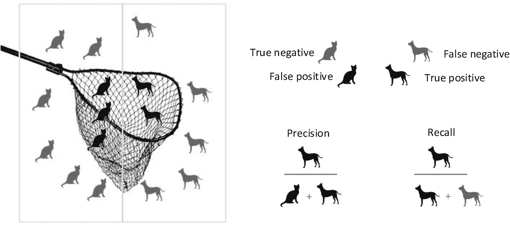
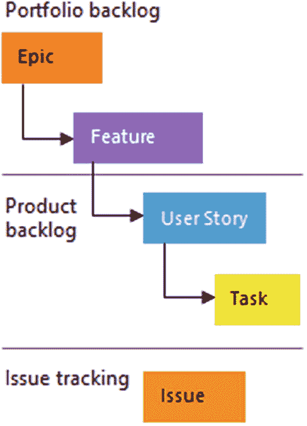
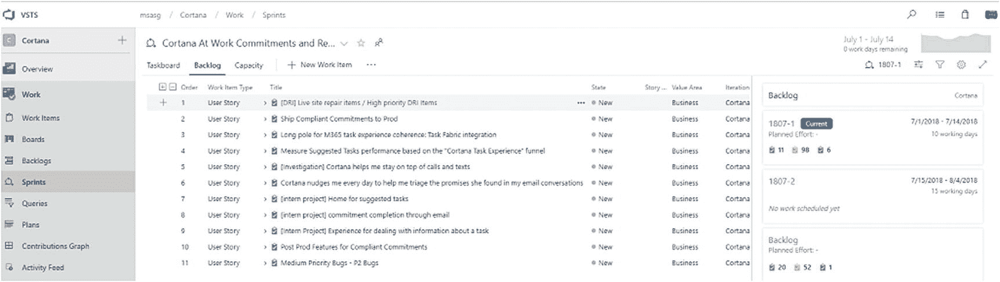
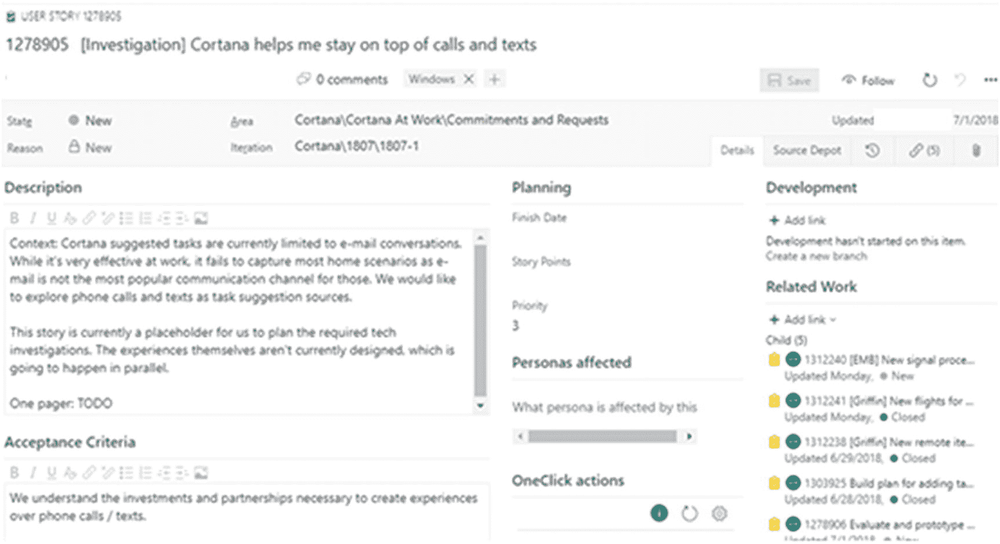
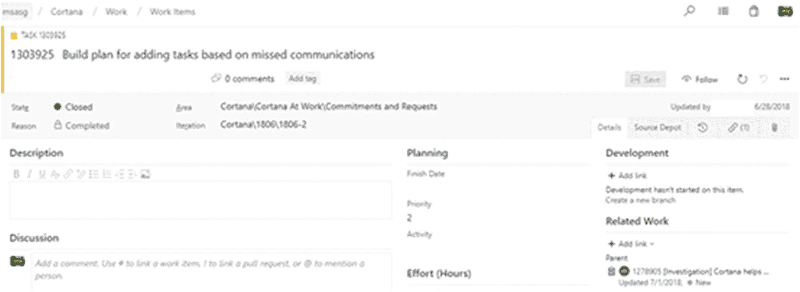
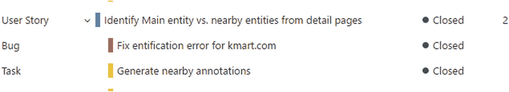
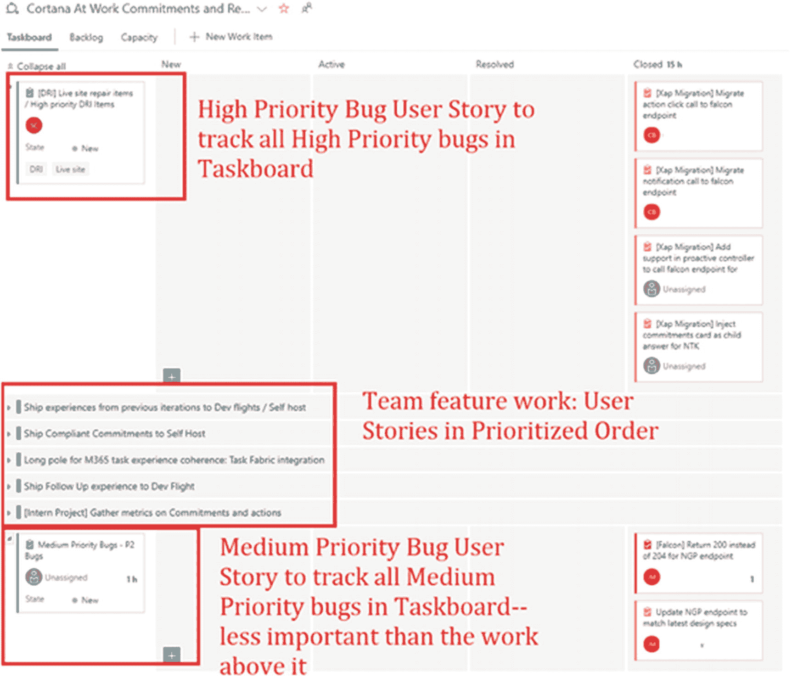
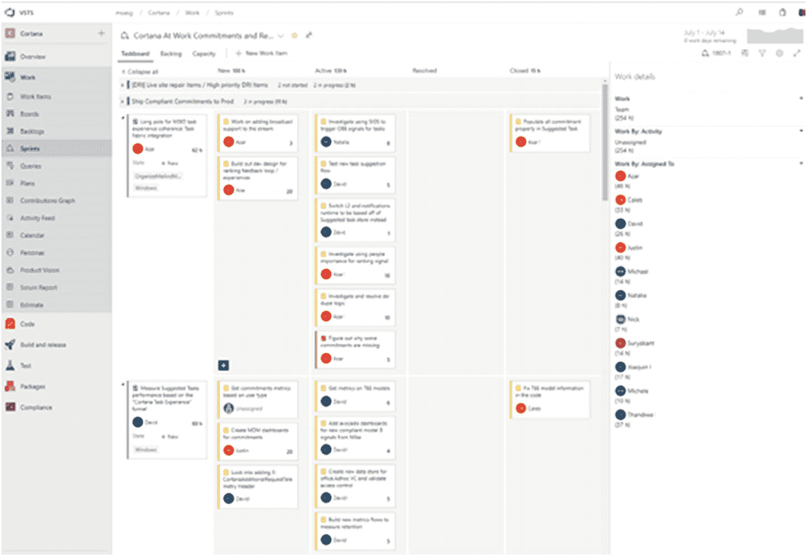
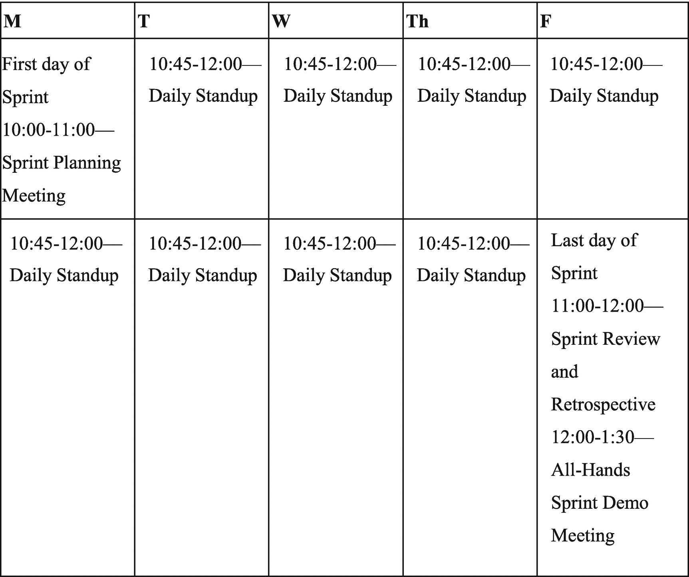
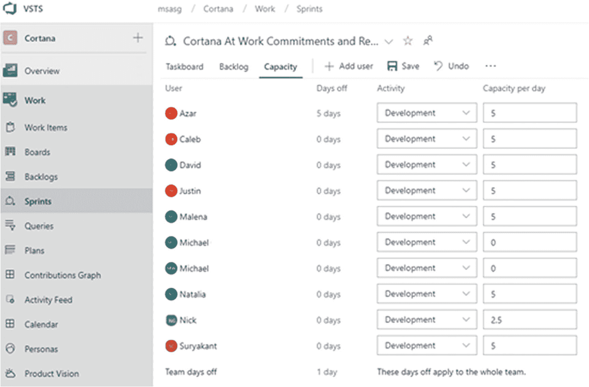

# 4. 与业务对齐

> ***业务人员与开发者*** 必须在整个项目中 ***每天*** 都一起工作。——agilemanifesto.org/principles

*Ciao* 是一个成立于德国的价格比较和产品评论网站，后来成为许多欧洲市场的顶级购物网站（如图 4-1 所示），到 2008 年，它在欧洲每月吸引 1960 万独立访客。微软于 2008 年收购了 Ciao，以增强其在欧洲的必应搜索引擎。在微软收购后，Eric 有机会作为新的工程经理与 Ciao 团队合作。Eric 观察到的是一个与业务高度对齐的开发团队——比他之前在微软工作时观察到的大多数团队都要对齐。促成这种高度对齐的因素有很多。在本章中，我们将探讨使 Ciao 成功的几个关键因素。

图 4-1

2012 年 Ciao 网站的英文版本

## 每日更新的重要性

对埃里克来说，在微软工作 10 年后加入 Ciao，最令人震惊的部分或许是，业务人员和工程人员都同在一栋大楼里，甚至经常在同一层楼。软件开发人员会去厨房用微波炉热午餐；就在同一个厨房里，他们会遇到为网站销售广告的人、为网站创作内容的人、为网站做营销的人，以及维护网站托管服务器的人。推动业务发展的人与编写业务运行代码的人，实际上就并肩工作。相比之下，在埃里克任职微软期间，他从未见过营销人员、为产品撰写内容的人，或负责产品托管的人。

这种并肩工作的模式在 Ciao 并不止于午餐室。在网站广告系统上遇到问题的业务人员，会直接参加工程团队的每日站会，解释他们的问题或提出改进建议。软件开发人员可以走到某个在使用内容标签系统时遇到困难的人桌前，观察问题所在，然后常常带着一个具体的改进或修复想法回到自己的座位。

为了本章的目的，让我们进一步思考谁是 Ciao 网站的“客户”，谁是“业务人员”。客户有三种类型。首先，最大数量的客户是那些来到网站研究想购买的商品并寻找最低价格的人。第二个客户群体是评论社区：那些来到网站发表评论的人，他们受到声誉和有用评论的金钱奖励的进一步激励。最后一个客户群体是商家——那些有产品要销售的第三方卖家，他们希望自己的价格能列在网站上，并附上指向其网站的链接，客户最终会在那里购买他们正在选购的商品。

Ciao 的业务人员是所有非工程岗位的员工，他们支持三个客户群体的需求，维持网站运行，确保资金流入，并推动业务向前发展。在 Ciao，这包括以下人员：

*   销售人员，他们说服商家在网站上列出价格，然后为商家提供工具支持，以便他们定期轻松上传价格数据
*   内容人员，他们编辑和修正所有可购买商品的目录
*   社区人员，他们管理评论社区，确保其充满活力和繁荣
*   营销人员，他们与其他公司组织特别活动——例如，他们与某些汽车制造商开展活动，让 Ciao 会员试驾并评论特定年份推出的新车型
*   计费和财务人员，他们确保在网站上列出价格的商家，因其网站获得的流量而被计费并支付费用
*   SEO（搜索引擎优化）人员，他们确保网站从主流搜索引擎获得持续增长的流量
*   运维人员，他们确保数据中心健康运行

相比之下，埃里克在微软的经历中，与他所参与产品的业务人员之间的分离程度要大得多，这些业务人员在微软扮演着类似的角色。在微软，“项目经理”角色与业务人员互动，然后将他们的需求转化为工程团队的需求。通过项目管理（PM）团队，埃里克间接地获得了代表许多业务人员希望在 Visual Studio 产品中实现的功能的指导。这种间接层级对业务和开发双方都很方便，但也让业务人员与他这位工程经理之间又多了一层隔阂。

### 每日更新的力量

埃里克在 Ciao 经历的与业务同事日常互动的冲击，还因另一个事实而加剧：他正从开发世界上最大的 Windows C++应用程序之一（Visual Studio，每隔几年才发布一次）转向一个通过 Web 交付、每隔几天就更新一次的应用程序。能够为 Web 构建一个功能并在第二天就发布，以观察用户是否喜欢该功能，这种即时性对于理解业务及其客户有着惊人的意义。在 Visual Studio 中，一个功能要开发数年才能最终发布；尽管在整个年度中会频繁咨询客户并进行演示，但 Visual Studio 经常发布客户不喜欢或不使用的功能。然而在 Web 上，这个周期急剧缩短，功能可以在数周而非数年内增量发布，并且一个功能的业务影响可以立即被衡量和量化。在必应（Bing），我们甚至更进一步——得益于将新变更小范围发布给少量用户，以及一个能对系统任何变更运行广泛测试的系统，我们每天都会发布更新。

## 同地办公的优势

让我们列举一些在 Ciao 公司，业务人员与工程人员在同一楼层办公的优势，以及即使办公空间和人员位置不允许真正同地办公时，也能复制这些优势的一些方法。

首要优势之一是，当某个特定月份业务进展顺利、销售业绩良好、流量上升时，让工程团队感受到业务人员中的积极氛围和兴奋情绪，会对士气产生明确的影响。一个成功的月份对工程团队来说可能非常鼓舞人心，尤其是当他们看到自己所做的工作与业务取得的成果之间存在直接联系时。同样，在业务进展不顺利的月份，让开发人员也能感受到这种氛围也是有益的。通常在这些低迷的月份里，业务人员和工程人员之间会自发产生对话，从而催生新的功能创意或网站改进方案，以应对销售下滑、流量下降或客户投诉等问题。

找到方法让工程师感受到他们的工作与对业务产生的影响之间的关联性至关重要。一个好的做法是每月召开业务回顾会议，审查业务的关键数据。可以汇报的一些数据（包括环比变化）如下：

*   网站的总访问量、页面浏览量和独立访客数
*   自然访问量 vs. 搜索引擎营销访问量
*   用户参与度（用户在离开网站前浏览的页面数量）
*   网站停留时间/每次访问时长
*   应用程序下载次数（如果属于业务范畴）
*   月活跃用户数（MAU，过去 30 天内与网站有过有意义互动的独立用户）
*   月深度参与用户数（MEU，参与度远高于月活跃用户的独立用户——这些是你的忠实粉丝，通常是活跃用户中的一小部分）
*   留存率数据（持续每月回访的独立用户数，以及相反地，每月流失的独立用户数）
*   每月总收入
*   运营指标——在 Ciao 公司，这包括网站上列出的商家数量、提供的优惠数量（某个特定产品的商家专属价格）、网站上的产品数量以及评论数量
*   可用性指标——过去一个月网站经历了多少宕机时间以及发生在何处
*   竞争对手对比指标——网站与主要竞争对手相比表现更好/差多少
*   Comscore 指标（Comscore 是一个衡量网站受欢迎程度和流量的网站）
*   任何其他与当前正在推动的业务目标高度相关的指标

有多种方式可以将这些业务指标和内容传递给开发人员。我们看到一些成功的方法包括：将月度业务回顾作为开发团队的可选会议；通过月度邮件发送业务信息；在始终保持更新的自助服务仪表板中提供；或在全体会议中展示。由于开发团队通常更喜欢构建产品，而不是阅读邮件或参加冗长的会议，我们也建议在冲刺演示会议结束时加入业务指标的简要总结。采用多种方式向团队传达这些信息以确保信息被接收，是非常值得的。

### 物理同地并非必需

当然，物理同地办公并不总是可行的。第 6 章《有效沟通》讨论了敏捷原则中重视面对面互动，并提供了一些当真正的物理同地办公不可行时的思路。

## 业务驱动的 Scrum 团队

Ciao 公司非常擅长的一点是将 Scrum 团队直接映射到关键业务目标上。从高层来看，业务目标如下：

*   增加网站的流量。
*   通过提高网站转化率（即离开网站前往商家网站的流量百分比，这为 Ciao 带来收入），尽可能多地将流量变现。

Ciao 公司的关键业务目标如下：

*   增加产品目录的规模和品质。
*   增加商家在网站上提供的优惠数量，并将这些优惠与我们的目录中的商品进行匹配。
*   增加用户在网站上撰写的高质量评论数量。

这五个业务目标直接映射到了五个 Scrum 团队。“流量”团队持续监控进入网站的流量，并进行开发工作以尝试增加网站流量。“转化率”团队持续监控网站的转化率，并致力于提高该比率。“产品”团队负责提升目录的质量和规模。“优惠”团队负责提高网站上产品优惠的数量和匹配率。“评论”团队则寻找新的方法来激励和提高评论质量，以及我们网站上评论撰写者社区的参与度。

有时，一个团队追求的目标和指标会与另一个团队追求的目标和指标从根本上产生冲突。例如，产品团队有时发布的功能会增加用户在网站上的停留时间，但会减少离开网站前往我们商家网站的点击次数。产品团队实现了他们提高目录质量和丰富度的目标，因此用户更多地与这些内容互动，但他们没有像以前那样快速（有时甚至根本不）前往商家网站购买商品，这影响了转化率团队。当一个团队发布的工作影响到其他团队的目标和指标时，会咨询业务领导者来决定哪个优先级更高。

在创建 Scrum 团队时，需要牢记几点。首先，尝试找到方法，让 Scrum 团队尽可能紧密地与业务目标以及易于定期衡量的业务指标联系起来。如果像“转化率”这样直接的日常业务指标无法为某个特定 Scrum 团队的指标驱动目标进行计算，那么尝试找出一种方法来量化和评分该团队正在推动的目标。让一个 Scrum 团队拥有一套他们可以持续监控的指标，检查他们的工作是否推动了指标变化，如果没有，则重新评估他们的工作直到指标发生变化，这是极其有效的。团队应该为每个冲刺设定目标，即他们认为自己能在每个冲刺中将所推动的业务指标提升多少。

表 4-1 展示了一些具体的业务指标示例，这些指标我们曾与本书中讨论过的一些团队一起使用过。你可以在此列表中看到计算型指标和评判型指标。计算型指标可以很容易地从系统数据中计算得出。评判型指标的成本更高，因为它们需要人工评判员查看数据来计算——这也意味着它们无法像计算型指标那样频繁地被计算。

表 4-1

具体的业务指标

| 团队 | 指标 | 指标类型 |
| --- | --- | --- |
| 本地数据融合团队 | 过度匹配率/不足匹配率 | 人工判定（每周）/人工判定（每周） |
| 本地数据网页提取团队 | 从网页提取的前 1000 家连锁企业占比/展示已提取数据的网站流量占比/从网页提取的电话号码准确率/已提取电话号码的企业占比 | 根据目录计算 |
| 本地数据管道团队 | 新数据出现在数据源到在网站上可见的秒数 | 根据目录和网站计算 |
| Ciao 流量团队 | 每月独立用户数 | 根据网站计算 |
| Ciao 产品团队 | 带图片的产品数量/带评论的产品数量/产品-图片匹配准确率/产品-评论匹配准确率 | 根据目录计算 |
| Ciao 优惠团队 | 跳转至商家网站的点击次数/关联商家价格的产品数量 | 根据网站计算 |
| Ciao 社区与评论团队 | 过去一个月内发布过被其他社区成员认为有帮助的评论的社区成员数量 | 根据网站计算 |

由于指标由各团队自行决定，请设法实现指标的自动化。尽可能每日追踪，并维护一个仪表板，让团队成员能够观察指标是否朝着正确方向变化。

### 团队命名的影响力

另一个对团队非常有效的工具是团队的命名方式。Eric 曾合作的一个团队，其产品存在两大问题：首先，它无法`扩展`以支持大量用户和海量数据；其次，为产品开发新功能的开发人员需要费力地处理现有代码和复杂的 API，从而拖慢了新功能发布的速度。该团队最初的名称反映了他们在产品中负责的子系统。例如，“图形”团队负责产品的图形引擎，“布局”团队负责产品的布局引擎。不出所料，名为“图形”的团队将大量工作投入到调整和持续改进图形引擎上，而布局团队也对其布局引擎做着同样的事。通过将团队重新命名为“扩展”团队和“速度”团队，团队的工作产出自然发生了变化，开始与团队整体面临的最重要问题保持一致，而非架构图中的模块划分。

在可能的情况下，最好能有一个统一的指标，让整个团队最终都明白自己正在朝着这个目标努力。对于网络产品，我们经常看到这个数字是月活跃用户数——这个数字是否在持续增长？对于一个移动应用团队，App Store 评分和月活跃用户数被视为最重要的驱动指标。对于必应的本地数据团队，我们最关注的数字是“Q”——本地企业目录的综合质量评分。但这个数字存在一定缺陷，因为它假设仅凭高度准确的目录就能推动产品使用——随着时间的推移，我们发现这个指标并不十分可靠，因为它与必应上的真实用户体验之间隔了太多层级。即使拥有高质量的目录，该目录如何以及何时呈现给用户仍存在许多问题，这使得 Q 无法完美反映网站上本地企业数据的用户体验。

## 与业务方合作理解数据

我们在开发必应本地搜索时最富有成效的经历之一，就是拜访一些为我们提供数据源的数据提供商，我们将这些数据源整合起来创建企业目录。通过与为我们收集数据的业务人员交流，我们获得了重要的见解，从而能够理解我们所依赖的数据源，并构建更好的机器学习模型来处理和优先排序数据。

在必应本地搜索的早期，我们曾前往一家主要数据提供商的总部，该提供商的数据源被用于创建我们的目录。我们研究了他们的数据，感觉这导致了大量质量问题——尤其是产生了大量重复的企业。我们与他们的工程团队讨论了去重系统，很快就发现他们使用的系统非常原始。此外，一位工程负责人指出，由于他们数据的主要客户是通过美国邮政系统向其他企业发送邮件的公司，因此“有重复数据往往是好事”，因为向一家热门企业多寄几份邮件（目录中越热门的企业越容易出现重复）并非坏事，这反而会增加你的营销邮件被热门企业打开的机会。

另一家数据提供商向我们提供了大量已关闭的企业信息。通过与该提供商更密切地沟通，并了解他们如何获取记录，我们得知他们数据的主要来源之一是通过 OCR 扫描电话簿。在某些市场，他们的扫描数据不如其他市场更新。在他们的后端系统中，他们保留了每条记录的扫描日期，但并未在数据源中提供该信息。通过与业务人员和工程师交流，我们很快发现，他们可以相对简单地为我们提供系统中每条通过 OCR 获取的记录的扫描日期。这为我们提供了一个宝贵的额外信号，我们的机器学习模型可以利用它来判断某家企业关闭的可能性。

### 数据提供商

与为你提供数据的第三方进行沟通，确保你了解他们收集数据的方式及其商业模式。数据提供商通常愿意为你提供他们后端系统中可能拥有但未在数据源中提供的额外信号。

## 帮助业务部门理解机器学习的局限性

刚开始采用基于机器学习的解决方案时，业务部门往往期望开发团队能创造奇迹。尽管机器学习能产生惊人的成果，但确保业务部门理解其局限性也很有帮助。我们与业务人员打交道时面临的最大挑战之一，就是帮助他们理解特定机器学习模型的功能特性。

虽然有许多指标可用于评估特定机器学习模型（例如 F1 分数），但我们通常使用精确率和召回率作为向业务部门传达机器学习模型性能的指标。以下是对精确率和召回率的快速回顾，希望能消除其神秘感。

设想一个场景：一名捕狗员受命外出抓捕城市里所有的狗。但捕狗员未能完美完成任务，不仅没有抓到城里所有的狗，还意外地抓了一些猫。图 4-2 展示了这个例子如何映射到机器学习的精确率和召回率概念上。如果每个狗或猫的图标代表 1000 只狗或猫，那么捕狗员抓到了 2000 只狗和 3000 只猫——但城里实际上有 7000 只狗。捕狗员抓到了 3000 个假正例（猫）和 2000 个真正例（狗）。因此，这次抓捕的精确率是抓到的狗的数量除以错误抓到的猫的数量加上抓到的狗的数量，即 2000/(3000+2000)，也就是 40%。召回率是抓到的狗的数量除以抓到的狗的数量加上未被抓到的剩余狗的数量，即 2000/(2000+5000)，大约是 29%。

图 4-2

捕狗员的精确率和召回率

当业务部门开始理解这些“虚拟捕狗员”模型的精确率和召回率，并熟悉如何用这些术语进行讨论后，你就可以开始与他们进行更细致的对话，探讨特定模型的表现如何。例如，业务人员会逐渐认识到，通常不可能让模型的精确率或召回率达到 100%。一个精确率和召回率都达到 95% 的模型，往往需要付出巨大的努力才能实现。即使一个精确率达到 99% 的模型听起来很棒，但这意味着每 100 次中就有 1 次会得到错误答案。此外，如果该模型的召回率只有 1%，那它可能毫无用处。现实与完美之间的差距是机器学习团队持续面临的挑战——业务部门必须制定计划来应对算法出错的情况。

在本地数据领域，我们通过几种方式应对模型达到高精确率和高召回率但并非 100% 的现实。首先，我们构建了一个系统，可以非常方便地手动快速纠正网站上发现的任何错误，这样当机器学习模型出错时，可以对其进行覆盖。其次，我们引入了人工审核环节，特别是针对最有可能展示给用户的数据。我们发现，尽管我们的本地商家目录中包含了美国市场的数百万家商家，但人们在网站上实际搜索的内容中，有 20% 集中在 5 万个实体上——即网站上最热门的本地商家。对于这 5 万个实体，我们使用机器学习算法来创建它们，但也通过人工进行反复检查和双重确认，以确保它们 100% 正确，而不是 98% 正确，因为这对整体用户体验有重大影响，毕竟它影响了我们 20% 的流量。

我们发现的另一件事是，经常与业务部门讨论诸如“已关闭商家分类器的精确率现在是 97%，召回率是 85%”之类的话题很有用，因为随着时间的推移，业务部门会了解在给定几个月的开发周期内，期望精确率和召回率提升到何种程度是合理的。业务部门会明白，提高精确率所需的工作类型通常与提高召回率所需的不同。他们会了解到精确率和召回率之间存在权衡——例如，以牺牲精确率为代价来提高召回率是相当可行的。他们还会认识到，当模型的精确率和召回率都达到 90% 以上时，后续的进步将更加昂贵。

### 强大竞争对手的好处

在必应本地搜索领域，我们有一个优势：除了报告我们自身模型的精确率和召回率，我们还可以评估竞争对手的精确率和召回率。在设定为期 6 个月的目标时，我们经常采用“缩小一半差距”的规则，事实证明这是一个有用的经验法则。在我们落后于竞争对手的领域——例如，我们可能测量到谷歌在电话号码上的精确率是 98%，而必应的是 94%——我们发现，计划在 6 个月内将差距缩小一半是合理的，这意味着如果我们有“存在性证明”，即测量到另一个竞争对手达到了比我们更高的精确率，那么设定从 94% 提升到 96% 的目标是可行的。在没有先例的情况下，这更难做到，因为如果没有先例表明在某个特定数据属性上可以达到如此高的精确率，你很难真正知道达到 98% 的精确率有多大可能。

## 向业务部门传达工程节奏：我们如何实施 Scrum

正如工程团队需要了解业务动态一样，业务部门也需要了解工程团队的进展。如果做不到这一点，可能会导致业务部门对工程团队及时解决关键业务问题的能力失去信心。我们使用 Scrum 和 Scrum 工件来与业务部门进行有效沟通。在本节中，我们将更详细地描述我们对 Scrum 所做的定制化调整。本节假设读者对 Scrum 的一般原则有基本了解。如果你不熟悉 Scrum，我们推荐 Ken Schwaber 和 Jeff Sutherland 编写的《Scrum 指南》（可在 [`www.scrum.org/scrum-guides/`](http://www.scrum.org/scrum-guides/) 找到），以及 Henrik Knibert 编写的《来自前线的 Scrum 和 XP》（可在 [`www.infoq.com/minibooks/scrum-xp-from-the-trenches`](http://www.infoq.com/minibooks/scrum-xp-from-the-trenches) 找到）。

### Scrum 团队

在微软的团队中，产品负责人通常是项目经理或架构师。Scrum Master 是开发经理、技术负责人，或者是开发团队中对推动 Scrum 和帮助团队成功充满热情的人。无论谁担任 Scrum Master，他们都不应期望自己能满负荷地安排编码工作——他们每天需要额外花一些时间来帮助团队成员扫清障碍，并维护待办事项列表。

### 组合待办事项与产品待办事项

Azure DevOps 支持 Scrum 概念中的史诗和特性。这些主要是业务概念，用于帮助业务团队或产品负责人管理产品计划。史诗和特性有时被称为“组合待办事项”。特性的规模应足够大，以便能够关联多个用户故事——用户故事是开发团队在所谓的“产品待办事项”中使用的主要概念。这些关系如图 4-3 所示。

通常，史诗会跨越多个发布版本，团队可能需要多个季度（一年中的四分之一时段）来完成。特性通常无法在一个冲刺中交付，但可以在一个产品发布周期内交付。一个由五到七人组成的团队可以在一个冲刺中完成多个用户故事，但有时一个用户故事也可能跨越多个冲刺。特性与用户故事之间的连接，正是业务驱动的“组合待办事项”与开发驱动的“产品待办事项”之间的桥梁。

Scrum 团队通常只在冲刺规划会议或冲刺评审会议中讨论特性，此时他们需要判断某个特性是否已完成，以及还需要规划哪些额外的用户故事才能完成该特性。

图 4-3
组合待办事项与产品待办事项之间的关系。来源：[*https://docs.microsoft.com/en-us/azure/devops/boards/work-items/guidance/agile-process-workflow*](https://docs.microsoft.com/en-us/azure/devops/boards/work-items/guidance/agile-process-workflow)

表 4-2 展示了史诗、特性、用户故事和任务的一些具体示例，并针对一个假设的团队（该团队致力于让用户能够在 Bing 中搜索 Office 365 内容，如文档、联系人、电子邮件、日历）给出了关于典型持续时间和每个父类型下典型数量的经验法则。

表 4-2
史诗、特性、用户故事和任务

| 概念 | 示例 | 典型持续时间 | 每个父类型下的典型数量 |
| --- | --- | --- | --- |
| 史诗 | 允许用户在 Bing 中搜索其 Office 365 数据 | 多个发布版本（季度） | 主要版本中总共五到十个史诗 |
| 特性 | 允许用户在 Bing 中搜索其 Office 365 联系人 | 发布版本（月） | 一个史诗中包含数十到数百个特性 |
| 用户故事 | 构建体验，允许用户浏览其 Office 365 联系人 | 冲刺（一到三个冲刺） | 完成一个特性需要数十个用户故事 |
| 任务 | 编写代码，从 Office 365 图表中获取联系人 XML | 天数（大约一到五天） | 每个用户故事包含数十个任务 |

我们的产品待办事项由 Azure DevOps 中的“用户故事”组成，如图 4-4 所示，这些用户故事又进一步分解为任务。产品待办事项记录了团队想要完成的所有工作。冲刺待办事项（在 Azure DevOps 中位于“冲刺”下的“待办事项”中）显示了冲刺待办事项。冲刺待办事项是在冲刺规划会议中创建的，理想情况下，只需查看产品待办事项（在 Azure DevOps 中位于“工作”下的“待办事项”中）中优先级最高的用户故事，并按优先级顺序将其添加到下一个冲刺中，直到冲刺排满为止。

图 4-4
Azure DevOps 用户故事待办事项示例

产品待办事项中的用户故事不应过于庞大。根据经验法则，它们应能在一个冲刺内完成，最多不超过三个为期两周的冲刺。要判断用户故事的粒度是否合适，一个典型的五到六人 Scrum 团队应该能够在一个冲刺中承担大约七个用户故事。当然，这可能会有所变化，但目标是让用户故事既不过大也不过小。

### Jira 及其他驱动 Scrum 的模式

尽管本节将 Azure DevOps 描述为驱动 Scrum 的环境，但所有这些原则同样适用于 Jira——Eric 在 Ciao 工作时曾广泛使用 Jira。同样值得一提的是，这些方法中的大部分也可以在基于物理看板的纸质系统中实现。前述的《Scrum 与 XP 实战》一书描述了纸质系统。我们也曾这样做过，不过，根据业务人员所在的位置，你可能需要每天拍摄物理看板的照片，或者定期转录关键信息并通过电子邮件发送出去，以便让业务方了解你的进展。

用户故事可以在冲刺之间延续——但如果可能的话，它们应能在少数几个冲刺内完成，理想情况下是一个冲刺。如果用户故事太大，无法在少数几个冲刺内完成，这通常是一个很好的信号，表明它们应该进一步分解。留意那些名称中包含“和”字的用户故事——这通常表明该用户故事应拆分为两个条目。

### 待办事项梳理

管理产品待办事项的一个最佳实践是频繁地“梳理”待办事项。梳理涉及持续审视产品待办事项中优先级最高的“数十个”用户故事，确保它们被正确排序并得到良好描述。有些团队会安排每周或每两周的会议来梳理待办事项——这有助于加快冲刺规划会议的速度。

### 用户故事

图 4-5 展示了 Azure DevOps 中的一个用户故事示例。

图 4-5
Azure DevOps 中的用户故事示例

用户故事可以选择性地与某个特性关联——这会将“产品待办事项”与“组合待办事项”联系起来，并帮助 PM 团队跟踪他们在组合待办事项这一领域中的进展。任何人都可以创建用户故事，但只有产品负责人可以设置优先级，也只有开发团队可以估算规模并将用户故事添加到冲刺中。

一个用户故事包含许多字段，包括以下内容：

*   **特性反向链接**：指示此故事是为组合待办事项中的哪个特性而实现的。如果用户故事与某个特性无关，则此字段非必填——例如，Scrum 团队可能决定自行开展一些开发工具或 DRI 工具方面的工作，如果 PM 团队对此并不关心，则无需将其关联到某个特性。

*   **ID**：唯一标识符，只是一个自动递增的数字。这是为了避免在重命名故事时丢失对它们的追踪。

*   **名称**：故事的简短描述性名称。名称应足够具体，以便开发人员和产品负责人能够大致理解我们在讨论什么，并且足够清晰，以便与其他故事区分开来。

### 命名用户故事

由于我们鼓励业务团队查看 Scrum 看板，因此至少要以业务人员能理解的方式编写用户故事名称和描述，避免使用专业术语，并描述我们试图实现的业务成果，这一点非常重要。因此，与其使用“生成更好的 n-gram 以更改匹配函数来提高匹配率”这样的用户故事，不如将其写成“通过更好的分词减少重复商家数量”。用户故事下的任务可以且应该使用技术性语言和专业术语，因为它们是为 Scrum 团队内部跟踪而设的——业务团队从任务中获取的唯一重要信息是：谁在处理某个用户故事、剩余工作量以及已完成的工作量。

*   **描述**：在很多情况下，可以只是重复名称，或者对用户故事进行更详细的解释。同样，这需要用团队外人员也能理解的语言来编写。

*   **业务价值**：产品负责人对该故事的重要性评级。在 Azure DevOps 中，你可以通过垂直拖拽用户故事在待办事项列表中上下移动来指示这一点。

*   **故事点**：单位是故事点，对于我们的团队来说，这大致相当于“典型人天”。问问团队：“如果为这个故事安排最佳人数（既不太少也不太多，通常是两人），并且他们在一个典型的工作日里，有中断和会议，大约有 5 小时处于编码心流状态，那么需要多少天才能完成一个可交付、可演示、经过测试、可发布的实现？”如果答案是“三个人大约需要 4 天”，那么初始估算就是 12 个故事点。

*   一旦你对一个用户故事有了初始的故事点估算，就无需再过多纠结。这是你的初始“最佳猜测”，主要用于在冲刺规划期间估算一个给定冲刺能承载多少个用户故事。一旦冲刺开始，对用户故事成本的跟踪就从故事点转移到将用户故事分解为任务，这些任务以理想的开发小时数来估算成本（我们假设在团队中，考虑到中断、会议、分心等因素，一名开发人员每天可以完成 5 小时的工作）。

### 故事点

对于 Scrum 纯粹主义者来说，我们对故事点的这种“篡改”可能令人反感。故事点本应是这样运作的：团队随着时间的推移学会在一个迭代中能完成多少个故事点，这个单位是灵活的，并且团队能很好地感知一个十个故事点的工作项有多少工作量。但我们发现，在拥有多个不同 Scrum 团队的大型团队中，这在实际中很难应用——也很难向业务方解释“A 团队的故事点大小与 B 团队的故事点大小不同”。因此，我们无法在实践中将故事点作为灵活的单位，而是退而求其次，采用“一个故事点等于一个典型人天的工作量”以及“当进行任务分解时，一天可以完成 5 小时的工作”。

*   **验收标准或“如何演示 (HTD)”**：这是关于如何在冲刺演示会议上演示该故事的高级描述。这本质上是一个简单的测试规范。“执行此操作，然后执行彼操作，接着应该出现此结果。”使用 TDD（测试驱动开发），此描述可用作验收测试代码的伪代码。这通常放在“验收标准”字段中，但也可以放在描述中——只需用“HTD”标记即可。

*   用户故事可以分配给某人——通常是该故事最了解的人，能够回答外部人员提出的问题。但在实践中，很多用户故事从未分配给任何人。这没问题，因为用户故事真正的“工作”是通过任务来跟踪的，而任务总是分配给具体的开发人员。因此，如果用户故事未被分配，你可以在任务板上看到迄今为止所有处理过它的开发人员，因为通常会有多个任务分配给不同的开发人员。

### 任务

图 4-6 展示了一个与用户故事关联的任务。任务可以非常轻量，通常只包含这些元素：标题、分配给谁、剩余时间、状态（新建/进行中/完成）以及“关联哪个用户故事”。任务用于协调谁在用户故事中做什么，并将用户故事分解为完成该故事所需的逻辑任务。我们不使用“估算”字段。描述可用于捕获额外的细节——但仅当这对处理任务的开发人员有用时才这样做。大多数情况下，开发人员只是将任务用作一个简单的“待办事项”，用于他们需要编码的工作，并且他们通常从任务描述中就能理解工作内容。在这里，我们不关心业务人员是否能读懂任务——任务的客户是处理该任务的开发人员。

我们这样使用“剩余时间”字段：当一个任务首次分配给某个开发人员处理时（这通常在每日站会或冲刺规划会议上完成），开发人员会快速估算该任务需要多少小时的工作量——例如，开发人员可能会说：“这大概需要 10 个小时”（即 2 个开发日）。这个初始估算应填入“剩余时间”字段，而不是“估算”字段。然后，在随后的每次每日站会上，每个有进行中任务的开发人员都会重新估算每个进行中任务还剩多少小时——例如，“这个任务看起来还有 10 个小时，它比我想象的要大”或“这个任务只剩 3 个小时了，它比我想象的要容易”，或者“这个任务完成了”，在这种情况下，只需将任务移至“完成”列。

下面的示例任务说明，用户故事中的第一个任务通常是分配该领域的专家来“制定如何交付此用户故事的计划”。

图 4-6

一个简单的任务

#### 任务链接到 Git 中的拉取请求

在微软，我们使用 Git 作为版本控制系统。跟踪导致任务完成的拉取请求非常有价值。当开发人员发起拉取请求时，他或她可以在该拉取请求中指定一旦该拉取请求被合并，哪些任务将被完成。这使得未来的审计人员能够将我们的待办事项列表与开发工作联系起来。

#### 缺陷

任何用户故事都可能记录与之相关的缺陷，如图 4-7 所示。当针对某个用户故事创建缺陷时，该缺陷几乎总是优先于该用户故事中的其他任务。原则是：在推进用户故事状态之前，先修复现有缺陷。

图 4-7

用户故事可以与任务和缺陷相关联

如果针对已交付的用户故事提交了 P0（优先级 0）级别的缺陷，则应立即将其纳入冲刺——它们被视为冲刺破坏者。在可能的情况下，应为已交付的用户故事添加一个缺陷，然后将其移入当前冲刺的迭代路径中——但在实践中，这种情况大多不会发生。我们将在下文描述一种似乎更有效的方法。当 Scrum 团队举行每日站会时，他们应查找这些新的高优先级缺陷，并立即将修复工作安排到冲刺中。

低优先级的缺陷应在下一次冲刺计划会议中考虑，如果认为在后续冲刺中修复至关重要，则将其纳入冲刺。

一旦项目启动，将缺陷附加到已交付的用户故事上是很困难的。因此，我们观察到团队通常采用的方法是，在冲刺中创建“高优先级缺陷”、“中优先级缺陷”和“低优先级缺陷”这三个用户故事，如图 4-8 所示。然后，他们将新出现的缺陷与这三个用户故事之一关联，并合理安排工作的优先级——例如，他们首先尝试完成高优先级缺陷，然后是高优先级用户故事，接着是中优先级缺陷，再是中优先级用户故事，以此类推。

图 4-8

在 Azure DevOps 任务板上跟踪缺陷与工作

### 不属于故事的任务

有时，团队所做的工作并不适合归入现有的用户故事。这没问题——这些工作仍然应该被跟踪（你可以创建一个包罗万象的“其他”用户故事来记录它）。通过记录团队所做的所有工作，团队可以更清楚地了解“这个冲刺的时间都花在了哪里”；在后续的冲刺计划会议中，他们可能会从“其他”工作中识别出一个主题，从而创建一个新的用户故事来跟踪它。例如，一个团队可能发现他们花了大量额外时间来修复构建。在观察到每个冲刺都花费了时间后，他们可能会决定深入探究并修复问题所在。或者，他们也可以持续安排一个占用五个故事点的“其他”项（如果“其他”项通常占用一个开发周的时间），这样他们就能更现实地评估在给定冲刺中能完成多少工作。

#### Scrum 任务板

Azure DevOps 中的 Scrum 任务板（位于冲刺下的任务板，而非“面板”下的“面板”）是团队查看所有正在进行工作状态的地方。你可以配置任务板，按分配给开发者的任务进行筛选。在冲刺计划会议期间，产品待办事项列表顶部的用户故事会被分配故事点；基于团队已知在冲刺中能承诺完成的故事点数量，团队将产品待办事项列表中优先级最高的故事纳入新的冲刺待办事项列表。一旦故事进入冲刺，团队会通过将每个故事分解为任务来进一步细化（初始的故事点估算在后续会被忽略，但可以在之后观察，以了解团队在初始估算方面的能力提升情况）。

在任务板上，通过点击用户故事右侧的“+”按钮，可以轻松地向用户故事添加任务。当任务从“新建”列水平拖拽到“进行中”列时，任务开始流转。任务在移至“进行中”列时，始终会分配给一位开发者，并始终分配一个以小时为单位的“剩余时间”（其中 5 小时 = 1 个开发日）。“新建”列中的任务可以预先分配给将要执行的开发者并预先估算成本，但这并非必需，并且受冲刺计划会议和冲刺站会可用时间的限制。

当任务完成时，在验证任务“完成”后，将其水平拖拽到“已关闭”列。我们不对用户故事使用“已解决”列；该列用于缺陷。Scrum 任务板如图 4-9 所示。

请注意，当冲刺待办事项列表中的缺陷修复完成时，使用“已解决”列代替“已关闭”列。当开发者开始处理缺陷时，将其移至“进行中”列。当缺陷被修复、测试、签入并部署到生产环境后，将其移至“已解决”列。最初提交该缺陷的人应验证其是否已修复，然后将其移至“已关闭”列。

图 4-9

Scrum 任务板

我们使用 Azure DevOps 的任务板作为每个团队的单一状态页面。此页面包含一个燃尽图（位于右上角），当团队定期移动和更新任务时，该图会自动保持更新：在任务首次移至“进行中”列时更新其剩余时间，此后每天更新进行中任务的剩余时间，直到任务完成并移至“已关闭”列。

所有这些操作都限定在站会时间内（这是一个敏捷术语，意思是在固定时间段内完成）——无需在站会之外进行任务更新。Scrum Master 是团队的服务者，帮助团队保持任务板更新，以免影响站会之外的工作。在每日冲刺会议期间，Scrum Master 会投影 Scrum 仪表板；每位参与者可以报告其进行中工作项的剩余时间，Scrum Master 在投影时更新所有进行中任务（更新右下角的剩余时间，通过垂直拖拽分配新任务，通过水平拖拽标记任务完成）。

### 冲刺

对于我们的团队，我们通常进行为期两周的冲刺。对于任何采用 Scrum 的团队来说，冲刺长度都是一个有争议的话题，我们发现我们经常在两周和三周冲刺之间争论。采用两周冲刺可以确保计划过程不会变得过于繁重，并且冲刺不会在没有新一轮计划的情况下偏离轨道太远。

#### 两周节奏

在我们的团队中，我们按照图 4-10 中的日历安排 Scrum 会议。这个具体示例是针对一个五到七人的团队——我们喜欢确保其他兄弟团队的每日站会时间不重叠，这样在任何特定的一天，业务方的相关人员都有可能参加所有团队的站会，以快速了解开发工作的进展。

图 4-10

Scrum 日历

#### 每日站会

每日站会将根据此时间表进行安排，确保两个站会不会同时进行。站会时间限制在 15 分钟以内。

每日站会在配备投影仪、电视或 Surface Hub 的会议室中进行，由 Scrum Master 投影显示 Azure DevOps 任务板。会议中，任务板会依次按每位开发者的筛选条件进行展示。会议室中的每位开发者可以参照自己的活跃任务，回答 Scrum 的三个问题：“我昨天做了什么？”“我今天要做什么？”以及“我遇到了什么阻碍？”随后，开发者会针对每个任务说明“该任务已完成”，此时 Scrum Master 会立即将该任务拖拽至“已关闭”列；或者，开发者会估算活跃任务的剩余工时（如果自上次站会后有变化），Scrum Master 会立即更新任务的“剩余时间”（显示在任务右下角）。

如果某位开发者已完成所有活跃任务，则会将之前分配给该开发者但尚未开始的任务从“新建”列拖拽至“活跃”列，并由开发者估算剩余工时。Scrum Master 将剩余工时填入任务右下角。

或者，如果某位开发者没有未开始（即“新建”）的任务分配，则可以从“新建”行或其他需要帮助的开发者处领取任务。每当任务被移入“活跃”列时，必须填写初始剩余工时。

### 站会之外更新任务板

实际上，我们要求开发者在每日站会之外不要更新任务板，因为任务板的更新（此任务已完成、此任务剩余工时减少、我接手了这个新任务）是向团队其他成员传达基本信息的关键。如果这种沟通发生在站会之外，那么每位开发者的进度信息就会在团队中丢失。

站会还应用于对团队遇到的阻碍问题进行分类处理。站会不应在这些问题上花费过多时间，除非问题能迅速解决——请记住 15 分钟的时间限制。如果某个问题需要更多讨论，Scrum Master 会在当天晚些时候安排另一个会议，与相关方进行讨论。

#### 迭代结束会议

我们喜欢让所有兄弟团队在同一天开始和结束他们的冲刺，并将我们各个五到七人兄弟团队的一些会议合并，举办更大规模的演示会议。因此，对于一个典型的由大约 50 名开发者组成的、共同参与同一项目的团队（例如，必应的本地数据团队），我们会有大约六个 Scrum 团队共同参与一个合并的全员冲刺演示。

##### 全员冲刺演示

在冲刺的最后一个星期五，全员冲刺演示会作为一个合并的 1.5 小时会议举行。我们进行面对面会议，但同时也会录制会议，使其成为 Scrum 的另一个产物。全员冲刺演示的格式如下。

每个团队的时间限制根据其开发者人数确定——每位开发者分配 2 分钟。因此，如果一个团队有 7 名开发者，他们就有 14 分钟进行演示；另一个有 5 名开发者的团队则有 10 分钟，以此类推。演示时间由 Eric 那令人畏惧的倒计时时钟严格限制，如图 4-11 所示。当时钟响起时，正在发言的人必须完成当前句子，然后将会议交给下一个团队。我们发现，使用计时器对于确保演示会议不拖延是必要的——计时器能确保每个人都准时、快速地展示自己的工作。

然而，如果在演示过程中有人提问、发表疑问或评论，我们会将时间返还给倒计时，因为我们不想打击好的评论、问题或建议。Scrum Master 有权在倒计时中返还时间，并建议将失控的讨论转为线下进行。

图 4-11

倒计时时钟——用于限定冲刺演示会议的时间

关于如何实现这一点的后勤说明——我们已将此流程应用于多达 50 名开发者的团队（会议持续约 1.5 小时，有六个不同的团队进行演示）。为确保会议顺利进行，我们采取了以下措施。

一个全员冲刺演示文稿会在会议前准备好，由所有 Scrum 团队共享。每个 Scrum 团队都有一张“封面幻灯片”，展示其冲刺目标、是否达成目标、团队的关键指标，以及他们在冲刺期间对这些指标所做的改进。团队可以在其封面幻灯片之后添加自己的幻灯片，用于展示他们将要演示的具体工作。

### 冲刺目标

我们对冲刺目标是什么以及是否达成目标保持高度透明。正如你将在本章后面看到的，冲刺目标及其达成情况会向业务团队和其他利益相关者通报。一次又一次地传达你未能达成冲刺目标，可能向其他团队发出一个信号：他们不能相信你会完成你声称要完成的工作——因此，你需要不断强调，团队不应将冲刺目标视为过于理想化，而应是可实现的。Eric 已开始将冲刺目标称为“冲刺承诺”，以进一步向其团队强调，这些目标需要经过深思熟虑和成本核算，以确保能够达成。

在可能的情况下，演示会预先录制好，并可直接从幻灯片中链接。然而，我们鼓励团队不要在准备演示会议上花费大量时间，因此临时演示也很常见。

我们使用 Skype 或 Microsoft Teams 等会议软件来投影演示文稿；进行临时演示、视频演示或基于幻灯片的演示的用户可以连接到正在进行的会议，并在演示时共享自己的屏幕。

##### 冲刺回顾

冲刺回顾会议通常安排在冲刺的最后一个星期五，并且不是合并会议——它仅针对每个较小的五到七人团队单独进行。该会议也作为冲刺的最终“站会”，在此会议中，任务被关闭，尚未完成的用户故事被移至下一个冲刺，并对产品待办列表进行审查和重新排序优先级。

我们尝试在会议回顾环节中，至少将一个直接源于改进建议的用户故事添加到新冲刺中。

我们还喜欢通过电子邮件向所有其他团队汇总一份关于各自回顾会议的简报，以便团队其他成员至少能了解到其他团队对其冲刺的感受。

#### 冲刺计划会议

根据此时间表，冲刺计划会议安排在冲刺的第一个星期一。此会议在可能的情况下会错开时间，以便外部的“旁观者”可以观察——但请记住 Scrum 的[猪和鸡原则](https://www.implementingscrum.com/2006/09/11/the-classic-story-of-the-pig-and-chicken/)。

### Scrum 中的鸡和猪

鸡和猪的故事讲的是，一只鸡和一头猪想合伙开一家火腿蛋早餐店。猪拒绝了，因为它会**全身投入**这家店，而鸡只是**参与其中**。

我们不会把冲刺演示会议当作提出产品待办列表建议的场合，而是使用冲刺计划会议，尽管在冲刺演示会议期间也可能产生一些关于待办列表的讨论。

冲刺计划会议通常在配有投影仪的会议室举行，时间限制为 1.5 小时。所有开发团队成员都必须出席。也欢迎非开发团队成员旁听，但他们的参与应受到限制。如果座位不够，猪坐在桌旁，鸡则靠墙坐。

理想情况下，产品待办列表在本次会议之前已经过梳理——如果产品待办列表已经排好优先级、定义明确并准备就绪，那么这次会议就能进行得更快。

在冲刺计划会议中，首先要结束上一个冲刺，并将任何未完成的用户故事从旧冲刺移至新创建的冲刺中。

如果产品待办列表尚未梳理，团队会花一些时间查看产品待办列表，确保所有想到的高优先级用户故事都已列入待办列表并正确排好优先级。这时，“鸡”可以插话，提出团队可能没想到但需要完成的用户故事。产品负责人在此讨论中影响力很大，能帮助团队理解下一步需要完成什么。

在会议期间的某个时刻，团队还应花些时间尝试确定本次冲刺的一个或多个冲刺目标。关于冲刺目标为何重要，请参阅本文档中的“冲刺目标”一节。

然后，团队会填写 Azure DevOps 中“冲刺”板块的“容量”选项卡。此时，团队需要确定休假情况、Scrum 团队中的每个人是否全职投入本次冲刺，或者是否有人部分时间投入本次冲刺、部分时间投入另一个 Scrum 团队（这种情况虽不理想，但有时会发生）。团队成员还可以记录他们在本次冲刺中的休假时间。图 4-12 展示了一个填写完毕的容量页面。任何开发人员的每日最大容量始终上限为 5。查看本次冲刺的“容量”选项卡，你可以一目了然地看到：

*   Azar 将在冲刺期间休假一周。
*   Michael 和 Michael 不参与本次冲刺——他们的容量设置为 0（也许他们出现在列表中是因为他们参与过之前的冲刺）。
*   Nick 在冲刺期间只能以大约一半的时间参与（在本例中，因为他是一名主管）。
*   团队有 1 天休息日——也许是某个提升士气的活动！

    

    图 4-12

    Azure DevOps 容量选项卡

一旦容量确定，团队就能立即知道他们在本次冲刺中可以承担多少故事点（总容量（小时）除以 5）。然后，团队会查看最顶部的用户故事，并估算其故事点大小（一个故事点等于 1 个开发日或 5 小时）。

### 计划扑克

一种估算用户故事大小的有用技术叫做计划扑克。计划扑克的主要思想是让多个团队成员同时估算一个用户故事的成本，然后找出团队中估算偏高和偏低的人，并确定导致高低估算的假设是什么。通常，估算偏高的人会想到团队其他成员没想到但需要考虑的事情。同样，估算偏低的人可能有一个比其他人认为必须做的更简洁、更简单的工作思路。有关计划扑克的更多信息，请参阅这篇博客文章：[`www.mountaingoatsoftware.com/agile/planning-poker`](http://www.mountaingoatsoftware.com/agile/planning-poker)。

一旦确定了团队的容量，并从新冲刺的容量中扣除了上一个冲刺中未完成的现有故事，就会按照产品待办列表中列出的优先级顺序，添加额外的故事来填满冲刺的容量。团队不需要估算产品待办列表中每个用户故事的故事点，只需估算那些将放入冲刺待办列表的故事，可能再加上几个作为缓冲，以防某些故事提前完成，需要在冲刺后期从产品待办列表向冲刺待办列表添加新故事。冲刺待办列表中的所有用户故事都必须有一个初始的故事点估算。

当冲刺待办列表填满了足以覆盖团队容量的故事点后，如果还有剩余时间，团队就会着手将每个用户故事分解成更细粒度的任务。他们通过向用户故事添加 Azure DevOps 子任务来实现这一点。有些用户故事可能已经足够小，以至于只是一个单一任务——这没问题，只需为该用户故事创建一个与用户故事同名的子任务即可。当冲刺计划会议的时间盒结束时，任何尚未分解的剩余用户故事可以分配给各个团队成员，让他们在之后自己的时间里分解成任务。

### 通过电子邮件向业务方沟通 Scrum 状态

我们会向业务方发送两封定期邮件：一封是在周五冲刺结束后的全员冲刺演示会议之后，总结上一个冲刺完成的工作；另一封是在周一为新冲刺举行的冲刺计划会议之后，总结新冲刺中将要做的工作。

#### 冲刺结束邮件

冲刺结束的演示会议邮件包含以下内容：

*   全体冲刺演示会议的视频链接
*   全体冲刺演示会议中使用的幻灯片链接
*   会议的简要“速查笔记”版本，以书面形式说明哪些目标已完成、哪些未完成，以及会议中演示的内容，并附有演示发生时的视频时间标记。

冲刺结束的演示会议邮件示例如下：

| 大家好——这是本地数据团队第 8 个冲刺的总结，该冲刺于 10 月 25 日结束。我们的演示会议视频在此，幻灯片在此。以下是我们的各个团队在本冲刺中完成的工作：**管道团队**完成的冲刺目标    •    本地探针 V.Next 已部署，支持在最近 5 次完整运行之间切换以及搜索标识符    •    发布管道优化（合并作业并迁移至通用数据访问层）将运行时间减少了 1.5 小时    •    市场现在可以使用其特定市场的逻辑来配置非结构化地址的地理编码。韩语团队利用此功能修复了 88%的错误地理编码韩国地址。未完成    •    刷新邻域缓存，为 210 万以上实体补充邻域信息（针对美式英语） |
| **演示：****本地探针 v.Next 演示 (5:15)**本地探针 v.4 已部署至自动驾驶模式。旧的本地探针现已废弃。您现在可以在最近 5 次完整运行之间切换。您还可以通过标识符进行搜索。例如，“1x1”可让您在标识符列表中搜索哨兵实体。**发布管道优化演示 (8:30)**我们将另外两个作业集成到了发布作业中。我们将 LesGeoOntoloty 和邻域作业合并到了 PublishIndex 作业中。我们还迁移了 PublishIndex 作业中的内容生成，以使用通用数据访问层。这项工作使发布管道的运行时间减少了约 1.5 小时。新的发布管道运行时间约为 5 小时。**合并团队**完成的冲刺目标    •    权威数据源设计方案    •    修正仪表板已发布，支持多种修正视图，包括正在修正的数据源、正在修正的属性，以及验证实体修正是否已应用的方法未完成    •    标识符变更仪表板**演示：****TCL 模型二进制文件自动化 (11:15)**我们现在可以在构建过程中自动准备 TCL 二进制文件。**权威数据源设计方案 (14:29)**我们提出了一项名为“权威数据源”的新功能方案。动机：考虑一个查询，例如“贝尔维尤的星巴克”。由于陈旧/错误的数据，我们显示的星巴克数量远多于实际数量。然而，我们可以抓取星巴克网站，准确了解当前星巴克门店的集合。我们需要的是一个功能，能够从星巴克网站拉取权威数据源并发布这些数据，同时删除所有其他与权威数据源不匹配的星巴克门店。 |

#### 冲刺开始邮件

冲刺开始邮件包含以下内容：

*   每个团队的任务板链接
*   每个团队的成员名单及其在冲刺中的产能（通过团队在 Azure DevOps 中该冲刺的产能页面链接）
*   面向业务的“通俗语言”产能说明——告知团队在下个冲刺中可用的开发人天数
*   新冲刺的高层级目标

冲刺开始邮件示例如下：

| 大家好。平台团队已完成 1812.1 冲刺（12 月 3 日至 12 月 14 日）的规划会议。以下是规划结果、各团队的冲刺任务板链接和冲刺目标。**管道团队**冲刺任务板链接在此 Scrum 主管：Taylor 团队成员：Abram, Joan, Dave, Emma, Patrick, Shahar, Stan（65 个开发人日产能）**冲刺目标：**让墨西哥市场上线并运行刷新邻域缓存减少缓存文件的总体大小**合并团队**冲刺任务板链接在此 Scrum 主管：Matt 团队成员：Ade, Max, Linus, Amy, Leah, Mike（45 个开发人日产能）**冲刺目标：**发布标识符变更仪表板发布墨西哥合并模型将强制匹配移至管道后期运行 |

#### 回顾邮件

我们偶尔会向业务方发送的另一封邮件是回顾报告。在我们的回顾中，我们会逐字收集“好”、“差”和“一般”的评论，以及回顾后确定要安排的具体用户故事。以下是一个冲刺后仅针对本地数据团队之一的回顾报告示例：

| 大家好，管道团队刚刚完成了本冲刺的回顾，以下是结果：**管道团队回顾****好****假期****对代码生成感到兴奋****收集了更多团队目标/指标****删除了拉取请求****与合并团队的良好沟通促成了两个功能添加到平台****代码审查提供了有用的反馈，并且处理迅速****感觉富有成效****无效批处理设计取得重大进展****收尾管道事件工作，期待转向工具开发****管道解引用有了新客户****富有成效的会议****一般****遗留的构建/基础设施问题****来自之前团队的大量长尾工作尚未完成****差****常见工作流错误无人报告，因为没人直接抱怨****我们仍需改进构建“团队”工作流/职责委派****忘记了使用测试驱动开发，导致浪费时间****没有好的流程来处理大型拉取请求，且不断出现合并冲突****构建经常失败，有时完全莫名其妙****“挂起错误”** |
| **后续行动**让我们的性能测试在 CI 服务器上运行更好/更频繁地进行错误分类（至少每周一次）找出如何防止断言挂起 CI 服务器发布一个维基页面，列出哪些配置是受支持的/可行的制定减少短期内存使用的计划 |

## 结论

在第 4 章“与业务对齐”中，我们讨论了与业务团队沟通的重要性。我们阐述了让团队尽可能直接地与业务指标和业务目标对齐是多么重要。我们分享了一些关于如何与业务方合作，帮助他们理解机器学习局限性的想法。我们还描述了我们是怎样开展 Scrum 的，以及如何通过 Scrum 会议、Scrum 工件和围绕 Scrum 节奏发送的邮件来让业务团队参与并与之沟通。

在第 5 章“激励个体”中，我们将探讨围绕激励个体构建项目的重要性，以及如何增加团队中激励个体的数量。

