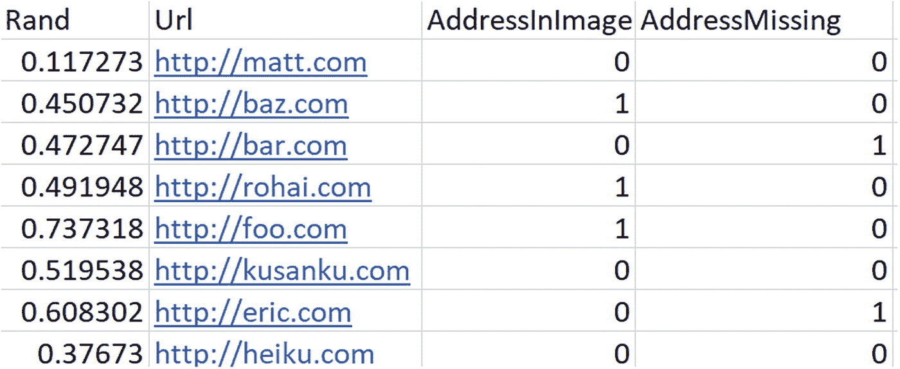
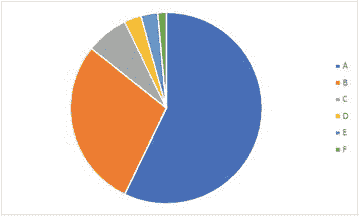
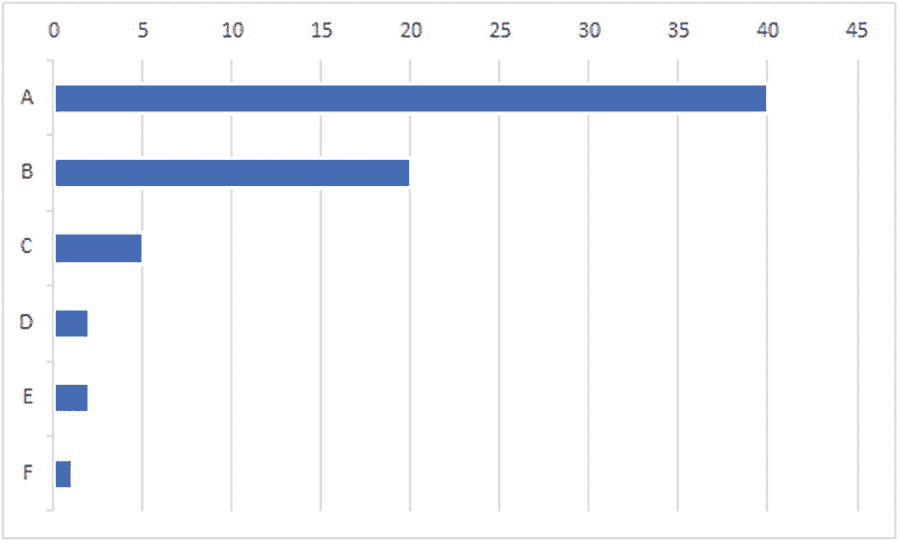
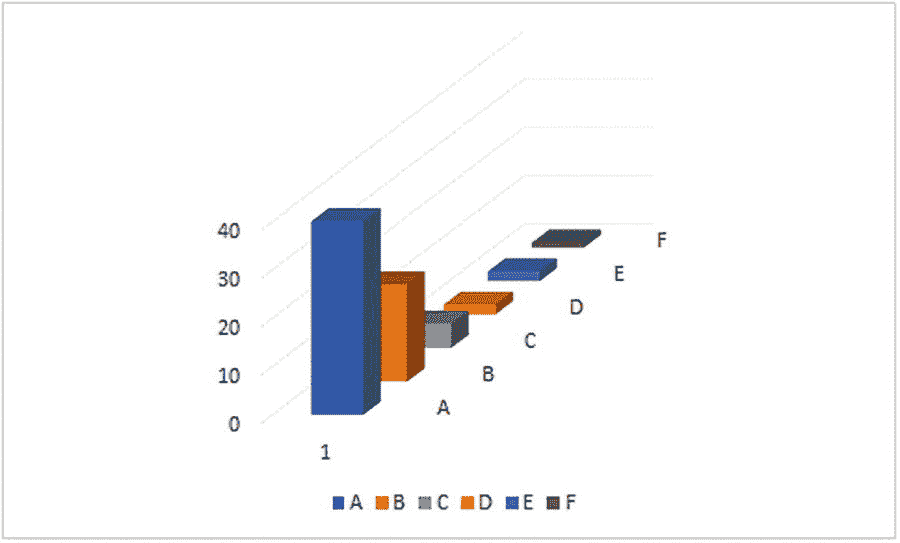
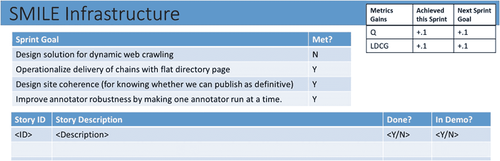

# 6. 有效沟通

> *向开发团队内部及团队之间传递信息最* ***高效*** *且* ***有效*** *的方法是* ***面对面交流***。
>
> *——agilemanifesto.org/principles*

数据工程团队中从不缺少讨论的话题：*我们查看了一部分输入数据样本，以下是我们的发现。这令人惊讶吗？目前，分类器对这些示例产生了误报。客户在意吗？我们将最新结果与月初的结果进行了比较，发现了一个奇怪的偏差。你怎么看？这些示例符合当前的定义吗，还是我们应该更新判断准则？我们的标注团队似乎在这些案例上一直存在分歧。它们重要吗？我们认为在这些案例中预测错误是可以接受的。你怎么看？我们相信这是衡量整体进展的正确指标。你同意吗？我们审查了一部分数据，看起来用于捕获所有案例的对象模型是这样的。它是不是太复杂了？*

如果你试图对庞大且多样化的数据集进行任何有意义的推断，那么几乎会持续不断地出现需要解决的问题、洞察、部分结果、歧义以及需要做出的决策。回答这些问题的最佳方式是什么？如何解读中间结果的蛛丝马迹，以便继续取得进展？如何让团队对你正在构建的世界模型的当前思考保持一致？如何为在数据科学探索空间中导航的个体开发者扫清障碍？现代开发工作场所提供了多种沟通模式，既有数字化的（电子邮件、即时消息、视频聊天、群聊、代码审查、数字看板），也有实体化的（面对面交流）——在敏捷数据工程项目中，哪些是最佳的沟通选择？

敏捷宣言的第六条原则提倡面对面交流。在它被撰写之时（2001 年），与互联网催生的多样化沟通平台相比，开发团队可用的替代方案非常有限。你可以将第六条原则理解为：面对面交谈比发起电子邮件线程要好得多。那么，面对面交流相比电子邮件，究竟提供了什么？

*   面对面交流是**即时的**——面对面交谈时，歧义、误解和困惑可以实时识别并立即纠正。异步沟通（电子邮件、即时消息等）是随意的，其延迟取决于相关个人的优先级。通常这些优先级是不匹配的——对于某个人来说，沟通主题的优先级高于其他人。
*   面对面交流是**人性化的**——我们可以充分利用人类交流的丰富性，包括非语言沟通（我能看出你似乎没理解我的意思）。所有其他形式，包括语音和视频聊天，都不具备这种特质——而且，表情符号并不能弥补这一缺陷 :-(
*   面对面交流是一种**共享体验**——我们都在场，看到了同样的事情，并就某些结果达成一致。由团队见证的契约对于确保问责制非常有价值（尽管我们稍后会看到，这并不总是足够的）。
*   面对面交流是**丰富且互动的**——我可以以丰富的方式讨论一个数据集，既可以通过物理方式（指向投影的数据图形）与数据内容互动，也可以通过计算方式（使用应用程序转换和查询数据）进行互动。我还可以在白板上画图，并在从他人那里了解到新出现的画面中哪些不清楚时，修改我的图画。

所有这些都表明，在工程项目的背景下，面对面交流是最*高效*的沟通形式。考虑到这些因素，我们可以从*即时性*、*丰富性*和*共享体验*的角度，审视现代工程工作空间中的数字化沟通选项：

*   像 `Slack` 和 `Microsoft Teams` 这样的群组消息系统提供了*潜在的*即时性（实时聊天——尽管平台并不强制要求立即回复）。如果发起者因正在讨论的问题而受阻，这可能会让他们感到沮丧。他们还会额外承担思考“再发消息会不会不礼貌？”“我是不是还是该去他们办公室一趟？”或“他们到底在不在办公室？”的负担——其丰富程度与电子邮件相当，也就是说非常有限——并且缺乏面对面讨论那种本质上的互动性。你无法真正以共享的方式与内容互动。此外，许多此类系统都存在线程或交织问题。沟通渠道可能会混合并交织不同个体组合之间的不同讨论线程。`Teams` 和 `Slack` 等系统最近的改进试图通过引入回复特定消息的功能来解决这个具体问题，但尚未达到理想的解决方案。在撰写本文时，这两个平台上的解决方案都引入了一些认知负担，并且容易因用户错误而导致线程碎片化。
*   视频聊天系统提供了面对面交流的大部分丰富性（参与者可以从参与者的视频中读取许多线索，尽管不是全部，使其更像一种人际互动），并且通过内容共享机制，提供了与数据的丰富交互。视频会议的局限性——读取参与者所有非语言线索的能力略有下降，尤其是在对话中轮流发言方面——可能导致互动略显生硬，但因此也更有条理。我们认识一些高管，他们要求那些本可以面对面进行的会议（对团队大部分成员而言），但由于某些必需参会者远程，而改为在线进行，以便所有参与者都能公平互动（而不是偏向那些能亲自到场的人）。
*   现代代码审查系统（例如微软的 `Azure DevOps`）围绕代码提供了异步、共享且适当丰富的体验。审查代码可以追踪作者、审查者和系统自动化组件（构建流水线、测试流水线等）之间相当复杂的交互。平台已经变得足够复杂，可以将聊天频道集成到任何可以使用身份标识的内容系统中。同样，数字看板也促进了多种形式的互动。它们本质上是围绕规划进行互动讨论的对象。

数字化中介互动的一大优势是其内置的捕获内容并为其增值的能力。例如，使用视频会议平台举办内部研讨会、`Scrum` 团队演示会议等，意味着活动可以被录制下来。录制的内容可以成为团队可共享的资产。此外，无论是实时还是离线，都可以增加一些价值——例如，机器翻译的最新进展意味着会议期间可以实时翻译口语。此外，数字平台意味着可以开放 `API`，允许机器人（能够与人和内容进行多步骤交互的智能代理）为任何流程做出贡献。例如，可以构建一个机器人来监控代码库，查找特定条件，向相关工程师报告，并与这些个体协调多步骤的解决方案。

传统工程项目涉及围绕系统（架构、平台、数据库模式）、流程（规划、执行）、运维（部署、监控）以及体验（用户界面和信息架构）的讨论。第六条原则提倡通过面对面沟通来解决这些议题。数据工程项目在此基础上增加了围绕数据和推理算法的交互。正如我们将看到的，需要进行的讨论类型以及以交互方式有效支持这些讨论的工具，在许多方面都与传统工程背景截然不同。我们将讨论数据项目所需的一些具体活动，以及如何在面对面会议中促进这些活动，同时探讨如何最好地支持传统敏捷工作流会议中围绕数据的讨论。

## 面对面沟通的短暂性

尽管面对面沟通有许多好处，团队在日常互动中应尽可能多地使用它，但它有一个基本问题，即使在规模适中的组织中也必须面对。面对面沟通是短暂的——没有内置的记录来保存决策、协议、设计、备选方案、假设等内容。根据我们的经验，面对面沟通的即时性和实用性需要通过一系列最佳实践来支持和增强，这些实践应产生某种形式的数字制品。这在大型组织中尤为重要。

建立一种能够高效地将面对面沟通与适时创建支持性数字制品（包括代码和非代码）相结合的文化，是一项不容低估的挑战。许多开发者认为编写代码是他们唯一应承担的“工作”，而任何涉及文档、规划等的额外任务都是不必要的开销。除此之外，如果内容平台和团队流程的选择未经深思熟虑，团队可能会经历在内容平台内部及跨平台重构文档的实际开销。

让我们用内容管理系统的特性来补充我们对面对面沟通优势的描述。

*   **创建和编辑内容的成本**：如果内容管理系统使创建和修改内容变得容易，这意味着团队可以非常迅速地开始工作。像 `Microsoft OneNote` 这样的系统允许用户在几分钟内上手并运行。缺点是，不受约束的内容创建会很快导致内容混乱、缺乏组织。页面和章节被遗忘并变得过时。随着内容创建成本的增加，团队可能会在如何组织和创建内容方面做出更周全、更好的决策。缺点是，高昂的维护成本可能导致团队推迟并最终放弃文档的创建和维护。
*   **搜索功能**：内容系统越不受约束、越开放，搜索就越成为一项重要功能。结构混乱且无法搜索的内容几乎变得毫无用处。例如，微软的 `OneNote` 虽然创建成本低，但据我们看来，其搜索功能平庸。

常用于管理团队内容的平台包括以下这些：

*   **`OneNote`**：微软的所见即所得类 `Wiki` 系统。它的入门门槛非常低——只需开始打字即可——但可能导致内容庞大、结构混乱且难以搜索。
*   **签入代码管理系统的文档**（例如 `Azure DevOps`、`GitHub`）：签入内容使团队能够将代码审查甚至测试的纪律引入文档领域。应选择一种人类可读的文本格式（`Markdown` 好，`PDF` 不好），以便与用于代码的内置比较工具良好配合。如果你能建立这种文化，那么维护工作就不会太繁琐——你需要在审查代码时，将“审查文档变更”添加到工作流程中。
*   **独立 `Wiki`**：像广受欢迎的 `MediaWiki` 平台这样的系统，你的团队应该熟悉（或易于采用）。它们比 `OneNote` 提供更多约束，编辑需要更多意图（这可能是件好事）。如果你需要更接近代码工作流程的工作流，还可以考虑 `DocFX` 和 `Git`（参见 `github.com/dotnet/docfx`）。`Atlassian` 的 `Confluence` 是另一个不错的选择。
*   **`Word` + 文件系统或 `SharePoint`**：对于内容不频繁变更的重要定义性内容（如规范或需求），功能完备的文字处理器的正式性可以成为有用的工具。这类文档在结构良好的文档空间中表现最佳。

# 非代码工件的挑战

非代码工件的挑战非常人性化——它们与纪律、行为习惯息息相关。为构建和测试文档寻找类比是极其困难的。在这一领域取得成功的一个通用方法是限制可创建的文档类型。有了这些范围明确、定义清晰的工件集，就更容易要求每次签入都必须包含公共方法的注释，或者演示会议必须直接从实验日志中运行。我们曾处理过的一些工件类型包括：

*   `实验日志`：我们工作中涉及数据科学的部分，嗯，是一门科学。与大多数科学探索一样，数据科学家会探索各种空间以发现有价值的东西。探索这些空间通常涉及数据集、算法、一些参数、一些输出以及分析。如果这些实验记录被创建、可访问且可搜索，对整个团队来说价值巨大。更好的是，如果这种形式的文档能够链接到所涉及数据的持久（且不可变）版本——更进一步，如果能够引用某种序列化版本的实验，以便其他人甚至可以重新运行该实验或检查其所有方面（代码版本、参数等）。作为该领域团队的经理，对这些能力进行深度投入（无论是研究第三方系统还是内部构建工具链）是一项重要的承诺。正如我们利用强大的系统来启用和集成代码的单元测试一样，持久的实验描述和重现将为团队带来回报。一个非常流行的平台是 `Jupyter Notebook`。^(¹²) `Jupyter` 文档将供人阅读的文本单元格与共享整个文档上下文的代码单元格交织在一起，任何有权限的人都可以交互式地运行、操作和扩展这些代码。

*   `模式文档`：为任何非最琐碎的情况推导模式都需要对该领域进行相当深入的研究。我们在对网站上企业用于描述本地实体营业时间的表达式进行建模时，以及在设计一种可用于描述网页、PDF 文档、SharePoint 页面和 PowerPoint 文档的抽象文档表示时，都经历了这一点。捕捉那些驱动从高层结构到包含或故意排除某些案例等一切决策的示例，将有助于团队决定实现什么以及如何实现。

*   `判断准则`：与模式文档密切相关，判断准则在某种意义上对团队来说是最具体的“真理”，因为它们被用来推导指导团队工作以及影响（和奖励！）的指标。判断准则是你试图从原始数据中推断出的丰富世界模型与你可能雇佣来生成训练和评估数据的大规模数据标注者之间的接口。可以想象，正确制定这些准则非常重要。我们围绕判断准则制定了许多最佳实践。它们应包括对如何使用特定工具完成任务的标准化描述。许多任务会涉及某种形式的标注，这些标注应由一个通用平台驱动。它们应包括对所捕获概念的直观描述。它们应描述包含和排除的具体案例。它们都应得到具体示例的支持，精确展示这些示例在工具中的样子以及标注应用前后工具的状态。最后，文档应进行严格的版本管理——既引用先前版本，也描述自上一版本以来所做的更改。

正如前文所述，在内容方面没有灵丹妙药。这正是人为因素发挥重要作用的地方。作为管理者，你能鼓励或要求团队紧跟内容任务吗？

## 围绕数据的讨论必然是交互式的

不同的团队成员以及其他团队的成员，对项目中涉及的数据集会有不同的看法。他们会看到数据中被建模对象的不同方面；他们对如何评估表示或推理结果的质量会有不同看法；他们对风险所在之处也会有不同看法。你还会遇到一些团队成员，他们对与机器学习工具链和生产架构相关的数据感兴趣。将这些不同的视角带入围绕数据的讨论中，只会让团队受益。

在最近一个改进从网站提取地址的项目中，尽管我们的新提取器在我们精心构建的评估集上表现更好，但负责连锁企业以及博物馆、医院等大型复杂实体的团队成员观察到，在他们负责的数据子集上实际上出现了性能倒退。如果我们仅仅使用现有的指标而不进行跨团队协作，我们就会错过这个洞见。在另一个场景中，一个合作团队质疑我们使用每文档平均精确率和召回率，建议我们改用全局精确率和召回率来评估我们正在开发的分类器。这些不同的方法得出了截然不同的数字，并帮助我们以不同的方式审视数据。

在构建一个新的模式来表示本地实体的营业时间时，对表达式广度的深入研究揭示出该模式必须相当复杂，必须能够表示关于节假日的规则、重复的开门和关门模式，以及像“日落”和“最后一位顾客离开时”这样的非特定时间。负责实现该模式的团队提出了一个需要工具来检查和理解实例化的解决方案。然而，当这项关于表示的研究成果与下游消费团队分享时，他们对复杂性（可能导致推理中的额外错误）和表示形式（更倾向于简单的文本序列化，以便数据工程师在调试和评估数据质量时能非常快速地阅读和理解数据实例）提出了相当大的反对意见。

在另一个旨在从网页中提取主要内容（剥离导航、横幅和其他非主要文本）的项目中，我们发现我们的指标偏向于小文档（在识别构成渲染页面的特定组件时，小文档出错的空间更小）。这引发了与数据消费者的重要对话，最终确定这些小文档实际上并没有特别的价值，因此构建一个分类器来识别并移除它们才是正确的方向。

个人也会带来不同的假设和偏见。同样，通过结合团队成员的观点，团队可以不断纠正并提升自身能力。讨论数据、推理系统设计以及实现结果，也将为经验丰富的数据工程师指导初级团队成员提供机会。

我们发现，在实践中，要围绕不同且常常相互冲突的观点和理论进行对话，唯一的方法就是手头有数据集，并且能够交互式地回答问题。任何未经分析支持的数据陈述都只是一个假设，数据要么支持它，要么反驳它。通过安排一个工作项然后进行讨论来回答每个问题是非常低效的。相反，应尽可能让交互式工具成为讨论的一部分，并直接用于选择、过滤和转换数据集（或样本）。

## 数据工具基础

为了支持围绕数据集交互的讨论，思考最佳实践至关重要，包括对工具、抽样方法和数据呈现的要求。请记住，当我们能够为流程的任何部分带来效率（即使是微小的效率）时，敏捷实践就会得到改进。然而，重要的是要记住，效率必须体现在团队层面，而不能贪婪地应用于个人。例如，如果你要向团队展示数据，在讨论前多花些精力，以便会议尽可能高效，这就是一种胜利。演示者个人花费了更多时间，从而在团队层面产生了净收益。

### 数据讨论工具的要求

有许多工具可以支持数据讨论。也许最显而易见的就是普通的电子表格（Excel、Google Sheets 等）。当你遇到这些工具的通用性对你的分析场景造成的限制时，你肯定会考虑实施内部工具。这些工具的基本要求如下：

*   **加载**

    *   这是一个显而易见的要求，但要注意工具在加载大型数据集时的性能。此外，有些工具虽然允许加载大型数据集，但在以任何有意义的方式处理这些数据时却无法执行。好的工具至少会实现数据和 UI 虚拟化；更好的工具能够即时对数据进行子采样，为用户提供更大数据集的代表性视图。

*   **转换**

    *   通过过滤和应用附加谓词来对数据进行子集化。一旦你加载了数据，你将需要对其进行过滤，以便按需查看不同的子集，并可能应用需要某种方法调用的任意过滤器。

    *   交互式生成数据样本，以便快速进行就地评估。在某些情况下，比如电子表格，可以通过一个相对简单的工作流程进行抽样，该流程涉及添加一列随机数，然后对这些随机数进行排序以打乱数据中的行。更复杂的系统会以内置方式提供此功能。

    *   计算从源数据派生的附加数据。例如，你可能想要在表格中添加一列，指示另一列中的值是否高于或低于某个阈值。这种通过派生数据构建分析的模式非常强大，也是标准电子表格应用程序的基本功能。

*   **聚合**

    *   执行各种聚合函数，例如求和、求平均值、计算分布等。同样，基本的电子表格支持此类操作，但只能通过一系列子步骤的工作流程来实现。

*   **可视化**

    *   可视化系统中各个阶段（包括输入和输出）存在的对象数据。

    *   对数据中的因子进行子集化，以便于查看，例如，从表格中移除不需要的列。

    *   绘制图表以显示趋势、分布和关系。

### 进行快速评估

使用电子表格或类似的面向表格的数据工具进行快速临时评估的方法如下：首先，为每个数据项关联一个随机数；然后，按此随机数对数据进行排序。从某种意义上说，数据的任何连续子序列都可以被视为随机样本。然而，在浏览数据做出判断时，提前确定你要查看多少数据至关重要。如果不这样做，你可能会在结果看起来对你有利的时候结束评估。这也意味着，如果你看到同事的数据摘要声称他们查看了某个任意数量的样本，你应该质疑为什么是那个数字。他们可能是在数据中看到了一个不错的结果时就停止了，从而陷入了确认偏误——在数据中寻找支持预先得出的结论的证据。请记住，随机数据可能是成簇的——这就是为什么当你抛硬币时，你不会得到 HTHTHT 这样的序列，而是会得到一串 H 簇和 T 簇。另一件要记住的事情是，如果你的数据中存在较大的效应，那么它很可能会通过一个相对较小（因此计算成本较低）的样本暴露出来。例如，如果某件事在你的数据中发生的概率是 10%，那么在 50 个样本中未观察到它的概率约为 0.5%。

有了样本，我们通常希望随后对数据中发现的因子进行快速分析。例如，假设我们正在评估一个针对特定命名实体、在网页上运行的提取器。我们可能会列出以下错误原因：

*   数据在图像中（我们的方法是基于文本的，因此如果内容以图像形式存在，则无法访问）。

*   数据不在文本节点中（实体可能被引用在元素的属性节点中，而不是元素的文本节点子节点中）。

*   HTML 中缺少内容（页面可能使用某种渲染时的动态过程从服务器拉取内容并修改 DOM，以允许用户看到所需信息）。

然而，我们经常看到的是，几乎不可能事先确定这样一个列表——只有通过检查样本，我们才能真正发现所涉及的因子。因此，最常采用的过程是使用电子表格，每行一个示例，并在我们分析时创建列来捕获分析的因子。在分析几个示例后，你将开始看到重复的因子。如果你遵循在每个因子列中根据因子的存在与否放置 `1` 或 `0` 的做法，那么在审查完示例后，就可以轻松地读出分析中因子的频率。图 6-1 展示了对一些 URL 进行因子分析的示例。

**图 6-1**

因子分析示例。请注意，在按随机数对行进行排序后，随机数看起来是无序的，因为 Excel 会在每次查看工作表时重新生成它们。

### 挖掘实例

对小样本进行快速评估有助于揭示数据中事物的*类型*。一旦你有了几个这样的类型，能够显式地挖掘该类型以更好地了解其频率和构成就非常有用了。例如，通过查看 `50` 个示例，我们可以相当确信会观察到频率在 `10%` 或以上的情况。然而，我们仍然对这个现象的真实规模有些模糊。通过查看几个案例，我们可以构建某种谓词（或启发式规则），使我们能够直接从集合中提取这些示例（因此需要一种能够支持某种任意谓词执行的工具）。

### 采样策略

随着你从数据经验中学习到的采样策略越多，你就越能期待针对特定数据集和特定场景，就哪种采样方式更合适展开长时间的讨论。其原因，以及关于正确采样方式所有问题的答案，在于没有所谓的最佳采样方式，而审视多个样本则有许多好处。尽管可能没有唯一的最佳采样方式，但确实存在许多糟糕的采样方式，因此了解一些基本选项是很有用的：

*   **简单均匀采样**：这也被称为随机样本。在电子表格应用中，可以通过为数据中的每一行分配一个随机数，然后按该数字对数据进行排序来生成。当以编程方式处理数据集时，可以应用 `Fisher-Yates^(13)` 洗牌算法；或者对于更大的数据集，甚至是潜在无限的数据流，可以使用 `蓄水池采样^(14)`。

*   **加权采样**：简单均匀采样回答的问题是“如果我从数据中随机选取一行，我看到某个特定效果的概率是多少？”。然而，你的数据很少会以这种方式被体验。例如，在网页搜索中，浏览网站的人并不会从数万亿的页面中进行均匀采样。相反，他们有意或无意地只消费了网络的一小部分。在这一小部分中，某些页面被浏览的次数多于其他页面。因此，如果你想问的问题是“如果我从所有用户和所有网页的空间中，对单个浏览事件的人群进行采样，观察到我所感兴趣的特定分析效果的概率是多少？”——例如，如果你感兴趣的有趣事情是与搜索引擎上商家列表相关联的地址的正确性——那么知道用户查看连锁商家列表的次数多于非连锁商家，意味着你应该更关注那些在连锁商家列表中发现错误的情况，而不是整个商家群体。加权采样可以通过根据权重有效重复数据中的行来实现。因此，如果我们给商家 `A` 分配权重 `2`，给商家 `B` 分配权重 `1`，那么我们的采样将着眼于一个包含三个数据点的人群。显然，在随机采样这个数据视图时，抽到商家 `A` 实例的概率比我们数据中只有两行时要高。

*   **分层采样**：通常情况下，你的数据可以按照有意义的、高层次的方式进行细分。同样常见的是，这些细分可能与预期（或怀疑）的偏差相关联。让我们考虑从提供商品销售的网站中提取价格的例子。由于在撰写本文时，亚马逊主导了这个领域，我们可以想象，这些网页的样本（无论是均匀采样还是加权采样）中会有大量来自亚马逊网站的页面。事实上，你最终可能只得到来自亚马逊网站的页面。由于亚马逊网站上的所有页面都使用相同的方式来呈现价格，那么价格提取器很可能要么在所有页面上成功，要么全部失败。虽然这能让我们对提取器的性能有一定的了解，但它无助于理解提取器在价格可能呈现的多种方式上的表现。当然，如果亚马逊的例子表现不佳，你会去修复它，但这实际上会使你对非亚马逊的价格呈现方式视而不见。分层采样使用某种形式的分层来提供一组子样本，然后将这些子样本组合成完整的样本。在这种情况下，我们可能每个域名最多采样 `10` 个页面。那么，采样算法首先会从域名空间中进行采样（我们可能会得到 `amazon.com`、`bestbuy.com`、`target.com`），然后对于每个域名，进行均匀采样以获取 `10` 个页面。

### 迭代差异分析

跟踪和改进质量的最佳方法是投资于一个度量标准——这包括所有必要的数据收集、指南编写、工具构建和维护。然而，有时开销过高，但仍需要进行某种评估。我们发现一种行之有效的方法是迭代地对系统的输出进行差异分析，并对差异部分进行采样。没有变化的数据对最新实验所产生的改进（或退化）的评估没有影响。通过对已发生变化的示例进行少量均匀采样，可以构建一个观察到的变化类型表：从好到好（两个结果都可接受）、从好到坏（我们过去能得到正确的推断，但现在不能了）、从坏到好（一个胜利——过去是错误的地方现在得到了改进），以及从坏到坏（结果仍然糟糕，只是不同了）。如果采用这种方法，那么一个副产品实际上是已标注的数据，这些数据的积累可以发展成一个度量标准，或者至少是一个用于测试的回归测试集。

## 审视数据

本书无意提供关于数据可视化呈现的深入回顾或详细指导。然而，我们确实希望就如何处理这一领域提供一些指导。就像我们在本书中涉及的所有非编码领域一样，数据可视化是另一个意图至关重要的领域——作为一名数据科学家、机器学习专家或数据工程师，你需要能够沟通和传达关于数据的叙事。因此，需要认识到数据可视化是一个可以不断学习、改进和创新的领域。请记住，敏捷性要求注重细节并投资于效率。清晰、令人难忘且真实的数据呈现有助于提升这种能力。同时也要注意，在这个领域很容易失去意图，因为已经有太多可用的工具。然而，许多这些工具提供的都是些常用的可视化方法，这些方法在当前数据项目时代之前，以及针对大规模和高维数据图形摘要呈现特定方法有效性的研究不断增多之前，就已经流行起来了。

也许最能说明数据可视化复杂性的著名例子是饼图。饼图的问题在于感知和一大堆神经科学方面。事实证明，我们在比较面积（二维）方面不如比较线段长度（一维）那么擅长。事实上，你可以将此视为数据可视化的第一条规则——不要在可视化中引入数据中不存在的维度。这一原则也否定了 3D 条形图、蜘蛛图或雷达图等。此外，饼图往往需要使用颜色——这给我们的大脑带来了额外的复杂性和负担。因此，与其这样

不如考虑这样做

但绝对不要这样做

因此，我们的建议是，将数据可视化视为你工具箱中不可或缺的一部分。就像你已经投入精力去理解如何优化代码、如何确保线程安全、如何为测试进行设计以及所有其他工程深奥技艺一样，你也应该深入研读数据可视化的文献，并理解如何帮助你的数据分析消费者准确、客观地理解它。

### 延伸阅读

关于数据可视化的著作颇丰。两本优秀的延伸阅读资料是爱德华·塔夫特的《*Envisioning Information*》和斯蒂芬·菲的《*Information Dashboard Design*》。此外，如果你想从精湛的数据可视化案例中汲取灵感，可参阅 `aka.ms/dataviz2018`。

## 高效主持会议是一门技能

面对面会议并非简单地确定时间和地点那么简单。作为开发者，我们应当非常珍惜专注于任务的专属时间；而作为管理者，我们应当意识到召集人员开会的成本（一场中等规模的 `1` 小时会议，其成本大致相当于一个人天的工作量）。会议至少应具备一个明确的目标，以及为实现该目标而设定的既定流程。通常，对与会者的个人准备（例如阅读需求文档、对数据集进行独立分析等）设定一些期望也很有帮助。负责主持会议的人还应对会议的技术成功负责——会议时间越短，因技术失误（如投影仪无法工作、笔记本电脑电池需要充电、视频会议集成出现故障）带来的风险就越大。此外，会议的社会性方面也总能加以优化——确保关键利益相关者能准时出席，了解谁在会议前后还有其他会议，以及这些会议在组织层面是否比你的会议优先级更高。最后，仔细思考回答关键问题所需的数据，并确保这些数据随时可用，这始终是很有价值的。

### 是否允许使用笔记本电脑

为会议参与度设定一些期望也很有用。你是否期望整个会议期间每个人都全神贯注？如果是这样，那么确保笔记本电脑合上，没有人随意浏览新闻推送，是个好主意。

### 有主持人的会议

对于大型会议，一个值得考虑的有用技巧是采用有主持人的会议形式。这种形式为会议增加了更多规范性，并有助于每个人更公平地参与会议。指定一人担任主持人。主持人拥有一份会议将要涵盖的主题列表，以及每个主题的时间限制。每个主题会指定一位主要发言人首先发言。但为了避免发言人被随意打断，有评论或问题的人需要举手。主持人将这些人的名字按“先进先出”的顺序列入一个列表，该列表要么投影到屏幕上，要么保留在房间的白板上，以便每个人都能看到队列顺序。当主要发言人准备让出发言权时，人们按顺序轮流发言，直到发言完毕。任何时候，其他人可以举手要求加入队列。主持人会留意时间，并在主题时间即将耗尽时给出时间提醒。

有主持人的会议形式有许多优点，包括：

*   它使远程参与的人处于平等的地位。

*   它让那些不习惯从正在发言的人那里抢过话头的人更容易做出贡献。

*   它有助于那些倾向于说得太多的人更多地倾听他人的意见。

关于如何高效主持有主持人会议的更多想法，请参阅 `Chelsea Troy` 的博客文章，网址为 [`https://aka.ms/moderatedmeetings`](https://aka.ms/moderatedmeetings)。

## 结对与并行标注

结对编程是一种编程方法，两名开发者以流畅互动的方式共同编写和测试代码。其中一名开发者主导，敲击键盘，通过讨论和迭代生成代码。由于过程中有第二双眼睛的存在，许多错误几乎可以立即避免，代码审查实际上在编写代码和测试时就已经同步进行。一旦被采纳，这个过程会非常有成效——这是一种编写高质量代码的高效方式，也是两位开发者相互学习的绝佳途径。

我们在成对标注训练数据和评估数据时也发现了类似的效率提升。在为新的地址提取器标注网页数据时，我们发现结对标注具有以下好处：

1.  在页面上定位标注目标：页面可能很复杂，有时地址并不容易快速定位。

2.  完善地址模型：由于我们不仅要标注地址的完整范围，还要标注其子部分，标注过程中的讨论促使我们改进了在标注中表达整体地址模型的方式。

3.  捕获问题：当其中一人进行标注时，作为一对搭档，我们可以发现并讨论我们看到的问题模式，并想出描述和记录它们的方法。

4.  共同承担责任：单独工作的一个风险，尤其是当你负责交付提取器或分类器时，是你在标注评估数据时可能会过于宽松。有另一个人在场，通过互动可以产生一定程度的平衡。

我们经常遇到这样的情况：我们在某个概念的较高层次定义和作用上大体达成一致，但发现精确定义它却很棘手。例如，在最近的一个项目中，我们希望为一组新闻文章提供一个主要主题，以便它们可以在内容推荐系统中呈现给用户。我们通过挖掘热门社区网站上的标签生成了大量主题，并着手构建一个数据集，以便在类似亚马逊土耳其机器人的系统中进行标注。然而，当我们开始详细审视这些主题时，我们开始怀疑自己对标签的直觉判断。

为了更好地理解问题所在以及如何解决它们，我们进行了一系列小组标注会议。负责交付主题分类系统的开发团队坐在一起完成一项标注任务。小组被分成两人一组，每组负责十个主题，并各自标注一份共享的文档集。每当出现一个有问题的示例时，小组就会讨论这篇文章，找出解决方案（利用到目前为止标注过程中共享的上下文），并在适当时更新判断指南，添加更多细节并重构现有文本，以反映最新的思考。

在适当的时候，各小组会跨主题讨论问题。这种方法意味着许多定义性问题可以实时解决。另一种方法是让一个人或一个小组完成一轮标注，总结问题，向团队汇报，然后再进行下一轮迭代。

## 数据沉浸会

我们在本书中多次谈到指标在数据项目执行中的核心作用。它们充当了开发者在项目的每次实验和迭代中都能使用的客户代理，同时也成为许多设计决策的强制驱动因素，其中最重要的是用于捕获系统输出的模式或数据结构。然而，在项目的生命周期中，有许多时刻需要做出决策，但要么没有指标，要么指标过于笼统或不足以提供清晰的黑白答案。在这种情况下，团队需要做出某种判断。具体如何决策取决于团队，但我们希望引入一个通用的团队流程，它提供了一个高效且信息充分的框架：数据沉浸会。

除了数据猪在数据泥里打滚、享受欢乐时光的迷人画面外，数据沉浸会是一种会议，团队通过亲手接触数据、与之互动并提问来做出决策。基本工作流程如下。

首先，主持数据沉浸会的开发者（主要负责引导团队达成决策）向团队提供他们试图达成的决策描述、所涉及的必要数据集、与数据交互的工具，以及（如果需要）对数据进行推断的工具。

其次，团队成员花一些时间单独审查数据，形成自己对数据和待决策事项的看法，并提出任何想要讨论的问题。

第三，召开数据沉浸会。主持人提供背景信息、数据回顾，团队成员贡献他们的想法和问题。会议期间，通过检查数据来回答问题——因此交互式工具、运行推断等环节至关重要。

让我们考虑一个具体的端到端示例，然后探讨通常通过数据沉浸会做出的决策类型。

团队一直在从事一个从网页中提取营业时间的项目。该项目注重精确度，这意味着提取技术实现了仅在满足特定约束条件时才生成结果的规则。具体来说，只有当系统找到一周中每一天的营业时间描述时，才会输出营业时间。这种数据交付方式的结果是数据质量非常高，但召回率有限。我们希望提高召回率，因此使用不同、更宽松的约束条件进行了一系列实验。

为了就数据发布做出决策，开发者组织了一次数据沉浸会。为准备这次沉浸会，他对结果进行了一些评估，并准备了一份包含评估内容的演示文稿。此外，他还开发了一个交互式工具，使团队能够在会议期间实时查看提取结果，并以显示提取结果在原始文档中确切位置的形式呈现。

会议从回顾评估方法开始。首先，进行了差异分析，将新约束条件下提取的数据与当前生产环境中测试站点提取的数据进行比较。在 57,000 个站点中，净增 3,300 个站点提取到了营业时间，其中 3,500 个是新提取的，200 个是回归（意味着我们之前能提取，但新系统现在无法提取），还有 200 个是修改（意味着我们仍然能提取，但结果不同）。开发者预测，在整个语料库中，提取量预计将增加约 50,000 个，并且根据手动评估的 100 个样本，精确度约为 90%——略低于当前生产环境的性能。

第一张幻灯片让团队了解了工作的影响和评估细节。任何对评估的批评都可以直接在会议上提出，并且可以集体决定评估方法是否合适，以及结果是否支持发布决策。

由于团队认为评估看起来合理，会议随后转向交互式查看特定站点的提取结果。除了为确定提取精确度而进行的随机抽样外，团队成员还可以立即了解系统在他们各自负责的问题领域上的表现。会议中提到了一些回归情况——是否存在对特定领域的偏向？有些站点既没有成功也没有失败，但提取结果发生了变化——这些变化看起来如何，是积极的、消极的还是中性的？由于开发者准备了每种结果类型（成功、失败、变化）的示例，团队可以查看并讨论这些案例。由于开发者手头有交互式工具来运行提取，团队可以查看他们感兴趣的站点的结果。

会议的结果是，团队支持发布这些更改。

## 演示会议

在每个冲刺结束时，我们会按照第 4 章“与业务对齐”中介绍的方式召开演示会议。开发团队，或者如果是在一个更大的多团队 `Scrum` 项目中，则是多个团队，会聚在一起展示他们的工作成果。在正式的 `Scrum` 流程中，团队会向客户演示可运行的软件。对于单个 `Scrum` 团队进行演示会议的标准 `Scrum` 流程，我们做了一点修改：我们发现，让多个在同一整体项目上以模块化方式协作的团队共同参加一个演示会议，是一种有用的方法。虽然这会增加会议时长方面的成本，但通过让那些相互依赖、共同工作的团队一起展示，工作成果、结果和规划会在某种程度上，根据合并后团队项目的更广泛目标进行自我调节。

在数据项目中，除了演示可运行的软件，展示数据分析、重要洞察以及重大规划和发布决策背后的理由，也是有效利用这段时间的方式。无论是否有正式客户在场，这个会议都是团队标记一个冲刺工作成果（可以说是一种庆祝活动，可能还会涉及食物和饮料），并向直属经理汇报、向同级经理通报的绝佳机会。

与 `Scrum` 中的许多活动一样，这个会议是有时间盒限制的。每个 `Scrum` 团队都会被分配一个特定的时间（通常与其规模成正比——一个五人团队可能会被分配 10 到 15 分钟）。我们发现，让每个团队采用一个模板来制作第一张总结幻灯片，是保持团队使命始终突出、并定期检查团队关键指标的有效方法。总结幻灯片包含一个表格，列出冲刺中计划的故事以及这些故事是否完成，还有一个表格显示关键指标，包括目标值、当前值以及随时间改善的情况。图 6-2 展示了一个冲刺总结幻灯片的示例。

图 6-2 冲刺总结幻灯片示例

# 敏捷数据工程中的有效沟通：演示会议最佳实践

与数据深潜和小组标注等活动相比，冲刺演示会议往往更受约束。没有那么多时间进行开放式讨论，因为每个团队的时间段有限，而且正如我们观察到的，团队会保护自己的时间（这很合理）。但这种约束是件好事——演示的关键技能之一是在尽可能透明和客观的同时，力求清晰并消除误解的机会。在演示中，把时间浪费在回答因图表坐标轴含义不清或数据可视化旨在传达的洞察的意义和重要性不明而引发的观众提问上，可不是什么好事。换句话说，在这个会议上聚在一起的价值在于，不同人对结果的不同看法能带来意想不到的洞察，而演示者越能通过有原则、清晰的数据展示来促进这一点，效果就越好。每当出现意外发现或困惑时，考虑到会议的时间盒限制，我们发现让相关的 Scrum Master 安排一个后续会议是个好做法——这样既能从互动中获取价值，又能保持演示会议的整体流程继续进行。

以下是一些关于演示最佳实践的说明：

`观众会阅读`^(¹⁵)：一旦你把内容放到屏幕上，不管你喜欢与否，人们都会去读它。他们阅读的速度会比你演示的速度快。你应该预料到他们会读得很快，以至于不会听你解释为什么它看起来不是那个意思。你唯一能控制的是演示的顺序——何时以及在屏幕上显示多少文字——以及内容的清晰度。如果无法在幻灯片中合理地实现清晰度，那么就要通过按顺序揭示信息来迫使观众集中注意力，以便你能为他们做好准备。

`标注坐标轴`：我们在小学就学过这一点，但并没有坚持做到。我们在这方面变得马虎的一个原因是，一些流行的数据处理和演示应用程序并不总是让这件事变得简单或显而易见。

`先展示成果，再说明过程`：演示的结构应该设计成随时可能被火警打断（同样，文档的结构应该设计成读者随时可能分心）。如果你只来得及讲完第一张幻灯片，那就要让它有价值——它应该把高层总结放在最突出的位置。一旦你让人们清楚了你所声称的内容，你就可以带他们踏上你如何得出这个结论的旅程。另一种情况是，你漫无目的地讲述一些过程，然后因为意识到时间不够而被打断，要求直接跳到结果。

`准备多用途使用`：你精心制作了一套带有精美动画和屏幕上诱人内容组合的演示文稿，并设计了演讲者的表演环节，结果却发现这套演示文稿在会议前就被打印在纸上分发给了副总裁们。现在他们感到困惑。至少，要意识到演示文稿是否会被当作文档来阅读，并据此进行设计——我们的演示会议文稿之后会被重新阅读，以便团队领导能够创建一份月度更新报告，向上级汇报团队进展。

## 别忘了测试颜色

当 Matt 调出他精心设计、配色绝佳的幻灯片时，他的心沉了下去，因为他发现，在他笔记本电脑屏幕上看起来对比度均衡的内容，在演示时却显得褪色且几乎难以辨认。还要记住，很多人（每 12 名男性中有 1 人，每 200 名女性中有 1 人）患有红绿色盲。色盲人士可以感知亮度的变化，所以请确保为不同的数值改变颜色和纹理的亮度，以使你的演示对他们可用。`Wearecolorblind.com` 提供了更多让演示对色盲用户可访问的技巧。

## 结论

在第 6 章“有效沟通”中，我们通过深入探讨你作为敏捷数据工程团队会遇到的各种互动类型，阐述并对比了这一原则。这里的主要信息是，所有这些沟通都是一种技能——就像编写代码和深入研究特定的机器学习方法一样。与任何技能一样，除非它被承认并成为你个人工作和团队文化中有意为之的一部分，否则它无法被学习、维持或提高。

第 7 章“监控”将讨论遥测技术以及对遥测日志的挖掘如何能提供重要数据，这些数据关乎你的产品是否真的按预期工作、产品为何以及何时出现故障，以及你是否真正为客户提供了良好的体验。

脚注 1   2   3   4