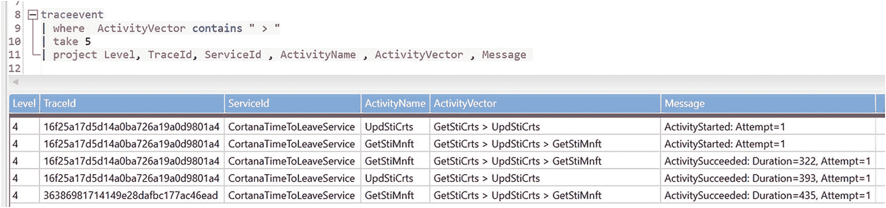
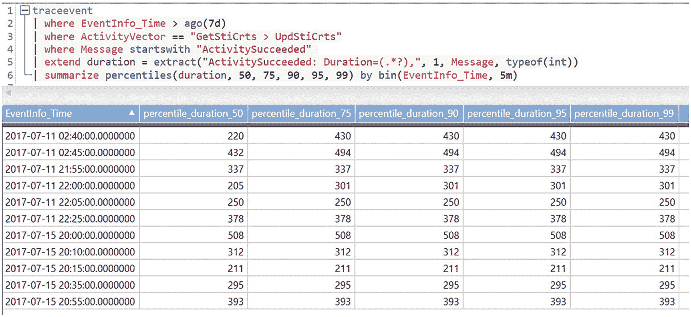

# 7. 监控

> *可工作的软件是衡量进度的首要标准。—— agilemanifesto.org/principles*

在第 3 章：持续交付中，我们讨论了持续集成和持续部署等技术，这些技术确保新的可工作软件不仅频繁交付，而且持续交付。敏捷宣言的作者们在这条原则中明确指出，拥有实际可工作的软件远比拥有大量描述某个尚未充分集成到可运行状态的软件系统的文档更有价值。因此，在任何软件项目中，快速让软件运行起来，然后在增量添加功能的同时保持其运行至关重要。第 1 章：早期交付中描述了一些实现此目标的技术。

但我们认为，拥有可工作的软件虽然至关重要，却不足以衡量你的进度。如果你并不真正了解你的可工作软件在运行时在做什么——如果你没有将度量机制构建到你的可工作软件中——那么拥有可工作软件可能等同于那句谚语：森林里一棵树倒下，却无人听见。很可能软件正在以无人察觉的方式“倒下”。

## 监控可工作软件

作为交付可工作软件开发流程的一部分，你应该制定一个计划，收集作为该可工作软件一部分的遥测数据。这些遥测数据不仅可以用来确保软件按承诺为用户正常工作，还可以指导未来功能的开发，并衡量你交付的产品是否真正满足了业务和客户的需求。你应该努力通过遥测数据回答四个问题。首先，软件是否真的按设计正确运行，还是出现了意外故障？其次，你向用户展示的数据有多准确？第三，你试图达成的业务目标是什么，能否衡量这些目标是否真的实现了？最后，你的用户有什么需求，你是否在衡量这些需求的满足情况？

### 监控与隐私

我们建议，可工作软件的监控方式应能保护用户隐私。用户对此的需求日益增长，这反映在全球各地通过的法律法规中，例如《通用数据保护条例》（GDPR）。我们将在本章讨论一些可用于在尊重用户隐私的同时进行监控的机制。然而，未来在某些司法管辖区，即使是这种“隐私感知”的监控，也可能需要征得用户的同意。

### 示例系统：出发时间

作为本章讨论的引子，我们简要描述一个埃里克在 Cortana 团队工作时开发的系统。该功能名为“出发时间”（TTL），集成在 iPhone 上的 Outlook 移动客户端中。Apple Mail 和 Google Inbox 中也有类似功能。该功能的工作原理如下：如果你在日历上安排了一个会议，并为会议添加了可在地图上定位的地点，同时你与 Outlook 移动客户端共享了位置数据，那么 TTL 会计算你当前位置与下一个会议地点之间的驾驶路线和驾驶时长，并在正确的出发时间通过手机提醒你，以便你能准时赴约。TTL 会根据当前交通状况以及你当前位置与下一个会议地点之间的预计驾驶时间来完成此操作。因此，如果你在 3 点有一个会议，在当前交通状况下需要 20 分钟车程，TTL 会在 2:30 提醒你最好出发前往下一个会议地点以准时到达，并向你显示前往会议地点的当前交通地图。如果会议地点很近，不需要很长的通勤时间，TTL 只会给你标准的即将开始的会议提醒，而不包含交通信息。

该系统在 Outlook 移动客户端中有一些代码，但大部分业务逻辑和代码作为一组微服务在服务器上运行。它与存储在服务器上的日历数据交互，以获取可能包含需要跟踪地点的日历变更信息。它与必应的交通和路线规划系统交互，以获取即将召开的会议的当前交通状况信息。它与 iPhone 上的通知服务交互，以便在正确的时间触发提醒。当用户在 Outlook 移动客户端中激活或停用该功能时，iPhone 应用还会与微服务交互，以开启或关闭该功能。

对于任何应用程序来说，监控对于全面了解其是否按预期运行都至关重要，而在该项目中，由于系统涉及众多移动部件，监控尤其关键。此外，许多逻辑操作跨越多个执行层面——例如，要成功开启该功能，需要成功完成以下步骤：代码必须在手机上的 Outlook 移动客户端中运行，用户必须同意向应用程序共享位置数据，服务器上的代码必须运行以开启该功能，服务器上必须启动额外的代码来扫描即将到来的日历事件以获取地点，并且必须开始运行代码来监听未来对会议的更改。


### 基于活动的监控

“该出发了”系统包含数万行代码和数千个方法，分布在客户端代码和多个微服务中。我们是如何监控它的呢？

我们采用了一种名为“基于活动的监控”的技术。首先，我们定义了大约 50 个活动类，它们代表了系统中重要的功能模块。以下是一些活动示例：

*   `RegisterForTTL`：追踪用户注册以开始接收“该出发了”通知的行为。
*   `UnregisterForTTL`：追踪用户关闭“该出发了”功能的行为。
*   `StartTrackingEvent`：追踪系统开始监控一个带有地点的即将发生的事件，并计算其行程时间的行为。
*   `StopTrackingEvent`：追踪一个正在被监控的、带有地点的事件被删除或不再具有可导航地点时的行为。
*   `ProcessMeetingWhenUserLocationChanged`：追踪一个带有地点的事件其地点发生变更时的行为。
*   `ChangeTransportationMode`：追踪 Outlook 移动端用户更改其常用出行方式偏好的行为——用户可以选择驾车路线，或者如果乘坐公交/火车则选择公共交通路线。
*   `SendTTLNotification`：追踪“该出发了”通知被触发并发送给用户的行为。

活动封装了系统中这些逻辑功能单元的执行过程。例如，一个名为“RegisterForTTL”的活动会从 iPhone 端发起，经过多个微服务处理，最后在微服务成功完成后回到 iPhone 端。系统使用一个 TraceID 来追踪用户请求从手机出发，经过各个后端系统，再返回手机的完整路径——这个 TraceID 就是一个 GUID（全局唯一标识符，每个用户请求对应一个唯一字符串，看起来像“360C4783-E414-4CEC-A114-8513AA6A8CCE”），用于在整个系统中追踪该特定操作。在 C#中，通过活动来封装一个操作看起来是这样的：

```
Activities.RegisterForTTL.ExecuteAsync(async () =>
{
// 执行操作
//
return ...;
});
```

每个活动类都有其唯一的标识符，一个长名称（如`ChangeTransportationMode`）和一个较短的缩写名称（如`ChgTranMode`）。活动还可以嵌套。例如，`RegisterForTTL`（`RegForTTL`）活动内部可能嵌套了其他几个相关活动，这些活动在首次开启该功能时发生——`StartTrackingEvent`（`StTrkEvnt`）活动就是一个可能被嵌套的活动示例：当“该出发了”功能开启时，如果发现一个即将开始的会议带有地点，且时间临近、距离用户当前位置足够远，就需要开始追踪以确定何时提醒用户。当活动嵌套时，系统会使用较短的缩写名称来创建一个“活动向量”，用以表示活动的嵌套关系。例如，“RegForTTL > StTrkEvnt”表示`StartTrackingEvent`活动（`StTrkEvnt`）是在`RegisterForTTL`活动（`RegForTTL`）内部被调用的。这些活动向量会随着活动类记录的每条追踪信息一起输出。

此外，我们微服务 API 中的每个 REST 入口点也都用活动进行了封装。这使得你可以追踪从服务器上调用 REST API 开始，到其成功（或失败）执行的整个过程。系统中大约还有另外 25 个左右的入口点也使用了活动进行封装。

随后，活动会将每个活动所封装的操作在执行过程中发生的事件记录到一个基于文本的日志系统中。活动会追踪以下事件：

*   `ActivityStarted`：活动开始时，会输出一行日志，包含 TraceID、活动所在的微服务名称、活动缩写名称、当前的“活动向量”以及事件消息文本。例如，如果`StartTrackingEvent`发生，可能会输出如下一行日志：

`16f25a17d5d13aa0ba726a19a0d9801a4 | CortanaTimeToLeaveService | StTrkEvnt | RegForTTL>StTrkEvnt | ActivityStarted: Attempt=1`

活动向量使用活动缩写名称，提供了一个紧凑的逻辑调用栈，展示了端点活动内各种活动的嵌套关系。这有助于理解系统流程，并允许进行强大的分析，我们稍后会看到。正如你在消息文本中看到的，某些活动内置了重试机制，如果某次尝试因故失败，系统会自动尝试重新执行代码，重试次数也会记录在消息中。

*   `ActivitySucceeded`：活动成功完成时，会输出一行日志，包含 TraceID、活动所在的微服务名称、活动缩写名称、当前的“活动向量”以及事件消息文本。例如，如果`StartTrackingEvent`成功完成，可能会输出如下一行日志：

`16f25a17d5d13aa0ba726a19a0d9801a4 | CortanaTimeToLeaveService | StTrkEvnt | RegForTTL>StTrkEvnt | ActivitySucceeded: duration=330, Attempt=1`

*   在此事件中，请注意活动的端到端持续时间被记录下来，从开始到完成，本例中耗时 330 微秒。

*   `ActivityFailed`：如果活动因故失败，会输出一行日志，包含 TraceID、活动所在的微服务名称、活动缩写名称、当前的“活动向量”以及包含异常详情和错误信息的事件消息文本。例如，如果`StartTrackingEvent`在执行过程中抛出异常，可能会输出如下一行日志：

`16f25a17d5d13aa0ba726a19a0d9801a4 | CortanaTimeToLeaveService | StTrkEvnt | RegForTTL>StTrkEvnt | ActivityFailed: duration=320, Attempt=1, Exception=Null Reference Exception in ‘register.cs’ line 239`

在此事件中，请注意报告了错误详情，这有助于开发者理解系统中发生了什么问题以及问题发生的位置。

*   除了上述三个基本事件（“ActivityStarted”、“ActivitySucceeded”和“ActivityFailed”）之外，还可以向追踪信息中输出自定义消息。这些消息将以相同的基本格式存储，包含关联 ID、活动名称、活动向量和消息；但在此情况下，消息内容将是开发者定义的自定义日志消息。


### 用于分析追踪的 Azure Data Explorer

真正让这个系统强大的是加入了 Azure Data Explorer。Azure Data Explorer 是一个日志分析云平台，针对半结构化文本日志的临时大数据查询进行了优化。系统中活动日志记录产生的所有日志都会被输入到 Azure Data Explorer。借助 Azure Data Explorer，你可以对活动发出的整个日志集执行复杂的临时查询。例如，你可以通过如下查询，仅查看任意一组至少包含一层嵌套的活动日志：



你还可以使用 Azure Data Explorer 执行更复杂的聚合查询。在此示例中，我们使用 Azure Data Explorer 来确定系统中常见活动向量（GetStiCrts > UpdStiCrts）的性能特征。在这种情况下，Azure Data Explorer 利用我们在每个 ActivitySucceeded 事件的消息中一致地发出“duration=”这一事实，并使用其“summarize”功能来计算整个系统中该特定活动序列的性能百分位数（GetStiCrts 与获取系统中某些所需证书有关）。



将基于活动的日志记录全面覆盖你的代码，并使用 Azure Data Explorer 分析这些日志，这两者结合是一个强大的组合，真正让你能够从多个维度衡量工作软件的进展。如果你还没有使用过 Azure Data Explorer，请准备好迎接惊喜——它是一个极其强大的工具，当你开始意识到对监控数据进行特定查询和聚合查询的强大功能时，它将彻底重塑你衡量产品的方式。更多关于 Azure Data Explorer 的信息，请访问 aka.ms/kdocs。

### Azure Data Explorer 与数据库的对比

你可能想知道为什么要使用 Azure Data Explorer 而不是其他数据库。Azure Data Explorer 的优势在于对数 TB 的半结构化文本数据执行快速查询。你也可以考虑的其他类似产品包括 Splunk、Logstash、InfluxDB 或 Elasticsearch。

## 监控能告诉你什么

有了基于活动的监控和像 Azure Data Explorer 这样的系统来查询生成的日志数据，你现在可以真正地衡量你的产品了。以下是一些你应该深入探索并开始创建 Azure Data Explorer 查询以分析产品的领域。

### 工作软件真的在工作吗？

基于活动监控的一个直接好处是，你现在可以量化系统成功和失败的频率。当然，这取决于你的活动监控中是否存在错误或缺口，因此，请将其作为常规优先事项和持续集成流程的一部分，以确保基于活动的监控不会出现缺口，并且当系统添加新功能时，会定义新的活动来跟踪该功能。评估系统健康状况只需一个 Azure Data Explorer 查询。你可以创建一个 Azure Data Explorer 查询，告诉你过去一天内活动失败的次数——类似这样：在此示例中，我们的基于活动的事件存储在一个名为“traceevent”的 Azure Data Explorer 表中：

```
traceevent
| where EventInfo_Time > ago(1d)
| where Message startswith "ActivityFailed"
| count
```

你可以通过类似的查询将其与成功活动的数量进行对比：

```
traceevent
| where EventInfo_Time > ago(1d)
| where Message startswith "ActivitySucceeded"
| count
```

你可以通过如下查询深入分析单个失败及其原因：

```
traceevent
| where EventInfo_Time > ago(1d)
| where Message startswith "ActivityFailed"
| take 5
```

### 出了什么问题？

你可以通过如下查询深入分析单个失败及其原因：

```
traceevent
| where EventInfo_Time > ago(1d)
| where Message startswith "ActivityFailed"
| take 5
```

这将显示最近的五个失败。你可以从失败中获取 TraceID，并通过如下 Azure Data Explorer 查询查看会话期间发生的整个活动集：

```
traceevent
| where TraceID == "在此处粘贴失败的完整 TraceID"
| project TraceID, ServiceID, ActivityName, ActivityVector, Message
```

这将输出一整套带有活动向量的活动追踪信息，以便你可以探索失败发生之前的确切事件序列。

### 速度有多快？

正如我们之前所见，你可以通过如下查询检查特定的活动向量或入口点，并查看大多数用户花费的时间：

```
traceevent
| where EventInfo_Time > ago(7d)
| where ActivityVector == "RegForTTL > StTrkEvnt"
| where message startswith "ActivitySucceeded"
| extend duration = extract("ActivitySucceeded: Duration=(.*?),", 1, Message, typeof(int))
| summarize percentiles(duration, 50, 75, 90, 95, 99) by bin(EventInfo_Time, 5m)
```

你可以通过如下查询查看一组相对于其他活动花费时间特别长的活动（该查询观察到前一个查询中的最高时间在 500 毫秒范围内）：

```
traceevent
| where EventInfo_Time > ago(7d)
| where ActivityVector == "RegForTTL > StTrkEvnt"
| where message startswith "ActivitySucceeded"
| extend duration = extract("ActivitySucceeded: Duration=(.*?),", 1, Message, typeof(int))
| where duration > 500
```

如果你怀疑较慢的时间是由特定问题引起的——例如，如果某个事件是重复事件，追踪该事件可能会更慢——你可以在日志记录中添加一条自定义消息，例如“RecurringEvent”，然后构建一个新的查询来查找它。请注意，这假设你的基于活动的日志记录实现在记录自定义事件时也会发出 duration：

```
traceevent
| where EventInfo_Time > ago(7d)
| where ActivityVector == "RegForTTL > StTrkEvnt"
| where message startswith "RecurringEvent"
| extend duration = extract("RecurringEvent: Duration=(.*?),", 1, Message, typeof(int))
| where duration > 500
```


### 业务目标真的实现了吗？

作为监控设计的一部分，你应该评估将追踪哪些业务指标来评估项目的成功。一个常用的业务指标是 MAU（月活跃用户）。在“Time To Leave”系统中，我们对 MAU 的定义是：积极注册以接收通知的用户数量。事实证明，这个数字对业务来说意义不大，因为通过监控系统很快发现，开启该功能的用户数量远多于实际收到“Time To Leave”通知的用户。用户未收到通知的常见原因包括：他们在日历中为足够多的会议输入了地点、日历上的会议数量不多，或者所有会议都在他们当前所在位置附近。

因此，定义第二个指标是一种良好的业务实践——即 MEU（发音像猫叫一样）。MEU 指的是月度活跃用户。定义这个指标的方法有很多，但在“Time To Leave”系统中，我们将活跃用户定义为在过去一个月内至少收到过一次系统会议提醒的用户。记录发送通知行为的活动被称为“SendTTLNotification”或“SendTTLNot”。查询上个月发送了多少条 TTL 通知的语句如下：

```
traceevent
| where EventInfo_Time > ago(30d)
| where ActivityVector == "SendTTLNotification"
| where message startswith "ActivitySucceeded"
| count
```

当然，这个查询并不能衡量月度活跃用户，因为一个用户在一个月内可能收到多条通知。我们需要一个更高级的查询来确定收到通知的唯一用户数量。

确定唯一用户数量开始涉及隐私领域——系统显然知道用户的唯一身份，但我们不希望将这些信息暴露在日志中，因为这可能向开发者泄露用户信息，而他们本不应能够通过 Azure Data Explorer 查询来确定任何单个用户的唯一或私人信息，例如电子邮件地址、会议名称或地点等。因此，为了识别用户，我们会使用一种单向哈希算法，根据系统可访问的用户唯一标识信息计算出一个唯一的用户 ID 并存储。然后，这个身份哈希值可用于创建 Azure Data Explorer 查询，以确定一个月内的唯一用户数量，同时避免将任何个人身份信息泄露到日志系统中。

### 聚合与匿名化

没有必要永久存储用户信息。在我们的系统中，我们会在大约 30 天后清除系统中关于用户的所有日志数据。我们会定期运行 Azure Data Explorer 查询，从当前可用的日志数据中存储关于关键业务指标和其他我们想追踪的用户指标的月度聚合数据，并长期保存这些聚合信息。

### 客户的需求真的被满足了吗？

监控也是判断客户需求是否真正得到满足，以及如果未满足，原因何在的有效方法。通过监控和日志记录，我们能够确定许多用户使用“Time To Leave”功能的场景之一是他们有航班从机场出发。这让我们感到惊讶，因为我们从未特意为此做过任何优化。但我们发现，前往机场的提醒频繁触发，且对用户毫无用处——这些机场提醒的设置方式，导致用户在航班起飞前 10 分钟才到达机场。

当我们调查这类提醒为何如此频繁时，我们发现在一个相关系统中存在一个意想不到的倍增因素。Cortana 有一个系统，当检测到收件箱中有航班确认邮件时，会自动将航班会议添加到你的日历中。Cortana 创建的航班会议会包含机场地址。于是我们明白了为什么人们日历上会有这么多这类会议，从而导致“Time To Leave”通知被触发。

随后，我们与构建自动创建这些会议的推理系统的团队合作，以便我们能够识别这些会议为航班。然后，我们修改了系统，针对航班触发提醒，使用户能在航班起飞前 2 小时到达机场。

### 数据和模型是如何被使用的？

考虑监控系统生成并呈现给客户的数据，以及在生产环境中运行的模型，也是很有用的。通过有效的监控，可以学到重要的东西。

我们在必应本地数据团队收集到的一个出奇有用的数据是：我们记录了某个特定商家实际向用户展示的频率。我们会记录每次本地数据实体在搜索结果页面上显示、每次作为页面顶部答案显示、每次在地图中显示、每次显示本地数据实体的详细描述等情况。这让我们非常清楚地了解哪些商家实际上被我们的搜索引擎展示和呈现出来。密切监控商家被展示的频率，帮助我们追踪用户最关心的商家类型。我们能够确定哪些类型的商家被搜索得最多，并投资于这些类别。例如，我们有一个内部列表，列出了浏览次数最多的类别，并根据被搜索和展示最频繁的类别来决定我们的工作重点。我们还会追踪那些月度增长最快的类别。举个例子，这促使我们在某一年将“餐车”类别作为重点，当时该类别正在快速增长。

监控哪些商家被展示以及展示频率，也帮助我们检测网站中的问题。我们可以逐月追踪系统中哪些实体获得了大量浏览，突然的变化会被标记出来进行审查。通过监控实体的展示次数，我们发现一个经常被浏览的实体——拉斯维加斯的一家赌场——突然从每月数万次浏览降为零。经过调查，我们发现我们的合并系统错误地将该赌场与一个名称相似的餐厅匹配，导致该赌场完全从系统中消失。我们还可以通过追踪可疑实体来检测系统滥用行为，这些实体从零浏览开始，然后每月积累数千次浏览。这些有时是提交给我们的欺诈性商家，它们通过了验证流程。

通常，机器学习模型会在生产环境中运行，必须仔细监控其性能变化。典型的例子是用于检测欺诈的模型，其问题空间本身就内置了与外部恶意行为者的对抗关系。恶意行为者想要找到绕过欺诈检测模型并欺骗系统的方法。长期监控模型检测到的欺诈交易数量以及判定为无欺诈的交易数量非常重要。如果正常交易与欺诈交易的比例在几个月内发生显著变化，这不太可能是世界上的邪恶减少、欺诈消失的结果。更可能的是，恶意行为者找到了击败系统的新方法。受对抗性影响的模型需要被监控，并经常重新训练和增强。


## 结论

在第七章“监控”中，我们讨论了如何利用基于活动的监控来真正衡量你的工作软件。我们会将这条敏捷原则改写为：“工作软件和数据的监控提供了衡量进展的主要标准。”我们探讨了基于活动的监控系统如何运作，以及它记录和追踪的内容。我们还介绍了 Azure Data Explorer，它允许你对大量日志数据进行复杂的临时查询。我们审视了良好的监控能够揭示的各种信息：你的软件是否真的按预期运行、软件出现故障的原因和时间、用户实际体验到的系统性能、业务目标是否达成、客户需求是否得到满足，以及如何在生产环境中监控数据和机器学习模型。

在第八章“可持续发展”中，我们将讨论如何判断你的工作节奏是过快还是过慢，以及如何调整节奏。我们还会探讨目标设定以及如何保持团队的高度参与感。

