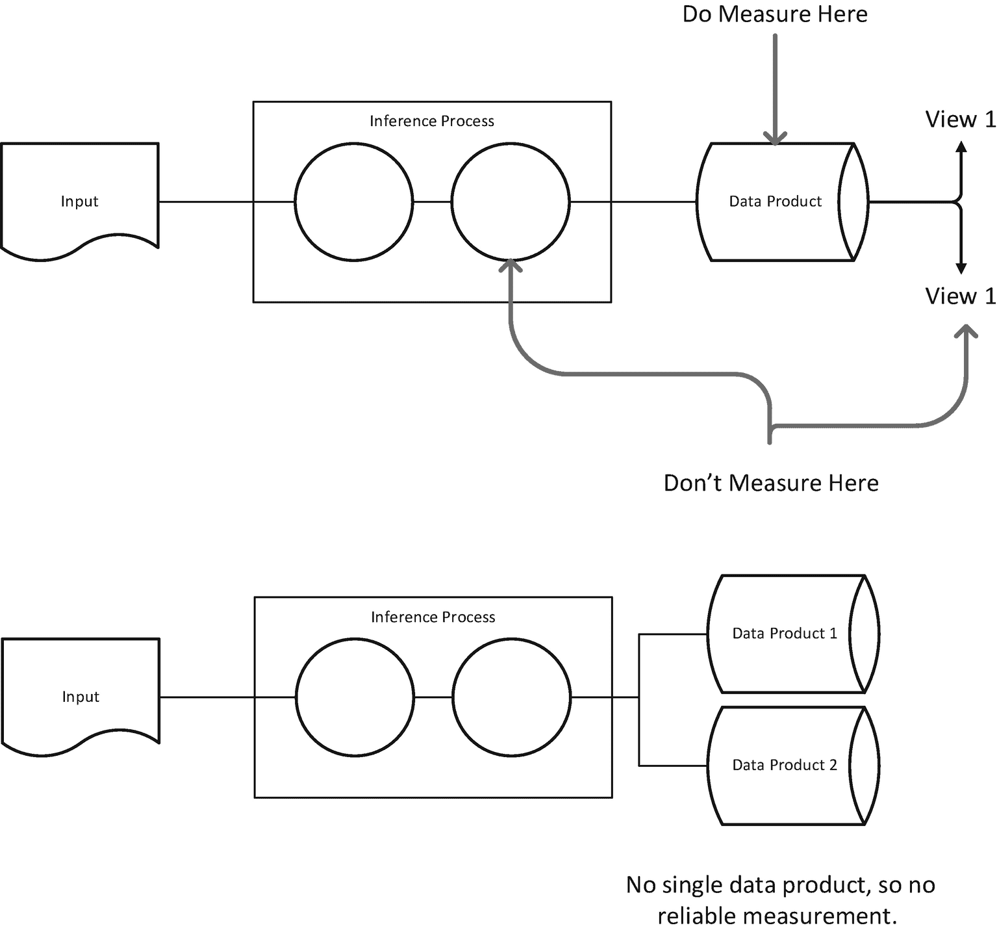

# 9. 技术卓越

> ***持续关注*** *技术卓越和* ***良好设计能够增强敏捷性*** *。 — agilemanifesto.org/principles*

当我们想到敏捷性时，我们想到的是高效移动的能力，以及在复杂多变的地形面前改变方向以追求特定目标的能力。尤塞恩·博尔特以 9.58 秒跑完 100 米令人印象深刻，但这并非敏捷性的体现。另一方面，莱昂内尔·梅西在防守球员的网格中穿梭，同时始终将足球控制在自己脚下，则更像是敏捷性的表现。^(¹⁶) 敏捷性当然需要快速移动，但它也需要那些让我们能够不受干扰地做到这一点的行为（梅西不会鞋带松散地走上球场）；它需要灵活性或灵巧性，以便在保持稳定的同时操控环境或改变路线；它需要意识和清醒的头脑，能够实时解读变化的地形和环境，从而预见并调整，而不错过任何一步。

许多开发者将追求快速进展与敏捷性的基本原则混为一谈。敏捷性是复合效率。它是低层级交互对流程和人员网络产生的影响。工程师所做的许多工作都应带来乘数效应。你编写一个测试，就能为每个使用你代码的开发者节省数小时调试下游系统中复杂错误的时间；你实现自动化部署，就能将发布更新的时间减少一个数量级；你启用持续集成，就能为每个克隆你代码的人省去调试构建过程的无数麻烦；你投资于设计，开发者就会将你的系统用于你未曾想象过的应用。

当投资于效率并非直接通往发布代码的路径时，很难抽出时间和精力去做这件事。既然我们可以花几个小时复制粘贴数据，为什么还要构建一个标注工具？既然代码明显能工作，我为什么还要写测试，而不是直接进入下一个任务？我们认识到，这需要一点信念的飞跃——如果你既没有因为走捷径而吃过亏，也没有体验过将效率融入文化所带来的胜利，那么做出这种飞跃可能很难。

在本章中，我们将探讨一系列场景，在这些场景中，关注技术卓越和良好设计将帮助你建立一种高效、持续开发和交付数据项目的文化。我们将首先说服你，对质量的投资有利于敏捷性，然后讨论对质量的投资对数据项目意味着什么。在此之前，先谈谈*持续关注*。这个术语实际上是一个信号，表明要让一个团队在这些行为上有所改进，需要付出努力、保持专注，并且少不了些许劝导。作为领导者，你必须不断寻找方法向你的团队证明，这些确实是值得去做的好事。作为开发者，你必须保持开放的心态，并愿意投资于那些前期需要付出成本，但日后会为你和你的团队带来回报的事情。

## 面向敏捷性的软件工程实践

思考敏捷团队的一种方式是通过*开发者生产力*这一概念。你所采用的每一个工具、行为和流程，首要关注的都应是让每个人都能高效工作。当然，生产力本身并不足够——它需要聚焦和引导，但我们发现“以开发者生产力为优化目标”这句口号，作为通用指南既精炼又有效。如果你的团队从根本上无法高效地完成任务，那么，你永远也无法交付产品。如果你在管理一个团队，你需要持续思考，你是否在赋能并投资于团队完成任务的能力。

当敏捷宣言的原则谈及技术卓越的作用时，它触及了工程学科的一个核心真理：所有的行动和决策都会通过团队和产品产生网络效应。好的行动是那些在通过网络级联传播时能产生正向乘数效应的行动。一个好的 API 设计能让开发者更轻松、更安全地在其基础上进行构建；好的规划能让你更容易达成目标。

让我们以单元测试为例来思考这些网络效应——这是通用软件工程中技术卓越的一个绝佳范例。单元测试不仅有助于提高个人的生产力，也有助于提升整个团队以及合作伙伴和协作者的生产力。在编写代码时，从测试开始（即实践测试驱动开发）能让开发者清晰地了解待计算函数的确切性质。在某个时刻，任何不清晰之处都可以反馈给团队其他成员或客户。开发者可以先思考成功的标准是什么。然后，编写代码就变成了满足测试要求的一项练习。这使工作模块化——测试成为了需求的体现。代码随后被提交进行某种形式的审查。审查者可以查看测试，了解函数应该做什么（他们也会审查测试，以确保其有意义且有用）。一旦代码被检入，它可能会被其他开发者使用、扩展或修改。由于测试已经就位，该开发者可以确信，其他使用这段代码的人得到了保护（如果他们的测试失败，则说明出了问题，函数的语义不再完整）。对测试的投入会为开发者、代码审查者、直属团队以及合作团队带来回报。

乐趣不止于此——如果测试被广泛接受，那就意味着代码是*为测试而设计*的。如果代码是为测试而设计的，那么计算单元就会保持小巧和模块化——使其易于审查者和维护者理解；测试可以增强面向对象编程的抽象和封装；在进行重构时，一套完善的测试将有助于保证代码可能发生了变化，但功能得以保留。

你有时会听到人们说：“是的，但你仍然可以写出糟糕的测试”或“测试会带来虚假的安全感。”这就像说，仅仅因为攀岩者系了安全带，他们仍然可能坠落。事实证明，攀岩者有充分的动力去确保他们的安全装备有效——那么软件工程师也应该有动力通过测试来确保他们的代码有效。编写好的测试，就像编写好的代码一样，是一项技能。那些拥抱它的人会发展这项技能，并帮助他们的同伴共同进步。

我们可以通过技术卓越看到积极网络效应的其他领域包括：

*   **持续集成**：当变更被提交审查时，它也应该触发一次构建。这次构建应包括运行仓库中的所有测试。这使得团队能够零成本地立即获得关于明显缺陷的反馈。持续集成是 Azure DevOps 上的一项标准功能。

*   **一键部署**：当你的代码被部署到多个目标（生产服务、测试工具、应用程序）时，如果每个步骤都是手动的，发布就会变得繁琐。每当团队面临需要执行的单调任务时，他们就会找其他事情做。结果是发布不一致且容易出错——你的测试工具中的代码版本与当前生产环境中运行的版本不同。为你的团队提供一个能自动化整个流程（包括验证测试）的按钮是一个巨大的胜利。

*   **代码卫生**：实践良好代码卫生的团队会避免复制代码，投入于打包，避免检入二进制文件，避免检入自动生成的类，一致地遵循编码风格指南，编写注释等等。这些好处中的许多都需要前期成本——但一旦你开始受益于其结果，这笔首付就微不足道了。

这些技术在第 3 章“持续交付”中有更详细的讨论。总之，通用软件开发中的技术卓越通过消除摩擦点，有助于最大化开发者的生产力。

原则 9 的第二条涉及良好的设计。技术卓越或许很容易规定。但什么是良好的设计？关于这个主题已有大量著述，通常被提炼为不同的原则或原则组：SOLID 原则（归功于 Robert C. Martin）、KISS 原则（归功于美国海军）和爱因斯坦原则（“一切都应尽可能简单，但不能过于简单”）。这些通常辅以流程指导原则，例如构建零特性发布或确立最小可行产品。根据我们的经验，确立团队对某些工程实践的态度确实能有所帮助。

首先是关于编程语言的态度。一方面，你可以固定使用某种语言，以便所有开发者共享一个共同参考点。这使得代码审查、测试和协作更加容易。另一个极端是语言完全灵活。这允许为工作选择更合适的工具，但缺点是专业知识的集中度较低。在必应的本地数据团队中，我们通常决定坚持使用面向对象编程，特别是 C#，同时利用其他系统进行脚本编写和一些非生产代码。面向对象编程提供了一个引人注目的框架，它足够灵活，可以对数据和流程进行建模，但通过一些纪律约束，它也可以被充分限制，以通过成熟的模式来指导设计。面向对象设计的核心原则是抽象、封装、继承和多态。每个设计和代码审查都可以根据这些原则进行检查，团队可以将其作为讨论的框架进行分享。还有其他选项需要考虑——函数式编程正在经历某种复兴，而像 Python 所支持的那种结构化程度较低的编码风格也很流行。

其次是团队对设计的态度。在我们的网络挖掘团队中，我们提出了一个说法：*除非是设计审查，否则代码审查就不是设计审查*。这意味着，如果你没有为你的功能进行设计审查，那么你就只能任由审查者摆布，他们可能会因为设计质量问题（而非代码质量问题）而阻碍代码审查。

第三点是承诺采用特定的操作范式。这与团队对编程语言的态度类似，但涉及分布式计算和存储的选择，并且在很大程度上取决于你所处的系统环境。例如，如果你的公司围绕 MapReduce 构建了庞大的专有基础设施，那么你很可能需要按照该范式进行设计。另一方面，如果你身处面向服务的文化中，那么你的解决方案将截然不同。虽然一种方法可能优于另一种，但有两件事需要牢记。首先，确保你的核心计算资产构建在不依赖于操作范式的库中；其次，将对操作范式的优化与对核心功能的优化分离开来。这样，当不可避免的范式切换发生时，你就能灵活应对，而无需承担任何重大的前期成本。

### 保持开放，但做出承诺

关于编码和平台，几乎有数不清的选择，优秀的开发人员和管理者需要随着技术发展而了解这些领域。然而，如果团队希望有所交付，就必须做出决策和承诺。对这些选项视而不见是不可取的——事实上，技术负责人和管理者应该持续探索并保持与时俱进；但不断转向可能更好的方案也同样愚蠢。项目启动阶段是审视选项和进行实验的好时机，而架构模块化和决策延迟则是帮助团队保持开放的良好实践。

## 数据项目的技术卓越性

考虑开发人员生产力以及优秀（和糟糕）贡献的网络效应，让我们大致了解了技术卓越性在通用软件工程中的作用。这如何转化为数据项目中的数据方面呢？我们对网络效应的讨论解释了技术卓越性为何重要。在数据项目方面，与“优化开发人员生产力”相对应的是“最大化数据资产的价值”。让我们来分解一下。

随着数据项目的推进，我们会生成许多数据资产。这些资产包括模式、样本、标注数据、模型、分析结果（例如，模型在测试集上的性能）、比较结果等等。数据的价值可以从两个方面来考虑：即时价值和长期价值。即时价值是其被创建的原因——它解决问题、提供知识或以某种方式推动项目前进。例如，标注数据集通过允许我们训练模型来提供价值，如果模型可接受，则可以将其部署到生产环境。然而，长期价值是我们之后从数据中获取的价值。这可能是计划内的，也可能是计划外的。计划内的长期价值，例如，持续使用一个真实数据集作为某个指标的基准。计划外的长期价值描述了我们意外获得的价值。例如，当我们使用新的测试集（旧模型创建时不可用）与新方法进行比较时，可能会从旧模型中受益。我们可能希望应用一种新方法来清理旧标签集上的标签，看看它是否能改进最初生成的模型。价值也存在于我们用来处理和检查数据的系统和工具中，例如，采样脚本、自定义标注和数据浏览工具，以及数据清理工作流。

也许令人惊讶的是，数据项目在确保数据的计划内长期价值方面投入不足，更不用说投资于计划外价值的潜力了。

### 你衡量什么，你就是什么

如果你正在处理一个相当有趣的问题，你很可能有一个包含多个阶段的流水线或其他形式的工作流程。数据可以在流水线的多个点进行采集。在涉及指标时，明确你在衡量什么非常重要。如果你正在报告合作伙伴或客户团队将依赖的官方指标，这一点尤其重要。至关重要的是，你必须清楚你的*数据产品*是什么，并且只衡量它。

离线数据流水线的一个常见模型，也是我们在必应本地搜索产品中采用的模型，是交付一个 XML 产品。使用 XML 是因为它的普遍性（任何平台都可以消费它）、它的标准（关于什么是正确的 XML 几乎没有歧义）以及它相当好的人类可读性。^(¹⁷) 这种 XML 格式是我们采样的来源，也是我们测量系统中使用的格式。该系统的许多消费者需要不同格式的数据——尤其是那些对空间（XML 很冗长）和计算性能有明确要求的消费者。对于这些客户，要么他们自己编写数据转换，要么我们提供转换。最终的序列化形式是可以经过严格测试的，以确保它不会以任何方式破坏你基于生产指标所做的声明。这意味着测量系统从系统中一个定义明确的瓶颈点拉取数据，你所有数据视图都源自该点。

通过这种设置，你还可以构建验证流程，该流程获取任何输入的数据产品输出，并验证你可能为用户提供的其他版本的数据。例如，你可以获取 XML 文档的字段，并检查它们是否在你节省空间的二进制序列化形式中得到保留。

有很多原因可能会诱使你采用数据的其他视图。由于你的架构，在数据写入瓶颈阶段之前采集数据可能更简单；用户消费数据的形式可能与现有的测量流水线配合不佳；或者输出格式已更改，而你的测量系统是为消费旧格式而构建的，并且缺乏重新定位到新格式的灵活性。无论原因是什么，你都应该不惜一切代价抵制这种诱惑。如果你不衡量一个定义明确的产品，而是做其他任何事情，你就有可能因为某个转换引入了变化，从而导致你的指标不正确。图 9-1 说明了这些不同的测量场景。

图 9-1

衡量这个，而不是那个——在上图中，系统产生一个单一的数据产品，这是衡量质量的可靠位置。不应在数据产品之前的阶段，也不应从不同的、特定于客户端的数据产品视图中衡量质量。在下图中，产生了两个不同的数据产品，没有单一的工件，因此无法进行可靠的测量。

### 避免无意的数据转换^(¹⁸)

当数据在系统中流转时，会经历一次或多次转换。顾名思义，有意转换正是你希望系统执行的那些操作，它们能增加数据价值。而无意的转换则会对数据产生实质性影响，这些影响要么不为人知，要么与你原有的假设不符。这类问题可能出现在多个环节，但最常见的两个场景是数据序列化和数据标注。在序列化数据时，我们需要将其从内存格式转换为磁盘（或流）格式。若不加注意，错误就可能在此处悄然滋生——编码错误（针对文本数据）、数据结构丢失（例如将树形结构转换为线性形式）、图像色彩深度降低等。

在标注数据时，我们需要以某种方式向用户展示数据。这可能涉及某种形式的序列化，但转换也可能发生在标注工具甚至标注员使用的显示设备中。网页数据标注因这类问题而臭名昭著。当浏览器从 URL 下载字节、应用关联的 CSS 样式并执行页面上的 JavaScript 时，网页才会呈现给用户。所有这些操作都可能显著改变数据，因此当我们保存网页数据时，必须竭尽全力确保其以能够准确还原的格式持久化存储。

另一种思考这个问题的方式是：你的数据产品主要应为你自己设计，而非你的客户。考虑到我们普遍对客户的重视，这听起来可能有些反直觉。客户消费的是数据产品的特定视图和序列化形式。你的数据产品需要兼顾开发团队的需求——将其转换为客户所需的形式应作为最后一步的简单且经过充分测试的环节。因此，卓越的度量意味着：度量你所产出的内容，并确保下游的最终序列化过程不会改变你的数据。

我们已经讨论了系统输出的细节及其与度量过程的关系。现在让我们从度量的角度来谈谈输入。要求标注系统的输入与处理流程的输入完全一致，这似乎是直观的。这能为所有组件带来某种一致性。然而，当人类对数据进行评判或标注时，存在合理的原因使得他们看到的数据视图可能与系统输入不同。想象一个负责图像分类的推理管道。分类器需要判断图像中是否包含美洲狮。由于该系统将部署在众多低成本数码相机上，预算限制要求所有相机必须为黑白模式。在开发用于创建标注数据的评判工具时，你发现由于缺乏色彩，评判员难以对图像进行分类。为了改进标注数据的创建流程，向评判员展示更丰富的彩色图像是合理的。

### 在构建度量指标的同时开发模型

恭喜！你提出的项目已获得资助，你即将与你的小团队开始交付工作。你们有 4 周时间从零开始实现首次上线部署。目前你们没有任何度量指标。你估算了定义指标、实现工具、培训评判员以及将开发集集成到内部循环所需的时间，发现大约需要 3 周。这意味着你将没有时间以理想的指标驱动方式处理推理组件。你会怎么做？

即使对于已建立某种度量框架的团队，开发新指标也可能需要时间。被度量的概念需要在为评判员编写指南、培训他们、审查他们的输出以及调整指南以应对新出现的歧义或困惑之间进行多次迭代。虽然应始终优先采用指标驱动的方法，但你会发现团队常常不得不在没有指标的情况下开始工作。

应对项目这一阶段的诀窍在于依赖这样一个事实：主要问题（即推理问题中值得解决的挑战）应该能在小样本数据中被观察到。这意味着开发人员可以花一两个小时手动标注数据，以找到极有可能影响最终指标改进方向。如果系统输出中有 20%存在特定问题，你应该有信心通过检查几百个样本就能观察到这一点。

### 为推理系统编写测试

在开发机器学习模型以使用相同评估数据提供某种形式的推理时，我们会生成任意数量的候选模型。随着这些模型在精确率和召回率方面逐步达到可接受的性能，其输出也会出现变化。评估集中的许多示例会产生相同的结果（这些是模型已捕获的较简单案例）。然而，净改进也会导致一些边际退化，即原本正确的结果会变为错误。系统的不同版本也是如此——我们通常追求净改进，并对先前正确结果的退化做出判断。对于程序化系统，除非所实现函数的语义发生变化，否则我们不会预期在进展过程中看到测试失败，除非出现了真正的错误。但是，如果我们以相同的方式测试推理系统（给定输入，期望始终得到相同输出），我们将面临测试在通过和失败之间反复切换的问题。让我们来梳理一个典型的推理流程，并探讨如何为其编写测试。

一个显而易见的起点是特征生成阶段。^(¹⁹) 为输入计算特征是编写测试的典型场景。每个被计算的特征都应被测试，包括输入中不存在该特征的情况。最糟糕的情况莫过于在已部署系统中发现特征计算错误，结果却发现修复特征——这只会影响运行时推理，而不会影响用于构建已部署模型的训练数据——反而导致了性能退化。

你还应确保训练期间和运行时推理期间生成特征的代码路径完全相同。当然，这可以在代码层面强制执行——实际上应该使用完全相同的代码。无论能否强制执行，都可以通过测试来检查一致性。测试一致性虽然不能做到穷尽，但相对容易实现：只需获取文档，分别通过训练和测试中的特征化流程，然后简单测试它们是否相同。这种测试方法在测试其他形式的一致性（如序列化/反序列化一致性）时也非常有用。值得指出的是，要做到这一点，我们需要建立在基本的工程卓越实践之上——编写并测试对象之间的相等性。有了正确实现并维护的相等性实现，在任何场景下编写一致性测试都变得几乎微不足道——只需生成两个对象并测试它们是否相等。实现（并测试）特征的序列化对于流程的整体设计也至关重要，我们稍后会看到这一点。

现在，我们面临为系统中的特定推理编写测试的挑战。正如我们上面讨论的，代码中部署的模型会随时间变化；虽然数据集中越来越大的核心部分会享有稳定的预测，但随着你持续交付净改进，边际部分会出现波动。例如，如果我们正在构建一个人名提取器，那么即使你之前版本的模型能够做到，当前最佳模型可能不再能找出文档 A 中的所有十个人名。此外，你正在测试的组件可能构建在其他组件之上。例如，你的人名提取器可能在你开发的另一个子系统之后运行，该子系统用于识别网页中的主要内容（并丢弃导航、横幅、页脚及其他无关内容）。这个子系统也可能基于统计方法，表现出同样类型的净增益进展。

针对这种情况，有几种测试策略。首先，构建一个独立的回归测试框架，允许你运行不同模型、比较输出并检查它们。这不应成为单元测试套件的一部分，因为它们不是单元测试，而是长时间运行的测试，应避免在内部循环中使用。其次，整个推理流程中的不同模块应被隔离。在测试中，不要将模块 A 的输出作为模块 B 的输入，而应将模块 A 的理想输出作为模块 B 的输入。换句话说，你是在假设模块 A 提供了完美输出的前提下测试模块 B 的性能。第三，你应该为特定版本的模型编写测试。与其为人名提取器编写测试，不如为人名提取器的第 3 版编写测试。这确保了测试是确定性的，并且始终以相同方式运行。如果推理系统的实现发生了根本性变化，测试会失败；但不会因为你通过净改进提升了产品而导致测试的特定案例出现退化而失败。

我们将测试视为固定墙上那幅形状奇特的大图的图钉。钉入一个图钉，固定一个自由度。再钉入一个，确保形状的一个边角固定在墙上。钉入的图钉越多，图片受到的约束就越多，直到有足够多的图钉保证图片精确地停留在期望的位置。最好的测试是那些以完全出乎意料的方式失败，从而提醒你注意未曾预料到的代码路径和输入场景的测试。

### 自定义标注工具

标注工具是人类用来创建训练和评估系统数据集的应用。它们提供数据的视图以及一些控件，允许用户输入或编辑某种元数据。一个简单的例子：如果你正在为图像构建一个二元分类器，那么该工具可能会显示图像，并提供一个按钮或设置一个按键来捕获正面或负面的判断。我们将标注工具纳入本章关于技术与设计卓越性的讨论中，因为理解这些工具的目的、呈现的保真度以及标注的创建方式，对于你整体产品的质量至关重要。让我们来详细分析一下。

查看数据可能看起来是整个难题中简单的一部分。你处理的是图像，就需要查看图像；你处理的是网页，就需要查看网页。但深入思考向人类呈现数据时的考量因素是值得的。

首先，你向评判者展示的内容是否与你的系统所“看到”的内容相同？当然，在处理网页数据时，很容易最终向评判者展示的内容与机器“看到”的内容大相径庭。如果你将网页的 HTML 字节保存到磁盘，然后在稍后的日期打开它们，你的浏览器将开始拉取额外的信息流来渲染页面。这可能像决定页面上元素字体大小、颜色等的 CSS 样式信息一样简单。也可能是页面上使用的图像。也许你正在查看一个与新闻相关的页面，并且有一个横幅小部件在页面主要内容上方拉取最新头条。此外，每当使用额外数据来改变页面的外观和内容时，这些数据有可能不再存在，从而导致意外的布局、图像缺失等问题。

其中一些呈现缺陷可能无关紧要。但假设你正在构建一个分类器来判断一个页面是否为“垃圾页面”。如果垃圾内容不再可供用户查看，那么它就不会被看到，因此就无法准确做出判断。

在处理某种方式受限的 HTML 数据时，我们见过一些此类问题更极端的案例。例如，你的数据采集系统可能可以访问托管在特定环境中的服务器；但是当你在本地查看同一个 URL 时，由于个人用户的权限不同，页面的内容可能会被完全或部分屏蔽。

这些网页示例说明了潜在的陷阱，即向评判者展示的对象可能与系统所看到的对象不同。我们也可以找到人类和机器会看到数据转换的例子。图像处理系统非常常见的一种做法是，由于训练和推理系统的容量要求，将图像转换为通用的、较低分辨率的版本。在这些情况下，你可以选择向评判者展示原始源图像，还是机器将看到的缩小后的较小图像。

### 存储与版本化管理训练和评估数据

有两种类型的标注数据——现有流程产生的丰富结果（例如，搜索引擎中导致点击——成功——或未点击——失败的查询）以及人工评判的类别。前者是免费可用的，但后者需要花费时间和金钱。当快速工作时（不要与敏捷混淆），很容易完成你的分类器，展示其有效性，满足客户需求，然后转向其他任务，从而避免了持久化数据的开销。当需要更新模型时，数据的位置和来源就丢失了。与敏捷世界中的许多流程一样，解决这个问题——这种价值损失——的方法在于建立正确的行为、流程和工具链，这些可以在*开发过程中*使用。这意味着在任务结束时——当你的模型在指标上显示出那些净收益时——没有额外的工作；一切都已经处理好了。

管理数据集的主要考量如下：

*   **总体**：总体是否是一个不可变的对象集合？任何替代方案都意味着你面临样本之间高变异性的风险。假设你有一个不断变化的商店——任何时候你抽取一个样本，该样本的性质都会改变。如果这是有意为之，那很好——也许你每个月都在构建一个新的指标集。但如果是无意的，那么你最终会对样本的等价性做出假设。

*   **样本**：你可以通过引用来抽样——在这种情况下，你创建一个指向总体中对象的引用列表——或者通过值来抽样，在这种情况下，你复制对象数据。每种方法都有利弊。如果你通过引用抽样，那么你确保数据点只有一个唯一的版本——即总体集中的那个。如果你通过值抽样，那么你就创建了数据的副本，这使你免受总体数据集可能存在的任何持久性问题的影响。但现在你造成了一种情况，即两个对象可能由于某种原因而出现分歧。

*   **标签的版本**：当为评估或训练和开发目的标注数据时，你会希望重新审视并修正标签。保留标注数据的版本非常重要。为什么？敏捷关乎进步，而进步的效率需要能够衡量实验之间的差异。任何跟踪项目的人都很自然地会要求进行可量化的比较，而且你肯定会基于最新一轮的标签为模型提出几个版本前未曾想到的新问题。

有几种实用的方法来管理数据集。对于较大体量的数据，一个基本策略是拥有某种形式的存储来管理你的总体，然后在用于处理代码的同一基础设施中处理较小的数据覆盖层——代表样本的总体子集引用、与数据对象关联的标签。Git LFS（大文件存储）是遵循此模型的解决方案的一个例子。基本工作流程是将你的数据集存储在大文件仓库中。Git LFS 将数据的引用放在主仓库中，以便 Git 交互无缝进行。现在，一个样本可以通过对 Git 中对象的引用和标签文件（例如，引用数据对象并序列化某些标签信息的文本文件）来定义，并以与代码完全相同的方式进行处理。

### 管理模型

在开发过程中，以及随着产品的持续改进，团队会生成许多模型以及推断相同输出的多个模型版本。例如，当您发布产品时，可能已经确定了蒸汽机名称提取器的第 7 版。随着进展，您可能会创建第 8、9、10 版，并在下一次发布时达到第 11 版。同样，您可能会意识到针对特定任务所采用的方法并不理想，并希望在下一轮实验和发布中使用不同类型的模型。

在管理模型时，您有两种选择：可以覆盖它们，也可以检入可在代码中引用的模型显式实例。例如，如果您将名称提取器封装在类 `SteamEngineNameExtractor` 中，覆盖方法会在每次模型迭代时简单地重构此类。另一方面，显式方法会为每个版本创建一个类：`SteamEngineNameExtractorV3`、`SteamEngineNameExtractorV4`，依此类推。后一种方法允许您随时在不同版本之间显式运行对比实验，从而实现持续的对比指标以及针对不同数据集的按需比较。

### 在工具链内尽可能多地计算

我们在数据项目背景下所做的一切都可以概括为：

`inputData + (process + parameters)` → `outputData.`

训练是：

`labeledData + (trainingAlgorithm + trainingParameters)` → `model.`

推断是：

`inputData + (modelRuntime + model)` → `prediction.`

考虑到这一点，我们需要做出选择：流程中有多少部分在工具链之外运行，又有多少部分在工具链内部运行？例如，我们可以在构建框架之外训练模型并检入参数。如果我们的训练范式涉及大型数据集、大量机器和大量时间，那么这样做是非常合理的。然而，如果我们处理的是涉及相对较小数据集和较短训练时间的训练系统，那么在构建时训练模型则具有优势。从根本上说，这确保了我们的所有系统都是一致的。它保证了不存在只有个别开发人员知道、且完成模型训练所必需的代码片段。我们可以使用仅保存在本地机器上的脚本来汇总指标；或者，我们可以将该脚本检入、进行代码审查和测试。更好的是，我们可以让评估脚本在每次检入时执行，或者设置为每天自动运行。我们将越多的代码纳入流程，效率就越高；代码被执行的次数越多，就越有可能发现问题并加以纠正。

## 数据项目的良好设计

我们已经讨论了数据项目的技术卓越性，现在让我们转向良好设计，特别是模式设计——如何表示系统的输入和输出。如果您正在构建一个用于分析 PDF 文档以提供逻辑文档结构的系统，输入是什么——仅仅是 PDF 吗？输出又是什么——如何为您的文档设计合适的数据模型？如果您正在构建一个从网页中提取企业名称的系统，您如何表示 URL 末尾的数据，又如何传递页面上找到的企业名称？

我们从终点开始——企业记录的正确模式是什么？表 9-1 显示了一个起点，即一组简单的基于字符串的属性。这最初看起来合理，但让我们考虑一下其中所做的一些假设。首先，我们将地址表示为字符串。这带来了许多问题。地址具有相当明确的结构。通过将其表示为字符串，我们将解析结构的任务转嫁给了消费者。我们对地址有三个不同的需求——向用户显示、为搜索场景建立索引、以及针对替代形式和整个数据集进行推理。显示地址似乎是一个字符串完全足够的场景。但是，当您的用户体验团队希望确保在显示组件中保证某些规范化时，您会意识到，即使对于这个简单的场景，一些内部结构也是更可取的。否则，您就是在要求用户体验团队开发规范化这些字符串所需的领域知识——而该领域知识恰恰定义了您团队的价值！

表 9-1

一个简单的企业模式

| 属性 | 类型 | 示例 |
| --- | --- | --- |
| 名称 | 字符串 | 埃里克与马特的游戏商店 |
| 地址 | 字符串 | 西雅图市卢卡斯街 1138 号，华盛顿州 |
| 电话号码 | 字符串 | 206 555 1970 |

因此，让我们用表 9-2 中所示的结构化地址对象替换我们的地址。这样做时，我们需要承认系统中数据源、生产者和消费者的一个要求——它们必须能够生成或消费新的结构化地址格式。

表 9-2

细化地址结构

| 属性 | 类型 | 示例 |
| --- | --- | --- |
| 名称 | 字符串 | 埃里克与马特的游戏商店 |
| 地址 | StructuredAddress |

&#124; 建筑编号 &#124; 字符串 &#124; 1138 &#124;
&#124; 街道名称 &#124; 字符串 &#124; 卢卡斯 &#124;
&#124; 街道类型 &#124; 枚举 &#124; 街 &#124;
&#124; 城市 &#124; 字符串 &#124; 西雅图 &#124;
&#124; 州 &#124; 枚举 &#124; WA &#124;

|
| 电话号码 | 字符串 | 206 555 1970 |

现在我们有了一个更有用的企业表示。我们正在更详细地思考所表示概念的*分解*。比较一下用字符串表示地址与用结构化对象分解构成地址的概念。字符串简单且通用，但不透明。结构化地址为客户带来了价值，但需要更多工作。当然，数据是混乱的。对地址世界的更深入审视揭示，并非所有地区都遵循欧洲和英联邦国家常见的以街道为中心的层级结构。例如，在日本，地址结构是基于街区的（地块编号、街区、城区）；在许多国家的农村地区，地址更像是供邮局解读的位置描述。这导致了一个两难境地——您是尝试为所有地址创建一个通用数据模型？还是采用一种回退策略，当您的结构化对象不足时，至少允许包含某种形式的表示？

一种回退表示的方法是在数据结构中为层级中的任何节点允许文本表示。例如，在我们的地址中，更深一层的结构是将建筑编号、街道名称和街道类型捆绑到一个街道节点中。该节点可以有一个额外的属性来存储分解后的字符串版本。这将允许处理街道未被分解或不符合模型的情况，至少能有一些记录。类似地，模型中的顶层节点（整个地址）将有一个文本节点，可以保存整个地址的字符串形式。表 9-3 显示了增加了回退内容的模式。

表 9-3

带有回退文本节点的企业模式

| 属性 | 类型 | 示例 |
| --- | --- | --- |
| 名称 | 字符串 | 埃里克与马特的游戏商店 |
| 地址 | StructuredAddress |

&#124; 建筑编号 &#124; 字符串 &#124; 1138 &#124;
&#124; 街道名称 &#124; 字符串 &#124; 卢卡斯 &#124;
&#124; 街道类型 &#124; 枚举 &#124; 街 &#124;
&#124; 城市 &#124; 字符串 &#124; 西雅图 &#124;
&#124; 州 &#124; 枚举 &#124; WA &#124;

|
| 地址文本 | 字符串 | 西雅图市卢卡斯街 1138 号，华盛顿州 |
| 电话号码 | 字符串 | 206 555 1970 |

### 开放图表示

一种能够对结构化但未知模式进行建模的方法是采用开放图表示，其中关系（或组成部分）的名称最初未定义，仅以字符串形式表示。这种方法的缺点是无法在编译时进行类型检查，但优点在于能够表示没有先验已知模式的结构化数据。

### 数据模型中的指称与同一性

讨论数据建模会引向同一性的概念。我们如何判断两条记录在现实世界中指代的是同一事物？要回答这个问题，我们首先需要明确定义所表示的概念。我们的示例记录指代的是什么？这类问题很容易陷入过度哲学化的讨论。因此，让我们从一个练习开始。思考一下，作为人类，我们是如何谈论商业实体的。我们可能会说：“你应该去埃里克和马特的游戏店看看。”你可能会回答：“它在哪？”此时，你已经暗示了这家店与其位置是独立的。它可以在任何地方（因此位置并不能定义它）。这让我们意识到，**企业** *运营* 于某个**地点**，或依托于某个地点。但这是否总是成立？如果我们说：“你去过我最喜欢的星巴克吗？”你可能会回答：“是哪一家？”答案显然会是一个具体位置。我们在这里偶然发现的，是像连锁店或特许经营这样的聚合概念，与像埃里克和马特的游戏店这样的“单一”企业之间的区别。

事实证明，这种审视可以带来关于如何表示领域核心概念的根本性见解。我们的本地搜索系统，由于历史原因，采用了如表 9-2 所示的相对扁平的结构。随着项目变得越来越复杂，我们发现了各种概念：

*   单一企业：只有一个地点的企业
*   企业集团：由共同所有者拥有的、相互区分的业务集合——主要例子是餐饮集团，其中一家公司同时拥有寿司店、牛排馆、海鲜餐厅等
*   连锁店：拥有多个地点，每个地点提供相同服务或体验的企业（你期望在任何一家麦当劳餐厅都能吃到同样的汉堡）
*   特许经营店
*   合作社
*   复杂实体：大学、医院、机场、政府等

我们面临的最大挑战，并非理解这些概念的结构，甚至也不是寻找能够以某种方式填充模型所需丰富结构的数据源。真正的挑战在于，能否将我们的模式从最初的简单格式，迁移到能够表示不断演化的模型丰富性的结构。

在丰富模型时，我们最终采用的策略是，将底层的简单企业表示视为一种基础类型，然后通过两种方式增加复杂性：一是在模型中添加新属性，二是创建额外模型来捕获概念空间的新部分，这些新模型可以引用表示中的其他部分。例如，在之前展示的简单模式中添加一个新字段来表示企业类别，是相对直接的。在处理连锁店时，我们创建了一个新的概念空间——连锁品牌。其模式如表 9-4 所示。

表 9-4

连锁品牌模式

| 属性 |   | 示例 |
| --- | --- | --- |
| 名称 | 字符串 | 乔什的波奇碗店 |
| 地点 | 引用数组 | [1, 88, 421] |
| 公司电话 | 电话号码 | 206 555 9943 |

### 表示歧义

当然，我们对数据唯一确定的事情就是它包含错误。你会遇到某些数据源的代理信誓旦旦地宣称他们的数据没有错误——不要相信他们。我们发现，即使是企业自身，也可能没有关于自己的准确信息。连锁店会在其活跃门店数据库中包含已关闭的地点，电话号码在变更后可能未被更新，等等。作为数据设计者，你可能需要考虑如何在数据中表示歧义或置信度。决定这样做是一个重要的决策。你传递给客户的歧义越多，就越需要他们运用某种推理来使你的产品适用于他们的场景。说“埃里克和马特的游戏店要么在地址 A，要么在地址 B——我们就是不确定”有用吗？最终，必须有人、在某处做出决定。如果你把这个决定留给客户，他们将不可避免地被迫引入额外的推理层来解决你数据中的问题，从而导致令人不适的依赖关系，并且缺乏真正的交易信任。我们发现，确保你的系统拥有设计良好的补救路径，与数据质量本身同样重要。错误总会存在，但如果你能立即对这些错误做出响应，你将获得很多谅解。为补救而设计，使你能够对自己发布的数据中的陈述采取稍微更强硬的立场——本质上，你可以做出决定，但也可以修正它们。

我们认为，某些类型的歧义是可以合理传递的。最显著的例子可能是企业名称。虽然某处可能有人清楚企业的唯一名称，但能够捕获两种类型的相关名称是有价值的。第一种是真实名称的变体。是“星巴克”还是“星巴克咖啡”？是“家得宝”还是“家得宝公司”？捕获诸如“马特和埃里克的游戏店”作为“埃里克和马特的游戏店”的替代名称也很有用。这种替代信息可以通过包含替代名称使用分布的某些指示来进一步增强。这类信息在搜索场景中尤为重要。在我们的企业列表场景中，第二种有用的相关信息是将先前经营者的名称与特定店铺关联起来。

但让我们先打住。我们开始走上“属性填充”的道路了。我们正在向模型添加属性以支持特定的客户场景。这个场景的核心是什么？在认识到记录某个地点先前经营者的价值时，我们揭示了一些额外的关键概念。首先，企业是具有时间性的。准确地说，在日期 1 和日期 2 之间，埃里克和马特的游戏店占据了一个特定地点。同样准确地说，在那段时间，可以联系到他们的电话号码是电话号码 1。该地点商业单元目前的经营者是乔什的波奇碗店。这里有一个机会来分解模型，并以这样一种方式链接陈述，使得消费者能够轻松地从你的分解模型中为其场景编译出合适的表示。这与我们在定义和衡量系统数据产品时讨论的原则相同。宁可偏向于你所描述世界的构成要素，也不要偏向于特定客户或场景的细节。这相当于数据世界中面向对象软件里良好类设计的原则。

### 表示输入

到目前为止，我们已经讨论了系统输出的数据模型。推理系统通常处理不同表示层次之间的转换。对于我们的网页抽取项目，我们从一些对象数据（即文档）开始，最终得到该文档内容的语义模型。项目启动时，我们使用从企业网站下载的原始 HTML 数据作为输入。对于从网页进行分类或实体抽取的应用来说，这是一种相当常见的方法。然而，随着项目的推进，我们观察到了一些问题。首先是下载时间。这一点很重要，因为如果没有它，我们就无法准确追踪抽取字段的更新时间。其次，我们注意到，有时我们会抽取页面上不可见的数据，而有时又无法抽取页面上可见的数据。在第一种情况下，问题在于我们平等对待所有文本节点——即使 HTML 的设计初衷是向用户隐藏某些文本。在第二种情况下，用户在浏览器中访问页面时所看到的内容，不仅由导航到该页面时下载的 HTML 字节流构成，还包括用于页面样式设计的 CSS、页面渲染过程中动态加载的内容，以及脚本对页面所做的修改。

数据的时间维度是存储*上下文*（即数据采集条件）的一个例子。这些数据本身构成了整个系统的宝贵信息，并且对于管理数据集也很有用——想象一个图像数据集，其中包含了拍摄时间和地点的额外信息。导致内容过度抽取和抽取不足的渲染问题，本质上是能够描述系统需求的例子。虽然项目的总体思路是从网页中抽取业务数据，但最初的实现尝试仅从用于向用户呈现网页的部分且不完整的数据视图中抽取业务数据。当我们更深入地研究这个问题时，我们确定了两种略有不同的场景。第一种是通过模拟人查看页面的方式从网页中抽取业务数据。第二种是重建连锁店或其他大型、多地点企业网站上的列表页面背后的数据库。从这些角度思考，对我们系统中使用的抽象概念以及抽取器的设计和实现都产生了相当大的影响。

## 结论

可以公平地说，关于敏捷工程实践最常见的困惑是，认为敏捷意味着偷工减料，避免那些看似不直接通往既定目标的任务。但就像任何努力一样，高效的执行力源于扎实的基础功底。这不仅适用于工程师个人的基础技能，也适用于团队运作的基础和项目运行的基础。早期并持续地对质量进行投入，将贯穿整个项目提升效率。

在第 9 章“技术卓越”中，我们阐述了在软件工程中普遍投资卓越性的动机——*优化开发者生产力*——并讨论了数据项目中的相似之处——*最大化数据的价值*。

在第 10 章“简单性”中，我们将描述如何每天敏锐地判断哪些工作应该做、哪些不应该做以推动项目前进，这如何能在项目中产生决定性的影响。

脚注 1   2   3   4

