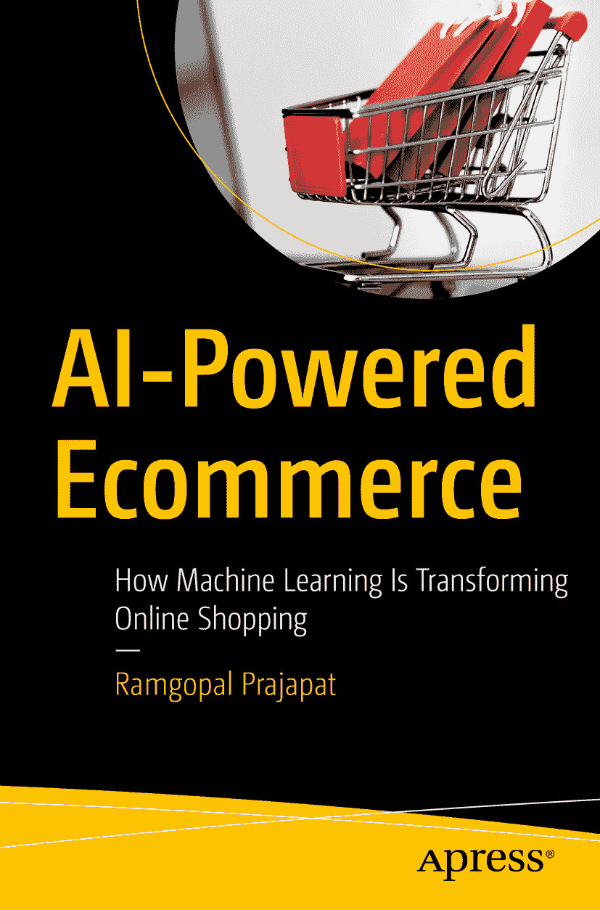

ISBN `979-8-8688-0922-4` e-ISBN `979-8-8688-0923-1` [`doi.org/10.1007/979-8-8688-0923-1`](https://doi.org/10.1007/979-8-8688-0923-1) © Ramgopal Prajapat 2024 本作品受版权保护。所有权利均由出版商独家许可，无论涉及材料的全部或部分，具体包括翻译、重印、插图复用、朗诵、广播、微缩胶片或其他任何物理形式的复制、传输或信息存储与检索、电子改编、计算机软件，或目前已知或未来开发的任何类似或不同方法的权利。本出版物中使用通用描述性名称、注册商标名称、商标、服务标志等，即使未作明确声明，也不意味着这些名称不受相关保护性法律和法规的约束，因此可自由用于一般用途。出版商、作者和编辑假定，本书中的建议和信息在出版之日是真实准确的。出版商、作者或编辑均不对本书所含材料或可能存在的任何错误或遗漏提供明示或暗示的担保。出版商对已出版地图中的管辖权主张和机构归属保持中立。

本 Apress 印记由注册公司 APress Media, LLC（Springer Nature 旗下）出版。注册公司地址为：`1 New York Plaza, New York, NY 10004, U.S.A.`

# 引言

电子商务作为消费者，是我们日常生活中不可或缺的一部分。这是一个蓬勃发展的行业，为寻求数字领域职业的人们提供了无数机会。无论你是数据科学家、产品经理、品类经理还是业务领导者，电子商务领域都提供了一个充满活力的环境，创新处于前沿，是未来工作的关键行业。

在以数字为先的电子商务世界中，人工智能（`AI`）的应用不仅普遍——而且至关重要。从个性化产品推荐到动态定价，`AI` 和机器学习（`ML`）已成为现代电子商务的支柱。虽然一些 `AI` 应用已经成熟，但在技术创新和买家行为不断演变的推动下，新的用例正以前所未有的速度涌现。

然而，对于从其他行业转型进入电子商务的专业人士来说，学习曲线可能非常陡峭。行业特定术语、关键绩效指标和独特的商业模式，即使对经验丰富的专业人士来说也可能构成挑战。本书旨在弥合这一差距，加速学习过程，并为读者提供在电子商务领域取得成功所需的知识。

最近像 ChatGPT 这样的生成式 `AI` 工具的兴起，进一步激发了在电子商务各个职能中利用 `AI` 的渴望。虽然热情显而易见，但产品经理、品类经理和业务领导者常常难以确定正确的 `AI` 和 `ML` 用例，并理解这些技术如何能带来切实的投资回报。本书直面这些挑战，提供了 `AI`/`ML` 应用的真实案例和详细成果，使决策者能够自信地启动 `AI` 驱动的计划。

在电子商务中识别 `AI` 和 `ML` 应用不仅需要技术知识；它还需要对业务背景的深刻理解，以及明确将精力集中在何处以产生最大影响的清晰愿景。本书提供了一个非技术性、面向应用的视角，阐述电子商务企业如何运营，如何为利益相关者（包括客户、投资者和员工）创造价值，以及如何战略性地实施 `AI` 和 `ML` 以提升该价值。

前几章为理解电子商务商业模式、电子商务平台的关键方面以及客户旅程的各个阶段提供了基础性认识。这些内容结合了推动电子商务成功的关键绩效指标（`KPI`），以及 `AI` 和 `ML` 如何影响这些指标以改善结果。

随着本书的深入，它探讨了正在改变电子商务格局的核心 `AI` 和 `ML` 干预措施。从先进的搜索算法和推荐系统，到提升客户体验的个性化策略，本书涵盖了客户旅程中 `AI` 应用的完整范围。它还涉及了订单后流程，`AI` 在此优化运营、管理风险和推动盈利能力方面发挥着关键作用。

无论你是电子商务新手，还是希望通过 `AI` 和 `ML` 转型业务，本书都是一本全面的指南，将为你提供成功所需的工具和见解。它提供了可以直接应用于工作的实用示例和可行策略，使其成为任何希望将 `AI` 融入其角色、职能或平台功能的人士的宝贵资源。

本书不仅仅是一本指南——它是每一位渴望在竞争激烈的数字世界中保持竞争力的电子商务专业人士的伴侣。本书是任何加入电子商务行业的专业人士的必备读物，并可作为旨在将电子商务企业转变为 `AI` 嵌入式强大实体的头脑风暴会议中的关键资源。

本书的每一章都设计为独立成篇，允许读者按任意顺序探索主题。然而，开头的章节为理解电子商务商业模式奠定了关键基础，应首先阅读。这些章节在深入探讨搜索、推荐、排序和个性化等更具体主题之前，提供了必要的背景和概念基础。

下一章详细审视了电子商务商业模式。它深入探讨了市场框架内收入和成本的关键驱动因素，并解释了电子商务公司损益表的复杂性。此外，本章重点介绍了如何应用 `AI` 和 `ML` 技术来提升盈利能力，为这些先进工具如何优化财务绩效和支持业务增长提供了宝贵的见解。

# 致谢

我深深感谢我的女儿 Ankita Prajapat 博士，她是本书的关键灵感来源。她鼓励我通过写作分享知识，并建议创建一个 YouTube 频道——我仍计划去做。我还要衷心感谢我的妻子 Nirmala Prajapat 和我的儿子 Girish Prajapat，感谢他们在这段旅程中给予我坚定不移的支持。

我在 Tata CLiQ 的经历对于塑造本书中分享的想法和见解至关重要。我向 Tata CLiQ 的领导团队以及我在那里的数据科学团队——Mahesh Gera、Anantharaman S、Prathamesh Fuldeore、Bhanu Pratap Singh Sikarwar、Niteesh Kumar 和 Arpan Dutta Chowdhury——表示深深的感谢，他们的项目和讨论直接或间接地为本书做出了贡献。

特别感谢我在 Tata CLiQ 的同事 Ruthraiah Thulasi、Biswajit Pal 和 Avinash Nethrakere，他们对内容和写作风格提供了宝贵的反馈，帮助重塑了本书。

我还要感谢 Suvadip Chakraborty 和 Gaurav Goyal，他们仔细审阅了每一章并提供了中肯的反馈，显著改进了最终成果。

特别提及 Sanjay Ojha 和 Rajneesh Pathak，感谢他们一贯的指导和支持。

最后，本书的诞生离不开 Apress 编辑团队的支持，他们让出版过程变得顺畅而难忘。我衷心感谢 Celestin、Kripa 和 Shobana。

# 关于作者 关于技术审校者