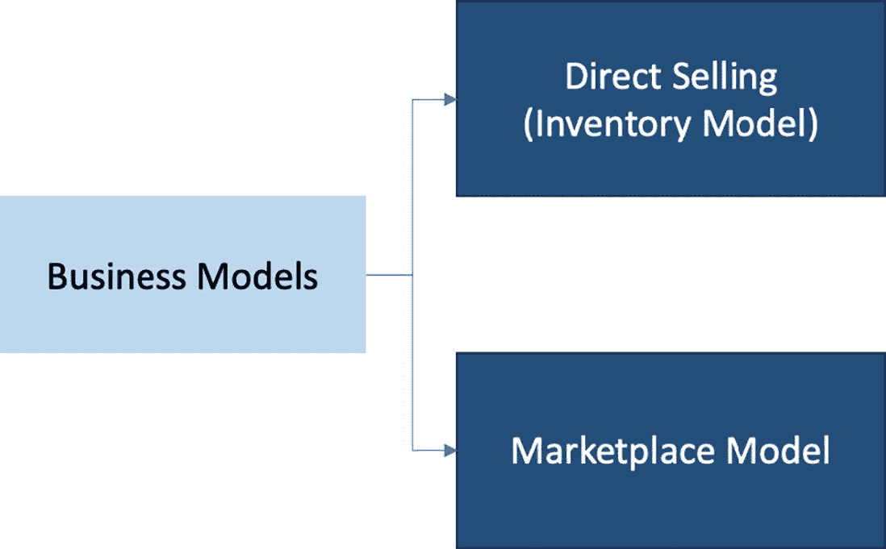
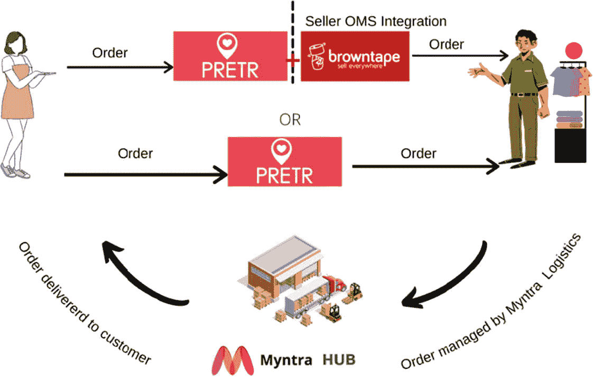
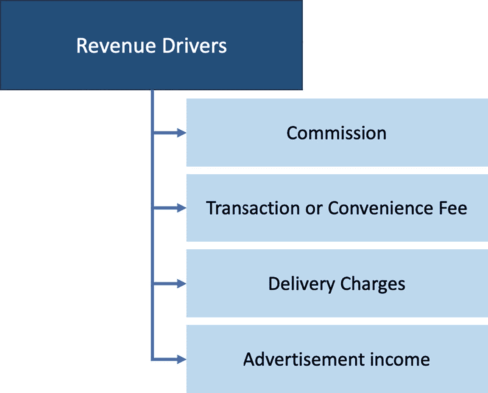
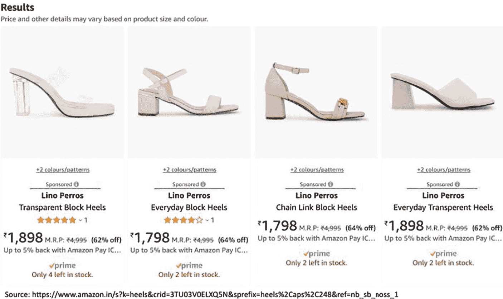
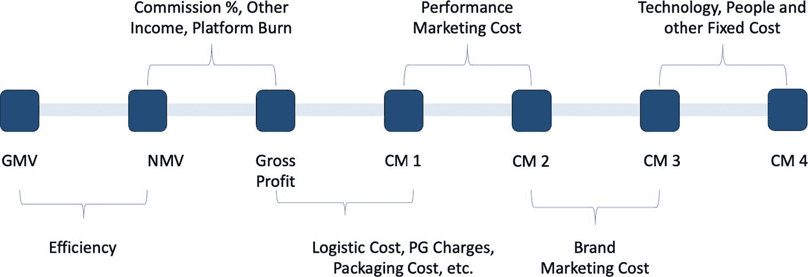

# 1. 电子商务业务的经济学

## 概述

尽管围绕生成式预训练 Transformer 聊天机器人 ChatGPT 的热议占据了头条，但总体而言，人工智能（AI）和机器学习（ML）已在众多行业悄然取得了重大进展。AI/ML 模型正赋能医生进行疾病诊断，使电商平台能够大规模审查产品并标记假货，并协助银行进行自动化信贷决策，展现了 AI/ML 的广泛应用。自动化信贷决策引擎通常由机器学习模型驱动，该模型多采用逻辑回归开发，因其能够解释影响信贷决策（接受或拒绝申请）的因素，但并非仅限于此技术。

电子商务，作为一个原生数字行业，正迅速演变为一个由 AI 驱动的工厂。算法不仅根据浏览历史和过往购买记录个性化推荐产品，还影响着产品在首页和搜索结果中的展示方式。电商中买家旅程的每一步都受到算法和数据的影响，以改善体验并最终实现业务成果。

印度领先的时尚电商平台 Myntra 正利用 AI 根据当前趋势设计自有品牌，并提升买家体验。这包括个性化店铺首页和 AI 驱动的造型助手。

亚马逊印度站（[amazon.​in](http://amazon.in)）在利用 AI 和 ML 方面走在前列，应用范围从推荐到地址纠错。由于其规模和普及度，亚马逊印度站面临着假货和虚假评论的挑战，这些问题也正通过 AI 和 ML 得到解决。

为了打造沉浸式购物体验并降低退货风险，像宜家这样的大型零售商为买家提供了支持增强现实（AR）的应用程序。这些应用帮助买家在购买前可视化家具在家中的摆放效果，从而提升整体购物体验并提高转化率（访客下单）。增强现实（AR）和人工智能（AI）形成了强大的协同效应，尤其是在打造沉浸式电商体验方面。例如，像协同过滤这样的 AI 驱动算法可以精准推荐个性化产品，而 AR 技术则能让买家在自己的空间中可视化这些产品。

电子商务已不可逆转地重塑了现代生活，其影响力在印度尤为显著，这得益于不断增长的年轻人口和广泛的移动设备普及。根据 IBEF 行业报告 [5]，印度电商市场经历了指数级增长，预计到 2026 年将达到惊人的 1630 亿美元。这一增长趋势预计将持续，到 2030 年市场价值将达到 3000 亿美元。

电子商务与人工智能——我们这个时代两项最重要的创新——的融合，彻底改变了我们的购物方式，并为所有利益相关者——社会、员工和企业主——释放了巨大的价值。电商业务中的这种价值创造由多种商业模式驱动，从开放市场模式到直销模式。

下一节将深入探讨两种主要的电商商业模式。我们将探讨每种模式如何交付商业价值，然后剖析市场模式特有的关键收入和成本驱动因素，并进一步提供利用人工智能和机器学习算法实现盈利的路线图。例如，由深度学习驱动的个性化产品推荐可以显著提升客户体验和收入。基于强化学习的动态定价可以优化转化率和利润率，而由机器学习驱动的分类模型可以有效识别欺诈订单，降低成本。这些仅仅是 AI 如何成为电商领域盈利催化剂的几个例子。

## 电商商业模式

在深入探讨 AI/ML 在电商中的变革力量之前，让我们首先通过探索影响电商这一动态领域盈利能力的关键因素来奠定基础。在印度，企业对消费者（B2C）领域主要由两种商业模式主导：直销（库存模式）和市场模式。图 1-1 描绘了常见的 B2C 电商商业模式类型。商业模式展示了买家、卖家等多方如何汇聚在一起促成交易 [14, 15]。

图 1-1.

常见的电商商业模式

在直销商业模式中，库存、配送合作伙伴和客户服务均由拥有电商平台的公司自行管理。他们通过网站和移动应用程序销售品牌产品或自有品牌产品。直销商业模式的一些知名例子包括 Lenskart（一家销售眼镜产品的印度电商）和 Nykaa（印度领先的美容与健康产品平台）。

在市场模式中，电商平台充当媒人，将买家和卖家连接到一个集中平台上。与直销不同，他们不持有库存 [2]，而是通过成功交易收取佣金以及向品牌和卖家出售广告位来赚取收入。这种模式使时尚平台能够提供海量产品选择，同时保持相对较低的运营成本。采用市场模式的电商平台常见例子包括 Flipkart（沃尔玛旗下的多品类市场）和 Myntra（由 Flipkart 拥有的时尚电商市场）[3]。

一些电商平台采用了这两种模式的混合体——即作为市场，但为某些品类持有库存或拥有一些自有品牌。这种混合商业模式为机器学习和人工智能开辟了广泛的应用领域。例如，这些平台通常采用多种预测模型来准确预测需求，优化库存管理和仓库资源分配。此外，基于协同过滤或基于内容的推荐系统，结合个性化体验，在所有电商商业模式中都很常见。

理解核心商业模式是深入认识关键收入和成本驱动因素的第一步。这涉及探索从买家获取和转化到物流和运营效率的方方面面。正是在这些因素错综复杂的相互作用中，人工智能和机器学习（AI/ML）得以发挥作用，为优化电商价值链的每个环节提供了强大工具。

虽然一些大型印度电商平台已涉足持有库存和推出自有品牌，但本章及本书其余部分将主要聚焦于强大的市场模式。这使我们能够充分探索 AI/ML 在这个充满活力的市场电商生态系统中解锁的独特挑战和机遇。

对于市场平台而言，AI/ML 算法优化了从订单分配到基于协同过滤或深度学习算法的个性化推荐等各个环节，这些是机器学习算法的一些常见应用。订单分配作为电商运营的关键组成部分，涉及在商品分布于多个门店或仓库时，为每个订单确定最优的履行地点。此过程需要仔细考量库存水平、运输成本和买家偏好等因素，以确保订单的及时高效履行。机器学习，特别是分类和无监督学习技术，在支持明智的订单分配决策中发挥着关键作用。但必须承认，其他商业模式可能会产生额外的用例和考量因素。例如，库存管理对于直销商业模式至关重要，而高质量的需求预测模型对于直销商来说也极为关键。

### Myntra – 纯市场模式

Myntra 是印度领先的时尚电商平台。Myntra 纯市场模式（MPPM）是一种履行模式 [3]；在这种市场模式下，卖家需支付固定费用、佣金、物流费（正向和逆向）以及购买 Myntra 品牌和强制要求的包装材料的费用。当客户在 Myntra 应用或网站上下单时，订单会通过订单管理系统（OMS）集成转发给卖家。卖家打包商品后，Myntra 会向配送合作伙伴发出取件请求，订单随即被取走进行配送。订单履行的责任由 Myntra 承担，通常由其配送合作伙伴 Ekart Logistics [4] 完成。图 1-2 展示了 Myntra 纯市场模式的工作模型。

图 1-2.

Myntra 市场模式

来源：[`https://browntape.com/what-is-myntra-ppmp/`](https://browntape.com/what-is-myntra-ppmp/)

卖家还可以使用卖家门户，通过该门户，卖家能够上传产品（目录）、更新折扣、获取运营详情（如订单和履行绩效报告）以及财务报告（如结算和佣金明细）。这是市场电商业务中的卖方平台，将在后续章节中详细讨论。

## 市场模式与盈利能力

市场平台的成功依赖于创收与成本管理之间的微妙平衡。对于这些平台而言，主要收入来源是向品牌和卖家收取的佣金。考虑到巨大的日活量和月活跃访客数，卖家也有动力利用平台的广告功能购买广告位，这成为这些电商平台重要的收入杠杆。

## 收入驱动因素

市场模式常见的收入驱动因素包括佣金费用（如亚马逊和 Flipkart）、广告费用（如亚马逊）以及平台费用（如 Myntra 和 Tata Cliq）[1]。其他收入来源可能包括上架费和配送费（如 Flipkart 和亚马逊）。

这些费用的结构可能会随时间推移以及在不同买家群体间发生变化或调整。图 1-3 展示了市场电商商业模式中的常见收入驱动因素。

图 1-3.

电商收入驱动因素

当买家在市场平台上完成交易时，平台本身通过收取佣金来赚取收入。该佣金是交易总额的一个百分比，通常称为商品交易总额（GMV）。向卖家收取的佣金率可能因行业、产品类别和特定市场平台而异。例如，据报道 Nykaa 向卖家收取商品价格 25% 的佣金 [12]，而 Myntra 的佣金率根据产品类别在 20% 到 35% 之间 [13]。像 Meesho 这样的平台则不向卖家收取任何佣金 [10]。

一些平台会向买家收取每个订单中每件产品的配送费，并征收便利费和/或平台费。这些是额外的基于交易的收入驱动因素，尽管它们与交易金额没有直接关联。

*   “印度第二大电商网站 Myntra 已对每笔订单收取 10 卢比的费用，无论订单金额大小。此外，如果您不是 Myntra 的注册用户，且订单金额低于 1000 卢比，则需在现有的 99 卢比费用基础上额外支付此费用”[11]。

除了佣金收入和交易费用/收费外，市场平台还通过广告创收。这些平台拥有数百万的月活跃用户（MAU），使其成为寻求推广产品的品牌和卖家的理想目的地。根据报告 [16]，Meesho 平均月活跃用户数（MAU）超过 1.2 亿，并且正在快速增长。这笔广告收入为电商平台提供了重要的额外收入来源。

这些平台通过利用协同过滤或类似算法来投放个性化广告，从而提高点击率（CTR）和广告收入，以此最大化广告收入。此外，它们还采用强化学习算法来实时确定最优广告出价。这些平台使用多臂老虎机算法，在探索（从新数据中学习）和利用（最大化当前收益）之间持续平衡，以实现持续优化。

对于平台上的广告位销售，卖家/品牌可以展示横幅广告，或者卖家可以针对与其产品相关的关键词进行竞价，以确保其商品在搜索结果中突出显示。下面的图 1-4 展示了一个真实案例，说明当买家进行搜索时，电商平台如何展示赞助商品。

图 1-4.

电商赞助列表示例

Flipkart 在 23 财年的广告收入为 3324 亿卢比。这比上一期的 2083 亿卢比有所增长 [8]。

AI/ML 算法，例如协同过滤和基于深度学习的推荐系统，在优先展示和个性化显示赞助列表方面发挥着至关重要的作用。通过分析用户行为、购买历史和浏览模式，这些算法能够准确预测用户的兴趣和偏好。这使得它们能够向每个用户展示高度相关的广告，从而显著增加点击和潜在购买的可能性 [17]。

## 成本流

电商平台在营销、技术及运营管理方面面临着众多成本。

营销费用涵盖了吸引新客户（例如，投放社交媒体广告等成本）以及通过短信或 WhatsApp 活动触达现有客户的成本。

电商平台是市场模式的基础，维护一个稳健且可扩展的平台需要持续投资于技术基础设施（服务器、数据存储、安全等）、各种功能的软件许可（电商交易、卖家管理工具、数据分析），以及持续的开发工作（错误修复、功能更新、安全增强）。

对于运营电商业务而言，运营成本涉及管理物流和配送成本、通过接听电话和解答疑问为买家提供服务、管理卖家运营（从入驻到结算付款），以及防止平台滥用或欺诈活动。

### 营销与推广成本

电商平台为争夺客户注意力而激烈竞争，营销和推广费用通常吞噬掉收入的 10-15% [6]。Myntra 在 2023 财年高达 1758 亿卢比的广告支出就说明了这一切 [9]。

营销团队涉及的战略决策之一，是优先分配其在各营销渠道（如社交搜索、搜索媒体等）上的支出，以获取买家并促进安装。媒体组合建模方法可以预测不同营销渠道（电视、社交媒体、搜索）对销售的影响，从而优化营销支出并提高预期投资回报率。

对于现有买家，基于买家人口统计、购买历史和在线浏览行为的人工智能驱动细分，能够实现有针对性的个性化客户关系管理活动，从而提高转化率和买家参与度。个性化的 CRM 活动可以有多种目标，例如向近期买家发送互补产品的电子邮件活动。对于每位买家，根据其近期购买记录，关联规则或矩阵分解等机器学习算法可以识别出通常一起购买的一组产品。这有助于为定向电子邮件活动选择和策划产品，从而提高买家对这些活动做出回应的可能性。

营销活动的个性化可以采取多种形式。如上例所示，这可能意味着根据每位买家的近期购买记录向其推荐产品。个性化还可以针对特定的优惠和奖励、偏好的风格或品牌，甚至买家偏好的沟通风格或布局进行定制。人工智能和机器学习实现了大规模个性化；例如，大型语言模型可以根据买家画像创建个性化的沟通内容。同时，随机森林等监督式机器学习算法可以识别出对特定活动构建做出回应的可能性较高的买家。

### 技术与平台成本

技术平台是成功电商市场的支柱。它支撑着整个生态系统，影响着买家和卖家旅程的方方面面。该平台促进差异化、塑造买家体验，并推动运营效率和盈利能力。

技术平台成本巨大，包括开发、维护以及支撑在线电商平台的基础设施。然而，这些成本通常不会随着商品交易总额或买家数量的增加而成比例上升。

人工智能和机器学习正成为管理和降低这些技术支出的强大工具。以下是这些算法如何降低电商技术成本的一些主要示例：

*   **预测性维护：** AI 可以分析日志数据和其他数据源，以识别服务器和基础设施组件中的潜在故障。这种分析可以增强诊断能力并提出预防措施，从而提高基础设施的弹性。机器学习技术（如随机森林或 BERT）可以预测给定代码库中出现错误的可能性，有助于在将代码发布到生产环境之前加强测试工作。

*   **云优化：** 云平台提供灵活、按需的资源配置。AI 算法可以预测高峰使用时间并实现动态资源分配，从而实现成本合理化。通过分析服务器使用模式来预测这些高峰，并实现这种动态分配。对于印度的任何电商平台，举办年度促销活动都很常见。机器学习技术可以精确预测流量，而精细化的预测可用于在整个销售期间扩展云资源。

*   **开发与测试效率：** 开发人员和测试人员的生产力对技术成本效益有显著影响。基于大型语言模型的生成式 AI 工具可以简化开发工作流程，提高开发人员生产力。此外，AI 驱动的测试工具可以自动化测试过程，与手动测试相比，缩短了时间并减少了资源消耗。这加快了开发速度，及早发现问题，并降低了整体开发和测试成本。LLM 模型已成功应用于从测试用例创建到程序修正的各个环节 [18]。AWS 发布了一项名为 Amazon CodeGuru Security 的服务，用于帮助识别代码中的漏洞。该服务利用机器学习和自动推理来检测潜在的安全问题 [20]。同样，也有多个平台或 AI 初创公司致力于提高开发和测试效率。这些平台使用机器学习来自动生成、执行和维护测试用例。

下面的案例研究展示了如何通过一个由 AI 和 ML 驱动的主动告警系统来改进平台监控。

案例研究：电商平台中的主动系统问题告警

背景：

电商是一个快速发展的数字原生行业，平台会频繁发布新功能和改进。这些平台通常在一个由相互关联的软件和服务组成的复杂生态系统中运行。这些发布产生的任何问题都可能对客户体验和收入产生重大影响。例如，结账流程、支付网关或产品页面中的错误可能导致购物车放弃，直接影响收入和订单量。

考虑到此类中断的可能性，持续监控各种业务绩效指标至关重要，并且需要一个自动化系统。

问题陈述：

开发一个智能监控代理，能够实时评估业务绩效参数，并主动标记潜在问题。

解决方案方法：

所提出的解决方案涉及一个模块，该模块利用机器学习方法，以细粒度的每小时级别预测业务绩效指标的预期值。这些预测会考虑一天中的时段、一周中的某天以及销售期与非销售期等因素。

该系统的核心构建于以下组件之上：

1.  **预测业务指标：**
    *   使用回归模型来估算关键指标，例如每小时订单数或商品交易总额（GMV）。然后将这些估算值与每小时的实际情况进行比较。

*   其他机器学习技术，例如随机森林或深度学习方法（如长短期记忆网络），也可用于更准确地预测收入趋势。

2.  **偏差分析与告警生成：**
    *   系统持续比较预测值与实际结果。如果存在显著偏差，则会生成告警。偏差阈值经过精心校准，以平衡调查工作量与遗漏潜在问题的风险。

3.  **多阶段问题管理流程：**
    *   **问题识别：** 第一阶段涉及通过业务绩效指标的显著偏差来检测潜在问题。

*   **调查优化：** 一旦识别出问题，下一步是缩短调查时间。这包括分析系统日志，以识别可能与问题相关的特定系统组件或交互。

*   **快速解决：** 最后阶段侧重于快速解决已确认的问题。这包括根据系统映射自动分配工单，并共享日志的相关部分以加速调查过程。

成果：

实施此主动监控系统可通过及早识别潜在问题并发出警报来减少业务损失。它还能加快问题的调查和解决速度，从而最大限度地减少对收入和客户体验的影响。

### 运营成本

电子商务市场依赖于简化的运营流程，但管理众多功能流程可能导致高昂的运营成本。其中一些主要的流程包括物流与履约、卖家运营、品类运营以及针对欺诈和滥用的交易监控。这些流程涵盖了电子商务平台买家和卖家旅程的方方面面。

然而，人工智能（AI）和机器学习（ML）的兴起为转变这些运营流程、优化成本和提升体验提供了令人兴奋的机遇。

印度电商企业在物流上的支出占其销售额（商品交易总额 – GMV）的 7% 到 15% [4]。像 AJIO 这样的平台依赖第三方物流（3PL），而亚马逊和 Flipkart（其 2023 财年物流收入达 578.9 亿卢比 [8]）等巨头则运营自己的车队。但无论采用何种配送模式，AI/ML 都能将这些成本高昂的运营转变为利润驱动力。

以下是一些关于 AI/ML 如何帮助物流、订单配送和履约运营的示例。

*   **智能订单分配**：对于市场平台而言，卖家可能从多个门店运营，且每个门店的绩效水平不同，订单分配引擎可以分配能够改善客户体验并降低配送成本的订单。例如，找到距离近且处理时间短的门店。可以使用基于机器学习的排序方法，为有资格履行订单的门店分配排名。排序函数中考虑的特征可能包括买家邮政编码与门店邮政编码之间的距离、配送成本、预计配送时间、门店取消率以及其他相关因素。

*   **减少产品退货**：产品退货是电子商务行业面临的一个复杂挑战。退货可能由多种原因引起：与特定卖家和产品相关的产品质量问题、通常源于电子商务模式（买家无法事先试用产品）的合身度和尺码问题，以及滥用行为的买家。这些挑战中的每一个都需要量身定制的策略来有效管理和减少退货。为了识别与滥用行为买家相关的退货，基于 ML 的预测模型可以在退货请求发生之前进行识别，从而实现主动干预。对于虚假和错误退货可能性较高的买家，当他们访问订单取消页面时，系统会提示他们提交退货产品图片。AI 驱动的图像识别可以验证退货索赔并自动退款，从而减少欺诈性退货和管理成本。

*   **最大限度减少取消和欺诈**：AI 驱动的系统有助于防止缺货和错放，从而减少买家发起的取消。ML 模型可以分析买家行为并标记可疑订单，以防止欺诈交易。在一项真实的行业实验中，观察到仅仅显示一条“您可能会因错误退货而被收取退货费”的消息，就显著减少了买家发起的取消，即使实际上并未向任何买家收费。然而，此消息应仅针对潜在的欺诈买家，因为向真实买家显示可能会导致不满。

除了节省成本之外，AI/ML 还有助于实现实时配送跟踪，为买家提供准确及时的更新，增强透明度和信任度，并减少他们致电客服团队的可能性。

在电子商务中，卖家运营团队协助新老卖家。他们提供入驻培训，帮助建立在线商店，并协助新卖家上架产品。他们审查和批准产品列表，以确保其准确性、符合平台政策并遵守法律法规。

机器学习算法能够自动化商品列表审核流程，在无需大量人工干预的情况下提升一致性与合规性。基于人工智能的流程还能生成数据洞察，帮助卖家优化运营并提升在平台上的表现。此外，增强现实（AR）技术可为卖家创造更具互动性和高效性的入驻与培训体验。

欺诈与平台滥用防范团队专注于监控欺诈交易、诈骗企图及其他平台滥用行为。他们跨职能协作，制定并实施安全措施，以应对不断演变的威胁和平台滥用问题。

机器学习模型在打击欺诈与平台滥用中发挥着关键作用。通过分析买家行为模式，这些模型能够预测退货欺诈或恶意取消订单等潜在问题。借助 AI 和 ML 算法，还可实现实时欺诈检测，标记可疑交易，保护平台及其用户免受经济损失。

以下案例研究展示了一种框架，通过运用机器学习模型减少平台滥用行为，同时避免对真实用户造成过多困扰，并提升运营效率。

案例研究：***识别电商平台上的恶意买家***

*背景：电商平台常面临欺诈订单问题——买家下单时并无意实际收货。这导致运输成本增加、卖家体验恶化以及库存效率低下。*

*问题陈述：降低因恶意意图下单所产生的成本，识别重复滥用者，在其确认订单前进行提醒。*

*解决方案：针对部分买家的反复滥用行为，平台可引入提醒机制，向高风险滥用买家提示退货可能产生费用。关键挑战在于，若手机号码为强制且唯一标识符，买家常通过使用不同手机号创建多个身份来规避限制。这使得仅凭少量订单采取行动变得困难，且可能误伤真实买家或对平台造成意外后果。*

*为解决此问题，特征工程与网络关联分析至关重要。例如，观察到许多退货请求来自相似地理位置。实施基于深度学习的分类方法有助于识别恶意客户，尤其是在处理姓名和地址等文本特征时。滥用者常在这些字段中使用相同或随机文本，可通过高级分析技术检测。结果：平台效率实现净正向提升，且无需向任何客户收取退货费用。*

通过自动化重复性人工任务，基于 AI 和 ML 的流程释放了宝贵的人力资源，使其专注于战略举措。这不仅减少了对人工审核流程的依赖，还提升了整体效率和支持服务的可用性。

AI/ML 算法在众多功能流程和领域中帮助企业做出更优决策并取得更好成果。量化项目影响对于推动采用和确保资源有效分配至关重要。将 AI/ML 项目成果与损益表的具体组成部分关联，可清晰展示这些举措的财务收益，有助于优先投资回报率最高的项目。

下一节将介绍典型电商公司损益表的关键组成部分。

### 电商经济学：损益表

损益指标使企业能够优化绩效、提升盈利能力并做出数据驱动决策。关键收入指标包括：总商品交易额（GMV）、净商品交易额（NMV）和贡献毛利（CM）。

**总商品交易额（GMV）** 是平台上所有售出商品的总价值，包含退货和取消订单；**净商品交易额（NMV）** 则是 GMV 减去退货和取消订单后的价值。NMV/GMV 是衡量效率的指标，可帮助寻找利用 AI/ML 方法提升效率的杠杆。如何减少退货或取消订单？

订单取消可归因于多种因素，包括同一平台或竞争平台的价格波动，以及购买后发现的意外费用。为缓解这些问题，在整个订单流程中保持透明且一致的定价至关重要。

重复违规者的欺诈订单也可能导致取消。如前所述，机器学习可有效识别并处理此类行为。

此外，卖家发起的取消通常源于库存或定价差异。

管理产品退货需要多管齐下的方法，综合考虑产品、卖家和买家相关因素。实施针对性策略可显著降低取消订单对电商平台的整体影响。

市场型电商公司通常在卖家团队更新的价格基础上提供折扣。折扣是提升销售和转化率的杠杆之一。团队会追踪 NMV 的折扣百分比，以衡量和控制成本。

毛利率（若采用库存模式销售商品）或总佣金（适用于市场型电商模式）有助于确定电商平台的收入。在典型电商业务中，毛利率或总佣金收入是主要收入来源。其他收入包括变现/广告收入、运费/配送费及平台费用。市场型平台的总收入包含佣金收入和其他收入。

总收入 = 佣金/毛利收入 + 其他收入

毛利润 = 总收入 – 折扣

在创收过程中，电商平台会产生成本。可直接归因于交易的直接成本包括：物流成本、支付网关费用、货到付款费用、买家/卖家补偿成本以及忠诚度成本。

贡献毛利 1（CM1）是毛利润减去直接成本后的净值。

CM1 = 毛利润 – 直接成本

可考虑多项 AI/ML 举措来降低这些直接成本。在市场型模型中，将订单/交易分配给合适的卖家和配送伙伴有助于降低运输成本（物流成本）。同样，优化和智能化的流程可减少买家与卖家补偿成本中的损耗。

在作为买卖双方中介的电商平台上，若未能识别问题并向责任方追回成本，平台通常需承担部分损失和风险。为应对此类情况，平台可能设立应急基金，金额可为其业务收入的一定百分比。

例如，若买家下单后要求退货，卖家可能声称产品已损坏并向平台索赔。若平台无法提供充分证据判断损坏是由配送伙伴造成，还是买家退回已损坏产品，则可能需要接受卖家索赔并予以相应补偿。

AI 驱动的图像识别模型可比较退货流程中的产品图像，以验证损坏或缺陷的索赔。此外，可分析重复滥用模式，以标记卖家可能存在的欺诈性索赔。

电商平台在获取新客户或维系现有客户上的支出占其收入的 10-15%[6]。品牌营销（BM）、直接营销（DM）和客户关系管理（CRM）等与维系现有客户相关的成本，是营销成本的关键组成部分。并非所有成本都是可变的，也并非都能归因于每笔交易。

效果营销（直接营销和 CRM 营销成本）属于可变成本，在计算边际贡献 2 时需予以考虑。

边际贡献 2（CM 2）= 边际贡献 1（CM 1）– 效果营销。

在边际贡献 3 中，则需考虑品牌营销成本。

边际贡献 3（CM 3）= 边际贡献 2（CM 2）– 品牌营销。

图 1-5.

电商损益结构

同样，AI/ML 算法可在优化营销决策和提高营销投资回报方面发挥重要作用。

在计算边际贡献 4（CM 4）时，需考虑包括技术和员工成本在内的固定成本。如前几节所述，机器学习和人工智能有助于优化和降低技术成本的各个组成部分，从而提高边际贡献 4。

## 总结

电商企业建立在技术平台之上，并采用了多种商业模式，尤其适用于企业对消费者（B2C）场景。平台型电商模式是最成功的商业模式之一，赋能了广泛的买家和卖家。该模式与一系列收入驱动因素和成本流相关联。AI/ML 用例可以提升收入水平并控制成本。

将电商平台的销售额转化为盈利能力是电商业务的基石。做出明智的决策和战略干预不仅能提升销售额，还能增强整体盈利能力。通过理解电商企业损益表的关键组成部分，数据科学领导者可以在电商的各个阶段影响决策制定。

在本章中，我们深入探讨了电商平台收入生成的复杂性，并审视了电商商业模式中固有的基本成本。在每个环节，我们都研究了人工智能（AI）和机器学习（ML）的各种应用，范围从改善买家体验到减少平台滥用。在当今由 AI 驱动的格局中，尽管人工智能的潜力已得到广泛认可，但对其投资回报仍存在相当大的怀疑。衡量每个 AI/ML 项目或用例的投资回报率（ROI），不仅可以提高其可接受性，还能提升企业的盈利能力。

通过将每个 AI/ML 用例的结果与损益表相关联，我们建立了一个清晰的框架，用于衡量和引导 AI/ML 旅程中的投资决策。

在全面理解电商商业模式、收入流、成本结构和盈利因素的基础上，下一章将深入探讨电商平台的复杂机制。这一探索涵盖了买家和卖家体验，并特别关注客户旅程——从在社交媒体上的初次接触到成为电商平台上的忠实客户。在整个旅程中，我们将审视机器学习（ML）和人工智能（AI）如何提升客户体验、优化成本并降低运营风险。

