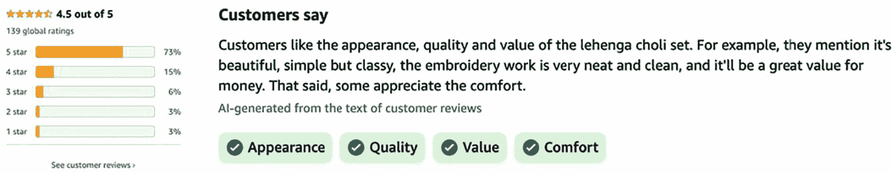
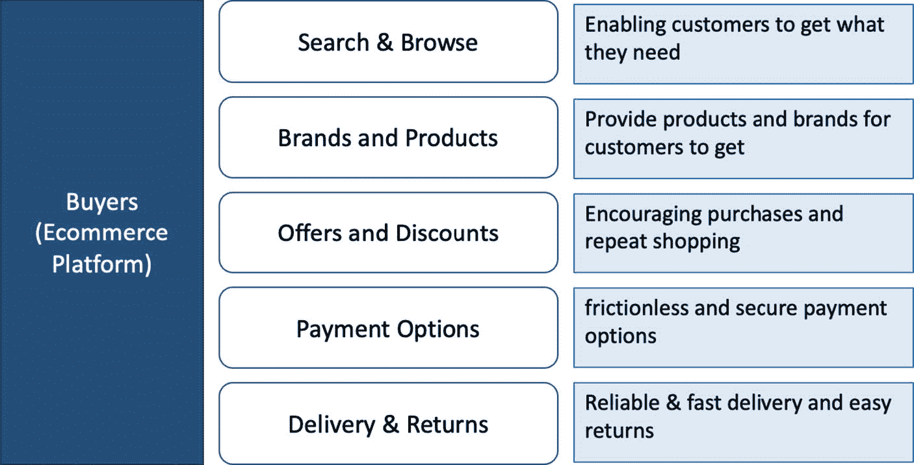
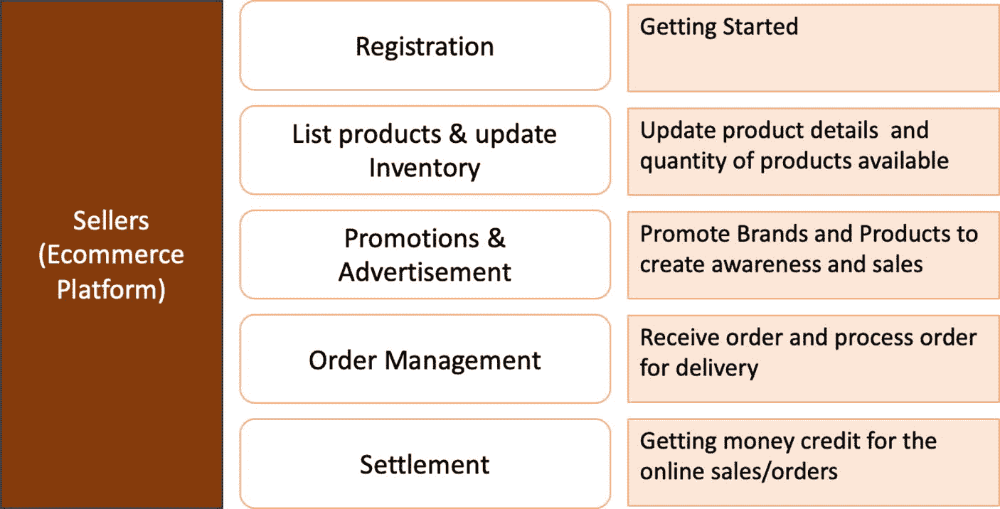
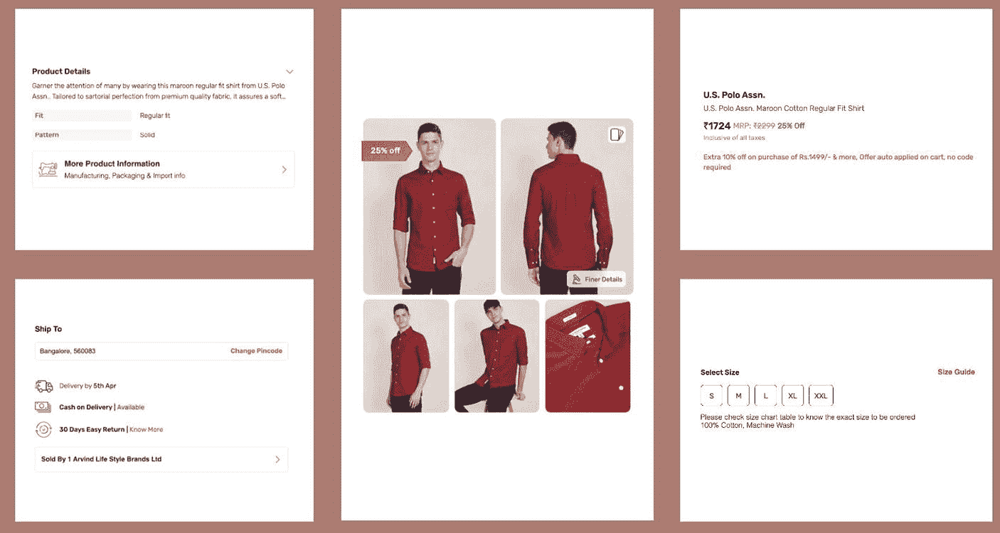

# 2. 电商平台：买卖的数字生态系统

## 概述

电商平台彻底改变了我们的购物方式，将实体店转变为数字市场。这在印度尤为明显，该国人口多元，互联网用户群体迅速增长。电商平台已成为连接印度国内外买家和卖家的强大媒介[3]。总体而言，电商平台不仅仅是连接买家和卖家；它通过基于云的环境促进全面的商务活动，并包含多种附加功能。本章稍后将详细探讨电商平台的关键特性和功能。

以来自米佐拉姆邦、在班加罗尔工作的 IT 专业人士 Renuka 为例。她喜爱米佐拉姆邦的传统服饰，尤其是在节日和特殊场合。她需要在班加罗尔找到销售类似产品的商店，这并不容易。进入快节奏的电商平台世界，Renuka 可以直接通过手机和笔记本电脑找到各种传统的米佐拉姆邦服饰。这是正在触及印度乃至全球大多数城市买家的变革。

有成千上万类似买家的需求和场景正通过电商平台得到满足。对于特殊和/或难以找到的产品，例如小地方的有机茶或小城市的奢侈品牌产品，电商的差异化作用更为显著。

一个电商平台要想蓬勃发展，必须有效地支持和增强买家在平台上的旅程的各个方面。这包括提供广泛的相关产品、提供便捷的访问途径，并确保探索和完成订单的无缝流程。

例如，Renuka 需要一件“Bandini Lehenga”，她进入一个电商平台并开始了她的购物之旅。她需要一种方式找到相关产品，这通过两种方式实现——搜索她需要的商品，或利用品类层级结构（产品分类法）或浏览路径。当买家使用如图 2-1 所示的搜索栏时，平台会以列表形式显示搜索结果——见图 2-2。

图 2-2

搜索结果列表

图 2-1

电商搜索

除了搜索路径，买家还可以通过浏览路径找到目标产品，如图 2-3 所示。

图 2-3

浏览路径的品类列表

## 按类别浏览

搜索是一种将搜索查询映射到产品的机制。这通常由机器学习算法实现。对于按类别/品牌浏览，排序算法能够将热门、相关且个性化的产品展示在顶部，为买家提供流畅的浏览体验。

在找到一组相关产品后，买家会希望在做出购买决定之前，探索更多产品——类似的设计和款式。买家的参与度或产品探索过程，通过一系列丰富的推荐功能得到提升，例如“经常一起购买”、“购买了此商品的顾客也购买了”、为您推荐或相似产品。

在传统的实体店中，当 Renuka 走进零售店时，店内陈列着琳琅满目的商品，销售人员会协助她了解其他产品。顾客可以触摸和感受产品，以了解服装产品的质量和材质。此外，还有试衣间可以试穿实际产品。其中一些需求通过提供全面的产品描述来实现——涵盖产品特性、规格、材质以及高质量的产品图片和视频，让顾客能够直观地看到产品，从而感受产品穿在自己身上的效果。

考虑到电子商务平台剥夺了顾客触摸和感受产品的体验，人工智能、机器学习、虚拟现实（VR）和增强现实（AR）技术改善了他们的在线购物体验。AR/VR 试穿技术使买家能够在模拟的真实世界环境中体验产品，例如看到眼镜戴在脸上的效果。当买家购买眼镜时，这项技术可以将眼镜显示在他们的脸上。丝芙兰等美妆平台使用面部识别和类似的人工智能技术来检测眼睛和嘴唇等特征，让顾客看到美妆产品在自己脸上的效果。卷积神经网络（CNN）作为一种深度学习方法，通过分析图像中的各种细微差别，在人脸识别中发挥着关键作用。例如，当买家想要尝试某种特定色号的口红时，深度学习模型会识别出嘴唇，并实时应用所选的口红颜色。这让买家能够直观地看到口红涂在自己嘴上的效果。

全球最大的家具零售商宜家，利用虚拟现实的沉浸式技术，为买家创造了一种交互式数字体验，让他们能够在自己所处的环境中实时查看家具产品的 3D 效果[21]。在虚拟现实应用中，计算机视觉模型在检测和识别买家物理环境中的物体方面起着至关重要的作用。当选择放置一件新产品时，人工智能模型会从图像中提取特征，以确保产品能准确地适应布局并优化其放置位置。这个过程增强了虚拟环境的真实感和功能性，帮助买家在考虑物理环境中其他各种元素的情况下，直观地看到所选产品在自己空间中的效果。

在电子商务平台上发现并选择产品后，吸引买家并引导他们完成订单流程至关重要。确保流畅且吸引人的结账体验，对于将兴趣转化为最终购买行为至关重要。

优惠券和优惠券是吸引新买家、激励重复购买和提升销售额的常用手段[1]。它们还可以通过根据商品数量或订单金额设置优惠条件来增加购物车价值。2023 年，77%的美国人口使用了优惠券，购物者因此节省了超过 30 亿美元[2]。印度购物者在电子商务平台上做出购买决定时，同样倾向于寻找优惠和促销活动。

由于缺乏合理的优惠或优惠券设计而导致的效率低下或成本流失可能非常严重。人工智能/机器学习和分析技术为产品捆绑或设计优惠条件提供支持，以最大化优惠成本的回报。买家细分能够实现有针对性的促销和个性化优惠。与买家偏好相符的优惠和优惠券可以提高平台上的用户参与度和转化率。

在实体店中，只有在收到商品后才付款，现金是主要的支付方式。电子商务的显著增长在其发展过程中遇到了许多挑战。首先，很大一部分印度人口仍然对在线交易存在信任缺失，而接入金融系统仍然是一个障碍[8]。

货到付款是电子商务中一种非常重要的支付方式，每 10 笔在线交易中就有 5 笔使用这种方式。虽然货到付款为买家提供了便利，但也给电子商务企业带来了挑战，包括高达 35%的产品退货率以及现金处理带来的运营成本增加[9]。此外，货到付款还与因无法送达而退回的产品比例较高有关，这被称为“退回原发地”交易。

为了促进对在线交易的信任并鼓励数字支付，印度政府实施了“数字印度”等举措，并推出了 BHIM（印度支付接口）来创建强大的数字支付基础设施。这些努力旨在减少对现金交易的依赖，并推动电子商务中数字支付方式的采用。云技术通过提供具有成本效益的解决方案来交付广泛的服务，从而推动着像“数字印度”这样的大规模计划。这些技术实现了高效的扩展性、资源管理和可访问性，这对于此类大型项目的成功实施和运营至关重要。

对于许多在线购物者来说，从下订单到收到产品之间的这段时间可能会引起焦虑。围绕配送时间的不确定性会侵蚀信任并阻碍购买。等待接收和使用产品也会影响电子商务的整体客户体验。买家通常对产品的外观和手感存在疑虑或不确定性。为了解决这些问题，平台提供端到端的追踪和关于订单旅程的清晰可见性。此外，为了减轻对产品质量差异或延迟配送/未送达的担忧，电子商务平台提供快速便捷的退款服务，以加快购买决策。

宽松的退换货和退款政策为在线购物者提供了安全网，降低了在线购物的感知风险。轻松的退货政策和货到付款选项在电子商务的普及中发挥了重要作用。然而，它们也与高退货率相关，印度的退货率在 25-40%之间，显著高于全球平均水平[10]。人工智能/机器学习算法正在帮助这些平台打击滥用这些宽松退货政策的行为，并保持运营效率。

订单下达后，可能会发生多种操作，包括订单取消（由客户或卖家发起）、产品退货或发起退款（如果订单是预付的）。买家也可能有各种疑虑或问题需要与电子商务平台沟通。因此，在平台上和通过电话提供买家支持是电子商务业务的额外必要条件。

对话式 AI 可以协助客服团队处理客户请求。某些需求可由全天候（24/7）在线的对话机器人处理。对话式聊天机器人运用**自然语言处理（NLP）**和机器学习分类模型，根据买家意图对其咨询进行分类。一旦确定意图，聊天机器人便会在系统中搜索相关信息，并量身定制回复。这种个性化方法确保买家获得最恰当、最有帮助的信息。此外，AI 和 ML 算法能够更准确地优化呼叫量预测和支持人员需求，减少对人工和重复性任务的依赖，并实现智能流程自动化。

呼叫量预测模型可以通过统计和机器学习两种方法开发。像 ARIMA（自回归积分滑动平均模型）这样的统计模型可以捕捉时间序列数据中的线性趋势和季节性模式。另一方面，诸如 LSTM（长短期记忆网络）之类的深度学习方法非常适合处理时间序列数据中复杂的非线性模式，使其成为呼叫量预测的一个有前景的选择。

电商平台通过展示同行买家的评论和评分来利用用户生成内容的力量。这个庞大的同行反馈池在影响买家决策方面起着至关重要的作用。然而，为了确保这些评论的可信度和价值，许多平台在评论上线前会实施审核流程。

此外，一些平台通过运用自然语言处理（NLP）技术，超越了基本的评论功能。这些方法允许创建摘要评论，突出关键点、积极方面和相关用户标签。这种简洁的格式帮助用户快速掌握特定产品用户评价的整体情感倾向。包括 BERT、RoBERTa 和 GPT-3 在内的 Transformer 模型，对于提升电商平台上的产品评论至关重要。这些先进的语言模型有助于生成简洁的摘要和相关标签，从而显著改善整体用户体验。图 2-4 展示了如何对产品评论进行摘要并呈现给买家。

图 2-4

评论的关键亮点

总之，为了促进客户在电商平台上的购买旅程，一个典型电商平台的关键部分包括搜索与浏览、优惠与折扣、支付和配送信息。此图概述了引导买家在平台上完成购物体验所必需的基本组件。

图 2-5 概述了电商平台上买家可用的典型功能，展示了平台的“买方侧”特性。

图 2-5

买方侧电商平台的关键功能

虽然从买家的角度来看，搜索、导航、产品列表、评论、推荐、支付和订单管理都是电商平台的关键方面，但还有一些基本功能在幕后运作，以确保无缝的购买体验。这些功能围绕产品和库存管理（如列出产品并确保可用性）、优惠券配置（确定哪些优惠券可用及对谁可用）、产品定价（管理产品价格更新）、订单管理（分配订单处理责任并向相关方传达订单旅程信息）等展开。这些元素属于电商平台的卖方侧，这将是下一节的重点。

## 电商平台：数字化赋能卖家

梅哈尔是印度喀拉拉邦一个小村庄里一位才华横溢的手工艺品制作者。电商平台让他能够将作品卖给全国各地的受众，有可能吸引更多客户，为保护印度传统手工艺做出贡献，同时为他的家庭带来更好的收入。这些并非孤例；数百万卖家也通过这些电商市场平台获得了数字化赋能。

像 Flipkart、亚马逊等电商平台正在为全印度的卖家创造民主化的准入机会。它们赋能卖家，让海量买家看到他们的产品，并让他们专注于自己最擅长的事情——更好的设计、创作、有竞争力的定价产品或差异化产品。

这些平台提供了所有技术功能（如创建产品列表、订单处理、库存管理等），供卖家在线开展业务，而无需担心技术变革或进步。甚至无需任何承诺或前期成本。大多数平台根据卖家从平台获得的业务价值收取佣金。

这些电商平台还为卖家提供了覆盖全印度的大量受众或买家基础，消除了实体店的限制并缩短了孕育期。

此外，这些平台使卖家能够在平台上推广他们的产品（通过赞助列表进行产品级推广），或者将他们的页面推广到社交媒体平台。这些电商平台通过自己的物流车队或第三方物流合作伙伴负责配送，使卖家无需担心实际的配送和履行服务。

以玛雅为例，她是一位年轻的女性珠宝设计师。她在拉贾斯坦邦的斋浦尔拥有一家名为“玛雅的神秘珠宝”的手工时尚珠宝店。她希望将产品带给更广泛的受众，并决定成为印度领先的市场平台之一。

玛雅在电商平台注册，并提交了作为平台卖家所需的所有支持文件。一旦她在平台上注册了品牌，她就在平台上列出了所有产品。

需要清晰简洁的产品详细信息，如标题、描述、相关关键词和有吸引力的产品视觉效果。从多个角度拍摄的高分辨率照片，包括展示细节和差异的特写镜头，有助于买家做出购买决定。一些卖家会寻求专业机构的帮助，以便在这些平台上正确地列出产品。该平台还具有验证和审核功能，以确保没有虚假或恶意卖家列出产品，从而降低平台风险。AI 赋能的电商平台根据上传的产品图片，协助玛雅生成产品描述、创建产品分类并填写其他详细信息。此外，基于计算机视觉的方法可以通过创建引人注目的图像和视觉内容来增强买家参与度。

考虑到这些平台的规模，AI/ML 解决方案是管理产品上线和审核流程的救星。以开放市场平台 Meesho 为例，看看它如何管理其平台上的产品评论。

***案例研究**：Meesho 利用深度学习解决产品标签问题* **[12*]*

*背景：Meesho 是印度第三大市场（市场份额 7%），仅次于亚马逊和 Flipkart* **[11*]，服务于数百万卖家，主要来自印度较小的城市（三线和四线城市）。这些卖家中的许多人缺乏必要的技术专长，无法使用所需的产品层级（分类法）正确地对产品进行分类。这使得 Meesho 在用户搜索和浏览时难以展示相关产品。*

***挑战**：在时尚品类中，不准确的产品详情和较低的属性填充率给顺畅的买家体验带来了重大障碍。依靠专门团队手动为产品打标签，在可扩展性和一致性方面存在挑战。*

***解决方案**：Meesho 的数据科学团队实施了一种基于深度学习的架构，用于自动将产品图像分类到不同类别。对于缺少属性信息的产品，系统会提取相关细节，从而简化产品打标签流程。*

***成果**：基于人工智能的可扩展产品分类流程，提升了产品分类体系与数据填充率。深度学习方法在根据图像及其他提供的细节预测产品类别方面非常高效，从而提高了填充率。用户常因各种压力在选择正确类别时出错，并可能跳过非必填字段。准确的产品分类和详情对于搜索和浏览体验至关重要，因此确保信息精确能够提升整体买家体验。这既节省了成本，也缩短了周转时间。*

产品上线平台后，Maya 需要找到从这些平台获取业务的方法，因为平台上有数百万卖家，而部分买家可能并不了解“Maya 的神秘珠宝”品牌的产品。

Maya 决定利用推广和广告功能来触达更广泛的受众，以提升她的线上销售额。

这些平台通常为卖家提供多种功能，例如“赞助商品”。针对选定的关键词，卖家设定出价金额，并根据其产品展示给买家时获得的点击次数向平台付费。这是一种按点击付费（PPC）的广告项目。当顾客搜索这些关键词时，产品就会显示出来。卖家可以通过“赞助品牌”项目推广其品牌，该功能会在搜索结果顶部展示品牌标识及其他详细信息。这能在平台访客中创造更高的可见度和品牌认知度。

另一个常见选项是，当顾客浏览相关产品类别时，展示推广产品，这能为选定产品带来流量，并提升购买意愿。

Maya 可以为她的产品确定目标受众和相关关键词列表。她可以利用品牌推广项目，在目标受众中建立品牌认知度，这有助于创造品牌资产和未来销售。为了获得即时的业务成果，她设定了一个每日预算目标，并为十个相关关键词进行出价。

卖家可能会为产品接到数十个订单，但如果他们无法在配送时限内完成交付，就会因订单取消而导致糟糕的客户体验。顾客会给出差评，卖家还可能面临平台的罚款。

平台要求卖家更新平台上可售商品的数量（库存），以避免超卖。同时，一旦买家确认订单，卖家即可进行后续步骤——取货、包装，并准备交付。这一流程通常在一个名为订单管理系统（OMS）的系统中完成。一些拥有自有订单管理系统的大型卖家，会与电商平台合作集成这些系统，以实现更快、更自动化的订单详情对接。

***案例研究**：为每个产品优先选择卖家*

***背景**：在一个开放的市场平台中，可能有数百个卖家销售相同的产品。多次展示相同产品会导致糟糕的客户体验。领先的电商平台会展示单一产品，并从其中一个主要卖家处获取定价详情。*

***方法**：基于公平和绩效的卖家选择对于市场平台至关重要，因为这直接影响买家体验和卖家业务。卖家选择会考虑以下因素：使用**卖家绩效**，如平均评分（评分高的卖家权重更高）、订单处理时间；**卖家位置**（靠近客户位置的卖家因配送天数少、配送成本低而获得优先考虑）；以及**产品详情**，如价格（例如，价格越低对买家越有利）和库存（库存越高重要性越高）。当存在多个卖家或卖家店铺时，这些特征与机器学习算法相结合，有助于为每个产品找到合适的卖家。一种常见的用于卖家优先排序的机器学习方法是排序算法，该算法会考虑多种因素，以展示来自顶级卖家的产品。*

***成果**：一个自动化且基于绩效的系统，用于在存在多个卖家或卖家店铺时为每个产品选择合适的卖家。*

除了将订单分配给卖家处理外，系统还会将订单分配给快递合作伙伴。平台可能有多个配送合作伙伴（例如，Blue Dart、Delhivery、XpressBees、Ecom Express 等），人工智能/机器学习可以结合配送时限、物流成本和配送绩效等特征来辅助决策。

“Maya 的神秘珠宝”的推广活动帮助其获得了来自印度各地的订单。她安排了一名人员监控门户网站上的订单并处理这些订单。一旦订单打包完毕并准备发货，信息就会在门户网站上更新。订单被分配给配送合作伙伴，产品便踏上了送达买家的旅程。

买家收到在平台订购的产品后，对产品质量和配送时效非常满意。他们会在平台上撰写产品评论并给出优秀评分（5 星）。得益于流行度排名（相关性排名）系统，这些产品开始出现在电商平台的自然搜索结果和分类页面中。相关性排名（或流行度排名）由机器学习算法驱动，该算法考虑多种因素，创建排名以将最相关的产品排在顶部。基于机器学习的“学习排序”（LTR）技术和基于深度学习的排序方法被用于提升产品对买家的准确性和相关性。

Maya 的在线商店——“Maya 的神秘珠宝”正处于增长轨道。她扩充了产品组合，并扩展到珠宝领域内的其他品类。她业务的主要重点是创新设计以推动增长。技术功能和运营流程则由电商平台负责处理。

线上销售所得款项会根据结算周期，在扣除佣金费用后自动存入银行账户。例如，据报道 Nykaa 对商品价格收取 25% 的佣金 [13]，而 Myntra 的佣金率根据产品类别在 20% 到 35% 之间 [14]。

这些平台还为卖家提供关键洞察和分析，以帮助他们更好地在电商平台上管理线上业务。这些洞察涵盖从销售指标（如订单量趋势）到运营指标（如退货率）的各个方面。

总之，为了赋能电商市场平台上的卖家，需要提供从注册到财务结算的全方位功能。

图 2-6 展示了电商平台上可供卖家使用的功能，突出了平台的“卖家端”特性。

图 2-6

卖家端电商平台的关键功能

除了这些功能外，卖家还需要关键业绩统计数据，例如平均订单价值、买家或访客数量以及产品的转化率。分析这些指标有助于卖家优化策略，提升其在平台上的业务表现。

每个电商平台的核心都承载着一个强大的承诺：赋能卖家并推动其业务向前发展。为了实现这一目标，平台必须成为一台运转顺畅的机器，能够吸引稳定或不断增长的访客流量。当访客到来后，平台需要用合适的产品吸引他们的注意力，并通过策略性的折扣和促销活动来激发他们的购买欲。最后，当交易达成时，平台需确保所选商品能够快速高效地送达客户手中。

接下来的部分将探讨吸引访客进入平台并引导他们成功转化的策略。电商平台上的买家旅程被划分为三个主要漏斗。顶层漏斗侧重于吸引访客进入平台，中层漏斗通过个性化和推荐来吸引他们，而底层漏斗则旨在将访客转化为订单。

## 顶层漏斗：将访客吸引至平台

一家领先电商公司的营销团队已采取一项战略举措，以提升品牌知名度并推动移动应用安装。他们与一家外部机构合作，制作了一支由品牌代言人出演、视觉上极具吸引力的电视广告。这场高影响力的广告活动将持续 30 天，预计每天覆盖 200 至 300 万观众。该电视广告活动有望培养品牌知名度和积极的品牌认知，从而增加其移动应用的安装量以及移动应用和网站的访客数量。

凭借广泛的覆盖面和大众吸引力，品牌建设和情感叙事是电商平台在电视广告上投入巨资的部分驱动因素。但是，电视广告也面临着诸多挑战，例如缺乏个性化、效果难以衡量、成本高昂且灵活性有限，以及观众注意力持续时间短。

除了电视和平面媒体广告，数字营销活动也是营销团队可用的重要工具。营销团队每天都有目标，需要为平台带来一定数量的访客和访问量，以实现艰巨的增长目标。电商平台每天有三类访客：首次访问者（新访客）、首次购物者（重复访问但此前未购物者）以及回头客（此前已购物者）。有针对性的数字营销活动是一种可衡量的方式，能够将这三类访客都吸引到平台，并帮助营销团队完成每日目标。

数字效果营销团队与业务/品类及内容团队合作，共同决定数字营销活动所需的创意、视觉效果和优惠方案。在不同的数字营销平台上，视觉内容、格式和布局可能有所不同。领先电商平台的视觉内容团队已开始使用基于生成式人工智能（GenAI）的平台（例如 Midjourney 或 DALL-E）来为这些活动生成视觉内容。

***案例研究：利用生成式 AI 提升视觉内容创作***

*问题陈述：电商平台会定期举办各种销售和促销活动。作为这些活动的一部分，他们需要频繁刷新主页和落地页的视觉效果，以配合促销主题。为这些活动创建新的图像既耗时又昂贵，这对电商的设计和创意团队构成了重大挑战。*

*解决方案：Midjourney 和 DALL-E 等生成式 AI 平台的出现，彻底改变了视觉内容的创作流程。这些 AI 工具使电商设计和创意团队能够加快创作新颖视觉内容的速度，显著减少所需的时间和精力。通过利用这些 AI 平台，电商企业可以快速为其促销活动生成高质量、主题化的图像。*

*收益：使用生成式 AI 显著缩短了创建新视觉内容所需的时间，从而能够更快地进行更新和更频繁地刷新。此外，由于减少了手动工作量（尤其是在创建基础图像方面），这有助于降低图像创作成本。现在，主要工作集中在审核和最终润色上。*

一旦拥有了吸引人且美观的视觉内容，数字营销团队便会着手设置营销活动，例如在社交媒体平台上以“转化”为目标开展社交媒体活动，并设定预算上限，以确保公司当天的成本不超过批准的预算额度。

社交媒体平台在后台运行实验，以评估目标用户——即那些在推广前发现此活动具有吸引力且相关的人群。这正是机器学习在社交媒体平台上的应用。社交媒体公司如何利用机器学习向合适的受众展示广告？[15] 理解这些算法有助于营销团队提升活动效果，并取得更优成果。

根据活动目标、推广信息和优惠结构，行动号召可能会将客户引导至首页、产品列表页或产品详情页。数据洞察表明，以产品详情页作为入口页的客户，其转化率高于从产品列表页开始的客户。

电商平台的转化率受多种因素影响，例如买家细分群体（可能受活动影响）、折扣与促销力度、商品组合、个性化推荐以及买家在平台上的购物旅程。但关键在于吸引购买意向更强的买家。

社交媒体活动能为电商平台带来可衡量的访客流量。访客归因于具体活动和来源，是基于 UTM 参数实现的，这些参数可追踪活动来源（例如 Facebook 广告）、活动媒介（例如社交媒体）以及活动名称（例如“春季大促”）。Facebook SDK 和像素代码（通常指 Facebook Pixel）常用于追踪和衡量电商移动应用内的转化情况[16]。

一家电商公司每天或每周都会在 Facebook、Instagram 和 YouTube 等不同渠道上，策划一个庞大的效果营销活动网络。这种战略性多渠道方法确保他们能在每个触点上触达目标受众。

这些活动的设计并非千篇一律。有些活动侧重于建立品牌知名度和忠诚度。想象一下，为推广阿迪达斯产品而制作的视觉上引人入胜的内容，可能包含特卖活动或与品牌形象相符的主题活动。此外，他们可能还会针对不同品类中的精选关键品牌开展定向活动，确保在平台海量产品选择中获得最大曝光度。

数据驱动的方法使营销团队能够系统地构建实验并进行 A/B 测试。这使他们能够确定实现各种活动目标（从应用安装到转化购买）的最有效策略。

与其他渠道相比，社交媒体和社交搜索活动的单次获客成本有时可能更高。这是因为转化成本（以广告支出回报率衡量）的计算方式是：产生的销售额与为获取这些销售额而花费的广告预算之比。一个精心策划的社交媒体广告策略可能实现 4:1 的广告支出回报率（即每花费 1 美元，产生 4 美元销售额），而 Google Ads 活动的平均广告支出回报率可能为 2:1[17]。

电商公司通过有效利用现有客户群，将其影响力扩展到社交媒体和联盟平台之外。这一策略的关键工具是其客户关系管理计划。

对于已选择接收通知的应用用户，定向推送通知会提供个性化的优惠和促销信息。此外，公司还会利用细分邮件和短信活动，重新吸引那些已使用手机号或邮箱注册的客户。这些定向信息旨在将买家拉回平台，从而维持稳定的每日访客流量。

通过采用超越社交媒体获客的多管齐下策略，电商公司可以有效地维护现有客户关系并推动重复购买。

虽然通知是一种成本效益高的触达买家方式，但用无关信息轰炸他们可能会适得其反。持续不断的推送可能导致通知疲劳，促使买家选择退出甚至卸载应用。因此，制定一个精心策划、集中管理的买家沟通策略至关重要。

想象一家典型的电商公司，拥有数十个品类团队，每个团队都有每日目标。频繁发送通知推广其特定产品的诱惑会变得很大。然而，这种各自为政的方式可能会让买家不堪重负，因为他们会收到来自同一应用内不同部门的众多信息。

集中化策略确保了协调一致的方法，使各个品类团队避免用冗余信息轰炸同一批买家，从而导致他们选择退出甚至卸载应用。个性化推送通知的内容可以将打开率提升 4 倍，将普通通知平均 1.5%的打开率提升至更可观的 5.9%[18]。

虽然短信和 WhatsApp 消息的单次联系成本很低，但对于拥有数百万注册用户的电商平台来说，这些优势可能具有欺骗性。由于信息相关性低，不受控制的外联可能导致巨额支出，而投资回报率却微乎其微。

关键在于数据驱动的个性化。一个运作良好的 CRM 分析和数据科学团队，能够为营销团队提供基于 AI/ML 的洞察。这些洞察可以预测哪些买家最有可能对特定的产品推荐或促销优惠做出积极回应。

“将 AI 集成到你的 CRM 中，可能会创建更高效的销售流程。添加基于 AI 的电商平台，如客户数据平台或商业智能，将为你铺平个性化之路，从而提高平均订单价值和客户忠诚度”[19]。

虽然通过 CRM 活动和侧重于销售的效果营销来维护现有客户至关重要，但仅依赖这种方法可能会导致收益递减。随着时间的推移，自然的客户流失会不可避免地减少回访和消费的客户群体。

为了确保长期增长，电商平台需要多管齐下的策略。在保留现有客户的同时，持续扩大应用安装基数并探索新的客户细分群体和获客渠道同样至关重要。

针对应用安装优化的数字活动可以吸引新用户，并鼓励他们下载电商平台的应用。此外，团队可以超越现有的营销渠道和人口统计特征，使平台能够触及新的客户群体。这可能涉及探索新的社交媒体平台、与不同的意见领袖合作，或通过定制化信息瞄准之前未开发的人口统计细分市场。

电商公司通过关键指标（如单次安装成本和客户获取成本）来评估应用安装活动的表现。

虽然单次安装成本和客户获取成本是理解获取新用户即时成本的关键指标，但它们并不能反映全貌。一个电商平台可能会发现其 iOS 应用安装活动的单次安装成本远高于 Android。然而，在分析安装后行为时，一个关键洞察浮现出来：iOS 用户尽管获取成本略高，但根据重复购买率和平均订单价值衡量，他们表现出更高的客户忠诚度。

过去有良好体验或对平台持有好感的客户可能会再次光顾，这并非任何 CRM 或数字营销活动的直接结果。口碑推荐以及电视或数字渠道上的品牌宣传活动，也可能是电商平台自然访问者的其他驱动因素。对于一个成功的电商平台而言，直接访问的典型贡献应随时间推移而呈上升趋势。经验表明，电商平台的直接访问者比例可能在 20%至 40%之间。

营销团队在预算限制内为电商平台吸引合适受众方面扮演着关键角色。他们通过双管齐下的策略实现这一目标：首先是预算优化，其次是卓越执行。在预算优化方面，重点是使用市场组合模型等数据驱动工具，在社交搜索和社交媒体等渠道间战略性地分配预算，并最大化所有数字营销活动及其他营销渠道的广告支出回报率。在日常运营中，营销团队可以通过在社交媒体和社交搜索渠道上精心执行的活动，努力实现基于数据和人工智能的卓越运营，确保传递有针对性的信息和无缝的用户体验。

作为这些努力的补充，客户关系管理团队以及嵌入人工智能和机器学习技术的 CRM 系统，在培育现有客户、促进重复购买以及建立忠诚客户群方面发挥着至关重要的作用。通过利用客户数据和购买历史，CRM 可以个性化推荐、提供有针对性的促销活动，并最终将一次性买家转化为忠诚的品牌倡导者。

成功的绩效营销、品牌建设活动和 CRM 工作协同作用，共同培养客户的认知和兴趣。一旦这些初始阶段将访问者吸引到电商平台，转化阶段就变得至关重要。在此阶段，重点转向吸引这些访问者，并引导他们完成营销漏斗的剩余阶段。

## 漏斗中部：用产品吸引访问者

客户与电商平台的首次接触点可能发生在首页、产品列表页或产品详情页。通过电视广告等品牌认知活动而来的访问者或直接访问者会进入首页，而付费搜索广告或社交媒体推广等有针对性的营销活动，则通常会将用户引导至相关的产品类别或品牌列表页或特定产品页面。

通过不同页面进入的访问者构成取决于多种因素，例如营销策略、平台成熟度或品牌知名度。那些高度聚焦数字营销的电商平台，由于有针对性的营销活动，通过产品列表页或产品详情页进入的访问者比例可能更高。而像亚马逊这样拥有强大品牌知名度的成熟平台，由于直接流量，通过首页进入的访问者份额可能更大。

了解访问者来源使电商平台能够优化从每个入口点开始的客户旅程。对于通过品牌认知活动（例如首页）到达的访问者，优先考虑具有视觉吸引力的体验是关键。这可能涉及令人惊艳的产品视觉效果、引人入胜的微件、清晰的搜索栏以及直观的类别导航。为了衡量首页的有效性，电商平台会跟踪跳出率——即未进一步探索就离开首页的访问者百分比。通常，对于电商网站而言，20%至 45%的跳出率被认为是一个良好的基准[20]。

在电商领域，网站商品团队在吸引客户注意力方面扮演着关键角色，尤其是在至关重要的首页上。他们如同建筑师，精心配置构成这个数字店面的布局和各种元素。首页就像是平台诱人的门面，网站商品团队会精心策划关键的“微件”，以吸引访问者进一步探索。一些常见的微件包括英雄横幅、类别导航或特色品牌/优惠微件。机器学习方法，如学习排序和协同过滤，增强了首页上的类别排序，从而提升个性化体验。

英雄横幅作为第一印象，通常展示季节性促销、新产品发布或引人入胜的视觉效果；而特色产品或优惠微件则突出特定产品、特价优惠或品牌促销，策略性地放置以激发访问者的兴趣。

网站商品团队正在拥抱人工智能和技术的力量，在首页上创造更具吸引力和个性化的客户体验。A/B 测试仍然是其策略的基石，使他们能够持续优化布局并完善元素以获得最大影响。机器学习在数字店面设计中扮演着关键角色。基于用户的点击和购买数据，算法可以为每位访问者个性化首页上显示的类别顺序。例如，如果“女式库尔塔套装”最近很流行，算法可能会优先为具有相关浏览和购买历史的访问者展示它们。

想象一个能够适应每位访问者独特品味和偏好的首页。人工智能可以个性化首页的各个方面，例如类别顺序、特色品牌、有针对性的优惠以及精心策划的产品推荐。

*   **类别优先级排序：** 类似于动态类别导航，为每位访问者突出显示最相关的类别。
*   **特色品牌：** 客户曾互动过或表现出兴趣的品牌可以在首页上被突出显示。
*   **针对性优惠：** 优惠区可以展示来自客户更可能使用的信用卡或商店的优惠和促销活动。

*   **精选产品推荐：** 基于过往购买和浏览行为，人工智能可以为每位访客量身定制符合其兴趣的产品选择。

这些个性化策略超越了“一刀切”的模式，将数字店面转变为每位顾客独一无二的精选体验。这种程度的个性化能够促进更深层次的互动，并显著提升顾客旅程。

在首页之后，由于效果营销活动，大量访客会进入分类列表页（CLP）和品牌列表页（BLP）。产品列表页（PLP），包括 CLP 和 BLP，会吸引那些对特定产品类别或品牌感兴趣的访客。与访客意图可能更广泛的首页相比，这种目标明确的流量能带来更高的转化率。PLP 会针对特定类别或品牌展示精选产品，以缩短产品发现时间并加速决策。

将最相关的产品展示在顶部，有助于买家更快地做出购买决策。电商平台利用相关性排序，将最相关的产品优先展示在列表页（如 PLP、CLP、BLP）上。这由机器学习（ML）算法驱动。这些算法将搜索结果点击、产品浏览、加购率（产品被加入购物车的频率）、转化率（浏览后购买产品的频率）以及商品交易总额（GMV）等多种因素作为排序模型的输入。

对于已登录的顾客，排序会更进一步。机器学习算法可以利用顾客的过往购买历史、浏览行为，甚至是被放弃的购物车商品，来个性化调整产品的显示顺序。这种个性化程度能展示出最可能引起每位顾客共鸣的商品，从而进一步加速他们的决策过程。

在典型的电商旅程中，访客经常会在产品列表页（PLP）上遇到引起他们兴趣的产品。这可能会促使他们点击以更仔细地查看某个特定产品，从而进入产品详情页（PDP）。引人注目的视觉效果能吸引访客点击进入 PDP。模特展示图（模特图片）和具有相关背景的产品图片通常具有更高的点击率（CTR）和用户参与度。

此外，买家可以从产品列表页导航至产品详情页（PDP）。付费搜索广告或短信营销活动可能会将访客直接引导至相关的 PDP。

产品详情页（PDP）是电商中做出购买决策的最终目的地。PDP 专注于展示单一产品，并提供产品的全面概览，通过高质量图片从多个角度展示产品，附有清晰简洁的描述，突出产品的特点、优势、规格和材质，同时显示可用的尺寸和颜色。

PDP 必须包含清晰的行动号召（CTA）。主要的 CTA 包括“加入购物车”和“立即购买”，同时显示预计送达日期和顾客评价等信息。

图 2-7 展示了产品详情页（PDP）上通常显示的信息。

图 2-7

产品详情页

通过提供丰富的产品信息、引人入胜的内容和清晰的行动号召（CTA），PDP 使访客能够做出明智的决定，并最终转化为付费客户。

为了衡量平台上的参与度，**每次访问的产品浏览量**（PV/V）——数值越高表示访客在浏览和探索产品选项方面的参与度越高；**加购率（CAR）**——衡量至少将一件产品加入购物车的访客百分比；以及**每次会话或每位访客的停留时间**——追踪访客在首页、产品页、分类页等页面停留的平均时长，时间越长表示对内容的参与度越深。

产品详情页（PDP）是宝贵的资源，一个设计良好的 PDP 对于将兴趣转化为购买至关重要。为了打造引人入胜的 PDP，会添加多个推荐组件。这些组件利用数据科学和人工智能为每位访客个性化推荐。这些推荐组件包括“经常一起购买”、“搭配推荐”或“相似产品”。

一个精心策划、带有直观筛选功能的产品列表，能引导访客进入产品详情页（PDP）。PDP 上的高质量视觉效果、突出关键优势的清晰描述以及透明的配送信息至关重要。这些要素的结合能有效建立信任，并促使访客考虑将产品加入购物车。一旦顾客找到了心仪的产品，目标就是将这些兴趣转化为实际购买。

## 漏斗底层：路径转化或实际成果

虽然将商品加入购物车是重要的客户行为，但真正产生影响的环节是订单确认。这些电子商务旅程中的最终步骤对企业的成功至关重要。

在全球范围内，电子商务的平均加购率为 7.6%[4]，而电商网站的平均转化率在 1%到 4%之间[5]。转化率会因行业和地域而异。例如，美妆品类的转化率超过 5%，但奢侈时尚品类可能只有 1%左右，这可能是由于产品平均售价较高所致。观察发现，价格越高的产品，在做出购买决策前需要更多的访问次数。**加购率**的计算方式是将至少添加一件商品到购物车的访客数除以产品详情页的总访客数。该指标评估产品详情页激发兴趣并促使用户选择产品的效果。**转化率**的计算方式是将加购后完成购买的访客数除以添加商品到购物车的总访客数。该指标衡量结账和支付流程的有效性。

电子商务转化率依赖于无缝的结账体验，包括多种安全支付方式（信用卡、借记卡、数字钱包）、预先清晰显示的运费信息，以及步骤精简的结账流程。为回头客预填收货地址和保存支付信息可进一步提升便利性，同时提供多种值得信赖的支付网关能满足不同客户的偏好，并减少购物车放弃率。

每个在电商旅程中放弃购物车的买家都提供了宝贵的学习机会。可以分析这些流失点，以确定在用户体验/界面设计（导航是否直观易用？产品信息是否清晰易找？）、产品详情（产品描述是否信息丰富且引人入胜？）、定价与优惠（产品价格是否有竞争力？）、费用与收费（费用是否在购物车页面被应用？）以及技术问题（技术日志中是否存在某种错误模式？）等方面的改进空间。

营销团队利用客户关系管理系统重新联系那些放弃购物车、未完成购买的客户。机器学习算法在这些购物车放弃挽回活动中发挥着关键作用，它能针对每位客户个性化定制消息、产品推荐和整体内容。

当买家处于购买旅程中时，不准确的收货地址是导致电商企业配送失败和收入损失的主要原因。人工智能和机器学习算法可以通过在结账时提供地址审核服务来帮助缓解这一问题。

支付是电商旅程中的最后一道关卡。提供多种安全支付方式，包括货到付款，可以简化结账流程并满足不同客户的偏好。

例如，在印度，整体支付成功率约为 75%[7]。有趣的是，33%的支付失败案例中，客户根本不会重试[6]。通过利用数据和机器学习，电商平台可以预测不同支付选项的成功率，并为每位客户确定优先级，从而提高首次支付成功率。

这种预测可以成为一个强大的工具。想象一下，预先告知买家哪些支付方式成功率更高。此外，在结账时优先展示最相关和最受偏好的选项，能进一步提升便利性。以往经验表明，个性化的支付顺序可以提高首选支付方式的使用率（这是客户体验的一个指标），也有助于提高预付选项的采用率。目前数字支付的支付方式成功率低于 80%。通过分析近期的支付成功率，机器学习算法可以提供更好的支付建议，从而可能改善买家体验并提高转化率。

## 总结

电商平台为卖家提供了成功所需的技术。卖家可以上架商品、开展促销、处理订单、管理库存，并接收安全的在线支付。

一个市场型电商平台可以容纳成千上万的卖家。易用性、自动化验证和灵活的选项构成了核心差异化优势。考虑到规模，人工流程和线性成本增长给这些平台的生存带来了巨大挑战。这正是人工智能和机器学习发挥作用的关键所在。基于人工智能/机器学习的流程使平台具有可扩展性和成本效益。

在买家方面，该平台提供种类繁多的商品，可通过任何移动设备或笔记本电脑访问，并实现无缝配送到家。本书涵盖了关键功能，以及如何利用机器学习和人工智能来实现这些功能，从而为买家提供顺畅高效的体验。这些功能包括搜索、商品列表、推荐、个性化等。

这些平台支撑着漏斗的每个阶段：顶层、中层和底层。关键点在于理解人工智能/机器学习在这些漏斗中的应用。顶层漏斗侧重于吸引访客或买家到平台，这主要关乎营销。

机器学习算法使营销团队能够创建与特定受众群体产生共鸣的精准效果营销活动。此外，媒体组合模型可以优化广告活动支出，并使营销预算的投资回报率最大化。

在平台上，个性化的数字店面为每位访客量身定制购物体验。相关性排序和基于人工智能的推荐确保买家看到他们感兴趣的商品，保持他们的参与度并鼓励他们将商品加入购物车。这就是中层漏斗，侧重于在平台上吸引买家。

具备安全支付方式的无摩擦结账流程，使客户能够快速便捷地完成购买。根据买家数据个性化支付顺序，并利用机器学习进行地址验证，可以显著提高转化率和订单完成率。将访客转化为买家是电子商务漏斗底层的重点。

在详细了解了电商平台及其买家旅程的运作概况后，接下来的重点是深入探讨每个关键功能。下一章将探讨产品、平台和促销如何协同作用，以在平台上吸引客户，即电子商务中的商品销售。

