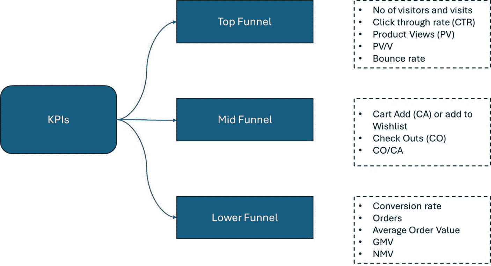

# 3. 电子商务市场的商品销售

## 概述

电商市场将众多卖家和买家汇聚在一个共同的技术平台上。该平台促进商品交易，并需要为买卖双方提供一套全面的功能，正如前一章所讨论的。

电商平台首先需要确定一组目标群体（TGs）来促成交易。这些目标买家群体代表了平台旨在服务的人群统计特征和买家细分市场。理解这些选定目标群体的需求和诉求，对于根据买家偏好定制产品和供应至关重要。最初，当电商平台刚起步时，目标群体是基于市场研究和创始人的假设来定义的。随着平台的发展，机器学习方法在识别这些群体方面变得至关重要，它通过分析买家购买模式，并将其与买家需求和用户画像对齐。一种常用于此目的的无监督机器学习方法是 K-Means 聚类，它根据客户在行为和属性上的相似性对其进行分组。

电商商品运营侧重于在平台上将买家与合适的产品连接起来。推荐方法，如协同过滤和矩阵分解，通常用于根据每个买家目标群体的浏览和购买模式，为其优先推荐产品。

例如，领先的时尚电商公司 Myntra 服务于特定的目标群体，而另一个电商平台 Amazon 则是一个也销售时尚产品的多品类平台。然而，这些平台上时尚品类的品牌和价格区间差异显著，它们各自针对不同的买家细分市场。

Myntra 的目标客户是注重时尚的买家，尤其是中等收入群体，他们寻求时尚和品牌产品 [4]。该平台策划精选系列，并专注于通过与全球品牌合作提供独家产品。其主要关注点是服装、鞋类和配饰等时尚品类。此外，视觉上吸引人的设计是该平台的核心关注点 [3]。

向目标群体（TGs）展示相关产品，并预测他们的需求和偏好，是商品运营中的关键关注领域。数据驱动的方法有助于将产品需求映射到特定的目标群体。ASOS 利用数据来优化其目标群体，并为每个群体有效地调整量身定制的价值主张 [11]。个性化和推荐功能使得向买家展示相关产品成为可能。监控新兴和不断变化的市场趋势，并结合预测，为预测每个目标群体未来的产品需求提供了洞察。

电商市场中的商品运营涉及几个关键活动：

*   **策划产品：** 从不同品牌和卖家中创建精选产品系列，并确保这些产品的可用性，是电商品类经理的首要任务。这就是产品品类管理。产品策划是电商平台上品类经理的主要职责。基于机器学习的推荐和排序方法帮助他们选择能够提升业绩的产品。品类经理持续监控关键绩效指标，如点击率、平均订单价值和转化率，以确保其产品策划策略的有效性。

*   **展示产品：** 在平台上使用有吸引力的视觉效果有效展示这些产品，并创建合适的优惠结构，是网站商品运营团队的工作重点。视觉效果的细微变化会显著影响买家在电商平台上的参与度。网站商品运营团队进行各种实验来评估这些影响，并使用统计测试来衡量其有效性。

*   **营销产品：** 通过各种营销渠道，使用诱人的视觉效果、优惠和促销活动，向正确的目标群体推广产品，并将他们吸引到平台，是营销团队的职能之一。人工智能（AI）和机器学习（ML）方法是实现营销个性化（尤其是针对现有买家）的关键推动因素。诸如 XGBoost 和 Random Forest 等机器学习技术常用于识别哪些客户最有可能对 CRM 活动做出响应。

电商商品运营是一项跨职能的责任，涵盖品类管理、网站商品运营到营销职能。这些职能之间的有效协作对于确保买家获得无缝的购物体验以及推动平台上的成功交易至关重要。

## 品类管理

电商平台上品类、品牌和产品的丰富程度，为任何电商企业创造了差异化优势。对于市场型电商平台而言，多元化的品牌和卖家构成了其相关性和独特身份。在时尚领域，品牌类型和价格区间则指明了平台旨在服务的目标群体。

品类经理的核心职责之一，是识别与平台买家需求相契合的品牌和产品。创建潜在品牌和卖家清单，需要理解买家需求、分析竞争对手以发现其产品组合中的新机遇和空白点，并辨别时尚趋势与风格创新。数据和人工智能使品类经理能够追踪竞争格局，捕捉买家的需求和偏好，并选择与买家相符的合适趋势。品类经理通常会监控主要竞争对手的电商平台，包括其评论以及表现最佳的产品和品牌。自然语言处理（NLP）技术可以分析竞争对手的产品描述、客户评论和社交媒体提及内容，提供可操作的洞察，帮助他们掌握信息并做出战略决策。

Stitch Fix 是一家由卡琳娜·莱克创立的美国个人造型公司，它利用机器学习算法和人类造型师，为其买家提供个性化的时尚产品[5]。除了“在正确的时间将正确的风格送达正确的人”之外，该公司还创建了一个框架，利用算法来识别未来的流行风格。这些算法的一些局限性则通过人类的洞察力和经验来弥补。

构思新风格并决定投资的过程，需要经历漫长的酝酿和反复迭代。该公司甚至在生产和采购新品之前，就通过 Style Shuffle 对其进行测试。这种方法提高了成功风格的产出效率，并减少了浪费[6]。

同样，其他领先的电商平台，如 Zalando、H&M 和阿里巴巴，也在利用人工智能进行新设计、需求预测和优化产品组合。谷歌、Zalando 以及总部位于英国的制作公司 Stinkdigital 共同开发了一个预测性的“设计引擎”。该引擎利用人工智能技术辅助创意决策，展示了超过 600 位时尚专家在颜色、质地和风格上的偏好[8]。

在识别出买家需求、与之相关的新兴风格趋势以及品牌/卖家清单后，品类经理会与品牌接洽，商讨入驻电商平台事宜。品牌入驻的整个过程在进入运营和技术讨论之前，需要考量多个因素。为电商平台识别潜在品牌既是一门艺术，也是一门科学。科学方面由机器学习方法和绩效洞察提供支持。例如，分析平台上的买家偏好以及竞争对手品牌的关键产品，为品牌选择提供了宝贵的数据。此外，自然语言处理（NLP）可以通过评估来自竞争对手网站买家评论中的产品质量和契合度，来增强这种理解。

品牌声誉和产品质量对于为平台买家提供卓越体验至关重要。通常，平台会有一套指导方针和评估标准，用于筛选能为平台买家创造价值的入驻品牌。与品牌的独家合作或联盟，使平台能够提供独特产品，从而在与竞争对手的较量中脱颖而出。品类团队会评估新品牌是否有助于平台上新旧品牌、流行品牌与利基品牌之间形成健康的组合。

在电商市场中，佣金收入是商业模式的关键组成部分。平台通常从每笔交易价值中抽取一定比例的佣金，该比例由品类管理部门与品牌协商确定。品类经理通过战略性地管理产品组合和品牌选择，在推动此项收入方面发挥着关键作用。

## 案例研究：电商平台上的品牌优先级排序

**背景**：在快速发展的印度电商市场中，识别并选择入驻品牌对平台的成功至关重要。通过市场调研和竞争分析，电商平台会识别出一份潜在品牌清单。同时，一些品牌也会主动联系平台寻求入驻。采用数据驱动的方法有助于系统性地评估这些品牌是否与电商平台的目标相符。

**目标**：为品类经理建立一个数据驱动的框架，以识别高绩效品牌，实现成熟品牌与新兴品牌的均衡组合，并引入符合买家偏好和市场需求的品牌。通过追踪这些品牌及其产品在竞争对手平台上的表现，并结合分析媒体报道，有助于预估品牌绩效并提供有价值的见解。

**方法**：

*   捕获数据——销售额、评论与评分、社交媒体热度指标。
*   为每个品牌创建关键绩效指标（KPI），例如销售潜力、买家满意度和市场相关性。
*   为这些绩效指标定义评分标准，并汇总得分以得出综合品牌评分。
*   综合评分及其各项分项评分将指导品类经理评估品牌并确定其入驻的优先级。

**成果**：该平台已实施一种结构化的方法，定期筛选品牌并确定其入驻优先级。通过确保将最相关、最具潜力的品牌展示在平台上，这种方法提升了销售额、优化了产品组合，并改善了整体买家体验。

与卖家和品牌建立长期合作关系涉及制定营销计划、设计最优定价策略，以及与品牌合作开展促销活动。这些努力旨在提升品牌知名度、提高买家参与度，并同时实现品牌的销售计划（GMV）和平台的收入目标。

在电商平台中，品牌或卖家负责产品库存、供货状态和订单处理。在品牌上线前，电商平台与品牌的订单管理系统之间需要进行技术集成，以确保订单处理顺畅。库存集成有助于降低因产品缺货而导致订单取消的可能性。印度电商平台 Flipkart 利用人工智能进行库存管理 [10]。支付处理和分析是电商平台模式中其他典型的服务和平台集成需求。相关协议旨在减少因产品缺货或质量不佳导致的订单取消，以及因包装和交付给物流伙伴缓慢而导致的订单配送延迟。

总而言之，品类经理负责在品类页面和品牌页面上做出关于品牌选择和产品组合的决策，并承担平台上产品供应的责任。他们还致力于提高来自品牌的广告收入，并为电商平台实现销售目标（GMV 和 NMV）。

品类经理几乎实时地追踪整个漏斗（顶部、中部和底部）的绩效，以确保达成平台业务目标。下面列出了一些常见的绩效指标。这些指标捕捉买家旅程，识别提升平台绩效的机会，并帮助定位任何问题。例如，如果首页上的某些视觉效果或组件对买家无效或不相关，这将会反映在该组件的点击率上。同样，如果前一小时的转化率低于预期转化率，品类经理将与跨职能团队合作，以识别并纠正问题。

对于顶部漏斗，访客数量、首页和产品列表页的点击率（CTR）、产品浏览量（PV）、产品浏览量/访问量比率（PV/V）以及跳出率（仅浏览着陆页就离开的访客百分比）有助于评估漏斗的健康状况。

中部漏斗侧重于买家参与度，这很大程度上受产品推荐和个性化推荐的影响。用于监控买家参与度的关键指标包括加购率（将产品加入购物车的访客百分比）、结账率（进入支付页面的比例）以及结账（CO）与加购（CA）的比率。

底部漏斗的绩效通过转化率、订单数量、GMV、NMV（考虑取消订单）、平均订单价值等指标进行追踪。这些指标有助于做出战术性的商品陈列决策。例如，如果最近几小时的平均订单价值较低，可以分析并调整促销策略。此外，产品组合和排名也可能产生影响。

图 3-1 总结了漏斗每个阶段的绩效统计数据。

图 3-1

营销漏斗各阶段的关键绩效指标

基于人工智能的数据驱动定价和促销策略，使品类经理能够优化平台上的销售和买家参与度，从而在增长与盈利能力之间为电商平台取得平衡。

在平台型电商平台上，部分定价决策由各个品牌和卖家自行决定。平台仅控制顶部商品的折扣，以不时推动销售。

基于人工智能的流程控制可以帮助电商平台节省成本并改善买家体验。下面的案例研究重点展示了使用人工智能进行价格和促销运营控制所带来的影响。

***案例研究：使用人工智能进行价格和促销审核***

***背景**：一家印度时尚电商平台定期进行价格调整和促销活动，以提升销售额和买家参与度。面对数千个卖家，在促销期间，价格调整会在单品（SKU）层面进行。不同品类和品牌的折扣差异很大，有些品牌对折扣设限，而另一些则会在特定季节提供大幅折扣。通过规则来管理跨品牌和品类的这些差异是一项巨大的运营挑战。此外，无意的定价错误，例如价格从 999 变为 99，可能会产生重大的财务影响，并在高流量时期偶尔导致平台崩溃。*

***问题陈述：** 开发一个机器学习模型，用于在批准所有价格调整之前对其进行审核并标记异常值。*

***方法**：利用历史价格调整数据，我们识别出所有价格变动，并通过数据分析和业务洞察相结合的方式标记出异常值。准备好标记数据后，我们开发了一个机器学习模型来自动检测异常的价格变动。*

***结果**：修订后的框架显著减少了对价格变动进行人工审核的需求，并加速了在生产环境中实施价格调整或上线发布的流程。*

*缺货是电商销售和促销期间常见的挑战。基于机器学习的预测方法可以通过考虑折扣水平、品牌兴趣和卖家活动等各种因素来帮助预估需求。*

品牌与电商平台之间的常规运营合作涵盖一系列职责：从新品上架、优化产品图片、标题和描述，到监控需求趋势、管理促销活动，以及处理订单管理问题（如包装延迟和退货增加）。

高退货率对任何电商平台而言都是一项重大挑战，其成因多种多样。这些原因包括产品质量问题、产品描述不准确或过时、尺码不合，或是买家利用平台政策进行不当使用。品类团队积极与卖家合作，以识别并缓解平台上与产品质量和详情相关的这些问题。

人工智能和机器学习被用于审核产品详情，并批准产品上架至电商平台。其中一些模型还会标记假冒和重复产品。

在引入合适的品牌和产品后，网站商品团队专注于优化它们在电商平台上的展示位置和优先级。

## 电商网站商品管理

网站商品管理团队在电商中扮演着关键角色，通过战略性的产品展示、布局和促销来影响买家行为并推动销售 [1]。通过分析买家群体、购买模式和新兴趋势，商品团队设计首页和品类页面的布局。他们创建展示特定产品组合的组件，并打造个性化的买家旅程。

网站商品管理通过在首页突出展示精心策划的产品组合，来提升整体买家体验并提高转化率。这包括设计跨品类布局、建立品牌旗舰店、策划营销活动、安排促销活动，以及协调搜索功能的改进。该团队与品类经理和营销团队紧密合作，使商品策略与业务目标保持一致。他们根据品类特定的趋势和目标来分配产品组合和促销活动。

特色组件旨在首页和特定品类页面上展示精心策划的产品组合、特价优惠和促销活动。团队持续监控这些组件的表现，并对其进行迭代以改善业务成果。追踪的关键指标包括点击率、转化率以及总销售额或商品交易总额（GMV）。

跨品类布局策略性地将互补品类的产品放在一起，以鼓励买家探索更广泛的产品选择。这些组合是利用分析和数据科学方法设计的，以优化买家参与度和销售额。

在时尚电商平台中，商品经理和品类经理与品牌合作，创建品牌旗舰店并策划产品组合。这些品牌页面通过各种社交媒体平台进行推广，以提高曝光度并吸引流量。商品经理与营销团队紧密合作，为这些策划好的产品组合和品牌旗舰店安排促销活动，以最大化其影响力。

下面的案例研究详细说明了由 AI/ML 驱动的网站商品管理如何帮助一家印度时尚电商平台改善业务成果。

***案例研究：针对区域性节日的个性化策展***

***背景**：印度是一个文化多样性丰富的国家，其各个邦和地区庆祝着众多节日。这些节日通常具有特定的文化意义，并吸引特定人群，即使他们可能分散在不同的地理位置。例如，“杜尔迦节”是孟加拉人热烈庆祝的一个重要节日，而孟加拉人在印度各大城市都有相当数量的人口。该电商平台旨在通过向正确的受众展示相关产品，来利用这些特定目标群体的文化相关性和需求。*

***目标**：目标是在杜尔迦节前几周，在一个时尚电商平台上，为孟加拉人创建一个相关的产品精选集。*

***方法**：该平台根据孟加拉用户登录时的地理位置和行为来识别他们。利用计算机视觉和 AI 技术，团队策划了一系列在节日期间对孟加拉人特别有吸引力的产品。然后，这些精选产品通过引人入胜的视觉效果进行展示，并通过社交媒体平台上的定向营销活动进行推广，这些活动专门设计用于吸引孟加拉人及相关买家群体。*

*问题的核心在于识别与“普迦”期间通常购买的商品相似的产品，特别是针对目标买家群体——全印度的孟加拉裔和东北部买家。基于品类经理的洞察和领域专业知识，确定了相关品类。针对这些品类，分析了去年“普迦”前 1-4 周这些群体购买产品的数据。采用多模型方法为每个品类创建了产品嵌入向量。随后利用这些嵌入向量来匹配当前的库存商品。然而，这种方法存在局限性，例如无法捕捉新兴趋势。为解决此问题，专家手动策展了额外的新颖产品。*

***成果**：该活动显著提升了平台新买家的获取量，并在促销期间提高了策展产品的转化率和销售额。为衡量转化率，采用了 A/B 测试方法。孟加拉裔买家群体被分为两组：一组展示策展后的产品列表页（PLP），另一组则查看标准产品列表页。*

印度是一个节日丰富的国家，全年定期举办庆祝活动。在这些时期，品牌通常会推出新产品线，并策展与节日场合特别相关的商品。例如，“排灯节”——光明节——在印度各地广泛庆祝，尤其是在北部地区。这个节日是购买服装和礼物的黄金时期。

像 Myntra 和亚马逊这样的时尚电商平台会专门为节日购物者创建策展系列，并进行广泛推广。网站商品陈列团队还会重新设计平台的展示或数字商店，以契合节日主题，旨在吸引和诱惑买家。

除了创建与节日一致的品牌商店，网站商品陈列团队还与品牌和品类团队紧密合作，策划有影响力的季末促销活动。例如，一家印度电商平台运用网站商品陈列技术，突出展示策展产品页面，并在社交媒体平台上推广季末产品。基于人工智能驱动的行为洞察和数据分析，他们能够为每个品牌创建多个页面，以提升转化率和销售额为目标对产品进行排序。通过结构化的相似人群拓展活动，这些页面被精准投放给合适的买家群体。这种策略性方法不仅推动了销售增长，还通过提供热门产品的及时折扣，提高了买家满意度。

通过利用数据驱动的洞察，并与品牌和品类团队建立战略合作伙伴关系，电商网站商品陈列团队在季末销售等关键促销活动期间，优化了产品可见性和销售业绩。这种迭代过程使他们能够不断优化商品陈列策略，并实现卓越的业务成果。

网站商品陈列团队确保平台上产品信息的准确性、全面性和高质量。该团队充当品牌与买家之间的桥梁，打造一个既能吸引他们又能诱使其做出购买决策的数字店面。

具有准确、相关产品描述以及高分辨率图片和视频的策展产品，有助于买家做出购买决策。该团队与品牌/卖家、品类经理和产品团队紧密合作，收集信息并呈现对买家而言既视觉吸引又易于理解的产品。

买家行为和参与度数据有助于了解平台上买家的兴趣和偏好，这些洞察帮助网站商品陈列团队实施策略，以增强导航、提高内容相关性并有效突出促销活动。该团队追踪多种绩效指标，包括点击率、转化率、跳出率、平均会话时长等。通过分析这些数据点，团队可以识别需要改进的领域并实施有针对性的优化。例如，如果某个品类页面的跳出率很高，团队可能会优化产品列表或调整页面布局以使其更具吸引力。这种数据驱动的方法确保网站不仅满足，甚至超越买家的期望。

商品陈列侧重于有吸引力地展示产品，而营销则涉及向目标群体推广这些产品。这种结合对于在电商市场平台中优化买家参与度和转化率至关重要。

## 电商中的数字营销

电商平台广泛利用数字渠道和社交媒体来吸引买家。视觉陈列、促销和定向信息传递是用于吸引社交媒体用户注意力并激励他们访问电商平台的关键工具。这些策略越来越依赖数据驱动，利用分析来理解买家行为和偏好。

视觉营销对于在社交媒体平台上吸引买家的注意力至关重要。利用计算机视觉和人工智能可以更深入地理解视觉呈现如何影响买家行为。通过增强视觉内容和开发创新的视觉策略，企业可以为买家创造更具吸引力和连贯性的购物体验[12]。

数据驱动的定向方法不仅提高了营销活动的有效性，还改善了买家的整体购物体验，从而带来更高的参与度和转化率。在追求数据驱动营销决策的过程中，电商行业普遍采用相似人群建模、程序化竞价，以及监控和衡量客户获取成本与营销支出回报率。这些策略有助于优化营销工作并提升整体绩效。

## 总结

品类团队与品牌和卖家合作，以丰富产品种类并确保目标买家的产品供应。网站商品陈列团队专注于打造视觉吸引人的展示、提供详细的产品信息，并确保顺畅的购买路径，所有这些都有助于在电商平台上实现无缝的购物体验。随后，营销和促销活动被用来吸引买家到平台，吸引并诱使他们做出购买决策。

个性化搜索和产品推荐为每位买家提供量身定制的购物体验，使他们更容易找到符合自己偏好的产品。此外，利用排序和排名算法根据购物模式优先显示不同的小组件，进一步增强了用户在平台上的参与度。

在下一章中，我们将探讨买家参与度和电商搜索的作用。此功能是电商平台的关键功能，因为它通过减少买家寻找满足其需求和偏好的产品所需的时间和精力，来促进产品发现之旅。

