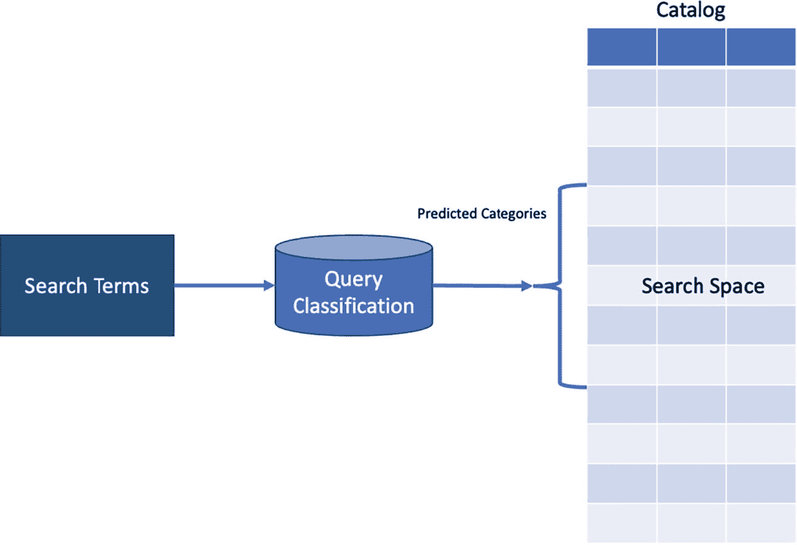
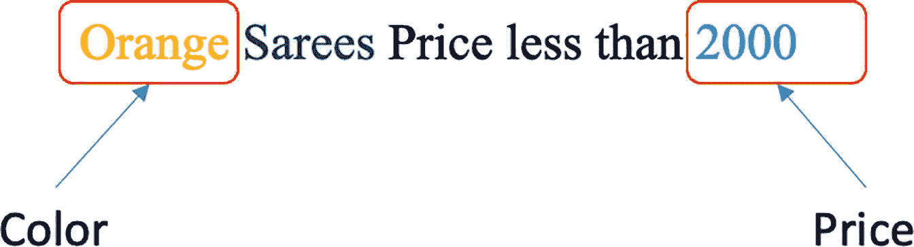
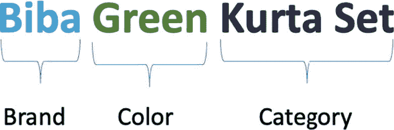
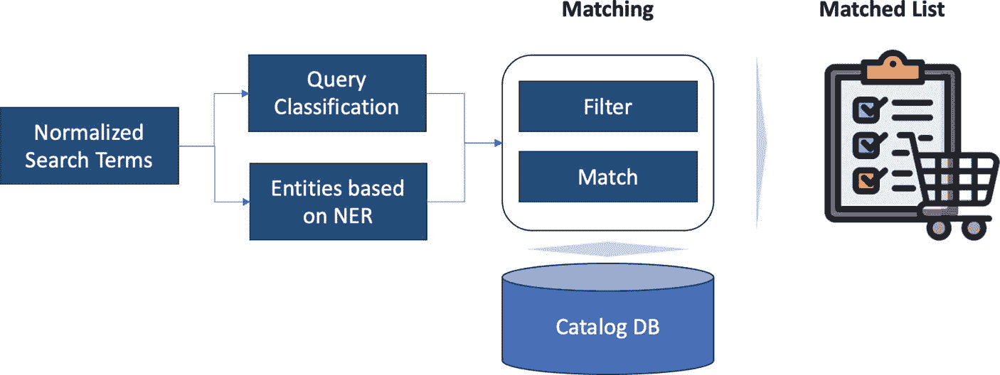
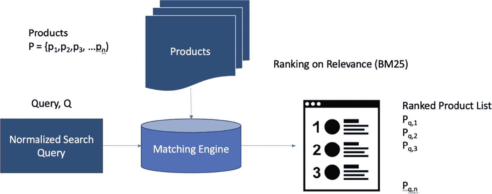
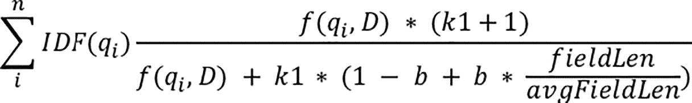
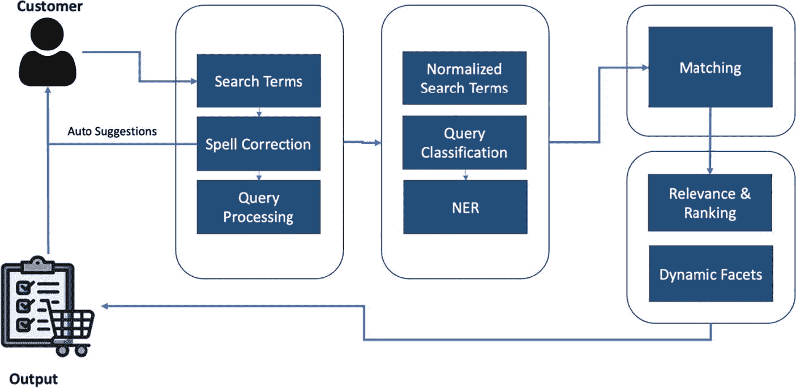
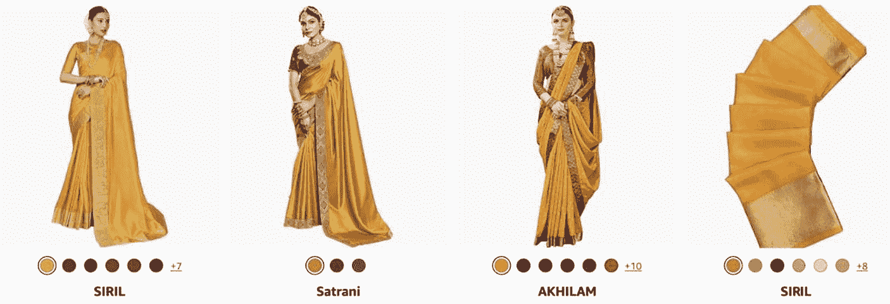
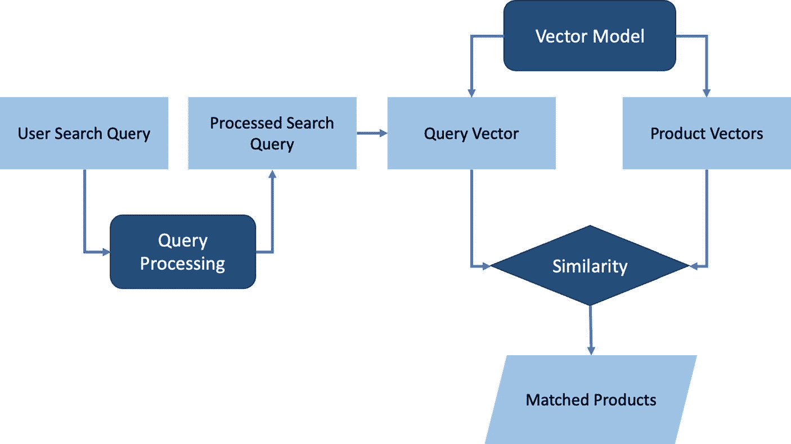

# 4. 电商搜索——转化的强大引擎

## 概述

何塞是一名热爱跑步的人，经常参加班加罗尔的赛事，他需要一双新鞋。和无数其他消费者一样，何塞转向网络来研究他的下一次购买。统计数据显示，相当大比例的买家在访问电商平台之前，会先通过在线搜索来决定要购买的产品[1]。何塞很清楚自己想要什么，他在一家印度热门电商平台的搜索栏中输入了“Adidas Men Trainers Running Shoes”，准备开始他的购物之旅。图 4-1 展示了一个电商网站搜索栏的示例。电商平台的移动应用程序上也提供了类似的搜索栏。

图 4-1

电商搜索

电商搜索在这些平台中扮演着关键角色，它允许用户在数十亿件商品中导航，找到他们需要的东西。它是销售的重要推动力，与其他渠道相比，它产生的交易占比最大[2]。通常，在时尚电商平台上，20-30% 的买家每次会话至少使用一次搜索功能，但值得注意的是，他们贡献了总销售额（GMV）的很大一部分（50-60%）。这些精通搜索的买家通常有明确的购买意图，其转化率是平台平均转化率的 2-3 倍。除了对转化率和整体价值的影响之外，一个有效的搜索功能还能在电商平台上创造无缝且引人入胜的买家体验。因此，搜索是平台策略和用户参与度的关键组成部分。

当何塞在搜索栏中输入“Adidas Men Trainers Running Shoes”并按下回车键时，电商平台的搜索算法立即启动。搜索算法将搜索查询词与商品标题和描述进行匹配，并显示包含这些搜索词的商品列表。这种方法被称为精确文本匹配。

电商中的搜索功能已经取得了长足的进步。它从基本的文本匹配发展到高级的语义搜索，如今则由生成式人工智能驱动。

一个电商平台可能提供数百万种商品。将每一件商品的标题和描述与何塞的查询词（“Adidas Men Trainers Running Shoes”）进行比较，效率会极其低下。这种方法会导致搜索响应时间非常慢，严重影响客户体验。既然何塞的查询明确表明他在寻找鞋子，那么就没有必要检查其他类别（如服装）来匹配商品。

电商平台依赖商品类别层级结构（也称为分类法）来将数百万种商品组织成清晰、不同的组别。这些分类法对于浏览和导航至关重要。然而，搜索查询本身往往无法完美地归入这些预定义的类别。一种方法是根据关键词对搜索进行分类。但是，由于客户使用各种各样的搜索词，并且他们在搜索查询中通常使用非正式语言，因此管理基于规则的手动分类会变得复杂[3]。

为了克服这些限制，电商平台利用基于机器学习的查询分类模型。这些模型充当智能分类器，分析诸如“Adidas Men Trainers Running Shoes”之类的搜索查询词，并预测最相关的商品类别和品牌信息。这使得搜索算法能够高效地将何塞的查询与目录中最相关的商品进行匹配，从而显著提高搜索响应时间和整体用户体验。

图 4-2 说明了将搜索词链接到目录商品的高级流程。

图 4-2

将搜索词链接到商品目录

## 搜索查询与机器学习

需要注意的是，搜索查询通常很简短，近 45% 的查询包含少于三个词。这一观察结果基于作者对特定时期内某印度电商平台搜索数据的审查。这表明相当大比例的买家可能是在浏览或探索平台，而不是有明确的搜索意图。因此，对于这些较短的查询，查询分类模型在准确性方面可能会遇到限制。即使是简短的搜索查询，BERT 和其他基于 Transformer 的深度学习模型也能有效地将搜索词分类到相关的商品类别中。这些模型表现出色，因为它们不仅利用了词语本身，还利用了查询背后的语义含义。

此外，电商平台利用会话内的点击和之前的搜索来优化和改进搜索结果，包括查询分类。例如，如果用户在搜索“Apple”时频繁点击电子产品，系统可能会推断该用户指的是该品牌。相比之下，搜索“custard apple”则会根据上下文线索被归入不同的类别。

***案例研究：搜索词分类模型***

***背景**：一个电商平台使用三个级别的分类法来组织服装商品。例如，第一级是服装/鞋类/家居/美妆，每个第一级（例如，服装）下会有第二级（例如，印度服饰、西式服饰等）。每个第二级下又有多个第三级类别。总共有 3000 多种第四级组合。*

*所有非直接品牌或类别搜索的查询，都需要链接到分类法或类别层级结构，以改进商品匹配。*

***目标**：开发一个基于 Transformer 的文本分类模型，将每个搜索查询链接到相关的类别层级结构。这是一个多标签分类任务。*

***方法**：对于规范化或处理过的搜索查询，根据点击数据分配类别标签。如果点击的大部分商品都与单个类别层级相关，则将其分配为正确的层级。下面解释所使用的高级逻辑。*

*例如，如果一个搜索查询链接到的点击商品中，超过 30% 与单个第四级值相关，则仅将该第四级及其对应的第三级、第二级和第一级视为标签。如果点击的商品分布在多个第四级中，则仅考虑第三级。*

*这个寻找 30% 点击贡献的过程从第四级开始，但在第三级及更高级别重复进行。如果某个特定第二级的商品被点击超过 30%，则将该第二级及其对应的第一级分配给标签。该过程以类似方式对第一级重复进行。*

*Tshirt For Women – > 第一级：服装：第二级：女装 第三级：西式服饰 第四级：T 恤*

*Woman Dresses – > 第一级：服装：第二级：女装*

*一旦创建了标签数据集，就使用基于 Transformer 的预训练模型来开发文本分类。但数据集对于某些最常购买或搜索的类别存在偏差。为了使数据集平衡，根据商品目录，为自然搜索查询数量较少的类别创建了一系列合成搜索查询。*

*模型验证：在保留样本上对训练好的查询分类模型进行了验证，并使用精确率、召回率和 F1 分数值进行性能评估。*

虽然何塞很清楚自己想要什么，并输入了具体的搜索查询，但重要的是要记住，基于电商搜索行为的买家画像差异很大。

与 Jose 的目标明确型搜索不同，另一位用户 Rashmi 是一位家庭主妇，正在为即将在家中举办的聚会做准备。她需要一件纱丽，但希望在做出购买决定前探索各种选择。与 Jose 不同，Rashmi 代表了相当一部分电商客户：他们已确定产品类别，但希望在该类别内获得更广泛的选择。为了满足需求，Rashmi 使用了更具探索性的搜索查询：“橙色纱丽 价格低于 2000”。这一搜索反映了她希望在特定价格范围内浏览各种橙色纱丽的意愿。

虽然查询分类模型可以有效地将 Rashmi 的搜索查询（“橙色纱丽 价格低于 2000”）路由到“服装”大类下的“纱丽”类别，但挑战依然存在。产品标题和描述可能并不总是明确提及用户心目中的价格或颜色。在文本匹配中准确捕捉价格意图可能尤为困难。

除了对搜索查询进行分类，查询理解对于电商平台也至关重要。这涉及提取品牌、价格、颜色和其他属性等关键实体。然而，由于搜索查询的多样性，这一过程可能充满挑战。

自然语言处理（NLP）提供了一种名为命名实体识别（NER）的强大技术来解决这个问题。NER 就像一个智能解码器，能够从搜索词中识别并提取相关实体。在时尚电商领域，NER 模型可以经过训练，识别对产品搜索至关重要的更广泛的实体，包括产品类型（如“纱丽”）、品牌名称、颜色（如“橙色”）、材质、性别、场合和风格。

图 4-3 展示了在电商搜索查询中识别出的不同实体。

图 4-3

从搜索查询中提取实体

对于电商搜索，通常利用基于深度学习的预训练模型来构建高效的 NER 模型[4]。诸如 BERT 之类的命名实体识别（NER）模型，会在电商特定的自定义数据集上进行训练，以提高其准确性和有效性。准备这些自定义标记数据集可能很耗时，但这能显著改善搜索过程。例如，“Apple”这个词在某些上下文中可能被识别为品牌，而在其他上下文中则被识别为类别。此外，某些词的变体可能指的是品牌名称，而非拼写纠正。

在此场景中，提取出了颜色为“橙色”和价格低于 2000 的信息。搜索算法在向用户 Rashmi 展示匹配结果之前，会使用这些属性来应用过滤条件。

图 4-4 展示了用于将搜索词映射到目录产品的命名实体识别（NER）和分类模型的序列。

图 4-4

从搜索到匹配产品的步骤

搜索词可以有多种写法，例如：“Orange sarees below 200”、“Orange saree less than 2k”、“Orange color sarees under 2000”、“Saree orange color price below 2000”、“Orang Sarees for under 2000”、“Orange Saree below 2000”、“Buy orange saree less than 2000”、“Orange Sarees < 2000”、“2000 below orange saree”、“Looking for orange saree < 2000”。搜索可能因单复数、词序变化、缩写（2000 vs. 2k）、拼写错误、使用符号（< 表示小于）、拼写变体（如 sari vs. saree 或 color vs. colour）、同义词（orange vs. saffron）以及更多情况而产生差异。此外，搜索词中可能还存在特殊字符和其他问题。

在网络搜索中，10-15%的查询存在拼写错误[5]，而在电商搜索中，拼写错误的搜索查询占比很大。搜索引擎也会考虑同义词来改善搜索。例如，搜索“sneakers”可能也会包含“athletic shoes”或“trainers”的结果。

搜索词在输入 NER 和分类模型之前会经过处理，涉及的处理步骤包括：规范化（转换为小写并移除特殊字符）、词干提取/词形还原（将单词还原为其词根形式，例如 running 变为 run，sarees 变为 saree）、拼写纠正（例如 orang sarees 变为 orange sarees）以及停用词移除（例如移除 the、an、for）。

在电商搜索中，处理后的搜索查询会被考虑用于规范化。查询规范化涉及根据查询的语义含义或点击的目标产品对查询进行分组。此过程识别出这些产品之间的相似性。利用产品和类别特征，通过对查询创建的嵌入向量进行 K-Means 聚类，将搜索查询聚类，从而获得更准确、更相关的搜索结果。

处理后的查询会经过查询分类和 NER 模型，并提取出用于产品过滤所需的信息。查询分类模型识别出相关的产品类别：“纱丽”。而 NER 成功提取了关键属性：价格 <= 2000 和颜色=“橙色”。

***案例研究：使用 Transformer 模型的自定义 NER***

***背景**：当客户在搜索查询中使用某些关键词或短语时，他们是在寻找特定产品。例如，“Vero Moda Floral Dresses”这个查询包含三个特定的用户意图——品牌、图案以及产品类型或类别。管理业务规则或逻辑变得复杂。需要迁移到基于机器学习的系统。*

***目标**：从搜索查询中提取品牌、颜色、类别和价格实体。*

***方法**：*

*电商面临的一些挑战包括歧义性，例如 AND 是品牌，但也可能被视为停用词；w 是另一个品牌，仅为一个字母。此外，一些特殊字符或数字是品牌名称的一部分，例如 Forever 21。*

*基于过去 90 天的数据，提取了最频繁的 10 万个搜索查询。从这些查询中，排除了那些直接是品牌或类别查询的单个词或两个词的查询。*

*对于剩余的搜索查询（约 6 万个），使用基于逻辑的自动化和人工审核相结合的框架来创建标签数据。例如，在搜索查询“Biba Green Kurta Set”中。*

*图**4-5**说明了如何定义实体以创建用于训练 NER 模型的标签数据。*

图 4-5

搜索查询中的实体

*用于训练的最终类别是 S-Brand、I-Brand、S-Color、S-Category、I-Category、I-Price。*

*一旦有了用于训练自定义 NER 的标记数据集，首先在目录数据集上训练一个预训练的 Transformer 模型 ALBERT，以便模型能够推断电商的上下文。然后，使用针对 NER 标签的交叉熵损失函数对模型进行微调。*

***验证与评估***

该模型在 20%的测试样本上使用召回率（提取出的所有相关实体的百分比）和精确率（识别出的实体中正确的百分比）等分类指标进行了验证，两项指标均超过 90%。此外，对每日搜索查询进行了规范化，并在排除了品牌或类别名称等直接搜索后，选取了 5000 个查询样本。由于没有自动化的方法为每个查询中的实体打标签，因此在新数据上对模型进行了进一步评估，这些新数据包括排除直接搜索词后出现频率最高的前 5000 个查询。

搜索引擎能够从其庞大的产品目录中高效检索出所有符合这些特定条件的纱丽。这确保了向用户呈现有针对性的产品选择，从而提升了搜索体验。

图 4-6 展示了使用标准化搜索查询为某个搜索词生成最终产品列表所涉及的高级步骤。买家查询在由查询分类模型（用于定义搜索的相关类别）和命名实体识别（NER）模型（用于提取相关实体）处理之前，会先进行标准化处理。这些提取出的实体用于在从目录中检索产品时应用过滤条件。最后，所有匹配的产品都会显示给用户。

图 4-6

从标准化搜索词到关联产品列表的方法

Rashmi 使用诸如“2000 卢比以下的纱丽”之类的搜索词搜索产品。当 Rashmi 获得搜索结果（即搜索列表页面，SLP）时，她会查看结果，并决定使用修改后的搜索词“2000 卢比以下的印花纱丽”重新搜索，从而检索出与搜索词匹配的纱丽列表。

图 4-7 展示了与搜索查询匹配的产品示例列表。

图 4-7

搜索结果

在此场景中，除了讨论的三个步骤——查询处理、查询分类模型和 NER 模型之外，搜索还需要对查询词（例如“印花”）在产品标题和描述中进行文本匹配。

## 搜索算法 – 文本匹配

电商搜索的核心是文本匹配，这是一种将用户查询与目录中相关产品连接起来的方法。为给定搜索查询查找相关产品的领域被称为信息检索（IR），并且已经研究了数十年。搜索查询封装了客户需求，在电商中，信息检索通常会为搜索查询获取一组产品。

在文本或词汇匹配中，算法尝试将搜索查询与产品进行匹配，并基于相似度推导出相关性。相似度是基于搜索词频率（**TF**）和逆文档频率（**IDF**）向量计算出的余弦相似度（或类似的距离度量）。文本匹配的基本方面是：如果搜索词在产品标题和描述中出现得越频繁，其相关性就越高，但这些词在所有产品中出现的频率也应该较低。

图 4-8 直观地展示了文本匹配的组成部分，包括搜索词如何与产品详情关联，以及 BM25 在对匹配产品进行排序中的作用。

图 4-8

文本匹配 - 搜索词与产品详情

## 文本匹配：BM25 算法

在电商系统中，搜索查询会与产品详情进行匹配，许多产品可能包含所有搜索词。然而，这些产品的相关性可能各不相同。例如，如果一个搜索词在查询中或在多个产品描述中频繁出现，这可能表明相关性更高。相反，特定或独特的词有助于过滤掉相关性较低的产品。

BM25（最佳匹配 25）利用这些概念来有效地对产品进行排序。它考虑了匹配词的频率及其特异性。例如，如果用户搜索“高性能游戏笔记本电脑”，那么频繁且精确匹配“游戏笔记本电脑”的产品将被排在更靠前的位置。然而，如果“高性能”这个词只出现在少数产品描述中，那么这些产品的评估方式将与那些该词出现更频繁的产品不同。

BM25 根据词频和文档长度计算产品的相关性，并根据词出现的频率及其在整个文档语料库中的独特性进行调整。这种平衡有助于确保与搜索查询最相关的产品得到优先考虑，从而改善用户的搜索体验。

BM25（最佳匹配 25）是电商搜索中用于文本匹配的常用算法。除了词频（TF）和逆文档频率（IDF）之外，该算法还考虑了文档长度和词频饱和度。

### 词频（TF）

词频衡量搜索词在产品详情（例如，产品标题和描述）中出现的次数。它是搜索词的相对频率。对于搜索词 t 和产品 p，其比值是词 t 在产品 p 中的频率与产品 p 中单词总数的比率。这表明搜索词出现次数越高，产品对于给定搜索词的相关性就越高。还有一些用于计算词频（TF）的额外公式 [9]。

### 逆文档频率（IDF）

某些搜索查询词可能非常常见，并且其出现在给定产品描述中可能并不表示任何特定的相关性。因此，需要计算逆文档频率（IDF），它衡量搜索词为产品提供多少特异性信息。从某种意义上说，它衡量了该词在所有产品中的常见或罕见程度，如果它是一个常见词，则会受到惩罚。

通常，搜索平台基于 Apache Lucene 及其变体（如 Solr 和 Elasticsearch）。Elasticsearch 平台中的 BM25 实现如下：

**q**[**i**] 是第 i 个查询词，

**IDF(q**[**i**]**)** 是第 i 个查询词的逆文档频率，

**f(q**[**i**]**,D)** 是第 i 个查询词在文档 D 中的计数或频率，

fieldLen 是字段的长度，

avgFieldLen 是所有产品或文档的平均字段长度，

k1 和 b 是参数。

在电商中，文档等同于产品详情。虽然像 BM25 这样的文本匹配算法构成了电商搜索的支柱，但当用户使用不精确的语言或同义词来表达需求时，它们往往力不从心。BM25 基于统计度量，不具备对词项语义含义的内置理解。BM25 算法有 k1 和 b 参数，选择最优值可能是一个挑战。

在电商搜索中，BM25 通常比传统的文本匹配算法（如 TF-IDF）更受青睐，因为它能更高级地处理词项饱和度和文档长度可变性。与可能过度强调词频且缺乏长度归一化的 TF-IDF 不同，BM25 会调整词频的递减收益，并对文档长度进行归一化。因此，BM25 分数在拉取更相关的产品时更为可靠。

## 搜索结果排序

在电商平台上搜索“2000 元以下的印花纱丽”，会返回超过 3 万件商品。在电商领域，绝大多数买家不会点击前三页之后的结果，因此将相关商品展示在靠前位置能提升买家在平台上的参与度。将相关商品置顶可以通过**热度排序**或**个性化排序**来实现。

热度排序主要基于商品表现——它们有多受欢迎？有多流行？

电商中商品的热度不能仅凭浏览量或购买量等单一指标来判断。例如，低价商品往往吸引更多浏览量，而转化率会因促销和折扣而波动。在列表页上突出展示的商品可能获得更高的点击率（CTR），但转化率却可能较低。为应对这些复杂性，业界采用综合热度评分，结合多种指标在电商平台上更有效地对商品进行排序。该评分能更全面地衡量商品的整体热度和表现。

热度评分可借助一系列商品表现属性及排序算法来实现。关于排序算法的章节详细介绍了如何开发排序模型，以对商品进行排序，从而提升客户体验和业务绩效。

电商平台掌握着大量客户偏好信息，尤其是针对回头客和高参与度客户。对于曾购买过纱丽的客户，平台应优先推荐价格区间、颜色图案及其他属性相似的商品。根据客户偏好对商品进行重新排序，即实现搜索结果的个性化。关于个性化章节详细讨论了具体方法及其在电商中的业务影响。

## 搜索架构实战：从查询到结果

电商平台（如 Myntra）在用户（如 José和 Rashmi）进入搜索栏时，通常会展示热门搜索词。这一策略基于一个理念：搜索量激增的词汇很可能与更广泛的受众相关且有趣。此外，还可通过融入地理位置和基于性别的个性化设置来优化热门搜索，使平台能够根据特定地区或用户群体的兴趣定制推荐。

部分平台会显示用户的历史搜索词，假设他们之后可能会再次搜索这些内容。这对于尚未做出决定或只想从上次中断处继续的用户来说，是一项实用的功能。同时，对于某些品类（如杂货平台上的牛奶或饼干），重复购买同一品类或商品的情况很常见。

对于输入搜索查询的用户，搜索引擎会使用拼写纠正（通常基于机器学习模型）实时识别并修正拼写错误，并在用户输入时检索相关搜索词以提升体验。这些建议通常被称为“自动建议”或“输入提示”，会显示出来方便用户。

在 Myntra，这种方法已显著提升了点击率（CTR）达 3%，尤其是针对那些使用上下文输入提示的用户[[6]](#630035_1_En_4_Chapter.xhtml#CR6)。

对于“2000 元以下的印花纱丽”这类搜索查询，搜索系统在返回结果前会经历多个步骤。第一步是查询预处理，包括去除特殊字符、拼写纠正、词干提取/词形还原等操作。

处理后的查询被输入命名实体识别（NER）和查询分类模型，以提取查询中的关键信息。NER 模型提取相关实体，如品牌、颜色、图案等；而查询分类模型则给出与搜索词相关的品类（一个或多个），包括产品类型（“纱丽”）及相关属性（如价格“2000 元以下”）。

一旦提取出产品品类及其他属性，系统便会在产品目录中搜索匹配属性的商品。这可能涉及检查商品标题和描述。最后一步，根据与用户搜索相关性的因素对检索到的商品进行排序。

电商搜索结果基于排序模型进行排序，该模型可优先考虑整体热度级别或用户个性化级别。

重要的是，要为买家提供从拉取的商品列表中进行筛选的功能，这需要借助一系列相关筛选器（分面），这些筛选器应针对每次搜索查询动态调整。例如，当买家搜索“纱丽”时，系统可能优先显示颜色和面料筛选器；而搜索“T 恤”时，则优先显示领型筛选器。这种定制化方法由支持分面搜索功能的机器学习模型实现。基于这些模型生成的动态分面，通过确保显示的筛选选项与用户的具体搜索查询高度相关且直接适用，从而提升买家体验。

最终，买家会获得一个连贯的搜索体验，页面顶部展示最相关的商品及合适的筛选选项。

图 4-9 展示了电商搜索生态系统的关键组成部分。它详细描述了从买家搜索查询到商品匹配与排序的整个过程，并突出了用于进一步细化搜索结果的各项功能。

图 4-9

逻辑搜索架构

电商中的搜索功能是一个复杂的生态系统，涉及机器学习模型、业务规则、不断变化的产品信息以及买家期望与行为的转变。鉴于这些动态因素，搜索平台的性能会受到严格监控。机器学习模型会持续评估和重新训练，部分更新自动进行，其他更新则需经过充分的数据准备和审慎考量。

新变更会通过 A/B 测试在少量用户中系统性地发布和测试。一旦观察到显著改进，这些变更便会逐步推广到更广泛的用户群体。

## 语义搜索

Rashmi 在搜索橙色纱丽时，会使用诸如“藏红花色纱丽”或“姜黄色纱丽”之类的词语。这凸显了电商搜索中的一个常见挑战：搜索查询的多种变体。在一个平台上，搜索“橙色纱丽”会得到 1877 个结果，而“藏红花色纱丽”仅显示 1 个结果，“姜黄色纱丽”则没有结果。这种不一致性体现了产品标签化面临的挑战。

有趣的是，另一个平台能够识别“姜黄”，并在搜索“姜黄色纱丽”时显示黄色纱丽（超过 3000 个结果中的第 1–48 个）。图 4-10 展示了该搜索结果的示例输出。

图 4-10

语义搜索结果

电商搜索的关键挑战在于，用户经常在搜索查询中使用非正式语言，而产品标题和描述往往采用更正式的文体。这造成了词汇鸿沟，可能阻碍搜索的准确性 [3]。诸如词干提取和词形还原之类的技术用于匹配具有相似词根的词汇（例如，将“reading glasses”匹配到“reading glass”），但这可能导致信息丢失和错误。同样，拼写纠正方法也未必总能捕捉到用户查询中的所有打字错误或拼写错误。这可能导致搜索结果不佳，与用户意图不符 [7]。

语义搜索算法融合了搜索词的意图和上下文，以匹配搜索词与产品目录。例如，语义搜索引擎会解释“鞋带”和“系带鞋”这类搜索词。语义搜索架构能够有效处理上义词、同义词、反义词、词形变体和拼写错误 [7, 8]。

语义搜索框架依赖于嵌入空间中的稠密向量来捕捉搜索查询和产品的上下文含义。深度学习方法将产品信息转换为这些向量，然后存储起来以供后续检索 [9]。

类似地，用户的搜索查询也会被转换并存储为向量。最后，当用户输入搜索查询时，系统会将其链接到对应的已存储搜索查询向量，并与产品向量进行比较以识别匹配项。

RoBERTa 和其他 Transformer 模型在用于创建产品和搜索查询嵌入之前，会针对电商语境进行专门的微调。此微调过程涉及调整模型以理解电商语言和买家行为的细微差别。这些模型生成的嵌入随后用于将新的买家搜索词链接到相关产品，从而提高搜索结果的准确性和相关性。

图 4-11 展示了使用语义搜索框架将搜索查询与产品匹配所涉及的逻辑步骤。

图 4-11

语义搜索步骤

语义搜索算法的三大主要类别 [3]：

1.  **因子化模型**：这些模型根据搜索查询和产品的内容，独立地将它们转换为低维向量表示（称为嵌入）。这些嵌入捕捉了查询和文档或产品的语义含义，从而实现更准确的语义匹配。

2.  **潜在因子模型 (LFM)**：潜在因子模型 (LFM) 使用矩阵分解技术来揭示词语与产品（或文档）之间的隐藏关系，而无需直接分析其内容。通过将交互矩阵分解为潜在因子，LFM 可以揭示潜在的模式和关联。例如，奇异值分解 (SVD) 或非负矩阵分解 (NMF) 等技术可以识别这些潜在因子，这有助于基于隐式交互（而非显式内容分析）来理解和预测买家偏好及产品相似性。

3.  **交互模型**：交互模型在查询与产品详情（例如，标题和描述文本）之间构建交互矩阵。这些模型使用深度学习模型捕捉查询词与产品详情之间的复杂交互，从而实现更细致的语义匹配。

## 用于搜索嵌入的深度学习

创建搜索查询和产品的向量表示（嵌入）有两种深度学习方法：无监督方法和有监督方法。

这篇研究论文 [3] 中详细介绍了推荐的有监督方法，该方法利用了一个名为 RoBERTa 的基于 Transformer 的模型。此过程包括两个阶段：

*   **预训练**：RoBERTa 模型首先在一个大型时尚相关文本数据集（语料库）上进行训练。这种初始训练使模型具备了理解搜索领域相关语言的坚实基础。

*   **微调**：接下来，模型使用一种称为三元组损失优化的技术进行微调。此方法旨在实现两个目标：减少搜索查询与用户点击产品（视为正匹配）之间的距离，并增加搜索查询与用户未点击的随机产品（视为负匹配）之间的距离。

微调这些模型需要标注数据，以指示哪些产品与搜索相关，哪些不相关。点击数据在此过程中至关重要，因为它有助于识别正例（买家与之交互的产品）和负例（用户未参与的产品）。搜索后点击某个产品列表表示正匹配，而点击不相关的列表或根本没有点击则表示负匹配。例如，当买家搜索“红色连衣裙”时，被点击的产品被视为正样本，而未点击或不相关的产品则被视为负样本。这种区分有助于训练模型根据用户交互更好地区分相关和不相关的产品。此外，作者建议在定义用于训练/微调预训练模型的正负样本时，引入“窄”查询与“宽”查询的概念。

最后，通过这个微调模型学习到的查询嵌入和产品嵌入，用于在买家输入搜索查询时检索相关产品。查询嵌入本质上充当了一个参考点，用于在产品目录中查找具有相似含义和特征的产品。

## 对话式搜索——由生成式 AI 驱动

当前的搜索架构在处理交易型搜索和浏览型搜索时表现出色。交易型搜索涉及那些明确知道自己要找什么的用户。例如，搜索“2000 元以下的印花纱丽”的用户对产品和价格范围有清晰的概念。而当用户正在探索某个特定产品类别但尚未确定具体产品时，这被称为“浏览型搜索”。例如，搜索“纱丽”的用户可能在决定购买前浏览各种设计和图案。

当前的搜索架构在应对灵感型搜索时可能存在局限性，这类搜索中，客户正在积极寻求想法和灵感来指导他们的购买决策。例如，搜索“幼儿生日礼物”或“婚礼礼服”的客户正在寻找符合特定情境的产品创意。当前的搜索可能难以提供这些更宽泛的建议，可能会局限于精确的关键词匹配。理想情况下，搜索引擎应该推荐产品，甚至跨类别推荐，以提供更全面的灵感选项。

电商平台正经历着“数字橱窗购物者”的激增，这与实体店中的橱窗购物者类似。这些客户既有时间也有意愿探索线上世界，浏览新趋势和产品类别。他们可能是平台的常客，但购买频率较低。当前的搜索架构在应对灵感型搜索和吸引数字橱窗购物者方面面临局限性。

当前的搜索架构可能无法满足基于灵感的搜索需求，因为它通常局限于少数特定类别。文本匹配和语义搜索方法都侧重于匹配文本，而不是理解上下文或将产品与其用途或应用场景联系起来。此外，产品目录通常缺乏关于产品何时使用、如何使用或其功效的最新信息。例如，目录描述可能只包含标题或材质等基本信息，而没有说明丝绸纱丽更适合特殊场合，而棉印花布可能更受老年人和夏季条件的青睐。

像对话式搜索这样的新兴技术为这些挑战提供了有前景的解决方案。印度领先的电商平台 Flipkart 于 2023 年底推出了名为 Flippi 的 ChatGPT 驱动聊天机器人，旨在帮助在购买决策中遇到困难的买家 [10]。Flippi 帮助寻找适合他们需求的产品。同样，亚马逊在 2024 年第一季度宣布推出 Rufus，这是一种全新的由生成式 AI 驱动的对话式购物体验 [11]。

对话式搜索允许用户以更自然、更人性化的方式与搜索引擎互动，使用完整的句子和问题。对话式搜索可以包含用于理解用户意图和偏好的上下文，并能促进更开放式的探索过程，帮助数字橱窗购物者发现新趋势和产品。

## 总结

搜索是电商平台上吸引买家参与的关键渠道。为了创造真正引人入胜的买家旅程，利用人工智能（AI）和机器学习（ML）算法是基础。从处理搜索查询，到将搜索词与产品关联，再到呈现相关结果，每一步都通过 AI 和 ML 模型得到增强，以改善结果。这种增强有助于提高转化率，因为更多买家通过他们的搜索旅程完成购买，同时也提升了整体买家体验。

实体识别可以识别搜索词中的重要实体，并将其用于应用筛选条件。例如，对于“2000 卢比以下的女士跑鞋”这样的搜索查询，算法可能会识别出“女士”为目标受众，“跑鞋”为产品类别，“2000 卢比”为价格筛选条件。

基于 ML 算法的搜索词查询分类可以将搜索词分类到相关的产品类别中，有助于实现高效的匹配空间和更准确的搜索结果。

基于深度学习的神经搜索：由深度学习框架驱动的先进技术，如神经搜索，使系统能够超越精确的关键词匹配。它可以理解搜索查询背后的语义含义，从而能够检索出概念上相关、即使不包含用户使用的确切关键词的产品。

本质上，AI 和 ML 算法正通过使电商搜索更智能、更高效、更用户友好来改变它。这为在线购物者带来了更具吸引力的买家旅程。

一旦向买家展示了最相关和/或个性化的搜索结果，买家就会在加入购物车并继续购买之前浏览产品详情。在此过程中，通过展示互补产品、相似产品和其他产品来吸引买家，以提高参与度和购物车规模。这些精心策划的选择由一系列称为推荐的算法驱动。在下一章中，重点将转向理解驱动电商平台上引人入胜的买家旅程的相似性算法。

