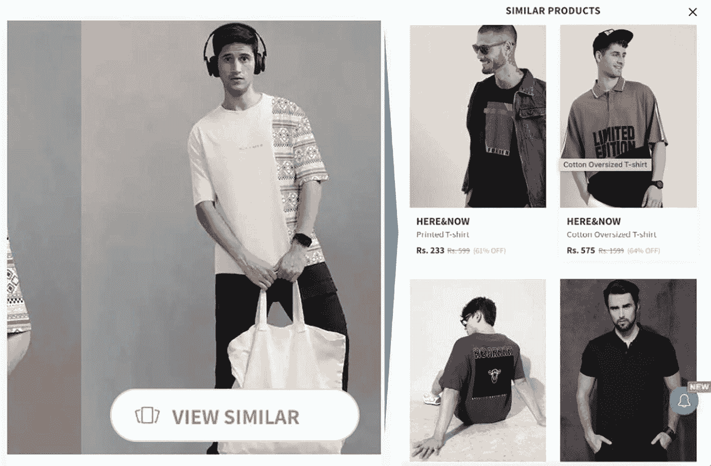
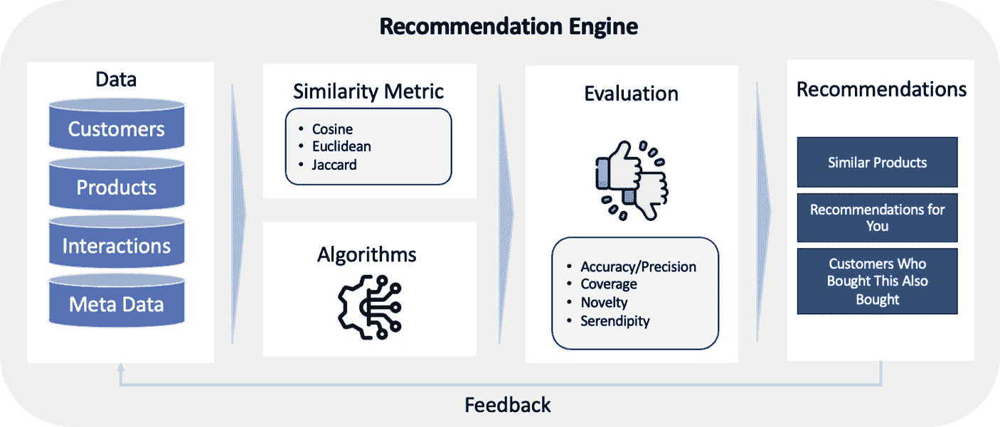
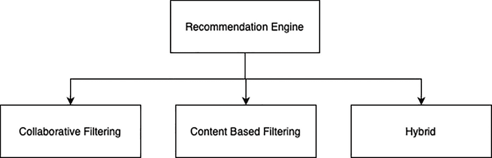
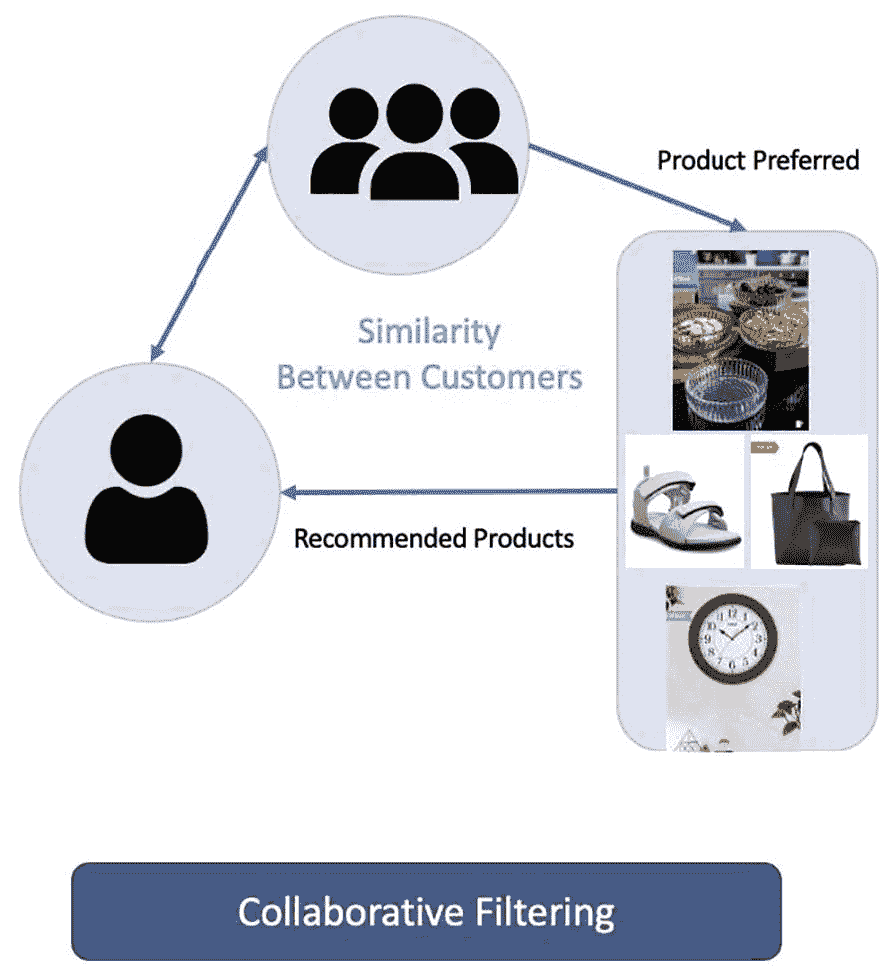
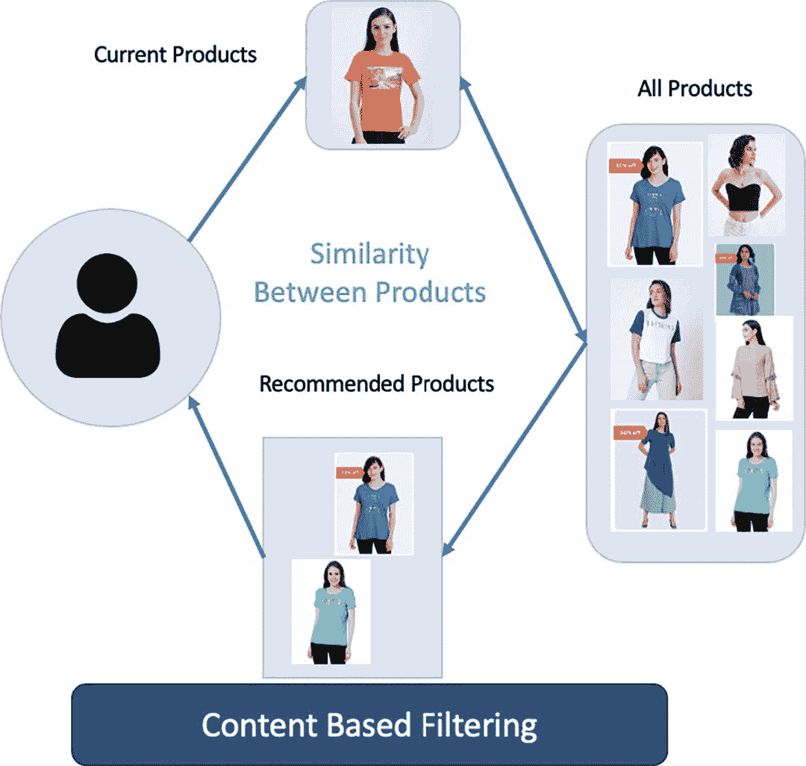
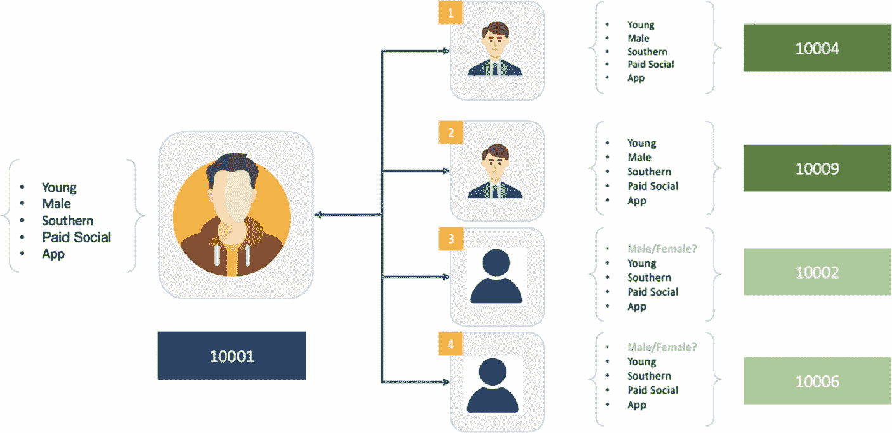
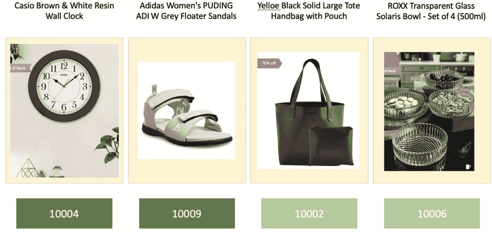
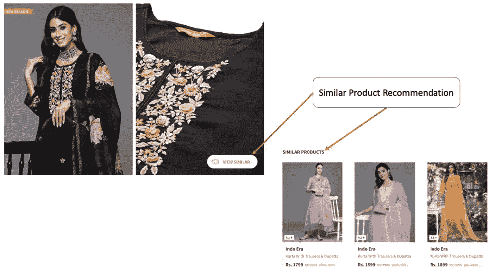
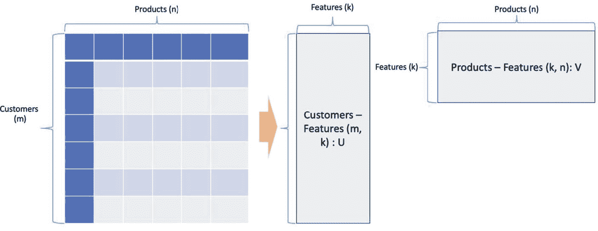
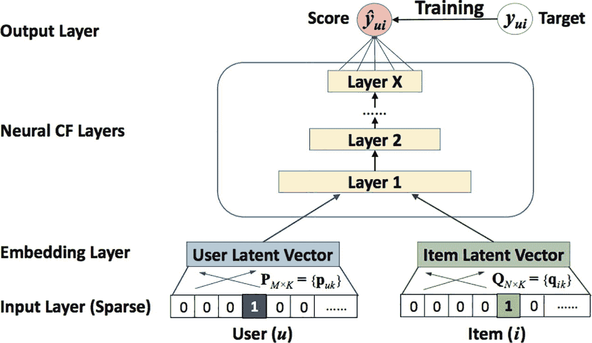

# 5. 利用推荐的艺术与科学进行精心策划的选择

## 概述

十月，在印度班加罗尔，大多数学校已经完成了期中考试。莱克斯有两个孩子，他们期待在附近度个短假。经过在线搜索和讨论，他们一致决定去本地治里（位于印度南部，距离班加罗尔或金奈不远）旅行。

本地治里曾是法国在印度的殖民地，直至 1954 年，如今是一个联邦属地，东南部与泰米尔纳德邦接壤。芥末色的殖民时期别墅和沿着孟加拉湾的海滨长廊是其令人兴奋的特色之一。他们对此地早有耳闻，所有人都对这次旅行充满期待。

期中考试结束后、出发前几天，莱克斯和朋友们聚在一起吃了顿饭。大家开始分享各自的假期计划，轮到莱克斯时，朋友们纷纷就本地治里的游览地点、餐馆、去处、购物目的地以及何时做什么提出了建议，这让他印象深刻。

如果莱克斯使用带有推荐引擎的旅行门户网站来规划年度旅行，该平台会根据他过往的偏好和预算，呈现精选的酒店选择。此外，一个由生成式人工智能驱动的聊天机器人可以协助规划行程，为旅行的每一天推荐活动。尽管有这些进步，许多推荐仍然是零散的。目前，很少有平台能提供全面的端到端旅行推荐，涵盖行程规划、住宿、餐厅建议和活动。

朋友们了解他的品味、偏好、预算以及更多信息。当他们推荐就餐地点时，会考虑到莱克斯一家是素食主义者。在推荐地点和游览时间时，他们会考虑到孩子们以及他们对冒险活动的热爱。

我们在探索选项或做选择时，都喜欢得到建议和反馈。我们都渴望有一个了解我们、掌握背景信息，并能帮助我们做出符合兴趣和偏好的精选推荐的朋友。

如果有一个朋友，它能综合所有分享给它的信息，针对特定情境，探索所有可用选项，并为你创建精选推荐，那会怎样？这个新朋友是一个由新技术——机器学习和人工智能——驱动的虚拟朋友。这个“虚拟朋友”在亚马逊或 Myntra 等电商平台以及 Netflix 等流媒体平台上为我们所有人提供帮助。这个虚拟朋友被称为推荐引擎。

电商平台上的推荐引擎会考虑过往行为、偏好和购买历史，来创建精选推荐（例如，准备产品列表或选择几个品牌等），这些推荐是买家在特定情境或访问中会感兴趣的。这些引擎不仅简化了决策过程，还提升了买家体验。

## 电商推荐引擎：用精选推荐吸引买家

玛尼莎是一位家庭主妇，和大多数女性一样，她热爱网购，是印度一家知名时尚电商平台的常客。

她打开电商移动应用，可以看到应用上琳琅满目的小部件。今天她有兴趣探索“库尔塔套装”，于是决定按照基于分类的导航开始她的购物之旅。

图 5-1 展示了基于产品分类的浏览路径。

图 5-1 产品分类或层级结构

她在分类页面上看到了时尚且受欢迎的“库尔塔套装”。这些商品由基于流行度的排序算法排名，这将在后续章节中讨论，并且列表会根据她的历史和偏好进行个性化定制。

在浏览产品时，“相似产品”吸引了她的注意，邀请她进一步探索。每次点击，平台都会呈现与她风格相契合的诱人选项。

当她进入详细产品页面时，她注意到“购买了该商品的顾客也购买了”，这引导她穿越选择的迷宫。结果呢？她的虚拟购物车里装满了精心挑选的商品。

即使在购物车页面，她也注意到“搭配风格”，这吸引她探索跨类别的产品，如手提包和凉鞋，这些产品与她已加入购物车的库尔塔套装相匹配。她往购物车里加了一双凉鞋。平台就是这样用各种选项吸引她，而她也很享受购物。

最重要的是，每次她回到平台，个性化小部件“为你推荐”和“根据你的浏览历史推荐”都会吸引她的注意力，并支持她在平台上的旅程。这些不起眼的小部件，呈现着引人入胜、诱人探索的选项，提供的建议似乎与她的品味和偏好无缝契合。

月复一月，她发现自己被平台的建议和推荐所吸引，投入了时间和金钱。

你有没有想过，电商平台是如何让她对平台保持兴趣的？它们是如何知道该向她推荐什么产品的？

这不仅仅是玛尼莎一个人的故事，而是全球数百万电商买家的缩影。在印度以及世界其他地区，数百万买家访问亚马逊、Flipkart 和天猫（中国领先的 B2C 平台，拥有 8 亿买家[3]）等电商平台。这些买家访问平台，是为了从数亿个可用选项中寻找满足他们需求的产品。

亚马逊印度提供超过 1.68 亿种产品[1]，而美国亚马逊及其市场卖家在美国拥有超过 3.5 亿种产品[2]。虽然海量的选项满足了多样化的需求，但在无数选择中导航可能既耗时又令人沮丧。基于分类的导航可能提供一些帮助，但在满足特定偏好方面也可能存在局限。在这种情况下，搜索功能可以派上用场，允许用户根据特定标准快速找到他们想要的东西。

让用户自行搜索和导航对电商平台来说代价高昂，因为这可能导致参与度低和转化率下降。“我们越快帮助用户找到合适的产品，用户转化的可能性就越高”[11]。利用推荐引擎创建精选和个性化的选择，提供一种机制来获取与用户相关的内容，从而改善买家体验、提高参与度，并最终提升转化率。

## 推荐引擎 – 商业影响

一个精心设计的推荐引擎能够显著提升电商平台上的买家体验。通过根据每位买家的偏好和浏览历史提供精心筛选的产品选择，推荐引擎可以增加买家参与度、提高转化率，并有可能提升每笔订单的交易额。此外，基于推荐引擎洞察的个性化电子邮件或 WhatsApp 营销活动能够吸引买家访问平台并培养忠诚度。常见的推荐算法包括协同过滤、基于内容的过滤以及混合算法。

除了电子商务领域，推荐引擎还广泛应用于从医疗保健到酒店等各个行业[4]。推荐引擎被用于不同行业的多种应用场景。在医疗保健领域，它们根据病史、症状及其他相关信息提供个性化治疗建议，并根据分子结构和相互作用推荐候选药物。在酒店行业，推荐引擎根据旅行历史和客人偏好推荐酒店，并通过推荐附加服务和设施来识别追加销售机会。像 Spotify 和 Netflix 这样的平台已经大规模利用推荐引擎来驱动差异化并提升用户体验，从而在各自的市场中脱颖而出。

根据麦肯锡的一份报告[5]，推荐引擎为亚马逊贡献了超过 35%的购买量。当买家在平台上与个性化推荐互动时，他们的转化率提高了 70%，并且平均订单价值也有所增加[5]。

研究[5]表明，当买家遇到糟糕的推荐时，38%的美国数字购物者会停止购物。对于一家大型欧洲 IPTV 提供商来说，高达 30%的推荐会带来后续购买，预估的提升系数（销售额增长）为 15%[7]。

推荐在电子商务中扮演着关键角色，从吸引买家参与平台到提高转化率[6]。因此，大多数领先平台都具备推荐功能，范围从展示个性化产品到推荐互补商品。

推荐引擎对于为每位买家创建个性化的数字商店至关重要。杰夫·贝佐斯在 21 世纪初就构想出了这一概念，他表示：“如果我们有 450 万买家，我们不应该只有一家商店，而应该拥有 450 万家商店”[7]。

亚马逊的个性化数字商店体现了推荐引擎的实际威力[9]。通过利用先进机器学习技术的复杂组合，亚马逊为每位买家（无论是在网站还是移动应用上）创建了近乎个性化的数字店面。当现有买家登录时，主页会根据其过往购买记录进行个性化推荐，突出显示买家可能想要再次购买的商品。亚马逊的系统还会考虑多种因素，如购买历史、星期几、位置以及其他情境数据。这种全面的方法整合了从协同过滤到基于深度学习的推荐等多种算法，确保买家获得高度相关且个性化的建议。

算法是如何为每位买家创建个性化商店的呢？让曼尼莎在电商平台上的各个接触点都参与其中的科学原理是什么？

### 相似性科学：打造个性化选择

在打造个性化推荐时，核心问题是：这些算法如何实现塑造我们在线体验的多样化应用场景？

其核心重点是为每位个体买家精心筛选出深度相关的选择，而基本原则就是相似性。因此，微软研究员阿米特·夏尔马在 Quora 上表示：“推荐系统无非就是‘相似性猎手’。”买家偏好与特定选择之间的相似度越高，买家觉得它有吸引力并参与其中的可能性就越大。

电子商务中有大量的推荐场景或功能，下面列举了其中一些典型的例子。

*   **相似产品**：寻找与买家当前正在查看的产品相似的选择，从而在同一类别中丰富他们的选择。

*   **经常一起购买**：推荐经常被一起购买的产品。例如，如果买家将智能手机加入购物车，那么屏幕保护膜和保护壳可能就是相关的推荐。

*   **购买此商品的顾客也购买了**：通过展示其他购买了此商品的买家也一起购买的产品来引导用户。

*   **搭配风格**：通过推荐互补商品来鼓励用户探索更多商品。例如，如果买家正在浏览一件黑色连衣裙，它可能会推荐一件黑色西装外套来完成整体造型。

*   **为你推荐**：根据买家的购买历史进行个性化产品推荐。旨在帮助买家发现他们可能感兴趣的新产品。

*   **根据您的浏览历史推荐**：这种推荐类型类似于“为你推荐”，但更侧重于买家最近浏览过的产品。旨在帮助买家找到他们已经在考虑的产品。

考虑一下**热门商品**的场景：当一款产品势头正劲，表明有大量买家正在购买或表现出兴趣时，它就成为了相关性的风向标。这种流行度的激增意味着，与更广泛受众偏好一致的买家，喜欢该产品的可能性也会增加。在缺乏特定买家洞察的情况下，热门商品尤其有价值，它作为一种首选选项，能够捕捉市场的集体脉搏。

**相似产品**是另一个复杂的方面，当买家对特定产品表现出兴趣时便会发挥作用。通过展示与当前正在探索的商品相似的商品，买家找到自己喜欢东西的几率就会增加。产品相似性的构建是微妙的，不仅要考虑历史购买和浏览等显性数据，还要考虑评分和评论等隐性反馈。推荐引擎会仔细评估这些参数，确保推荐的产品与买家的偏好产生共鸣。

图 5-2 展示了在电商平台的产品详情页上显示相似产品推荐的简单布局。

图 5-2

相似产品组件

进一步深入推荐领域，我们遇到了`购买此商品的顾客也购买了`这一概念。这里的目标是发掘可能吸引买家兴趣的新产品。关键在于识别具有相似品味和偏好的买家。通过检查这些相似买家所做的选择，引擎可以推断出当前买家的潜在兴趣。这里的基本假设是深刻的：相似的买家倾向于欣赏相似的选择。通过将当前买家的偏好与其同类买家的偏好对齐，引擎扩展了可能性的范围，呈现出那些有望带来未知吸引力的选择。

本质上，推荐引擎的贡献在于其能够利用买家行为，通过寻找相似性线索，创建个性化且引人入胜的选择列表，从而在电商平台上提供卓越的体验。这些算法基于`相似性科学`，重新定义了我们在电商平台上的导航方式，确保呈现的每一个选择不仅是一个选项，更是一份专为个体买家量身定制的邀请。

基于从`相似性科学`中获得的洞见，我们踏上了一段探索之旅，旨在了解关键组件如何协同作用，为每位买家提供卓越的选择。

## 推荐引擎架构：打造个性化选择

在推荐引擎领域，数据是石油，是驱动这些系统的燃料。算法在将这些数据编织在一起方面发挥着至关重要的作用，它们利用各种相似性度量来最大化其有效性。创建有效的推荐系统不仅仅是简单地将数据输入算法。评估其性能并持续优化是基于机器学习的推荐系统的一个基本方面。让我们深入探讨在推荐引擎中塑造个性化选择过程的关键组件。这些组件包括：

1.  数据

2.  相似性度量

3.  算法

4.  评估

*图 5-3 展示了推荐引擎架构和关键组件*

图 5-3

推荐引擎的概念层面

### 1. 数据

对于电商场景，一系列数据点，如点击、搜索、浏览、购买和加入购物车，是理解买家兴趣和行为的基石。这些隐式线索揭示了特定的买家偏好，引导算法做出个性化选择。一些平台甚至捕获人口统计和地理属性，从而提供对买家相似性的细致理解。此外，电商买家还会通过提供数字评分（如星级评分）和对其购买产品的文字评论来提供显式反馈。这种反馈可用于衡量买家是否喜欢某个特定产品或选择。买家与产品的交互——购买/点击和/或评分——对于向买家展示相关选择至关重要，这些交互分别被归类为隐式和显式。

电商目录本身就是一个信息宝库。包含类别、描述、价格和规格的产品详情丰富了推荐过程。具体来说，它增强了诸如`“相似产品”`之类的结构，提升了引擎呈现紧密相关商品的能力。

### 2. 相似性度量

`相似性度量`是推荐引擎的关键，它允许根据买家或产品的特征和交互来识别它们之间的相似性。推荐引擎本质上就是一个`相似性机器`。

`相似性度量`的选择取决于数据的性质和推荐结构。根据上下文定制`相似性度量`，可以确保计算出的相似性能够反映关键特征之间的关系。

`相似性度量`的选择会显著影响推荐的质量。例如，`余弦相似度`测量两个向量之间的角度，非常适合稀疏数据，如用户-物品评分矩阵。相比之下，`欧几里得距离`计算两个数据点之间的直线距离，更适用于向量具有非零值的密集数据。它也对数据的量级敏感。在电商场景中，处理像产品评分这样的数值数据时，`欧几里得距离`可能更有效。然而，对于基于稀疏产品-买家交互矩阵的协同过滤，`余弦相似度`通常能产生更好的结果，因为它能高效处理稀疏性。

以下是一些常见的`相似性度量`：

*   **`余弦相似度`**：非常适合比较以向量形式表示的产品或买家，`余弦相似度`测量 n 维空间中两个非零向量之间的角度。它揭示了它们方向上的相似性，提供了对它们兼容性的洞察。

*   **`皮尔逊相关系数`**：适用于处理不同的评分尺度和缺失值，该度量衡量两组数据点之间的线性相关性。它揭示了关系的强度和方向，有助于理解用户-产品亲和度。

*   **`杰卡德相似系数`**：专为二元数据（如用户-物品交互）定制，`杰卡德相似系数`计算两个集合中非零元素的交集与并集之比。它量化了物品之间的重叠，指示了共享的用户偏好。

*   **`欧几里得距离`**：计算 n 维空间中两点之间的直线距离，`欧几里得距离`量化了以坐标表示的项目或用户之间的不相似性。它识别空间分离，揭示了偏好的差异性。

*   **`曼哈顿距离`**：与`欧几里得距离`不同，`曼哈顿距离`测量基于网格的距离，计算坐标绝对差之和。该度量对异常值不太敏感，并能提供对网格中邻近性的稳健理解，从而洞察买家-物品关系。

根据数据的独特特征和特定的推荐上下文，明智地结合使用这些度量，可以确保机器学习算法编排出一曲个性化选择的交响乐，从而提升电商平台上的用户满意度和参与度。

为什么 Netflix 推荐引擎使用`余弦相似度`？

Netflix 使用`余弦相似度`来衡量用户和电影之间的相似性。每个用户和电影都被表示为一个向量，电影向量的维度可能包括电影的类型、演员阵容和导演。通常，一个用户只对少数几本书进行评分或评论，导致大多数书籍未被评分；同样，许多书籍也只收到一小部分用户的评分。`余弦相似度`非常适合稀疏数据，因为它测量的是向量之间的角度，而不是它们的量级。它关注非零维度，因此适用于像用户-电影交互这样的高维、稀疏数据。此外，`余弦相似度`度量计算效率高。

### 3. 算法

推荐引擎算法利用数据和`相似性度量`来生成个性化推荐。有许多不同的推荐引擎算法，每种都有其自身的优缺点。两种基础方法是`协同过滤`和`基于内容的过滤`。在深入探讨`协同过滤`和`基于内容的过滤`的工作原理之前，理解它们在推荐系统背景下的演变过程非常重要。

#### 过滤算法简史 [8]

施乐帕克研究中心（`Palo Alto Research Center`）的研究人员在 20 世纪 90 年代中期开发了`Tapestry`，这被认为是第一个计算机化的`协同过滤`系统。`Tapestry` 使数百名研究人员能够用关键词或标签对新闻文章进行注释。它还通过检测具有相似注释模式的用户（表明有共同偏好），使研究人员更容易进行协作。利用这些协作模式，`Tapestry` 为其他研究人员过滤并推荐了在线内容 [8, 15]。

`Tapestry` 的协作特性——即集体利用用户的交互、注释和偏好来过滤和推荐内容——催生了“`协同过滤`”这一术语。

明尼苏达大学的一个研究项目`GroupLens` 为`协同过滤`成为主流做出了重大贡献。`GroupLens` 是最早证明`协同过滤`在推荐各种物品（包括新闻文章、电影和音乐）方面有效性的系统之一。

`GroupLens` 提供了开源软件库，使开发人员能够轻松构建自己的`协同过滤`系统。这有助于加速`协同过滤`技术的采用。

`Amazon.com` 是 1998 年率先使用`协同过滤`算法向其买家推荐产品的先驱之一 [9]。如今，推荐引擎无处不在：`Alibaba`、`Amazon`、`Booking.com`、`Facebook`、`Quora`、`LinkedIn`、`Instagram`、`Netflix`、`YouTube`、`Pinterest`、`Spotify`、`TikTok`、`Stitch Fix`——所有这些公司都在使用推荐引擎为其买家过滤和展示相关选择 [8]。

`协同过滤`和`基于内容的过滤`是电子商务中最常用的两种推荐算法。它们可用于为买家生成个性化产品推荐。鉴于`基于内容的过滤`和`协同过滤`算法都存在局限性，通常会采用混合方法，同时考虑上下文和各种其他因素。

图 5-4 展示了各种推荐算法，包括`协同过滤`、`基于内容的过滤`和混合方法。

图 5-4

推荐算法

每个用户/物品的交集——每个矩阵配对——都揭示了用户对该物品的偏好程度。对于`基于内容的推荐器`和`协同过滤推荐器`而言，`效用矩阵`正是寻找相似性产生价值的地方。“`基于内容的推荐器`和`协同过滤推荐器`利用不同类型的相似性来填充各自的`效用矩阵`。”

| 产品/客户 | 物品 1 | 物品 2 | 物品 3 | 物品 4 | 物品 5 |

| --- | --- | --- | --- | --- | --- |

| 客户 1 |   | Y |   |   | Y |

| 客户 2 | Y |   | Y |   | Y |

| 客户 3 |   | Y |   | Y |   |

| 客户 4 |   | Y | Y | Y |   |

| 客户 5 | Y |   | Y | Y | Y |

| 客户 6 | Y | Y |   |   | Y |

理解推荐算法的一种方式是将其视为根据可用信息预测`效用矩阵`中空白单元格的过程。在电子商务的背景下，这意味着根据买家过去的购买或点击历史，预测买家是否会购买或点击某个产品。

`Amazon` 的机器学习或人工智能算法预测买家行为的准确率为 5%，这意味着买家会点击所展示的 20 个产品中的一个。考虑到`Amazon` 上产品数量庞大，这个准确率已经相当可观了 [12]。

#### 协同过滤

`协同过滤`是一种推荐算法，它利用其他相似买家的选择和偏好，在电子商务环境中为特定买家生成个性化产品推荐。`协同过滤`的核心假设是，具有相似偏好的买家会购买相似的物品或以相似的方式对物品进行评分。`协同过滤`算法的第一步是识别与当前买家具有相似偏好的买家，然后找出这些买家表现出兴趣（例如，购买或评分过）的产品。

此图展示了`协同过滤`算法如何为买家生成个性化产品推荐。

*图* *5-5* *展示了协同过滤的工作原理：寻找品味相似的买家，并获取他们探索过的一些产品*

图 5-5
协同过滤方法的逻辑视图

用于识别相似买家的常用相似度度量是皮尔逊相关系数和余弦相似度。而买家交互数据（例如，购买和浏览历史）是电子商务中买家行为和兴趣的丰富来源；因此，交互数据通常被用作相似度计算的输入。

协同过滤算法在为拥有大量交互数据的电子商务买家生成推荐方面非常有效。然而，对于系统的新用户（冷启动问题）或具有独特偏好的买家，其效果可能较差。

## 基于内容的过滤

基于内容的过滤是一种推荐算法，它通过识别买家过去购买产品的特征，然后推荐具有这些特征的相似产品，从而为特定买家生成个性化产品推荐。

基于内容的推荐器需要创建产品画像和买家画像。物品画像是一个“物品到特征”的矩阵，描述了电子商务中关键的产品属性，如品牌、类别、颜色、款式、材质等。买家画像依赖于与构建的物品画像相同的特征，以发现买家对每个特征的喜好或偏好。例如，一位买家喜欢阿迪达斯品牌、男士类别和蓝色。

此图展示了基于内容的过滤算法如何利用历史交互数据为买家生成个性化产品推荐。

*图* *5-6* *展示了基于内容的过滤的工作原理：寻找与买家已购产品相似的产品*

图 5-6
基于内容过滤方法的逻辑视图

例如，如果一位买家购买过价格在 2000 到 3000 卢比之间的跑鞋，那么基于内容的过滤算法会推荐同一价格范围内的其他跑鞋。

基于内容的过滤中常用的特征包括品牌、价格、颜色、款式和类别。然而，任何可用于描述产品的特征都可以用于基于内容的过滤。

`Spotify` “对每个 `Spotify` 用户的行为进行建模——他们的品味，主要基于他们的收听习惯、他们在 `Spotify` 上使用的功能以及他们关注的艺术家”，从而为每个用户创建每周播放列表 `[8]`。

基于内容的过滤是一种强大的算法，可用于生成个性化产品推荐；电子商务公司可以通过帮助买家找到他们最有可能购买或点击的产品来提供帮助。

基于内容的过滤严重依赖于买家过去的偏好和产品特征。它推荐与已购产品相似的产品；因此限制了推荐买家可能不知道的新产品的能力（这被称为“意外发现”）。在处理新买家或新产品时，基于内容的过滤会遇到困难，即冷启动问题。

## 混合推荐算法

混合推荐算法结合了协同过滤和基于内容过滤的优势，向用户推荐既符合其偏好又具有新颖性的产品。

结合基于内容与协同过滤的算法可以通过多种方式增强推荐系统。一种方法是为两种方法的推荐结果分配权重，例如将 40%的推荐分配给协同过滤，其余 60%分配给基于内容过滤。另一种方法是根据两种算法的加权得分对产品进行评分，并据此呈现最终推荐结果。上下文因素在决定哪种方法更有效方面也起着关键作用。例如，当买家信息有限时，可能会优先采用基于内容的推荐。相反，对于交互数据丰富的活跃用户，协同过滤往往能提供更相关的推荐。

对于电商平台上的新买家，混合算法利用基于内容的推荐来解决冷启动问题。混合系统还整合了人口统计信息、用户上下文和历史数据来优化推荐。

基于相似用户的产品推荐有助于解决基于内容过滤算法中缺乏多样性的问题。

以下是电商平台使用混合算法的一些示例。当买家访问电商网站首页时，混合推荐算法可以根据其过往的购买和浏览历史，以及其他具有相似偏好的买家购买过的产品，来推荐产品。

此外，当买家查看某个产品详情页时，混合推荐算法可以推荐买家可能感兴趣的其他产品，例如互补产品，或来自同一品牌或类别的产品。

混合推荐算法相比传统推荐算法具有以下优势：

*   **更高的准确性**：混合推荐算法通常比传统推荐算法更准确，因为它们考虑了更广泛的因素。
*   **更好的惊喜度**：混合推荐算法更擅长推荐买家未曾接触过或可能自己并未意识到的新产品。
*   **减轻冷启动问题**：混合推荐算法受冷启动问题的影响小于传统推荐算法，因为它们可以利用基于内容的过滤向新用户推荐产品，即使这些用户尚未与系统进行太多交互。

### 评估

像亚马逊这样的电商平台管理着数百万种产品，并依赖推荐引擎每天向买家提供高度相关的建议。如何评估推荐系统是否满足了买家的偏好？

像亚马逊或 `Myntra` 这样的电商平台会向数百万买家展示个性化的产品推荐。评估这些推荐系统的性能是一项复杂的任务，因为不同组织的关注点和优先级可能不同。然而，有一些关键指标可以使用，例如准确性、覆盖率和新颖性。如果目标是提高用户满意度，那么买家参与度（如点击次数和停留时间等）和满意度等指标可能比准确性更重要。

在任何推荐算法上线电商平台之前，其输出都会经过评估，所考虑的一些评估指标包括：

*   **准确性**：衡量推荐引擎预测产品与买家相关性的准确程度。
*   **覆盖率**：衡量被推荐给买家的产品所占的比例。
*   **新颖性**：衡量推荐给买家的产品中，对买家而言是新产品所占的比例。

在商业环境中，业务指标至关重要。受推荐引擎影响的一些业务指标包括：

*   **点击率（CTR）**：当产品被推荐给买家时，有多少买家喜欢并点击它们。点击率有助于衡量这一点，它是指点击推荐产品的买家所占的百分比。
*   **转化率（CVR）**：电商平台的目标是向买家销售产品。这意味着买家会购买推荐给他们的产品。转化率衡量的是每次访问电商平台时最终完成购买的买家比例。转化率是指点击推荐产品并最终购买该产品的买家所占的百分比。
*   **购买收入**：通常，单价较低的产品具有更高的转化率。电商平台也会优化推荐，以提高买家访问带来的总收入。因此，由推荐产品产生的总收入是评估推荐引擎的一个重要考量因素。

时尚电商平台 `Zelano` 指出：“衡量点击率是推荐系统的核心指标，但你不能忘记追踪总收入” `[14]`。

像亚马逊或 `Myntra` 这样的电商平台使用 `A/B` 测试来评估不同推荐算法和方法的性能。在 `A/B` 测试中，平台将买家随机分配到不同组，然后根据不同的推荐结果展示产品。比较每组在这些指标上的表现，以确定哪种推荐算法或方法表现最佳。为了进行正确的 `A/B` 测试，每个组都需要有足够大的买家基数，才能获得统计上显著的结果。

2021 年，亚马逊 35%的销售额来自推荐产品。这意味着亚马逊的推荐引擎每年负责创造数十亿美元的收入，并帮助买家发现他们可能未曾意识到的新产品 `[5]`。

现在，我们将考虑几个场景用例，并逐步解释上述推荐架构的组成部分。

### 时尚电商：为您推荐

玛尼莎是时尚电商平台的常客。当她访问平台时，会看到一个名为“为您推荐”的组件，其中展示了一份精心挑选的商品列表。支撑该组件的方法之一是协同过滤算法。协同过滤是迄今为止最成功的推荐技术`[10]`。

时尚电商拥有一种有趣的商业模式：潮流趋势快速演变，每天都有更多商品上架，并且任何给定品类下的商品数量都极为庞大。

考虑到每件商品只会被少数买家购买，买家与商品之间的购买交互数据极其稀疏。因此，一种可行的方法是利用买家的兴趣和偏好数据。我们可以创建能够捕捉买家兴趣或指示其偏好的手工特征，然后利用协同过滤算法。

由领域专家根据分类体系精心设计的手工特征，能够捕捉细微的买家偏好。例如，在时尚电商中，这些特征可以涵盖品牌偏好、品类偏好、价格区间、尺码偏好、颜色偏好、风格属性等等。此外，特征还包括人口统计数据（性别、地理位置）以及与设备相关的信息（应用端 vs. 网页端，`iOS` vs. `Android`）等特性。这些手工特征有助于识别买家的风格偏好，而这通常是传统交互数据（购买或评分）难以捕捉的。

基于用户的协同过滤与手工特征相结合，提供了一种战略性的方法，能够提供量身定制的推荐，并有效满足买家偏好。一个定义明确的用户画像，能够将更个性化或定制化的推荐系统与传统系统区分开来`[14]`。

在基于用户的协同过滤中，推荐过程涉及比较用户的偏好和行为。当引入手工特征时，需要以结构化的方式创建一个矩阵来表示用户及其特征。我们构建一个用户-特征矩阵，其中每一行对应一个买家，每一列对应一个特征。

矩阵中的值表示某个特定手工特征对于特定用户的强度或相关性。在简化场景中，它可以是二元的（`0` 或 `1`），表示该特征存在或不存在。

第一步，针对时尚电商平台上数百万的买家，创建包括品牌偏好、品类偏好、价格区间、性别、年龄和地理位置在内的手工特征。这些特征被转换为一个二元的用户-特征矩阵，其中 `1` 表示该用户与该特征组合存在购买行为，`0` 表示不存在。

一旦构建好用户-特征矩阵，协同过滤的下一步就是计算用户之间的相似度。这样做是为了基于手工特征识别出最相似的买家。为此，常用的两种相似度度量标准是杰卡德相似度和余弦相似度。然后，使用最近邻算法来找出与给定用户最相似的前 N 个买家。这些算法能够识别出与目标用户偏好最为相似的用户。

图 5-7 展示了协同过滤算法如何比较买家特征以识别相似买家并生成推荐。

图 5-7
识别相似买家

基于最近邻，选出前 N 个最相似的买家。对于这些买家，他们偏好的所有商品都被选入候选集。其基本假设是：如果这些买家在品味和偏好上与当前用户相似，那么他们所偏好的商品也会引起该用户的兴趣。

在最终精心挑选的推荐列表中，会排除用户已经购买过的商品。这一点在时尚品类中尤为重要，因为买家可能不想再次购买同一件商品。

这种方法有助于找到那些已被相似买家探索并喜欢的精选时尚商品，从而为买家/用户提供更个性化和更相关的推荐。

图 5-8 展示了相似买家偏好的商品，这些商品可以纳入最终的推荐集合。

图 5-8

## 推荐商品列表

基于协同过滤技术的推荐系统已在许多场景中成功应用[14]。当某些用户因手工特征而表现出相似特征时，采用基于用户的协同过滤进行个性化推荐就变得更容易。通过准备一个包含手工特征的用户矩阵，可以减少数据的稀疏性。此外，利用用户-用户关系进行推荐，能为选择带来新颖性。

然而，这种方法也面临一些挑战。其中一个挑战是过拟合，尤其是在电商环境中用户画像特征和交互数据有限的情况下。另一个挑战是计算所有买家对之间相似度矩阵的计算开销，这对于大型数据集来说可能是难以承受的。

推荐引擎的功能和算法基础已得到详尽阐述。然而，实际实施超出了框架和算法的范畴，因为电商平台或类似数字生态系统中的推荐通常需要近乎实时地提供。生成这些推荐所涉及的复杂性，需要先进的技术创新和强大的生态系统。

为数百万用户生成推荐，同时考虑数十亿数据点，需要一个为大规模扩展而设计的系统。虽然本书侧重于功能和算法方面，但理解高层次的技术考量也至关重要。

云技术在实现大规模推荐中扮演着关键角色。架构选择因用例而异。例如，相似商品推荐可能不需要完全实时计算，尽管推荐是即时提供的。这类系统在向用户呈现选项之前，通常会应用业务规则并检查商品可用性。

相比之下，实时推荐引擎依赖于实时点击数据，需要实时数据流和大量的计算资源。这些系统的架构涉及更复杂的技术组件，以应对实时处理和大规模扩展的更高要求。

## 相似产品 – 个性化产品推荐

相似产品推荐是电商平台最常见的功能之一。当买家进入产品详情页（PDP）时，通常有两种方式查看相似产品推荐：一种是在产品图片上方，另一种是页面下方的组件。

图 5-9 展示了电商平台上相似产品推荐的呈现示例。

图 5-9

## 相似产品

在时尚电商平台上，约有 20–30% 的买家会访问产品详情页，其中 15% 的买家会浏览相似产品。使用相似产品推荐的买家转化率通常高出 3–4 倍，因为这些买家对购买产品有浓厚兴趣。

相似产品推荐可以通过基于内容的方法或协同过滤方法生成。在基于内容的过滤中，产品属性（如颜色、图案、面料、袖型、领型等）被用于推荐相似产品。然而，这些特征并非固定不变，因为潮流和偏好会随时间变化。基于内容过滤的另一个挑战是需要对这些属性进行手动标注 [11]。

与基于内容的相似度度量不同，物品间协同过滤算法使用买家信号而非分类体系来计算物品间的相似度，其底层考量是共同评分或共同购买。如果同一批买家对某些产品进行了评分或购买，那么这些产品就具有与买家相关的相似潜在因素。

基于物品的推荐技术（也称为基于模型的方法）通过分析用户-物品矩阵来识别不同物品之间的关系，然后利用这些关系计算前 N 个推荐列表 [16]。亚马逊的“购买此商品的顾客也购买了”功能也是物品间协同过滤的典型应用。

在印度大型电商平台 Myntra，采用物品间协同过滤方法来生成个性化相似产品推荐 [11]。买家产品交互数据被用于构建效用矩阵——即用户-物品交互矩阵。对于用户-物品交互，系统考虑了三种用户信号：产品点击、加入购物车和结账，然后通过线性分类模型估算产品点击次数、加入购物车次数和结账次数之间的关系 [10]。

由于每个买家通常只与海量可选产品中的少数产品进行交互（购买或浏览），该矩阵高度稀疏。这种稀疏性对传统推荐算法构成了挑战，因为传统算法往往难以有效处理大规模稀疏数据集。矩阵分解方法被用于将买家与产品的交互矩阵转换为低维潜在空间。其中一种用于将交互矩阵分解为低维矩阵的方法是交替最小二乘法（ALS）[21]。

输入的用户-物品交互矩阵被转换为两个稠密矩阵：买家特征矩阵（U）和产品特征矩阵（V）。这些矩阵捕捉了潜在因素或特征，其中 U 捕捉买家偏好，V 包含买家隐含考虑的产品属性。通过将每个买家（买家特征矩阵中的行）与产品（产品特征矩阵中的列）进行比较，我们可以识别买家对不同产品的偏好。

图 5-10 展示了效用矩阵如何与买家/客户特征矩阵及产品特征矩阵相关联。

图 5-10

## 矩阵分解

利用产品特征向量，通过计算向量间的余弦相似度，将当前产品与目录中其他产品进行比较，从而生成非个性化候选集。然后，选择前 N 个相似产品作为相似产品推荐的候选。

对于个性化推荐，该论文同时使用了产品间相似度评分和用户-产品相似度评分。这种方法有助于保留上下文信息以及个性化效果。

除了协同过滤和基于内容过滤这些基础方法外，深度学习框架也被用于解决可扩展性、利用多样化信息以及性能提升等方面的挑战。下一节将概述如何使用深度学习进行协同过滤和基于内容过滤。

## 神经协同过滤（NCF）

协同过滤根据用户过去的行为以及相似用户的行为，向用户推荐相关物品。协同过滤中的矩阵分解（MF）方法将用户-物品交互矩阵分解为表示潜在因素的低维矩阵。然而，MF 难以捕捉用户与物品之间复杂的非线性关系。

神经协同过滤（NCF）是一种利用深度学习增强推荐系统的强大方法。通过使用神经网络，NCF 能够捕捉用户与物品之间错综复杂的非线性关系 [13]。这使得 NCF 能够利用点击和购买等隐式数据，从而生成更准确、更个性化的推荐。最初的 NCF 论文 [17] 引入了使用多层感知机来学习用户-物品交互函数，强调了其在建模复杂用户-物品关系方面的有效性。

从高层架构来看，NCF 包含三个主要组件：嵌入层、交互层以及输出或预测层。输入的物品和用户向量是分类特征向量，两者拼接后作为嵌入层的输入。这些嵌入表示用户和物品的潜在特征。交互层利用多层神经网络（如多层感知机）来建模用户与物品的交互。用户和物品的嵌入被输入到这些层中，使 NCF 能够建模传统矩阵分解无法捕捉的复杂非线性关系。

输出层接收前一层生成的交互表示，并预测用户与物品交互的可能性。该预测通常包含一个分数，用于指示用户点击、加入购物车或购买特定物品的潜在可能性。

图 5-11 展示了神经协同过滤的功能架构组件。

图 5-11

## 神经协同过滤

来源：[`https://arxiv.org/abs/1708.05031`](https://arxiv.org/abs/1708.05031)

NCF 使用目标函数（通常是逐点损失或成对损失）来评估其预测准确性。通过持续最小化该损失函数，模型不断学习并优化其参数。观察到的用户交互（点击、购买）会与预测分数进行比较，以判断模型的性能表现。

## 基于深度学习的内容过滤

与神经协同过滤（NCF）类似，传统的内容过滤（CBF）可以通过利用人工神经网络和深度学习得到增强。传统的内容过滤难以处理文本、视频和音频数据的复杂性。基于深度学习的模型已成为一种变革性的解决方案，能够将丰富的物品信息（如产品描述、规格和音乐声学特征）整合到推荐系统中。这种方法不仅提高了推荐准确性，还消除了手动特征提取和数据标注的需求 [18]，使其成为面向实际内容过滤应用更高效、更具可扩展性的解决方案。

在电子商务领域，产品描述、评论和图像数据可以为向买家推荐类似产品提供宝贵的见解。基于深度学习的模型已成为有效处理并利用这些多样化数据的不可或缺的工具 [19]。一个典型的内容过滤深度学习架构包括：特征提取层（例如，从产品内容中提取相关特征）、嵌入层（例如，将产品类别、品牌和标签等转换为数值表示）、交互层（例如，使用多层感知机对交互进行建模）以及输出层（例如，通过二元损失函数比较交互与预测交互）。

这些组件的结合使得基于深度学习的内容过滤模型能够有效捕获并利用丰富的物品信息，从而产生更准确、更个性化的推荐。

## 使用计算机视觉进行“风格搭配”或“完善造型”

在高级推荐算法领域，“风格搭配”或“完善造型”是一项突出的功能。该功能旨在展示与所选产品完美搭配的商品，从而有效完善用户期望的造型。

正如文献 [20] 所指出的，此功能需要一个复杂的模型，该模型不仅要识别合适的产品类型（服装单品）以构建完整的着装，还要选择在风格上和谐统一的单品，并考虑品牌、价格、颜色和整体主题等因素，以创建一个协调的整体搭配。

例如，在电子商务环境中，买家想要为上传的裤子图片搭配一件 T 恤，可以使用“风格搭配”或“完善造型”功能。图像处理组件从上传的图片中提取特征，识别出颜色、风格和场合等相关方面。然后，这些特征被输入到推荐模型中，模型会生成一个推荐的 T 恤列表。买家可以浏览这些推荐，并选择最符合自己喜好的那一件。

总的来说，使用计算机视觉的“风格搭配”或“完善造型”是一项前景广阔的功能，能够为用户生成准确、个性化且可扩展的风格推荐。

## 结论

推荐引擎，即基于机器学习（ML）和人工智能（AI）的方法，通过提供个性化和高效的购物体验，正在改变我们与电子商务平台的互动方式。亚马逊是在电子商务中大规模利用推荐的先驱。亚马逊 35%的购买交易是由推荐系统促成的。

# 推荐系统概述

电子商务平台上展示了一系列推荐用例，例如：为你推荐、经常一起购买、相似产品、风格搭配或完善造型。一个成功的推荐系统需要多管齐下的方法，综合考虑数据、算法、相似度度量和评估方法。推荐引擎中最常用的两种算法是**协同过滤**和**内容过滤**。

## 协同过滤

`协同过滤`利用过去的交互（购买、评分、点击）来识别具有相似品味的用户，并向用户推荐那些相似用户偏好的物品。这种方法为用户引入了他们可能未曾考虑过的新颖有趣的选择。

## 内容过滤

`内容过滤`则考虑产品描述、流派、类别和用户评论等特征，向用户推荐与他们过去交互过的物品具有相似属性的物品。它创建了与用户已交互物品相似的选择，从而提高了用户认为这些选择相关的可能性。

## 深度学习与推荐系统

深度学习在众多应用中取得了巨大成功，推荐系统也不例外。`协同过滤`和`内容过滤`这两种方法都通过深度学习框架得到了增强。`神经协同过滤（NCF）`在性能上表现出显著提升，并能大规模交付成果。同时，深度学习帮助扩展了内容过滤，使其成为多模态模型——利用从图像到交互数据的各种数据来生成推荐。

`卷积神经网络（CNN）`架构正在改变“风格搭配”或“完善造型”这类推荐用例。

## 排序算法

当一长串选择与用户的品味和偏好相符时，如何将最相关的选项优先排在顶部。为了改善买家体验和业务成果而对选择进行排序，是搜索、推荐和分类导航旅程中常见的挑战。这一挑战通过一类称为`排序算法`的算法来解决。这将是下一章的主题。