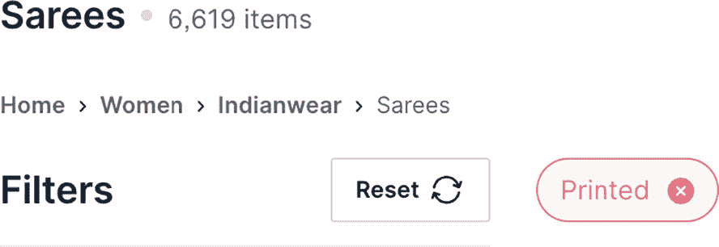
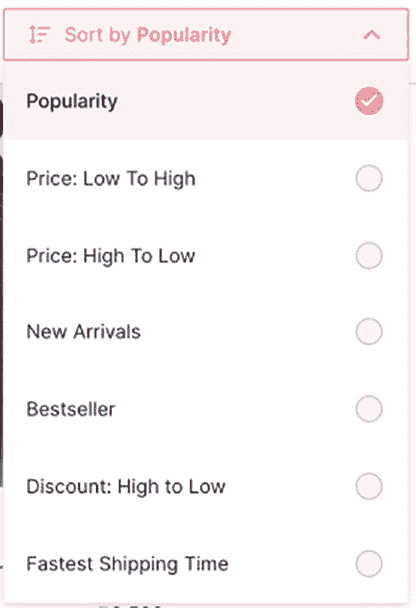
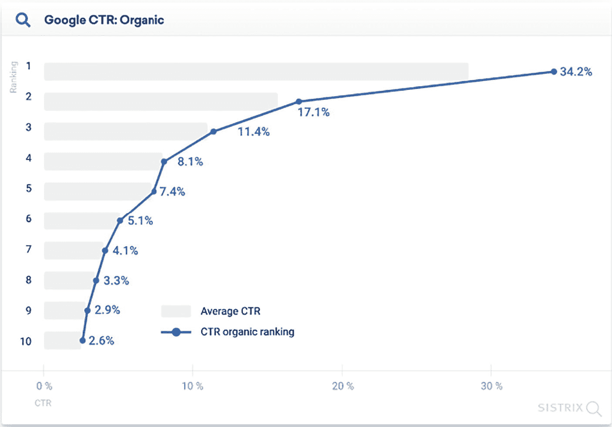
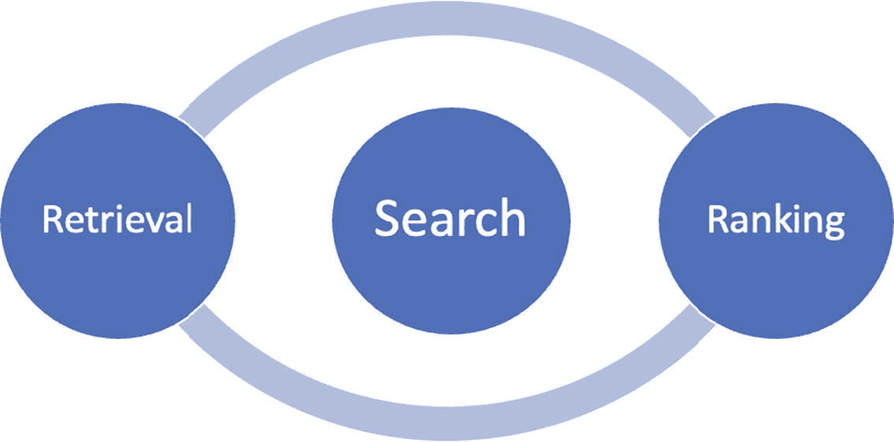
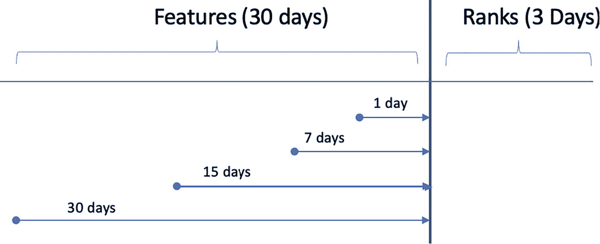
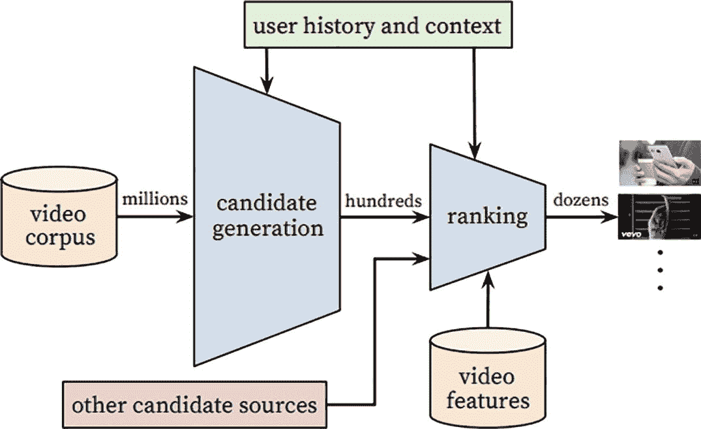
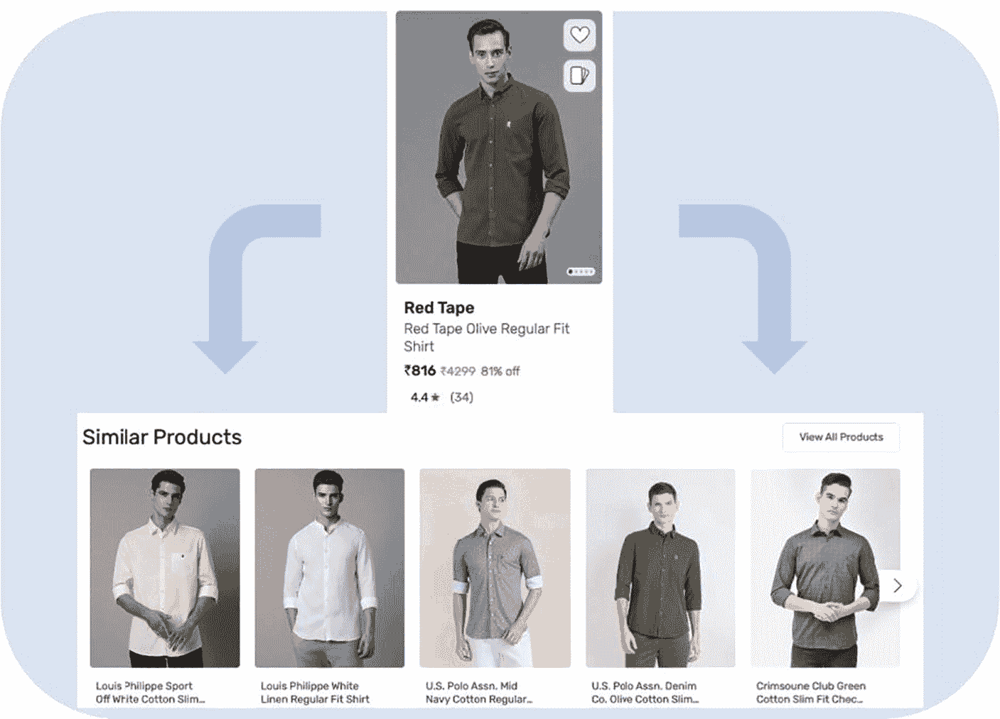

# 6. 排序：电子商务中的排序科学

## 引言

在电子商务平台的购物旅程中，搜索功能提供了一种更快找到所需产品的方式。使用搜索功能的买家，其转化率或下单率往往更高，大约是不使用搜索功能买家的四倍。使用搜索功能的买家通常有明确的购买意图，而搜索功能加速了他们找到产品的过程。排序算法通过帮助买家更高效地发现最相关的产品，进一步优化了这一旅程。

另一方面，相当一部分买家群体，尤其是在时尚电商领域，属于“探索者”。这些人积极寻求符合其独特偏好的多样性和选择。对于这一群体，虚拟销售助手被证明是不可或缺的，它能提供量身定制的推荐和建议，推荐他们可能感兴趣的产品。本质上，推荐引擎在时尚电商中扮演着虚拟销售助手的角色。在前一章中，我们讨论了为每位买家策划个性化选择的过程。此外，这些策划好的推荐还会通过排序算法进一步优化，以增强对买家的相关性，从而推动关键业务成果，如转化率和总商品交易额（GMV）。

在本章中，我们将深入探讨一种机器学习孪生概念——排序，它通常与搜索或推荐引擎一起使用。排序通过重新排列搜索结果或推荐顺序，在增强相关性、最终提升转化率和 GMV 方面发挥着关键作用。排序算法的作用不仅限于补充搜索和推荐；它们在独立场景中也有广泛的应用。排序算法被广泛用于对主页上的类别进行优先级排序，甚至在结账页面上重新排列支付选项。本章重点介绍排序背后的科学，包括开发排序模型的框架，以及创建标注数据和特征的过程。

## 电商中的排名

每天，成千上万的购物者访问电商平台并使用搜索功能来寻找商品。玛尼莎是一位常逛电商的消费者，最近她想在自己常用的手机应用上浏览纱丽。她输入了搜索词“印花纱丽”，页面显示有超过 77,000 种可选商品。

图 6-1

商品数量展示

面对超过 77,000 种选择，而每页只显示 50 件商品，玛尼莎要浏览所有选项会感到不知所措。这个挑战并非她这次搜索所独有，而是许多查询的普遍现象，因为相当大比例的电商搜索词都是短词组，通常少于四个词。此外，并非所有商品都同样相关；有些列表可能因时尚潮流演变而过时且不相关，而另一些则正流行并受到买家极大关注。应该采用什么机制来向买家展示最相关的 50 件商品呢？排名算法就是其中一种机制。

排名系统会优先展示最相关的 40 件商品。本章将进一步探讨实现这种排名的具体细节。

图 6-2

导航与商品数量

玛尼莎探索了另一个电商平台，并浏览了其商品分类。她遇到了超过 6000 种选择，但首页只显示了 40 件商品。这 40 件商品经过精心挑选和排列，以确保它们与她的搜索最为相关。

为搜索或导航排列这些商品的科学方法被称为排名。在电商平台上，商品有多种排名方式——按人气、价格从低到高、价格从高到低、新品上市、折扣从高到低、最快送达时间等。

其中一些排序或排列方法是单一维度的。例如，按价格从低到高排列，将价格最低的商品放在顶部，价格最高的放在底部。价格数据已经存在，在网页上显示之前会据此进行排序。这一功能让买家能快速找到符合其价格标准的商品，从而提升购物体验。然而，复杂性在于确保排序算法能高效处理庞大的库存和多样化的定价结构。此外，仅按价格排序并未考虑其他关键因素，如商品人气、评价或近期趋势，而这些都会影响整体购物体验。

图 6-3

电商平台上的排序选项

来源：[`https://www.nykaafashion.com/`](https://www.nykaafashion.com/)

其中一种排名选项是基于人气进行排列，这在各大平台（如亚马逊印度、Myntra 或 Nykaa Fashion 等）上都有提供。为什么会有这个选项？又如何定义这种人气呢？

由于“人气”一词具有多面性，基于人气排列商品变得复杂。人气可以通过多种指标来衡量，包括商品获得的点击次数、其曝光度的增长情况或总销量。这些指标往往并不完全一致；例如，点击率（CTR）高的商品如果转化不佳，可能并不会带来高销量；而销量强劲的商品可能点击次数不多，但买家满意度更高且更符合需求。此外，低价商品往往能获得更多浏览量，促销活动也会显著影响转化率。

机器学习模型可以平衡这些因素，从而全面评估商品的人气。这被称为人气分数或相关性分数。然后，这个综合的人气分数被用来在电商平台上有效地对商品进行排名，确保最相关、最具影响力的商品在商品列表页上得到突出展示。

正如玛尼莎的搜索和导航过程所示，大量商品在电商平台上争夺靠前的位置。由于首页只有 40 或 50 个展示位，选择最相关的商品需要一个有效的算法。这一点至关重要，因为买家通常在做出决定前只浏览几页。图 6-4 展示了点击率（CTR）在后续页面中如何呈指数级下降，凸显了确保最相关商品在首页得到突出展示的重要性。

图 6-4

排名与点击率（CTR）

在网络搜索中，点击率（CTR）从第一位（34.2%）到第五位（7.4%）显著下降 [7]。

同样，在电商平台上，随着商品位置的后移以及从首页到后续页面，点击率和转化率都会呈指数级下降。这一趋势可能归因于顶部展示了相关商品，和/或浏览访客如果在浏览初期未能找到相关商品，可能会失去兴趣。

目标是让商品出现在更靠前的位置，从而增加点击和转化的可能性。然而，只有少数商品能够获得顶部位置。这对买家和电商平台都至关重要：买家希望看到最相关的商品，而平台则希望推广能促进销售和转化的商品。

当玛尼莎未注册或未登录时，平台对她的选择和偏好了解较少。然而，平台不能简单地为每个位置随机选择商品。相反，它应该基于一种能提高点击和销售可能性的机制来展示商品。如果商品很受欢迎，表明更多买家认为它们相关且有用，那么这些买家中有一部分与玛尼莎有相似偏好的可能性就会增加，从而使这些商品对她来说也相关。因此，人气提高了商品对买家相关性的可能性，同时也为平台带来了更好的结果。

在电商领域，基于不同的表现特征，商品人气可以有不同层面。例如，有些商品订单量高，这归因于它们在市场上的长期存在以及低于平台平均售价的竞争性定价。这些通常是低价商品，得益于大幅折扣。相反，由品牌背书并在 Instagram 等社交媒体平台上推广的新上市产品系列，获得了高点击量，但转化率相对较低。尽管受欢迎，但这些产品的订单量却较低。另一方面，奢侈品牌和商品则价格更高，销量更少，但由于其高端属性，却能产生可观的收入。

鉴于这些不同的场景，为个体买家选择最合适的商品是一项复杂的任务。它需要综合考虑多种因素，如定价、折扣、促销和品牌吸引力。仅依赖单一因素不足以确定商品的人气；在电商中，人气是一个多维度的衡量标准。

电商平台上所有产品的热度是通过评估其综合表现来确定的。热度评估会综合考虑**表现**、**潜力**和**效率**等因素，这些因素共同决定了每款产品的热度。

表现指标涵盖单位销量、销售额和点击量等要素。然而，当产品获得更高的曝光度和更靠前的搜索结果排名时，其表现指标可能会因位置偏差或系统性优势而被放大。因此，仅凭表现指标可能不足以准确评估。

某些指标可能预示着负面表现，例如产品的高退货率。高退货率可能与多种因素相关，包括尺码不合、质量问题或配送延迟。在评估热度时，应考虑产品退货表现指标，尤其是那些归因于尺码或质量问题的退货。仅基于正面表现的热度评估，可能会让高退货率产品排名靠前，从而导致运营成本增加。

效率指标衡量产品在推动表现指标方面的有效性。这些指标包括点击率、加购率和转化率等比率，反映了产品在获得机会时实现成果的能力。然而，当基于小样本量时，效率指标可能具有误导性。例如，如果一款产品仅被五位访客浏览并收到一份订单，其转化率看似高达 20%。但这可能不足以证明该指标的有效性。因此，必须将表现指标与效率指标结合考虑，以确保对产品效果进行全面评估。

新品通常缺乏成熟的表现和效率指标。然而，这些产品在保持平台新鲜感、激发潜在买家兴趣方面发挥着重要作用。此外，知名品牌拥有自己的忠实受众，并对访客具有吸引力。因此，新颖性、品牌知名度以及点击量和浏览量等因素，可以作为这些产品巨大潜力的指标。

此外，当某个此前仅在竞争对手电商平台销售的品牌入驻本平台时，该品牌的某些产品可能会吸引用户关注。尽管本平台缺乏其表现数据，但该品牌在竞争对手平台上的产品评分、评论和排名等指标，可以为其潜在热度提供参考。因此，这些指标可纳入本平台评估这些产品热度的考量中。

最后但同样重要的是，在电商平台（尤其是时尚电商领域）展示产品时，多样性和新颖性是关键考量因素。引入多样化产品和推出新品不仅能丰富购物体验，还能满足买家更广泛的品味和偏好。对多样性和新颖性的重视有助于保持平台的活力和吸引力，鼓励购物者持续探索和发现 [8]。

## 排名函数

将多个属性组合成一个复合因子，用于对商业产品进行排序的方法称为排名 [1]。在电商中，排名是表现、潜力和效率特征的函数，可用于重新排列产品。这些因素被整合成一个排名分数，决定产品的排序和展示方式。这可以用数学公式表示为：

*   排名分数 = f(表现, 潜力, 效率)

在电商中，对产品进行排名需要评估表现、潜力和效率，以确保相关产品获得优先展示。产品浏览量、订单量和销售额等表现指标反映了当前的成功度和热度。新兴的浏览量增长和产品新颖性等潜力指标，则衡量了未来前景和日益增长的兴趣。点击率和转化率等效率指标，评估了产品将机会转化为实际销售的能力。通过整合这些因素，电商平台可以构建一个平衡即时成功与未来潜力的综合排名系统，从而优化产品的可见性和相关性。

排名的函数形式可以简单到线性模型，也可以复杂到高级算法，具体取决于所采用的特定排名系统。线性模型使用直接的计算方法（通常基于表现指标的加权和）来确定排名。相比之下，复杂算法可能采用先进技术，如机器学习或神经网络，基于多种因素及其交互作用来分析和排名产品。选择线性模型还是复杂模型，取决于排名系统的目标以及实现准确、相关产品排序所需的复杂程度。

总之，排名函数可以构建为确定性模型或预测性模型。在讨论排名函数形式的细节之前，有必要回顾一下排名及其在电商之外应用的历史背景。

### 排名简史

排名的应用已渗透到我们的数字生活中，影响着我们在各种在线活动中的选择和决策。其历史可追溯到 20 世纪 40 年代，当时排名的概念首次出现在经济学领域。几十年来，排名系统被广泛用于评估大学和学院 [3]。然而，真正将排名算法推向主流的是谷歌在 1998 年开发的 PageRank 算法 [2, 4, 5]。

### Google PageRank – 革新搜索技术

PageRank 算法是谷歌搜索结果的核心支柱 [2]，它彻底改变了我们在线检索信息的方式。通过分析网页之间的链接，PageRank 为每个网页分配一个排名分数，从而判断其与用户搜索查询的相关性。

“PageRank 的工作原理是计算指向某个页面的链接的数量和质量，以粗略估计该网站的重要性。其基本假设是，更重要的网站更有可能从其他网站获得更多链接” [9]。

该算法的成功激励了其他科技巨头将排名算法整合到自己的平台中，从而催生了多样化的应用。

排名算法已渗透到我们在线体验的方方面面，塑造了我们与技术平台的互动方式，并影响着我们的决策过程。除了谷歌搜索和 PageRank 之外，以下是一些值得注意的例子：

*   **必应排名**：微软的必应搜索引擎采用了一种复杂的排名算法，该算法会考虑用户相关性、查询上下文和文档质量，确保用户获得相关且满意的搜索结果。

*   **Facebook 信息流算法**：Facebook 的算法根据点赞、分享和评论来确定对用户最相关的动态，优先推送那些不仅引人入胜，而且能在用户社交圈内产生共鸣的内容，从而影响用户的在线互动和社交体验。

*   **亚马逊产品排名模型**：亚马逊的算法利用评论数量、平均评分和产品价格等因素，确保产品排名与用户偏好保持一致，引导用户找到可能满足其需求和期望的产品。

这些例子展示了排名算法的多功能性和适应性，它们已成为塑造用户体验、影响数字领域决策过程不可或缺的工具。

在电子商务领域，排名算法扮演着关键角色，它决定着产品的展示顺序，影响着用户行为、购买决策，并最终影响销售业绩。与分类或回归任务不同，排名涉及根据多种因素，以最优且相关的顺序排列项目。

产品排名在电子商务体验的多个方面都发挥着至关重要的作用。以下是一些常见的应用场景：

*   **搜索结果排名**：当用户输入搜索词时，产品会根据其排名分数进行展示。这确保了最相关、最吸引人的产品出现在顶部。

*   **产品推荐重排序**：推荐的产品通常会根据一个考虑用户偏好、产品热度和历史互动的排名分数进行重新排序。这能个性化购物体验，并提高转化率。

*   **品类和品牌 PLP（产品列表页）**：品类和品牌页面上的产品会根据其排名分数进行排列。这有助于用户在大量商品中导航，更高效地找到他们想要的东西。

## 电子商务中的搜索排名

当 Manisha 在电商平台上搜索“印花纱丽”时，搜索功能会将搜索词与产品进行匹配。该平台大约有 6000 件符合搜索条件的纱丽。搜索结果首页会显示 40 件产品，之后才会出现分页，供用户探索更多搜索结果。排名算法使平台能够为搜索结果落地页选出最相关的 40 件产品。其目标是针对给定的搜索词，提高这些产品与用户的相关性。

考虑到关于 Manisha 偏好和品味的有限信息，使用热度作为展示产品的方法可能很有效。其假设是，如果产品很受欢迎，说明它们受到许多买家的喜爱，这也会增加这些产品符合她偏好的机会。

电子商务搜索使买家能够从平台上浩瀚的商品海洋中发现他们需要的产品。即使是速度和搜索结果质量上最微小的改进，也能对收入和用户体验产生显著影响 [6]。

搜索过程包括两个阶段：产品检索（搜索），然后根据热度排名展示产品，以改善用户体验和业务影响，例如点击率和转化率。上一章介绍的针对搜索词检索相关产品是初始阶段。

图 6-5 直观地展示了在电商平台上创建有效搜索旅程所涉及的两个关键阶段。

图 6-5

排名与检索在搜索中的作用

根据产品热度进行排名至关重要。热度是多维度的，涉及衡量产品热度的各种性能、效率和产品特性。

与 Manisha 类似，成千上万的用户正在电商平台上搜索“印花纱丽”。从检索到的 6000 件印花纱丽中，会展示基于历史数据得出的前 40 件最热门产品。这些产品是根据高搜索点击率、更好的转化率、更高的点击量和订单量等特征来选择的。这种方法确保向用户展示最相关、最受欢迎的产品，从而提升他们的购物体验并增加购买的可能性。

热度得分可以使用确定性或概率性方法进行建模，并结合产品的性能、潜力和效率特征。概率模型通常利用机器学习技术，能够捕捉这些因素之间复杂的相互作用，并提供更细致的结果。用于热度排名的常见机器学习方法包括 XGBoost 排序器和基于深度学习的排序模型，这两种方法都能提高产品排名的准确性和相关性。

## 排名：一种确定性模型

诸如产品浏览量、订单量和销售额等绩效因素，以及点击率、加购率和转化率等效率属性，都可以考虑用于通过排名函数计算综合得分。当像玛尼莎这样的用户搜索印花纱丽时，这些综合得分便用于对产品进行排名。

排名函数的一种较简单形式可以是确定性方法。在此方法中，为每个绩效因素和效率属性分配权重，以计算综合得分。权重的确定基于业务背景和标准，并在与相关业务利益相关者讨论后得出。这种方法允许根据预定义的优先级和目标，对产品进行清晰且一致的排名。

像 Flipkart 这样的电商平台每年都会举办“十亿大促”活动，在此期间，更多打折产品会展示给用户。在基于确定性的综合排名得分方法中，会为产品的折扣百分比分配更高的权重，以反映其增加的吸引力。

同样，在节日期间，新品和潮流产品备受追捧。在排名得分中，会给予新品和时尚产品更高的权重，以匹配用户偏好和季节性趋势。这种自适应权重确保根据当前背景和用户兴趣，突出显示最相关的产品。

在确定性方法中，根据预识别因素的重要性为其分配权重，并据此计算产品的综合流行度得分。此方法在实践中可能很复杂，因为产品可能出现在各种页面上，包括品牌页、品类页或搜索结果页，权重的任何变化都会影响所有这些列表。在促销或季节性活动期间，会调整相关因素的权重，以突出显示更相关的产品。例如，虽然“新颖度”通常可能占得分的 5%，但在促销期间可能会增加到 10%，以更好地代表新品。

用于产品排名的确定性方法是一种简单且透明的方法，用于创建综合得分来排列产品，例如在电商搜索结果中。然而，它也带来了一些挑战和局限性。

像 Myntra 或亚马逊这样的电商平台处理着数十万个搜索查询词，每个词都与大量待排列的产品相关联。如搜索章节所述，搜索词会被规范化，以将意图相似的查询聚合到同一个规范化查询中。例如，“男士 T 恤”和“男式 T 恤”可以归入同一个规范化查询。

然而，管理分配给每个规范化查询的权重可能相当费力。此外，所使用的产品绩效和效率属性基于历史数据，不一定能反映它们将如何影响未来的产品表现。这一局限性使得难以动态适应不断变化的趋势和用户行为。

## 排名：一种机器学习模型

可以利用监督机器学习框架在每个规范化搜索查询内创建排名得分。排名的目的是改善业务指标和用户体验。

标记排名对于开发产品排名模型至关重要。为每个主要搜索查询的产品分配排名的一种方法是基于人工审核和业务知识。然而，考虑到搜索查询的数量，这种方法可能具有挑战性并成为瓶颈。

一种系统化且自动化的方法，用于为每个搜索查询的产品分配排名，是使用函数形式。该形式可以结合总销售额、订单数和转化率。可以在产品和搜索查询之间分配权重。虽然订单数可能因低价商品的高销量而偏向于它们，但考虑转化率会优先考虑那些被更频繁推荐或展示给更广泛受众的产品，确保流行度不仅仅由价格决定。

*   排名 = f(总商品交易额, 订单数, 转化率)

这三个因素的权重通过模拟和分析确定，同时考虑了各因素不同的测量尺度。在应用权重以得出最终值和排名之前，会使用缩放后的值。

用于排名模型的基于机器学习的预测建模结构，涉及创建三天的排名，并利用前 30 天的窗口来生成特征。

图 6-6

监督排名模型开发的结构

为了构建这些特征，使用了多种产品绩效驱动因素和产品属性。考虑了以下基础特征：

*   **产品特征：** 颜色、版型、图案等。
*   **绩效统计：** 订单数、销售额、产品浏览量等。
*   **效率比率：** 加购率、转化率等。
*   **反馈：** 退货率、评分、评论

电商平台上的产品评论数据提供了宝贵的见解，可以增强流行度排名模型。然而，由于评论是文本形式，在将其整合到排名模型之前，必须将其转换为数值特征。

特征提取的常见方法包括计算情感得分，例如正面和负面情感的百分比，并将这些转换为排名值（例如，产品是否基于正面情感进入前 20%）。此外，自然语言处理（NLP）和 Transformer 模型可以识别与产品相关的热门标签。还会考虑诸如评论数量和这些标签的正面情感得分等特征。例如，如果一个标签频繁突出产品设计问题，那么与该标签关联的产品可能会被排名较低。

在基于深度学习的排名系统中，文本评论可以使用先进技术转换为嵌入向量。这些嵌入向量捕捉了评论的语义含义，允许模型直接将其用作输入。这种方法使排名系统能够利用评论中包含的细微信息，例如整体情感和上下文，以提高产品排名的准确性和相关性。

预测性机器学习模型方法利用历史特征来预测未来一段时间的相关排名。

***案例研究：时尚产品搜索结果排名***

***背景***

*一家印度时尚电商平台希望为其买家打造无缝且个性化的购物体验。超过 30% 的买家使用该平台的搜索功能，其中大多数人会点击搜索结果中展示的产品。这种体验的一个关键方面是有效地对时尚产品的搜索结果进行排名，确保买家看到最相关和最吸引人的商品。*

*时尚产品多样且动态的特性，涵盖了广泛的风格、品牌、颜色、尺寸和价格区间，这使得准确评估它们对个体买家的相关性和吸引力颇具挑战。排序列表还需要与最新的潮流和偏好保持一致。*

***目标变量***

*设计基于机器学习的排序系统* *需要标注数据。然而，由于平台产品数量庞大，为每个搜索词手动对产品列表进行排序既不切实际，成本也过高。*

*基于 3 天的时间周期，我们考虑了这些产品在搜索旅程中的产品销售额（GMV）、转化率和点击率。根据业务讨论，这三个因素的权重分别设为 60、20 和 20，以得出每个搜索查询内产品的排序。*

***特征***

*在特征构建方面，我们分别针对搜索旅程和所有旅程，在过去 90 天内创建了产品表现特征。针对这些变量，我们构建了时变特征以捕捉趋势和模式。*

*除了表现和流行度特征外，还考虑了产品内在特征，如销售评论、评分和退货率。*

***模型***

*采用带有列表级排序目标函数的梯度提升树算法来开发模型排序。这种方法被称为“学习排序模型”。*

***评估***

*该模型使用精确率/召回率@5 和@20 以及平均倒数排名（MRR）等指标进行评估。在平台 10%的流量上评估模型显示，业务指标有显著提升，点击率提高了 2%，转化率提高了 0.2%。*

## 排序算法：学习排序（LTR）

学习排序（LTR）是现实系统中广泛使用的技术，用于在电商平台上作为搜索和推荐的后续阶段生成有序列表。LTR 因其多功能性和有效性而在各种基础排序器中脱颖而出。它采用全局评分函数来评估候选集中每个项目的相关性，并根据这些分数生成有序列表。

定义损失函数有多种方式，该函数用于量化预测排序与真实排序之间的差异。选择合适的损失函数对于有效训练模型至关重要。学习排序模型中通常使用三种函数形式：点级、配对级和列表级。每种形式都有其自身的优势和挑战。

点级学习排序（LTR）方法侧重于最小化每个项目的预测相关性分数与其实际相关性分数之间的个体误差。

配对级学习排序（LTR）则采用不同的方法。它不关注单个项目，而是将排序问题转化为二分类任务。这涉及从给定的有序列表（学习示例）中创建项目对，并根据它们的排序对每一对进行标记。

点级和配对级方法都存在局限性，因为它们的损失函数没有考虑整个排序列表，从而导致排序效果欠佳。

列表级方法通过将整个排序项目列表作为输入，并利用多变量损失函数来确定最优的有序列表作为输出，从而解决了这些局限性。这种整体方法考虑了项目的相对顺序，从而产生更准确、更有意义的排序。

列表级排序列表可以通过一组指标进行评估。这种方法通过考虑整个排序列表来衡量排序的质量。这些指标在电商领域尤其相关，因为用户通常只关注列表中的前几个结果。

*   平均精确率均值（MAP）总结了所有可能截断点处的精确率。

*   平均倒数排名（MRR）衡量排序列表中第一个相关项目的平均倒数排名，提供了一种简单有效的方法来评估排序质量。

*   归一化折损累计增益（NDCG）考虑了相关项目在排序列表中的位置，位置越靠前，权重越大。

在搜索结果或推荐结果的顶部找到相关产品，对买家体验和转化率都有显著影响。如前所述，确保最相关的项目被突出显示，可以提升用户满意度并推动更高的销售额。NDCG（归一化折损累计增益）专门衡量最相关产品在列表顶部的定位效果。它通过应用一个随相关项目排名降低而呈指数级衰减的折损因子，来考虑相对位置的重要性。这种方法确保该指标能反映排名靠前的项目在影响买家决策和实现更好的业务成果（如转化率或 GMV）方面具有更重要的意义。

排序算法的强大功能不仅限于电商搜索。它们在重新排列电商平台上的推荐列表、为个体用户定制以提供更具吸引力的购物体验方面也发挥着至关重要的作用。在下一节中，我们将深入探讨专门为推荐系统开发排序模型的方法，探索优化产品推荐和提升用户参与度的技术与策略。

## 电商推荐排序

为了提升用户体验并推动销售，电商平台采用推荐引擎向每位用户推荐相关商品。这些推荐引擎通常包含两个阶段：候选生成和候选排序。

候选生成阶段涉及从庞大的商品目录中识别出可能与用户相关的商品子集。此过程通常利用推荐引擎算法，其中深度学习框架因其处理多种数据类型和高效扩展的能力而日益流行。

排序阶段则根据候选商品与用户的相关性对其进行优先级排序。这正是排序算法发挥作用的地方。排序算法分析用户数据、商品特征和上下文因素，以确定向用户展示商品的顺序。

图 6-7 展示了在 YouTube 上呈现视频推荐的步骤。

图 6-7

推荐与排序

来源：[`https://dl.acm.org/doi/pdf/10.1145/2959100.2959190`](https://dl.acm.org/doi/pdf/10.1145/2959100.2959190)

## 相似商品推荐的排序

在在线时尚领域，“相似商品”推荐并非只是橱窗装饰——它们是推动转化的强大引擎。浏览商品详情页（PDP）的买家依赖它们，就像信赖一位值得信赖的造型师，来发现心仪商品并做出购买决策。虽然只有 10%–20%的印度时尚电商访客会在商品详情页上积极与这些推荐互动，但他们是购买意向强烈的买家，随时准备下单。因此，优化这些建议的排序对于提升转化率至关重要。

用户对“相似商品”的期望，既源于商品的内在特征（如款式、材质和颜色），也源于其视觉元素（如图案、形状和色彩）。相似商品推荐引擎会进行商品特征匹配，从图片中提取视觉线索，并结合商品流行度数据，动态生成相关的商品推荐。这确保了用户发现的商品不仅在款式上匹配，而且符合当前潮流，最终带来更令人满意、更具吸引力的购物体验。

即使商品特征（如颜色或图案）保持不变，相似商品推荐也可以定期且有效地进行刷新。这是通过更新从买家互动和购买模式中推导出的隐式因子来实现的，这些因子同时被捕捉在用户特征矩阵和商品特征矩阵中。随着买家行为的变化，这些更新确保了推荐能够动态适应随时间变化的偏好。此外，基于机器学习的排序系统会整合更新的商品指标，持续优化向买家展示的商品。这种方法确保了推荐即使在非个性化场景下，也能保持相关性并与当前趋势和表现数据保持一致。

在电商平台上，买家会在所选商品下方看到五条“相似商品”推荐，并可以选择探索更多相似商品，如下图所示。然而，大多数互动都发生在默认显示的列表中。因此，首要目标是确保该组件中的前五个商品是最相关、最具影响力的，从而最大化业务成果。这涉及设计排序算法，为每位买家优化这些顶部商品的展示位置。

图 6-8 展示了相似商品推荐的布局示例。

图 6-8

相似商品展示布局

相似商品推荐的候选列表通过以下方式生成：基于图像的相似商品生成——识别具有相似视觉元素（如图案、颜色和形状等）的商品；以及基于商品属性的相似商品生成——整合基于商品描述和规格（如材质、尺寸或品牌）的特征。

候选的相似商品使用学习排序（LTR）进行重新排列。该模型优先考虑近期销量高、用户评分高和点击率高的商品，确保买家看到的商品不仅相关，而且受到他人好评。

由于电商行业的动态特性，学习排序（LTR）模型面临着若干挑战。例如，在时尚电商中，潮流变化迅速，新设计可能很快变得流行。然而，这些新产品可能缺乏历史数据，使得 LTR 模型难以有效地对它们进行排序。数据质量至关重要；数据中的偏差或不准确会显著影响模型的结果。此外，基于深度学习的排序模型虽然强大，但可能出现过拟合，尤其是在没有充分正则化或过度依赖历史模式的情况下。

例如，当用户在电商平台上浏览一双厚底运动鞋时，用户会看到符合当前偏好的流行选项，从而获得更令人满意的购物体验。

## 结论

排序对于帮助买家找到相关商品以及用户在数字平台上发现信息至关重要。无论是电商平台、搜索引擎还是流媒体服务，通过排序对商品、内容或服务进行战略性展示，都能显著提升用户体验。

谷歌开创性的 PageRank 算法凸显了排序系统的威力，彻底改变了我们与信息互动的方式。如今，排序已成为数字成功不可或缺的组成部分，需要战略性的方法和持续的优化。

电商的繁荣依赖于相关性。通过将最相关的商品置于首位，平台提升了买家体验，推动了转化，并培养了忠诚度。排序的重要性在各个触点上显而易见，从在首页展示排序后的选项列表，到显示排序后的搜索结果和浏览页面。

随着数字格局的演变，电商平台成为数百万买家的核心舞台，排序算法在整理这些平台上的商品或选项中扮演着关键角色。首页上的个性化品类序列和组件选项能够吸引用户并改善他们的体验。在搜索过程中，排序后的商品列表能提高点击率（CTR）和转化率。搜索排序通过机器学习（ML）和人工智能（AI）算法实现。同样，列表页上的推荐和商品，也会在已识别候选的基础上，通过排序算法进行增强。

在下一章中，重点将放在个性化如何提升买家体验上。除了在搜索和推荐中进行个性化排序外，个性化还通过布局个性化、个性化优惠和促销活动，影响买家在电商平台上的旅程，从而改善买家体验和业务成果。

