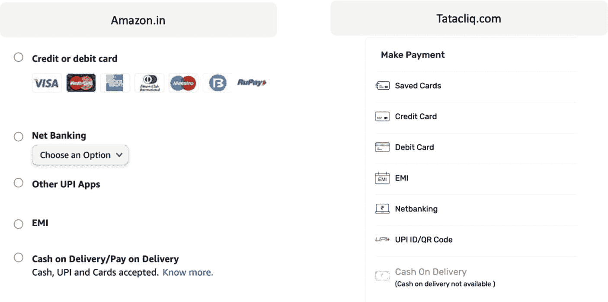

# 7. 个性化——AI 打造的客户体验

## 引言

搜索页面和分类导航页面上的产品会进行排序，以提升其与买家的相关性，从而提高用户参与度并改善业务成果，例如更高的转化率和商品交易总额（GMV）。虽然排序通常受产品属性和新兴趋势的影响，但通过个性化——即根据单个买家的偏好对产品进行排序——可以显著提升性能。本章将探讨个性化排序的概念以及产品个性化的其他各种用例。

推荐引擎用于实现个性化，但并非所有推荐都是个性化的。例如，相似产品推荐最初可能并非个性化，因此需要创建一个额外的个性化重排序层，以便为每位买家提供个性化推荐。

个性化不仅限于搜索和推荐，它影响着电子商务及电商平台上买家触点的每一个环节。在本章中，我们将探讨几个场景，以及个性化如何推动电子商务的性能提升。

莫辛在班加罗尔经营一家服装时尚店，他有一位常客名叫贾斯敏，住在附近的一个公寓小区。贾斯敏来到店里，请莫辛为她展示几件适合即将到来的婚礼的连衣裙。莫辛熟悉贾斯敏的风格、偏好以及确切尺码，于是挑选了一组选项，贾斯敏从中选出了她最喜欢的一件。贾斯敏在大量选项中无缝浏览，节省了时间，也促进了更快的购买决策。这是一个利用个性化与情境化知识创造流畅用户体验或客户体验的例子。

虽然莫辛的个性化方法对少量用户效果很好，但他注册了一家时尚电商平台。该电商平台每天有数百万的访客。平台需要能够提供类似于莫辛那样的个性化体验。一种方法是，有成千上万像莫辛一样的人，他们观察用户正在做和已经做过的事情，以形成对用户的看法。一旦用户登录平台，他们就开始推送与每位用户相关的选项和产品。

上述为用户创建手动但个性化信息流的方法不可扩展且成本极高。平台甚至可能无法提供同等水平的个性化体验。那么，人工智能和机器学习如何帮助莫辛/电商平台在拥有成千上万甚至数百万用户的情况下，也能提供个性化体验呢？

每天有数百万用户访问电商平台。一家时尚电商平台如何满足其数百万日访客的个性化需求？

杰夫·贝佐斯在 1998 年提到，如果亚马逊平台上有 450 万客户，那么就应该有 450 万家店铺[1]。这是他当时的愿景，而人工智能/机器学习正是实现这一愿景的推动力。

电子商务中的个性化是指根据用户情境和偏好来定制购物体验。在本章中，我们将探讨电商环境中广泛的个性化策略和示例，并研究它们是如何利用人工智能（AI）和机器学习（ML）实现的。

电子商务中的个性化核心在于利用更新的买家信息来定制产品推荐和搜索结果。首先，捕获所有关于买家的相关细节至关重要。一旦收集完毕，这些信息必须能被算法访问以进行进一步处理。然后，这些算法根据特定目标，使用更新后的数据来优化推荐、搜索结果及其他功能。

捕获、处理数据并将其集成到算法中的过程涉及各种技术组件和一个精心设计的架构，以实现有效的个性化。

**设想一个场景：** 亚历克斯是某电商平台的常客，他搜索“蓝色 T 恤”。他的个人资料中包含了对品牌和价格区间的偏好，这些信息被用来定制搜索结果。买家的资料存储在客户数据平台（CDP）中，例如 Elasticsearch，并与搜索查询结果一起被利用。系统会根据亚历克斯的个人资料和当前的搜索结果，执行实时的个性化重排序。

## 基于位置的个性化

玛尼莎看到一则电视广告后访问了一个电商平台。这是她第一次访问。平台识别出她来自班加罗尔。网站首页优先展示了与班加罗尔访客产生共鸣的品类；这是基于位置进行的。考虑到这是她的首次访问，平台展示了针对首次访客的相关优惠和折扣。这个优惠力度很大，并且可以在各个品类和品牌中使用。

她点击了第一个选项，开始在平台上探索。基于位置的个性化和情境化（首次访客）优惠吸引着玛尼莎进入旅程的下一步。

她点击了女装印度服饰品类（尽管这并非个性化推荐，因为系统无法识别性别），并在女装类别中进一步探索库尔塔套装。她进入了“库尔塔套装”分类，看到了一系列库尔塔套装。这些库尔塔套装根据该地区的流行度进行了优先排序，供她查看和探索热门产品。她在产品间浏览，并将几件加入了心愿单。她结束了当天的探索之旅，留下了大量关于她兴趣和偏好的信息。

平台捕获了她在不同品牌和品类中浏览、购买和加入心愿单的信息。这些丰富的数据成为理解独特偏好和打造超个性化体验的关键[2]。

对于像玛尼莎这样的首次访客，平台会根据设备类型（例如，iOS vs. Android）和/或基于位置的个性化进行定制。如果有人访问网站或未启用位置跟踪，则可能无法获取位置信息。

## 首页个性化

几天后，Manisha 再次访问该电商平台，并进入了移动应用的首页。这是她的重复访问。电商平台根据设备 Cookie 识别出她。Cookie 可以存储浏览历史之外的各种数据点，包括位置和设备类型。即使她未登录，首页也会根据从 Cookie 中提取的数据进行个性化设置。

电商平台的首页包含几个重要元素：分类导航、主横幅（展示优惠活动的大型视觉区域）以及其他一些小部件或版块。但对于回头客来说，诸如“最近浏览”、“历史购买”和“为你推荐”等个性化小部件会开始向买家推送。

平台识别出 Manisha 对印度服饰感兴趣，偏爱 Westside 品牌（基于她之前访问中的点击行为），并且她的价格承受能力高于平均水平。系统映射出她的偏好，并拉取带有这些特征标签的主横幅图片。横幅视觉图突出展示了网站品牌，并配有一位身着库尔塔套装的女士形象。同时，分类轮播中的分类顺序也针对她进行了个性化调整。首页内容根据她的兴趣进行调整，让她感到兴奋。

除了个性化的主横幅和分类外，首页上还可见个性化小部件，包括“最近浏览的商品”和“根据浏览历史推荐的商品”。这些小部件的创建旨在建立与之前访问的连续性，以帮助她完成购买旅程。机器学习算法会识别出当用户浏览 Manisha 之前访问中浏览过的商品时，通常会被探索或购买的额外商品列表。这些商品帮助她探索平台上可用但相关且个性化的选择。

这两个个性化小部件是产品推荐的例子，但电商的个性化远不止于产品推荐。着陆页布局、上下文搜索以及展示精选优惠和促销活动，是电商首页个性化的一些额外维度。在动态布局中，首页的颜色和布局会根据买家偏好进行调整，营造出一个熟悉且诱人的空间，感觉就像是为他们量身定制。在上下文搜索中，搜索词的理解会考虑之前的浏览和购买行为。例如，由机器学习驱动的智能搜索能够理解“kurta”这个搜索词，并根据浏览历史将其映射到女式库尔塔套装，根据 Manisha 对该分类的点击行为，向她展示更多女式库尔塔，而非男式库尔塔。

对于 Manisha 来说，整个首页都是个性化的，展示了最近浏览的商品、与之前旅程相符的额外选项，并且优惠活动也是为她定制的。这为 Manisha 创造了顺畅的购买旅程，并促使她进行商品探索。

首页，或称数字门户，在电商中对于创造引人入胜且个性化的体验至关重要。当买家访问首页时，可以专门为他们量身定制，每个小部件都根据他们的个人资料和偏好进行个性化设置。

例如，如果买家是来自印度南部的男性，首页可以定制为展示与该人群相关的产品分类和推荐。此过程涉及将买家的人口统计和地理详细信息映射到分类表现矩阵。这个矩阵类似于用户-项目交互矩阵，将分类表现与买家细分群体联系起来。它被分解为一个分类特征矩阵和一个买家细分群体特征矩阵。

为了个性化首页，每个买家根据其个人资料被分配到一个细分群体。然后，将该买家细分群体的特征偏好与分类特征矩阵进行比较。这种比较会识别出相似的分类，然后对这些分类进行排序，以确保最相关的分类出现在首页上。

此外，首页上的每个小部件和功能——例如横幅、产品推荐和促销内容——都可以进行个性化设置，以提升买家体验。通过根据买家的个人资料和互动动态调整这些元素，电商平台可以提高参与度和满意度。

现在，我们将探讨一个案例研究，了解印度领先的时尚电商平台 Myntra 如何个性化其店面。他们如何为用户创造个性化体验，以及改进后的旅程带来了什么影响？

***案例研究：Myntra 的店面定制*** ******[3***,*** 23***]***

*印度领先的时尚电商平台 Myntra 正在通过超个性化重新定义购物体验。一个复杂的人工智能引擎将其首页（称为“店面”）转变为为每位顾客精心策划的时尚空间。*

*Myntra 超越了基本的数据收集，以理解其顾客“时尚品味”的精髓。顾客的“时尚品味”不仅包括偏好的品牌和分类，还包括他们对特定产品属性（如颜色、面料，甚至偏好的版型）的微妙倾向。这种丰富的偏好图景在个性化店面中得到了考虑。*

*Myntra 的人工智能引擎通过已购商品解读个人风格，提取关键特征，如偏好的品牌、颜色、面料和款式。与每个横幅相关联的特征是根据对横幅和目标商品的点击得出的。通过将顾客的“时尚品味”与每个横幅的精髓相匹配，Myntra 的人工智能编排出一场店面交响乐，其中每个广告都直接与个人品味对话。*

*“通过这一改变，同时进入 Myntra 应用商店的两位用户会看到完全不同的商店，以满足他们的时尚购物需求”* **[3*]。*

*电商平台的首页包含各种小部件，例如横幅、推荐版块和行动号召旅程小部件，每个都包含特定内容。目标是动态排列这些小部件，为个人用户量身定制首页体验。为此，采用了一种称为上下文多臂老虎机的强化学习算法来为每位买家生成个性化布局。*

*该平台利用联邦架构来最小化延迟，确保快速响应的交互。排名服务通过内存缓存进行管理，这有助于进一步减少响应时间。此外，系统集成了近实时和批量数据管道，以平衡数据的时效性与全面处理的需求。根据性能指标，此服务的 p99 响应时间为 50 毫秒，表明这是一个高效且响应迅速的系统。*

个性化是一种在多个触点上吸引客户并为电商业务带来成果的体验。个性化提高了用户访问的转化率以及他们再次光顾的可能性。在下一节中，我们将详细探讨个性化带来的影响。

## 个性化在电子商务中的影响

个性化已深深融入电子商务的肌理。其根源可追溯至在线购物的黎明时期，亚马逊和 eBay 等先驱在 20 世纪 90 年代便开始利用其力量。快进到 21 世纪初，推荐引擎成为个性化的首选工具。亚马逊的协同过滤算法，根据用户过往行为，巧妙地引导他们进行下一次购买。

进入 2010 年代，格局发生了剧变。人工智能（AI）和机器学习（ML）成为新的主导力量，实现了更精准的预测和实时调整。个性化不再局限于产品推荐，而是被用于个性化电子邮件、聊天机器人、虚拟助手，甚至动态网站内容，所有这些都旨在根据个人偏好定制体验。

过去几年，超个性化经历了飞速崛起。每一次点击和操作都被剖析和分析，实时塑造产品建议和内容。可以将其视为一种专为用户量身定制的购物体验。自然语言处理（NLP）和计算机视觉等技术进一步完善了这些策略，将个性化扩展到促销、折扣和忠诚度计划。

个性化已不再是差异化优势，而是生存的必需品[4]。客户对个性化的期望日益增长——73%的购物者希望品牌能够理解他们独特的需求和期望[5]。一个成功的个性化项目可以带来显著的商业影响，“客户满意度提高 20%，销售转化率提升 10%至 15%”[4]。根据麦肯锡的研究，擅长个性化的公司比普通公司多创造 40%的收入[5]。

以下描述了电子商务平台及整个营销漏斗中成功个性化项目的优秀案例。

*   **BigBasket：** 这家印度生鲜平台通过向客户发送时机精准的推送通知，将点击率从 1.8%提升至 2.5%–3%，并实现了购物车添加量的激增（提升 26%）[4]。

*   **多品类电商平台：** 一个销售时尚、鞋类、配饰、电子产品和奢侈品等多个垂直品类的电商平台，利用个性化实现了 2 倍的收入增长和 35%的客户参与度提升[7]。

*   **Tata CLiQ：** Tata CLiQ 是印度塔塔集团旗下 Tata Unistore Limited 拥有的全渠道市场平台。该平台利用个性化消息进行购物车放弃挽回活动，使点击率（CTR）提升了 1.5 倍[8]。

*   **Paytm：** 印度金融服务公司 Paytm 在其首页上提供个性化推荐，观察到 Paytm Mall 首页的转化率达到 5.5–6%[9]。

*   **丝芙兰：** 丝芙兰成立于 1970 年，于 1997 年被 LVMH 集团收购，在全球 33 个国家拥有约 2300 家门店。丝芙兰正在投资人工智能，用于个性化产品推荐[10]。

这些只是少数已发表的研究，它们突显了个性化的重要性。个性化在电子商务的各个接触点都发挥着作用。

随着深度学习和大语言模型的出现，买家行为的细微细节——例如在电商平台上的反馈、点击和购买——被捕获并表示为嵌入向量。向量数据库进一步增强了近乎实时地利用这些细节的能力，从而在电商平台上实现高度个性化的搜索结果和其他针对买家的特定功能。为机器学习模型创建和管理大量特征的挑战已通过深度学习的能力得到缓解，深度学习可以有效地处理数百个特征并进行高效扩展。

在这个超个性化的时代，集群或细分群体的数量限制不再是制约因素。个性化工作越来越聚焦于单个买家层面，从而提供更具针对性、更精准的买家体验。

以 Manisha 为例，她再次自然访问了平台，但电商平台不能仅仅依赖访问者记得回来。负责提升现有客户或访问者参与度的营销团队，通常被称为客户关系管理（CRM）团队，其工作是设计活动以吸引访问者返回平台。个性化的电子邮件营销可以显著改善关键绩效指标，包括打开率（打开邮件的收件人百分比）、点击率（点击邮件内链接访问电商平台的收件人百分比）和交易率（最终在平台完成购买的收件人百分比）[6]。

## 营销中的个性化

玛尼莎正全神贯注地浏览一个电商平台，这时她接到了办公室的电话，购物过程戛然而止。和玛尼莎一样，95%–98% 的顾客会在购物过程中流失，不会在访问电商平台时购买任何商品。

只有 1%–3% 的访客最终会购买商品，这使得时尚电商的转化率大约在 1%–3% 左右。几小时后，平台向玛尼莎发送了一条通知，提醒她曾浏览但未购买的商品。玛尼莎点击了通知，页面将她带回了她之前浏览过的商品。这是一次成功的通知，提醒并激发了玛尼莎重新与平台互动的兴趣。

营销团队专注于设置通知，以加强客户重新参与的努力。这些活动通过不同的信息和促销优惠结构来运行，以提高通知活动的响应率。访客是否会响应或点击通知并返回平台，并非一个“一刀切”的场景，而是一个多维度的场景。一个基于机器学习的框架帮助营销团队识别出对每个用户有效的方法。这有助于提高通知响应率或点击率。

玛尼莎重新开始了她的商品发现之旅，浏览了各种库尔塔套装，大多是印花和刺绣款式，并将商品加入了购物车！这是购物过程中的一个重要事件——加入购物车。大约 5%–10% 的电商访客会到达这个阶段。这被称为加购率，即至少将一件商品加入购物车的访客百分比。她将商品留在了购物车中，结束了她的购物之旅。

像玛尼莎一样，有相当数量的用户将商品加入购物车，但在访问期间并未购买任何东西。研究表明，印度的购物车放弃率约为 51%，原因包括意外运费、货到付款选项、商品价格变动、与其他电商平台相比价格过高、缺乏商品评价等 [14, 15]。同样，营销团队利用客户关系管理系统和流程，通过（可能）发送通知来重新吸引这些用户。

并非所有通知都能保证送达客户，这就是为什么 CRM 团队利用多种渠道来联系访客。其中一些渠道包括短信、WhatsApp 等。虽然通知是一种低成本渠道，但短信和 WhatsApp 会产生一些费用（通常每条通讯 12–15 分）。尽管每条通讯的成本很低，但考虑到电商平台上的数百万用户，总成本可能会显著增加。应该针对哪些用户？使用什么渠道？以及发送多少次？

营销和数据科学团队合作，以确定买家偏好的沟通渠道，并决定向买家传达的优惠或商品信息。买家细分和机器学习算法通过识别哪些用户会点击并返回平台，帮助营销团队提高活动响应率，最终促成更多购买。常见的干预接触点包括：浏览商品但未加入购物车，或者已将商品加入购物车但未购买。这些客户会通过电子邮件、短信或 WhatsApp 等多种渠道进行联系。

营销策略中的每个渠道都有不同的响应率和相关成本。要实现业务成果，例如通过 CRM 活动增加访问量同时控制成本，需要仔细考量。一个优化框架可以帮助营销团队确定每个渠道的最佳联系数量，旨在遵守预算限制的同时最大化响应率。这种方法确保了有效的资源分配和成本管理，同时努力实现预期的营销目标。

*案例研究：由机器学习模型驱动的用户重新参与*

*背景：对于一个电商平台，每日有超过 200 万访客。其中很大一部分客户会浏览商品。然而，只有 8%–10% 的客户会将商品加入购物车，并且其中许多人在接下来的几天内不会返回。该平台在营销工作上投入巨资以吸引用户，放任这些访客流失并非明智之举。重点在于开发营销干预措施，以重新吸引那些浏览过商品但未将其加入购物车或未进行购买的客户。*

*目标：开发一个机器学习模型，用于预测当某件商品被推广或包含在短信/WhatsApp 活动中时，客户返回的可能性。*

*方法：在模型开发中，选择那些在最近一次会话中浏览过至少两件商品的用户。利用历史数据，将商品标记为 1（如果被浏览并购买）或 0（否则）。用户的浏览行为，例如对品牌或类别的点击，以及在每件商品上花费的时间，被用作特征。然后开发一个机器学习模型，以识别出最有可能将用户带回平台的商品。*

*成果：提高了为每个活动提供个性化商品的活动电子邮件响应率。*

一条短信提醒了玛尼莎她打算购买的库尔塔套装。她打开了电商应用，这次她没有选择浏览式购物，而是更倾向于使用搜索导航。

## 搜索个性化

玛尼莎在电商应用的搜索栏中输入“kurta-set”。搜索建议显示为“kurta set for women”，于是她开始了自己的产品购买之旅。

当搜索引擎返回产品结果时，考虑到她之前已经浏览过印花和刺绣图案的库尔塔套装，列表进行了个性化调整。这让玛尼莎的购物体验变得无缝流畅，因为电商搜索考虑了她对特定图案类型的偏好。玛尼莎的个性化搜索体验不仅考虑了图案，还涵盖了价格范围、品牌、场合或面料等各种细微偏好。

搜索个性化能让客户更快地发现产品，改善购物体验，从而提高转化率。

电商平台上高达 30%的客户会利用搜索功能来寻找他们想要的东西，由此产生的销售额超过 50%[13]。优化和个性化搜索旅程直接影响着商业成功和客户体验。研究表明，产品在搜索结果中的位置对其点击率（CTR）有显著影响[11]。这正是个性化排序发挥作用的地方。通过考虑个人客户数据，如过往购买记录、浏览行为以及情境因素（位置、一天中的时段等），由人工智能驱动的排序模型可以策划出与每位购物者深度共鸣的产品列表。

个性化领域的先驱爱彼迎，利用短期信号（如最近的点击和搜索）和长期记忆（过往预订和偏好），通过先进的嵌入技术打造深度个性化的搜索结果。这种方法使其点击率显著提升了 20%[12]。

除了搜索结果、首页和营销个性化之外，电商平台上还有许多功能可以从个性化中受益。当结果是根据我们的需求、品味和偏好精心策划和定制时，我们都会感到欣喜。

在我们深入探讨电商平台上其他个性化案例之前，让我们先探索一个全新的个性化世界：Stitch Fix 的故事。Stitch Fix 是一家甚至在客户下单之前就为其设计和配送时尚产品的公司。

### 从设计到配送的个性化：Stitch Fix – 你的专属造型师

Stitch Fix 是美国一家领先的在线服装订阅服务公司，成立于 2011 年。它通过将算法与人类智慧相结合，将电商的个性化体验提升到了新的高度。凭借客户关于价格、尺码、风格、生活方式及其他偏好的信息，该公司为每位买家设计个性化风格，并附上个人便签一同配送产品[16]。

简而言之，想象一个精心挑选的盒子，里面装有五件时尚单品，由一位了解买家所有相关细节的虚拟造型师为你量身挑选，就像一位专属的私人造型师。这并非魔法，而是数据科学与人类造型师结合的力量[17]。

Stitch Fix 利用关于客户风格偏好、合身度以及过往购买的丰富数据，来策划一种感觉毫不费力的个性化选择。这就像拥有一位时尚仙女教母，帮你省去猜测的烦恼，只留下一盒让你在家试穿的惊喜。无论你是留下全部五件宝贝，还是只退回一部分，这个过程都关乎发现新宠和打磨个人风格。免费退货服务形成了一个闭环，可以进一步优化算法，更深入地了解客户的品味和偏好。

Stitch Fix 的商业模式从根本上围绕个性化展开，为每位客户创造独特且量身定制的体验。另一方面，大多数电商平台则通过个性化来增强其功能，以提供更好的客户体验并实现积极的商业成果。

玛尼莎花了很多时间在 Instagram 上探索有趣的潮流，并与个人社交圈互动。她注意到一则有趣的产品广告（付费社交活动），并点击了横幅。这将她重定向到电商产品详情页（PDP）。她浏览了产品，并点击了相似产品组件。

### 个性化相似商品推荐

像玛尼莎这样的用户可以通过多种方式到达商品详情页（PDP），例如搜索商品并从搜索结果中点击商品、通过品牌和商品列表页导航、浏览分类层级，或直接通过短信、社交媒体或社交媒体活动中分享的商品链接进入。

进入商品页面的用户属于高意向访客群体，该群体的转化率显著更高。为了提升这些客户的参与度，平台在商品详情页上提供了多个小组件。其中一个组件是“相似商品”，它帮助用户探索相关商品并做出购买决策。

相似商品功能会识别出与玛尼莎正在浏览的商品类似的候选商品。在推荐章节中，我们阐述了有助于生成具有相似特征的商品列表的方法。这些算法会为所有用户生成一套非个性化的商品集合，而不考虑当前用户的偏好[18]。

根据玛尼莎之前的浏览和购买历史，可以明显看出她偏爱印花和刺绣图案、价格高于平均水平的商品以及浅色商品。因此，必须根据玛尼莎的偏好，对来自相似商品推荐的非个性化商品列表进行重新排序。

*案例研究：Myntra 的个性化相似商品推荐* **[18*]*

***背景**：Myntra 是印度领先的时尚电商平台。商品发现对于平台提升用户参与度至关重要。相似商品推荐不仅能让用户更轻松地发现相关商品，还有助于增加用户在平台上的停留时间，从而提升整体参与度。个性化推荐可以进一步改善用户体验和参与度。*

***目标**：根据每位用户的偏好和时尚品味，为相似商品推荐组件重新排列商品顺序。*

***方法**：*

*   *利用点击、浏览和购买等隐式数据，通过矩阵分解方法为用户和商品生成低维潜在空间向量。*

*   *候选集生成涉及通过将当前商品与商品目录进行比较，来创建非个性化的相似商品推荐。*

*   *用户向量将用户兴趣和偏好封装在低层嵌入向量中，而商品向量则在同一空间中捕获类似特征。*

*   *然后，根据商品-商品相似度得分和商品-用户相似度得分对商品（候选集）进行重新排序。*

***评估与结果**：向用户展示的商品数量保持不变，但会根据用户偏好重新排序。性能评估使用基于前 15 个商品的精确率、召回率和平均精确率均值等指标。从实践角度来看，A/B 测试通常用于评估机器学习算法的改进对真实买家的影响。衡量召回率和精确率等技术指标至关重要，但衡量点击率、平均订单价值和转化率等业务指标则更为重要。评估这些指标可以全面了解变化如何影响买家体验和整体业务绩效。*

个性化相似商品推荐正在推动商品详情页（PDP）上的用户参与度，并提高加购率。加购率通常在 5–10% 之间，并因品类、地点和其他因素而异。

用户会将商品添加到购物车或心愿单，有时这些商品会缺货。当某个商品对用户缺货时，平台可以利用“个性化相似商品”功能来识别可能引起用户共鸣的替代品，并通过短信或 WhatsApp 渠道联系客户。

从购物车页面，用户进入购买旅程的下一步，例如选择送货地址和进行支付。广泛的支付选项确保用户能够利用最适合自己的选项。缺乏相关的支付选项可能是导致购物车放弃的因素之一[14, 19]。

印度和世界各地都有大量的支付选项。亚马逊印度和 Tata CLiQ 上可用的支付方式列表如下。

图 7-1 展示了两个电商平台的支付页面布局概览。

图 7-1

电商支付选项

在印度，电商支付中仍然普遍依赖货到付款（COD）。然而，信用卡/借记卡在城市中心和技术娴熟的人群中越来越受欢迎，约占电商支付的 29%。尽管如此，在印度较小的城市和城镇，银行卡和网上银行的渗透率仍然较低[20]。

此外，统一支付接口（UPI）正在迅速普及，进一步丰富了印度的支付生态系统[21]。印度各城市和城镇对支付选项的偏好差异很大。

这些支付选项的顺序会影响客户体验和转化率。研究表明，当向用户提供他们最偏好的前三种支付方式时，转化率会提高约 30%[22]。各城镇之间明显的支付选项偏好差异，凸显了在不同地区采用多种支付选项的重要性。向用户展示个性化的支付选项可以进一步改善客户体验。

机器学习通过基于大量数据动态预测用户偏好的支付方式，为这种个性化赋能。过去的购买记录、地理位置、用户人口统计信息、浏览行为，甚至对折扣和促销活动的参与度，都可以为确定正确的支付顺序提供信息并产生影响。

基于机器学习的支付方式个性化，会优先为首次用户（尤其是来自较小城市或城镇的用户）展示货到付款选项。对于回头客，它会考虑之前使用过的支付方式，甚至选择最相关的选项作为默认支付方式。

为每位用户提供的个性化支付顺序不仅仅是提供支付选择。通过利用数据驱动的洞察并根据个人用户偏好定制结账体验，平台可以显著减少购物车放弃率、推动转化，并营造更无缝、更令人满意的电商旅程。该案例研究概述了支付顺序个性化如何影响客户行为，并对业务成果产生积极影响。

***案例研究：针对回头客的支付顺序个性化***

***背景**：对于一家印度时尚电商平台，货到付款（COD）的使用率约为 40%，并且会产生现金处理费。此外，前三种支付方式的使用率约为 20–25%。重点是首先展示相关的支付选项以改善客户体验，同时提高信用卡、网上银行和 UPI 等预付支付方式的采用率。*

***目标**：开发个性化的支付顺序，将最相关的支付选项显示在顶部。*

***方法**：对于重复用户，系统会将其过往的支付方式使用情况作为输入，用于基于机器学习预测其下一次的支付模式。每种支付方式的最近使用时间和使用频率被用来创建模型特征。*

***结果**：对于看到个性化支付选项的用户，预付款支付增加了（+3%），并且现在使用所展示的前三种支付选项之一的客户数量是原来的三倍，从而提升了客户体验。*

根据个人用户偏好定制支付选项，不仅能提高转化率，还能提升买家的便利性。

对每种支付方式的偏好可能受到买家历史行为（已在上述场景中考虑）和促销优惠的影响。例如，买家通常使用 UPI 支付，但如果提供额外折扣，可能会转而使用信用卡。这需要实时个性化，因为优惠的条款和条件可能频繁变化。如果买家已经使用过某个信用卡优惠，系统应调整未来的排名以反映这一点，可能会降低该信用卡选项的优先级。考虑到多个维度——如优惠资格、交易历史和当前促销——实时支付模式个性化变得复杂，但对于优化用户体验和最大化促销效果至关重要。

从展示基于地区或地理位置的热门个性化产品，到基于个人使用习惯的支付顺序，个性化对于电商平台至关重要。本章讨论了几个不同的个性化用例。当用户访问首页时，个性化欢迎语会为其营造一个引人入胜的旅程，展示相关的品牌、促销和产品，并配有个性化布局。当用户在购物旅程中导航时，平台会根据其选择进行调整。从个性化推荐到支付选项，每一个方面都迎合了用户的偏好。

在旅程中，当用户未完成购物就离开平台时，平台会通过个性化营销活动重新吸引他们，以诱使他们重新开始购买旅程。个性化体验还能带来更高的用户复购率。这些个性化措施推动了用户参与度和转化率，并对用户体验和业务绩效产生重大影响。

一旦个性化体验促成了购买，重点就转向了满足客户体验，即准时交付正确的产品。订单后旅程对用户和电商企业都至关重要，优化配送运营可以对业务成功产生重大影响。

## 总结

个性化营销活动能以高性价比的方式吸引更多买家到电商平台。一旦买家进入平台，个性化能提升参与度和转化率。

一个个性化框架使电商平台能够提供个性化内容、搜索结果、产品推荐和促销优惠。个性化内容，例如根据买家位置、浏览历史和偏好定制的首页横幅和促销活动，能显著提高买家参与度。

买家的参与度还受到个性化搜索结果以及基于浏览模式和其他行为数据点改进的列表页产品相关性排名的影响。基于深度学习的个性化框架可在电商平台上实现可扩展的个性化。

个性化的支付选项、优惠和促销能提高转化率。此外，个性化的消息和沟通有助于减少购物车放弃率。机器学习（ML）方法在实现这些个性化方面起着关键作用。

下一章将深入探讨在电商平台上确认订单后如何提升买家体验，并增加已实现收入（净商品价值 – NMV）。缩小总商品价值（GMV）与 NMV 之间的差距至关重要，因为这反映了相关流程的效率。成本管理和运营效率对于业务成功至关重要。本章将探讨电商效率的关键驱动因素和组成部分，特别关注提高配送率和减少买家退货。

