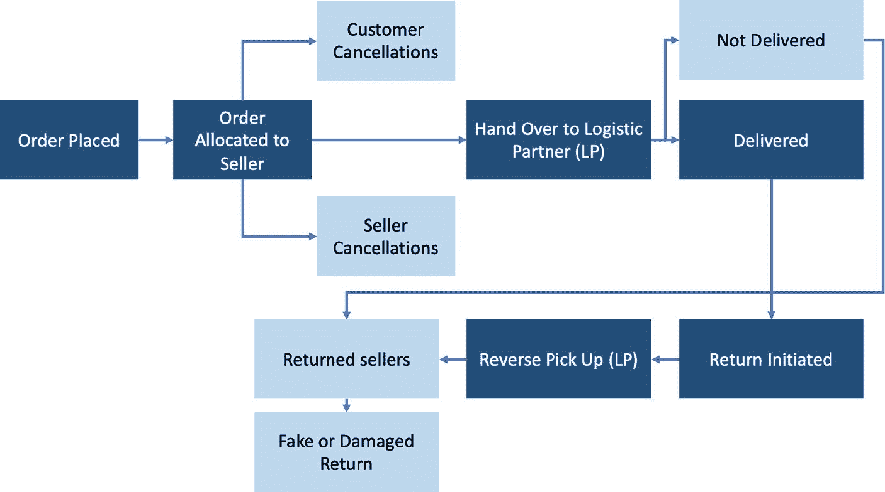
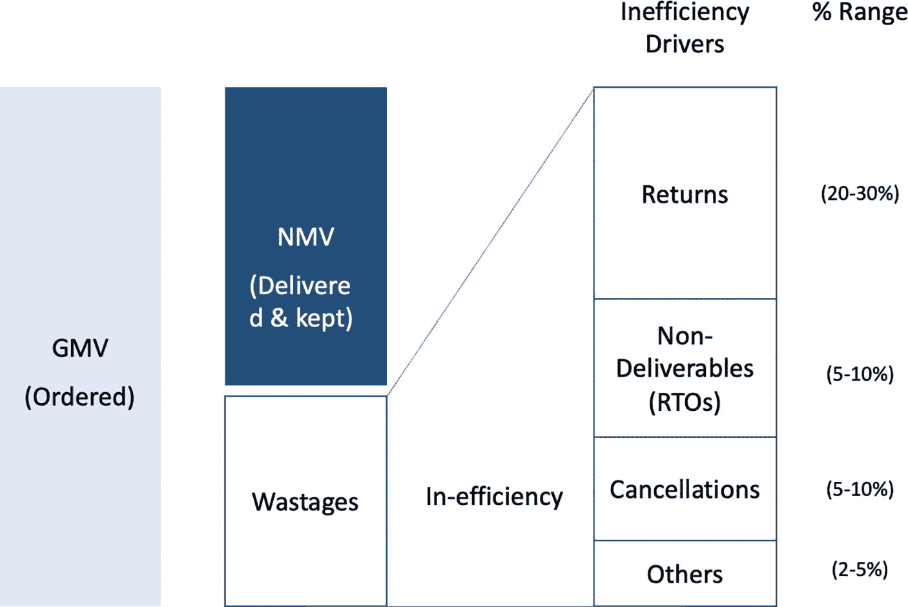
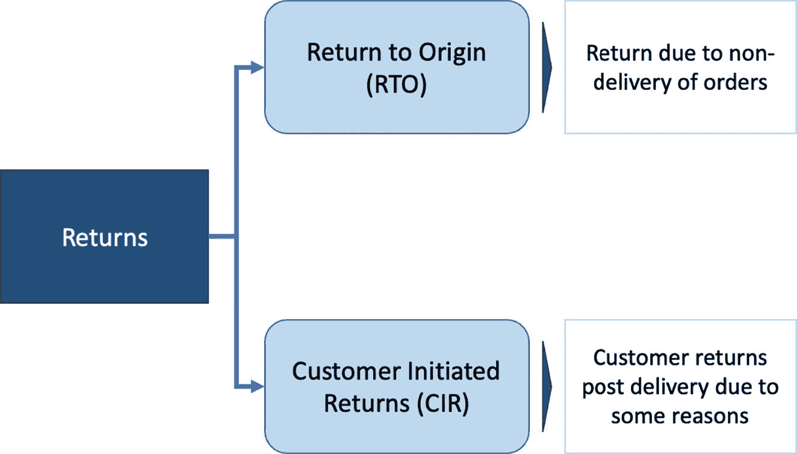
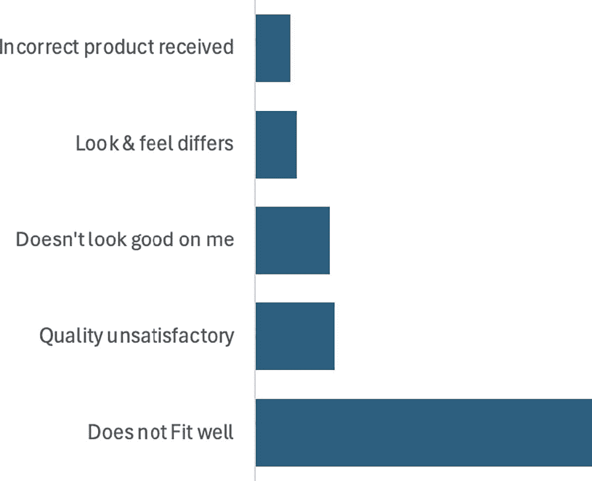
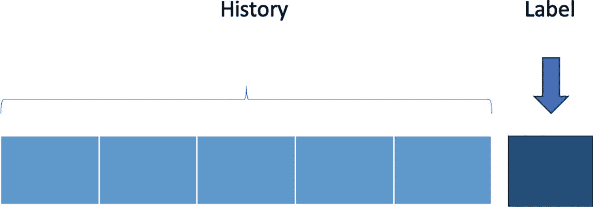
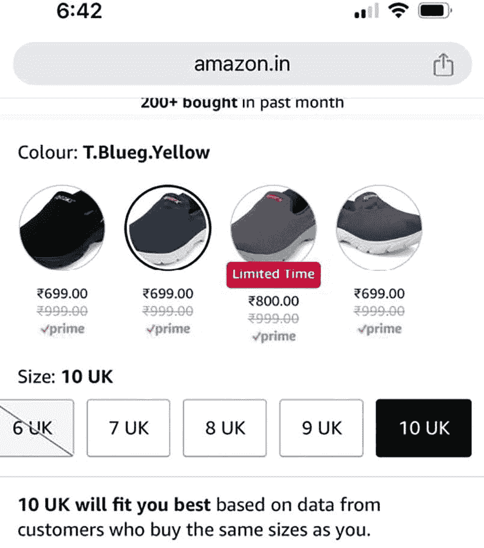
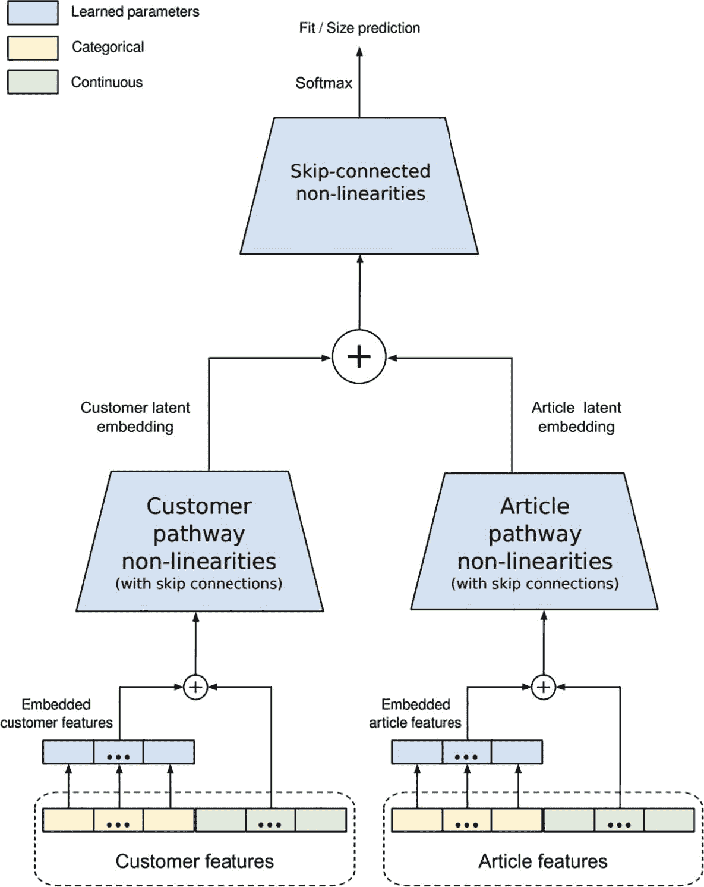
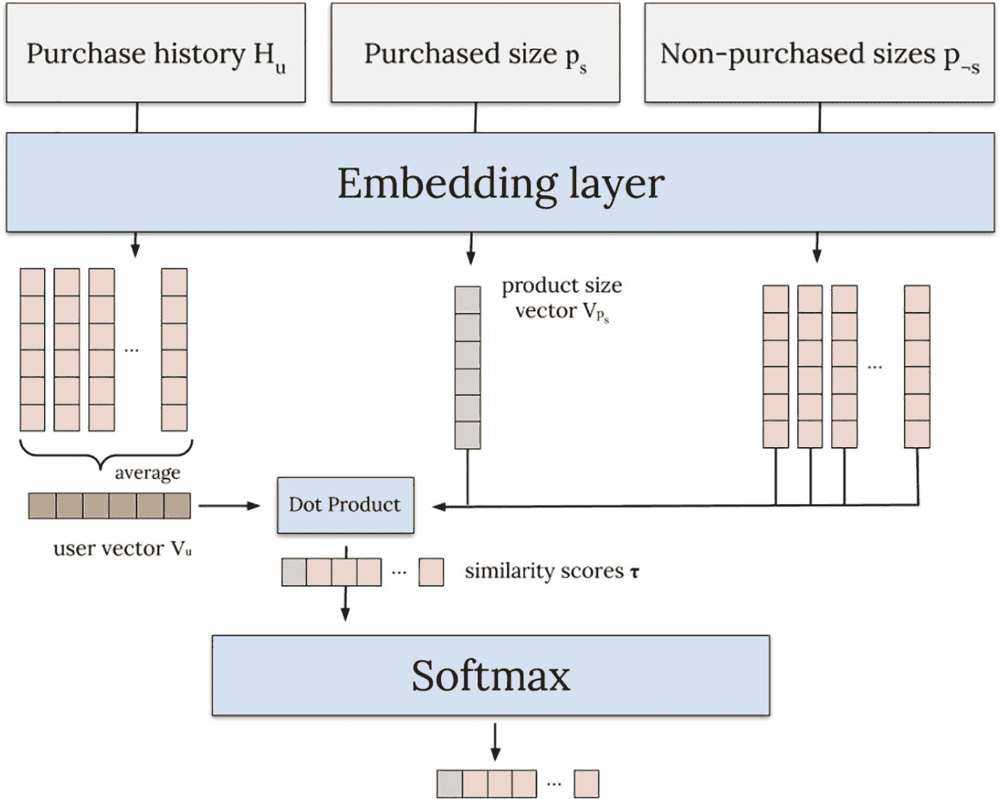
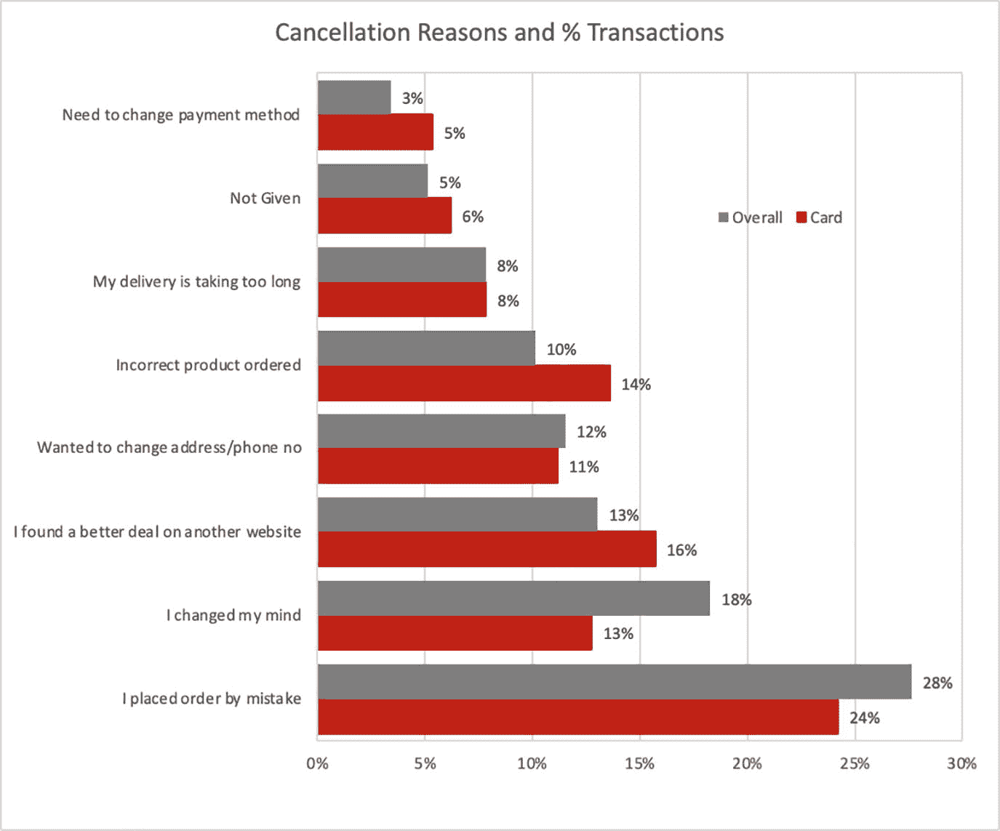

# 8. 效率：实现配送体验与盈利的关键推动力

## 引言

在一家蓬勃发展的电商公司的品类运营团队中，有一位目光敏锐的分析师 Kavya，她日复一日地仔细审查交易记录。某一天，一个奇怪的案例引起了她的兴趣。一位客户在过去 24 小时内下了多个订单，商品总数超过 50 件。Kavya 感到好奇，于是深入调查。

在分析团队的协助下，她的调查揭示了一个惊人的事实。这些高量订单中，超过 80%最终被取消、配送失败或错误退货。这一异常现象暗示着系统中可能存在一张低效的网。

与同事的讨论揭示了一系列威胁电商顺畅流程的场景。一些客户使用无意义或不完整的地址，导致配送员束手无策，客户也无法联系。货到付款（COD）交易尤其容易受到这种策略的影响。

另一个奇怪的现象出现了。拉贾斯坦邦和北方邦的某些邮政编码显示订单取消率显著偏高，且主要与 UPI 支付相关。在另一个案例中，一位卖家报告了“错误退货”的令人担忧的增长。通过调查不同邮政编码和配送伙伴的退货模式，一个惊人的关联浮出水面。这些欺诈性退货来自古吉拉特邦苏拉特附近的一个特定邮政编码，并与少数几名配送员有关。这似乎是买家和配送伙伴之间勾结，利用系统漏洞的案例。

这些只是印度电商广阔图景中的几个例子，突显了与低效率和平台滥用行为的持续斗争。买家、配送伙伴，甚至一些卖家团队成员都可能利用平台及其流程中的漏洞。

取消的订单、失败的配送、错误的配送和欺诈性退货都会增加电商运营成本，扰乱运营，让客户沮丧，并侵蚀卖家的信任。想象一下连锁反应：一个不满的买家留下负面反馈，影响卖家声誉，并可能阻止未来的购买。此外，包装材料、损坏产品和物流等浪费的资源也推高了运营成本。

部署了人工智能的电商平台使 Kavya 和她的团队能够揭露其中一些平台滥用行为。在许多场景下，Kavya 的 AI 同事 Kia（一个智能机器人）会阻止平台滥用者在平台上下单，并验证平台上买家的退货请求。

从订单确认到配送或产品保留，涉及多个阶段和流程，买家、卖家和物流公司等各方利益相关者都扮演着关键角色。在平台模式内管理这个复杂的生态系统对于保持竞争优势和运营效率至关重要。数据智能、预测性警报和预防性机器学习模型对于优化这些流程至关重要。

在本章中，我们将详细探讨订单履行流程，重点关注 AI 和 ML 在提升效率、买家体验和盈利能力方面的作用。电商订单配送流程中的主要挑战包括：

*   买家取消订单
*   卖家取消订单
*   订单未送达/退回发件人（RTO）订单
*   虚假退货或损坏退货
*   产品退货

我们将逐一讨论这些挑战，并探讨机器学习和 AI 框架如何有效应对它们。

## 电商迷宫：导航订单履约之旅

买家完成支付并“确认订单”的那一刻，标志着客户购买之旅的开启。但在幕后，电商平台内会展开一系列复杂的操作和步骤。这个确认后的漫长旅程，被称为订单履约，它决定了产品能以多快、多顺畅的速度到达最终目的地——客户的家门口，或者开启退货之旅。

订单确认后，该订单会被分配给一位客户。卖家核实库存，精心拣选并打包您的订单，然后将其交给快递员或配送合作伙伴。选定的快递合作伙伴会取件并将产品送到客户家门口。这种无缝的流程代表了理想的订单履约之旅——高效运营的证明。

然而，从确认到配送的道路并非总是一帆风顺。可能会出现若干障碍，导致效率低下，给客户和卖家都带来困扰。

图 8-1 展示了电商平台下单后旅程的各个阶段。

图 8-1

从订单到配送的旅程

*   **客户取消**：客户可能因为改变主意、在别处找到更划算的交易或其他原因而取消订单。了解客户取消背后的原因有助于优化产品列表和定价策略。客户取消可能源于各种问题，例如买家滥用、价格差异或意外收费。提高购买流程的清晰度有助于减少此类取消。此外，实施基于机器学习的警报可以帮助识别和减少与取消相关的平台滥用行为。

*   **卖家取消**：卖家取消通常与库存差异或定价异常有关。通过改进平台集成以确保实时库存更新，可以缓解库存问题。此外，机器学习系统有助于最大限度地减少导致卖家取消的无意价格变动。

*   **未送达——退回原发货地 (RTO)**：退回原发货地 (RTO) 订单通常与错误的配送地址以及无法接收订单的买家有关。在某些情况下，欺诈性买家可能会提供虚假地址，且无意接收配送。可以运用机器学习模型来识别和缓解这些问题，实施预防措施以降低 RTO 的发生率。

*   **客户发起的退货**：改变主意、尺码或合身问题、错误产品或产品质量是客户退货的部分原因。每种退货原因都可以通过特定策略来解决。合身问题可以通过根据买家详细信息推荐合适的尺码或实施虚拟试穿功能来缓解。质量问题可以通过加强审核流程或与相关卖家进行讨论以确保产品符合标准来管理。

*   **虚假退货**：一些客户可能通过退回假冒或非原装产品进行欺诈活动。机器学习模型可以通过分析模式和异常情况来帮助识别和减少这些虚假退货。此外，在逆向取件过程中实施质量检查可以进一步帮助检测和管理可疑退货。

所有这些都可能给电商业务带来巨大成本，导致订单配送流程效率低下。这解释了总商品价值 (GMV) 与净商品价值 (NMV) 之间的差距。大约 30% 的总商品价值 (GMV) 因退货和取消而损失 [17]。

## 效率等式

GMV - NMV = 客户发起的退货 (CIR) + 无法配送 (RTO) + 取消（客户和卖家）+ 其他

**客户发起的退货 (CIR)** 指买家因各种原因退回的产品价值。电商平台通常允许在指定期限内退货，该期限称为“退货窗口”，具体因平台和产品类别而异。在某些情况下，某些类别或产品可能不允许退货。退货仅在产品配送后发生。

退货率，即 CIR 率，以总 GMV（总商品价值）的百分比表示。例如，20% 的 CIR 率表示已订购产品总价值的 20% 已被买家退回。该指标对于了解退货趋势、管理库存和客户满意度至关重要。

**退回原发货地 (RTO)**，也称为未配送，指无法送达买家而退回给卖家的产品。在配送过程中，配送员会尝试通过提供的地址联系买家，必要时会拨打电话。如果由于地址错误或买家不在等原因无法完成配送，产品将退回给卖家（原发货地）。

5% 的 RTO 百分比表示已订购产品 GMV（总商品价值）的 5% 无法配送并已退回给卖家。RTO 会产生正向和逆向运输成本，并对卖家的体验和库存管理产生负面影响。

**客户取消**发生在下单和配送之间。这些取消的影响因支付方式和订单旅程阶段而异。当买家决定取消订单时，会涉及几个因素：

*   **预付订单：** 如果订单已预付，电商平台可能需要承担支付网关费用。

*   **订单处理中：** 如果卖家已开始处理订单，则会产生实际上被浪费的精力和时间。

*   **交接后：** 如果取消发生在订单已交给配送合作伙伴之后，则会产生额外的配送成本。

5% 的取消率表示取消占已订购产品 GMV（总商品价值）的 5%。该指标反映了客户取消的订单占总订单的比例。

**卖家取消**发生在卖家取消分配给他们的配送订单时。这可能是由于库存短缺或定价差异等多种原因造成的。虽然与客户发起的取消相比，卖家取消不那么频繁，但在市场环境中仍可能带来挑战。像 Flipkart 这样的市场电商平台会对卖家收取订单取消费，以此作为阻止取消的措施 [18]。

除了前面提到的挑战外，订单履约还会因虚假退货、产品损坏和运输途中丢失等问题而产生成本和效率低下。有效管理这些问题对于最大限度地减少浪费和优化配送流程至关重要。

通常，20-40% 的销售额会因上述任何原因而损失。

每个效率低下的驱动因素都需要有效管理，以改善效率状况。

图 8-2 说明了总商品价值 (GMV) 与净商品价值 (NMV) 之间的关系，突出了导致电商效率低下的各种因素。

图 8-2

解释 GMV 与 NMV 之间差距的因素

## 退货订单

电子商务业务正以迅猛的速度增长，预计从 2023 年到 2029 年将以 31%的复合年增长率激增[1]，而宽松的退货政策和货到付款选项在其中发挥了重要作用。在印度，退货率（客户退回订单的百分比）约为 25-40%，显著高于全球平均水平[2]。电商企业可能因退货而支付订单价值的 10-15%作为成本，这可能会严重侵蚀其利润[3, 4]。

订单退货可分为两类：因无法配送而退回（退回始发地 – RTO），以及第二类，客户在成功配送后发起的退货。

图 8-3 展示了电商中的两种退货类型：发生在配送前的退回始发地（RTO），以及发生在配送完成后的客户发起退货。

图 8-3

配送前退货（RTO）与配送后退货（CIR）

## 客户发起退货（CIR）

一旦产品送达客户手中，如果该产品符合退货条件且在退货窗口期内，客户可以退货。如果订单日期是 3 月 13 日，退货窗口期为七天，那么客户只能在 3 月 20 日之前发起退货。要退货，客户需要访问移动应用或网站并发起退货流程。

通常，客户会被要求输入退货原因并提供更多详细信息。此外，在某些情况下，如果退货原因是产品损坏等，平台会强制要求客户提供产品图片。

退货涉及物流成本（正向和逆向）、包装成本、损坏/假冒产品退货成本，以及糟糕的客户体验。

鞋类和服装类常见的退货原因可能与尺码不合适（感觉不舒服）、穿上不好看、质量不满意、外观手感有差异，或收到不正确/有缺陷的产品有关[4]。对于家居或手表类目，“订单/产品部件缺失”或“改变主意”等退货原因可能更为常见。具体原因的组合会因产品组合或类目组合以及平台而异。

图 8-4 说明了产品退货的主要原因。

图 8-4

产品退货原因

在特定时期内，服装类目的退货率可能高达订单量的 25%，而手表类目的退货率大约在 10-12%之间。对于服装和鞋类类目，尺码或合身问题是导致退货的重要因素[12, 20]。

电商平台需要改进流程并加强平台建设以降低退货率。多种机器学习和人工智能模型可以显著减少退货。例如，平台可以利用已保留和已退回产品的历史数据提供尺码推荐。这些推荐方法范围广泛，从协同过滤模型到先进的深度学习方法。此外，向买家展示每个产品的退货可能性可以帮助他们做出更明智的选择。为了打击滥用行为，在订购过程中实施提示也有助于减少退货。

管理电商退货的策略包括：

*   **产品上架：** 提高上架产品的质量，例如产品描述、图片和附加细节的质量，可以减少产品退货的可能性。

*   **尺码推荐：** 合身问题是导致产品退货的最大单一因素，尤其对于电商中的鞋类和服装类目。引导客户做出正确的尺码选择至关重要。

*   **加强质量控制和包装流程：** 对于平台模式，产品配送流程涉及多次交接——卖家运营、快递车队、最后一公里配送和客户。在各个阶段实施质量控制并捕获数据，对于控制因产品损坏或错误配送产品而导致的退货非常有帮助。

## 产品内容：创建与验证

85%的购物者会根据产品信息和图片做出购买决定[5]。人工智能工具可以帮助创建产品描述、生成标签和设计产品图片[6]。

对于一个电商平台，有成百上千的卖家，他们可能利用供应商团队来创建、编目和上传产品到电商平台。考虑到资源的多样性，需要一个多层次的验证流程来确保高质量的内容上线。

*   **产品图片质量验证：** 审查上传的产品图片质量，并标记任何质量不佳的图片。此过程可以使用计算机视觉模型实现自动化。

*   **产品类目验证：** 利用人工智能模型根据产品图片创建产品分类，并验证上传的产品层级结构。

*   **产品描述生成器：** 基于关键的产品分类和搜索关键词，生成式人工智能模型可以帮助生成准确且有吸引力的产品描述。

## 基于 AI 的尺码推荐：帮助客户做出正确决策

合身度或尺码推荐是时尚电商面临的主要挑战之一。当客户在电商平台上做出购买决定时，他们需要决定尺码。而错误的决定会导致客户退货，带来糟糕的客户体验并增加运营成本[8, 11]。向客户推荐正确尺码存在诸多挑战，其中一些挑战包括：

*   **数据稀疏性与冷启动：** 客户可能是平台新用户（冷启动），也可能是该类目的新用户（之前未购买过鞋类，但可能购买过服装），并且跨品牌和跨类目进行多次交易的客户数量有限。例如，品牌-品牌层面的共同购买率仅为 0.64，这意味着大多数品牌要么没有被共同购买，要么很少被共同购买[11]。

*   **品牌间尺码不一致：** 相同的尺码在不同品牌可能对应不同的测量值。例如，男士美国尺码 8 号的鞋子，耐克训练鞋是 10 英寸，而阿迪达斯训练鞋则是 10.2 英寸[9]。

*   **多种购买角色：** 同一个账户（注册客户）下的购买可能对应多种客户角色。可以使用高斯混合模型（GMM）识别多种角色[9]。

*   **信息缺失：** 对于鞋类，尺码决定是一个多因素决策，例如，足弓类型、鞋宽和鞋型等属性都会影响鞋子是否合脚。根据报告，平台上大多数卖家只提供鞋子的长度，80%的卖家不提供任何关于鞋宽、足弓类型等信息[10]。

## 尺码推荐：机器学习（ML）模型

尺码推荐可以建模为尺码预测问题。例如，在男装类别中，鞋类尺码 {UK7, UK8, UK9, UK10, UK11, UK12} 可被视为标签。

最近一个月的交易数据可作为标签数据，而客户的所有历史记录则可用于特征构建。图 8-5 展示了在基于机器学习的预测模型中，用于创建特征和标签的结构。

图 8-5

有监督的尺码预测

可以考虑的部分特征包括：

*   同一品类中的频繁尺码
*   同一品类中的最近尺码
*   跨品类中的最频繁尺码
*   同一品类中曾被退回的尺码
*   购买次数
*   基于相似用户的尺码
*   每个尺码的购买次数（按品类及跨品类统计）

通过跨多个月份（称为群组）复制此过程来准备数据后，数据被划分为训练样本和测试样本。可以考虑使用 XGBoost 或随机森林等机器学习技术来开发基于 ML 的尺码推荐。

合身度推荐被建模为一个有序回归问题，即尺码预测任务。在此过程中，通过计算顾客与产品真实尺码之间的差异，并将其输入线性模型来学习这些尺码 [9, 13]。

## 尺码推荐 – 基于 Skip-gram 的模型 [10]

Myntra 是印度最大的时尚电商公司，它采用了基于 skip-gram 的尺码推荐方法。对于鞋类，它提议在品类、性别、品牌和尺码级别对 SKU 进行编码。例如，一个性别为“男”、商品类型为“休闲鞋”、品牌为“Vans”、英码为“8”的 SKU 被编码为“Men_Casual_Shoes_Vans_8”。对于这些编码中的每一个，将其视为一个“词”，并将多次购买记录合并视为一个“文档”。以这些词和文档作为输入，我们训练 Word2Vec 网络。该网络能够学习不同品牌中，本质上对应相同鞋码测量的不同尺码标签之间的联系。

为了训练模型，我们通过按时间顺序排列购买记录（将最近一次购买放在末尾）来创建用户级别的购买序列。在训练 Word2Vec 模型后，每个词/购买记录都被表示为一个潜在特征。

在网站上，平台会要求用户提供明确的鞋子偏好，然后找到该偏好的潜在表示。例如，如果用户填写的鞋子偏好问卷显示：常穿商品类型为男士休闲鞋，偏好品牌为 Roadster，常穿尺码为 UK8，我们会将此信息编码为一个词/购买偏好，并获取该词/偏好的潜在向量表示。基于余弦相似度，针对所需品类和品牌的组合，系统将推荐合适的尺码。

在亚马逊，他们利用潜在特征进行个性化尺码预测 [11]。顾客和产品的潜在因子与物理真实尺码（例如，长度和宽度等维度）相关，并从过去的产品购买和退货数据中学习得到。具体来说，对于每笔（顾客，产品）购买交易，我们的模型会输出一个分数，该分数是顾客与产品真实尺码之差的（线性）函数，并用于预测结果。我们提出了一种构造方法，将具有有序结果的损失函数简化为具有二元结果的新损失函数。我们定义了 Hinge 损失和 Logistic 损失变体，并提出了具有线性时间复杂度的有效算法，用于计算能够最小化这两种损失变体的顾客和产品真实尺码值。

图 8-6 展示了一个在尺码选择过程中向买家呈现尺码推荐的示例。

图 8-6

尺码推荐示例

同时，它还会显示一条消息：“根据与您购买相同尺码的顾客数据，**X 英码将最适合您**。”

[7] 用于预测尺码和合身度的深度学习系统基于内容协同方法，实现个性化的尺码和合身度预测。在该方法中，顾客和商品嵌入被并行创建，以发现个体顾客和商品的隐含属性，从而实现个性化推荐。

图 8-7 展示了用于合身度尺码推荐的深度学习架构。

图 8-7

基于深度学习的尺码预测

来源：A Deep Learning System for Predicting Size and Fit in Fashion ECommerce

标准的协同过滤方法仅依赖交互数据来建模顾客行为 [14]，但对于绝大多数顾客而言，此类数据是稀疏的。这导致顾客-商品交互矩阵极度稀疏，使得在个性化层面上为每个个体顾客建模偏好变得困难。然而，顾客和商品属性的额外信息有助于应对稀疏性和冷启动推荐问题。

### 使用产品尺码嵌入（PSE）推荐服装尺码 [9]

在在线购物过程中推荐合适的服装尺码仍然是一个挑战。虽然传统的推荐系统会根据过去的购买记录推荐相似产品，但准确推荐尺码需要考虑顾客的体型和合身度偏好。本案例研究探讨了产品尺码嵌入（PSE）模型，这是一种利用隐式用户行为数据来推荐服装尺码的神经协同过滤方法。

产品尺码嵌入（PSE）模型通过学习每个产品的尺码特定嵌入来应对这一挑战。该方法建立在神经协同过滤的概念之上，即利用用户和物品的交互来创建潜在表示。

*   **隐式信号：** PSE 利用购买和退货等隐式用户行为数据，无需用户提供明确的尺码信息。
*   **学习尺码嵌入：** 该模型为每个产品-尺码组合学习一个向量表示（嵌入）。这些嵌入捕捉了相似体型与服装尺码之间的内在关系。
*   **非对称框架：** 为了提高效率，模型采用了非对称框架。它不学习单个用户嵌入，而是专注于产品表示，从而显著减少了模型参数的数量。
*   **多分类：** PSE 将尺码推荐表述为一个多分类问题。给定一个用户和一个产品，模型会预测该顾客在该特定产品中最合适的尺码。

图 8-8 直观地展示了如何利用购买历史（包括已购买和未购买的尺码）来为买家预测正确的尺码。

图 8-8

基于嵌入的合身度预测

来源：[`https://ceur-ws.org/Vol-2410/paper13.pdf`](https://ceur-ws.org/Vol-2410/paper13.pdf)

### PSE 的优势

*   **改进的尺码推荐：** 通过考虑产品特定的尺码信息，PSE 提供了比传统方法更准确的尺码推荐。
*   **高效的模型架构：** 非对称框架减少了所需参数的数量，使模型更易于训练和部署。

## 减少客户退货——标记平台滥用者

除了帮助真实客户提供合适的尺码建议以减少退货外，识别并针对平台滥用者采取行动同样重要。

Appriss Retail 报告发现，网购退货总额高达 410 亿美元，其中 35%（约 140 亿美元）属于退货欺诈 [14]。另一份报告指出，高达 14% 的退货被证实存在欺诈行为 [15]。

日益增长的欺诈性退货要求电商平台制定防御措施。严格的退货政策可能因不愉快的退货体验而导致客户流失；因此，找到欺诈客户和交易，并仅针对他们采取行动至关重要。

*   **退货运费**：在印度某领先的开放市场平台上，基于机器学习模型，平台会预测客户是否可能退货，并显示类似“如果您退货，将被收取运费”的提示；这主要是为了威慑那些有退货意图的客户。

*   **退货发起时验证**：当客户发起退货流程时，根据预测的滥用风险，平台会强制要求客户上传产品图片。计算机视觉模型会验证退货是虚假还是真实的。

*   **逆向取件质检**：逆向取件过程中的质量检查涉及在从买家处取回退货商品前对其进行检验。此过程会增加配送员和电商平台的额外工作量和成本。由于这些额外成本，对所有退货都实施质检并不可行。相反，机器学习模型可以优化此流程。通过分析错误退货和真实退货的历史数据，模型可以整合与买家、产品、地理位置等因素相关的特征。当买家发起退货时，模型会根据这些特征评估是否启用质检标记。如果标记被激活，配送合作伙伴会在取件前进行质量检查；否则，将跳过检查。

## 无法配送订单与退回发货地交易

5–8% 的电商交易因无法配送而被退回给卖家。导致交易无法配送的主要原因有两个：客户意图问题（客户无意接收货物，即平台滥用者）和错误的配送地址。

这些错误地址是导致电商企业产生退回发货地损失的主要原因之一 [16]。

“错误地址在印度造成的经济影响巨大：根据新兴世界对主要行业的估算，糟糕的地址每年给印度造成 100 至 140 亿美元的损失，约占 GDP 的 0.5%” [15]。

有多种方法可以减少电商平台上的错误地址。一种帮助客户选择地址的选项是使用“谷歌地图”。强制使用此功能存在两个挑战：首先，印度二三线城市的客户可能会觉得使用起来有困难；其次，这可能会对退货率产生负面影响，因为他们可能会随意选择一个地点。总之，由于在订单流程中增加了额外步骤，转化率可能会受到影响，并且平台滥用者可以轻松选择任意地址下单，因为他们本来就没打算收货。

识别高风险配送地址可以显著降低退回发货地比例并提高配送成功率。通过实施地址验证流程，“可将退回发货地/取消订单的几率降低高达 30%” [16]。

在我之前任职的公司，我们建立了一个基于机器学习的无法配送地址识别流程，用于识别乱码和无法配送的地址，从而显著降低了退回发货地比例，并减少了错误退货。带有错误地址的交易会被近乎实时地识别出来，并提交审核和处理。考虑到客户服务的重要性，这些交易中只有 50% 被采取了行动——取消交易、屏蔽客户或仅接受预付交易。而对于另外 50% 的交易，其退回发货地比例高达 3 倍，且退货率和虚假退货率显著更高。

地址只是一个表象，并非所有客户都有不良意图；他们可能只是不知道如何正确提供地址。因此，客户历史记录在地址处理中可能是一个重要的影响因素。客户退回发货地模型和错误配送地址模型相结合，有助于提高识别平台滥用者的效率并降低退回发货地率。

## 取消订单

订单取消是导致电商平台效率低下的另一个因素。较高的取消率会导致因库存占用而错失销售机会、预付订单的支付网关费用、运营成本（订单处理、拣货和包装）以及物流成本（如果在交给快递合作伙伴后取消）。取消订单还会导致库存信息失真，从而增加整个系统的总成本 [19]。

由于成本增加、订单处理和库存占用，取消订单会给卖家带来糟糕的体验。

根据经验，观察到 4–6% 的交易被客户取消，其中超过一半的取消发生在下单后一小时内。一小时内取消的订单是主要问题之一，并会产生支付费用——约为交易金额的 1.5%。

图 8-9 直观展示了订单取消的主要原因及其相对占比。

图 8-9

订单取消原因

较长的配送时间或延迟配送，以及产品价格，可能是客户取消订单的驱动因素。但客户通常会选择“我改变了主意”和“我误下了订单”。

用于改善卖家体验和成本的机器学习预测：一旦订单在电商平台上确认，订单就会被分配给卖家，卖家运营团队开始处理订单。对于在一小时内取消订单可能性较高的客户，订单可以在分配给卖家之前被暂缓一小时。这有助于减少订单处理工作量并改善卖家体验。

## 摘要

电商平台上的订单总价值称为**商品交易总额（GMV）**，而买家最终保留的订单价值则称为**净商品交易额（NMV）**。GMV 与 NMV 之间的差额代表了电商生态系统中合作伙伴所承担的成本与负面体验。造成这一差额的关键因素包括订单取消、退货至原发地（RTO）订单、客户主动退货以及虚假退货或损坏。

履约流程涉及多个环节和合作伙伴，这使得技术，尤其是机器学习和人工智能（AI），成为管理这些挑战的高性价比且可扩展的解决方案。**客户主动退货（CIR）**发生在配送之后，可能源于产品质量或尺码等问题。AI 和机器学习可以通过提供个性化尺码推荐和虚拟试穿来减少退货。

**RTO**（即未妥投）是指因地址错误或买家无法联系等原因而退回给卖家的商品。机器学习模型通过主动识别并处理问题订单，有助于减少 RTO。有效管理 RTO 对于最小化相关成本、提升电商盈利能力至关重要。

**订单取消**，无论是客户发起还是卖家发起，同样构成重大挑战。AI 和机器学习有助于管理并降低与取消订单相关的成本。此外，这些问题通常会给买家和卖家带来负面体验，例如因收到劣质产品或频繁取消订单而感到沮丧。欺诈性退货或发错货等滥用行为则进一步加剧了这些问题。机器学习模型在检测和减轻此类滥用行为、改善所有相关方整体体验方面发挥着至关重要的作用。

领先的电商平台正持续利用并增强这些技术，以改善买家体验和运营效率。通过有效应对这些挑战，它们旨在优化流程，并在竞争激烈的电商格局中提升盈利能力。

索引 A 加入购物车率 人工智能 参见 人工智能 (AI) 亚马逊 亚马逊印度 平均订单价值 参见 平均订单价值 (AOV) 增强现实 参见 增强现实 (AR) 人工智能 (AI) 平均售价 参见 平均售价 (ASP) 增强现实 (AR) 平均订单价值 (AOV) 平均售价 (ASP) B Bandini Lehenga 最佳匹配 25 (BM25) 另请参阅 文本匹配 印度统一支付接口 (BHIM) BHIM 参见 印度统一支付接口 (BHIM) 商业智能 参见 商业智能 (BI) BigBasket Bing 排名 品牌列表页 参见 品牌列表页 (BLPs) 品牌营销 参见 品牌营销 (BM) BM25 参见 最佳匹配 25 (BM25) 品牌列表页 (BLPs) 品牌营销 (BM) 品牌优先级 品牌声誉 企业对消费者 参见 企业对消费者 (B2C) 商业智能 (BI) 企业对消费者 (B2C) 买家 买家互动 C 客户获取成本 参见 客户获取成本 (CAC) 行动号召 (CTAs) 呼叫量预测模型 已取消订单 取消 加购率 参见 加购率 (CAR) 加购率 (CAR) 货到付款 (COD) 品类列表页 (CLPs) 基于内容的过滤 参见 基于内容的过滤 (CBF) 客户数据平台 参见 客户数据平台 (CDPs) 协同过滤 参见 协同过滤 (CF) ChatGPT 点击率 (CTR) 客户发起退货 参见 客户发起退货 (CIR) 云优化 CLPs 参见 品类列表页 (CLPs) 贡献毛利 参见 贡献毛利 (CM) 贡献毛利 1 参见 贡献毛利 1 (CM 1) 卷积神经网络 参见 卷积神经网络 (CNNs) COD 参见 货到付款 (COD) 协同过滤 (CF) 基于内容的过滤 (CBF) 贡献毛利 (CM) 贡献毛利 1 (CM 1) 对话式搜索 转化率 (CVR) 卷积神经网络 (CNNs) 余弦相似度 单次获取成本 (CPA) 单次安装成本 (CPI) 成本流 CPA 参见 单次获取成本 (CPA) CPI 参见 单次安装成本 (CPI) 客户关系管理 参见 客户关系管理 (CRM) CTAs 参见 行动号召 (CTAs) 精选商品 客户获取成本 (CAC) 客户取消订单 售后处理 预付订单 客户数据平台 (CDPs) 客户发起退货 (CIR) 客户关系管理 (CRM) 客户退货 CVR 参见 转化率 (CVR) D 数据稀疏性 深度学习 配送费、退货 偏差分析 数字营销 数字市场 买方侧功能 成本泄漏 客户购买旅程 客户服务团队 功能 漏斗底部 漏斗中部 在线交易 赋能卖家 漏斗顶部 电视和印刷媒体广告 另请参阅 电子商务 直接营销 (DM) DM 参见 直接营销 (DM) E 电子商务与人工智能 AI/ML 算法 算法 品牌优先级 商业模式 商业价值 买家和卖家 品类管理 成本效益方式 经济学 效率方程 高层流程 印度市场 市场 商品销售 Myntra 订单履行 个性化影响 价格与促销 评论 产品品类 推荐引擎 推荐引擎 搜索算法 搜索查询 搜索结果 精通搜索的买家 赋能卖家 语义搜索 策略 技术与平台成本 网站 欧几里得距离 F Facebook 因子化模型 虚假退货 时尚敏感型买家 时尚电商 算法基础 商业模式 挑战 云技术 手工特征 相似买家 时尚产品（案例研究） 过滤算法 微调 Flipkart 预测业务指标 G 高斯混合模型 (GMM) 生成式人工智能 参见 生成式人工智能 (GenAI) 生成式人工智能 (GenAI) GMM 参见 高斯混合模型 (GMM) 商品交易总额 参见 商品交易总额 (GMV) 谷歌地图 谷歌 PageRank 商品交易总额 (GMV) GroupLens H 首页个性化 混合推荐算法 I 逆文档频率 参见 逆文档频率 (IDF) 宜家，家具零售商 Instagram 交互模型 逆文档频率 (IDF) 网络电视 (IPTV) IPTV 参见 网络电视 (IPTV) 物品交互矩阵 J 杰卡德相似度 K 关键绩效指标 (KPIs) 库尔塔套装 L 大型语言模型 (LLMs) 潜在因子模型 (LFMs) 学习排序 (LTR) 技术 LFMs 参见 潜在因子模型 (LFMs) LinkedIn LLMs 参见 大型语言模型 (LLMs) 基于位置的个性化 长短期记忆 (LSTM) 网络 漏斗底部营销 加入购物车率 CRM 系统 电商转化 支付预测 LSTM 参见 长短期记忆 (LSTM) 网络 LTR 参见 学习排序 (LTR) 技术 M 机器学习 (ML) 排序 搜索查询 尺码推荐 用户重新互动 案例 曼哈顿距离 平均准确率均值 参见 平均准确率均值 (MAP) 营销团队 月活跃用户 参见 月活跃用户 (MAU) Maya’s Mystic Jewellery 平均准确率均值 (MAP) 平均倒数排名 (MRR) Meesho 案例研究 商品销售 市场 漏斗中部营销 电商平台 产品推荐 站点商品销售 站点商品销售团队 访客 ML 参见 机器学习 (ML) 月活跃用户 (MAU) MRR 参见 平均倒数排名 (MRR) 多品类电商 多阶段问题管理流程 Myntra N 命名实体识别 (NER) 自然语言处理 (NLP) 归一化折损累计增益 参见 归一化折损累计增益 (NDCG) Netflix NER 参见 命名实体识别 (NER) 净商品价值 (NMV) 神经协同过滤 (NCF) NLP 参见 自然语言处理 (NLP) 非负矩阵分解 参见 非负矩阵分解 (NMF) NMV 参见 净商品价值 (NMV) 无法配送订单 非负矩阵分解 (NMF) 归一化折损累计增益 (NDCG) Nykaa Fashion O 订单管理系统 参见 订单管理系统 (OMS) 一刀切策略 运营成本 订单确认 订单管理系统 (OMS) P PageRank 算法 支付序列个性化 按点击付费 (PPC) Paytm 产品详情页 参见 产品详情页 (PDPs) 皮尔逊相关系数 个性化与情境知识 电商首页 基于位置 营销中 推荐引擎 重复用户 案例 搜索与推荐 搜索引擎 个性化策展（案例研究） 个性化推荐 个性化相似产品推荐 Pinterest 产品列表页 参见 产品列表页 (PLPs) 本地治里 流行度得分 订单确认后 PPC 参见 按点击付费 (PPC) 预测性维护 自有品牌产品 产品属性 产品内容 产品详情页 (PDPs) 推荐 产品列表页 (PLPs) 产品退货 产品尺码嵌入 (PSE) 模型 非对称框架 优势 隐式信号 学习尺码嵌入 多分类 产品浏览量到访问量 (PV/V) PSE 参见 产品尺码嵌入 (PSE) 模型 购买收入 Q 质量检查 参见 质量检查 (QC) 质量检查 (QC) 查询分类模型 Quora R 排序算法 确定性模型 在电商中 函数形式 ML 模型 性能指标 流行度得分 产品流行度 产品 推荐引擎 推荐 搜索功能 相似产品推荐 推荐引擎 算法 亚马逊 数据 电子商务 评估 个性化推荐 个性化处理 场景或功能 相似度度量 广告支出回报率 (ROAS) 投资回报率 (ROI) 退货订单 退货至发货方 (RTO) 收入驱动因素 AI/ML 算法 佣金 配送费 市场模式 RoBERTa 模型 ROAS 参见 广告支出回报率 (ROAS) ROI 参见 投资回报率 (ROI) RTO 参见 退货至发货方 (RTO) S 相似性科学 算法 搜索算法 搜索架构 搜索嵌入 搜索结果页 参见 搜索结果页 (SLPs) 搜索个性化 相似产品推荐 Stitch Fix 搜索词分类模型 卖家门户 卖家 品牌与取消 品类团队 赋能，电商 选择 案例研究 统计 卖方侧功能 语义搜索算法 丝芙兰 相似产品 奇异值分解 (SVD) 尺码推荐 基于 AI 的服装尺码 ML 模型 Skip-gram Skip-gram 搜索结果页 参见 搜索结果页 (SLPs) 智能订单分配 Spotify Stitch Fix Style On Style Up SVD 参见 奇异值分解 (SVD) T 目标群体 (TGs) 目标变量 Tata CLiQ 词频 (TF) 文本匹配 IDF 搜索算法 TF TF 参见 词频 (TF) TGs 参见 目标群体 (TGs) TikTok 天猫 漏斗顶部营销 业务/品类 集中策略 CRM 数据驱动方法 数据驱动个性化 数字营销活动 电商营销团队 多管齐下方法 短信和 WhatsApp 社交媒体营销活动 社交媒体平台 电视和印刷媒体广告 视觉内容创作 趋势商品 U 基于用户的协同过滤 参见 基于用户的协同过滤 (UBCF) 统一支付接口 (UPI) UPI 参见 统一支付接口 (UPI) 基于用户的协同过滤 (UBCF) V 虚拟现实 (VR) 视觉内容创作（案例研究） VR 参见 虚拟现实 (VR) W, X Word2Vec 模型 Y, Z YouTube
