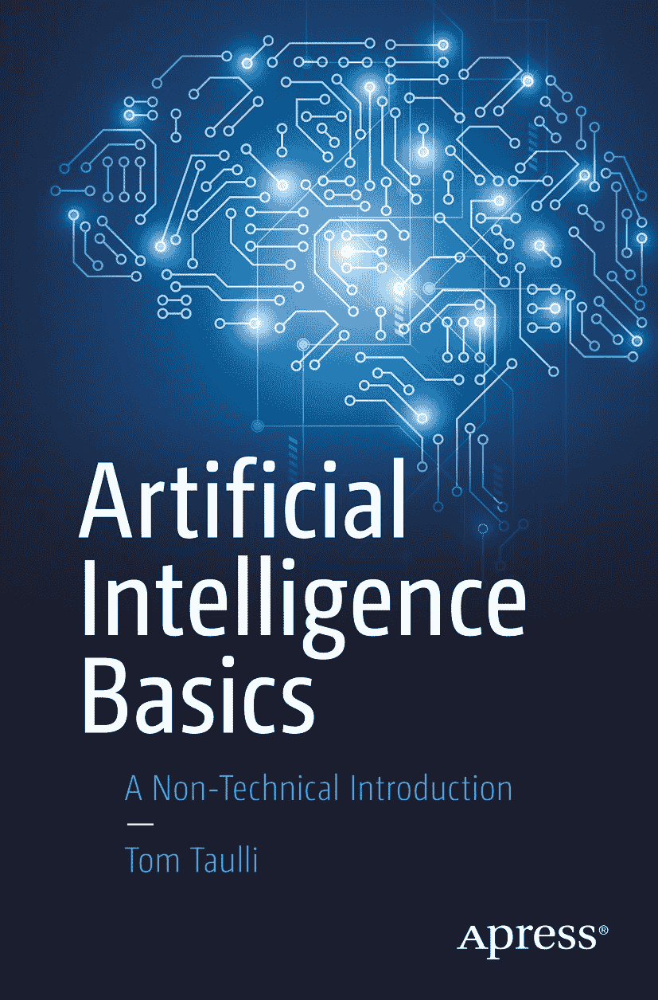

<!--



ISBN 978-1-4842-5027-3 e-ISBN 978-1-4842-5028-0 [`doi.org/10.1007/978-1-4842-5028-0`](https://doi.org/10.1007/978-1-4842-5028-0) © Tom Taulli 2019 本作品受版权保护。出版商保留所有权利，无论是涉及材料的全部或部分，特别是翻译、重印、重用插图、背诵、广播、以缩微胶卷或任何其他物理方式复制，以及传输或信息存储与检索、电子改编、计算机软件，或通过目前已知或未来开发的类似或不同方法进行的权利。本书中可能出现商标名称、标识和图像。我们并非在每次出现商标名称、标识或图像时都使用商标符号，而是仅以编辑方式使用这些名称、标识和图像，以维护商标所有者的利益，且无意侵犯商标权。本出版物中对商品名称、商标、服务标志及类似术语的使用，即使未明确标识，也不应被视为对其是否受专有权利保护的表达意见。尽管本书中的建议和信息在出版时被认为是真实准确的，但作者、编辑和出版商均不对可能存在的任何错误或遗漏承担法律责任。出版商对本书所含内容不作任何明示或暗示的保证。本书通过 Springer Science+Business Media New York 在全球图书贸易中发行，地址：233 Spring Street, 6th Floor, New York, NY 10013。电话：1-800-SPRINGER，传真：(201) 348-4505，电子邮件：orders-ny@springer-sbm.com，或访问 www.springeronline.com。Apress Media, LLC 是一家加利福尼亚有限责任公司，其唯一成员（所有者）是 Springer Science + Business Media Finance Inc (SSBM Finance Inc)。SSBM Finance Inc 是一家特拉华州公司。前言

正如本书所展示的，人工智能（AI）的采用将成为人类历史上的一个重大转折点。与其他同样具有开创性的技术一样，如何管理它以及谁能够使用它，将塑造未来几代人的社会形态。然而，AI 与 19 世纪和 20 世纪的其他变革性技术——如蒸汽机、电网、基因组学、计算机和互联网——有所不同，因为它并不完全依赖于极其昂贵的物理基础设施来实现普及；毕竟，它的许多好处可以通过我们随身携带的现有硬件来传递。相反，AI 技术大规模普及的根本限制因素在于我们共享的知识基础设施：教育、理解和远见。

这是一个关键的区别，因为如果处理得当，AI 可以成为一种广泛的民主化力量。它已经并将继续从我们的生活中消除过去的苦差事，释放出巨大的人类能量和资本。但那个“如果”远非确定无疑。不负责任地应用 AI 可能会破坏世界大部分地区的经济稳定，正如许多人担心的那样，导致劳动力萎缩、中产阶级购买力下降，以及一个缺乏广泛稳定基础、由无休止的债务螺旋驱动的经济。

然而，在我们对 AI 陷入悲观之前，我们应该回顾一下历史。尽管 AI 的变革能力具有历史意义——而且它确实是历史性的——但同样的问题几十年来甚至几个世纪以来一直在经济格局中发挥作用。毕竟，AI 是自亨利·福特以来一直存在的自动化趋势的延伸。事实上，Zoho 本身就诞生于自动化与平等主义经济原则之间的张力之中。早在 21 世纪初，我们就意识到一个塑造了我们技术方法的理念：普通人——无论是国内还是国外的小企业主——应该能够使用与《财富》500 强公司相同的先进业务自动化工具；否则，大量人口将被排除在经济体系之外。

当时，强大的数字软件几乎无一例外地被严格的合同、高昂的费用结构和复杂的本地部署实施所限制。大公司能够承担此类系统的负担，而较小的运营商则被拒之门外，使他们处于巨大的劣势。我们试图通过将技术的承诺开放给越来越广泛的受众来打破这种局面。在过去的二十年里，我们致力于利用云技术的可扩展性，在不提高价格的情况下增加我们产品的价值。我们的目标是通过降低商业软件的价格并扩展工具的功能，来赋能社会各阶层的人们。获取资本不应限制成功；企业应该根据其未来愿景的强弱而兴衰。

从这个角度来看，AI 是技术承诺的实现。它使人们能够摆脱繁琐或不愉快的重复性劳动，从而将他们从时间的束缚中解放出来。它帮助人们识别微观和宏观尺度上的模式，而这些模式是人类天生不擅长感知的。它可以预测问题，也可以纠正错误。它可以节省金钱、时间，甚至生命。

为了像我们为通用商业软件所做的那样，将这些好处民主化，Zoho 已将 AI 贯穿于我们的整个应用套件中。在过去的六年里，我们基于自己的原则，悄然开发了内部 AI 技术。其成果是 Zia，一个智能但不耍小聪明的 AI 助手。这是一个关键的区别。一个智能的系统拥有信息和功能，能够赋能活跃操作者的独特愿景和直觉。一个耍小聪明的系统会模糊流程的内部运作，将人降级为一个被动用户，仅仅消费机器提供的见解。AI 应该是一个可供使用的工具，而不是我们观察世界的透镜。要驾驭如此强大的工具，我们必须掌握理解并操作它的知识，同时不削弱我们人类系统的人性特质。

保持对这项技术的了解，正是像《人工智能基础》这样的书在当今世界如此重要的原因。它是知识基础设施，将使人们——普通人——能够利用 AI 的力量。如果没有这类举措，AI 将使权力天平向拥有巨额预算的大公司倾斜。普通大众掌握理解 AI 系统的技能至关重要，因为这些系统将日益定义我们如何与世界互动并导航。很快，本书所包含的信息将不仅仅是一个有趣的话题；它将成为参与现代经济的先决条件。

这就是普通人也能享受 AI 革命成果的方式。在未来几年里，我们如何定义工作，以及哪些活动具有经济价值，都将发生改变。我们必须接受这样一个事实：未来的工作对我们而言，可能就像坐办公室对我们的远古祖先一样陌生。但我们必须——也应该——相信人类有能力创新出新的工作形式，即使这些工作看起来不像我们熟悉的那样。但首要的一步，在一切之前，是去更多地了解这项全新的、激动人心的、且从根本上实现民主化的技术。

> ——斯里达尔·文布，Zoho 公司联合创始人兼 CEO

-->

# 引言

从表面上看，Uber 应用很简单。只需点击几下，你就能在几分钟内叫到一辆车。

但在幕后，却是一个高度依赖人工智能（AI）的先进技术平台。以下是其中部分能力：

*   一个能够理解对话的自然语言处理（NLP）系统，提供流畅的用户体验

*   用于验证数百万张图片和文档（如驾照和餐厅菜单）的计算机视觉软件

*   有助于提高密集城区定位精度的传感器处理算法，包括通过感知司机或乘客手机的异常移动来自动检测碰撞

*   能够预测司机供应、乘客需求和预计到达时间（ETA）的复杂机器学习算法

这些技术无疑令人惊叹，但也是必需的。如果没有 AI，Uber 根本无法实现其规模扩张——这其中包括处理超过 100 亿次行程。鉴于此，该公司在这项技术上投入数亿美元，并拥有一支庞大的 AI 专家团队也就不足为奇了。^(¹)

但 AI 并非只属于高速发展的初创公司。这项技术也正成为传统公司的关键优先事项。看看麦当劳就知道了。2019 年，该公司斥资 3 亿美元收购了科技初创公司 Dynamic Yield。这是该公司自 1999 年收购波士顿市场以来最大的一笔交易。^(²)

Dynamic Yield 成立于 2011 年，是利用 AI 在网页、应用和电子邮件中创建个性化客户互动体验的先驱。其部分客户包括 Hallmark 频道、宜家和丝芙兰。

至于麦当劳，它正在进行数字化转型——而 AI 是该战略的关键部分。借助 Dynamic Yield，该公司计划利用这项技术重新构想其占收入大部分的“得来速”服务。通过分析天气、交通和时段等数据，数字菜单将动态变化以增加收入机会。看起来麦当劳还将使用地理围栏甚至车牌图像识别来增强定向能力。

但这仅仅是个开始。麦当劳预计将把 AI 用于店内自助点餐机、标识牌以及供应链。

该公司意识到未来既充满希望也暗藏风险。如果公司不主动拥抱新技术，最终可能会失败。看看柯达是如何对数码相机反应迟缓的。或者想想出租车行业在面对 Uber 和 Lyft 的冲击时是如何一成不变的。

另一方面，新技术对一家公司来说几乎可以成为灵丹妙药。但这需要坚实的战略、对可能性的充分理解以及承担风险的意愿。因此，在这本书中，我将提供有助于实现这一切的工具。

那么，AI 的规模会有多大？根据普华永道的一项研究，到 2030 年，AI 将为全球 GDP 增加惊人的 15.7 万亿美元，这比中国和印度的产出总和还要多。该报告的作者指出：“AI 几乎触及我们生活的方方面面。而且它才刚刚开始。” ^(³)

诚然，在预测趋势时，可能会有很多炒作。然而，AI 可能有所不同，因为它有潜力成为一种通用技术。与此类似的是 19 世纪电力的出现，它对世界产生了变革性的影响。

作为 AI 战略重要性的一个标志，谷歌、微软、亚马逊、苹果和 Facebook 等科技公司已在该领域进行了大量投资。例如，谷歌自称是一家“AI 优先”的公司，并已花费数十亿美元收购该领域的公司以及雇佣了数千名数据科学家。

换句话说，越来越多的工作将需要 AI 知识。当然，这并不意味着你需要学习编程语言或理解高级统计学。但拥有扎实的基础知识将至关重要。

```json
{
  "example": "structure"
}
```

# 《人工智能基础》

本书旨在为管理者提供能对组织和职业生涯产生重大影响的可操作建议。书中不会包含深奥的技术解释、代码片段或公式，而是回答以下核心问题：AI 在哪些方面有意义？有哪些陷阱？如何评估这项技术？如何启动 AI 试点项目？

本书还从现实世界的角度审视 AI 技术。凭借在科技领域的撰稿和顾问经验，我有机会与众多 AI 领域的杰出人士交流，这帮助我识别行业中真正重要的东西，以及了解成功的案例和实例。

本书的组织方式涵盖了 AI 的主要主题，你无需按顺序阅读每一章。《人工智能基础》旨在成为一本实用手册。

以下是各章的简要描述：

*   第 1 章——AI 基础：本章概述了从 20 世纪 50 年代至今的 AI 发展历程，介绍艾伦·图灵、约翰·麦卡锡、马文·明斯基和杰弗里·辛顿等研究者，并涵盖图灵测试等关键概念。
*   第 2 章——数据：数据是 AI 的命脉，算法通过数据发现模式和相关性。本章讨论数据质量和偏差等陷阱，并提供在 AI 项目中处理数据的框架。
*   第 3 章——机器学习：作为 AI 的子集，本章涵盖传统统计技术如回归，以及 K 近邻（k-NN）和朴素贝叶斯分类器等高级算法，还探讨如何构建机器学习模型。
*   第 4 章——深度学习：这是 AI 的另一个子集，涉及使用神经网络模仿大脑寻找模式。本章探讨循环神经网络（RNN）、卷积神经网络（CNN）和生成对抗网络（GAN）等主要算法，以及反向传播等概念。
*   第 5 章——机器人流程自动化：该技术用于自动化重复性流程，如在客户关系管理（CRM）系统中输入数据。因其高投资回报率（ROI），机器人流程自动化（RPA）近年增长迅速，并已成为公司实施 AI 的入门方式。
*   第 6 章——自然语言处理（NLP）：这种 AI 形式以理解对话为特点，如 Siri、Cortana 和 Alexa 所示。NLP 系统（如聊天机器人）在企业界也至关重要，本章将介绍如何有效利用并避免常见问题。
*   第 7 章——实体机器人：AI 正在深刻影响机器人行业。借助深度学习，机器人理解环境变得更容易。本章通过大量用例审视消费级和工业级机器人。
*   第 8 章——人工智能的实施：本章采用循序渐进的方法介绍 AI 项目的整合，从概念到部署，并涵盖 `Python`、`TensorFlow` 和 `PyTorch` 等工具。
*   第 9 章——人工智能的未来：本章涵盖自动驾驶、人工智能武器化、技术性失业、药物发现和监管等 AI 领域的重大趋势。

本书末尾还包含一个资源附录，用于进一步学习，以及一份与人工智能相关的常用术语词汇表。

## 配套材料

任何更新都将提供在网站 [`www.Taulli.com`](http://www.taulli.com) 上。

### 关于作者

脚注 1   2   3