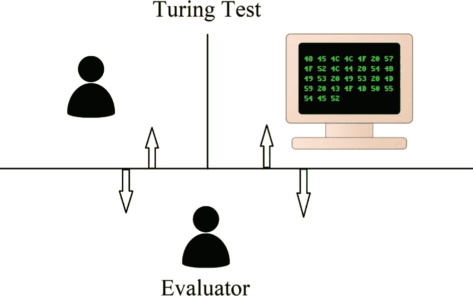
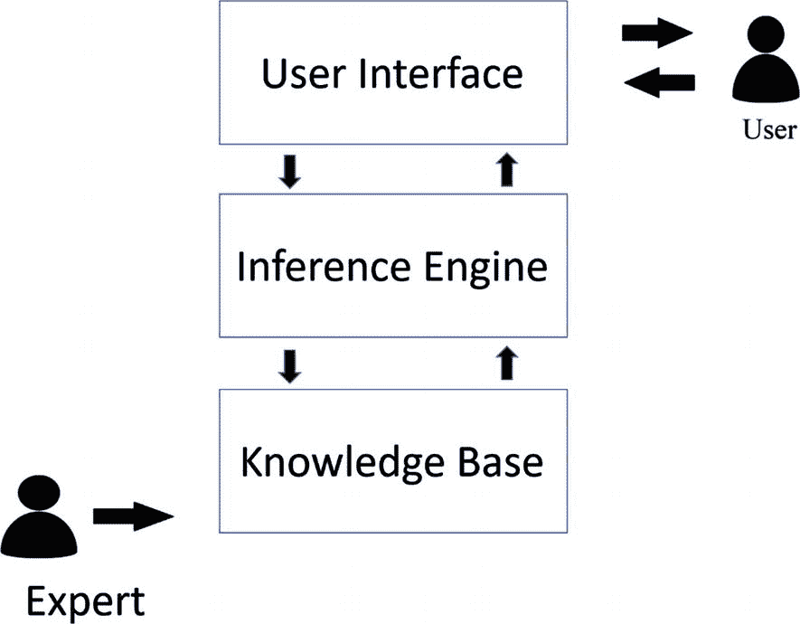
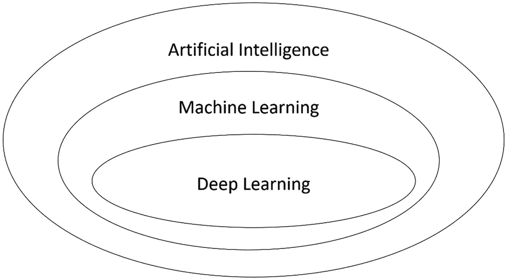

# 1. 人工智能基础

历史课

> *人工智能将是* *Google* *的终极版本。那个能理解网络上一切内容的终极搜索引擎。它会准确理解你想要什么，并给出正确的结果。我们现在离实现这一点还差得很远。然而，我们可以逐步接近这个目标，而这基本上就是我们正在努力的方向。*
> 
> ——拉里·佩奇，Google Inc. 联合创始人兼 Alphabet 首席执行官^(⁴)

在弗雷德里克·布朗 1954 年的短篇小说《答案》中，宇宙中 960 亿颗行星上的所有计算机被连接成一个超级机器。然后有人问它：“有上帝吗？”它回答道：“是的，*现在*有上帝了。”

毫无疑问，布朗的故事确实很巧妙——同时也带点滑稽和令人不寒而栗！科幻小说一直是我们理解新技术影响的一种方式，而人工智能（AI）一直是一个重要主题。科幻小说中一些最令人难忘的角色涉及变得具有自我意识的机器人或计算机，例如在《终结者》、《银翼杀手》、《2001：太空漫游》，甚至《弗兰肯斯坦》中。

但随着当今新技术和创新永不停歇的步伐，科幻小说开始变成现实。我们现在可以对着智能手机说话并得到答案；我们的社交媒体账户为我们提供感兴趣的内容；我们的银行应用提供提醒；诸如此类。这种个性化内容创作几乎像魔法一样，但正迅速成为我们日常生活中的常态。

要理解人工智能，了解其丰富的历史基础至关重要。你会看到这个行业的发展充满了突破和挫折。还有一群才华横溢的研究人员和学者，如艾伦·图灵、约翰·麦卡锡、马文·明斯基和杰弗里·辛顿，他们不断推动着技术的边界。但纵观整个过程，进步从未停止。

让我们开始吧。

## 艾伦·图灵与图灵测试

艾伦·图灵是计算机科学和人工智能领域的杰出人物。他常被称为“人工智能之父”。

1936 年，他撰写了一篇题为《论可计算数》的论文。在这篇论文中，他阐述了计算机的核心概念，后来被称为图灵机。请记住，真正的计算机直到十多年后才被开发出来。

然而，正是他那篇题为《计算机器与智能》的论文，在人工智能领域具有历史意义。他专注于智能机器的概念。但要做到这一点，必须有一种方法来衡量它。什么是智能——至少对机器而言？

这就是他提出著名的“图灵测试”的地方。这本质上是一个有三个参与者的游戏：两个是人类，一个是计算机。评估者（人类）向另外两个参与者（一个人，一台计算机）提出开放式问题，目的是确定哪一个是人类。如果评估者无法做出判断，那么就可以假定计算机是智能的。图 1-1 展示了图灵测试的基本工作流程。

图 1-1.

图灵测试的基本工作流程

这个概念的天才之处在于，无需检查机器是否真的知道某些东西、是否具有自我意识，甚至其回答是否正确。相反，图灵测试表明一台机器可以处理大量信息、解释语音并与人类交流。

图灵认为，实际上可能要等到世纪之交，机器才能通过他的测试。是的，这是人工智能领域众多未能实现的预测之一。

那么，多年来图灵测试的表现如何呢？嗯，事实证明它很难被攻克。请记住，有一些竞赛，如勒布纳奖和图灵测试竞赛，旨在鼓励人们创建智能软件系统。

2014 年，有一个案例看起来确实通过了图灵测试。它涉及一台自称 13 岁的计算机。^(⁵) 有趣的是，人类评委很可能被愚弄了，因为有些答案存在错误。

然后在 2018 年 5 月的 Google I/O 大会上，首席执行官桑达尔·皮查伊对 Google Assistant 进行了一次引人注目的演示。^(⁶) 在现场观众面前，他使用该设备给当地一家理发店打电话预约。电话那头的人表现得就像在跟真人说话一样！

很神奇，对吧？确实如此。然而，它可能仍然没有通过图灵测试。原因是对话集中在一个主题上——而不是开放式的。

毫不奇怪，图灵测试一直存在争议，因为有些人认为它可以被操纵。1980 年，哲学家约翰·塞尔撰写了一篇著名论文，题为《心灵、大脑与程序》，他在其中提出了自己的思想实验，称为“中文房间论证”，以突出其缺陷。

其工作原理如下：假设约翰在一个房间里，不懂中文。然而，他有一些手册，提供了易于使用的翻译规则。房间外是简，她懂中文，并向约翰提交字符。过了一段时间，她会从约翰那里得到准确的翻译。因此，简有理由相信约翰会说中文。

塞尔的结论：

> 这个论证的要点是：如果房间里的那个人仅仅通过执行一个理解中文的适当程序而不理解中文，那么任何其他数字计算机也仅仅基于此基础也无法理解中文，因为没有任何计算机，作为计算机，拥有那个人所没有的东西。^(⁷)

这是一个相当不错的论点——并且自那以后一直是人工智能界热议的话题。

塞尔还认为人工智能有两种形式：

*   **强人工智能**：指机器真正理解正在发生的事情，甚至可能具备情感和创造力。这很大程度上是我们在科幻电影中看到的情景。这类人工智能也被称为通用人工智能（AGI）。请注意，只有少数公司专注于这一领域，例如谷歌的 DeepMind。

*   **弱人工智能**：指机器进行模式匹配，通常专注于狭窄的任务。这方面的例子包括苹果的 Siri 和亚马逊的 Alexa。

现实情况是，人工智能仍处于弱人工智能的早期阶段。要达到强人工智能的水平，很可能需要数十年时间。一些研究人员认为这可能永远不会发生。

鉴于图灵测试的局限性，出现了一些替代方案，例如：

*   **库兹韦尔-卡普测试**：由未来学家雷·库兹韦尔和科技企业家米奇·卡普提出。该测试要求计算机进行两小时的对话，并且三位评委中有两位认为对话的是人类。至于卡普，他认为直到 2029 年才能实现这一目标。

*   **咖啡测试**：由苹果联合创始人史蒂夫·沃兹尼亚克提出。根据咖啡测试，机器人必须能够进入陌生人的家中，找到厨房，并煮好一杯咖啡。

## 大脑是一台……机器？

1943 年，沃伦·麦卡洛克和沃尔特·皮茨在芝加哥大学相遇，尽管他们背景迥异，年龄也相差悬殊（麦卡洛克 42 岁，皮茨 18 岁），但他们很快成为了挚友。麦卡洛克成长于富裕的东部名门世家，就读于名校。而皮茨则成长于低收入社区，甚至在青少年时期无家可归。

尽管如此，他们的合作却成为了人工智能发展史上最具影响力的合作之一。麦卡洛克和皮茨提出了解释大脑的新理论，这些理论常常与弗洛伊德心理学的传统观念相悖。但两人都认为逻辑可以解释大脑的力量，并借鉴了艾伦·图灵的见解。由此，他们在 1943 年合著了一篇论文，题为《神经活动中内在思想的逻辑演算》，并发表在《数学生物物理学通报》上。论文的核心论点是，大脑的核心功能（如神经元和突触）可以通过逻辑和数学来解释，例如使用“与”、“或”、“非”等逻辑运算符。利用这些运算符，可以构建一个能够处理信息、学习和思考的复杂网络。

讽刺的是，这篇论文并未在神经学家中引起太大反响。但它确实引起了从事计算机和人工智能研究人员的关注。

## 控制论

诺伯特·维纳提出了多种理论，其中最著名的是控制论。该理论侧重于理解动物、人和机器中的控制与通信——展示了反馈回路的重要性。

1948 年，维纳出版了《控制论：或关于在动物和机器中控制和通信的科学》。尽管这是一部学术著作——充满了复杂的方程式——但这本书仍然成为了畅销书，登上了《纽约时报》榜单。

这本书的内容确实包罗万象。其中一些主题包括牛顿力学、气象学、统计学、天文学和热力学。这本书预示了混沌理论、数字通信甚至计算机存储器的发展。

但这本书对人工智能也产生了影响。像麦卡洛克和皮茨一样，维纳将人脑与计算机进行了比较。此外，他推测计算机将能够下棋，并最终击败国际象棋大师。主要原因是他相信机器可以在下棋的过程中学习。他甚至认为计算机能够自我复制。

但《控制论》也并非乌托邦式的。维纳在理解计算机的负面影响方面也很有先见之明，例如非人化的可能性。他甚至认为机器会让人变得多余。

这无疑是一个好坏参半的信息。但维纳的思想是强大的，并推动了人工智能的发展。

## 起源故事

约翰·麦卡锡对计算机的兴趣始于 1948 年，当时他参加了一场名为“行为中的大脑机制”的研讨会，该研讨会探讨了机器最终将如何能够思考这一主题。部分与会者包括该领域的先驱，如约翰·冯·诺依曼、艾伦·图灵和克劳德·香农。

麦卡锡继续沉浸在新兴的计算机行业中——包括在贝尔实验室工作过一段时间——并于 1956 年在达特茅斯大学组织了一个为期十周的研究项目。他将其称为“人工智能研究”。这是该术语首次被使用。

与会者包括马文·明斯基、纳撒尼尔·罗切斯特、艾伦·纽厄尔、O. G. 塞尔弗里奇、雷蒙德·所罗门诺夫和克劳德·香农等学者。他们后来都成为了人工智能领域的重要人物。

该研究的目标无疑是雄心勃勃的：

> 本研究基于以下假设进行：学习或任何其他智能特征的每一个方面，原则上都可以被精确地描述，以至于可以制造一台机器来模拟它。我们将尝试寻找如何让机器使用语言、形成抽象概念和概念、解决目前保留给人类的各类问题，并实现自我改进。我们认为，如果精心挑选一组科学家，共同工作一个夏天，那么在这些问题中的一个或多个方面，可以取得重大进展。^(⁸)

在会议上，艾伦·纽厄尔、克里夫·肖和赫伯特·西蒙演示了一个名为“逻辑理论家”的计算机程序，该程序由他们在兰德公司开发。其主要灵感来自西蒙（他后来于 1978 年获得了诺贝尔经济学奖）。当他看到计算机如何为防空系统在地图上打印文字时，他意识到这些机器可能不仅仅是处理数字。它们还可以处理图像、字符和符号——所有这些都可能导向一台会思考的机器。

关于逻辑理论家，其重点是解决《数学原理》中的各种数学定理。该软件得出的一个解决方案甚至比原书中的更为优雅——该书的合著者伯特兰·罗素对此感到非常高兴。

创建逻辑理论家绝非易事。纽厄尔、肖和西蒙使用了 IBM 701 计算机，该计算机使用机器语言。因此，他们创建了一种名为 IPL（信息处理语言）的高级语言，从而加快了编程速度。在数年间，它都是人工智能领域的首选语言。

IBM 701 也没有足够的内存来运行逻辑理论家。这导致了另一项创新：列表处理。它允许程序在运行时动态地分配和释放内存。

要点：逻辑理论家被认为是第一个开发出来的人工智能程序。

尽管如此，它并没有引起太多兴趣！达特茅斯会议总体上令人失望。甚至连“人工智能”这个短语也受到了批评。

研究人员试图提出替代方案，例如“复杂信息处理”。但它们不像人工智能那样朗朗上口——于是这个术语就保留了下来。

至于麦卡锡，他继续致力于推动人工智能领域的创新。请看以下内容：

*   在 20 世纪 50 年代末，他开发了 Lisp 编程语言，该语言因易于处理非数值数据而常被用于人工智能项目。他还创造了递归、动态类型和垃圾回收等编程概念。Lisp 至今仍在使用，例如在机器人技术和商业应用中。在开发该语言的同时，他还共同创立了麻省理工学院人工智能实验室。

*   1961 年，他提出了计算机分时概念，这对整个行业产生了变革性的影响。这也促成了互联网和云计算的发展。

*   几年后，他创立了斯坦福大学人工智能实验室。

*   1969 年，他撰写了一篇题为“计算机控制的汽车”的论文，其中描述了一个人如何通过键盘输入指令，并由一台电视摄像机来导航车辆。

*   他于 1971 年获得了图灵奖。该奖项被认为是计算机科学领域的诺贝尔奖。

在 2006 年的一次演讲中，麦卡锡指出，他对于强人工智能的进展过于乐观了。在他看来，“我们人类并不擅长识别我们自己使用的启发式方法。”^(⁹)

## 人工智能的黄金时代

从 1956 年到 1974 年，人工智能领域是科技界最热门的领域之一。一个主要的催化剂是计算机技术的快速发展。它们从基于真空管的庞大系统，转变为运行在集成电路上的更小系统，速度更快，存储容量也更大。

联邦政府也在大力投资新技术。部分原因是阿波罗太空计划的宏伟目标以及冷战的严苛需求。

至于人工智能，主要的资金来源是高级研究计划局（ARPA），该机构是在苏联发射人造卫星带来的冲击之后，于 20 世纪 50 年代末成立的。项目支出通常要求很少，目标是激发突破性创新。ARPA 的领导人之一 J. C. R. 利克莱德有一句座右铭：“资助人才，而非项目。”大部分资金主要流向了斯坦福大学、麻省理工学院、林肯实验室和卡内基梅隆大学。

除了 IBM，私营部门对人工智能发展的参与很少。请记住，到 20 世纪 50 年代中期，IBM 开始收缩业务，专注于其计算机的商业化。实际上，客户担心这项技术会导致大量失业，因此 IBM 不想因此受到指责。

换句话说，人工智能领域的许多创新都源于学术界。例如，1959 年，纽厄尔、肖和西蒙通过开发一个名为“通用问题求解器”的程序，继续推动人工智能领域的边界。顾名思义，该程序旨在解决数学问题，例如汉诺塔。

但还有许多其他程序试图实现某种程度的强人工智能。例如：

*   *SAINT 或符号自动积分器（1961 年）*：这个由麻省理工学院研究员詹姆斯·斯拉格创建的程序，帮助解决大学一年级的微积分问题。它后来被更新为其他程序，称为 SIN 和 MACSYMA，用于处理更高级的数学问题。SAINT 实际上是专家系统的第一个例子，我们将在本章后面介绍这一类人工智能。

*   *ANALOGY（1963 年）*：这个程序由麻省理工学院教授托马斯·埃文斯创建。该应用程序证明计算机可以解决智商测试中的类比问题。

*   *STUDENT（1964 年）*：在麻省理工学院明斯基的指导下，丹尼尔·博布罗为其博士论文创建了这个人工智能应用程序。该系统使用自然语言处理（NLP）来为高中生解决代数问题。

*   *ELIZA（1965 年）*：麻省理工学院教授约瑟夫·维森鲍姆设计了这款程序，它迅速风靡一时，甚至在主流媒体中也引起了轰动。它以伊丽莎（源自萧伯纳的戏剧《卖花女》）命名，扮演心理分析师的角色。用户可以输入问题，ELIZA 会提供咨询（这是聊天机器人的第一个例子）。一些使用过它的人认为该程序是真人，这令维森鲍姆深感担忧，因为底层技术相当基础。你可以在网上找到 ELIZA 的例子，例如在[`http://psych.fullerton.edu/mbirnbaum/psych101/Eliza.htm`](http://psych.fullerton.edu/mbirnbaum/psych101/Eliza.htm)。

*   *计算机视觉（1966 年）*：在一个传奇故事中，麻省理工学院的马文·明斯基对学生杰拉德·杰伊·萨斯曼说，让他花一个夏天的时间将相机连接到计算机，并让计算机描述它所看到的东西。他确实做到了，并构建了一个能够检测基本模式的系统。这是计算机视觉的首次应用。

*   *Mac Hack（1968 年）*：麻省理工学院教授理查德·D·格林布拉特创建了这个下国际象棋的程序。它是第一个参加正式锦标赛的程序，并获得了 C 级评级。

*   *Hearsay I（20 世纪 60 年代末）*：拉吉·雷迪教授开发了一个连续语音识别系统。他的一些学生后来创立了龙系统公司，该公司成为一家重要的科技公司。

在此期间，人工智能领域的学术论文和书籍大量涌现。一些主题包括贝叶斯方法、机器学习和视觉。

但关于人工智能，通常有两种主要理论。一种由明斯基领导，他认为需要符号系统。这意味着人工智能应该基于传统的计算机逻辑或预编程——即使用诸如 If-Then-Else 语句之类的方法。

另一种是弗兰克·罗森布拉特，他认为人工智能需要使用类似于大脑的系统，比如神经网络（这个领域也被称为联结主义）。但他没有将内部工作机制称为神经元，而是称之为感知器。一个系统将能够在随时间摄取数据的过程中学习。

1957 年，罗森布拉特为此创建了第一个计算机程序，称为 Mark 1 感知器。它包括摄像头，用于帮助区分两个图像（它们有 20×20 像素）。Mark 1 感知器将使用具有随机权重的数据，然后经历以下过程：

1.  接收输入并得出感知器输出。
2.  如果不匹配，则
    1.  如果输出应为 0 但却是 1，则权重 1 将减小。
    2.  如果输出应为 1 但却是 0，则权重 1 将增大。
3.  重复步骤#1 和#2，直到结果准确。

这对人工智能来说无疑是开创性的。《纽约时报》甚至为罗森布拉特写了一篇报道，称赞“海军今天展示了一台电子计算机的雏形，预计它将能够行走、说话、观看、书写、自我复制，并意识到自己的存在。”^(¹⁰)

但感知器仍然存在一些棘手的问题。一个是神经网络只有一层（主要是因为当时缺乏计算能力）。其次，大脑研究仍处于起步阶段，在理解认知能力方面提供的帮助不多。

明斯基与西摩·帕珀特合著了一本书，名为《感知器》（1969 年）。作者们毫不留情地攻击罗森布拉特的方法，该方法很快就销声匿迹了。请注意，在 20 世纪 50 年代初期，明斯基开发了一台粗糙的神经网络机器，例如使用了数百个真空管和 B-24 轰炸机的备件。但他看到这项技术远未达到可行的程度。

罗森布拉特试图反击，但为时已晚。人工智能界很快对神经网络失去了兴趣。几年后，罗森布拉特在一次划船事故中去世，年仅 43 岁。

然而，到了 20 世纪 80 年代，他的想法得以复兴——这导致了人工智能的革命，主要是深度学习的发展。

总的来说，人工智能的黄金时代是自由奔放和激动人心的。世界上一些最聪明的学者正试图创造能够真正思考的机器。但这种乐观情绪常常走向极端。1965 年，西蒙说，在 20 年内，机器可以做人类能做的任何事情。然后在 1970 年，在接受《生活》杂志采访时，他说这将在 3 到 8 年内发生（顺便说一句，他是电影《2001：太空漫游》的顾问）。

不幸的是，人工智能的下一个阶段要暗淡得多。越来越多的学者开始持怀疑态度。也许最直言不讳的是哲学家休伯特·德雷福斯。在《计算机仍然不能做什么：对人工智能理性的批判》^(¹¹)等书中，他阐述了自己的观点：计算机与人脑并不相似，人工智能将可悲地无法达到崇高的期望。

## AI 寒冬

20 世纪 70 年代初，人们对人工智能的热情开始消退。这一时期后来被称为“AI 寒冬”，一直持续到 1980 年左右（该术语源自“核冬天”，即太阳被遮蔽、全球气温骤降的灭绝事件）。

尽管人工智能取得了许多进展，但它们大多仍停留在学术领域，并且局限于受控环境。当时的计算机系统能力仍然有限。例如，一台在 AI 研究中很常见的 DEC PDP-11/45，其内存最大只能扩展到 128K。

Lisp 语言对于当时的计算机系统来说也并不理想。相反，在企业界，人们主要关注的是 FORTRAN。

此外，在理解智能和推理方面，仍然存在许多复杂的难题。歧义消除就是其中之一。这种情况是指一个单词有多个含义。这增加了 AI 程序的难度，因为它还需要理解上下文。

最后，20 世纪 70 年代的经济环境远非强劲。通货膨胀持续、增长缓慢，并且存在供应中断，例如石油危机。

考虑到所有这些因素，美国政府收紧资金投入也就不足为奇了。毕竟，对于一个五角大楼的规划者来说，一个能下棋、能解定理、能识别一些基本图像的程序有多大用处呢？

不幸的是，用处不大。

一个显著的例子是卡内基梅隆大学的语音理解研究项目。国防高级研究计划局（DARPA）原本认为，这种语音识别系统可用于让战斗机飞行员发出语音指令。但事实证明这行不通。其中一个名为 Harpy 的程序能够理解 1011 个单词——这相当于一个普通 3 岁孩子的词汇量。

DARPA 的官员们实际上认为他们被蒙蔽了，于是取消了该项目每年 300 万美元的预算。

但人工智能遭受的最大打击来自 1973 年詹姆斯·莱特希尔爵士教授发布的一份报告。这份由英国议会资助的报告，对强人工智能的“宏大目标”进行了全面否定。他指出，一个主要问题是“组合爆炸”，即模型变得过于复杂且难以调整。

该报告总结道：“在该领域的任何部分，迄今为止的发现都未能产生当时所承诺的重大影响。”^(¹²) 他非常悲观，以至于不相信计算机能够识别图像或击败国际象棋大师。

这份报告还引发了一场在 BBC 电视上播出的公开辩论（你可以在 YouTube 上找到相关视频）。辩论双方是莱特希尔对阵唐纳德·米奇、理查德·格雷戈里和约翰·麦卡锡。

尽管莱特希尔的观点有合理之处——并且评估了大量的研究——但他没有看到弱人工智能的力量。但这似乎无关紧要，因为寒冬已经降临。

情况变得非常糟糕，以至于许多研究人员改变了职业道路。至于那些仍在研究 AI 的人，他们常常用其他术语来指代自己的工作——比如机器学习、模式识别和信息学！

## 专家系统的兴衰

即使在 AI 寒冬期间，重大的创新仍在继续。其中之一是反向传播，这对于为神经网络分配权重至关重要。随后是循环神经网络（RNN）的发展。这使得连接能够在输入层和输出层之间传递。

但在 20 世纪 80 年代和 90 年代，专家系统也出现了。一个关键驱动因素是个人电脑和小型计算机的爆炸式增长。

专家系统基于明斯基符号逻辑的概念，涉及复杂的路径。这些系统通常由特定领域的领域专家开发，例如医学、金融和汽车制造领域。

图 1-2 展示了专家系统的关键组成部分。

图 1-2.

专家系统的关键组成部分

虽然专家系统可以追溯到 20 世纪 60 年代中期，但它们直到 20 世纪 80 年代才获得商业应用。一个例子是 XCON（专家配置器），由约翰·麦克德莫特在卡内基梅隆大学开发。该系统能够优化计算机组件的选择，最初约有 2500 条规则。可以将其视为第一个推荐引擎。自 1980 年推出以来，它为 DEC 的 VAX 计算机系列节省了大量成本（到 1986 年约为 4000 万美元）。

当公司看到 XCON 的成功后，专家系统迎来了繁荣——发展成为一个价值数十亿美元的产业。日本政府也看到了机会，投资数亿美元来支持其国内市场。然而，结果大多令人失望。大部分创新都发生在美国。

例如，IBM 在其深蓝计算机中使用了专家系统。1996 年，它在六场比赛中击败了国际象棋大师加里·卡斯帕罗夫。深蓝是 IBM 自 1985 年以来一直在开发的，每秒处理 2 亿个棋位。

但专家系统也存在问题。它们通常范围狭窄，难以应用于其他类别。此外，随着专家系统变得越来越大，管理和输入数据变得更加困难。结果是结果中的错误增多。其次，测试这些系统通常被证明是一个复杂的过程。坦率地说，有时专家们会在基本问题上存在分歧。最后，专家系统不会随着时间的推移而学习。相反，必须不断更新底层逻辑模型，这大大增加了成本和复杂性。

到 20 世纪 80 年代末，专家系统开始在企业界失宠，许多初创公司被合并或倒闭。实际上，这导致了另一次 AI 寒冬，一直持续到 1993 年左右。个人电脑迅速侵蚀高端硬件市场，这意味着基于 Lisp 的机器数量急剧减少。

政府对 AI 的资助，例如来自 DARPA 的资助，也枯竭了。此外，随着苏联解体，冷战也迅速走向平静的终结。

## 神经网络与深度学习

20 世纪 50 年代，正值青少年的杰弗里·辛顿梦想成为一名教授并研究人工智能。他出身于一个著名的学术世家（他的高外祖父是乔治·布尔）。他的母亲常说：“要么做学者，要么就是失败者。”^(¹³)

即使在第一次人工智能寒冬期间，辛顿对人工智能依然充满热情，并坚信罗森布拉特的神经网络方法是正确的道路。于是，他在 1972 年凭借这一课题获得了爱丁堡大学的博士学位。

但在此期间，许多人认为辛顿是在浪费自己的时间和才华。人工智能基本上被视为一个边缘领域，甚至不被认为是一门科学。

但这反而更加激励了辛顿。他乐于扮演局外人的角色，并坚信自己的想法最终会胜出。

辛顿意识到，人工智能最大的障碍是计算能力。但他也看到，时间站在他这一边。摩尔定律预测，芯片上的元件数量大约每 18 个月就会翻一番。

与此同时，辛顿不知疲倦地致力于发展神经网络的核心理论——这最终被称为深度学习。1986 年，他与大卫·鲁姆哈特和罗纳德·J·威廉姆斯合著了一篇开创性的论文，题为《通过反向传播误差来学习表征》。该论文阐述了在神经网络中使用反向传播的关键过程。其结果是，在预测和视觉识别等方面的准确性得到了显著提升。

当然，这并非孤立发生。辛顿的开创性工作建立在其他同样信奉神经网络的研究人员的成就之上。而他自己的研究也激发了一系列其他重大成就：

*   *1980 年*：福岛邦彦创建了*Neocognitron*，这是一个识别模式的系统，成为了卷积神经网络的基础。这些网络基于动物的视觉皮层。
*   *1982 年*：约翰·霍普菲尔德开发了“霍普菲尔德网络”。这本质上是一种循环神经网络。
*   *1989 年*：杨立昆将卷积网络与反向传播相结合。这种方法在分析手写支票方面找到了应用场景。
*   *1989 年*：克里斯托弗·沃特金斯的博士论文《从延迟奖励中学习》描述了 Q 学习。这是强化学习领域的一大进步。
*   *1998 年*：杨立昆发表了《基于梯度的学习应用于文档识别》，该论文使用下降算法来改进神经网络。

## 现代人工智能的技术驱动力

除了新概念方法、理论和模型的进步之外，人工智能还有其他一些重要的驱动力。以下是主要驱动力：

*   *数据集的爆炸式增长*：互联网是人工智能的一个重要因素，因为它允许创建大规模数据集。在下一章中，我们将探讨数据如何改变了这项技术。
*   *基础设施*：在过去 15 年左右的时间里，对人工智能影响最大的公司可能是谷歌。为了跟上以惊人速度增长的网页索引，该公司不得不采用创造性的方法来构建可扩展的系统。其结果是商品服务器集群、虚拟化和开源软件方面的创新。谷歌也是深度学习的早期采用者之一，于 2011 年启动了“谷歌大脑”项目。哦，对了，几年后该公司还聘请了辛顿。
*   *GPU（图形处理器）*：这项由英伟达率先推出的芯片技术，最初用于游戏中的高速图形处理。但 GPU 的架构最终也成为了人工智能的理想选择。请注意，大多数深度学习研究都是使用这些芯片完成的。原因是——通过并行处理——其速度比传统 CPU 高出数倍。这意味着计算一个模型可能只需要一两天，而不是几周甚至几个月。

所有这些因素相互强化，为人工智能的增长增添了燃料。更重要的是，这些因素在未来许多年可能仍将保持活力。

## 人工智能的结构

在本章中，我们涵盖了许多概念。现在，理解人工智能的组织结构可能有些困难。例如，我们经常看到机器学习和深度学习这样的术语被混淆。但理解它们之间的区别至关重要，我们将在本书的其余部分详细讨论。

但从高层次来看，图 1-3 展示了人工智能的主要元素是如何相互关联的。最顶层是人工智能，它涵盖了广泛的理论和技术。然后可以将其分解为两个主要类别：机器学习和深度学习。

图 1-3.

这是对人工智能世界主要组成部分的高层次概览

## 结论

如今，人工智能是一个流行词，这已不是什么新鲜事。这个词经历了多次令人反胃的繁荣-萧条周期。

也许它会再次失宠？有可能。但这一次，人工智能确实带来了正在改变商业的真正创新。像谷歌、微软和 Facebook 这样的科技巨头都将这一领域视为重中之重。总而言之，人工智能将继续发展并改变我们的世界，这似乎是一个不错的赌注。

## 要点总结

*   技术的发展往往比最初理解的要耗时更长。
*   人工智能不仅仅是计算机科学和数学。经济学、神经科学、心理学、语言学、电气工程、数学和哲学等领域也做出了关键贡献。
*   人工智能主要有两种类型：弱人工智能和强人工智能。强人工智能是指机器具有自我意识，而弱人工智能则是指专注于特定任务的系统。目前，人工智能处于弱人工智能阶段。
*   图灵测试是测试机器是否能思考的常用方法。它基于某人是否真的认为一个系统具有智能。
*   人工智能的一些关键驱动力包括：辛顿等研究人员的新理论、数据的爆炸式增长、新的技术基础设施以及 GPU。

脚注 1   2   3   4   5   6   7   8   9   10

