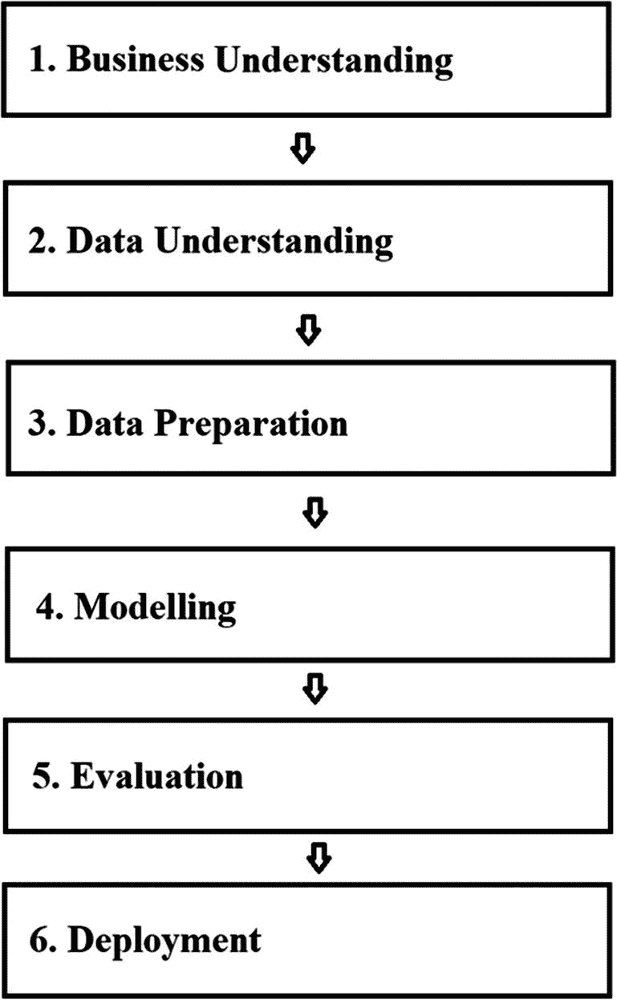

# 2. 数据

人工智能的燃料

Pinterest 是硅谷最热门的初创公司之一，允许用户收藏他们喜爱的物品来创建引人入胜的展板。该网站拥有 2.5 亿月活跃用户，并在 2018 年实现了 7.56 亿美元的收入。^(14)

Pinterest 上一个受欢迎的活动是策划婚礼。准新娘会收藏婚纱、场地、蜜月地点、蛋糕、请柬等内容的图钉。

这也意味着 Pinterest 在收集海量有价值数据方面具有优势。这部分数据有助于提供定向广告。同时，也存在开展电子邮件营销活动的机会。在一个案例中，Pinterest 发送了一封内容如下的邮件：

> 您要结婚了！因为我们热爱婚礼策划——尤其是所有可爱的文具——我们邀请您浏览由平面设计师、摄影师和其他准新娘策划的最佳展板，她们都是眼光独到且心系婚姻的 Pin 用户。^(15)

问题在于：这封邮件的许多收件人已经结婚，或者近期没有结婚的打算。

Pinterest 确实迅速采取了行动，并发布了如下道歉声明：

> 每周，我们都会向我们认为可能感兴趣的用户发送特定类别图钉和展板的邮件合集。不幸的是，最近的一封邮件暗示用户实际上要结婚了，而不仅仅是可能对婚礼相关内容感兴趣。我们很抱歉表现得像一位总是追问你何时能找到如意郎君或佳人的专横母亲。

这是一个重要的教训。即使是一些最精通技术的公司也会搞砸。

例如，在某些情况下，数据可能非常精准，但结果仍然可能是一场彻底的失败。以 Target 为例。该公司利用其海量数据向准妈妈们发送个性化优惠。这是基于那些进行了特定类型购买的客户，例如购买无香型乳液。Target 的系统会生成一个怀孕评分，甚至能提供预产期的估算。

结果，其中一位客户的父亲看到邮件后非常愤怒，声称他的女儿没有怀孕。^(16)

但事实上她怀孕了——而且，没错，她一直对父亲隐瞒着这件事。

毫无疑问，数据对于人工智能来说极其强大且至关重要。但你需要深思熟虑并理解其中的风险。在本章中，我们将探讨一些你需要了解的内容。

## 数据基础

了解数据领域的行话是件好事。

首先，比特（bit，是“二进制位”的缩写）是计算机中数据的最小形式。可以把它想象成原子。一个比特可以是 0 或 1，这是二进制的。它通常也用于衡量正在传输的数据量（例如在网络或互联网中）。

另一方面，字节（byte）主要用于存储。当然，字节数会增长得非常快。让我们在表 2-1 中看看具体情况。

表 2-1. 数据级别类型

| 单位 | 数值 | 使用场景 |
| :--- | :--- | :--- |
| 兆字节 | 1,000 千字节 | 一本小书 |
| 吉字节 | 1,000 兆字节 | 约 230 首歌曲 |
| 太字节 | 1,000 吉字节 | 500 小时的电影 |
| 拍字节 | 1,000 太字节 | 地球观测系统五年的数据 |
| 艾字节 | 1,000 拍字节 | 整个美国国会图书馆的 3,000 倍 |
| 泽字节 | 1,000 艾字节 | 36,000 年的高清电视视频 |
| 尧字节 | 1,000 泽字节 | 这需要一个特拉华州和罗德岛州面积总和的数据中心 |

数据也可以来自许多不同的来源。以下仅举几例：

* 网络/社交（Facebook、Twitter、Instagram、YouTube）
* 生物识别数据（健身追踪器、基因检测）
* 销售点系统（来自实体店和电子商务网站）
* 物联网（ID 标签和智能设备）
* 云系统（如 `Salesforce.com` 等商业应用）
* 企业数据库和电子表格

## 数据类型

组织数据有四种方式。首先是结构化数据，通常存储在关系数据库或电子表格中。一些例子包括：

* 财务信息
* 社会安全号码
* 地址
* 产品信息
* 销售点数据
* 电话号码

在大多数情况下，结构化数据更容易处理。这些数据通常来自 `CRM`（客户关系管理）和 `ERP`（企业资源规划）系统——并且通常数据量较小。在分析方面，它也往往更直接。有多种 `BI`（商业智能）程序可以帮助从结构化数据中获取洞察。然而，这类数据仅占人工智能项目的大约 20%。

大部分数据将来自非结构化数据，即没有预定义格式的信息。你需要自己处理这些数据，这可能既繁琐又耗时。但是，有一些工具，比如基于 `NoSQL` 的下一代数据库，可以帮助完成这个过程。人工智能系统在管理和结构化数据方面也很有效，因为算法可以识别模式。

以下是非结构化数据的例子：

* 图像
* 视频
* 音频文件
* 文本文件
* 社交网络信息，如推文和帖子
* 卫星图像

还有一些数据是结构化数据和非结构化数据的混合体——称为半结构化数据。这些信息包含一些有助于分类的内部标签。

半结构化数据的例子包括 `XML`（可扩展标记语言），它基于各种规则来识别文档的元素；以及 `JSON`（JavaScript 对象表示法），这是一种通过 `API`（应用程序编程接口）在网络上传输信息的方式。

但半结构化数据仅占所有数据的 5% 到 10%。

最后，还有时间序列数据，它可以是结构化、非结构化和半结构化数据。这类信息用于交互，例如追踪“客户旅程”。这会在用户访问网站、使用应用程序甚至走进商店时收集信息。

然而，这类数据通常杂乱且难以理解。部分原因在于需要理解用户的意图，而用户的意图可能千差万别。交互数据量也非常巨大，可能涉及数万亿个数据点。哦，成功的衡量标准可能也不明确。用户为什么要在网站上做某件事？

但人工智能对于解决此类问题可能至关重要。不过，在大多数情况下，时间序列数据的分析仍处于早期阶段。

## 大数据

随着互联网接入、移动设备和可穿戴设备的普及，海量数据如潮水般涌现。每秒钟，谷歌要处理超过 4 万次搜索，即每天 35 亿次。按分钟计算，Snapchat 用户分享 527,760 张照片，YouTube 用户观看超过 410 万个视频。此外，还有像电子邮件这样的传统系统，其使用量仍在显著增长。每分钟，有 1.56 亿条信息被发送。^(17)

但还有一点需要考虑：公司和机器也会产生海量数据。根据 Statista 的研究，到 2020 年，传感器数量将达到 128.6 亿个。^(18)

鉴于这一切，数据量将继续快速增长似乎是一个合理的预测。在国际数据公司（`IDC`）一份名为《数据时代 2025》的报告中，预计到 2025 年，产生的数据量将达到惊人的 163 泽字节。^(19) 这大约是 2017 年数据量的十倍。

为了应对这一切，出现了一类名为“大数据”的技术。以下是甲骨文公司对这一趋势重要性的解释：

> 如今，大数据已成为资本。想想世界上一些最大的科技公司。它们提供的价值很大一部分来自其数据，这些数据被不断分析，以提高效率并开发新产品。^(20)

所以，没错，大数据仍将是许多人工智能项目的关键组成部分。

那么，大数据到底是什么？一个好的定义是什么？实际上，并没有一个统一的定义，尽管有很多公司专注于这个市场！但大数据确实具有以下特征，被称为“三 V”（Gartner 分析师道格·莱尼在 2001 年提出了这个框架^(21)）：海量性（Volume）、多样性（Variety）和高速性（Velocity）。

### 海量性

这是指数据的规模，通常是非结构化的。对于阈值没有硬性规定，但通常是几十 TB。

在处理大数据时，海量性通常是一个主要挑战。但云计算和下一代数据库在容量和降低成本方面提供了巨大帮助。

### 多样性

这描述了数据的多样性，例如结构化、半结构化和非结构化数据（上文已解释）的组合。它也显示了数据的不同来源和用途。毫无疑问，非结构化数据的高速增长一直是大数据多样性的关键。

管理这一点很快就会成为一个重大挑战。然而，机器学习通常有助于简化这一过程。

### 高速性

这显示了数据生成的速度。正如本章前面所述，像 YouTube 和 Snapchat 这样的服务具有极高的速度（这通常被称为数据的“消防水带”）。这需要对下一代技术和数据中心进行大量投资。数据也通常在内存中处理，而不是使用基于磁盘的系统。

由于这些问题，在“三 V”中，高速性通常被认为是最困难的。让我们面对现实吧，在当今的数字世界中，人们希望尽可能快地获取数据。如果速度太慢，人们会感到沮丧并转向其他地方。

然而，多年来，随着大数据的发展，又增加了更多的“V”。目前，已有超过十个。

但以下是一些常见的：

* 真实性（Veracity）：这是指被认为准确的数据。在本章中，我们将探讨一些评估真实性的技术。
* 价值（Value）：这显示了数据的实用性。这通常涉及拥有可信的来源。
* 可变性（Variability）：这意味着数据通常会随时间变化。例如，社交媒体内容就是这种情况，它会根据对新发展和突发新闻的整体情绪而发生变化。
* 可视化（Visualization）：这是利用图表等视觉元素来更好地理解数据。

正如你所见，管理大数据涉及许多动态部分，这导致了复杂性。这有助于解释为什么许多公司仍然只使用其数据的一小部分。

## 数据库及其他工具

有无数工具可以帮助处理数据。其核心是数据库。毫不奇怪，几十年来，这项关键技术一直在演进。但即使是像关系数据库这样的较老技术，今天仍然被广泛使用。对于关键任务数据，公司不愿做出改变——即使有明确的好处。

# 数据库技术演变与数据处理

## 关系数据库的诞生与优势

为了理解这个市场，让我们回到 1970 年，当时 IBM 计算机科学家埃德加·科德发表了《大型共享数据库的关系模型》。这篇论文具有开创性，因为它引入了关系数据库的结构。在此之前，数据库相当复杂和僵化——以层次结构组织。这使得搜索和查找数据中的关系非常耗时。

至于科德的关系数据库方法，它是为更现代的机器构建的。`SQL` 脚本语言易于使用，允许进行 CRUD（创建、读取、更新和删除）操作。表之间还通过主键和外键建立连接，从而形成如下重要的关联：

*   *一对一*：一个表中的一行仅与另一个表中的一行相关联。示例：唯一的驾照号码与一名员工相关联。
*   *一对多*：一个表中的一行与另一个表中的多行相关联。示例：一个客户有多个采购订单。
*   *多对多*：一个表中的多行与另一个表中的多行相关联。示例：多份报告有多位作者。

有了这些类型的结构，关系数据库可以简化创建复杂报告的过程。这确实是革命性的。

但尽管有这些优势，IBM 对该技术并不感兴趣，并继续专注于其专有系统。该公司认为关系数据库对企业客户来说太慢且脆弱。

然而，有一个人对此持不同看法：拉里·埃里森。他阅读了科德的论文，并知道这将改变游戏规则。为了证明这一点，他于 1977 年共同创立了甲骨文公司，专注于构建关系数据库——这很快成为一个巨大的市场。科德的论文基本上是他创业努力的产品路线图。

直到 1993 年，IBM 才推出了自己的关系数据库 `DB2`。但为时已晚。此时，甲骨文已成为数据库市场的领导者。

## 大数据时代关系数据库的局限

在 20 世纪 80 年代和 90 年代，关系数据库是大型机和客户端-服务器系统的标准。但当大数据成为影响因素时，该技术出现了严重的缺陷，例如：

*   *数据蔓延*：随着时间的推移，不同的数据库会遍布整个组织。结果是数据集中变得越来越困难。
*   *新环境*：关系数据库技术并非为云计算、高速数据或非结构化数据而构建。
*   *高成本*：关系数据库可能很昂贵。这意味着将其用于人工智能项目可能成本过高。
*   *开发挑战*：现代软件开发严重依赖迭代。但关系数据库已被证明对这一过程具有挑战性。

## 开源数据库系统的兴起

在 20 世纪 90 年代末，出现了一些开源项目，旨在帮助创建下一代数据库系统。其中最重要的一个可能来自道格·卡廷，他开发了用于文本搜索的 `Lucene`。该技术基于一个复杂的索引系统，可实现低延迟性能。`Lucene` 一经推出便大获成功，并开始演进，例如 `Apache Nutch`，它可以高效地抓取网页并将数据存储在索引中。

但有一个大问题：要爬取网络，必须有一个能够超大规模扩展的基础设施。因此，在 2003 年底，卡廷开始开发一种新型的基础设施平台来解决这个问题。他的灵感来源于谷歌发表的一篇论文，该论文描述了其庞大的文件系统。一年后，卡廷构建了他的新平台，该平台能够在不增加复杂性的情况下实现复杂的存储。其核心是 `MapReduce`，它允许跨多台服务器进行处理。处理结果随后会被合并，从而生成有意义的报告。

最终，卡廷的系统演变成了一个名为 `Hadoop` 的平台——它对于管理大数据至关重要，例如使得创建复杂的数据仓库成为可能。最初，雅虎使用了它，随后随着 Facebook 和 Twitter 等公司采用这项技术，它迅速普及开来。这些公司现在能够获得数据的 360 度全景视图，而不仅仅是子集。这意味着可以进行更有效的数据实验。

但作为一个开源项目，`Hadoop` 仍然缺乏面向企业客户的复杂系统。为了解决这个问题，一家名为 `Hortonworks` 的初创公司在 `Hadoop` 平台之上构建了诸如 `YARN` 之类的新技术。它具备内存分析处理、在线数据处理和交互式 SQL 处理等功能。这些能力支持了 `Hadoop` 在许多企业中的采用。

当然，也出现了其他开源数据仓库项目。像 `Storm` 和 `Spark` 这样的知名项目专注于流式数据处理。而 `Hadoop` 则针对批处理进行了优化。

## 数据仓库的创新

除了数据仓库，传统数据库业务也出现了创新。这些通常被称为 `NoSQL` 系统。以 `MongoDB` 为例。它最初是一个开源项目，后来变成了一家非常成功的公司，并于 2017 年 10 月上市。`MongoDB` 数据库的下载量已超过 4000 万次，旨在处理云、本地和混合环境。^(²²) 其基于文档模型的数据结构也具有很大的灵活性。`MongoDB` 甚至可以在 PB 级规模下管理结构化和非结构化数据。

尽管初创公司一直是数据库系统和存储创新的源泉，但值得注意的是，大型科技运营商也至关重要。同样，像亚马逊和谷歌这样的公司，由于需要管理其庞大的平台，不得不寻找处理海量数据的方法。

其中一项创新是*数据湖*，它允许无缝存储结构化和非结构化数据。请注意，无需重新格式化数据。数据湖会处理这些，并允许你快速执行 AI 功能。根据阿伯丁集团的一项研究，使用这项技术的公司平均有机增长率为 9%，而其他公司则没有。^(²³)

但这并不意味着你必须抛弃你的数据仓库。相反，两者服务于特定的功能和用例。数据仓库通常适用于结构化数据，而数据湖则更适合多样化的环境。更重要的是，很可能很大一部分数据永远不会被使用。

总的来说，有各种各样的工具。并且随着数据环境变得越来越复杂，预计会有更多工具被开发出来。

但这并不意味着你应该选择最新的技术。再次强调，即使是较旧的关系型数据库在 AI 项目中也能非常有效。关键在于理解每种技术的优缺点，然后制定一个清晰的策略。

## 数据处理的重要性

在数据上的投入是巨大的。根据 `IDC` 的数据，大数据和分析解决方案的支出预计将从 2018 年的 1660 亿美元增长到 2022 年的 2600 亿美元。^(²⁴) 这代表着 11.9% 的年复合增长率。最大的支出者包括银行、离散制造商、流程制造商、专业服务公司和联邦政府。它们占了总支出的近一半。

以下是 `IDC` 客户洞察与分析项目副总裁杰西卡·格普费特所说的话：

> 从宏观层面来看，组织正在转向大数据和分析解决方案，以应对其物理世界和数字世界的融合。这种转变因行业而异。例如，在银行业和零售业——大数据和分析增长最快的两个领域——投资都是为了管理和重振客户体验。而在制造业，公司正在重塑自我，本质上成为高科技公司，利用其产品作为平台来支持和提供数字服务。^(²⁵)

但高水平的支出并不一定能转化为良好的结果。高德纳的一项研究估计，大约 85% 的大数据项目在进入试点阶段之前就被放弃了。^(²⁶) 原因包括以下几点：

*   缺乏明确重点
*   数据脏乱
*   投资了错误的 IT 工具
*   数据收集问题
*   缺乏组织内关键利益相关者和倡导者的支持

## CRISP-DM 数据处理流程

有鉴于此，拥有一个数据处理流程至关重要。尽管有许多方法——通常由软件供应商推崇——但有一种方法被广泛接受。一群专家、软件开发人员、顾问和学者在 20 世纪 90 年代末创建了 `CRISP-DM 流程`。请参见图 2-1 进行直观了解。

图 2-1. `CRISP-DM` 流程

在本章中，我们将介绍步骤#1 到#3。然后在本书的其余部分，我们将介绍剩余的步骤（即，我们将在第 3 章中讨论建模和评估，在第 8 章中讨论部署）。

请注意，根据 Teradata 新兴实践全球副总裁阿蒂夫·库雷希的经验，步骤#1–#3 可能占数据处理流程 80% 的时间。^(²⁷) 这是由于以下因素造成的：数据组织不善且来源不同（无论是来自不同的供应商还是组织内的孤岛），对自动化工具的关注不足，以及初始规划不足以覆盖项目范围。

同样值得记住的是，`CRISP-DM` 流程不是一个严格的线性流程。在处理数据时，可能会有很多迭代。例如，可能需要多次尝试才能获得正确的数据并进行测试。

### 第一步——业务理解

你需要对要解决的业务问题形成清晰的认识。例如：

*   价格调整会如何影响销售额？
*   文案的更改能否提升数字广告的转化率？
*   用户参与度下降是否意味着流失率会上升？

接着，你必须确定如何衡量成功。是销售额至少增长 1%，还是转化率提升 5%？

以下是印孚瑟斯咨询公司企业洞察实践部合伙人普拉萨德·维尤鲁（Prasad Vuyyuru）分享的一个案例：

> 确定使用人工智能解决哪个业务问题，并评估将创造何种价值，是所有人工智能项目成功的关键。如果缺乏对业务价值的这种专注，人工智能项目就有可能无法在组织内得到采纳。百威英博利用人工智能识别可能发生故障的包装线电机的经验，就是人工智能创造实际价值的一个绝佳范例。百威英博安装了 20 个无线传感器来测量包装线电机的振动。他们将这些声音与正常运转的电机进行比较，以识别异常，从而预测电机最终可能发生的故障。^(²⁸)

无论目标是什么，整个过程都必须避免任何预判或偏见。重点是找到最佳结果。毫无疑问，在某些情况下，可能无法得到令人满意的结果。

### 数据理解、准备与治理

或者，在其他情况下，可能会有巨大的惊喜。迈克尔·刘易斯（Michael Lewis）所著的《点球成金》一书中就有一个著名的例子，该书于 2011 年被改编成电影，由布拉德·皮特主演。这是一个关于奥克兰运动家队如何运用数据科学技术招募球员的真实故事。棒球界的传统是依赖诸如击球率之类的指标。但当使用复杂的数据分析技术时，却得出了一些令人震惊的结果。奥克兰运动家队意识到，重点应该放在长打率和上垒率上。凭借这一信息，该队得以用较低的薪酬水平招募到表现出色的球员。

结论是，你需要保持开放的心态并愿意尝试。

在第一步中，你还应该为项目组建合适的团队。除非你在像 `Facebook` 或谷歌这样的公司工作，否则你不太可能奢侈地挑选一群机器学习与数据科学领域的博士。这样的人才相当稀缺——而且成本高昂。

但一个人工智能项目也并非需要一支顶尖工程师大军。实际上，应用机器学习和深度学习模型正变得越来越容易，这要归功于像 `TensorFlow` 这样的开源系统，以及来自谷歌、亚马逊和微软的云平台。换句话说，你可能只需要几个有数据科学背景的人。

接下来，你应该找到——很可能来自你所在组织——那些对人工智能项目拥有正确领域专业知识的人。他们需要深入思考工作流程、模型和训练数据——并对行业和客户需求有特别的理解。

最后，你需要评估技术需求。将使用哪些基础设施和软件工具？是否需要增加容量或购买新的解决方案？

### 第二步——数据理解

在这一步中，你将审视项目的数据来源。考虑主要有三种数据来源，包括以下内容：

*   *内部数据*：这些数据可能来自网站、门店内的信标、物联网传感器、移动应用程序等。这类数据的一个主要优势是免费且针对你的业务进行了定制。但同样，也存在一些风险。如果对数据格式或应选择哪些数据关注不足，就可能出现问题。
*   *开源数据*：这通常是免费提供的，这当然是一个不错的好处。开源数据的一些例子包括政府和科学信息。这些数据通常通过 `API` 访问，这使得过程相当直接。开源数据通常也格式良好。然而，某些变量可能不明确，并且可能存在偏差，例如偏向于特定人群。
*   *第三方数据*：这是来自商业供应商的数据。但费用可能很高。事实上，在某些情况下，数据质量可能有所欠缺。

根据 Teradata 公司基于其自身人工智能项目经验的数据，大约 70%的数据来源是内部的，20%来自开源，其余来自商业供应商。^(²⁹) 但无论来源如何，所有数据都必须可信。否则，很可能会出现“垃圾进，垃圾出”的问题。

为了评估数据，你需要回答如下问题：
*   数据完整吗？可能缺少什么？
*   数据来自哪里？
*   收集点有哪些？
*   谁接触并处理过这些数据？
*   数据发生过哪些变化？
*   存在哪些质量问题？

如果你处理的是结构化数据，那么这个阶段应该会更容易。然而，当涉及到非结构化和半结构化数据时，你将需要对数据进行标注——这可能是一个漫长的过程。不过，市场上已经出现了一些有助于自动化这一过程的工具。

### 第三步——数据准备

数据准备过程的第一步是决定使用哪些数据集。

让我们来看一个场景：假设你在一家出版公司工作，想要制定一项提高客户留存率的策略。一些可能有帮助的数据包括客户群的人口统计信息，如年龄、性别、收入和受教育程度。为了提供更多细节，你还可以查看浏览器信息。客户对什么类型的内容感兴趣？访问频率和时长如何？是否有其他有趣的模式——比如在周末访问信息？通过整合这些信息来源，你可以构建一个强大的模型。例如，如果某些领域的活动量下降，可能预示着取消订阅的风险。这将提醒销售人员主动联系客户。

虽然这是一个明智的过程，但仍然存在隐患。即使只包含或排除一个变量，也可能对人工智能模型产生显著的负面影响。要了解原因，可以回顾一下金融危机。当时用于承销抵押贷款的模型非常复杂，并且基于海量数据。在正常经济时期，这些模型运行得相当好，高盛、摩根大通和美国国际集团等大型金融机构都严重依赖它们。

但有一个问题：这些模型没有考虑到房价下跌！主要原因是——几十年来——从未出现过全国性的房价下跌。当时的假设是，房价主要是一种局部现象。

当然，房价不仅仅是下跌——而是暴跌。事实证明，这些模型与实际情况相去甚远，数十亿美元的损失几乎摧毁了美国的金融体系。联邦政府别无选择，只能提供 7000 亿美元贷款用于救助华尔街。

诚然，这是一个极端的案例。但它确实凸显了数据选择的重要性。这正是拥有一个由领域专家和数据科学家组成的坚实团队至关重要的地方。

接下来，在数据准备阶段，需要进行数据清洗。事实上，所有数据都存在缺陷。即使是像 `Facebook` 这样的公司，其数据集中也存在空白、歧义和异常值。这是不可避免的。

因此，以下是一些你可以用来清洗数据的操作：
*   *去重*：设置测试来识别任何重复项，并删除多余的数据。
*   *异常值*：这是指远远超出其余大部分数据范围的数据。这可能表明该信息没有帮助。但当然，在某些情况下，情况恰恰相反，例如用于欺诈检测。
*   *一致性*：确保你对变量有清晰的定义。即使是像“收入”或“客户”这样的术语也可能有多种含义。
*   *验证规则*：在查看数据时，尝试找出其固有的局限性。例如，你可以为年龄列设置一个标记。如果在许多情况下年龄超过 120，那么数据存在严重问题。
*   *分箱*：某些数据可能不需要那么具体。一个人是 35 岁还是 37 岁真的重要吗？可能不重要。但比较 30-40 岁和 41-50 岁的人群可能就有意义了。
*   *时效性*：数据是否及时和相关？
*   *合并*：在某些情况下，数据列可能包含非常相似的信息。也许一列是以英寸为单位的高度，另一列是以英尺为单位。如果你的模型不需要更精确的数字，你可以只使用英尺那一列。
*   *独热编码*：这是一种将分类数据替换为数字的方法。例如：假设我们有一个数据库，其中一列有三个可能的值：苹果、菠萝和橙子。你可以将苹果表示为 1，菠萝表示为 2，橙子表示为 3。听起来很合理，对吧？也许并非如此。问题在于，人工智能算法可能会认为橙子大于苹果。但使用独热编码，你可以避免这个问题。你将创建三个新列：`is_Apple`、`is_Pineapple` 和 `is_Orange`。对于数据中的每一行，你将在水果存在的那一列填入 1，其余列填入 0。
*   *转换表*：当你需要将数据从一种标准转换为另一种标准时，可以使用此方法。例如，如果你有十进制系统的数据，并希望转换为公制系统。

这些步骤将大大有助于提高数据质量。还有一些自动化工具可以提供帮助，例如来自 `SAS`、`Oracle`、`IBM`、`Lavastorm Analytics` 和 `Talend` 等公司的工具。此外，还有开源项目，如 `OpenRefine`、`plyr` 和 `reshape2`。

无论如何，数据都不会是完美的。没有哪个数据源是完美的。很可能仍然存在空白和不准确之处。

这就是为什么你需要有创造力。看看 `BlueVine` 首席执行官 Eyal Lifshitz 的做法。他的公司利用人工智能为小企业提供融资。“我们的数据来源之一是我们客户的信用信息，”他说。“但我们发现，小企业主会错误地识别他们的业务类型。这可能对我们的承销产生不良结果。为了解决这个问题，我们使用人工智能算法从客户网站上抓取数据，这有助于识别行业。”^(³⁰)

数据清洗方法还将取决于人工智能项目的用例。例如，如果你正在为制造业构建一个预测性维护系统，挑战将在于处理来自不同传感器的巨大差异。结果是，大量数据可能价值不大，并且主要是噪声。

### 伦理与治理

你需要留意数据可能存在的任何限制。供应商是否会禁止你将信息用于某些目的？如果出现问题，你的公司是否需要承担责任？为了处理这些问题，建议让法务部门介入。

在大多数情况下，数据必须谨慎处理。毕竟，有许多知名案例涉及公司侵犯隐私。一个突出的例子是 `Facebook`。该公司的合作伙伴之一剑桥分析公司在未经用户许可的情况下，从用户资料中获取了数百万个数据点。当一名举报人揭露此事后，`Facebook` 股价暴跌，市值损失超过 1000 亿美元。该公司还面临来自美国和欧洲政府的压力。^(³¹)

另一件需要警惕的事情是从公共来源抓取数据。诚然，这通常是创建大型数据集的有效方法。也有很多工具可以自动化这一过程。但抓取数据可能会使你的公司面临法律责任，因为这些数据可能受版权或隐私法保护。

还有一些预防措施可能具有讽刺意味地存在固有缺陷。例如，麻省理工学院最近的一项研究表明，匿名化数据可能并不那么匿名。研究人员发现，实际上很容易重建这类数据并识别出个人身份——例如通过合并两个数据集。他们通过使用新加坡移动网络（`GPS` 追踪）和当地交通系统的数据做到了这一点。经过大约 11 周的分析，研究人员能够识别出 95%的个人。^(³²)

最后，确保你采取措施保护数据安全。网络攻击和威胁事件的数量正以惊人的速度持续增长。根据威瑞森公司的数据，2018 年发生了超过 5.3 万起安全事件和约 2200 起数据泄露。^(³³) 该报告还指出：
*   76%的数据泄露是出于经济动机。
*   73%来自公司外部人员。
*   约一半来自有组织的犯罪集团，12%来自国家或国家附属行为者。

云服务和本地数据使用量的增加也可能使公司面临安全漏洞。此外，还有移动办公人员，这意味着对数据的访问可能使其暴露于泄露风险之中。

攻击造成的破坏性也越来越大。其结果是，公司很容易遭受处罚、诉讼和声誉损害。

基本上，在组建人工智能项目时，要确保制定并遵守安全计划。

## 人工智能需要多少数据？

数据越多越好，对吗？通常情况确实如此。看看所谓的休斯现象。该理论认为，随着你向模型添加特征，性能通常会提高。

但数量并非决定一切。可能会有一个临界点，数据开始导致性能下降。请记住，你可能会遇到所谓的维度灾难。据佐治亚理工学院交互计算学院教授兼高级副院长查尔斯·伊斯贝尔称，“随着特征或维度的数量增长，我们进行准确泛化所需的数据量呈指数级增长。”^(³⁴)

实际影响是什么？由于可能没有足够的数据，这可能导致无法构建一个好的模型。这就是为什么在视觉识别等应用中，维度灾难可能相当成问题。即使分析RGB图像，维度数量也大约为7500。想象一下，使用实时高清视频进行处理的过程会有多么密集。

## 更多数据术语与概念

在进行数据分析时，你应该了解基本术语。以下是一些你经常会听到的术语：

*分类数据*：这是没有数值意义的数据。相反，它具有文本意义，例如对某个群体（种族和性别）的描述。不过，你可以为每个元素分配数字。

*数据类型*：这是变量所代表的信息种类，例如布尔值、整数、字符串或浮点数。

*描述性分析*：这是通过分析数据来更好地了解业务的当前状态。一些例子包括衡量哪些产品卖得更好，或确定客户支持中的风险。有许多用于描述性分析的传统软件工具，例如商业智能应用。

*诊断性分析*：这是通过查询数据来了解某事发生的原因。这类分析使用数据挖掘、决策树和相关性等技术。

*ETL（提取、转换、加载）*：这是一种数据集成形式，通常用于数据仓库。

*特征*：这是数据的一列。

*实例*：这是数据的一行。

*元数据*：这是关于数据的数据——即描述信息。例如，一个音乐文件可以包含大小、时长、上传日期、评论、流派、艺术家等元数据。这类数据最终可能对人工智能项目非常有用。

*数值数据*：这是任何可以用数字表示的数据。但数值数据有两种形式。有离散数据，即整数——也就是不带小数点的数字。还有连续数据，它具有连续性，例如温度或时间。

*OLAP（联机分析处理）*：这是一种允许你分析来自多个数据库信息的技术。

*序数数据*：这是数值数据和分类数据的混合。一个常见的例子是亚马逊网站上的五星评级。它既包含星级，也关联着一个数字。

*预测性分析*：这涉及使用数据进行预测。用于此的模型通常很复杂，并依赖于机器学习等人工智能方法。为了有效，用新数据更新底层模型非常重要。一些用于预测性分析的工具包括回归等机器学习方法。

*规范性分析*：这是关于利用大数据做出更好的决策。它不仅关注预测结果，还理解其背后的逻辑。这正是人工智能发挥重要作用的地方。

*标量变量*：这些是保存单个值的变量，例如姓名或信用卡号。

*事务数据*：这是记录在财务、业务和物流活动上的数据。例如付款、发票和保险索赔。

## 结论

在人工智能方面取得成功意味着要拥有数据驱动的文化。这对于亚马逊、谷歌和Facebook等公司至关重要。在做决策时，他们首先会查看数据。数据还应在整个组织中广泛可用。

如果没有这种方法，无论你的计划如何，在人工智能方面取得的成功都将是短暂的。这或许有助于解释——根据NewVantage Partners的一项研究——约77%的受访者表示，“业务采用”大数据和人工智能仍然是挑战。^(³⁵)

## 核心要点

*   结构化数据经过标记和格式化，通常存储在关系数据库或电子表格中。

*   非结构化数据是指没有预定义格式的信息。

*   半结构化数据包含一些有助于分类的内部标签。

*   大数据描述了一种处理海量信息的方法。

*   关系数据库基于数据之间的关系。但这种结构对于人工智能等现代应用来说可能难以应对。

*   NoSQL数据库更加自由，基于文档模型。这使得它能够更好地处理非结构化和半结构化数据。

*   CRISP-DM流程提供了一种管理项目数据的方法，其步骤包括业务理解、数据理解、数据准备、建模、评估和部署。

*   数据的数量固然重要，但质量方面也需要下很大功夫。即使是微小的错误也可能对人工智能模型的结果产生巨大影响。

脚注 1   2   3   4   5   6   7   8   9   10   11   12   13   14   15   16   17   18   19   20   21   22