# 3. 机器学习

从数据中挖掘洞见

> *机器学习的突破将价值十个微软。*

> ——比尔·盖茨^(³⁶)

尽管卡特里娜·莱克喜欢网购，但她知道这种体验本可以更好。主要问题在于：很难找到个性化的时尚单品。

于是，Stitch Fix 的灵感由此诞生。2011 年，卡特里娜在哈佛商学院就读期间，于她在剑桥的公寓里创办了这家公司（顺便提一下，公司最初的名字是没那么吸引人的“Rack Habit”）。该网站为用户提供问答环节——询问尺码和时尚风格等因素——然后由专业造型师每月精选搭配一盒服装和配饰寄出。

这个概念迅速流行起来，增长势头强劲。但筹集资金却很困难，因为许多风险投资家看不到这项业务的潜力。然而，卡特里娜坚持不懈，并相当迅速地建立了一个盈利的运营模式。

在此过程中，`Stitch Fix` 收集了大量有价值的数据，例如关于体型和风格偏好的数据。卡特里娜意识到这对于机器学习来说是理想之选。为了利用这一点，她聘请了埃里克·科尔森，他曾是 `Netflix` 数据科学与工程副总裁，新职位是首席算法官。

这一战略转变至关重要。随着 `Stitch Fix` 收集到更多数据——不仅来自最初的调查，还来自持续的反馈——机器学习模型的预测能力变得越来越好。这些数据也被编码在 `SKU` 中。

结果：`Stitch Fix` 的客户忠诚度和转化率持续提升。库存周转率也有所改善，这有助于降低成本。

但新战略并不意味着解雇造型师。相反，机器学习极大地提升了他们的生产力和效率。

这些数据还提供了关于应该创造何种类型服装的洞见。这促使 `Stitch Fix` 在 2017 年推出了 `Hybrid Designs`，这是其自有品牌。事实证明，这在应对库存缺口方面非常有效。

到 2017 年 11 月，卡特里娜带领 `Stitch Fix` 上市，筹集了 1.2 亿美元。公司估值高达 16.3 亿美元——使她成为美国最富有的女性之一。^(³⁷) 哦，顺便提一下，当时她还有一个 14 个月大的儿子！

时至今日，`Stitch Fix` 在美国拥有 270 万客户，年收入超过 12 亿美元。公司还拥有超过 100 名数据科学家，其中大多数拥有神经科学、数学、统计学和人工智能等领域的博士学位。^(³⁸)

根据该公司的 `10-K` 文件：

> 我们的数据科学能力驱动着我们的业务。这些能力包括我们丰富且不断增长的详细客户和商品数据集，以及我们专有的算法。我们在整个业务中运用数据科学，包括为客户提供造型建议、预测购买行为、预测需求、优化库存以及设计新服装。^(³⁹)

毫无疑问，`Stitch Fix` 的故事清楚地展示了机器学习不可思议的力量，以及它如何颠覆一个行业。在接受 `digiday.com` 采访时，莱克指出：

> 从历史上看，你向公司提供的信息与你所获得的体验改善之间存在着差距。大数据在网络各处追踪你，而你现在从中获得的最大好处是：如果你点击了一双鞋，一周后你会再次看到那双鞋。我们将看到这个差距开始缩小。人们对个性化的期望非常不同，但重要的是，要追求一种真实的个性化。而不是‘你放弃了购物车，我们注意到了这一点。’它将真正认识到你作为一个独特个体的身份。大规模实现这一点的唯一途径是拥抱数据科学，并通过创新来实现目标。^(⁴⁰)

那么，机器学习到底是什么？为什么它能产生如此巨大的影响？又有哪些风险需要考虑？

在本章中，我们将回答这些问题——以及更多内容。

## 什么是机器学习？

在麻省理工学院和贝尔电话实验室工作一段时间后，阿瑟·L·塞缪尔于 1949 年加入 `IBM`，在波基普西实验室任职。他的努力帮助提升了公司机器的计算能力，例如参与了 `701` 型计算机（这是 `IBM` 首款商业化的计算机系统）的研发。

但他也编写应用程序。其中有一款将载入史册——那就是他的计算机跳棋游戏。这是机器学习系统的首个实例（塞缪尔在 1959 年就此发表了一篇有影响力的论文^(⁴¹)）。`IBM` 首席执行官老托马斯·J·沃森表示，这项创新将使股价上涨 15 个点！^(⁴²)

那么，为什么塞缪尔的论文如此重要呢？通过研究跳棋，他展示了机器学习的工作原理——换句话说，计算机可以通过处理数据来学习和改进，而无需进行显式编程。这得益于对高级统计学概念的运用，尤其是概率分析。因此，计算机可以被训练来做出准确的预测。

这在当时是革命性的，因为那时的软件开发主要是一系列遵循逻辑工作流程的命令。

为了理解机器学习的工作原理，我们以 HBO 电视喜剧《硅谷》中的一个例子来说明。工程师杨健被要求创建一个“美食版 `Shazam`”。为了训练这个应用，他必须提供大量食物图片的数据集。不幸的是，由于时间限制，这个应用只学会了识别……热狗。换句话说，如果你使用这个应用，它只会回应“热狗”和“不是热狗”。

虽然很幽默，但这集电视剧很好地演示了机器学习。本质上，这是一个接收带标签数据并寻找关系的过程。如果你用热狗（比如数千张图像）来训练系统，它识别热狗的能力会越来越强。

是的，即使是电视剧也能教给我们关于人工智能的宝贵知识！

但当然，你还需要更多。在本章的下一节中，我们将更深入地探讨你需要了解的关于机器学习的核心统计学知识。这包括标准差、正态分布、贝叶斯定理、相关性和特征提取。

然后，我们将涵盖机器学习的使用案例、一般流程以及常见算法等主题。

## 标准差

标准差衡量的是与平均值的平均距离。事实上，你无需学习如何计算它（这个过程涉及多个步骤），因为 `Excel` 或其他软件可以轻松为你完成。

为了理解标准差，我们以你家附近房屋的价值为例。假设平均值为 145,000 美元，标准差为 24,000 美元。这意味着低于平均值一个标准差是 133,000 美元（145,000 美元 – 12,000 美元），高于平均值一个标准差是 157,000 美元（145,000 美元 + 12,000 美元）。这为我们提供了一种量化数据变异程度的方法。也就是说，数据与平均值之间存在 24,000 美元的离散度。

接下来，我们看看如果马克·扎克伯格搬到你附近，导致平均值跃升至 850,000 美元，标准差变为 175,000 美元的情况。但这些统计指标能反映估值吗？并非如此。扎克伯格的购买行为是一个异常值。在这种情况下，最好的方法可能是排除他的房子。

## 正态分布

当绘制在图表上时，正态分布看起来像一个钟形（这也是它被称为“钟形曲线”的原因）。它表示一个变量概率的总和。有趣的是，正态曲线在自然界中很常见，因为它反映了诸如身高和体重等事物的分布。

解释正态分布时，一种常用的方法是使用 `68-95-99.7` 法则。该法则估计，`68%` 的数据项将落在一个标准差范围内，`95%` 落在两个标准差范围内，`99.7%` 落在三个标准差范围内。

理解这一点的一个方法是使用智商分数。假设平均分是 `100`，标准差是 `15`。那么三个标准差的情况如图 3-1 所示。

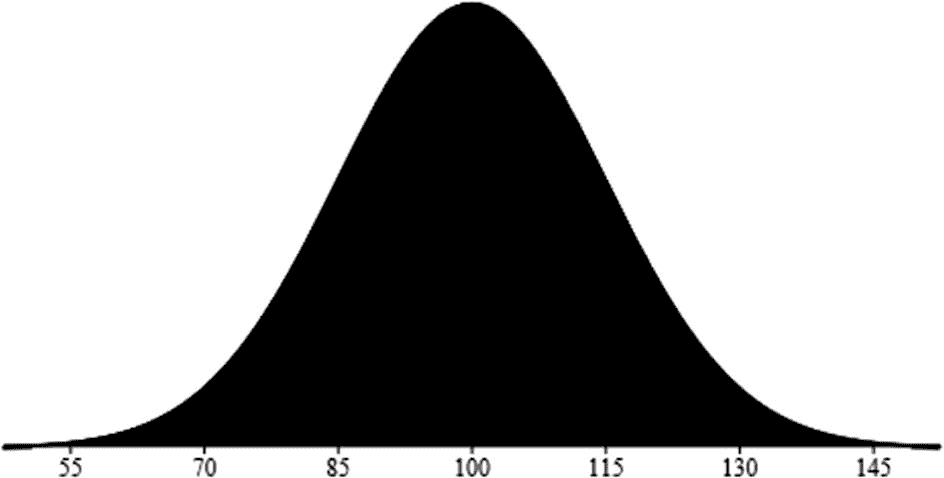

图 3-1.

智商分数的正态分布

请注意，此图中的峰值是平均值。所以，如果一个人的智商是 `145`，那么只有 `0.15%` 的人会有更高的分数。

现在，根据数据的变异程度，曲线可能有不同的形状。例如，如果我们的智商数据中有大量天才，那么分布将向右偏斜。

## 贝叶斯定理

顾名思义，描述性统计提供了关于数据的信息。我们已经通过平均值和标准差等概念看到了这一点。

但当然，你可以远远超越这一点——基本上，通过使用贝叶斯定理。这种方法在分析医学疾病时很常见，其中因果关系是关键——例如在 `FDA`（美国食品药品监督管理局）的试验中。

为了理解贝叶斯定理的工作原理，我们举个例子。一位研究人员提出了一种针对某种癌症的测试方法，并且证明其准确率为 `80%`。这被称为真阳性。

但有 `9.6%` 的情况下，测试会将被测试者识别为患有癌症，即使他/她并没有患病，这被称为假阳性。请记住——在某些药物测试中——这个百分比可能高于准确率！

最后，总人口中有 `1%` 患有这种癌症。

综上所述，如果医生对你进行了测试，结果显示你患有癌症，那么你真正患有癌症的概率是多少？贝叶斯定理将揭示答案。这个计算使用准确率、假阳性率和人口患病率等因素来得出一个概率：

*   *步骤 1*：`80%` 的准确率 × 患癌概率（`1%`）= `0.008`。
*   *步骤 2*：未患癌概率（`99%`）× `9.6%` 的假阳性率 = `0.09504`。
*   *步骤 3*：然后将上述数字代入以下等式：`0.008 / (0.008 + 0.09504) = 7.8%`。

听起来有点不对劲，对吧？确实如此。毕竟，一个准确率高达 `90%` 的测试，其正确的概率竟然只有 `7.8%`？但请记住，准确率是基于对患病者的测量。而这是一个很小的数字，因为总人口中只有 `1%` 的人患病。更重要的是，测试仍然会产生假阳性。因此，贝叶斯定理是一种更好地理解结果的方法——这对于像人工智能这样的系统至关重要。

## 相关性

机器学习算法通常涉及数据之间的某种相关性。一种量化描述方式是使用皮尔逊相关系数，它显示两个变量之间关系的强度，取值范围为 `1` 到 `-1`（即相关系数）。

其工作原理如下：

相关系数的值可以告诉我们变量之间关系的强度与方向。

*   **大于 0**：表示一个变量增加会导致另一个变量增加。例如：假设收入与支出之间的相关系数为 0.9。如果收入增加 1000 美元，那么支出将增加 900 美元（1000 美元 × 0.9）。
*   **0**：表示两个变量之间不存在相关性。
*   **小于 0**：表示一个变量的任何增加都会导致另一个变量的减少，反之亦然。这描述了一种反向关系。

那么，什么是强相关性呢？根据一般经验法则，如果相关系数达到 +0.7 左右，即为强相关。如果低于 0.3，则相关性很弱。

这一切都印证了那句老话：“相关性并不必然意味着因果关系。”然而，在机器学习中，这个概念很容易被忽视，从而导致误导性的结果。

例如，许多相关性只是随机出现的。事实上，有些甚至相当滑稽。请看下面来自 Tylervigen.com 的例子：<sup>(43)</sup>

*   缅因州的离婚率与人造黄油的人均消费量之间的相关性高达 99.26%。
*   美国小姐的年龄与因蒸汽、热蒸汽和热带地区导致的谋杀案之间的相关性为 87.01%。
*   美国从挪威进口的原油量与因与火车相撞而死亡的司机人数之间的相关性为 95.4%。

这有一个专门的名称：模式性。这是一种在无意义的噪音中寻找模式的倾向。

## 特征提取

在第 2 章中，我们讨论了为模型选择变量。这个过程通常被称为特征提取或特征工程。

例如，一个从照片中识别男性或女性的计算机模型。对人类来说，这相当容易且快速，是一种直觉行为。但如果有人让你描述其中的差异，你能做到吗？对大多数人来说，这将是一项艰巨的任务。然而，如果我们想构建一个有效的机器学习模型，就需要正确地进行特征提取——而这可能是主观的。

表 3-1 展示了一些关于男性面部与女性面部可能存在的差异的想法。

**表 3-1. 面部特征**

| 特征 | 男性 |
| :--- | :--- |
| 眉毛 | 更粗、更直 |
| 脸型 | 更长、更大，更偏向方形 |
| 下颌骨 | 方形、更宽、更棱角分明 |
| 颈部 | 有喉结 |

这只是冰山一角，我相信你也有自己的想法或方法。这很正常。但这也是为什么人脸识别这类事情高度复杂且容易出错的原因。

特征提取也存在一些细微的问题。其中之一是潜在的偏差。例如，你对男性或女性的外貌是否有先入为主的观念？如果有，这可能导致模型给出错误的结果。

鉴于所有这些原因，最好由一个专家团队来确定正确的特征。如果特征工程被证明过于复杂，那么机器学习可能不是一个好的选择。

但还有另一种方法可以考虑：深度学习。这涉及到在数据中寻找特征的复杂模型。实际上，这也是深度学习成为人工智能领域重大突破的原因之一。我们将在下一章中了解更多。

## 你能用机器学习做什么？

由于机器学习已经存在了几十年，这项强大的技术已经有了许多用途。此外，它在节省成本、创造收入和风险监控方面的明显优势也助长了其应用。

为了让你了解其众多的应用场景，下面来看一些例子：

*   **预测性维护**：通过监控传感器来预测设备何时可能发生故障。这不仅有助于降低成本，还能减少停机时间并提高安全性。事实上，像 `PrecisionHawk` 这样的公司正在使用无人机来收集数据，这效率要高得多。这项技术已被证明在能源、农业和建筑等行业非常有效。以下是 `PrecisionHawk` 对其基于无人机的预测性维护系统的描述：“一位客户测试了使用视距内（VLOS）无人机检查半径三英里内一组 10 个井场的情况。我们的客户确定，使用无人机可将检查成本降低约 66%，从传统检查方法的每个井场 80-90 美元降至使用 VLOS 无人机任务的每个井场 45-60 美元。”<sup>(44)</sup>
*   **招聘员工**：这可能是一个繁琐的过程，因为许多简历往往各不相同。这意味着很容易错过优秀的候选人。但机器学习可以极大地帮助解决这个问题。以 `CareerBuilder` 为例，它收集并分析了超过 230 万个职位、6.8 亿个独特档案、3.1 亿份独特简历、1000 万个职位名称、13 亿项技能和 250 万次背景调查，从而构建了 `Hello to Hire` 平台。这个平台利用机器学习，将成功招聘所需的平均求职申请数量减少到了 75 份。而行业平均水平约为 150 份。<sup>(45)</sup> 该系统还能自动创建职位描述，甚至考虑了基于行业和地点的细微差别！
*   **客户体验**：如今，客户希望获得个性化的体验。通过使用 `Amazon.com` 和 `Uber` 等服务，他们已经习惯了这一点。借助机器学习，公司可以利用其数据获得洞察力——了解真正有效的方法。这一点非常重要，以至于 `Kroger` 收购了该领域的一家公司，名为 `84.51°`。该公司拥有超过 6000 万美国家庭的数据，这无疑是关键所在。这里有一个简短的案例研究：`Kroger` 的大部分门店都销售散装牛油果，只有少数门店销售 4 个装。传统观点认为，由于与散装牛油果存在尺寸差异，4 个装必须打折。但应用机器学习分析后，这被证明是不正确的，因为 4 个装吸引了新的、不同的家庭群体，如千禧一代和 ClickList 购物者。通过在连锁店中推广 4 个装，牛油果的整体销量得到了提升。<sup>(46)</sup>
*   **金融**：机器学习可以检测差异，例如在账单方面。但有一类新的技术，称为 `RPA`（机器人流程自动化），可以帮助解决这个问题（我们将在第 5 章中讨论这个主题）。它自动化常规流程以帮助减少错误。`RPA` 也可能使用机器学习来检测异常或可疑交易。
*   **客户服务**：过去几年，聊天机器人得到了发展，它们使用机器学习来自动化与客户的互动。我们将在第 6 章中讨论这一点。
*   **约会**：机器学习可以帮助你找到灵魂伴侣！`Tinder` 是最大的约会应用之一，它正在使用这项技术来帮助改善匹配。例如，它有一个系统可以自动标记每天上传的超过 100 亿张照片。

图 3-2 展示了机器学习的一些应用。

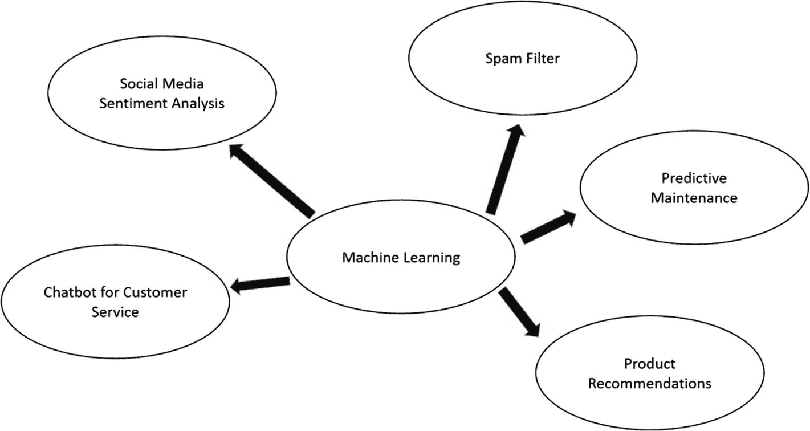

## 机器学习流程

要将机器学习成功应用于某个问题，采取系统化的方法至关重要。否则，结果可能会严重偏离预期。

首先，你需要经历一个数据处理流程，我们在前一章已经介绍过。完成这一步后，最好对数据进行可视化处理。数据是大多呈散乱分布？还是存在某些模式？如果答案是肯定的，那么这些数据就很有可能是机器学习的良好候选。

机器学习流程的目标是创建一个基于一种或多种算法的模型。我们通过训练来开发这个模型，目标是让模型具备高度的可预测性。

现在，让我们更详细地看看这个过程（顺便提一下，这也适用于我们将在下一章介绍的深度学习）：

### 第一步——数据排序

如果你的数据是排序的，这可能会扭曲结果。也就是说，机器学习算法可能会将其检测为一种模式！因此，随机打乱数据顺序是个好主意。

### 第二步——选择模型

你需要选择一个算法。这将是一个有根据的猜测，会涉及反复试验的过程。在本章中，我们将介绍各种可用的算法。

### 第三步——训练模型

训练数据（约占完整数据集的 70%）将用于在算法中建立各种关系。例如，假设你正在构建一个机器学习系统来估算二手车的价值。一些特征将包括制造年份、品牌、型号、里程数和车况。通过处理这些训练数据，算法会计算出每个因素的权重。

示例：假设我们使用一个线性回归算法，其格式如下：

```
y = m * x + b
```

在训练阶段，系统会计算出 `m`（即图表上的斜率）和 `b`（即 `y` 轴截距）的值。

### 第四步——评估模型

你将整理出测试数据，即数据集中剩余的 30%。它应该能代表训练数据中信息的范围和类型。

通过测试数据，你可以判断算法是否准确。在我们的二手车示例中，市场价值是否与现实世界的情况一致？

> **注意**：训练数据和测试数据绝不能有任何混杂。这很容易导致结果失真。有趣的是，这是一个常见的错误。

准确率是衡量算法成功与否的一个指标。但在某些情况下，这可能会产生误导。考虑欺诈检测的情况。与数据集相比，通常只有少量特征。但遗漏一个特征可能是灾难性的，导致公司损失数百万美元。

这就是为什么你可能想使用其他方法，比如贝叶斯定理。

### 第五步——微调模型

在这一步中，我们可以调整算法中参数的值。这是为了看看我们是否能获得更好的结果。

在微调模型时，可能还会涉及超参数。这些是无法直接从训练过程中学习到的参数。

## 应用算法

有些算法计算起来相当简单，而另一些则需要复杂的步骤和数学运算。好消息是，你通常不需要自己计算算法，因为有多种语言（如 `Python` 和 `R`）可以让这个过程变得直接明了。

至于机器学习，算法通常与传统算法不同。原因在于，第一步是处理数据——然后，计算机将开始学习。

尽管有数百种机器学习算法可用，但它们实际上可以分为四大类：监督学习、无监督学习、强化学习和半监督学习。我们将逐一介绍。

### 监督学习

监督学习使用标记数据。例如，假设我们有一组包含数千张狗的照片。如果每张照片都标明了狗的品种，那么这些数据就被认为是标记过的。在大多数情况下，这使得分析更容易，因为我们可以将结果与正确答案进行比较。

监督学习的关键之一是需要大量的数据。这有助于完善模型并产生更准确的结果。

但有一个大问题：现实情况是，许多可用数据并未被标记。此外，如果数据集非常庞大，提供标签可能会非常耗时。

然而，有一些创造性的方法可以解决这个问题，比如众包。`ImageNet` 系统就是这样构建的，这曾是人工智能创新的一个突破。但创建它仍然花费了数年时间。

或者，在某些情况下，可以采用自动化方法来标记数据。以 `Facebook` 为例。2018 年，该公司在其 `F8` 开发者大会上宣布，它利用了来自 `Instagram` 的庞大照片数据库，这些照片都带有标签。^(⁴⁷)

诚然，这种方法有其缺陷。一个标签可能给出照片的非视觉描述——比如 `#tbt`（即“Throwback Thursday”）——或者可能过于模糊，比如 `#party`。这就是为什么 `Facebook` 称其方法为“弱监督数据”。但该公司才华横溢的工程师找到了一些提高质量的方法，例如构建一个复杂的标签预测模型。

总而言之，结果相当不错。`Facebook` 的机器学习模型包含了 35 亿张照片，基于 `ImageNet` 识别基准的准确率达到 85.4%。这实际上是历史上记录的最高水平，高出 2 个百分点。

这个人工智能项目还需要创新的方法来构建基础设施。根据 `Facebook` 的博文：

> 由于单台机器需要一年多的时间才能完成模型训练，我们创建了一种方法，将任务分布到多达 336 个 `GPU` 上，将总训练时间缩短到仅几周。随着模型规模越来越大——这项研究中最大的模型是 `ResNeXt 101-32x48d`，拥有超过 8.61 亿个参数——这种分布式训练变得越来越重要。此外，我们设计了一种去除重复项的方法，以确保我们不会意外地在用于评估模型的图像上训练模型，而这个问题一直困扰着该领域的类似研究。^(⁴⁸)

展望未来，`Facebook` 看到了将其方法应用于多个领域的潜力，包括以下方面：

*   改进信息流中的排名

*   更好地检测不良内容

*   为视障人士自动生成描述文字

### 无监督学习

无监督学习是指处理未标记数据的过程。这意味着你将使用深度学习算法来检测模式。

迄今为止，无监督学习最常用的方法是聚类，它接收未标记数据，并利用算法将相似的项目归入同一组。这个过程通常从猜测开始，然后通过多次迭代计算来获得更优的结果。其核心在于找到彼此接近的数据项，这可以通过多种定量方法实现：

*   *欧几里得度量*：这是两个数据点之间的直线距离。欧几里得度量在机器学习中相当常见。

*   *余弦相似度度量*：顾名思义，你将使用余弦值来测量角度。其思想是根据方向来寻找两个数据点之间的相似性。

*   *曼哈顿度量*：这涉及计算图形坐标上两点绝对距离的总和。之所以称为“曼哈顿”，是因为它参考了该城市的街道布局，这种布局允许更短的通行距离。

就聚类的用例而言，最常见的是客户细分，这有助于更好地定位营销信息。在大多数情况下，具有相似特征的群体很可能拥有共同的兴趣和偏好。

另一个应用是情感分析，即挖掘社交媒体数据并发现趋势。对于一家时装公司来说，这对于理解如何调整下一季服装系列的风格至关重要。

除了聚类之外，还有其他方法。以下是另外三种方法：

*   *关联*：基本概念是，如果 X 发生，那么 Y 很可能发生。因此，如果你买了我的 AI 书籍，你可能也想购买该类型的其他书籍。通过关联，深度学习算法可以解读这类关系。这可以产生强大的推荐引擎。

*   *异常检测*：这能识别数据集中的离群点或异常模式，对网络安全应用很有帮助。据 `Barracuda Networks` 的电子邮件安全副总裁 `Asaf Cidon` 称：“我们发现，通过结合许多不同的信号——例如电子邮件正文、邮件头、通信社交图谱、`IP` 登录、收件箱转发规则等——我们能够在检测社会工程攻击方面实现极高的精度，即使这些攻击高度个性化，并且专门针对特定组织中的特定个人。机器学习使我们能够检测到源自组织内部的攻击，其来源是员工的合法邮箱，这是静态的一刀切规则引擎无法做到的。”^(⁴⁹)

*   *自编码器*：通过这种方法，数据将被压缩成一种紧凑形式，然后进行重构。由此，可能会出现新的模式。然而，自编码器的使用并不常见。但它可能在帮助减少数据噪声等应用中显示出其价值。

许多 AI 研究人员认为，无监督学习很可能对下一阶段的成就至关重要。根据 `Yann LeCun`、`Geoffrey Hinton` 和 `Yoshua Bengio` 在《自然》杂志上发表的一篇论文：“我们预计无监督学习在长期内将变得更为重要。人类和动物的学习在很大程度上是无监督的：我们通过观察世界来发现其结构，而不是通过被告知每个物体的名称。”^(⁵⁰)

### 强化学习

当你还是个孩子，想尝试一项新运动时，你很可能不会去阅读说明书。相反，你会观察别人在做什么，并试图自己弄明白。在某些情况下，你会犯错并丢球，队友们会表现出不满。但在其他情况下，你做出了正确的动作并得分了。通过这种试错过程，你的学习基于正强化和负强化得到了改进。

从高层次来看，这与强化学习类似。它一直是 AI 领域一些最显著成就的关键，例如：

*   *游戏*：游戏是强化学习的理想应用场景，因为它们有明确的规则、分数和各种约束（如游戏棋盘）。在构建模型时，你可以通过数百万次模拟来测试它，这意味着系统会迅速变得越来越智能。这就是程序如何学会击败围棋或国际象棋世界冠军的。

*   *机器人技术*：关键在于能够在空间内导航——这需要在许多不同的点评估环境。如果机器人想要移动到，比如说，厨房，它需要在家具和其他障碍物之间导航。如果它撞到东西，就会产生一个负强化动作。

### 半监督学习

这是监督学习和无监督学习的混合体。当你只有少量标记数据，但有大量未标记数据时，就会出现这种情况。你可以使用深度学习系统将无监督数据转换为监督数据——这个过程称为伪标记。之后，你就可以应用算法了。

半监督学习的一个有趣用例是核磁共振成像（`MRI`）的解读。放射科医生可以先标记扫描结果，之后，深度学习系统可以找出其余的模式。

## 常见的机器学习算法类型

本书的篇幅显然无法涵盖所有的机器学习算法！相反，最好专注于最常见的那些。

在本章的剩余部分，我们将探讨以下几类算法：

*   *监督学习*：你可以将算法归结为两种变体。一种是分类，它将数据集划分为共同的标签。算法示例包括朴素贝叶斯分类器和 `k`-最近邻（神经网络将在第 4 章介绍）。另一种是回归，它在数据中寻找连续的模式。为此，我们将研究线性回归、集成建模和决策树。

*   *无监督学习*：在这一类别中，我们将研究聚类。为此，我们将介绍 `k`-均值聚类。

图 3-3 展示了机器学习算法的通用框架。

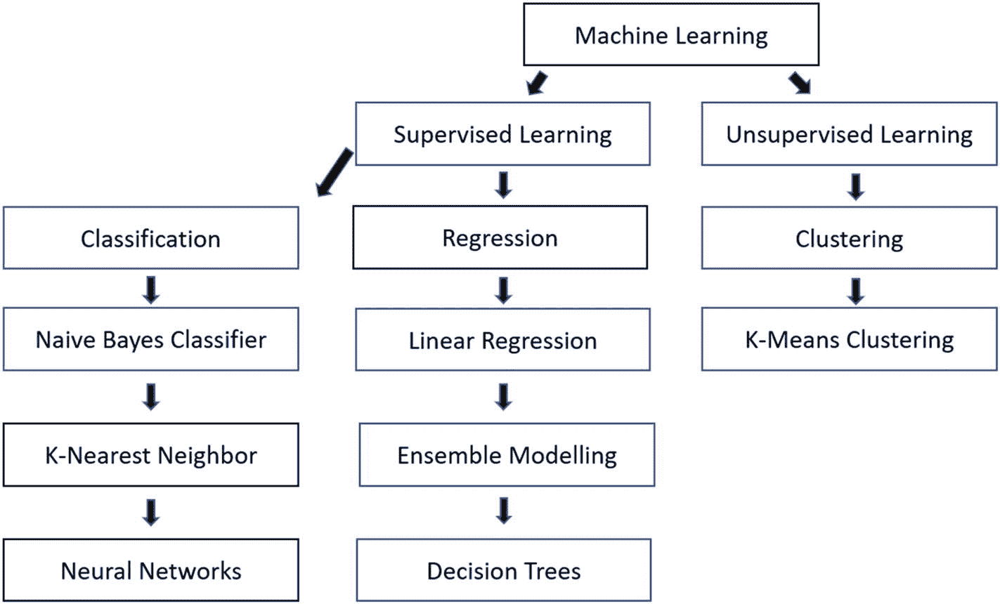

图 3-3.

机器学习算法的通用框架

## 朴素贝叶斯分类器（监督学习/分类）

在本章前面，我们学习了贝叶斯定理。在机器学习领域，它被改进为一种称为朴素贝叶斯分类器的算法。之所以称为“朴素”，是因为它假设变量之间相互独立——即一个变量的出现与其他变量无关。诚然，这看起来像是一个缺点。但事实上，朴素贝叶斯分类器已被证明开发速度快且相当有效。

还有一个需要注意的假设：先验假设。该假设指出，如果数据发生了变化，预测结果将会出错。

朴素贝叶斯分类器有三种变体：

*   *伯努利模型*：适用于二元数据（真/假、是/否）。

*   *多项模型*：适用于离散数据，例如一本书的页数。

*   *高斯模型*：适用于符合正态分布的数据。

朴素贝叶斯分类器的一个常见用例是文本分析。例如电子邮件垃圾邮件检测、客户细分、情感分析、医疗诊断和天气预报。原因在于，这种方法有助于根据关键特征和模式对数据进行分类。

为了了解其工作原理，我们来看一个例子：假设你运营一个电子商务网站，拥有一个庞大的客户交易数据库。你想了解产品评论评分、折扣和一年中的时间等变量如何影响销售。

表 3-2 展示了该数据集。

表 3-2.

客户交易数据集

| 折扣 | 产品评论 | 购买 |
| --- | --- | --- |
| 是 | 高 | 是 |
| 是 | 低 | 是 |
| 否 | 低 | 否 |
| 否 | 低 | 否 |
| 否 | 低 | 否 |
| 否 | 高 | 是 |
| 是 | 高 | 否 |
| 是 | 低 | 是 |
| 否 | 高 | 是 |
| 是 | 高 | 是 |
| 否 | 高 | 否 |
| 否 | 低 | 是 |
| 是 | 高 | 是 |
| 是 | 低 | 否 |

然后，你将把这些数据整理成频率表，如表 3-3 和 3-4 所示。

表 3-3.

折扣频率表

| 折扣 | 购买：是 | 购买：否 |
| --- | --- | --- |
| 是 | 19 | 1 |
| 否 | 5 | 5 |

表 3-4.

产品评论频率表

| 产品评论 | 购买：是 | 购买：否 | 总计 |
| --- | --- | --- | --- |
| 高 | 21 | 2 | 11 |
| 低 | 3 | 4 | 8 |
| **总计** | 24 | 6 | 19 |

观察这些表格时，我们将“购买”称为事件，将“折扣”和“产品评论”称为自变量。然后，我们可以为其中一个自变量（例如产品评论）制作一个概率表。见表 3-5。

表 3-5.

产品评论概率表

|       | 购买 |       |
|-------|------|-------|
| 是    | 否   |       |
| **产品评论** | **高** | 9/24 | 2/6  | 11/30 |
| **低**       | 7/24 | 1/6  | 8/30  |
|       | 24/30 | 6/30 |       |

使用此图表，我们可以看到，当产品评论较低时，购买的概率是 `7/24`，即 `29%`。换句话说，朴素贝叶斯分类器允许在数据集内进行更细粒度的预测。它也比较容易训练，并且可以很好地处理小数据集。

## K-近邻算法（监督学习/分类）

K-近邻算法（`k-NN`）是一种对数据集进行分类的方法（`k` 代表邻居的数量）。其理论是，那些彼此接近的值很可能是模型的好预测因子。可以将其理解为“物以类聚，人以群分”。

`k-NN` 的一个用例是信用评分，它基于收入、还款历史、地点、房屋所有权等多种因素。该算法会将数据集划分为不同的客户群体。然后，当有新的客户加入时，你可以看到他/她属于哪个群体——这将是其信用评分。

`K-NN` 实际上计算起来很简单。事实上，它被称为惰性学习，因为不需要对数据进行训练过程。

要使用 `k-NN`，你需要计算最近值之间的距离。如果值是数值型的，可以基于欧几里得距离，这涉及复杂的数学计算。或者，如果有分类数据，则可以使用重叠度量（即数据相同或非常相似的情况）。

接下来，你需要确定邻居的数量。虽然拥有更多邻居会使模型更平滑，但也可能意味着需要大量的计算资源。为了管理这一点，你可以为更接近其邻居的数据分配更高的权重。

## 线性回归（监督学习/回归）

线性回归展示了某些变量之间的关系。该方程——假设有足够高质量的数据——可以帮助根据输入预测结果。

示例：假设我们有关于为考试而学习的小时数和成绩的数据。见表 3-6。

表 3-6.

学习时间与成绩图表

| 学习小时数 | 成绩百分比 |
|-----------|-----------|
| 1         | 0.75      |
| 1         | 0.69      |
| 1         | 0.71      |
| 3         | 0.82      |
| 3         | 0.83      |
| 4         | 0.86      |
| 5         | 0.85      |
| 5         | 0.89      |
| 5         | 0.84      |
| 6         | 0.91      |
| 6         | 0.92      |
| 7         | 0.95      |

如你所见，总体关系是正向的（这描述了更高分数与更多学习时间相关的趋势）。使用回归算法，我们可以绘制一条最佳拟合线（这是通过使用一种称为“最小二乘法”的计算来完成的，该方法可以最小化误差）。见图 3-4。

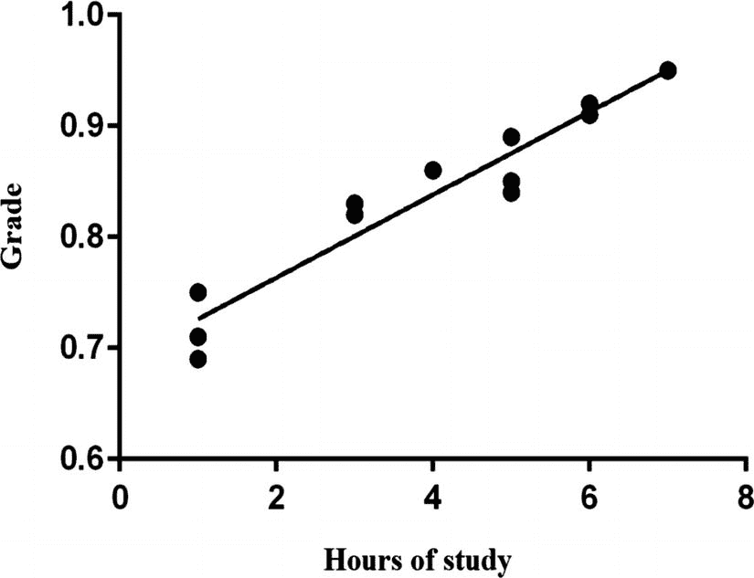

图 3-4.

这是一个基于学习时间的线性回归模型图

由此，我们得到以下方程：

`成绩 = 学习小时数 × 0.03731 + 0.6889`

那么，假设你为考试学习了 `4` 个小时。你的预估成绩会是多少？该方程告诉我们如何计算：

`0.838 = 4 × 0.03731 + 0.6889`

这个结果有多准确？为了帮助回答这个问题，我们可以使用一种称为 R 平方的计算方法。在我们的例子中，它是 `0.9180`（范围从 `0` 到 `1`）。该值越接近 `1`，拟合度越好。所以 `0.9180` 是相当高的。这意味着学习时间可以解释考试成绩的 `91.8%`。

诚然，这个模型过于简单。为了更好地反映现实，你可以添加更多变量来解释考试成绩——比如学生的出勤率。这样做时，你将使用一种称为多元回归的方法。

### 注意

如果某个变量的系数非常小，那么最好将其排除在模型之外。

有时数据也可能不是直线分布的，在这种情况下，回归算法将不起作用。但你可以使用一个更复杂的版本，称为多项式回归。

## 决策树（监督学习/回归）

毫无疑问，聚类可能不适用于某些数据集。但好消息是，还有其他替代方案，例如决策树。这种方法通常对非数值数据效果更好。

决策树的起点是根节点，位于流程图的顶部。从这里开始，会形成一条由决策路径组成的树，这些路径被称为分裂点。在这些节点上，你将使用算法做出决策，并计算出相应的概率。树的末端是叶节点（即结果）。

在机器学习领域，一个著名的例子是使用决策树来预测泰坦尼克号沉没事件中的生存情况。该模型根据三个特征预测乘客的生存概率：性别、年龄以及随行的配偶或子女人数（`sibsp`）。如图 3-5 所示。

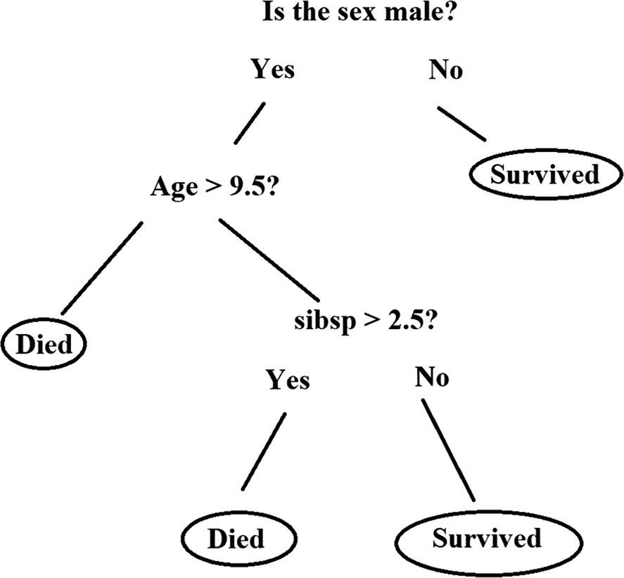

图 3-5.

这是一个用于预测泰坦尼克号生存情况的基本决策树算法

决策树有明显的优势。它们易于理解，适用于大型数据集，并且模型具有透明性。

然而，决策树也有缺点。其一是错误传播。如果某个分裂点出错，这个错误可能会级联影响到模型的其余部分！

其次，随着决策树的增长，由于涉及大量算法，复杂性也会增加。这最终可能导致模型性能下降。

## 集成建模（监督学习/回归）

集成建模意味着使用多个模型来进行预测。尽管这会增加复杂性，但事实证明这种方法能产生强大的结果。

要了解其实际应用，可以看看始于 `2006` 年的“Netflix Prize”竞赛。该公司宣布，将向任何能将电影推荐系统准确率提升 `10%`或以上的个人或团队支付 `100` 万美元。Netflix 还提供了一个数据集，包含来自 `480,189` 名用户对 `17,770` 部电影的超过 `1` 亿条评分。^(⁵¹) 最终，该数据集被下载超过 `30,000` 次。

Netflix 为何要这样做？一个主要原因是公司自己的工程师在改进方面遇到了困难。那么，为什么不把问题交给大众来解决呢？事实证明这非常巧妙——与潜在收益相比，`100` 万美元的奖金其实相当适中。

这场竞赛确实激发了从学生到 AT&T 等公司员工在内的众多程序员和数据科学家的热情。

Netflix 还简化了竞赛规则。主要要求是参赛团队必须公开他们的方法，这有助于提升整体成果（甚至还有一个显示团队排名的仪表板）。

但直到 `2009` 年，一个名为 BellKor's Pragmatic Chaos 的团队才赢得了大奖。当然，这中间也遇到了相当大的挑战。

那么，获胜团队是如何成功的呢？第一步是创建一个基线模型，以平滑处理数据中的棘手问题。例如，有些电影只有寥寥几条评分，而另一些则有数千条。此外，还有一个棘手的问题：有些用户总是给电影打一星。为了处理这些问题，BellKor 团队使用机器学习来预测评分，以填补数据空缺。

基线模型完成后，还有更多艰巨的挑战需要应对，例如：

*   系统可能会向许多用户推荐相同的电影。

*   有些电影可能难以归入特定类型。例如，《异形》实际上是科幻和恐怖的混合体。

*   有些电影，比如《拿破仑炸药》，被证明极难被算法理解。

*   电影的评分往往会随时间变化。

获胜团队使用了集成建模，其中包含了数百种算法。他们还使用了一种称为提升（boosting）的方法，即构建连续的模型。通过这种方法，算法中的权重会根据前一个模型的结果进行调整，从而随着时间的推移使预测效果越来越好（另一种方法称为装袋（bagging），即并行构建不同的模型，然后选择最佳的一个）。

最终，BellKor 团队找到了解决方案。然而，尽管如此，Netflix 并没有使用这个模型！原因尚不清楚。也许是因为 Netflix 当时正在逐渐放弃五星评分系统，而更专注于流媒体服务。此外，这场竞赛也引发了部分人的反弹，他们认为可能存在隐私侵犯问题。

无论如何，这场竞赛确实凸显了机器学习的力量——以及协作的重要性。

## K-Means 聚类（无监督/聚类）

K-Means 聚类算法对于大型数据集非常有效，它能够将相似的未标记数据归入不同的组别。第一步是选择 `k`，即簇的数量。为了帮助确定这个值，你可以对数据进行可视化，观察是否存在明显的分组区域。

图 3-6 展示了一些示例数据：

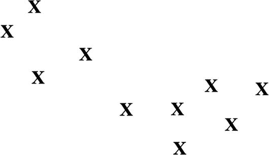

图 3-6.

数据集的初始绘图

在这个例子中，我们假设会有两个簇，这意味着也会有两个质心。质心是一个簇的中点。我们将随机分配每个质心，如图 3-7 所示。

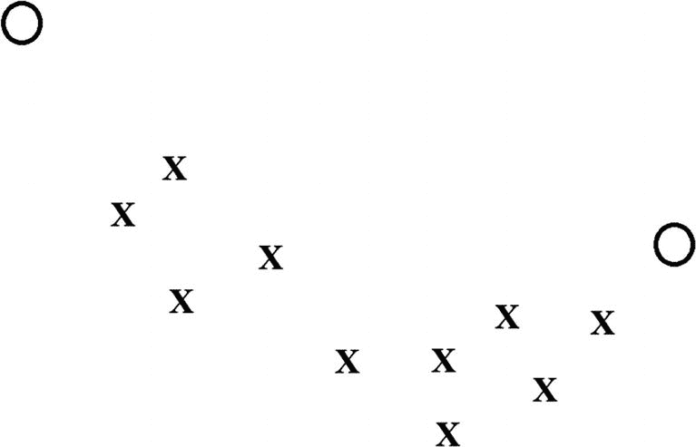

图 3-7.

此图显示了两个随机放置的质心（用圆圈表示）

如你所见，左上角的质心看起来偏差很大，但右侧的那个质心位置更好。然后，K-Means 算法会计算质心的平均距离，并改变它们的位置。这个过程会不断迭代，直到误差变得相当小——这个点被称为收敛，如图 3-8 所示。

## K-Means 算法的讨论

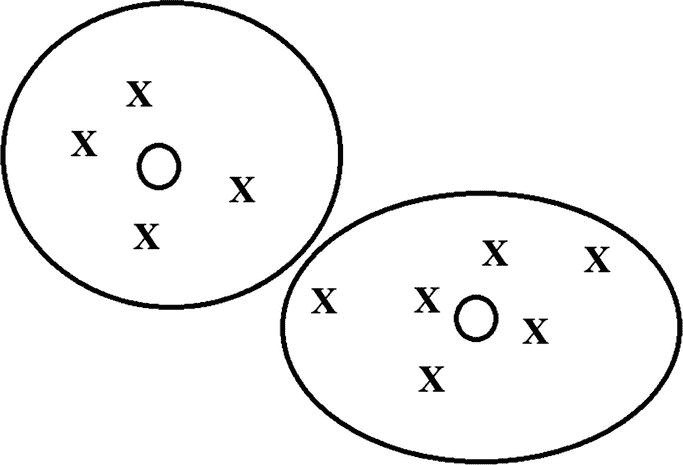

图 3-8.
通过迭代，`K-Means` 算法在数据分组方面表现越来越好

诚然，这是一个简单的示例。但当然，对于复杂的数据集，很难确定初始簇的数量。在这种情况下，你可以尝试不同的 `k` 值，然后测量平均距离。通过多次执行此操作，结果应该会更准确。

那么，为什么不直接使用一个较大的 `k` 值呢？你当然可以这样做。但是，当你计算平均值时，你会发现只会带来微小的改进。因此，一种方法是在这种改进开始出现时就停止。如图 3-9 所示。

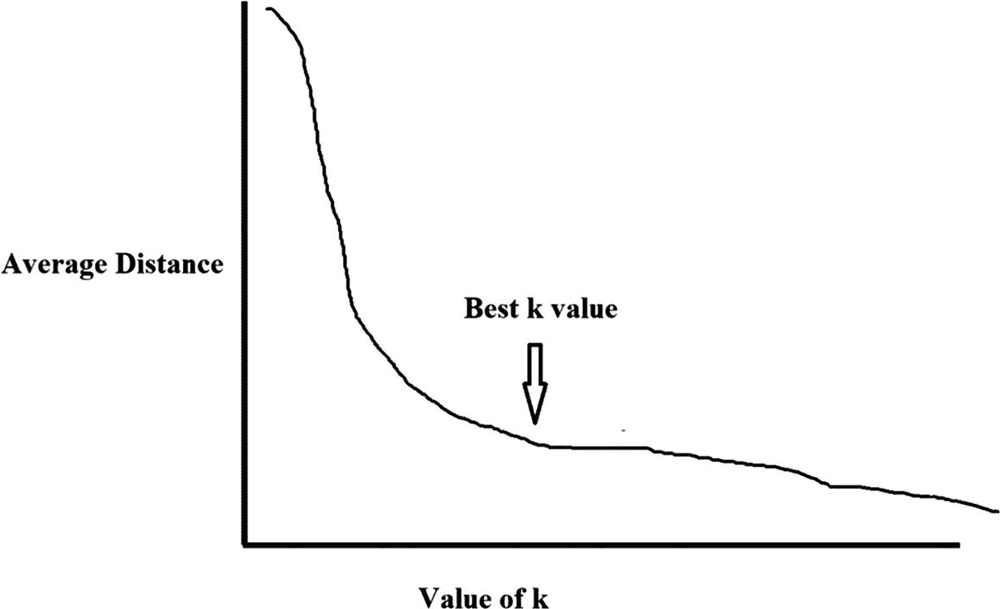

图 3-9.
此图显示了 `K-Means` 算法中 `k` 值的最优点

然而，`K-Means` 也有其缺点。例如，它不适用于非球形数据，如图 3-10 所示的情况。

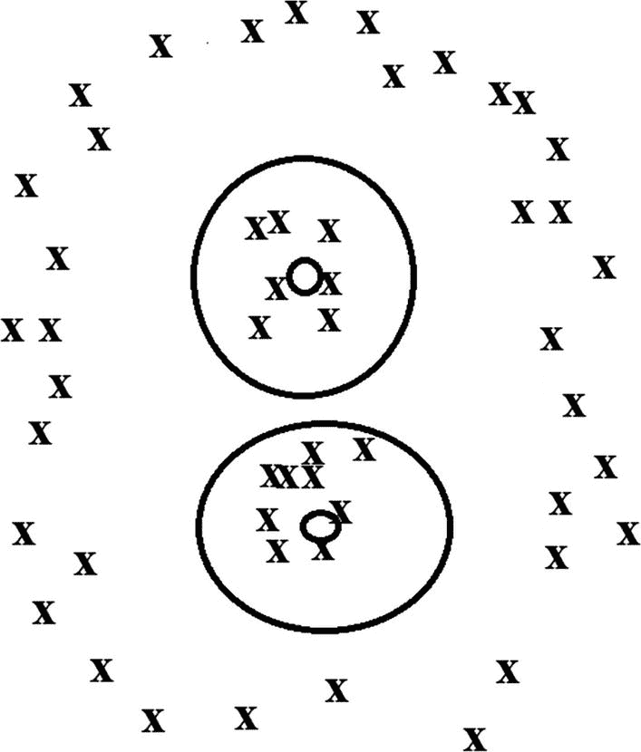

图 3-10.
这里演示了 `K-Means` 不适用于非球形数据的情况

在这种情况下，即使数据存在某种模式，`K-Means` 算法也可能无法识别出周围的数据。但有一些算法可以提供帮助，例如 `DBScan`（基于密度的含噪声应用空间聚类），它旨在处理大小差异很大的混合数据集。不过，`DBScan` 可能需要大量的计算能力。

接下来，还有一种情况是某些簇包含大量数据，而其他簇包含少量数据。可能会发生什么？`K-Means` 算法有可能无法识别出数据稀疏的簇。如图 3-11 所示的情况。

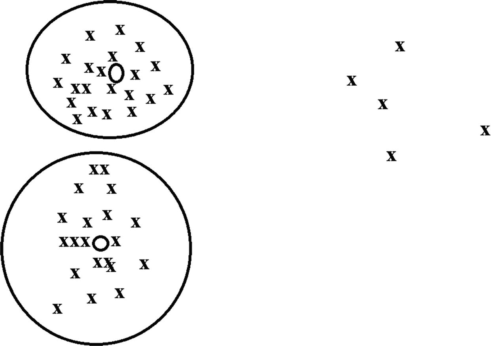

图 3-11.
如果存在数据稀疏的区域，`K-Means` 算法可能无法识别它们

## 结论

这些算法可能很复杂，并且确实需要扎实的技术技能。但重要的是不要过度陷入技术细节中。毕竟，重点是找到使用机器学习来实现明确目标的方法。

再次强调，Stitch Fix 是获取这方面指导的一个好地方。在《哈佛商业评论》11 月刊中，该公司的首席算法官埃里克·科尔森发表了一篇文章，题为“好奇心驱动的数据科学”。^(⁵²) 在文章中，他分享了自己在创建数据驱动型组织方面的经验。

其核心是允许数据科学家探索新的想法、概念和方法。这导致了人工智能在业务核心功能中的实施，如库存管理、关系管理、物流和商品采购。这具有变革性，使组织更加敏捷和精简。科尔森还认为，这提供了“一道抵御竞争的屏障”。

他的文章还为数据分析提供了其他有用的建议：

-   *数据科学家*：他们不应隶属于其他部门。相反，他们应该拥有自己的部门，直接向 CEO 汇报。这有助于专注于关键优先事项，并全面了解组织的需求。
-   *实验*：当数据科学家有新想法时，应该在一小部分客户样本上进行测试。如果效果良好，则可以推广到其余客户群体。
-   *资源*：数据科学家需要完全访问数据和工具。还应该提供持续的培训。
-   *通才*：招聘跨领域的数据科学家，如建模、机器学习和分析（科尔森称这些人为“全栈数据科学家”）。这有助于组建小型团队——这些团队通常更高效、更有生产力。
-   *文化*：科尔森寻找的价值观包括“在实践中学习、适应模糊性、平衡长期与短期回报”。

## 核心要点

-   机器学习，其根源可追溯至 20 世纪 50 年代，是指计算机无需显式编程即可学习。相反，它会利用复杂的统计技术来摄取和处理数据。
-   异常值是指数据集中远超出其余数值范围的数据点。
-   标准差衡量的是数据与平均值的平均距离。
-   正态分布——其形状像一口钟——表示一个变量的概率总和。
-   贝叶斯定理是一种复杂的统计技术，能提供对概率更深入的洞察。
-   真正例是指模型做出了正确的预测。而假正例则是指模型预测结果显示为真，但实际并非如此。
-   皮尔逊相关系数显示了两个变量之间关系的强度，其取值范围在 1 到-1 之间。
-   特征提取或特征工程描述了为模型选择变量的过程。这至关重要，因为即使一个错误的变量也可能对结果产生重大影响。
-   训练数据用于在算法中创建关系。而测试数据则用于评估模型。
-   监督学习使用标记数据来创建模型，而无监督学习则不使用。此外还有半监督学习，它混合使用了这两种方法。
-   强化学习是一种通过奖励准确预测、惩罚不准确预测来训练模型的方法。
-   `k-近邻算法`是一种基于“数值相近的值是模型良好预测因子”这一概念的算法。
-   线性回归用于估计某些变量之间的关系。`R 平方值`将指示这种关系的强度。
-   决策树是一种基于“是/否”决策工作流的模型。
-   集成模型使用多个模型来进行预测。
-   `k-均值聚类算法`将相似的无标签数据归入不同的组别。

```脚注 1   2   3   4   5   6   7   8   9   10   11   12   13   14   15   16   17
```